> Fully revised teaching manuscript exported from the delivered reader. Native display equations use @eq; complete matrices use @matrix JSON. Figures are editable SVGs. The build uses the original source manuscripts plus beginner-content.json as its canonical teaching records; edit those records to persist changes, then rebuild and export again.

# MATH 2255 - Linear Algebra Made Understandable

A Complete Beginner-to-University-Level Self-Study Textbook Based on the Supplied Lakehead University Course Material

**Prepared for independent learning from first principles.**

This book explains the ten supplied sections: 1.1-1.5, 1.7-1.9, and 2.1-2.2. Chapter 0 supplies the prerequisite arithmetic, algebra, notation, and reasoning. Section 1.6 was not supplied and has not been inserted. Original teaching examples and prerequisite explanations are additions by the author; source examples carry PDF page references.

- The companion Exercise Workbook contains the supplied exercise pages and numbered worked solutions.

- Answers developed here are independently derived teaching solutions.

- Where a matching selected solution appears in the supplied course PDF, the workbook records that cross-check.

- Neither document claims to be an instructor-issued answer key.

# Contents

Use the chapter navigation or [Explore Topics](#topics) to open any chapter.

# How to use this book independently

You may open any chapter. If a symbol or an algebraic step is unfamiliar, use Chapter 0 or the glossary. The course section appears in each chapter title so that you can move between this book and your slides without guessing where a topic belongs. There is no timetable or required study duration.

- Read a worked example as a chain of decisions.

- Before looking at a calculation, identify what the question asks: a solution, an existence decision, a span test, an independence test, an image, a standard matrix, or an inverse.

- These requests may use the same row-reduction calculation but require different concluding sentences.

- Every significant row operation in the worked reductions is followed by the complete updated matrix.

- Read its rows as equations.

- The explanations name the unknowns, identify free choices, and verify the answer in the original data.

- A calculation is useful only when you can explain what it establishes.

End-of-chapter questions have worked answers in the practice-solutions chapter. The companion workbook supplies course-based practice; the questions in this textbook are original foundation and transfer practice unless explicitly labeled as a course example. You can cover an answer with a sheet of paper, attempt the question, then compare your reasoning. This is optional self-study, not a progress system.

- **Conventions.** All computations here use real numbers and column vectors unless stated otherwise.

- A vector written (a,b,c) in a sentence represents the column with those entries.

- A superscript T means transpose.

- A superscript -1 on a matrix means inverse, not entrywise reciprocal.

- A vertical divider in a matrix separates coefficients from appended right-hand sides.

- It is not an extra column.

- All parameters are real unless a problem says otherwise.

- **The two questions to keep separate.** Existence asks whether a solution is possible.

- Uniqueness asks whether two different solutions are possible.

- Decide existence first.

- An inconsistent system cannot have a unique solution, and the presence of a free coefficient variable does not repair a contradiction.

# 0. Mathematical foundations

- This chapter is supplementary prerequisite teaching.

- It is included because the supplied linear algebra assumes these skills.

- None of it adds a later course topic.

## 0.1 Numbers, variables, and signs

SEE THE IDEA

### A sign can name a position or an operation

Start with positions, then read what the operation asks you to do.

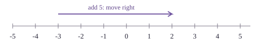

−3 + 5 = 2. Negative positions and subtraction are different uses of the minus sign.

**Remember.** Subtracting a negative means adding its opposite: 4 − (−5) = 9.

A number can describe an amount, a position, or a change. On a number line, 3 is three units to the right of 0 and -3 is three units to the left. The minus sign can name a negative number, as in -3, or describe subtraction, as in 5 - 3. In -(-3), the outer minus asks for the opposite of -3, giving 3.

- A variable is a symbol whose value is being discussed.

- In

@eq 2x + 3 = 11

, x is unknown;

- in

@eq y = 2x + 3

, x may be an input and y the corresponding output.

- The same letter need not play the same role in every problem.

- State what your unknowns represent before calculating an application.

- Multiplication by a positive number preserves direction on the number line.

- Multiplication by a negative number reverses direction.

- Thus

@eq (-2)(3) = -6, (-2)(-3) = 6

, and

@eq 2(-3) = -6

- The rule for two negatives follows from distributivity:

@eq 0 = (-2)(3 + (-3)) = -6 + (-2)(-3)

- so the last product must be 6.

- Subtraction means adding the opposite.

- For example,

@eq 4 - (-5) = 4 + 5 = 9

- but

@eq -4 - 5 = -9

- Parentheses are essential in row operations: if an entry is -5 and you subtract twice a row whose corresponding entry is -3, the new entry is

@eq -5 - 2(-3) = 1

- **Worked arithmetic.** Evaluate -3 + 2(-4) - (-5).

- Multiplication comes first:

@eq 2(-4) = -8

- Replace subtracting -5 by adding 5.

- The result is

@eq -3 - 8 + 5 = -6

- Do not turn the entire expression positive because it contains two minus signs;

- only the particular subtraction of a negative changes to addition.

## 0.2 Fractions and exact arithmetic

SEE THE IDEA

### Keep the pieces the same size

Before adding fractions, rename them using the same denominator.

- `1/2` = `3/6`

- `1/3` = `2/6`

- `3/6` + `2/6` = `5/6`

@eq (-3/4) + (5/6) = (-9/12) + (10/12) = 1/12

**Remember.** Add numerators after denominators match. Keep exact fractions during elimination.

- The fraction a/b means a divided by b, with b nonzero.

- Equivalent fractions are formed by multiplying or dividing both numerator and denominator by the same nonzero number.

- Thus

@eq 6/9 = 2/3

- The fraction `-2/3` equals 2/(-3),

- but (-2)/(-3) equals `2/3`.

- To add fractions, express them with a common denominator.

- For `1/2` + `1/3`, use sixths:

@eq 3/6 + 2/6 = 5/6

- Adding the denominators would produce `2/5`, which is a different number.

- For `-3/4` + `5/6`, use twelfths:

@eq -9/12 + 10/12 = 1/12

- Multiply numerators together and denominators together:

@eq (2/3)(-9/4) = -18/12 = -3/2

- Cancel common factors before multiplying if helpful: 9 divided by 3 is 3, and 2 divided by 4 is `1/2`.

- Cancellation applies to factors, not arbitrary terms in a sum.

- You cannot cancel the 2 in (2 + 3)/2 to obtain 1 + 3.

- Dividing by a nonzero fraction means multiplying by its reciprocal.

- Hence

@eq (3/5)/(2/7) = (3/5)(7/2) = 21/10

- Division by 0 is never allowed.

- If a row has pivot -3, multiplying the row by `-1/3` changes that pivot to 1;

- every entry of the row must receive the same multiplier.

- **Worked row arithmetic.** If

@eq R₁ = [2, -3, 5]

and

@eq R₂ = [1, 1/2, -2]

, then `R₂` ← `R₂` - (`1/2`)`R₁` gives

@eq [1 - 1, 1/2 + 3/2, -2 - 5/2] = [0, 2, -9/2]

- The fraction is exact.

- A rounded decimal such as -4.5 is harmless here,

- but fractions prevent rounding errors from accumulating in longer calculations.

## 0.3 Expressions, equality, and solving an equation

SEE THE IDEA

### An equation is a balance

Apply the same reversible operation to both sides.

- 3x − 2 = 10

- Add 2: 3x = 12

- Divide by 3: x = 4

- Check: 3(4) − 2 = 10

**Remember.** A subscript labels an entry; a power multiplies a quantity by itself.

- An expression such as 3x - 2 has a value after x is chosen.

- An equation such as

@eq 3x - 2 = 10

asserts that two expressions have equal values.

- A solution is a choice that makes the assertion true.

- Checking

@eq x = 4

gives

@eq 3(4) - 2 = 10

- so 4 is a solution.

- Checking

@eq x = 2

gives 4 rather than 10,

- so 2 is not.

- Use the order: grouping, powers, multiplication and division from left to right, then addition and subtraction from left to right.

- For 2 + 3(4 - 1)^2, first obtain

@eq 4 - 1 = 3

, then

@eq 3^2 = 9

, then

@eq 3·9 = 27

, then

@eq 2 + 27 = 29

- A subscript such as `x₂` is a label;

- it is not a power and does not mean x squared.

- Distributivity says

@eq a(b + c) = ab +

ac.

- In -2(x - 3), distribute the negative multiplier to both terms: -2x + 6.

- Combining like terms gives

@eq 3x + 2x = 5x

- but 3x + 2y cannot be combined unless x and y are known to be equal.

- To solve an equation, preserve its truth by performing the same reversible action on both sides.

- Starting with

@eq 3x - 2 = 10

, add 2 to both sides to get

@eq 3x = 12

- divide both sides by 3 to get

@eq x = 4

- The phrase 'move -2 to the other side' abbreviates adding 2 to both sides.

- It is not a separate rule that lets terms cross an equals sign without a reason.

- **Worked fraction equation.** Solve

@eq x/3 - 2 = 5/6

- Add

@eq 2 = 12/6

to both sides:

@eq x/3 = 17/6

- Multiply both sides by 3:

@eq x = 17/2

- Check:

@eq (17/2)/3 - 2 = 17/6 - 12/6 = 5/6

- The check uses the original equation and therefore catches a sign error made during rearrangement.

- Two warnings matter later.

- Multiplying an equation by zero loses information:

@eq x = 4

would become

@eq 0 = 0

, which is true for every x.

- Dividing by a variable may discard solutions if that variable could be zero.

- Row scaling therefore uses a known nonzero number, and parameter problems require a separate case when a potential pivot becomes zero.

## 0.4 Substitution and simultaneous equations

SEE THE IDEA

### A system means “all at once”

One pair must make every original equation true.

| Candidate | x + y = 5 | x − y = 1 |
| --- | --- | --- |
| (3,2) | 3 + 2 = 5 ✓ | 3 − 2 = 1 ✓ |
| (1,4) | 1 + 4 = 5 ✓ | 1 − 4 = −3 ✗ |

**Remember.** Checking only one equation is insufficient.

- Substitution means replacing a symbol by its stated value or expression wherever that symbol occurs.

- If

@eq x = 2t - 1

, then 3x + 4 becomes

@eq 3(2t - 1) + 4 = 6t + 1

- Keep parentheses around the replacement until you have distributed correctly.

- A system asks you to satisfy several equations at the same time.

- Consider

@eq x + y = 5

and

@eq x - y = 1

- Adding the equations gives

@eq 2x = 6

- so

@eq x = 3

- Substitute into the first equation:

@eq 3 + y = 5

- hence

@eq y = 2

- Both original equations check:

@eq 3 + 2 = 5

and

@eq 3 - 2 = 1

- Satisfying only the first equation would be insufficient;

- (1,4) fails the second.

- If the system instead says

@eq x + y = 5

and

@eq x + y = 7

, subtracting the first equation from the second gives

@eq 0 = 2

- This cannot be true,

- so no pair works.

- If the second equation is

@eq 2x + 2y = 10

, it repeats the first equation.

- Every pair (5 - t,t) works, because

@eq (5 - t) + t = 5

- A repeated equation supplies no new restriction.

## 0.5 Coordinates and lines

SEE THE IDEA

### A solution is a shared point

The graphs visualize the same “all equations at once” requirement.

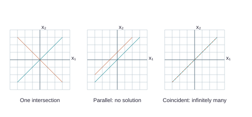

Intersecting lines have one common point; parallel distinct lines have none; coincident lines have infinitely many.

The horizontal axis is the `x₁`-axis and the vertical axis is the `x₂`-axis. Their intersection is the origin (0,0). An ordered pair (a,b) means move a units horizontally, then b units vertically. The order matters: (2,-1) and (-1,2) are different points. Three coordinates locate a point in three-dimensional space.

- The graph of an equation is the set of all points satisfying it.

- For

@eq x₂ = 2x₁ + 1

, choosing

@eq x₁ = 0,1,2

gives points (0,1), (1,3), (2,5).

- The line passes through all of them.

- Its slope 2 means a horizontal change of 1 produces a vertical change of 2.

- A vertical line such as

@eq x₁ = 3

cannot be written as `x₂` = m`x₁` + c,

- but it is still a linear equation.

- An equation a`x₁` + bx

@eq ₂ = c

with at least one of a,b nonzero describes a line in the plane.

- Two such lines can intersect once, be distinct and parallel, or coincide.

- Those pictures correspond to one solution, no solutions, and infinitely many solutions of a two-equation system.

- Equations in three variables normally describe planes;

- the common solution must lie in all the specified planes.

Intersecting lines have one common point; parallel distinct lines have none; coincident lines have infinitely many.

The diagrams show the three possibilities for two genuine lines in the plane. A system with more equations still demands a point common to every graph, not merely an intersection of two selected graphs.

## 0.6 Reading mathematical language

SEE THE IDEA

### Read the logical direction

“If” and “if and only if” ask for different arguments.

| Notation | Meaning | Proof needed |
| --- | --- | --- |
| P ⇒ Q | P guarantees Q | One direction |
| P ⇔ Q | Each guarantees the other | Both directions |
| ∅ versus {0} | No members versus one zero member | Different sets |

- The symbol ℝ names the real numbers.

- The statement

@eq t ∈ ℝ

means t is a real number.

- A set is a collection of objects;

- braces list its members.

- The empty set, ∅, has no members.

- The set {0} contains one member, zero,

- so it is different from ∅.

- In linear algebra, the zero in {0} may be a vector, whose size is determined by the context.

- The statement

@eq P ⇒ Q

means 'if P is true, then Q is true.' It does not automatically assert the reverse.

- The statement

@eq P ⇔ Q

means both directions: P implies Q and Q implies P.

- It is read 'P if and only if Q.' To prove an equivalence, explain both directions or give a chain of already established equivalences.

- A universal statement says something about every allowed object.

- For instance, 'every homogeneous system has a solution' includes systems of every permitted size.

- One numerical example cannot prove it.

- The vector

@eq x = 0

supplies a solution for an arbitrary matrix A, which is a general argument.

- A false universal statement can be disproved by a single counterexample satisfying its assumptions and violating its conclusion.

- A theorem is a mathematical statement proved from definitions and accepted earlier results.

- Its assumptions matter. 'A consistent system with a free variable has infinitely many solutions' includes the assumption of consistency.

- Omitting that assumption makes the statement false.

- A proof is a chain of justified statements that begins with the assumptions and ends with the desired conclusion.

- An intuitive picture helps explain a theorem,

- but a proof must cover every case covered by its wording.

- Sigma notation is a compact way to add indexed terms.

- The expression Σ from

@eq j=1

to n of `a_j` `x_j` means `a₁``x₁` + `a₂``x₂` + ... + `a_n` `x_n`.

- The index j runs through the indicated labels.

- No new operation is involved.

- We use expanded sums whenever they make a new idea easier to read.

## 0.7 Foundation practice

TRY IT YOURSELF · F1

**F1.** Evaluate -2(3 - 5) + `1/2` - `5/6` exactly.

**Show Detailed Solution · F1**

**F1.**

#### Work inside the parentheses first

@eq 3 - 5 = -2

The minus sign means move five units left from 3. The result is negative.

#### Multiply by the outside −2

@eq (-2)(-2) = 4

A negative times a negative is positive. The outside −2 multiplies the entire parenthesis.

#### Give the fractions a common denominator

@eq 1/2 = 3/6

@eq 1/2 - 5/6 = 3/6 - 5/6 = -2/6 = -1/3

Sixths have the same size, so subtract their numerators. Divide numerator and denominator by 2 to simplify.

#### Combine the integer and the fraction

@eq 4 - 1/3 = 12/3 - 1/3 = 11/3

FINAL ANSWER

@eq 11/3

TRY IT YOURSELF · F2

**F2.** Solve 2(x - 3)/5 = 4 and verify your answer.

**Show Detailed Solution · F2**

**F2.**

#### Start with the given equation

@eq 2(x - 3)/5 = 4

The fraction applies to all of 2(x − 3), not just to the 3.

#### Undo division by 5

@eq 5(2(x - 3)/5) = 5(4)

@eq 2(x - 3) = 20

Multiply both sides by the same nonzero number to preserve equality.

#### Undo multiplication by 2

@eq 2(x - 3)/2 = 20/2

@eq x - 3 = 10

#### Undo subtraction of 3

@eq x - 3 + 3 = 10 + 3

@eq x = 13

#### Check in the original equation

@eq 2(13 - 3)/5 = 2(10)/5 = 20/5 = 4

FINAL ANSWER

@eq x = 13

TRY IT YOURSELF · F3

**F3.** Solve x + 2y = 7 and 3x - y = 7. Explain why both equations must be checked.

**Show Detailed Solution · F3**

**F3 and S11.**

**F3 and S11.** The same system appears twice so that you can compare the substitution and matrix methods. Here is the complete matrix solution; the answer must satisfy both original equations.

- Each coefficient column corresponds to one unknown;

- the column after the vertical divider records the right-hand sides.

- We use reversible row operations to reveal the constraints.

The starting matrix is:

@matrix {"a": [["1", "2", "7"], ["3", "-1", "7"]], "bar": 2}

**Step 1: `R_2` ← `R_2` + (-3)`R_1`.** Add -3 times row 1 to row 2. This cancels the entry in the pivot column while preserving the solutions. All other rows stay as displayed.

Before

@matrix {"a": [["1", "2", "7"], ["3", "-1", "7"]], "bar": 2}

After

@matrix {"a": [["1", "2", "7"], ["0", "-7", "-14"]], "bar": 2}

Lavender: affected row. Sage: pivot used.

#### Calculate every entry in the changed row

Multiply each entry of old row 1 by -3, then add it to the matching entry of old row 2. The other row is retained.

Row 2, column 1

@eq 3 + (-3)(1) = 3 - 3 = 0

Row 2, column 2

@eq -1 + (-3)(2) = -1 - 6 = -7

Row 2, column 3 (right-hand side)

@eq 7 + (-3)(7) = 7 - 21 = -14

**Step 2: `R_2` ← (`-1/7`)`R_2`.** Multiply every entry of row 2, including any right-hand side, by `-1/7`. The pivot becomes 1; the multiplier is nonzero, so this step is reversible.

Before

@matrix {"a": [["1", "2", "7"], ["0", "-7", "-14"]], "bar": 2}

After

@matrix {"a": [["1", "2", "7"], ["0", "1", "2"]], "bar": 2}

Lavender: affected row. Sage: pivot used.

#### Calculate every entry in the changed row

Multiply every entry of old row 2 by `-1/7`. This includes the constant column when one is present. The multiplier is nonzero, so division by it undoes the step.

Row 2, column 1

@eq (-1/7)(0) = 0/7 = 0

Row 2, column 2

@eq (-1/7)(-7) = 7/7 = 1

Row 2, column 3 (right-hand side)

@eq (-1/7)(-14) = 14/7 = 2

**Step 3: `R_1` ← `R_1` + (-2)`R_2`.** Add -2 times row 2 to row 1. This cancels the entry in the pivot column while preserving the solutions. All other rows stay as displayed.

Before

@matrix {"a": [["1", "2", "7"], ["0", "1", "2"]], "bar": 2}

After

@matrix {"a": [["1", "0", "3"], ["0", "1", "2"]], "bar": 2}

Lavender: affected row. Sage: pivot used.

#### Calculate every entry in the changed row

Multiply each entry of old row 2 by -2, then add it to the matching entry of old row 1. The other row is retained.

Row 1, column 1

@eq 1 + (-2)(0) = 1 + 0 = 1

Row 1, column 2

@eq 2 + (-2)(1) = 2 - 2 = 0

Row 1, column 3 (right-hand side)

@eq 7 + (-2)(2) = 7 - 4 = 3

- **Read the equations.**

@eq x_1 = 3

- @eq x_2 = 2

- Every unknown is basic,

- so no arbitrary choices remain.

- There is exactly one solution:

@matrix {"a": [["3"], ["2"]], "bar": null}

**Verification in the original equations.** For p, the left-hand sides A p are:

@matrix {"a": [["7"], ["7"]], "bar": null}

These entries equal the original right-hand sides, in order.

#### What does the reduced matrix say?

@matrix {"a": [["1", "0", "3"], ["0", "1", "2"]], "bar": 2}

There are 2 equations and 2 unknown weights or coordinates. The divider separates the constants from those unknowns.

#### Separate determined coordinates from free choices

| Coordinate | Look at its column | What you may do |
| --- | --- | --- |
| `x_1` | Pivot column → basic | Determined by its pivot equation |
| `x_2` | Pivot column → basic | Determined by its pivot equation |

#### Determine x1 from its row

@eq x_1 = 3

@eq x_1 = 3

Subtract each free-variable term from both sides. The pivot coefficient is 1, so no further division is needed.

#### Determine x2 from its row

@eq x_2 = 2

@eq x_2 = 2

Subtract each free-variable term from both sides. The pivot coefficient is 1, so no further division is needed.

#### Verify the starting point in every original equation

@eq (1)(3) + (2)(2) = 3 + 4 = 7

@eq (3)(3) + (-1)(2) = 9 - 2 = 7

FINAL ANSWER

@eq x = [3;2]

Every coordinate is fixed. There are no free choices, so the solution is unique.

TRY IT YOURSELF · F4

**F4.** Explain the difference between `x₂` and `x^2`, and between 'there exists a solution' and 'there exists exactly one solution.'

**Show Detailed Solution · F4**

**F4.**

#### A subscript is a label

@eq x_2

This means the unknown labeled 2. It does not tell you to multiply x by 2 or square it.

#### A superscript can be a power

@eq x^2 = x x

This means multiply x by itself. If x = 3, the result is 9.

#### Existence and uniqueness ask different questions

| Question | What must be true |
| --- | --- |
| Does a solution exist? | At least one input satisfies every equation. |
| Is the solution unique? | One input works, and no different input works. |

A whole line of solutions has many inputs, so existence holds but uniqueness fails.

FINAL ANSWER

A label and a power have different meanings. Having a solution and having exactly one solution are different claims.

TRY IT YOURSELF · F5

**F5.** Disprove: 'If two equations have one common solution, they have the same solution set.' Supply actual equations and explain their different sets.

**Show Detailed Solution · F5**

**F5.**

#### Choose equations with one shared point

@eq x + y = 1

@eq x - y = 1

#### Check the shared point (1,0)

@eq 1 + 0 = 1

@eq 1 - 0 = 1

It satisfies both equations.

#### Find a point that belongs to only one equation

@eq 0 + 1 = 1

@eq 0 - 1 = -1

The point (0,1) satisfies the first equation and fails the second. The two solution sets therefore differ.

FINAL ANSWER

The statement is false. One shared point does not mean two sets contain exactly the same points.

Worked answers appear in Chapter 12.

# 1. Section 1.1 - Systems of linear equations

Source correspondence: Combined PDF pages 1-11; exercise PDF pages 1-2. This chapter expands the lecture definitions and the two principal elimination examples.

## 1.1 What makes an equation linear?

SEE THE IDEA

### Linear means no interaction between unknowns

Unknowns occur only to the first power, multiplied by fixed coefficients.

| Linear | Not linear in x,y | Reason |
| --- | --- | --- |
| 2x − 3y = 7 | xy = 7 | Product of unknowns |
| x + y = 1 | `x²` + y = 1 | An unknown is squared |
| 0x + y = 2 | 1/x + y = 2 | An unknown is in a denominator |

- The equation

@eq 2x₁ - 3x₂ + x₃ = 7

gives a weighted sum of unknown entries.

- The numbers 2,-3,1 are coefficients; 7 is the constant on the right.

- A missing variable has coefficient 0.

- The general form is `a₁``x₁` + ...

@eq + a_n x_n = b

, where the coefficients and b are fixed numbers.

- The unknowns appear to the first power and are not multiplied together.

- Thus

@eq x₁ + 2x₂ = 3

is linear;

- @eq x₁x₂ = 3, x₁^2 + x₂ = 1

, and

@eq 1/x₁ + x₂ = 4

are not linear equations in these variables.

- A coefficient can be a fraction or a square root if it is a fixed number.

- The restriction concerns how the unknowns enter, not how simple the known coefficients look.

- A solution is a list of numbers in the variable order that makes every equation true.

- The solution set contains every such list.

- Two systems are equivalent when their solution sets are identical.

- A consistent system has at least one solution;

- an inconsistent one has none.

- A linear system over ℝ has zero, one, or infinitely many solutions.

- It cannot have exactly two: if p and q are distinct solutions, linearity shows that p + t(q - p) is a solution for every real t.

## 1.2 Matrices record the equations without changing them

SEE THE IDEA

### A matrix is a tidy record of equations

Each row records one equation. Coefficient columns keep the same variable order.

@eq x_1 + 2x_2 = 7

@eq 3x_1 - x_2 = 7

@matrix {"a": [["1", "2", "7"], ["3", "-1", "7"]], "bar": 3}

2 rows = 2 equations; 2 coefficient columns = 2 unknowns; last column = constants.

- A matrix is a rectangular array.

- Its size is rows × columns, with rows first.

- The coefficient matrix records the coefficients in a fixed variable order.

- The augmented matrix appends the constants.

- For the lecture system, the coefficient rows are `[1,-2,1]`, `[0,2,-8]`, `[-4,5,9]`, and the constants are `[0,8,-9]`.

- The 0 at the start of the second row means the equation has no `x₁` term.

- It is needed to keep the other coefficients in their correct columns.

- The coefficient matrix has size 3 × 3.

- The augmented matrix has size 3 × 4.

- The four columns do not mean four unknowns: one column contains the constants.

- In every substantial reduction below, a vertical line marks that distinction.

## 1.3 Why row operations preserve solutions

SEE THE IDEA

### A legal row operation has an undo

Changing equations preserves their solutions when the change can be reversed.

| Operation | Undo |
| --- | --- |
| `R₂` ← `R₂` − 3`R₁` | `R₂` ← `R₂` + 3`R₁` |
| `R₁` ← 2`R₁` | `R₁` ← (`1/2`)`R₁` |
| `R₁` ↔ `R₂` | Swap again |
| `R₁` ← 0`R₁` | No undo: information was erased |

- Three elementary operations are allowed.

- Interchange two rows.

- Multiply one row by a nonzero scalar.

- Replace one row by itself plus a multiple of a different row.

- The notation `R₃` ← `R₃` + 4`R₁` means compute four times every entry of row 1, add those entries to row 3, and put the results into row 3.

- The arrow describes replacement, not an equation between row numbers.

- Interchanging equations changes only their order.

- Scaling by

@eq c ≠ 0

is reversible by scaling by 1/c.

- Replacing equation `E₃` by `E₃` + 4`E₁` is reversible by subtracting 4`E₁`.

- If a list satisfies the original equations, it satisfies the replacement;

- if it satisfies the new equations, reversal shows it satisfies the original ones.

- This explains preservation in both directions.

- Scaling by 0 is not an elementary operation.

- Replacing `R₃` by `R₃` + 4`R₁` must change the appended constant as well as every coefficient.

- Performing unrelated column operations generally changes which variable combinations are being represented and is not the solving method used here.

## 1.4 Complete lecture example: systematic elimination

SEE THE IDEA

### Eliminate one target at a time

Follow the verified matrix states below. The highlighted pivot supplies the row used to change another row.

- Locate a nonzero pivot

- Clear a target entry

- Read the updated constraints

- Work back to the unknowns

**Remember.** Use Next Step for focus, or Show All Steps for the full calculation.

- Solve

@eq x₁ - 2x₂ + x₃ = 0, 2x₂ - 8x₃ = 8

, and -4`x₁` + 5`x₂` + 9`x₃` = -9 (Combined PDF pages 4-8).

- We choose pivots from left to right, eliminate below them, then clear above.

- Our intermediate order may differ from the slides,

- but each reversible operation solves the same system.

- Each coefficient column corresponds to one unknown;

- the column after the vertical divider records the right-hand sides.

- We use reversible row operations to reveal the constraints.

The starting matrix is:

@matrix {"a": [["1", "-2", "1", "0"], ["0", "2", "-8", "8"], ["-4", "5", "9", "-9"]], "bar": 3}

**Step 1: `R_3` ← `R_3` + (4)`R_1`.** Add 4 times row 1 to row 3. This cancels the entry in the pivot column while preserving the solutions. All other rows stay as displayed.

Before

@matrix {"a": [["1", "-2", "1", "0"], ["0", "2", "-8", "8"], ["-4", "5", "9", "-9"]], "bar": 3}

After

@matrix {"a": [["1", "-2", "1", "0"], ["0", "2", "-8", "8"], ["0", "-3", "13", "-9"]], "bar": 3}

Lavender: affected row. Sage: pivot used.

#### Calculate every entry in the changed row

Multiply each entry of old row 1 by 4, then add it to the matching entry of old row 3. The other row is retained.

Row 3, column 1

@eq -4 + (4)(1) = -4 + 4 = 0

Row 3, column 2

@eq 5 + (4)(-2) = 5 - 8 = -3

Row 3, column 3

@eq 9 + (4)(1) = 9 + 4 = 13

Row 3, column 4 (right-hand side)

@eq -9 + (4)(0) = -9 + 0 = -9

**Step 2: `R_2` ← (`1/2`)`R_2`.** Multiply every entry of row 2, including any right-hand side, by `1/2`. The pivot becomes 1; the multiplier is nonzero, so this step is reversible.

Before

@matrix {"a": [["1", "-2", "1", "0"], ["0", "2", "-8", "8"], ["0", "-3", "13", "-9"]], "bar": 3}

After

@matrix {"a": [["1", "-2", "1", "0"], ["0", "1", "-4", "4"], ["0", "-3", "13", "-9"]], "bar": 3}

Lavender: affected row. Sage: pivot used.

#### Calculate every entry in the changed row

Multiply every entry of old row 2 by `1/2`. This includes the constant column when one is present. The multiplier is nonzero, so division by it undoes the step.

Row 2, column 1

@eq (1/2)(0) = 0/2 = 0

Row 2, column 2

@eq (1/2)(2) = 2/2 = 1

Row 2, column 3

@eq (1/2)(-8) = -8/2 = -4

Row 2, column 4 (right-hand side)

@eq (1/2)(8) = 8/2 = 4

**Step 3: `R_3` ← `R_3` + (3)`R_2`.** Add 3 times row 2 to row 3. This cancels the entry in the pivot column while preserving the solutions. All other rows stay as displayed.

Before

@matrix {"a": [["1", "-2", "1", "0"], ["0", "1", "-4", "4"], ["0", "-3", "13", "-9"]], "bar": 3}

After

@matrix {"a": [["1", "-2", "1", "0"], ["0", "1", "-4", "4"], ["0", "0", "1", "3"]], "bar": 3}

Lavender: affected row. Sage: pivot used.

#### Calculate every entry in the changed row

Multiply each entry of old row 2 by 3, then add it to the matching entry of old row 3. The other row is retained.

Row 3, column 1

@eq 0 + (3)(0) = 0 + 0 = 0

Row 3, column 2

@eq -3 + (3)(1) = -3 + 3 = 0

Row 3, column 3

@eq 13 + (3)(-4) = 13 - 12 = 1

Row 3, column 4 (right-hand side)

@eq -9 + (3)(4) = -9 + 12 = 3

**Step 4: `R_1` ← `R_1` + (-1)`R_3`.** Add -1 times row 3 to row 1. This cancels the entry in the pivot column while preserving the solutions. All other rows stay as displayed.

Before

@matrix {"a": [["1", "-2", "1", "0"], ["0", "1", "-4", "4"], ["0", "0", "1", "3"]], "bar": 3}

After

@matrix {"a": [["1", "-2", "0", "-3"], ["0", "1", "-4", "4"], ["0", "0", "1", "3"]], "bar": 3}

Lavender: affected row. Sage: pivot used.

#### Calculate every entry in the changed row

Multiply each entry of old row 3 by -1, then add it to the matching entry of old row 1. The other row is retained.

Row 1, column 1

@eq 1 + (-1)(0) = 1 + 0 = 1

Row 1, column 2

@eq -2 + (-1)(0) = -2 + 0 = -2

Row 1, column 3

@eq 1 + (-1)(1) = 1 - 1 = 0

Row 1, column 4 (right-hand side)

@eq 0 + (-1)(3) = 0 - 3 = -3

**Step 5: `R_2` ← `R_2` + (4)`R_3`.** Add 4 times row 3 to row 2. This cancels the entry in the pivot column while preserving the solutions. All other rows stay as displayed.

Before

@matrix {"a": [["1", "-2", "0", "-3"], ["0", "1", "-4", "4"], ["0", "0", "1", "3"]], "bar": 3}

After

@matrix {"a": [["1", "-2", "0", "-3"], ["0", "1", "0", "16"], ["0", "0", "1", "3"]], "bar": 3}

Lavender: affected row. Sage: pivot used.

#### Calculate every entry in the changed row

Multiply each entry of old row 3 by 4, then add it to the matching entry of old row 2. The other row is retained.

Row 2, column 1

@eq 0 + (4)(0) = 0 + 0 = 0

Row 2, column 2

@eq 1 + (4)(0) = 1 + 0 = 1

Row 2, column 3

@eq -4 + (4)(1) = -4 + 4 = 0

Row 2, column 4 (right-hand side)

@eq 4 + (4)(3) = 4 + 12 = 16

**Step 6: `R_1` ← `R_1` + (2)`R_2`.** Add 2 times row 2 to row 1. This cancels the entry in the pivot column while preserving the solutions. All other rows stay as displayed.

Before

@matrix {"a": [["1", "-2", "0", "-3"], ["0", "1", "0", "16"], ["0", "0", "1", "3"]], "bar": 3}

After

@matrix {"a": [["1", "0", "0", "29"], ["0", "1", "0", "16"], ["0", "0", "1", "3"]], "bar": 3}

Lavender: affected row. Sage: pivot used.

#### Calculate every entry in the changed row

Multiply each entry of old row 2 by 2, then add it to the matching entry of old row 1. The other row is retained.

Row 1, column 1

@eq 1 + (2)(0) = 1 + 0 = 1

Row 1, column 2

@eq -2 + (2)(1) = -2 + 2 = 0

Row 1, column 3

@eq 0 + (2)(0) = 0 + 0 = 0

Row 1, column 4 (right-hand side)

@eq -3 + (2)(16) = -3 + 32 = 29

- **Read the equations.**

@eq x_1 = 29

- @eq x_2 = 16

- @eq x_3 = 3

- Every unknown is basic,

- so no arbitrary choices remain.

- There is exactly one solution:

@matrix {"a": [["29"], ["16"], ["3"]], "bar": null}

**Verification in the original equations.** For p, the left-hand sides A p are:

@matrix {"a": [["0"], ["8"], ["-9"]], "bar": null}

These entries equal the original right-hand sides, in order.

- The unique answer (29,16,3) satisfies

@eq 29 - 32 + 3 = 0, 32 - 24 = 8

, and

@eq -116 + 80 + 27 = -9

- The matrix method did not introduce an approximation.

- It rearranged the original information until the unknown values could be read directly.

## 1.5 A contradiction ends the existence question

SEE THE IDEA

### An impossible row ends the search

No choice of unknowns can make zero equal a nonzero number.

@matrix {"a": [["0", "0", "0", "1"]], "bar": 3}

0 = 1: impossible; no solution.

@matrix {"a": [["0", "0", "0", "0"]], "bar": 3}

0 = 0: always true; adds no restriction.

- For the lecture system on pages 9-11, the equations are

@eq x₂ - 4x₃ = 8, 2x₁ - 3x₂ + 2x₃ = 1

, and

@eq 5x₁ - 8x₂ + 7x₃ = 1

- An impossible row will establish that there is no common solution.

- We display a full reduction here;

- when solving an existence-only question by hand, you may stop as soon as a contradiction appears.

- Each coefficient column corresponds to one unknown;

- the column after the vertical divider records the right-hand sides.

- We use reversible row operations to reveal the constraints.

The starting matrix is:

@matrix {"a": [["0", "1", "-4", "8"], ["2", "-3", "2", "1"], ["5", "-8", "7", "1"]], "bar": 3}

**Step 1: `R_1` ↔ `R_2`.** Move a nonzero entry into row 1 so that it can be used as a pivot.

Before

@matrix {"a": [["0", "1", "-4", "8"], ["2", "-3", "2", "1"], ["5", "-8", "7", "1"]], "bar": 3}

After

@matrix {"a": [["2", "-3", "2", "1"], ["0", "1", "-4", "8"], ["5", "-8", "7", "1"]], "bar": 3}

Lavender: affected rows. Sage: pivot used.

#### What changes in this swap?

Row 1 takes the complete contents of old row 2. Row 2 takes the complete contents of old row 1. No entry is multiplied or added; we only exchange the two equations.

**Step 2: `R_1` ← (`1/2`)`R_1`.** Multiply every entry of row 1, including any right-hand side, by `1/2`. The pivot becomes 1; the multiplier is nonzero, so this step is reversible.

Before

@matrix {"a": [["2", "-3", "2", "1"], ["0", "1", "-4", "8"], ["5", "-8", "7", "1"]], "bar": 3}

After

@matrix {"a": [["1", "-3/2", "1", "1/2"], ["0", "1", "-4", "8"], ["5", "-8", "7", "1"]], "bar": 3}

Lavender: affected row. Sage: pivot used.

#### Calculate every entry in the changed row

Multiply every entry of old row 1 by `1/2`. This includes the constant column when one is present. The multiplier is nonzero, so division by it undoes the step.

Row 1, column 1

@eq (1/2)(2) = 2/2 = 1

Row 1, column 2

@eq (1/2)(-3) = -3/2 = -3/2

Row 1, column 3

@eq (1/2)(2) = 2/2 = 1

Row 1, column 4 (right-hand side)

@eq (1/2)(1) = 1/2 = 1/2

**Step 3: `R_3` ← `R_3` + (-5)`R_1`.** Add -5 times row 1 to row 3. This cancels the entry in the pivot column while preserving the solutions. All other rows stay as displayed.

Before

@matrix {"a": [["1", "-3/2", "1", "1/2"], ["0", "1", "-4", "8"], ["5", "-8", "7", "1"]], "bar": 3}

After

@matrix {"a": [["1", "-3/2", "1", "1/2"], ["0", "1", "-4", "8"], ["0", "-1/2", "2", "-3/2"]], "bar": 3}

Lavender: affected row. Sage: pivot used.

#### Calculate every entry in the changed row

Multiply each entry of old row 1 by -5, then add it to the matching entry of old row 3. The other row is retained.

Row 3, column 1

@eq 5 + (-5)(1) = 5 - 5 = 0

Row 3, column 2

@eq -8 + (-5)(-3/2) = -8 + 15/2 = -1/2

Row 3, column 3

@eq 7 + (-5)(1) = 7 - 5 = 2

Row 3, column 4 (right-hand side)

@eq 1 + (-5)(1/2) = 1 - 5/2 = -3/2

**Step 4: `R_3` ← `R_3` + (`1/2`)`R_2`.** Add `1/2` times row 2 to row 3. This cancels the entry in the pivot column while preserving the solutions. All other rows stay as displayed.

Before

@matrix {"a": [["1", "-3/2", "1", "1/2"], ["0", "1", "-4", "8"], ["0", "-1/2", "2", "-3/2"]], "bar": 3}

After

@matrix {"a": [["1", "-3/2", "1", "1/2"], ["0", "1", "-4", "8"], ["0", "0", "0", "5/2"]], "bar": 3}

Lavender: affected row. Sage: pivot used.

#### Calculate every entry in the changed row

Multiply each entry of old row 2 by `1/2`, then add it to the matching entry of old row 3. The other row is retained.

Row 3, column 1

@eq 0 + (1/2)(0) = 0 + 0 = 0

Row 3, column 2

@eq -1/2 + (1/2)(1) = -1/2 + 1/2 = 0

Row 3, column 3

@eq 2 + (1/2)(-4) = 2 - 2 = 0

Row 3, column 4 (right-hand side)

@eq -3/2 + (1/2)(8) = -3/2 + 4 = 5/2

**Step 5: `R_3` ← (`2/5`)`R_3`.** Multiply every entry of row 3, including any right-hand side, by `2/5`. The pivot becomes 1; the multiplier is nonzero, so this step is reversible.

Before

@matrix {"a": [["1", "-3/2", "1", "1/2"], ["0", "1", "-4", "8"], ["0", "0", "0", "5/2"]], "bar": 3}

After

@matrix {"a": [["1", "-3/2", "1", "1/2"], ["0", "1", "-4", "8"], ["0", "0", "0", "1"]], "bar": 3}

Lavender: affected row. Sage: pivot used.

#### Calculate every entry in the changed row

Multiply every entry of old row 3 by `2/5`. This includes the constant column when one is present. The multiplier is nonzero, so division by it undoes the step.

Row 3, column 1

@eq (2/5)(0) = 0/5 = 0

Row 3, column 2

@eq (2/5)(0) = 0/5 = 0

Row 3, column 3

@eq (2/5)(0) = 0/5 = 0

Row 3, column 4 (right-hand side)

@eq (2/5)(5/2) = 10/10 = 1

**Step 6: `R_1` ← `R_1` + (`-1/2`)`R_3`.** Add `-1/2` times row 3 to row 1. This cancels the entry in the pivot column while preserving the solutions. All other rows stay as displayed.

Before

@matrix {"a": [["1", "-3/2", "1", "1/2"], ["0", "1", "-4", "8"], ["0", "0", "0", "1"]], "bar": 3}

After

@matrix {"a": [["1", "-3/2", "1", "0"], ["0", "1", "-4", "8"], ["0", "0", "0", "1"]], "bar": 3}

Lavender: affected row. Sage: pivot used.

#### Calculate every entry in the changed row

Multiply each entry of old row 3 by `-1/2`, then add it to the matching entry of old row 1. The other row is retained.

Row 1, column 1

@eq 1 + (-1/2)(0) = 1 + 0 = 1

Row 1, column 2

@eq -3/2 + (-1/2)(0) = -3/2 + 0 = -3/2

Row 1, column 3

@eq 1 + (-1/2)(0) = 1 + 0 = 1

Row 1, column 4 (right-hand side)

@eq 1/2 + (-1/2)(1) = 1/2 - 1/2 = 0

**Step 7: `R_2` ← `R_2` + (-8)`R_3`.** Add -8 times row 3 to row 2. This cancels the entry in the pivot column while preserving the solutions. All other rows stay as displayed.

Before

@matrix {"a": [["1", "-3/2", "1", "0"], ["0", "1", "-4", "8"], ["0", "0", "0", "1"]], "bar": 3}

After

@matrix {"a": [["1", "-3/2", "1", "0"], ["0", "1", "-4", "0"], ["0", "0", "0", "1"]], "bar": 3}

Lavender: affected row. Sage: pivot used.

#### Calculate every entry in the changed row

Multiply each entry of old row 3 by -8, then add it to the matching entry of old row 2. The other row is retained.

Row 2, column 1

@eq 0 + (-8)(0) = 0 + 0 = 0

Row 2, column 2

@eq 1 + (-8)(0) = 1 + 0 = 1

Row 2, column 3

@eq -4 + (-8)(0) = -4 + 0 = -4

Row 2, column 4 (right-hand side)

@eq 8 + (-8)(1) = 8 - 8 = 0

**Step 8: `R_1` ← `R_1` + (`3/2`)`R_2`.** Add `3/2` times row 2 to row 1. This cancels the entry in the pivot column while preserving the solutions. All other rows stay as displayed.

Before

@matrix {"a": [["1", "-3/2", "1", "0"], ["0", "1", "-4", "0"], ["0", "0", "0", "1"]], "bar": 3}

After

@matrix {"a": [["1", "0", "-5", "0"], ["0", "1", "-4", "0"], ["0", "0", "0", "1"]], "bar": 3}

Lavender: affected row. Sage: pivot used.

#### Calculate every entry in the changed row

Multiply each entry of old row 2 by `3/2`, then add it to the matching entry of old row 1. The other row is retained.

Row 1, column 1

@eq 1 + (3/2)(0) = 1 + 0 = 1

Row 1, column 2

@eq -3/2 + (3/2)(1) = -3/2 + 3/2 = 0

Row 1, column 3

@eq 1 + (3/2)(-4) = 1 - 6 = -5

Row 1, column 4 (right-hand side)

@eq 0 + (3/2)(0) = 0 + 0 = 0

- A row now states

@eq 0 = 1

- No choices of the unknowns can make that true.

- The system is inconsistent, and its solution set is empty.

- Free-looking coefficient columns cannot remove a contradiction.

- A row of zeros on the left with a nonzero right-hand side is an impossible equation.

- A completely zero row instead represents

@eq 0 = 0

- that row is always true.

- Confusing these two rows reverses the consistency decision.

## 1.6 Choosing a method and writing the conclusion

SEE THE IDEA

### Decide before doing extra arithmetic

The wording tells you whether you need a decision, one input, or the full set.

| Asked for | Stop when you have |
| --- | --- |
| Consistency | A contradiction or a valid existence argument |
| Unique solution | Consistency and no free variables |
| Solve completely | Every unknown described, including all parameters |

- Gaussian elimination means using row operations to reach a staircase arrangement, then substituting backward.

- Gauss-Jordan elimination continues until each pivot is 1 and its column is otherwise zero.

- Both methods preserve the solution set.

- The latter makes parameters especially easy to read.

- If the question asks whether a solution exists, a consistent echelon form is enough.

- If it asks to solve, provide every solution, including arbitrary parameters when appropriate.

- If it asks for an intersection, give the point or describe the common set in the original coordinate language.

- If it asks to verify, substitute into the original equations;

- merely repeating a reduction is not the same check.

- **Common mistakes.** Keeping only equations that are easy to satisfy can lose a contradiction.

- Forgetting a zero coefficient shifts columns.

- Adding rows without replacing a specified row makes the next step ambiguous.

- Multiplying one entry instead of the whole row changes the equations incorrectly.

- Always write the chosen operation and then the entire updated matrix.

## 1.7 Practice

TRY IT YOURSELF · S11

**S11.** Solve `x₁` + 2`x₂` = 7 and 3`x₁` - `x₂` = 7 using an augmented matrix.

**Show Detailed Solution · S11**

**F3 and S11.**

**F3 and S11.** The same system appears twice so that you can compare the substitution and matrix methods. Here is the complete matrix solution; the answer must satisfy both original equations.

- Each coefficient column corresponds to one unknown;

- the column after the vertical divider records the right-hand sides.

- We use reversible row operations to reveal the constraints.

The starting matrix is:

@matrix {"a": [["1", "2", "7"], ["3", "-1", "7"]], "bar": 2}

**Step 1: `R_2` ← `R_2` + (-3)`R_1`.** Add -3 times row 1 to row 2. This cancels the entry in the pivot column while preserving the solutions. All other rows stay as displayed.

Before

@matrix {"a": [["1", "2", "7"], ["3", "-1", "7"]], "bar": 2}

After

@matrix {"a": [["1", "2", "7"], ["0", "-7", "-14"]], "bar": 2}

Lavender: affected row. Sage: pivot used.

#### Calculate every entry in the changed row

Multiply each entry of old row 1 by -3, then add it to the matching entry of old row 2. The other row is retained.

Row 2, column 1

@eq 3 + (-3)(1) = 3 - 3 = 0

Row 2, column 2

@eq -1 + (-3)(2) = -1 - 6 = -7

Row 2, column 3 (right-hand side)

@eq 7 + (-3)(7) = 7 - 21 = -14

**Step 2: `R_2` ← (`-1/7`)`R_2`.** Multiply every entry of row 2, including any right-hand side, by `-1/7`. The pivot becomes 1; the multiplier is nonzero, so this step is reversible.

Before

@matrix {"a": [["1", "2", "7"], ["0", "-7", "-14"]], "bar": 2}

After

@matrix {"a": [["1", "2", "7"], ["0", "1", "2"]], "bar": 2}

Lavender: affected row. Sage: pivot used.

#### Calculate every entry in the changed row

Multiply every entry of old row 2 by `-1/7`. This includes the constant column when one is present. The multiplier is nonzero, so division by it undoes the step.

Row 2, column 1

@eq (-1/7)(0) = 0/7 = 0

Row 2, column 2

@eq (-1/7)(-7) = 7/7 = 1

Row 2, column 3 (right-hand side)

@eq (-1/7)(-14) = 14/7 = 2

**Step 3: `R_1` ← `R_1` + (-2)`R_2`.** Add -2 times row 2 to row 1. This cancels the entry in the pivot column while preserving the solutions. All other rows stay as displayed.

Before

@matrix {"a": [["1", "2", "7"], ["0", "1", "2"]], "bar": 2}

After

@matrix {"a": [["1", "0", "3"], ["0", "1", "2"]], "bar": 2}

Lavender: affected row. Sage: pivot used.

#### Calculate every entry in the changed row

Multiply each entry of old row 2 by -2, then add it to the matching entry of old row 1. The other row is retained.

Row 1, column 1

@eq 1 + (-2)(0) = 1 + 0 = 1

Row 1, column 2

@eq 2 + (-2)(1) = 2 - 2 = 0

Row 1, column 3 (right-hand side)

@eq 7 + (-2)(2) = 7 - 4 = 3

- **Read the equations.**

@eq x_1 = 3

- @eq x_2 = 2

- Every unknown is basic,

- so no arbitrary choices remain.

- There is exactly one solution:

@matrix {"a": [["3"], ["2"]], "bar": null}

**Verification in the original equations.** For p, the left-hand sides A p are:

@matrix {"a": [["7"], ["7"]], "bar": null}

These entries equal the original right-hand sides, in order.

#### What does the reduced matrix say?

@matrix {"a": [["1", "0", "3"], ["0", "1", "2"]], "bar": 2}

There are 2 equations and 2 unknown weights or coordinates. The divider separates the constants from those unknowns.

#### Separate determined coordinates from free choices

| Coordinate | Look at its column | What you may do |
| --- | --- | --- |
| `x_1` | Pivot column → basic | Determined by its pivot equation |
| `x_2` | Pivot column → basic | Determined by its pivot equation |

#### Determine x1 from its row

@eq x_1 = 3

@eq x_1 = 3

Subtract each free-variable term from both sides. The pivot coefficient is 1, so no further division is needed.

#### Determine x2 from its row

@eq x_2 = 2

@eq x_2 = 2

Subtract each free-variable term from both sides. The pivot coefficient is 1, so no further division is needed.

#### Verify the starting point in every original equation

@eq (1)(3) + (2)(2) = 3 + 4 = 7

@eq (3)(3) + (-1)(2) = 9 - 2 = 7

FINAL ANSWER

@eq x = [3;2]

Every coordinate is fixed. There are no free choices, so the solution is unique.

TRY IT YOURSELF · S12

**S12.** Classify the systems `x₁` + `x₂` = 2, 2`x₁` + 2`x₂` = 5 and `x₁` + `x₂` = 2, 2`x₁` + 2`x₂` = 4. Give complete solution sets.

**Show Detailed Solution · S12**

**S12, first system.**

#### First system: write its augmented matrix

@matrix {"a": [["1", "1", "2"], ["2", "2", "5"]], "bar": 2}

@eq R_2 ← R_2 - 2R_1

#### Calculate the new second row

@eq 2 - 2(1) = 0

@eq 2 - 2(1) = 0

@eq 5 - 2(2) = 1

It says 0 = 1. No input can satisfy this.

#### Second system: the constant is 4 instead

@matrix {"a": [["1", "1", "2"], ["2", "2", "4"]], "bar": 2}

@eq 4 - 2(2) = 0

The second row is now 0 = 0. It imposes no restriction, so only `x₁` + `x₂` = 2 remains.

#### Describe every solution of the second system

@eq x_2 = t

@eq x_1 = 2 - t

@eq (2-t) + t = 2

Any real t works. Conversely, choosing `x₂` forces exactly this value of `x₁`.

FINAL ANSWER

First system: no solution.

@eq x = [2-t;t]

Second system: the displayed vector for every real t.

TRY IT YOURSELF · S13

**S13.** Explain why replacing `R₂` by `R₂` - 3`R₁` is reversible, but multiplying `R₂` by 0 is not.

**Show Detailed Solution · S13**

**S13.**

#### Keep row 1 and change row 2

@eq R_2 ← R_2 - 3R_1

Subtract three copies of row 1 from the old row 2.

#### Undo that change

@eq (R_2 - 3R_1) + 3R_1 = R_2

Adding back the same three copies recovers the original row.

#### Compare multiplication by zero

@eq 0[1,2] = [0,0]

@eq 0[7,-3] = [0,0]

Different rows become the same zero row. Nothing in that zero row tells you which original row to recover.

FINAL ANSWER

Adding a multiple of a retained different row is reversible. Multiplying a row by zero is not.

# 2. Section 1.2 - Row reduction and echelon forms

Source correspondence: Combined PDF pages 12-27; exercise PDF pages 3-4.

## 2.1 The staircase and the pivots

SEE THE IDEA

### 1 · What is a leading entry?

Read a row from left to right. Skip the zeros. The first number that remains is its leading entry.

@matrix {"a": [["0", "0", "-3", "6"]], "bar": null}

First nonzero entry: −3.

@matrix {"a": [["0", "4", "1", "2"]], "bar": null}

First nonzero entry: 4.

The leading entry of a nonzero row is its first nonzero entry when read from left to right.

SEE THE IDEA

### 2 · REF: build a staircase

Look down the rows: each next leading entry takes a step to the right.

@matrix {"a": [["2", "4", "6"], ["0", "3", "9"], ["0", "0", "0"]], "bar": null}

Leading entries are highlighted. The zero row is at the bottom.

| REF check | What to look for |
| --- | --- |
| Zero rows last | The completely zero row is below the nonzero rows. |
| Move right | Leading entries are in columns 1, then 2. |
| Clear below | All entries below each leading entry are zero. |

A matrix is in row echelon form (REF) when all zero rows are at the bottom, each leading entry is strictly to the right of the leading entry in the row above, and every entry below a leading entry is zero. Leading entries need not be 1 in REF.

SEE THE IDEA

### 3 · RREF: finish cleaning each pivot column

REF gives the shape. RREF also normalizes each leading entry and clears above it.

#### REF, but not RREF

@matrix {"a": [["2", "4", "6"], ["0", "3", "9"], ["0", "0", "0"]], "bar": null}

Leading entries 2 and 3 are not normalized.

#### RREF of the same matrix

@matrix {"a": [["1", "0", "-3"], ["0", "1", "3"], ["0", "0", "0"]], "bar": null}

Each pivot is 1 and is alone in its column.

- Reduced row echelon form (RREF) also requires each leading entry to be 1 and each leading 1 to be the only nonzero entry of its column.

- A matrix can be REF without being RREF.

- For example, `[2,3;0,4]` is REF,

- but the leading entries are not 1.

- The notation in this sentence separates rows with a semicolon;

- displayed matrices below use full brackets.

SEE THE IDEA

### 4 · A pivot column belongs to the original matrix

Reduce to identify column numbers; then go back to those columns in the original matrix.

#### Original A

@matrix {"a": [["0", "2", "4"], ["1", "1", "3"]], "bar": null}

Original columns 1 and 2 are the pivot columns.

#### RREF(A)

@matrix {"a": [["1", "0", "1"], ["0", "1", "2"]], "bar": null}

Leading 1s identify pivot-column indices 1 and 2.

**Remember.** The original entry at position (1,1) is 0. A pivot position is a location, not a promise about that original number.

- A pivot position in A is the row-column location corresponding to a leading 1 in RREF(A).

- A pivot column is an original column containing such a position.

- The original entry at a pivot position can be zero: the position is identified through reduction.

- A pivot used during elimination is the nonzero entry currently used to cancel entries,

- so its numerical value can change with the sequence of operations.

### 5 · REF versus RREF, at a glance

| Condition | REF | RREF |
| --- | --- | --- |
| Leading entries make a staircase | Required | Required |
| Zero rows at the bottom | Required | Required |
| Zeros below each leading entry | Required | Required |
| Each leading entry equals 1 | Not required | Required |
| Zeros above every leading entry | Not required | Required |
| Unique in its row-equivalence class | No | Yes |

SEE THE IDEA

### 6 · Why can there be only one RREF?

Different legal routes can simplify the same constraints. A fully reduced matrix records those constraints in one fixed form.

@matrix {"a": [["2", "4"], ["0", "0"]], "bar": null}

One possible REF.

@matrix {"a": [["1", "2"], ["0", "0"]], "bar": null}

The unique RREF: `x₁` + 2`x₂` = 0 if read homogeneously.

- The supplied uniqueness theorem states that every matrix has exactly one RREF among its row-equivalent matrices.

- REF is not unique, because multiplying a nonzero row by 2 may preserve its staircase shape.

- The RREF conditions remove that scaling freedom and all entries above pivots.

- More deeply, row equivalence preserves all constraints, and RREF is a canonical way to record which earliest variables are determined by later ones.

- The following supplementary proof explains that uniqueness rather than trying to establish it by numerical examples.

**Deeper Mathematical Explanation · Explore the Full Proof**

SEE THE IDEA

### The proof in three connections

Follow the logical connections; each arrow needs a reason.

- Row operations preserve row span

- The row span determines pivot-column indices

- Matching pivot coordinates force corresponding rows to agree

### Why two different RREF answers cannot both be right

- We need one temporary piece of vocabulary.

- The row span of a matrix means all linear combinations of its rows, treated as horizontal lists.

- This is the same weighted-sum idea used for column vectors later in Section 1.3.

- Row operations do not change the row span.

- A new row is a combination of old rows,

- so every new-row combination is an old-row combination.

- Reversibility gives the opposite inclusion.

- Therefore row-equivalent matrices have exactly the same row span.

- Suppose R and S are two RREF matrices obtained from one matrix.

- They have the same row span.

- In an RREF matrix, take any nonzero combination of its nonzero rows, and find the first row in the combination whose weight is nonzero.

- Its leading pivot is the first nonzero coordinate of the resulting list: all earlier row weights are zero, and all later rows are zero to the left of their own later pivots.

- Consequently the possible first-nonzero coordinate locations of vectors in the row span are precisely the pivot-column indices.

- Since R and S have the same row span, they have the same pivot columns, in the same order.

- Now compare row i of R with row i of S.

- Their entries in every common pivot column agree: both have 1 at their own pivot and 0 at the other pivots.

- Their difference is in the common row span and is zero at every pivot coordinate.

- But any row combination in R has, in pivot column j, exactly the weight on the corresponding pivot row: the pivot columns are identity columns.

- If all those coordinates are zero, every row weight is zero,

- so the entire combination is zero.

- Thus the difference between the two compared rows must be zero.

- All corresponding nonzero rows agree, and both matrices place their remaining zero rows at the bottom.

- Hence

@eq R = S

- This proves uniqueness while allowing different intermediate operations and different ordinary echelon forms.

## 2.2 The forward and backward phases

SEE THE IDEA

### Two passes, two purposes

The forward phase creates the staircase; the backward phase cleans above the pivots.

#### Forward → REF

@matrix {"a": [["2", "4", "6"], ["0", "3", "9"], ["0", "0", "0"]], "bar": null}

Zeros below; leading entries move right.

#### Backward → RREF

@matrix {"a": [["1", "0", "-3"], ["0", "1", "3"], ["0", "0", "0"]], "bar": null}

Normalize and clear above.

- Start at the leftmost column containing a possible nonzero pivot.

- Interchange rows if needed.

- Use a nonzero pivot to clear entries below it.

- Move down one row and right to the next possible pivot column.

- Continue to REF.

- This is the forward phase.

- If a column has no available nonzero entry below the previous pivots, skip it;

- do not force a pivot there.

- For the backward phase, start at the rightmost pivot, scale its row to make the pivot 1, and clear entries above it.

- Continue upward and leftward.

- Normalizing a pivot earlier, as many examples here do, is also valid.

- Arithmetic convenience determines the order;

- preserving the equations determines validity.

## 2.3 Course example: pivot columns of a rectangular matrix

SEE THE IDEA

### Find indices, then return to A

This is a rectangular-matrix question, not an augmented-system question.

- All 5 columns are ordinary matrix columns

- Use the original verified reduction

- Report original pivot-column indices

**Remember.** A final column is not automatically a right-hand side.

- The matrix on Combined PDF pages 14-17 has four rows and five columns.

- It is not declared an augmented matrix in that example,

- so all five columns are ordinary matrix columns.

- Row reduction finds pivot columns without making any claim about a solution set.

The starting matrix is:

@matrix {"a": [["0", "-3", "-6", "4", "9"], ["-1", "-2", "-1", "3", "1"], ["-2", "-3", "0", "3", "-1"], ["1", "4", "5", "-9", "-7"]], "bar": null}

**Step 1: `R_1` ↔ `R_2`.** Move a nonzero entry into row 1 so that it can be used as a pivot.

Before

@matrix {"a": [["0", "-3", "-6", "4", "9"], ["-1", "-2", "-1", "3", "1"], ["-2", "-3", "0", "3", "-1"], ["1", "4", "5", "-9", "-7"]], "bar": null}

After

@matrix {"a": [["-1", "-2", "-1", "3", "1"], ["0", "-3", "-6", "4", "9"], ["-2", "-3", "0", "3", "-1"], ["1", "4", "5", "-9", "-7"]], "bar": null}

Lavender: affected rows. Sage: pivot used.

#### What changes in this swap?

Row 1 takes the complete contents of old row 2. Row 2 takes the complete contents of old row 1. No entry is multiplied or added; we only exchange the two equations.

**Step 2: `R_1` ← (-1)`R_1`.** Multiply every entry of row 1, including any right-hand side, by -1. The pivot becomes 1; the multiplier is nonzero, so this step is reversible.

Before

@matrix {"a": [["-1", "-2", "-1", "3", "1"], ["0", "-3", "-6", "4", "9"], ["-2", "-3", "0", "3", "-1"], ["1", "4", "5", "-9", "-7"]], "bar": null}

After

@matrix {"a": [["1", "2", "1", "-3", "-1"], ["0", "-3", "-6", "4", "9"], ["-2", "-3", "0", "3", "-1"], ["1", "4", "5", "-9", "-7"]], "bar": null}

Lavender: affected row. Sage: pivot used.

#### Calculate every entry in the changed row

Multiply every entry of old row 1 by -1. This includes the constant column when one is present. The multiplier is nonzero, so division by it undoes the step.

Row 1, column 1

@eq (-1)(-1) = 1/1 = 1

Row 1, column 2

@eq (-1)(-2) = 2/1 = 2

Row 1, column 3

@eq (-1)(-1) = 1/1 = 1

Row 1, column 4

@eq (-1)(3) = -3/1 = -3

Row 1, column 5

@eq (-1)(1) = -1/1 = -1

**Step 3: `R_3` ← `R_3` + (2)`R_1`.** Add 2 times row 1 to row 3. This cancels the entry in the pivot column while preserving the solutions. All other rows stay as displayed.

Before

@matrix {"a": [["1", "2", "1", "-3", "-1"], ["0", "-3", "-6", "4", "9"], ["-2", "-3", "0", "3", "-1"], ["1", "4", "5", "-9", "-7"]], "bar": null}

After

@matrix {"a": [["1", "2", "1", "-3", "-1"], ["0", "-3", "-6", "4", "9"], ["0", "1", "2", "-3", "-3"], ["1", "4", "5", "-9", "-7"]], "bar": null}

Lavender: affected row. Sage: pivot used.

#### Calculate every entry in the changed row

Multiply each entry of old row 1 by 2, then add it to the matching entry of old row 3. The other row is retained.

Row 3, column 1

@eq -2 + (2)(1) = -2 + 2 = 0

Row 3, column 2

@eq -3 + (2)(2) = -3 + 4 = 1

Row 3, column 3

@eq 0 + (2)(1) = 0 + 2 = 2

Row 3, column 4

@eq 3 + (2)(-3) = 3 - 6 = -3

Row 3, column 5

@eq -1 + (2)(-1) = -1 - 2 = -3

**Step 4: `R_4` ← `R_4` + (-1)`R_1`.** Add -1 times row 1 to row 4. This cancels the entry in the pivot column while preserving the solutions. All other rows stay as displayed.

Before

@matrix {"a": [["1", "2", "1", "-3", "-1"], ["0", "-3", "-6", "4", "9"], ["0", "1", "2", "-3", "-3"], ["1", "4", "5", "-9", "-7"]], "bar": null}

After

@matrix {"a": [["1", "2", "1", "-3", "-1"], ["0", "-3", "-6", "4", "9"], ["0", "1", "2", "-3", "-3"], ["0", "2", "4", "-6", "-6"]], "bar": null}

Lavender: affected row. Sage: pivot used.

#### Calculate every entry in the changed row

Multiply each entry of old row 1 by -1, then add it to the matching entry of old row 4. The other row is retained.

Row 4, column 1

@eq 1 + (-1)(1) = 1 - 1 = 0

Row 4, column 2

@eq 4 + (-1)(2) = 4 - 2 = 2

Row 4, column 3

@eq 5 + (-1)(1) = 5 - 1 = 4

Row 4, column 4

@eq -9 + (-1)(-3) = -9 + 3 = -6

Row 4, column 5

@eq -7 + (-1)(-1) = -7 + 1 = -6

**Step 5: `R_2` ← (`-1/3`)`R_2`.** Multiply every entry of row 2, including any right-hand side, by `-1/3`. The pivot becomes 1; the multiplier is nonzero, so this step is reversible.

Before

@matrix {"a": [["1", "2", "1", "-3", "-1"], ["0", "-3", "-6", "4", "9"], ["0", "1", "2", "-3", "-3"], ["0", "2", "4", "-6", "-6"]], "bar": null}

After

@matrix {"a": [["1", "2", "1", "-3", "-1"], ["0", "1", "2", "-4/3", "-3"], ["0", "1", "2", "-3", "-3"], ["0", "2", "4", "-6", "-6"]], "bar": null}

Lavender: affected row. Sage: pivot used.

#### Calculate every entry in the changed row

Multiply every entry of old row 2 by `-1/3`. This includes the constant column when one is present. The multiplier is nonzero, so division by it undoes the step.

Row 2, column 1

@eq (-1/3)(0) = 0/3 = 0

Row 2, column 2

@eq (-1/3)(-3) = 3/3 = 1

Row 2, column 3

@eq (-1/3)(-6) = 6/3 = 2

Row 2, column 4

@eq (-1/3)(4) = -4/3 = -4/3

Row 2, column 5

@eq (-1/3)(9) = -9/3 = -3

**Step 6: `R_3` ← `R_3` + (-1)`R_2`.** Add -1 times row 2 to row 3. This cancels the entry in the pivot column while preserving the solutions. All other rows stay as displayed.

Before

@matrix {"a": [["1", "2", "1", "-3", "-1"], ["0", "1", "2", "-4/3", "-3"], ["0", "1", "2", "-3", "-3"], ["0", "2", "4", "-6", "-6"]], "bar": null}

After

@matrix {"a": [["1", "2", "1", "-3", "-1"], ["0", "1", "2", "-4/3", "-3"], ["0", "0", "0", "-5/3", "0"], ["0", "2", "4", "-6", "-6"]], "bar": null}

Lavender: affected row. Sage: pivot used.

#### Calculate every entry in the changed row

Multiply each entry of old row 2 by -1, then add it to the matching entry of old row 3. The other row is retained.

Row 3, column 1

@eq 0 + (-1)(0) = 0 + 0 = 0

Row 3, column 2

@eq 1 + (-1)(1) = 1 - 1 = 0

Row 3, column 3

@eq 2 + (-1)(2) = 2 - 2 = 0

Row 3, column 4

@eq -3 + (-1)(-4/3) = -3 + 4/3 = -5/3

Row 3, column 5

@eq -3 + (-1)(-3) = -3 + 3 = 0

**Step 7: `R_4` ← `R_4` + (-2)`R_2`.** Add -2 times row 2 to row 4. This cancels the entry in the pivot column while preserving the solutions. All other rows stay as displayed.

Before

@matrix {"a": [["1", "2", "1", "-3", "-1"], ["0", "1", "2", "-4/3", "-3"], ["0", "0", "0", "-5/3", "0"], ["0", "2", "4", "-6", "-6"]], "bar": null}

After

@matrix {"a": [["1", "2", "1", "-3", "-1"], ["0", "1", "2", "-4/3", "-3"], ["0", "0", "0", "-5/3", "0"], ["0", "0", "0", "-10/3", "0"]], "bar": null}

Lavender: affected row. Sage: pivot used.

#### Calculate every entry in the changed row

Multiply each entry of old row 2 by -2, then add it to the matching entry of old row 4. The other row is retained.

Row 4, column 1

@eq 0 + (-2)(0) = 0 + 0 = 0

Row 4, column 2

@eq 2 + (-2)(1) = 2 - 2 = 0

Row 4, column 3

@eq 4 + (-2)(2) = 4 - 4 = 0

Row 4, column 4

@eq -6 + (-2)(-4/3) = -6 + 8/3 = -10/3

Row 4, column 5

@eq -6 + (-2)(-3) = -6 + 6 = 0

**Step 8: `R_3` ← (`-3/5`)`R_3`.** Multiply every entry of row 3, including any right-hand side, by `-3/5`. The pivot becomes 1; the multiplier is nonzero, so this step is reversible.

Before

@matrix {"a": [["1", "2", "1", "-3", "-1"], ["0", "1", "2", "-4/3", "-3"], ["0", "0", "0", "-5/3", "0"], ["0", "0", "0", "-10/3", "0"]], "bar": null}

After

@matrix {"a": [["1", "2", "1", "-3", "-1"], ["0", "1", "2", "-4/3", "-3"], ["0", "0", "0", "1", "0"], ["0", "0", "0", "-10/3", "0"]], "bar": null}

Lavender: affected row. Sage: pivot used.

#### Calculate every entry in the changed row

Multiply every entry of old row 3 by `-3/5`. This includes the constant column when one is present. The multiplier is nonzero, so division by it undoes the step.

Row 3, column 1

@eq (-3/5)(0) = 0/5 = 0

Row 3, column 2

@eq (-3/5)(0) = 0/5 = 0

Row 3, column 3

@eq (-3/5)(0) = 0/5 = 0

Row 3, column 4

@eq (-3/5)(-5/3) = 15/15 = 1

Row 3, column 5

@eq (-3/5)(0) = 0/5 = 0

**Step 9: `R_4` ← `R_4` + (`10/3`)`R_3`.** Add `10/3` times row 3 to row 4. This cancels the entry in the pivot column while preserving the solutions. All other rows stay as displayed.

Before

@matrix {"a": [["1", "2", "1", "-3", "-1"], ["0", "1", "2", "-4/3", "-3"], ["0", "0", "0", "1", "0"], ["0", "0", "0", "-10/3", "0"]], "bar": null}

After

@matrix {"a": [["1", "2", "1", "-3", "-1"], ["0", "1", "2", "-4/3", "-3"], ["0", "0", "0", "1", "0"], ["0", "0", "0", "0", "0"]], "bar": null}

Lavender: affected row. Sage: pivot used.

#### Calculate every entry in the changed row

Multiply each entry of old row 3 by `10/3`, then add it to the matching entry of old row 4. The other row is retained.

Row 4, column 1

@eq 0 + (10/3)(0) = 0 + 0 = 0

Row 4, column 2

@eq 0 + (10/3)(0) = 0 + 0 = 0

Row 4, column 3

@eq 0 + (10/3)(0) = 0 + 0 = 0

Row 4, column 4

@eq -10/3 + (10/3)(1) = -10/3 + 10/3 = 0

Row 4, column 5

@eq 0 + (10/3)(0) = 0 + 0 = 0

**Step 10: `R_1` ← `R_1` + (3)`R_3`.** Add 3 times row 3 to row 1. This cancels the entry in the pivot column while preserving the solutions. All other rows stay as displayed.

Before

@matrix {"a": [["1", "2", "1", "-3", "-1"], ["0", "1", "2", "-4/3", "-3"], ["0", "0", "0", "1", "0"], ["0", "0", "0", "0", "0"]], "bar": null}

After

@matrix {"a": [["1", "2", "1", "0", "-1"], ["0", "1", "2", "-4/3", "-3"], ["0", "0", "0", "1", "0"], ["0", "0", "0", "0", "0"]], "bar": null}

Lavender: affected row. Sage: pivot used.

#### Calculate every entry in the changed row

Multiply each entry of old row 3 by 3, then add it to the matching entry of old row 1. The other row is retained.

Row 1, column 1

@eq 1 + (3)(0) = 1 + 0 = 1

Row 1, column 2

@eq 2 + (3)(0) = 2 + 0 = 2

Row 1, column 3

@eq 1 + (3)(0) = 1 + 0 = 1

Row 1, column 4

@eq -3 + (3)(1) = -3 + 3 = 0

Row 1, column 5

@eq -1 + (3)(0) = -1 + 0 = -1

**Step 11: `R_2` ← `R_2` + (`4/3`)`R_3`.** Add `4/3` times row 3 to row 2. This cancels the entry in the pivot column while preserving the solutions. All other rows stay as displayed.

Before

@matrix {"a": [["1", "2", "1", "0", "-1"], ["0", "1", "2", "-4/3", "-3"], ["0", "0", "0", "1", "0"], ["0", "0", "0", "0", "0"]], "bar": null}

After

@matrix {"a": [["1", "2", "1", "0", "-1"], ["0", "1", "2", "0", "-3"], ["0", "0", "0", "1", "0"], ["0", "0", "0", "0", "0"]], "bar": null}

Lavender: affected row. Sage: pivot used.

#### Calculate every entry in the changed row

Multiply each entry of old row 3 by `4/3`, then add it to the matching entry of old row 2. The other row is retained.

Row 2, column 1

@eq 0 + (4/3)(0) = 0 + 0 = 0

Row 2, column 2

@eq 1 + (4/3)(0) = 1 + 0 = 1

Row 2, column 3

@eq 2 + (4/3)(0) = 2 + 0 = 2

Row 2, column 4

@eq -4/3 + (4/3)(1) = -4/3 + 4/3 = 0

Row 2, column 5

@eq -3 + (4/3)(0) = -3 + 0 = -3

**Step 12: `R_1` ← `R_1` + (-2)`R_2`.** Add -2 times row 2 to row 1. This cancels the entry in the pivot column while preserving the solutions. All other rows stay as displayed.

Before

@matrix {"a": [["1", "2", "1", "0", "-1"], ["0", "1", "2", "0", "-3"], ["0", "0", "0", "1", "0"], ["0", "0", "0", "0", "0"]], "bar": null}

After

@matrix {"a": [["1", "0", "-3", "0", "5"], ["0", "1", "2", "0", "-3"], ["0", "0", "0", "1", "0"], ["0", "0", "0", "0", "0"]], "bar": null}

Lavender: affected row. Sage: pivot used.

#### Calculate every entry in the changed row

Multiply each entry of old row 2 by -2, then add it to the matching entry of old row 1. The other row is retained.

Row 1, column 1

@eq 1 + (-2)(0) = 1 + 0 = 1

Row 1, column 2

@eq 2 + (-2)(1) = 2 - 2 = 0

Row 1, column 3

@eq 1 + (-2)(2) = 1 - 4 = -3

Row 1, column 4

@eq 0 + (-2)(0) = 0 + 0 = 0

Row 1, column 5

@eq -1 + (-2)(-3) = -1 + 6 = 5

- The pivots occur in columns 1, 2, 4.

- Mark those column numbers in the original matrix as well as the reduced one.

- The entries of a reduced pivot column are generally not the entries of the corresponding original column.

## 2.4 A larger course reduction

SEE THE IDEA

### A skipped column tells you something

A column without an available pivot supplies no new leading position.

- Inspect the next possible column

- If every available entry is 0, skip it

- Keep the full column in every matrix

**Remember.** The original nine operations below remain available in order.

- Combined PDF pages 17-22 use the following 3 × 6 matrix.

- This is an algorithm example, not automatically a five-variable system.

- We reduce every column and identify the pivots.

- If you later interpret the last column as appended constants, only the first five columns represent unknowns.

The starting matrix is:

@matrix {"a": [["0", "3", "-6", "6", "4", "-5"], ["3", "-7", "8", "-5", "8", "9"], ["3", "-9", "12", "-9", "6", "15"]], "bar": null}

**Step 1: `R_1` ↔ `R_2`.** Move a nonzero entry into row 1 so that it can be used as a pivot.

Before

@matrix {"a": [["0", "3", "-6", "6", "4", "-5"], ["3", "-7", "8", "-5", "8", "9"], ["3", "-9", "12", "-9", "6", "15"]], "bar": null}

After

@matrix {"a": [["3", "-7", "8", "-5", "8", "9"], ["0", "3", "-6", "6", "4", "-5"], ["3", "-9", "12", "-9", "6", "15"]], "bar": null}

Lavender: affected rows. Sage: pivot used.

#### What changes in this swap?

Row 1 takes the complete contents of old row 2. Row 2 takes the complete contents of old row 1. No entry is multiplied or added; we only exchange the two equations.

**Step 2: `R_1` ← (`1/3`)`R_1`.** Multiply every entry of row 1, including any right-hand side, by `1/3`. The pivot becomes 1; the multiplier is nonzero, so this step is reversible.

Before

@matrix {"a": [["3", "-7", "8", "-5", "8", "9"], ["0", "3", "-6", "6", "4", "-5"], ["3", "-9", "12", "-9", "6", "15"]], "bar": null}

After

@matrix {"a": [["1", "-7/3", "8/3", "-5/3", "8/3", "3"], ["0", "3", "-6", "6", "4", "-5"], ["3", "-9", "12", "-9", "6", "15"]], "bar": null}

Lavender: affected row. Sage: pivot used.

#### Calculate every entry in the changed row

Multiply every entry of old row 1 by `1/3`. This includes the constant column when one is present. The multiplier is nonzero, so division by it undoes the step.

Row 1, column 1

@eq (1/3)(3) = 3/3 = 1

Row 1, column 2

@eq (1/3)(-7) = -7/3 = -7/3

Row 1, column 3

@eq (1/3)(8) = 8/3 = 8/3

Row 1, column 4

@eq (1/3)(-5) = -5/3 = -5/3

Row 1, column 5

@eq (1/3)(8) = 8/3 = 8/3

Row 1, column 6

@eq (1/3)(9) = 9/3 = 3

**Step 3: `R_3` ← `R_3` + (-3)`R_1`.** Add -3 times row 1 to row 3. This cancels the entry in the pivot column while preserving the solutions. All other rows stay as displayed.

Before

@matrix {"a": [["1", "-7/3", "8/3", "-5/3", "8/3", "3"], ["0", "3", "-6", "6", "4", "-5"], ["3", "-9", "12", "-9", "6", "15"]], "bar": null}

After

@matrix {"a": [["1", "-7/3", "8/3", "-5/3", "8/3", "3"], ["0", "3", "-6", "6", "4", "-5"], ["0", "-2", "4", "-4", "-2", "6"]], "bar": null}

Lavender: affected row. Sage: pivot used.

#### Calculate every entry in the changed row

Multiply each entry of old row 1 by -3, then add it to the matching entry of old row 3. The other row is retained.

Row 3, column 1

@eq 3 + (-3)(1) = 3 - 3 = 0

Row 3, column 2

@eq -9 + (-3)(-7/3) = -9 + 7 = -2

Row 3, column 3

@eq 12 + (-3)(8/3) = 12 - 8 = 4

Row 3, column 4

@eq -9 + (-3)(-5/3) = -9 + 5 = -4

Row 3, column 5

@eq 6 + (-3)(8/3) = 6 - 8 = -2

Row 3, column 6

@eq 15 + (-3)(3) = 15 - 9 = 6

**Step 4: `R_2` ← (`1/3`)`R_2`.** Multiply every entry of row 2, including any right-hand side, by `1/3`. The pivot becomes 1; the multiplier is nonzero, so this step is reversible.

Before

@matrix {"a": [["1", "-7/3", "8/3", "-5/3", "8/3", "3"], ["0", "3", "-6", "6", "4", "-5"], ["0", "-2", "4", "-4", "-2", "6"]], "bar": null}

After

@matrix {"a": [["1", "-7/3", "8/3", "-5/3", "8/3", "3"], ["0", "1", "-2", "2", "4/3", "-5/3"], ["0", "-2", "4", "-4", "-2", "6"]], "bar": null}

Lavender: affected row. Sage: pivot used.

#### Calculate every entry in the changed row

Multiply every entry of old row 2 by `1/3`. This includes the constant column when one is present. The multiplier is nonzero, so division by it undoes the step.

Row 2, column 1

@eq (1/3)(0) = 0/3 = 0

Row 2, column 2

@eq (1/3)(3) = 3/3 = 1

Row 2, column 3

@eq (1/3)(-6) = -6/3 = -2

Row 2, column 4

@eq (1/3)(6) = 6/3 = 2

Row 2, column 5

@eq (1/3)(4) = 4/3 = 4/3

Row 2, column 6

@eq (1/3)(-5) = -5/3 = -5/3

**Step 5: `R_3` ← `R_3` + (2)`R_2`.** Add 2 times row 2 to row 3. This cancels the entry in the pivot column while preserving the solutions. All other rows stay as displayed.

Before

@matrix {"a": [["1", "-7/3", "8/3", "-5/3", "8/3", "3"], ["0", "1", "-2", "2", "4/3", "-5/3"], ["0", "-2", "4", "-4", "-2", "6"]], "bar": null}

After

@matrix {"a": [["1", "-7/3", "8/3", "-5/3", "8/3", "3"], ["0", "1", "-2", "2", "4/3", "-5/3"], ["0", "0", "0", "0", "2/3", "8/3"]], "bar": null}

Lavender: affected row. Sage: pivot used.

#### Calculate every entry in the changed row

Multiply each entry of old row 2 by 2, then add it to the matching entry of old row 3. The other row is retained.

Row 3, column 1

@eq 0 + (2)(0) = 0 + 0 = 0

Row 3, column 2

@eq -2 + (2)(1) = -2 + 2 = 0

Row 3, column 3

@eq 4 + (2)(-2) = 4 - 4 = 0

Row 3, column 4

@eq -4 + (2)(2) = -4 + 4 = 0

Row 3, column 5

@eq -2 + (2)(4/3) = -2 + 8/3 = 2/3

Row 3, column 6

@eq 6 + (2)(-5/3) = 6 - 10/3 = 8/3

**Step 6: `R_3` ← (`3/2`)`R_3`.** Multiply every entry of row 3, including any right-hand side, by `3/2`. The pivot becomes 1; the multiplier is nonzero, so this step is reversible.

Before

@matrix {"a": [["1", "-7/3", "8/3", "-5/3", "8/3", "3"], ["0", "1", "-2", "2", "4/3", "-5/3"], ["0", "0", "0", "0", "2/3", "8/3"]], "bar": null}

After

@matrix {"a": [["1", "-7/3", "8/3", "-5/3", "8/3", "3"], ["0", "1", "-2", "2", "4/3", "-5/3"], ["0", "0", "0", "0", "1", "4"]], "bar": null}

Lavender: affected row. Sage: pivot used.

#### Calculate every entry in the changed row

Multiply every entry of old row 3 by `3/2`. This includes the constant column when one is present. The multiplier is nonzero, so division by it undoes the step.

Row 3, column 1

@eq (3/2)(0) = 0/2 = 0

Row 3, column 2

@eq (3/2)(0) = 0/2 = 0

Row 3, column 3

@eq (3/2)(0) = 0/2 = 0

Row 3, column 4

@eq (3/2)(0) = 0/2 = 0

Row 3, column 5

@eq (3/2)(2/3) = 6/6 = 1

Row 3, column 6

@eq (3/2)(8/3) = 24/6 = 4

**Step 7: `R_1` ← `R_1` + (`-8/3`)`R_3`.** Add `-8/3` times row 3 to row 1. This cancels the entry in the pivot column while preserving the solutions. All other rows stay as displayed.

Before

@matrix {"a": [["1", "-7/3", "8/3", "-5/3", "8/3", "3"], ["0", "1", "-2", "2", "4/3", "-5/3"], ["0", "0", "0", "0", "1", "4"]], "bar": null}

After

@matrix {"a": [["1", "-7/3", "8/3", "-5/3", "0", "-23/3"], ["0", "1", "-2", "2", "4/3", "-5/3"], ["0", "0", "0", "0", "1", "4"]], "bar": null}

Lavender: affected row. Sage: pivot used.

#### Calculate every entry in the changed row

Multiply each entry of old row 3 by `-8/3`, then add it to the matching entry of old row 1. The other row is retained.

Row 1, column 1

@eq 1 + (-8/3)(0) = 1 + 0 = 1

Row 1, column 2

@eq -7/3 + (-8/3)(0) = -7/3 + 0 = -7/3

Row 1, column 3

@eq 8/3 + (-8/3)(0) = 8/3 + 0 = 8/3

Row 1, column 4

@eq -5/3 + (-8/3)(0) = -5/3 + 0 = -5/3

Row 1, column 5

@eq 8/3 + (-8/3)(1) = 8/3 - 8/3 = 0

Row 1, column 6

@eq 3 + (-8/3)(4) = 3 - 32/3 = -23/3

**Step 8: `R_2` ← `R_2` + (`-4/3`)`R_3`.** Add `-4/3` times row 3 to row 2. This cancels the entry in the pivot column while preserving the solutions. All other rows stay as displayed.

Before

@matrix {"a": [["1", "-7/3", "8/3", "-5/3", "0", "-23/3"], ["0", "1", "-2", "2", "4/3", "-5/3"], ["0", "0", "0", "0", "1", "4"]], "bar": null}

After

@matrix {"a": [["1", "-7/3", "8/3", "-5/3", "0", "-23/3"], ["0", "1", "-2", "2", "0", "-7"], ["0", "0", "0", "0", "1", "4"]], "bar": null}

Lavender: affected row. Sage: pivot used.

#### Calculate every entry in the changed row

Multiply each entry of old row 3 by `-4/3`, then add it to the matching entry of old row 2. The other row is retained.

Row 2, column 1

@eq 0 + (-4/3)(0) = 0 + 0 = 0

Row 2, column 2

@eq 1 + (-4/3)(0) = 1 + 0 = 1

Row 2, column 3

@eq -2 + (-4/3)(0) = -2 + 0 = -2

Row 2, column 4

@eq 2 + (-4/3)(0) = 2 + 0 = 2

Row 2, column 5

@eq 4/3 + (-4/3)(1) = 4/3 - 4/3 = 0

Row 2, column 6

@eq -5/3 + (-4/3)(4) = -5/3 - 16/3 = -7

**Step 9: `R_1` ← `R_1` + (`7/3`)`R_2`.** Add `7/3` times row 2 to row 1. This cancels the entry in the pivot column while preserving the solutions. All other rows stay as displayed.

Before

@matrix {"a": [["1", "-7/3", "8/3", "-5/3", "0", "-23/3"], ["0", "1", "-2", "2", "0", "-7"], ["0", "0", "0", "0", "1", "4"]], "bar": null}

After

@matrix {"a": [["1", "0", "-2", "3", "0", "-24"], ["0", "1", "-2", "2", "0", "-7"], ["0", "0", "0", "0", "1", "4"]], "bar": null}

Lavender: affected row. Sage: pivot used.

#### Calculate every entry in the changed row

Multiply each entry of old row 2 by `7/3`, then add it to the matching entry of old row 1. The other row is retained.

Row 1, column 1

@eq 1 + (7/3)(0) = 1 + 0 = 1

Row 1, column 2

@eq -7/3 + (7/3)(1) = -7/3 + 7/3 = 0

Row 1, column 3

@eq 8/3 + (7/3)(-2) = 8/3 - 14/3 = -2

Row 1, column 4

@eq -5/3 + (7/3)(2) = -5/3 + 14/3 = 3

Row 1, column 5

@eq 0 + (7/3)(0) = 0 + 0 = 0

Row 1, column 6

@eq -23/3 + (7/3)(-7) = -23/3 - 49/3 = -24

- The pivots are in columns 1,2,5.

- Column 3 cannot acquire an additional pivot without contradicting the existing row constraints.

- A skipped column is mathematically meaningful;

- it is not an unsuccessful step.

## 2.5 Basic and free variables: what freedom means

SEE THE IDEA

### Choose the free input; calculate the rest

Here `x₃` = s is free. The two pivot equations determine `x₁` and `x₂`.

| Choose s = `x₃` | Compute `x₁` = 3 + 2s, `x₂` = 4 − s | Solution x |
| --- | --- | --- |
| 0 | 3, 4 | (3,4,0) |
| 1 | 5, 3 | (5,3,1) |
| −1 | 1, 5 | (1,5,−1) |

@eq (3 + 2s) - 2s = 3

@eq (4 - s) + s = 4

**Remember.** Different parameter values produce different valid solutions.

- Suppose the augmented matrix is already in the following reduced form.

- It has three coefficient columns and one constant column.

- A missing pivot in coefficient column 3 means `x₃` can be chosen freely, provided no contradiction occurs.

- It does not mean that `x₃` must be zero or that it can be omitted from the answer.

- Each coefficient column corresponds to one unknown;

- the column after the vertical divider records the right-hand sides.

- We use reversible row operations to reveal the constraints.

The starting matrix is:

@matrix {"a": [["1", "0", "-2", "3"], ["0", "1", "1", "4"], ["0", "0", "0", "0"]], "bar": 3}

- It already has the required reduced form,

- so no row operation is necessary.

- **Read the equations.**

@eq x_1 - 2 x_3 = 3

- @eq x_2 + x_3 = 4

- The pivot columns are 1, 2.

- Thus `x_1`, `x_2` are basic variables. `x_3` have no leading pivots.

- Their values may be chosen arbitrarily;

- the pivot equations then determine the remaining entries.

- A zero row means

@eq 0 = 0

and imposes no additional restriction.

- Set

@eq x_3 = s

with all parameters real.

- The complete coordinate answer is:

@eq x_1 = 3 + 2 s

@eq x_2 = 4 - s

@eq x_3 = s

- In vector form, assemble the constant entries into p and the coefficients of each parameter into a direction vector.

- Every solution is

@eq x = p + s v_1

, where:

p =

@matrix {"a": [["3"], ["4"], ["0"]], "bar": null}

`v_1` =

@matrix {"a": [["2"], ["-1"], ["1"]], "bar": null}

- For example, setting all parameters to 0 gives

@eq x = p

- Setting

@eq s = 1

and all other parameters to 0 gives:

@matrix {"a": [["5"], ["3"], ["1"]], "bar": null}

These are different because the selected free coordinate changes. Infinitely many real parameter values give infinitely many different solutions.

**Verification in the original equations.** For p, the left-hand sides A p are:

@matrix {"a": [["3"], ["4"], ["0"]], "bar": null}

- These entries equal the original right-hand sides, in order.

- For direction `v_1`, multiplying by the original A gives the zero vector.

- Therefore

@eq A(p + s v_1) = A p + s A v_1 = b

for every parameter choice.

- Conversely, the pivot equations show that every solution has this form.

- For the lecture's related reduced matrix `[1,0,-5 | 1]`, `[0,1,1 | 4]`, `[0,0,0 | 0]`, the same reasoning gives

@eq x₁ = 1 + 5t, x₂ = 4 - t, x₃ = t

- Choosing

@eq t = 0

gives (1,4,0), and choosing

@eq t = 1

gives (6,3,1).

- Both satisfy

@eq x₁ - 5x₃ = 1

and

@eq x₂ + x₃ = 4

- Different formulas can describe the same solution set if you choose a different parameter;

- RREF itself is still unique.

## 2.6 Two free variables and complete answers

SEE THE IDEA

### Two free variables need two separate choices

The four-unknown example below has free `x₂` and `x₄`. Choose them independently.

| Free choices | Basic variables |
| --- | --- |
| `x₂` = s, `x₄` = t | `x₁` = 5 − 2s − t |
| s,t ∈ ℝ independently | `x₃` = 1 + 2t |

**Remember.** Using the same parameter for both free variables would impose an extra equation.

- More unknowns than pivots can leave several independent choices.

- Use a different parameter for each free variable.

- The following original example has four unknowns.

- Do not use the same t for both free variables, because that would impose an extra restriction not present in the equations.

- Each coefficient column corresponds to one unknown;

- the column after the vertical divider records the right-hand sides.

- We use reversible row operations to reveal the constraints.

The starting matrix is:

@matrix {"a": [["1", "2", "-1", "3", "4"], ["2", "4", "-2", "6", "8"], ["0", "0", "1", "-2", "1"]], "bar": 4}

**Step 1: `R_2` ← `R_2` + (-2)`R_1`.** Add -2 times row 1 to row 2. This cancels the entry in the pivot column while preserving the solutions. All other rows stay as displayed.

Before

@matrix {"a": [["1", "2", "-1", "3", "4"], ["2", "4", "-2", "6", "8"], ["0", "0", "1", "-2", "1"]], "bar": 4}

After

@matrix {"a": [["1", "2", "-1", "3", "4"], ["0", "0", "0", "0", "0"], ["0", "0", "1", "-2", "1"]], "bar": 4}

Lavender: affected row. Sage: pivot used.

#### Calculate every entry in the changed row

Multiply each entry of old row 1 by -2, then add it to the matching entry of old row 2. The other row is retained.

Row 2, column 1

@eq 2 + (-2)(1) = 2 - 2 = 0

Row 2, column 2

@eq 4 + (-2)(2) = 4 - 4 = 0

Row 2, column 3

@eq -2 + (-2)(-1) = -2 + 2 = 0

Row 2, column 4

@eq 6 + (-2)(3) = 6 - 6 = 0

Row 2, column 5 (right-hand side)

@eq 8 + (-2)(4) = 8 - 8 = 0

**Step 2: `R_2` ↔ `R_3`.** Move a nonzero entry into row 2 so that it can be used as a pivot.

Before

@matrix {"a": [["1", "2", "-1", "3", "4"], ["0", "0", "0", "0", "0"], ["0", "0", "1", "-2", "1"]], "bar": 4}

After

@matrix {"a": [["1", "2", "-1", "3", "4"], ["0", "0", "1", "-2", "1"], ["0", "0", "0", "0", "0"]], "bar": 4}

Lavender: affected rows. Sage: pivot used.

#### What changes in this swap?

Row 2 takes the complete contents of old row 3. Row 3 takes the complete contents of old row 2. No entry is multiplied or added; we only exchange the two equations.

**Step 3: `R_1` ← `R_1` + (1)`R_2`.** Add 1 times row 2 to row 1. This cancels the entry in the pivot column while preserving the solutions. All other rows stay as displayed.

Before

@matrix {"a": [["1", "2", "-1", "3", "4"], ["0", "0", "1", "-2", "1"], ["0", "0", "0", "0", "0"]], "bar": 4}

After

@matrix {"a": [["1", "2", "0", "1", "5"], ["0", "0", "1", "-2", "1"], ["0", "0", "0", "0", "0"]], "bar": 4}

Lavender: affected row. Sage: pivot used.

#### Calculate every entry in the changed row

Multiply each entry of old row 2 by 1, then add it to the matching entry of old row 1. The other row is retained.

Row 1, column 1

@eq 1 + (1)(0) = 1 + 0 = 1

Row 1, column 2

@eq 2 + (1)(0) = 2 + 0 = 2

Row 1, column 3

@eq -1 + (1)(1) = -1 + 1 = 0

Row 1, column 4

@eq 3 + (1)(-2) = 3 - 2 = 1

Row 1, column 5 (right-hand side)

@eq 4 + (1)(1) = 4 + 1 = 5

- **Read the equations.**

@eq x_1 + 2 x_2 + x_4 = 5

- @eq x_3 - 2 x_4 = 1

- The pivot columns are 1, 3.

- Thus `x_1`, `x_3` are basic variables. `x_2`, `x_4` have no leading pivots.

- Their values may be chosen arbitrarily;

- the pivot equations then determine the remaining entries.

- A zero row means

@eq 0 = 0

and imposes no additional restriction.

- Set

@eq x_2 = s, x_4 = t

with all parameters real.

- The complete coordinate answer is:

@eq x_1 = 5 - 2 s - t

@eq x_2 = s

@eq x_3 = 1 + 2 t

@eq x_4 = t

- In vector form, assemble the constant entries into p and the coefficients of each parameter into a direction vector.

- Every solution is

@eq x = p + s v_1 + t v_2

, where:

p =

@matrix {"a": [["5"], ["0"], ["1"], ["0"]], "bar": null}

`v_1` =

@matrix {"a": [["-2"], ["1"], ["0"], ["0"]], "bar": null}

`v_2` =

@matrix {"a": [["-1"], ["0"], ["2"], ["1"]], "bar": null}

- For example, setting all parameters to 0 gives

@eq x = p

- Setting

@eq s = 1

and all other parameters to 0 gives:

@matrix {"a": [["3"], ["1"], ["1"], ["0"]], "bar": null}

These are different because the selected free coordinate changes. Infinitely many real parameter values give infinitely many different solutions.

**Verification in the original equations.** For p, the left-hand sides A p are:

@matrix {"a": [["4"], ["8"], ["1"]], "bar": null}

- These entries equal the original right-hand sides, in order.

- For direction `v_1`, multiplying by the original A gives the zero vector.

- For direction `v_2`, multiplying by the original A gives the zero vector.

- Therefore

@eq A(p + s v_1 + t v_2) = A p + s A v_1 + t A v_2 = b

for every parameter choice.

- Conversely, the pivot equations show that every solution has this form.

## 2.7 Existence and uniqueness theorem

SEE THE IDEA

### Existence first. Uniqueness second.

Use two separate decisions, in that order.

- Is there an echelon row [0 … 0 | c], c ≠ 0?

- Yes: no solution. No: the system is consistent.

- If consistent, are any coefficient variables free?

- None: unique. At least one: infinitely many.

- **Theorem (supplied Theorem 2).** A linear system is consistent if and only if the last column of its augmented matrix is not a pivot column.

- Equivalently, no echelon row is `[0,...,0 | c]` with

@eq c ≠ 0

- Once consistency is established, the solution is unique exactly when there are no free coefficient variables;

- it is infinite exactly when there is at least one free coefficient variable.

- Why does the theorem work?

- A last-column pivot corresponds to an impossible equation.

- Without such a row, free variables can be assigned values and the pivot equations can be solved backward, which constructs a solution.

- With no free variables the construction has no arbitrary choices.

- With a free variable, changing that coordinate changes the solution itself,

- so infinitely many solutions result.

- A zero coefficient row does not by itself prove either inconsistency or infinitely many solutions.

- Its constant determines whether it is a contradiction.

- The number of nonzero coefficient pivots relative to the number of unknowns determines whether free variables remain.

## 2.8 Practice

TRY IT YOURSELF · R1

**`R_1`.** Decide whether `[1,2,0;0,0,1;0,0,0]` is REF, RREF, both, or neither. Explain each condition.

**Show Detailed Solution · R1**

@matrix {"a": [["1", "2", "0"], ["0", "0", "1"], ["0", "0", "0"]], "bar": null}

Inspect columns 1 and 3; column 2 is nonpivot.

| REF checklist | RREF checklist |
| --- | --- |
| Nonzero rows before zero rows | Each leading entry is 1 |
| Leading entries move right | Each pivot column is otherwise zero |
| Zeros below each leading entry | The 2 in a nonpivot column is allowed |

**`R_1`.**

#### Locate the first nonzero entry of each nonzero row

@matrix {"a": [["1", "2", "0"], ["0", "0", "1"], ["0", "0", "0"]], "bar": null}

They are the 1 in column 1 and the 1 in column 3. These are the leading entries.

#### Check the three REF rules

| Rule | What the actual matrix shows |
| --- | --- |
| Zero rows last | The all-zero row is row 3, at the bottom. |
| Leading entries move right | Column 3 lies to the right of column 1. |
| Zeros below each leading entry | Column 1 has zeros below its leading 1; column 3 also has a zero below its leading 1. |

#### Check the two extra RREF rules

| Extra rule | Check |
| --- | --- |
| Leading entries equal 1 | Both leading entries are already 1. |
| Each leading 1 is alone in its column | Column 1 is (1,0,0); column 3 is (0,1,0). |

Column 2 has no pivot. The 2 in that column does not violate a pivot-column rule.

FINAL ANSWER

The matrix is RREF and therefore also REF.

TRY IT YOURSELF · R2

**`R_2`.** Solve `x₁` + 2`x₂` - `x₃` = 4 and 2`x₁` + 4`x₂` - 2`x₃` = 8. Use two independent parameters.

**Show Detailed Solution · R2**

Choose `x₂` = s and `x₃` = t independently. The augmented matrix and exact row operation appear in the answer.

| Choose (s,t) | Compute `x₁` = 4 − 2s + t | Solution x |
| --- | --- | --- |
| (0,0) | 4 | (4,0,0) |
| (1,0) | 2 | (2,1,0) |
| (0,1) | 5 | (5,0,1) |

The two choices are independent. Requiring s = t would wrongly discard solutions.

**`R_2`.**

**`R_2`.** Reduce the two-row augmented system. Its second equation repeats twice the first. There are two free variables, so the solution is a plane in `ℝ^3`.

- Each coefficient column corresponds to one unknown;

- the column after the vertical divider records the right-hand sides.

- We use reversible row operations to reveal the constraints.

The starting matrix is:

@matrix {"a": [["1", "2", "-1", "4"], ["2", "4", "-2", "8"]], "bar": 3}

**Step 1: `R_2` ← `R_2` + (-2)`R_1`.** Add -2 times row 1 to row 2. This cancels the entry in the pivot column while preserving the solutions. All other rows stay as displayed.

Before

@matrix {"a": [["1", "2", "-1", "4"], ["2", "4", "-2", "8"]], "bar": 3}

After

@matrix {"a": [["1", "2", "-1", "4"], ["0", "0", "0", "0"]], "bar": 3}

Lavender: affected row. Sage: pivot used.

#### Calculate every entry in the changed row

Multiply each entry of old row 1 by -2, then add it to the matching entry of old row 2. The other row is retained.

Row 2, column 1

@eq 2 + (-2)(1) = 2 - 2 = 0

Row 2, column 2

@eq 4 + (-2)(2) = 4 - 4 = 0

Row 2, column 3

@eq -2 + (-2)(-1) = -2 + 2 = 0

Row 2, column 4 (right-hand side)

@eq 8 + (-2)(4) = 8 - 8 = 0

**Read the equations.** `x_1` + 2 `x_2` - `x_3` = 4

- The pivot columns are 1.

- Thus `x_1` are basic variables. `x_2`, `x_3` have no leading pivots.

- Their values may be chosen arbitrarily;

- the pivot equations then determine the remaining entries.

- A zero row means

@eq 0 = 0

and imposes no additional restriction.

- Set

@eq x_2 = s, x_3 = t

with all parameters real.

- The complete coordinate answer is:

@eq x_1 = 4 - 2 s + t

@eq x_2 = s

@eq x_3 = t

- In vector form, assemble the constant entries into p and the coefficients of each parameter into a direction vector.

- Every solution is

@eq x = p + s v_1 + t v_2

, where:

p =

@matrix {"a": [["4"], ["0"], ["0"]], "bar": null}

`v_1` =

@matrix {"a": [["-2"], ["1"], ["0"]], "bar": null}

`v_2` =

@matrix {"a": [["1"], ["0"], ["1"]], "bar": null}

- For example, setting all parameters to 0 gives

@eq x = p

- Setting

@eq s = 1

and all other parameters to 0 gives:

@matrix {"a": [["2"], ["1"], ["0"]], "bar": null}

These are different because the selected free coordinate changes. Infinitely many real parameter values give infinitely many different solutions.

**Verification in the original equations.** For p, the left-hand sides A p are:

@matrix {"a": [["4"], ["8"]], "bar": null}

- These entries equal the original right-hand sides, in order.

- For direction `v_1`, multiplying by the original A gives the zero vector.

- For direction `v_2`, multiplying by the original A gives the zero vector.

- Therefore

@eq A(p + s v_1 + t v_2) = A p + s A v_1 + t A v_2 = b

for every parameter choice.

- Conversely, the pivot equations show that every solution has this form.

#### What does the reduced matrix say?

@matrix {"a": [["1", "2", "-1", "4"], ["0", "0", "0", "0"]], "bar": 3}

There are 2 equations and 3 unknown weights or coordinates. The divider separates the constants from those unknowns.

#### Separate determined coordinates from free choices

| Coordinate | Look at its column | What you may do |
| --- | --- | --- |
| `x_1` | Pivot column → basic | Determined by its pivot equation |
| `x_2` | No pivot → free | Choose an arbitrary real parameter |
| `x_3` | No pivot → free | Choose an arbitrary real parameter |

#### Determine x1 from its row

@eq x_1 + (2)x_2 + (-1)x_3 = 4

@eq x_2 = s

@eq x_3 = t

@eq x_1 = 4 + (-2)s + (1)t

Subtract each free-variable term from both sides. The pivot coefficient is 1, so no further division is needed.

#### See the freedom with actual choices

| Independent choice | Resulting solution |
| --- | --- |
| All parameters 0 | (4,0,0) |
| s = 1; all other parameters 0 | (2,1,0) |
| t = 1; all other parameters 0 | (5,0,1) |

Changing a free coordinate changes the input. Each parameter is independent; forcing two parameters to have the same value would wrongly discard solutions.

#### Verify the starting point in every original equation

@eq (1)(4) + (2)(0) + (-1)(0) = 4 + 0 + 0 = 4

@eq (2)(4) + (4)(0) + (-2)(0) = 8 + 0 + 0 = 8

#### Verify the s direction produces zero

@eq (1)(-2) + (2)(1) + (-1)(0) = -2 + 2 + 0 = 0

@eq (2)(-2) + (4)(1) + (-2)(0) = -4 + 4 + 0 = 0

#### Verify the t direction produces zero

@eq (1)(1) + (2)(0) + (-1)(1) = 1 + 0 - 1 = 0

@eq (2)(1) + (4)(0) + (-2)(1) = 2 + 0 - 2 = 0

#### Why this is the whole solution set

A times the starting point gives the original right side. A times every direction gives zero. Therefore every parameter choice still gives that right side. Conversely, the pivot equations force exactly these coordinates, so no solution is missing.

FINAL ANSWER

@eq x = [4;0;0] + s[-2;1;0] + t[1;0;1]

All displayed parameters are arbitrary real numbers.

TRY IT YOURSELF · R3

**`R_3`.** A 3 × 5 coefficient matrix has three pivots. Is Ax = b solvable for every b ∈ `ℝ^3`? Can a consistent system have a unique solution? Distinguish the two conclusions.

**Show Detailed Solution · R3**

#### Existence: every output row

- 3 equations → 3 rows

- 3 pivots → a pivot in every row

- Every b ∈ `ℝ³` is attainable

#### Uniqueness: every input column

- 5 unknowns → 5 columns

- 5 − 3 = 2 free variables

- No consistent system has a unique solution

**`R_3`.**

#### Read the dimensions

A 3 × 5 coefficient matrix records 3 equations in 5 unknowns. The right-hand-side vector b has 3 entries.

#### Ask about existence: inspect rows

There are 3 pivots distributed among 3 rows.

Pivots occupy different rows. Three pivots among three rows therefore give a pivot in every row. There is no unused coefficient row that could turn into 0 = a nonzero constant.

#### Apply the existence theorem

@eq A x = b

A pivot in every coefficient row means this equation can be solved for every three-entry b.

#### Ask about uniqueness: inspect columns

@eq 5 - 3 = 2

Five unknowns but only three pivot columns leave two free variables. They can vary independently; the pivot equations determine the other unknowns.

FINAL ANSWER

Every b in `ℝ³` has a solution. Every such system has infinitely many solutions, with two free parameters; none has a unique solution.

# 3. Section 1.3 - Vector equations

Source correspondence: Combined PDF pages 28-36; exercise PDF pages 5-6. Applications include mine outputs and a coal-burning plant.

## 3.1 A vector keeps several quantities together

SEE THE IDEA

### A vector keeps ordered quantities together

Its entries are coordinates in a fixed order; its dimension counts those entries.

@matrix {"a": [["2"], ["-1"]], "bar": null}

A 2-entry column: first horizontal, then vertical.

@matrix {"a": [["-1"], ["2"]], "bar": null}

Reversing the entries gives a different vector.

- A vector is an ordered list of entries, normally written as a column.

- The vector (2,-1) can represent a point, a displacement, or two measured quantities.

- Its interpretation comes from the problem.

- The set `ℝ^2` contains every column with two real entries; `ℝ^3` contains every column with three.

- In `ℝ^n`, n is the number of entries, not the numerical size of an entry.

- The vector (2,-1) can be drawn as an arrow from (0,0) to (2,-1).

- Moving the arrow without changing its length or direction gives the same displacement.

- The coordinate point is the endpoint when the arrow starts at the origin.

- A vector is not merely its length: (2,0) and (0,2) point in different directions.

- Two vectors are equal when they have the same number of entries and their corresponding entries are equal.

- Addition is entrywise and needs matching sizes.

- For

@eq u = (2,-1), v = (-3,4), u + v = (2 - 3,-1 + 4) = (-1,3)

- Subtraction is addition of the opposite:

@eq u - v = (2 + 3,-1 - 4) = (5,-5)

- A scalar is an ordinary number multiplying a vector.

- The scalar multiple cu multiplies every entry of u by c.

- For

@eq c = -2, -2u = (-4,2)

: the direction reverses and the length doubles.

- The zero vector has every entry zero;

- its size must match the surrounding calculation.

- Multiplication by 0 produces that vector.

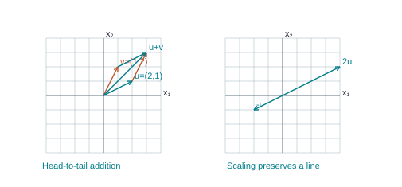

u = (2,1), v = (1,2). Head-to-tail addition gives u + v = (3,3). Multiplying u by −1 reverses it, and multiplying by 2 doubles its length.

- The left diagram adds

@eq u = (2,1)

and

@eq v = (1,2)

- Starting at the endpoint of u and drawing a copy of v reaches

@eq u + v = (3,3)

- The opposite order reaches the same point.

- Completing the parallelogram supplies the geometric version of commutativity.

- The right diagram compares u, -u, and 2u.

## 3.2 Vector algebra has familiar rules

SEE THE IDEA

### Add matching coordinates

An arrow picture and coordinate arithmetic describe the same operation.

u = (2,1), v = (1,2). Head-to-tail addition gives u + v = (3,3). Multiplying u by −1 reverses it, and multiplying by 2 doubles its length.

- For vectors of the same size,

@eq u + v = v + u

and

@eq (u + v) + w = u + (v + w)

- Also

@eq u + 0 = u

and

@eq u + (-u) = 0

- Scalars distribute:

@eq c(u + v) = cu + cv

and

@eq (c + d)u = cu + du

- Scalar multiplication associates:

@eq c(du) = (cd)u

, and

@eq 1u = u

- Each statement follows entry by entry from the corresponding real-number property.

- A useful proof illustrates this.

- Entry i of c(u + v) is c(`u_i` + `v_i`).

- Real-number distributivity makes this c`u_i` + c`v_i`, which is entry i of cu + cv.

- Both vectors have the same size and agree in every entry,

- so they are equal.

- Checking only the first entry would not prove vector equality in general.

## 3.3 Linear combinations and unknown weights

SEE THE IDEA

### Weights are the unknowns

A linear combination asks how much of each direction is needed.

@eq 2(1,0) + 3(0,1) = (2,3)

- Put the given vectors into columns

- Use the target as the appended column

- Solve for the weights

**Remember.** A solution to [A | b] gives the combination coefficients.

- A linear combination of `v₁`,...,`v_p` is `c₁``v₁` + ... + `c_p``v_p`, where the weights `c_i` are scalars.

- The weights may be negative or zero.

- You are choosing how much of each available vector to use.

- A question asking whether b can be generated by given vectors asks whether any weights produce b exactly.

- Take the lecture vectors `a₁` = (1,-2,-5), `a₂` = (2,5,6), b = (7,4,-3) (Combined PDF pages 32-35).

- The equation

@eq x₁a₁ + x₂a₂ = b

means the three entries agree:

@eq x₁ + 2x₂ = 7, -2x₁ + 5x₂ = 4

, and

@eq -5x₁ + 6x₂ = -3

- The unknowns are the weights, not the entries of the supplied vectors.

- Place `a₁` and `a₂` into coefficient columns and b after the divider.

- A solution gives the required weights.

- Each coefficient column corresponds to one unknown;

- the column after the vertical divider records the right-hand sides.

- We use reversible row operations to reveal the constraints.

The starting matrix is:

@matrix {"a": [["1", "2", "7"], ["-2", "5", "4"], ["-5", "6", "-3"]], "bar": 2}

**Step 1: `R_2` ← `R_2` + (2)`R_1`.** Add 2 times row 1 to row 2. This cancels the entry in the pivot column while preserving the solutions. All other rows stay as displayed.

Before

@matrix {"a": [["1", "2", "7"], ["-2", "5", "4"], ["-5", "6", "-3"]], "bar": 2}

After

@matrix {"a": [["1", "2", "7"], ["0", "9", "18"], ["-5", "6", "-3"]], "bar": 2}

Lavender: affected row. Sage: pivot used.

#### Calculate every entry in the changed row

Multiply each entry of old row 1 by 2, then add it to the matching entry of old row 2. The other row is retained.

Row 2, column 1

@eq -2 + (2)(1) = -2 + 2 = 0

Row 2, column 2

@eq 5 + (2)(2) = 5 + 4 = 9

Row 2, column 3 (right-hand side)

@eq 4 + (2)(7) = 4 + 14 = 18

**Step 2: `R_3` ← `R_3` + (5)`R_1`.** Add 5 times row 1 to row 3. This cancels the entry in the pivot column while preserving the solutions. All other rows stay as displayed.

Before

@matrix {"a": [["1", "2", "7"], ["0", "9", "18"], ["-5", "6", "-3"]], "bar": 2}

After

@matrix {"a": [["1", "2", "7"], ["0", "9", "18"], ["0", "16", "32"]], "bar": 2}

Lavender: affected row. Sage: pivot used.

#### Calculate every entry in the changed row

Multiply each entry of old row 1 by 5, then add it to the matching entry of old row 3. The other row is retained.

Row 3, column 1

@eq -5 + (5)(1) = -5 + 5 = 0

Row 3, column 2

@eq 6 + (5)(2) = 6 + 10 = 16

Row 3, column 3 (right-hand side)

@eq -3 + (5)(7) = -3 + 35 = 32

**Step 3: `R_2` ← (`1/9`)`R_2`.** Multiply every entry of row 2, including any right-hand side, by `1/9`. The pivot becomes 1; the multiplier is nonzero, so this step is reversible.

Before

@matrix {"a": [["1", "2", "7"], ["0", "9", "18"], ["0", "16", "32"]], "bar": 2}

After

@matrix {"a": [["1", "2", "7"], ["0", "1", "2"], ["0", "16", "32"]], "bar": 2}

Lavender: affected row. Sage: pivot used.

#### Calculate every entry in the changed row

Multiply every entry of old row 2 by `1/9`. This includes the constant column when one is present. The multiplier is nonzero, so division by it undoes the step.

Row 2, column 1

@eq (1/9)(0) = 0/9 = 0

Row 2, column 2

@eq (1/9)(9) = 9/9 = 1

Row 2, column 3 (right-hand side)

@eq (1/9)(18) = 18/9 = 2

**Step 4: `R_3` ← `R_3` + (-16)`R_2`.** Add -16 times row 2 to row 3. This cancels the entry in the pivot column while preserving the solutions. All other rows stay as displayed.

Before

@matrix {"a": [["1", "2", "7"], ["0", "1", "2"], ["0", "16", "32"]], "bar": 2}

After

@matrix {"a": [["1", "2", "7"], ["0", "1", "2"], ["0", "0", "0"]], "bar": 2}

Lavender: affected row. Sage: pivot used.

#### Calculate every entry in the changed row

Multiply each entry of old row 2 by -16, then add it to the matching entry of old row 3. The other row is retained.

Row 3, column 1

@eq 0 + (-16)(0) = 0 + 0 = 0

Row 3, column 2

@eq 16 + (-16)(1) = 16 - 16 = 0

Row 3, column 3 (right-hand side)

@eq 32 + (-16)(2) = 32 - 32 = 0

**Step 5: `R_1` ← `R_1` + (-2)`R_2`.** Add -2 times row 2 to row 1. This cancels the entry in the pivot column while preserving the solutions. All other rows stay as displayed.

Before

@matrix {"a": [["1", "2", "7"], ["0", "1", "2"], ["0", "0", "0"]], "bar": 2}

After

@matrix {"a": [["1", "0", "3"], ["0", "1", "2"], ["0", "0", "0"]], "bar": 2}

Lavender: affected row. Sage: pivot used.

#### Calculate every entry in the changed row

Multiply each entry of old row 2 by -2, then add it to the matching entry of old row 1. The other row is retained.

Row 1, column 1

@eq 1 + (-2)(0) = 1 + 0 = 1

Row 1, column 2

@eq 2 + (-2)(1) = 2 - 2 = 0

Row 1, column 3 (right-hand side)

@eq 7 + (-2)(2) = 7 - 4 = 3

- **Read the equations.**

@eq x_1 = 3

- @eq x_2 = 2

- Every unknown is basic,

- so no arbitrary choices remain.

- There is exactly one solution:

@matrix {"a": [["3"], ["2"]], "bar": null}

**Verification in the original equations.** For p, the left-hand sides A p are:

@matrix {"a": [["7"], ["4"], ["-3"]], "bar": null}

These entries equal the original right-hand sides, in order.

- The weights 3 and 2 mean

@eq b = 3a₁ + 2a₂

- Directly,

@eq 3(1,-2,-5) + 2(2,5,6) = (3,-6,-15) + (4,10,12) = (7,4,-3)

- The solution answers the original generation question, not merely an unrelated system.

## 3.4 Span is the entire collection of obtainable outputs

SEE THE IDEA

### A span is everything the generators can reach

One example is a member; the span is the entire collection of weighted sums.

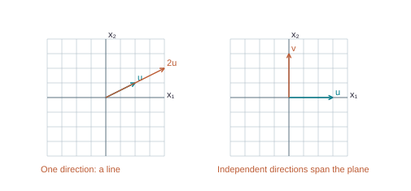

One nonzero vector and its multiples span a line. Two independent vectors span the coordinate plane.

**Remember.** Two vectors span a genuine plane only when they are independent.

- **Definition.** Span{`v₁`,...,`v_p`} is the set of all `c₁``v₁` + ... + `c_p``v_p` as the real weights vary.

- The braces {`v₁`,`v₂`} name a collection of the listed vectors.

- Span{`v₁`,`v₂`} normally contains infinitely many vectors, including 0, `v₁`, `v₂`, and many others.

- Do not confuse the generating collection with the set it generates.

- If

@eq v ≠ 0

, its scalar multiples tv form a line through the origin.

- If

@eq v = 0

, its span is only {0}.

- Two nonzero vectors that are multiples of one another still span just one line.

- Two vectors in `ℝ^3` that are not multiples span a plane through the origin.

- Two such vectors in `ℝ^2` span the entire coordinate plane.

- A general span need not be a plane: it may be {0}, a line, a plane, or all of `ℝ^3` in three-dimensional examples.

One nonzero vector and its multiples span a line. Two independent vectors span the coordinate plane.

- The right diagram uses the coordinate directions (3,0) and (0,3).

- An arbitrary (a,b) equals (a/3)(3,0) + (b/3)(0,3),

- so every point is obtainable.

- The left pair contains redundant directions and cannot leave its line.

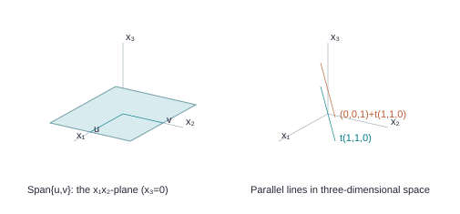

The vectors along the first two coordinate axes span x₃ = 0. The lines t(1,1,0) and (0,0,1) + t(1,1,0) are parallel.

- The shaded region represents part of the infinite `x₁``x₂`-plane in `ℝ^3`, generated by

@eq u = (2,0,0)

and

@eq v = (0,2,0)

- Its points have form (2s,2t,0), with s,t real.

- The adjacent three-dimensional sketch shows a homogeneous line and its translate by (0,0,1).

- These are coordinate projections of three-dimensional objects, not claims that the drawn angles are their true spatial angles.

- To test whether b belongs to a span, solve the augmented system [`v₁` ... `v_p` | b].

- Consistency proves membership.

- A contradictory row proves nonmembership.

- A pivot in every row of the coefficient matrix proves membership for every b of the appropriate size, a stronger statement than membership of one particular b.

## 3.5 Application: mine production

SEE THE IDEA

### Attach units before solving

Each coordinate records a different resource; each weight records operating time.

| Quantity | Mine 1 per day | Mine 2 per day |
| --- | --- | --- |
| Copper (metric tons) | 20 | 30 |
| Silver (kg) | 550 | 500 |

@eq x_1(20,550) + x_2(30,500) = (150,2825)

**Remember.** The weights are days, not tons or kilograms.

- Course Exercise 1.3.35 describes daily mine outputs

@eq v₁ = (20,550)

and

@eq v₂ = (30,500)

- The first entry measures metric tons of copper;

- the second measures kilograms of silver.

- Multiplying `v₁` by 5 means operating mine 1 for five days:

@eq 5v₁ = (100,2750)

- The two entries have different units,

- so they must not be added to each other.

- For a target (150,2825), let `x₁`,`x₂` be operating days for mines 1 and 2.

- Then

@eq x₁v₁ + x₂v₂ = (150,2825)

- The two entry equations track the two resources independently.

- Here fractional days are mathematically allowed;

- an actual operating policy could add a restriction,

- but none should be invented in the algebra.

- Each coefficient column corresponds to one unknown;

- the column after the vertical divider records the right-hand sides.

- We use reversible row operations to reveal the constraints.

The starting matrix is:

@matrix {"a": [["20", "30", "150"], ["550", "500", "2825"]], "bar": 2}

**Step 1: `R_1` ← (`1/20`)`R_1`.** Multiply every entry of row 1, including any right-hand side, by `1/20`. The pivot becomes 1; the multiplier is nonzero, so this step is reversible.

Before

@matrix {"a": [["20", "30", "150"], ["550", "500", "2825"]], "bar": 2}

After

@matrix {"a": [["1", "3/2", "15/2"], ["550", "500", "2825"]], "bar": 2}

Lavender: affected row. Sage: pivot used.

#### Calculate every entry in the changed row

Multiply every entry of old row 1 by `1/20`. This includes the constant column when one is present. The multiplier is nonzero, so division by it undoes the step.

Row 1, column 1

@eq (1/20)(20) = 20/20 = 1

Row 1, column 2

@eq (1/20)(30) = 30/20 = 3/2

Row 1, column 3 (right-hand side)

@eq (1/20)(150) = 150/20 = 15/2

**Step 2: `R_2` ← `R_2` + (-550)`R_1`.** Add -550 times row 1 to row 2. This cancels the entry in the pivot column while preserving the solutions. All other rows stay as displayed.

Before

@matrix {"a": [["1", "3/2", "15/2"], ["550", "500", "2825"]], "bar": 2}

After

@matrix {"a": [["1", "3/2", "15/2"], ["0", "-325", "-1300"]], "bar": 2}

Lavender: affected row. Sage: pivot used.

#### Calculate every entry in the changed row

Multiply each entry of old row 1 by -550, then add it to the matching entry of old row 2. The other row is retained.

Row 2, column 1

@eq 550 + (-550)(1) = 550 - 550 = 0

Row 2, column 2

@eq 500 + (-550)(3/2) = 500 - 825 = -325

Row 2, column 3 (right-hand side)

@eq 2825 + (-550)(15/2) = 2825 - 4125 = -1300

**Step 3: `R_2` ← (`-1/325`)`R_2`.** Multiply every entry of row 2, including any right-hand side, by `-1/325`. The pivot becomes 1; the multiplier is nonzero, so this step is reversible.

Before

@matrix {"a": [["1", "3/2", "15/2"], ["0", "-325", "-1300"]], "bar": 2}

After

@matrix {"a": [["1", "3/2", "15/2"], ["0", "1", "4"]], "bar": 2}

Lavender: affected row. Sage: pivot used.

#### Calculate every entry in the changed row

Multiply every entry of old row 2 by `-1/325`. This includes the constant column when one is present. The multiplier is nonzero, so division by it undoes the step.

Row 2, column 1

@eq (-1/325)(0) = 0/325 = 0

Row 2, column 2

@eq (-1/325)(-325) = 325/325 = 1

Row 2, column 3 (right-hand side)

@eq (-1/325)(-1300) = 1300/325 = 4

**Step 4: `R_1` ← `R_1` + (`-3/2`)`R_2`.** Add `-3/2` times row 2 to row 1. This cancels the entry in the pivot column while preserving the solutions. All other rows stay as displayed.

Before

@matrix {"a": [["1", "3/2", "15/2"], ["0", "1", "4"]], "bar": 2}

After

@matrix {"a": [["1", "0", "3/2"], ["0", "1", "4"]], "bar": 2}

Lavender: affected row. Sage: pivot used.

#### Calculate every entry in the changed row

Multiply each entry of old row 2 by `-3/2`, then add it to the matching entry of old row 1. The other row is retained.

Row 1, column 1

@eq 1 + (-3/2)(0) = 1 + 0 = 1

Row 1, column 2

@eq 3/2 + (-3/2)(1) = 3/2 - 3/2 = 0

Row 1, column 3 (right-hand side)

@eq 15/2 + (-3/2)(4) = 15/2 - 6 = 3/2

- **Read the equations.**

@eq x_1 = 3/2

- @eq x_2 = 4

- Every unknown is basic,

- so no arbitrary choices remain.

- There is exactly one solution:

@matrix {"a": [["3/2"], ["4"]], "bar": null}

**Verification in the original equations.** For p, the left-hand sides A p are:

@matrix {"a": [["150"], ["2825"]], "bar": null}

These entries equal the original right-hand sides, in order.

- The result is `3/2` days at mine 1 and 4 days at mine 2.

- Check copper:

@eq 20(3/2) + 30(4) = 150

- Check silver:

@eq 550(3/2) + 500(4) = 2825

- This is the same linear-combination method used for abstract vectors, with meanings attached to the weights and entries.

## 3.6 Practice

TRY IT YOURSELF · V1

**V1.** For u = (1,-2), v = (2,-5), compute 4u - 3v and explain the effect of each scalar.

**Show Detailed Solution · V1**

**V1.**

#### Multiply all coordinates by their weights

@eq 4[1;-2] = [4;-8]

@eq (-3)[2;-5] = [-6;15]

The positive factor 4 stretches u in its original direction. The negative factor −3 stretches v and reverses its direction.

#### Add coordinates in matching positions

@eq 4 + (-6) = -2

@eq -8 + 15 = 7

FINAL ANSWER

@eq 4u - 3v = [-2;7]

TRY IT YOURSELF · V2

**V2.** Determine whether (5,1) belongs to Span{(1,1),(2,-1)}. Find weights and verify them.

**Show Detailed Solution · V2**

**V2.**

#### Name the two unknown weights

@eq c_1[1;1] + c_2[2;-1] = [5;1]

We are asking whether some amounts of the two supplied vectors add to the target.

#### Match the first and second coordinates

@eq c_1 + 2c_2 = 5

@eq c_1 - c_2 = 1

#### Subtract the second equation from the first

@eq (c_1 + 2c_2) - (c_1 - c_2) = 5 - 1

@eq 3c_2 = 4

@eq c_2 = 4/3

#### Use the second equation to find the other weight

@eq c_1 - 4/3 = 1

@eq c_1 = 1 + 4/3 = 3/3 + 4/3 = 7/3

#### Verify the actual weighted sum

@eq (7/3)[1;1] + (4/3)[2;-1] = [7/3;7/3] + [8/3;-4/3]

@eq [15/3;3/3] = [5;1]

FINAL ANSWER

Yes, the target belongs to the span.

@eq c_1 = 7/3

@eq c_2 = 4/3

TRY IT YOURSELF · V3

**V3.** Describe Span{(2,4,0),(3,6,0)} geometrically. Is (1,0,0) in it?

**Show Detailed Solution · V3**

**V3.**

#### Compare the two generators

@eq (3/2)[2;4;0] = [3;6;0]

The second arrow points along the same line as the first; it supplies no new direction.

#### Describe everything they can build

@eq s[2;4;0] + t[3;6;0] = (s + (3/2)t)[2;4;0]

Every combination is a multiple of (2,4,0). All multiples are attainable, so the span is precisely the line through that vector and the origin.

#### Test the target (1,0,0)

@eq 2k = 1

@eq k = 1/2

@eq 4k = 4(1/2) = 2

The first coordinate would force k = `1/2`. That would make the second coordinate 2, but the target needs 0.

FINAL ANSWER

The span is a line through the origin. The target (1,0,0) is outside it.

TRY IT YOURSELF · V4

**V4.** A process produces (2,5) units per batch of type A and (3,1) per batch of type B. Find nonnegative batch amounts giving (13,13), and check both quantities.

**Show Detailed Solution · V4**

**V4.**

#### Use batch amounts as the unknowns

Let a be the number of type-A batches and b the number of type-B batches. Match each resource separately.

@eq 2a + 3b = 13

@eq 5a + b = 13

#### Express b using the second equation

@eq b = 13 - 5a

#### Substitute into the first equation

@eq 2a + 3(13 - 5a) = 13

@eq 2a + 39 - 15a = 13

@eq -13a = -26

@eq a = 2

#### Recover b and check both resources

@eq b = 13 - 5(2) = 3

@eq 2(2) + 3(3) = 4 + 9 = 13

@eq 5(2) + 3 = 10 + 3 = 13

FINAL ANSWER

Use 2 type-A batches and 3 type-B batches. Both amounts are nonnegative.

# 4. Section 1.4 - The matrix equation Ax = b

Source correspondence: Combined PDF pages 37-43; exercise PDF pages 7-8.

## 4.1 Multiplication combines columns

SEE THE IDEA

### Ax is a weighted sum of columns

Each input entry weights the column in the same position.

@matrix {"a": [["2", "-1"], ["1", "3"]], "bar": null}

`a₁` = (2,1), `a₂` = (−1,3).

@eq A(3,2) = 3(2,1) + 2(-1,3) = (4,9)

- If A has m rows and n columns and x has n entries, Ax is the vector formed by using the entries of x as weights on the columns of A.

- Its size is m × 1.

- Thus an m × n matrix takes an input in `ℝ^n` and produces an output in `ℝ^m`.

- The number of columns must match the number of input entries.

- Write A = [`a₁` ... `a_n`].

- Then

@eq Ax = x₁a₁ +

... + `x_n` `a_n`.

- This definition explains the multiplication: every column is a possible output contribution, and the input tells us how to combine them.

- An m × n matrix multiplied by an input with m entries is not automatically valid;

- check n, not m.

- The row computation rule follows by examining one entry.

- Entry i of Ax is `a_{i1}``x₁` + ... + `a_{in}``x_n`.

- Multiply matching entries across row i of A and down x, then add.

- This sum of products is sometimes called a dot product here.

- It is a scalar;

- the collection of m such scalars is the output vector.

## 4.2 Worked product using both views

SEE THE IDEA

### Two views give the same output

Compute by columns or by row–column products; the coordinates must agree.

#### Choose one row

@matrix {"a": [["2", "3"], ["1", "-5"]], "bar": null}

Row 1 of A is (2,3).

#### Choose one column

@matrix {"a": [["4", "3", "6"], ["1", "-2", "3"]], "bar": null}

Column 1 of B is (4,1).

@eq c_{11} = (2)(4) + (3)(1) = 11

- Pair corresponding entries

- Multiply each pair

- Add to get one output entry

- Let

@eq A = [2,3; -1,5; 4,0]

and

@eq x = (2,-1)

- The column view gives

@eq 2(2,-1,4) - (3,5,0) = (1,-7,8)

- The row view gives the same result with each entry shown below.

In this calculation, A is the left factor and x is the right factor.

#### Read A: 3 rows, 2 columns

A row runs horizontally, from left to right. A column runs vertically, from top to bottom. Count rows first when writing a size.

@matrix {"a": [["2", "3"], ["-1", "5"], ["4", "0"]], "bar": null}

A has size 3 × 2.

#### Read x: 2 rows, 1 column

@matrix {"a": [["2"], ["-1"]], "bar": null}

x has size 2 × 1.

#### Check that multiplication is allowed

(3 × **2**)(**2** × 1)→ 3 × 1

The highlighted inner counts are both 2: every row of the left factor has one entry for every row of the right factor. The outside counts tell us the output has 3 rows and 1 column.

#### Calculate output row 1

Take row 1 of A and column 1 of x. Pair entries in their original order: multiply the first pair, the second pair, and so on. Then add.

@matrix {"a": [["2", "3"], ["-1", "5"], ["4", "0"]], "bar": null}

Use this highlighted row 1.

@matrix {"a": [["2"], ["-1"]], "bar": null}

Pair it with highlighted column 1.

@eq c_{11} = (2)(2) + (3)(-1) = 1

@eq 4 - 3

@eq 1

#### Calculate output row 2

Take row 2 of A and column 1 of x. Pair entries in their original order: multiply the first pair, the second pair, and so on. Then add.

@matrix {"a": [["2", "3"], ["-1", "5"], ["4", "0"]], "bar": null}

Use this highlighted row 2.

@matrix {"a": [["2"], ["-1"]], "bar": null}

Pair it with highlighted column 1.

@eq c_{21} = (-1)(2) + (5)(-1) = -7

@eq -2 - 5

@eq -7

#### Calculate output row 3

Take row 3 of A and column 1 of x. Pair entries in their original order: multiply the first pair, the second pair, and so on. Then add.

@matrix {"a": [["2", "3"], ["-1", "5"], ["4", "0"]], "bar": null}

Use this highlighted row 3.

@matrix {"a": [["2"], ["-1"]], "bar": null}

Pair it with highlighted column 1.

@eq c_{31} = (4)(2) + (0)(-1) = 8

@eq 8 + 0

@eq 8

#### Put the entries into their output positions

@matrix {"a": [["1"], ["-7"], ["8"]], "bar": null}

The result has 3 rows and 1 column.

#### Check with the column method

The entries of x are weights. Weight 1 multiplies column 1 of A, weight 2 multiplies column 2, and so on. A negative weight reverses the sign of every entry in that column.

Column 1, with weight 2:

@eq 2 [2;-1;4] = [4;-2;8]

Column 2, with weight -1:

@eq -1 [3;5;0] = [-3;-5;0]

@eq y_1 = 4 - 3 = 1

@eq y_2 = -2 - 5 = -7

@eq y_3 = 8 + 0 = 8

@matrix {"a": [["1"], ["-7"], ["8"]], "bar": null}

Both methods add exactly the same products. The row method groups them by output entry. The column method groups them by input weight. Regrouping a finite sum does not change its value.

FINAL ANSWER

@eq Ax = [1;-7;8]

Dimensions: (3 × 2)(2 × 1) = 3 × 1.

## 4.3 One problem, three equivalent languages

#### 1 · Start with the two equations

@eq x_1 + 2x_2 - x_3 = 4

@eq -5x_2 + 3x_3 = 1

We seek three numbers that make both equations true at the same time. At this stage we are changing notation, not finding their values.

#### 2 · Identify the three unknowns

@eq x_1, x_2, x_3

The subscripts 1, 2, and 3 are labels distinguishing three unknown values. They are not powers or multiplication instructions.

#### 3 · Read one coefficient for every variable

| Equation | `x₁` | `x₂` | `x₃` | Right side |
| --- | --- | --- | --- | --- |
| First | 1 | 2 | −1 | 4 |
| Second | 0 | −5 | 3 | 1 |

A coefficient is the number multiplying an unknown. The second equation has no `x₁` term, so its `x₁` coefficient is 0. The term −`x₃` means (−1)`x₃`.

#### 4 · Build A from the coefficient rows

@matrix {"a": [["1", "2", "-1"], ["0", "-5", "3"]], "bar": null}

A: 2 equations give 2 rows; 3 unknowns give 3 columns.

Row 1 records the first equation. Row 2 records the second. Keep the variable order `x₁`,`x₂`,`x₃` in both rows. The constants do not belong in A.

#### 5 · Put the unknowns in a column

@eq x = [x_1;x_2;x_3]

The unknown vector has size 3 × 1. Its order matches the three columns of A.

#### 6 · Put the constants in a separate column

@eq b = [4;1]

This vector has size 2 × 1. Its entries follow the order of the two equations.

#### 7 · Write the full matrix equation

@eq [1,2,-1;0,-5,3][x_1;x_2;x_3] = [4;1]

@eq A x = b

The sizes (2 × 3)(3 × 1) produce a 2 × 1 output, matching b.

#### 8 · Read the same multiplication by columns

@eq x_1[1;0] + x_2[2;-5] + x_3[-1;3] = [4;1]

The first column carries the `x₁` coefficients; multiply that entire column by `x₁`. Do the same for columns 2 and 3, with weights `x₂` and `x₃`. Add matching coordinates.

#### 9 · Expand the weighted columns to recover the system

@eq [x_1;0] + [2x_2;-5x_2] + [-x_3;3x_3] = [4;1]

@eq x_1 + 2x_2 - x_3 = 4

@eq 0x_1 - 5x_2 + 3x_3 = 1

Matching first coordinates gives equation 1. Matching second coordinates gives equation 2. Every entry has returned to its original place.

FINAL ANSWER

Linear system ↔ vector equation ↔ matrix equation: the unknowns and constraints are identical. Converting between these representations does not solve the system.

**Optional further study: solve this system after converting it**

- Each coefficient column corresponds to one unknown;

- the column after the vertical divider records the right-hand sides.

- We use reversible row operations to reveal the constraints.

The starting matrix is:

@matrix {"a": [["1", "2", "-1", "4"], ["0", "-5", "3", "1"]], "bar": 3}

**Step 1: `R_2` ← (`-1/5`)`R_2`.** Multiply every entry of row 2, including any right-hand side, by `-1/5`. The pivot becomes 1; the multiplier is nonzero, so this step is reversible.

Before

@matrix {"a": [["1", "2", "-1", "4"], ["0", "-5", "3", "1"]], "bar": 3}

After

@matrix {"a": [["1", "2", "-1", "4"], ["0", "1", "-3/5", "-1/5"]], "bar": 3}

Lavender: affected row. Sage: pivot used.

#### Calculate every entry in the changed row

Multiply every entry of old row 2 by `-1/5`. This includes the constant column when one is present. The multiplier is nonzero, so division by it undoes the step.

Row 2, column 1

@eq (-1/5)(0) = 0/5 = 0

Row 2, column 2

@eq (-1/5)(-5) = 5/5 = 1

Row 2, column 3

@eq (-1/5)(3) = -3/5 = -3/5

Row 2, column 4 (right-hand side)

@eq (-1/5)(1) = -1/5 = -1/5

**Step 2: `R_1` ← `R_1` + (-2)`R_2`.** Add -2 times row 2 to row 1. This cancels the entry in the pivot column while preserving the solutions. All other rows stay as displayed.

Before

@matrix {"a": [["1", "2", "-1", "4"], ["0", "1", "-3/5", "-1/5"]], "bar": 3}

After

@matrix {"a": [["1", "0", "1/5", "22/5"], ["0", "1", "-3/5", "-1/5"]], "bar": 3}

Lavender: affected row. Sage: pivot used.

#### Calculate every entry in the changed row

Multiply each entry of old row 2 by -2, then add it to the matching entry of old row 1. The other row is retained.

Row 1, column 1

@eq 1 + (-2)(0) = 1 + 0 = 1

Row 1, column 2

@eq 2 + (-2)(1) = 2 - 2 = 0

Row 1, column 3

@eq -1 + (-2)(-3/5) = -1 + 6/5 = 1/5

Row 1, column 4 (right-hand side)

@eq 4 + (-2)(-1/5) = 4 + 2/5 = 22/5

- **Read the equations.**

@eq x_1 + 1/5 x_3 = 22/5

- @eq x_2 - 3/5 x_3 = -1/5

- The pivot columns are 1, 2.

- Thus `x_1`, `x_2` are basic variables. `x_3` have no leading pivots.

- Their values may be chosen arbitrarily;

- the pivot equations then determine the remaining entries.

- A zero row means

@eq 0 = 0

and imposes no additional restriction.

- Set

@eq x_3 = s

with all parameters real.

- The complete coordinate answer is:

@eq x_1 = 22/5 - 1/5 s

@eq x_2 = -1/5 + 3/5 s

@eq x_3 = s

- In vector form, assemble the constant entries into p and the coefficients of each parameter into a direction vector.

- Every solution is

@eq x = p + s v_1

, where:

p =

@matrix {"a": [["22/5"], ["-1/5"], ["0"]], "bar": null}

`v_1` =

@matrix {"a": [["-1/5"], ["3/5"], ["1"]], "bar": null}

- For example, setting all parameters to 0 gives

@eq x = p

- Setting

@eq s = 1

and all other parameters to 0 gives:

@matrix {"a": [["21/5"], ["2/5"], ["1"]], "bar": null}

These are different because the selected free coordinate changes. Infinitely many real parameter values give infinitely many different solutions.

**Verification in the original equations.** For p, the left-hand sides A p are:

@matrix {"a": [["4"], ["1"]], "bar": null}

- These entries equal the original right-hand sides, in order.

- For direction `v_1`, multiplying by the original A gives the zero vector.

- Therefore

@eq A(p + s v_1) = A p + s A v_1 = b

for every parameter choice.

- Conversely, the pivot equations show that every solution has this form.

## 4.4 A particular b versus every b

SEE THE IDEA

### One reachable target is not every target

Distinguish solving one system from proving that the columns fill the codomain.

@matrix {"a": [["1", "0"], ["0", "0"]], "bar": null}

This A reaches (1,0), but never (0,1).

| Question | Test |
| --- | --- |
| This b? | Reduce [A \| b] |
| Every b ∈ ℝᵐ? | Pivot in every row of A |

**Remember.** The row-pivot theorem applies to the coefficient matrix A.

- **Theorem (supplied Theorem 4).** For an m × n matrix A, the following four statements are equivalent:

@eq Ax = b

has a solution for every

@eq b ∈ ℝ^m

- every

@eq b ∈ ℝ^m

is a linear combination of the columns;

- the columns span `ℝ^m`;

- A has a pivot position in every row.

- The first three formulations are equivalent by the definition of Ax and span.

- For the pivot formulation, imagine row-reducing A while carrying an arbitrary appended b.

- If each coefficient row has a pivot, no row is left over that could state 0 = nonzero,

- so every appended b is allowed.

- If a coefficient row has no pivot, an appropriate b can leave a nonzero entry in that zero row, producing inconsistency.

- This last statement asserts some b will fail;

- it does not say every b fails.

- For

@eq A = [1,2;2,4], b = (3,6)

works, since the second equation repeats the first.

- But

@eq b = (3,7)

fails.

- The column span is a line in `ℝ^2`, not all of `ℝ^2`.

- By contrast,

@eq A = [1,0,2;0,1,-1]

has a pivot in each of its two rows and can produce every

@eq b = (b₁,b₂)

: choose

@eq x = (b₁,b₂,0)

- It still has a free input coordinate,

- so uniqueness does not follow.

## 4.5 Identity and distributivity

SEE THE IDEA

### Identity leaves every coordinate alone

Each identity column selects exactly one input coordinate.

@matrix {"a": [["1", "0", "0"], ["0", "1", "0"], ["0", "0", "1"]], "bar": null}

`I₃`x = x for every three-entry input.

@eq A(u + v) = Au + Av

- The identity matrix `I_n` has 1 on its main diagonal and 0 elsewhere.

- Its columns are the standard coordinate vectors.

- Consequently

@eq I_n x = x

: each coordinate is copied once and nothing is mixed.

- The subscript records the size,

- so `I₂` and `I₃` are different matrices.

- For compatible vectors u,v and scalar

@eq c, A(u + v) = Au + Av

and A(cu) = cAu (supplied Theorem 5).

- A proof by columns writes

@eq A(u + v) = (u₁ + v₁)a₁ +

... + (`u_n` + `v_n`)`a_n`.

- Distribute and regroup to obtain (`u₁``a₁` + ... + `u_n` `a_n`) + (`v₁``a₁` + ... + `v_n` `a_n`) = Au + Av.

- Similarly,

@eq A(cu) = (cu₁)a₁ +

... + (c`u_n`)`a_n` = cAu.

- These properties later explain why matrix transformations are linear.

## 4.6 Practice

TRY IT YOURSELF · A1

**A1.** Write 2`x₁` - `x₂` = 3 and `x₁` + 4`x₂` = 5 as a vector equation and a matrix equation, then solve.

**Show Detailed Solution · A1**

**A1.**

**A1.** The vector equation is `x₁`(2,1) + `x₂`(-1,4) = (3,5). The matrix equation is `[2,-1;1,4]`(`x₁`,`x₂`) = (3,5). Solving the system gives the following.

- Each coefficient column corresponds to one unknown;

- the column after the vertical divider records the right-hand sides.

- We use reversible row operations to reveal the constraints.

The starting matrix is:

@matrix {"a": [["2", "-1", "3"], ["1", "4", "5"]], "bar": 2}

**Step 1: `R_1` ← (`1/2`)`R_1`.** Multiply every entry of row 1, including any right-hand side, by `1/2`. The pivot becomes 1; the multiplier is nonzero, so this step is reversible.

Before

@matrix {"a": [["2", "-1", "3"], ["1", "4", "5"]], "bar": 2}

After

@matrix {"a": [["1", "-1/2", "3/2"], ["1", "4", "5"]], "bar": 2}

Lavender: affected row. Sage: pivot used.

#### Calculate every entry in the changed row

Multiply every entry of old row 1 by `1/2`. This includes the constant column when one is present. The multiplier is nonzero, so division by it undoes the step.

Row 1, column 1

@eq (1/2)(2) = 2/2 = 1

Row 1, column 2

@eq (1/2)(-1) = -1/2 = -1/2

Row 1, column 3 (right-hand side)

@eq (1/2)(3) = 3/2 = 3/2

**Step 2: `R_2` ← `R_2` + (-1)`R_1`.** Add -1 times row 1 to row 2. This cancels the entry in the pivot column while preserving the solutions. All other rows stay as displayed.

Before

@matrix {"a": [["1", "-1/2", "3/2"], ["1", "4", "5"]], "bar": 2}

After

@matrix {"a": [["1", "-1/2", "3/2"], ["0", "9/2", "7/2"]], "bar": 2}

Lavender: affected row. Sage: pivot used.

#### Calculate every entry in the changed row

Multiply each entry of old row 1 by -1, then add it to the matching entry of old row 2. The other row is retained.

Row 2, column 1

@eq 1 + (-1)(1) = 1 - 1 = 0

Row 2, column 2

@eq 4 + (-1)(-1/2) = 4 + 1/2 = 9/2

Row 2, column 3 (right-hand side)

@eq 5 + (-1)(3/2) = 5 - 3/2 = 7/2

**Step 3: `R_2` ← (`2/9`)`R_2`.** Multiply every entry of row 2, including any right-hand side, by `2/9`. The pivot becomes 1; the multiplier is nonzero, so this step is reversible.

Before

@matrix {"a": [["1", "-1/2", "3/2"], ["0", "9/2", "7/2"]], "bar": 2}

After

@matrix {"a": [["1", "-1/2", "3/2"], ["0", "1", "7/9"]], "bar": 2}

Lavender: affected row. Sage: pivot used.

#### Calculate every entry in the changed row

Multiply every entry of old row 2 by `2/9`. This includes the constant column when one is present. The multiplier is nonzero, so division by it undoes the step.

Row 2, column 1

@eq (2/9)(0) = 0/9 = 0

Row 2, column 2

@eq (2/9)(9/2) = 18/18 = 1

Row 2, column 3 (right-hand side)

@eq (2/9)(7/2) = 14/18 = 7/9

**Step 4: `R_1` ← `R_1` + (`1/2`)`R_2`.** Add `1/2` times row 2 to row 1. This cancels the entry in the pivot column while preserving the solutions. All other rows stay as displayed.

Before

@matrix {"a": [["1", "-1/2", "3/2"], ["0", "1", "7/9"]], "bar": 2}

After

@matrix {"a": [["1", "0", "17/9"], ["0", "1", "7/9"]], "bar": 2}

Lavender: affected row. Sage: pivot used.

#### Calculate every entry in the changed row

Multiply each entry of old row 2 by `1/2`, then add it to the matching entry of old row 1. The other row is retained.

Row 1, column 1

@eq 1 + (1/2)(0) = 1 + 0 = 1

Row 1, column 2

@eq -1/2 + (1/2)(1) = -1/2 + 1/2 = 0

Row 1, column 3 (right-hand side)

@eq 3/2 + (1/2)(7/9) = 3/2 + 7/18 = 17/9

- **Read the equations.**

@eq x_1 = 17/9

- @eq x_2 = 7/9

- Every unknown is basic,

- so no arbitrary choices remain.

- There is exactly one solution:

@matrix {"a": [["17/9"], ["7/9"]], "bar": null}

**Verification in the original equations.** For p, the left-hand sides A p are:

@matrix {"a": [["3"], ["5"]], "bar": null}

These entries equal the original right-hand sides, in order.

#### What does the reduced matrix say?

@matrix {"a": [["1", "0", "17/9"], ["0", "1", "7/9"]], "bar": 2}

There are 2 equations and 2 unknown weights or coordinates. The divider separates the constants from those unknowns.

#### Separate determined coordinates from free choices

| Coordinate | Look at its column | What you may do |
| --- | --- | --- |
| `x_1` | Pivot column → basic | Determined by its pivot equation |
| `x_2` | Pivot column → basic | Determined by its pivot equation |

#### Determine x1 from its row

@eq x_1 = 17/9

@eq x_1 = 17/9

Subtract each free-variable term from both sides. The pivot coefficient is 1, so no further division is needed.

#### Determine x2 from its row

@eq x_2 = 7/9

@eq x_2 = 7/9

Subtract each free-variable term from both sides. The pivot coefficient is 1, so no further division is needed.

#### Verify the starting point in every original equation

@eq (2)(17/9) + (-1)(7/9) = 34/9 - 7/9 = 3

@eq (1)(17/9) + (4)(7/9) = 17/9 + 28/9 = 5

FINAL ANSWER

@eq x = [17/9;7/9]

Every coordinate is fixed. There are no free choices, so the solution is unique.

TRY IT YOURSELF · A2

**A2.** A is 2 × 3 and has two pivots. Explain what this says about every b ∈ `ℝ^2` and about uniqueness.

**Show Detailed Solution · A2**

**A2.**

#### Count the output equations and input coordinates

A has 2 rows and 3 columns. It takes a three-entry input and returns a two-entry output.

#### Two pivots fill both rows

There is a pivot in each coefficient row. The existence theorem says Ax = b is consistent for every b in `ℝ²`. This is what onto `ℝ²` means.

#### Two pivots cannot fill three columns

@eq 3 - 2 = 1

One coefficient column is nonpivot. Its input coordinate is free; choosing it determines the remaining basic coordinates.

FINAL ANSWER

The map is onto `ℝ²`. Every b has infinitely many inputs, with one free parameter. It is not one-to-one.

TRY IT YOURSELF · A3

**A3.** Compute `[1,2,3;0,-1,4]`(2,1,-1) by the column and row rules. State every size.

**Show Detailed Solution · A3**

**A3.**

#### Read A: 2 rows, 3 columns

A row runs horizontally, from left to right. A column runs vertically, from top to bottom. Count rows first when writing a size.

@matrix {"a": [["1", "2", "3"], ["0", "-1", "4"]], "bar": null}

A has size 2 × 3.

Row 1 is (1,2,3). Row 2 is (0,−1,4). Each row has three entries, so there are three columns.

#### Read x: 3 rows, 1 column

@matrix {"a": [["2"], ["1"], ["-1"]], "bar": null}

x has size 3 × 1.

#### Check that multiplication is allowed

(2 × **3**)(**3** × 1)→ 2 × 1

The highlighted inner counts are both 3: every row of the left factor has one entry for every row of the right factor. The outside counts tell us the output has 2 rows and 1 column.

#### Calculate output row 1

Take row 1 of A and column 1 of x. Pair entries in their original order: multiply the first pair, the second pair, and so on. Then add.

@matrix {"a": [["1", "2", "3"], ["0", "-1", "4"]], "bar": null}

Use this highlighted row 1.

@matrix {"a": [["2"], ["1"], ["-1"]], "bar": null}

Pair it with highlighted column 1.

@eq (1)(2) + (2)(1) + (3)(-1)

@eq 2 + 2 - 3

@eq 1

#### Calculate output row 2

Take row 2 of A and column 1 of x. Pair entries in their original order: multiply the first pair, the second pair, and so on. Then add.

@matrix {"a": [["1", "2", "3"], ["0", "-1", "4"]], "bar": null}

Use this highlighted row 2.

@matrix {"a": [["2"], ["1"], ["-1"]], "bar": null}

Pair it with highlighted column 1.

@eq (0)(2) + (-1)(1) + (4)(-1)

@eq 0 - 1 - 4

@eq -5

#### Put the entries into their output positions

@matrix {"a": [["1"], ["-5"]], "bar": null}

The result has 2 rows and 1 column.

#### Check with the column method

The entries of x are weights. Weight 1 multiplies column 1 of A, weight 2 multiplies column 2, and so on. A negative weight reverses the sign of every entry in that column.

Column 1, with weight 2:

@eq 2 [1;0] = [2;0]

Column 2, with weight 1:

@eq 1 [2;-1] = [2;-1]

Column 3, with weight -1:

@eq -1 [3;4] = [-3;-4]

@eq y_1 = 2 + 2 - 3 = 1

@eq y_2 = 0 - 1 - 4 = -5

@matrix {"a": [["1"], ["-5"]], "bar": null}

Both methods add exactly the same products. The row method groups them by output entry. The column method groups them by input weight. Regrouping a finite sum does not change its value.

#### Why the row and column methods agree

Each output entry adds exactly the same three products in both methods. The row method gathers the products for one output entry. The column method first builds each whole weighted column, then adds corresponding entries. Neither method changes the order of the coordinates.

FINAL ANSWER

@eq Ax = [1;-5]

Dimensions: (2 × 3)(3 × 1) = 2 × 1.

# 5. Section 1.5 - Solution sets of linear systems

Source correspondence: Combined PDF pages 44-52; exercise PDF page 9.

## 5.1 Homogeneous means zero right-hand side

SEE THE IDEA

### Zero is always a starting solution

With right-hand side zero, the all-zero input always works. The real question is whether anything else works.

@eq A0 = 0

@matrix {"a": [["1", "0"], ["0", "1"]], "bar": null}

Ax = 0 forces x = 0.

@matrix {"a": [["1", "2"], ["0", "0"]], "bar": null}

x = t(−2,1) also works; t ≠ 0 is nontrivial.

- A homogeneous system has the form

@eq Ax = 0

- Its zero on the right is the zero vector in `ℝ^m` if A is m × n.

- Its unknown x lies in `ℝ^n`.

- The choice

@eq x = 0

always works, because multiplying every column by weight zero gives zero.

- This is the trivial solution.

- A nontrivial solution is any solution vector with at least one nonzero entry;

- it need not have every entry nonzero.

- A homogeneous system has a nontrivial solution if and only if at least one coefficient variable is free.

- There is never a contradiction, because the appended zero column stays zero under row operations.

- If every variable is basic, the pivot equations force every variable to zero.

- If some variable is free, set it to 1 and the other free variables to 0;

- the resulting solution is nonzero.

- This proves both directions.

## 5.2 The lecture homogeneous system

SEE THE IDEA

### Read directions from free variables

Homogeneous solution vectors describe motions that produce no output.

- Append zeros

- Reduce

- Assign independent free parameters

- Assemble the direction vectors

**Remember.** Check each direction v by Av = 0.

- The lecture uses coefficient rows `[3,5,-4]`, `[-3,-2,4]`, `[6,1,-8]`.

- A nonzero direction of solutions would describe inputs that A sends to zero.

- The reduction below reveals exactly which direction survives.

- Each coefficient column corresponds to one unknown;

- the column after the vertical divider records the right-hand sides.

- We use reversible row operations to reveal the constraints.

The starting matrix is:

@matrix {"a": [["3", "5", "-4", "0"], ["-3", "-2", "4", "0"], ["6", "1", "-8", "0"]], "bar": 3}

**Step 1: `R_1` ← (`1/3`)`R_1`.** Multiply every entry of row 1, including any right-hand side, by `1/3`. The pivot becomes 1; the multiplier is nonzero, so this step is reversible.

Before

@matrix {"a": [["3", "5", "-4", "0"], ["-3", "-2", "4", "0"], ["6", "1", "-8", "0"]], "bar": 3}

After

@matrix {"a": [["1", "5/3", "-4/3", "0"], ["-3", "-2", "4", "0"], ["6", "1", "-8", "0"]], "bar": 3}

Lavender: affected row. Sage: pivot used.

#### Calculate every entry in the changed row

Multiply every entry of old row 1 by `1/3`. This includes the constant column when one is present. The multiplier is nonzero, so division by it undoes the step.

Row 1, column 1

@eq (1/3)(3) = 3/3 = 1

Row 1, column 2

@eq (1/3)(5) = 5/3 = 5/3

Row 1, column 3

@eq (1/3)(-4) = -4/3 = -4/3

Row 1, column 4 (right-hand side)

@eq (1/3)(0) = 0/3 = 0

**Step 2: `R_2` ← `R_2` + (3)`R_1`.** Add 3 times row 1 to row 2. This cancels the entry in the pivot column while preserving the solutions. All other rows stay as displayed.

Before

@matrix {"a": [["1", "5/3", "-4/3", "0"], ["-3", "-2", "4", "0"], ["6", "1", "-8", "0"]], "bar": 3}

After

@matrix {"a": [["1", "5/3", "-4/3", "0"], ["0", "3", "0", "0"], ["6", "1", "-8", "0"]], "bar": 3}

Lavender: affected row. Sage: pivot used.

#### Calculate every entry in the changed row

Multiply each entry of old row 1 by 3, then add it to the matching entry of old row 2. The other row is retained.

Row 2, column 1

@eq -3 + (3)(1) = -3 + 3 = 0

Row 2, column 2

@eq -2 + (3)(5/3) = -2 + 5 = 3

Row 2, column 3

@eq 4 + (3)(-4/3) = 4 - 4 = 0

Row 2, column 4 (right-hand side)

@eq 0 + (3)(0) = 0 + 0 = 0

**Step 3: `R_3` ← `R_3` + (-6)`R_1`.** Add -6 times row 1 to row 3. This cancels the entry in the pivot column while preserving the solutions. All other rows stay as displayed.

Before

@matrix {"a": [["1", "5/3", "-4/3", "0"], ["0", "3", "0", "0"], ["6", "1", "-8", "0"]], "bar": 3}

After

@matrix {"a": [["1", "5/3", "-4/3", "0"], ["0", "3", "0", "0"], ["0", "-9", "0", "0"]], "bar": 3}

Lavender: affected row. Sage: pivot used.

#### Calculate every entry in the changed row

Multiply each entry of old row 1 by -6, then add it to the matching entry of old row 3. The other row is retained.

Row 3, column 1

@eq 6 + (-6)(1) = 6 - 6 = 0

Row 3, column 2

@eq 1 + (-6)(5/3) = 1 - 10 = -9

Row 3, column 3

@eq -8 + (-6)(-4/3) = -8 + 8 = 0

Row 3, column 4 (right-hand side)

@eq 0 + (-6)(0) = 0 + 0 = 0

**Step 4: `R_2` ← (`1/3`)`R_2`.** Multiply every entry of row 2, including any right-hand side, by `1/3`. The pivot becomes 1; the multiplier is nonzero, so this step is reversible.

Before

@matrix {"a": [["1", "5/3", "-4/3", "0"], ["0", "3", "0", "0"], ["0", "-9", "0", "0"]], "bar": 3}

After

@matrix {"a": [["1", "5/3", "-4/3", "0"], ["0", "1", "0", "0"], ["0", "-9", "0", "0"]], "bar": 3}

Lavender: affected row. Sage: pivot used.

#### Calculate every entry in the changed row

Multiply every entry of old row 2 by `1/3`. This includes the constant column when one is present. The multiplier is nonzero, so division by it undoes the step.

Row 2, column 1

@eq (1/3)(0) = 0/3 = 0

Row 2, column 2

@eq (1/3)(3) = 3/3 = 1

Row 2, column 3

@eq (1/3)(0) = 0/3 = 0

Row 2, column 4 (right-hand side)

@eq (1/3)(0) = 0/3 = 0

**Step 5: `R_3` ← `R_3` + (9)`R_2`.** Add 9 times row 2 to row 3. This cancels the entry in the pivot column while preserving the solutions. All other rows stay as displayed.

Before

@matrix {"a": [["1", "5/3", "-4/3", "0"], ["0", "1", "0", "0"], ["0", "-9", "0", "0"]], "bar": 3}

After

@matrix {"a": [["1", "5/3", "-4/3", "0"], ["0", "1", "0", "0"], ["0", "0", "0", "0"]], "bar": 3}

Lavender: affected row. Sage: pivot used.

#### Calculate every entry in the changed row

Multiply each entry of old row 2 by 9, then add it to the matching entry of old row 3. The other row is retained.

Row 3, column 1

@eq 0 + (9)(0) = 0 + 0 = 0

Row 3, column 2

@eq -9 + (9)(1) = -9 + 9 = 0

Row 3, column 3

@eq 0 + (9)(0) = 0 + 0 = 0

Row 3, column 4 (right-hand side)

@eq 0 + (9)(0) = 0 + 0 = 0

**Step 6: `R_1` ← `R_1` + (`-5/3`)`R_2`.** Add `-5/3` times row 2 to row 1. This cancels the entry in the pivot column while preserving the solutions. All other rows stay as displayed.

Before

@matrix {"a": [["1", "5/3", "-4/3", "0"], ["0", "1", "0", "0"], ["0", "0", "0", "0"]], "bar": 3}

After

@matrix {"a": [["1", "0", "-4/3", "0"], ["0", "1", "0", "0"], ["0", "0", "0", "0"]], "bar": 3}

Lavender: affected row. Sage: pivot used.

#### Calculate every entry in the changed row

Multiply each entry of old row 2 by `-5/3`, then add it to the matching entry of old row 1. The other row is retained.

Row 1, column 1

@eq 1 + (-5/3)(0) = 1 + 0 = 1

Row 1, column 2

@eq 5/3 + (-5/3)(1) = 5/3 - 5/3 = 0

Row 1, column 3

@eq -4/3 + (-5/3)(0) = -4/3 + 0 = -4/3

Row 1, column 4 (right-hand side)

@eq 0 + (-5/3)(0) = 0 + 0 = 0

- **Read the equations.**

@eq x_1 - 4/3 x_3 = 0

- @eq x_2 = 0

- The pivot columns are 1, 2.

- Thus `x_1`, `x_2` are basic variables. `x_3` have no leading pivots.

- Their values may be chosen arbitrarily;

- the pivot equations then determine the remaining entries.

- A zero row means

@eq 0 = 0

and imposes no additional restriction.

- Set

@eq x_3 = s

with all parameters real.

- The complete coordinate answer is:

@eq x_1 = 4/3 s

@eq x_2 = 0

@eq x_3 = s

- In vector form, assemble the constant entries into p and the coefficients of each parameter into a direction vector.

- Every solution is

@eq x = p + s v_1

, where:

p =

@matrix {"a": [["0"], ["0"], ["0"]], "bar": null}

`v_1` =

@matrix {"a": [["4/3"], ["0"], ["1"]], "bar": null}

- For example, setting all parameters to 0 gives

@eq x = p

- Setting

@eq s = 1

and all other parameters to 0 gives:

@matrix {"a": [["4/3"], ["0"], ["1"]], "bar": null}

These are different because the selected free coordinate changes. Infinitely many real parameter values give infinitely many different solutions. Because p = 0, choosing a nonzero parameter gives a nontrivial homogeneous solution.

**Verification in the original equations.** For p, the left-hand sides A p are:

@matrix {"a": [["0"], ["0"], ["0"]], "bar": null}

- These entries equal the original right-hand sides, in order.

- For direction `v_1`, multiplying by the original A gives the zero vector.

- Therefore

@eq A(p + s v_1) = A p + s A v_1 = b

for every parameter choice.

- Conversely, the pivot equations show that every solution has this form.

- The solution is t(`4/3`,0,1), a line through the origin.

- You may instead use s(4,0,3).

- These describe the same line because

@eq t = 3s

- Changing the scale of a direction vector does not change the line if the parameter still ranges over all real numbers.

## 5.3 A particular solution translates the homogeneous set

SEE THE IDEA

### A particular solution chooses a new starting point

Add a homogeneous motion to p without changing the output b.

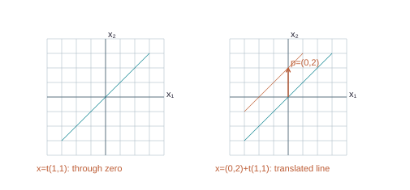

x = t(1,1) passes through the origin; x = (0,2) + t(1,1) is its parallel translated line.

@eq A(p + tv) = Ap + tAv = b + 0 = b

- Now keep the same A and change b to (7,-1,-4), as on Combined PDF pages 47-49.

- This system is nonhomogeneous.

- Its zero input is no longer a solution.

- We seek one particular solution p and all allowable homogeneous directions.

- Each coefficient column corresponds to one unknown;

- the column after the vertical divider records the right-hand sides.

- We use reversible row operations to reveal the constraints.

The starting matrix is:

@matrix {"a": [["3", "5", "-4", "7"], ["-3", "-2", "4", "-1"], ["6", "1", "-8", "-4"]], "bar": 3}

**Step 1: `R_1` ← (`1/3`)`R_1`.** Multiply every entry of row 1, including any right-hand side, by `1/3`. The pivot becomes 1; the multiplier is nonzero, so this step is reversible.

Before

@matrix {"a": [["3", "5", "-4", "7"], ["-3", "-2", "4", "-1"], ["6", "1", "-8", "-4"]], "bar": 3}

After

@matrix {"a": [["1", "5/3", "-4/3", "7/3"], ["-3", "-2", "4", "-1"], ["6", "1", "-8", "-4"]], "bar": 3}

Lavender: affected row. Sage: pivot used.

#### Calculate every entry in the changed row

Multiply every entry of old row 1 by `1/3`. This includes the constant column when one is present. The multiplier is nonzero, so division by it undoes the step.

Row 1, column 1

@eq (1/3)(3) = 3/3 = 1

Row 1, column 2

@eq (1/3)(5) = 5/3 = 5/3

Row 1, column 3

@eq (1/3)(-4) = -4/3 = -4/3

Row 1, column 4 (right-hand side)

@eq (1/3)(7) = 7/3 = 7/3

**Step 2: `R_2` ← `R_2` + (3)`R_1`.** Add 3 times row 1 to row 2. This cancels the entry in the pivot column while preserving the solutions. All other rows stay as displayed.

Before

@matrix {"a": [["1", "5/3", "-4/3", "7/3"], ["-3", "-2", "4", "-1"], ["6", "1", "-8", "-4"]], "bar": 3}

After

@matrix {"a": [["1", "5/3", "-4/3", "7/3"], ["0", "3", "0", "6"], ["6", "1", "-8", "-4"]], "bar": 3}

Lavender: affected row. Sage: pivot used.

#### Calculate every entry in the changed row

Multiply each entry of old row 1 by 3, then add it to the matching entry of old row 2. The other row is retained.

Row 2, column 1

@eq -3 + (3)(1) = -3 + 3 = 0

Row 2, column 2

@eq -2 + (3)(5/3) = -2 + 5 = 3

Row 2, column 3

@eq 4 + (3)(-4/3) = 4 - 4 = 0

Row 2, column 4 (right-hand side)

@eq -1 + (3)(7/3) = -1 + 7 = 6

**Step 3: `R_3` ← `R_3` + (-6)`R_1`.** Add -6 times row 1 to row 3. This cancels the entry in the pivot column while preserving the solutions. All other rows stay as displayed.

Before

@matrix {"a": [["1", "5/3", "-4/3", "7/3"], ["0", "3", "0", "6"], ["6", "1", "-8", "-4"]], "bar": 3}

After

@matrix {"a": [["1", "5/3", "-4/3", "7/3"], ["0", "3", "0", "6"], ["0", "-9", "0", "-18"]], "bar": 3}

Lavender: affected row. Sage: pivot used.

#### Calculate every entry in the changed row

Multiply each entry of old row 1 by -6, then add it to the matching entry of old row 3. The other row is retained.

Row 3, column 1

@eq 6 + (-6)(1) = 6 - 6 = 0

Row 3, column 2

@eq 1 + (-6)(5/3) = 1 - 10 = -9

Row 3, column 3

@eq -8 + (-6)(-4/3) = -8 + 8 = 0

Row 3, column 4 (right-hand side)

@eq -4 + (-6)(7/3) = -4 - 14 = -18

**Step 4: `R_2` ← (`1/3`)`R_2`.** Multiply every entry of row 2, including any right-hand side, by `1/3`. The pivot becomes 1; the multiplier is nonzero, so this step is reversible.

Before

@matrix {"a": [["1", "5/3", "-4/3", "7/3"], ["0", "3", "0", "6"], ["0", "-9", "0", "-18"]], "bar": 3}

After

@matrix {"a": [["1", "5/3", "-4/3", "7/3"], ["0", "1", "0", "2"], ["0", "-9", "0", "-18"]], "bar": 3}

Lavender: affected row. Sage: pivot used.

#### Calculate every entry in the changed row

Multiply every entry of old row 2 by `1/3`. This includes the constant column when one is present. The multiplier is nonzero, so division by it undoes the step.

Row 2, column 1

@eq (1/3)(0) = 0/3 = 0

Row 2, column 2

@eq (1/3)(3) = 3/3 = 1

Row 2, column 3

@eq (1/3)(0) = 0/3 = 0

Row 2, column 4 (right-hand side)

@eq (1/3)(6) = 6/3 = 2

**Step 5: `R_3` ← `R_3` + (9)`R_2`.** Add 9 times row 2 to row 3. This cancels the entry in the pivot column while preserving the solutions. All other rows stay as displayed.

Before

@matrix {"a": [["1", "5/3", "-4/3", "7/3"], ["0", "1", "0", "2"], ["0", "-9", "0", "-18"]], "bar": 3}

After

@matrix {"a": [["1", "5/3", "-4/3", "7/3"], ["0", "1", "0", "2"], ["0", "0", "0", "0"]], "bar": 3}

Lavender: affected row. Sage: pivot used.

#### Calculate every entry in the changed row

Multiply each entry of old row 2 by 9, then add it to the matching entry of old row 3. The other row is retained.

Row 3, column 1

@eq 0 + (9)(0) = 0 + 0 = 0

Row 3, column 2

@eq -9 + (9)(1) = -9 + 9 = 0

Row 3, column 3

@eq 0 + (9)(0) = 0 + 0 = 0

Row 3, column 4 (right-hand side)

@eq -18 + (9)(2) = -18 + 18 = 0

**Step 6: `R_1` ← `R_1` + (`-5/3`)`R_2`.** Add `-5/3` times row 2 to row 1. This cancels the entry in the pivot column while preserving the solutions. All other rows stay as displayed.

Before

@matrix {"a": [["1", "5/3", "-4/3", "7/3"], ["0", "1", "0", "2"], ["0", "0", "0", "0"]], "bar": 3}

After

@matrix {"a": [["1", "0", "-4/3", "-1"], ["0", "1", "0", "2"], ["0", "0", "0", "0"]], "bar": 3}

Lavender: affected row. Sage: pivot used.

#### Calculate every entry in the changed row

Multiply each entry of old row 2 by `-5/3`, then add it to the matching entry of old row 1. The other row is retained.

Row 1, column 1

@eq 1 + (-5/3)(0) = 1 + 0 = 1

Row 1, column 2

@eq 5/3 + (-5/3)(1) = 5/3 - 5/3 = 0

Row 1, column 3

@eq -4/3 + (-5/3)(0) = -4/3 + 0 = -4/3

Row 1, column 4 (right-hand side)

@eq 7/3 + (-5/3)(2) = 7/3 - 10/3 = -1

- **Read the equations.**

@eq x_1 - 4/3 x_3 = -1

- @eq x_2 = 2

- The pivot columns are 1, 2.

- Thus `x_1`, `x_2` are basic variables. `x_3` have no leading pivots.

- Their values may be chosen arbitrarily;

- the pivot equations then determine the remaining entries.

- A zero row means

@eq 0 = 0

and imposes no additional restriction.

- Set

@eq x_3 = s

with all parameters real.

- The complete coordinate answer is:

@eq x_1 = -1 + 4/3 s

@eq x_2 = 2

@eq x_3 = s

- In vector form, assemble the constant entries into p and the coefficients of each parameter into a direction vector.

- Every solution is

@eq x = p + s v_1

, where:

p =

@matrix {"a": [["-1"], ["2"], ["0"]], "bar": null}

`v_1` =

@matrix {"a": [["4/3"], ["0"], ["1"]], "bar": null}

- For example, setting all parameters to 0 gives

@eq x = p

- Setting

@eq s = 1

and all other parameters to 0 gives:

@matrix {"a": [["1/3"], ["2"], ["1"]], "bar": null}

These are different because the selected free coordinate changes. Infinitely many real parameter values give infinitely many different solutions.

**Verification in the original equations.** For p, the left-hand sides A p are:

@matrix {"a": [["7"], ["-1"], ["-4"]], "bar": null}

- These entries equal the original right-hand sides, in order.

- For direction `v_1`, multiplying by the original A gives the zero vector.

- Therefore

@eq A(p + s v_1) = A p + s A v_1 = b

for every parameter choice.

- Conversely, the pivot equations show that every solution has this form.

- Here

@eq p = (-1,2,0), v = (4/3,0,1)

, and

@eq x = p +

tv.

- The fixed p chooses a starting point that already satisfies

@eq Ax = b

- The scalar t is a free real number.

- The direction v tells how to move without changing the output, because

@eq Av = 0

- At

@eq t = 0

we get p;

- at

@eq t = 3

we get (3,2,3).

- Check the latter:

@eq 9 + 10 - 12 = 7, -9 - 4 + 12 = -1

, and

@eq 18 + 2 - 24 = -4

x = t(1,1) passes through the origin; x = (0,2) + t(1,1) is its parallel translated line.

- The figure uses simpler two-dimensional vectors to display the same principle.

- Translating a line through zero by p moves every point by the same vector.

- The new line is parallel to the original.

- For several free variables, an entire plane or higher-dimensional solution set is translated in the same way.

## 5.4 Why the complete solution is p plus a homogeneous solution

SEE THE IDEA

### Why the formula captures every solution

Start with one solution p. The difference between any other solution and p must produce zero.

@eq (2-t) + t = 2

- p = (2,0)

- Homogeneous direction v = (−1,1)

- All solutions: p + tv = (2−t,t)

- **Theorem (supplied Theorem 6).** Assume

@eq Ax = b

is consistent and fix a particular solution p.

- Then x is a solution exactly when

@eq x = p + v_h

for some `v_h` satisfying

@eq Av_h = 0

**Explore the Full Proof · Deeper Mathematical Explanation**

- State the assumptions

- Use the definition

- Justify each implication

- Reach the claimed conclusion

- To prove the forward direction, let x satisfy

@eq Ax = b

- Since

@eq Ap = b, A(x - p) = Ax - Ap = b - b = 0

- Thus

@eq v_h = x - p

is homogeneous and

@eq x = p + v_h

- For the reverse direction, start with any `v_h` satisfying

@eq Av_h = 0

- Then

@eq A(p + v_h) = Ap + Av_h = b + 0 = b

- so p + `v_h` is a solution.

- Both directions are needed: one says the formula produces solutions, the other says it misses none.

- The theorem requires consistency.

- If no particular solution exists, there is no p with which to translate.

- A nonhomogeneous solution set normally does not contain the origin and is not itself a span of its direction vectors.

## 5.5 Point, line, plane, or empty

SEE THE IDEA

### Count independent choices, after checking consistency

The solution set can be empty, or a translated set of homogeneous motions.

| Consistent? | Free parameters | Shape |
| --- | --- | --- |
| No | Irrelevant | Empty |
| Yes | 0 | Point |
| Yes | 1 | Line |
| Yes | 2 | Plane |
| Yes | k | Affine set of dimension k |

- With no free variables a consistent solution set is a single point.

- With one free variable it is a line, because the parameter direction cannot be zero: it has a 1 in its free coordinate.

- With two free variables it is a plane, because the two direction vectors have different free-coordinate patterns and are independent.

- A contradictory row makes the set empty.

- In larger input spaces, more free variables give analogous sets that cannot be fully drawn on a page.

- For

@eq x₁ + 2x₂ - x₃ = 4

, choose

@eq x₂ = s

and

@eq x₃ = t

- Then

@eq x = (4,0,0) + s(-2,1,0) + t(1,0,1)

- Setting both parameters to zero gives the particular solution.

- Multiplying the coefficient row by either direction gives 0.

- If the right side is changed to 0, the particular point disappears and the solution plane passes through the origin.

- **Common mistakes.** A homogeneous system is always consistent,

- but may have only the trivial solution.

- A nontrivial solution is not the same as a nonhomogeneous system.

- A parametric solution must include all its coordinates;

- writing only

@eq x₁ = 4 - 2s + t

leaves `x₂` and `x₃` unspecified.

- The parameter coefficients become direction vectors, while constants become the particular vector.

## 5.6 Practice

TRY IT YOURSELF · H1

**H1.** Solve `x₁` - 2`x₂` + `x₃` = 0 in parametric vector form. Show a nontrivial solution.

**Show Detailed Solution · H1**

**H1.**

#### Choose the coordinates that are not determined

@eq x_1 - 2x_2 + x_3 = 0

@eq x_2 = s

@eq x_3 = t

The one equation can determine `x₁` once `x₂` and `x₃` are chosen. The choices s and t are independent real numbers.

#### Calculate `x₁` from those choices

@eq x_1 - 2s + t = 0

@eq x_1 = 2s - t

#### Collect one direction for each parameter

@eq x = [2s-t;s;t] = s[2;1;0] + t[-1;0;1]

#### Check the entire family, not only one point

@eq (2s - t) - 2s + t = 0

This identity holds for every s,t. Conversely, the equation forces exactly `x₁` = 2s − t, so no solutions are omitted.

FINAL ANSWER

@eq x = s[2;1;0] + t[-1;0;1]

All s,t are real. For s = 1,t = 0 the solution is (2,1,0), which is nontrivial because it is not the zero vector.

TRY IT YOURSELF · H2

**H2.** Solve `x₁` - 2`x₂` + `x₃` = 5. Compare its geometry with H1 and prove your full answer works for arbitrary parameters.

**Show Detailed Solution · H2**

**H2.**

#### Choose two independent free coordinates

@eq x_2 = s

@eq x_3 = t

#### Use the equation with right side 5

@eq x_1 - 2s + t = 5

@eq x_1 = 5 + 2s - t

#### Separate the starting point from the directions

@eq x = [5;0;0] + s[2;1;0] + t[-1;0;1]

#### Verify for arbitrary parameters

@eq (5 + 2s - t) - 2s + t = 5

The cancellation works for every pair of real parameters. Conversely, every solution must have these coordinates.

FINAL ANSWER

@eq x = [5;0;0] + s[2;1;0] + t[-1;0;1]

This plane is H1 shifted by (5,0,0). The directions are unchanged, so the planes are parallel. The new plane does not pass through the origin.

TRY IT YOURSELF · H3

**H3.** If Ap = b and Aq = b, prove that p - q is a homogeneous solution. Explain what this says when Ax = 0 has only the trivial solution.

**Show Detailed Solution · H3**

**H3.**

#### Given: two inputs produce the same b

@eq Ap = b

@eq Aq = b

We must show that their difference produces zero. A homogeneous equation has zero on the right.

#### Apply distributivity

@eq A(p - q) = Ap - Aq

A acts on the subtraction coordinate by coordinate.

#### Substitute the two known outputs

@eq Ap - Aq = b - b = 0

#### Use the extra hypothesis if only zero is homogeneous

@eq A(p-q) = 0

@eq p - q = 0

@eq p = q

Under that hypothesis the difference cannot be any nonzero vector.

FINAL ANSWER

The difference p − q is a homogeneous solution. If the homogeneous equation has only zero, any two solutions of Ax = b coincide; every consistent system then has exactly one solution.

# 6. Section 1.7 - Linear independence

Source correspondence: Combined PDF pages 53-62; exercise PDF page 10.

## 6.1 Redundancy and the precise definition

SEE THE IDEA

### A redundant direction adds no new reach

Dependence means a nonzero choice of weights can cancel to zero.

Parallel generators supply one direction. Independent generators supply two distinct directions.

@eq 2(1,2) - (2,4) = (0,0)

**Remember.** The all-zero choice of weights proves nothing about dependence.

- Imagine assembling outputs from a collection of vectors.

- If one vector can already be constructed from the others, including it does not enlarge the span.

- It is redundant.

- Linear dependence is the algebraic way of detecting such redundancy, including cases that are hard to see geometrically.

- **Definition.** The indexed collection `v₁`,...,`v_p` is linearly independent when `c₁``v₁` + ... + `c_p`v

@eq _p = 0

forces `c₁` = ...

@eq = c_p = 0

- It is linearly dependent when at least one choice of weights, not all zero, gives the zero vector.

- Such a choice is a dependence relation. 'Not all zero' means at least one weight is nonzero, not that every weight must be nonzero.

- Every collection admits the zero-weight combination.

- Therefore the fact that

@eq Ax = 0

has a solution proves nothing about independence: it always does.

- The test asks whether it has only that trivial solution.

- Put the vectors into columns of A, solve

@eq Ax = 0

, and look for free variables.

- Every column pivot means independent.

- A free weight means dependent.

Parallel generators supply one direction. Independent generators supply two distinct directions.

- Two nonzero vectors along one line are dependent.

- Two vectors in the plane that point along different lines through zero are independent.

- Three vectors in `ℝ^3` may be independent or may lie in a common plane through zero;

- a picture alone should not replace a calculation when exact coordinates are available.

## 6.2 Deriving a relation in the lecture example

SEE THE IDEA

### One relation is enough

A verified nontrivial zero combination already proves dependence.

@eq 2v_1 - v_2 + v_3 = 0

@eq v_2 = 2v_1 + v_3

**Remember.** The second vector can be built from the others.

- For

@eq v₁ = (1,2,3), v₂ = (4,5,6), v₃ = (2,1,0)

, the lecture finds

@eq 10v₁ - 5v₂ + 5v₃ = 0

- We derive a smaller equivalent relation by choosing the free weight 1 rather than 5.

- The coefficient matrix contains the original vectors as columns.

The starting matrix is:

@matrix {"a": [["1", "4", "2", "0"], ["2", "5", "1", "0"], ["3", "6", "0", "0"]], "bar": 3}

**Step 1: `R_2` ← `R_2` + (-2)`R_1`.** Add -2 times row 1 to row 2. This cancels the entry in the pivot column while preserving the solutions. All other rows stay as displayed.

Before

@matrix {"a": [["1", "4", "2", "0"], ["2", "5", "1", "0"], ["3", "6", "0", "0"]], "bar": 3}

After

@matrix {"a": [["1", "4", "2", "0"], ["0", "-3", "-3", "0"], ["3", "6", "0", "0"]], "bar": 3}

Lavender: affected row. Sage: pivot used.

#### Calculate every entry in the changed row

Multiply each entry of old row 1 by -2, then add it to the matching entry of old row 2. The other row is retained.

Row 2, column 1

@eq 2 + (-2)(1) = 2 - 2 = 0

Row 2, column 2

@eq 5 + (-2)(4) = 5 - 8 = -3

Row 2, column 3

@eq 1 + (-2)(2) = 1 - 4 = -3

Row 2, column 4 (right-hand side)

@eq 0 + (-2)(0) = 0 + 0 = 0

**Step 2: `R_3` ← `R_3` + (-3)`R_1`.** Add -3 times row 1 to row 3. This cancels the entry in the pivot column while preserving the solutions. All other rows stay as displayed.

Before

@matrix {"a": [["1", "4", "2", "0"], ["0", "-3", "-3", "0"], ["3", "6", "0", "0"]], "bar": 3}

After

@matrix {"a": [["1", "4", "2", "0"], ["0", "-3", "-3", "0"], ["0", "-6", "-6", "0"]], "bar": 3}

Lavender: affected row. Sage: pivot used.

#### Calculate every entry in the changed row

Multiply each entry of old row 1 by -3, then add it to the matching entry of old row 3. The other row is retained.

Row 3, column 1

@eq 3 + (-3)(1) = 3 - 3 = 0

Row 3, column 2

@eq 6 + (-3)(4) = 6 - 12 = -6

Row 3, column 3

@eq 0 + (-3)(2) = 0 - 6 = -6

Row 3, column 4 (right-hand side)

@eq 0 + (-3)(0) = 0 + 0 = 0

**Step 3: `R_2` ← (`-1/3`)`R_2`.** Multiply every entry of row 2, including any right-hand side, by `-1/3`. The pivot becomes 1; the multiplier is nonzero, so this step is reversible.

Before

@matrix {"a": [["1", "4", "2", "0"], ["0", "-3", "-3", "0"], ["0", "-6", "-6", "0"]], "bar": 3}

After

@matrix {"a": [["1", "4", "2", "0"], ["0", "1", "1", "0"], ["0", "-6", "-6", "0"]], "bar": 3}

Lavender: affected row. Sage: pivot used.

#### Calculate every entry in the changed row

Multiply every entry of old row 2 by `-1/3`. This includes the constant column when one is present. The multiplier is nonzero, so division by it undoes the step.

Row 2, column 1

@eq (-1/3)(0) = 0/3 = 0

Row 2, column 2

@eq (-1/3)(-3) = 3/3 = 1

Row 2, column 3

@eq (-1/3)(-3) = 3/3 = 1

Row 2, column 4 (right-hand side)

@eq (-1/3)(0) = 0/3 = 0

**Step 4: `R_3` ← `R_3` + (6)`R_2`.** Add 6 times row 2 to row 3. This cancels the entry in the pivot column while preserving the solutions. All other rows stay as displayed.

Before

@matrix {"a": [["1", "4", "2", "0"], ["0", "1", "1", "0"], ["0", "-6", "-6", "0"]], "bar": 3}

After

@matrix {"a": [["1", "4", "2", "0"], ["0", "1", "1", "0"], ["0", "0", "0", "0"]], "bar": 3}

Lavender: affected row. Sage: pivot used.

#### Calculate every entry in the changed row

Multiply each entry of old row 2 by 6, then add it to the matching entry of old row 3. The other row is retained.

Row 3, column 1

@eq 0 + (6)(0) = 0 + 0 = 0

Row 3, column 2

@eq -6 + (6)(1) = -6 + 6 = 0

Row 3, column 3

@eq -6 + (6)(1) = -6 + 6 = 0

Row 3, column 4 (right-hand side)

@eq 0 + (6)(0) = 0 + 0 = 0

**Step 5: `R_1` ← `R_1` + (-4)`R_2`.** Add -4 times row 2 to row 1. This cancels the entry in the pivot column while preserving the solutions. All other rows stay as displayed.

Before

@matrix {"a": [["1", "4", "2", "0"], ["0", "1", "1", "0"], ["0", "0", "0", "0"]], "bar": 3}

After

@matrix {"a": [["1", "0", "-2", "0"], ["0", "1", "1", "0"], ["0", "0", "0", "0"]], "bar": 3}

Lavender: affected row. Sage: pivot used.

#### Calculate every entry in the changed row

Multiply each entry of old row 2 by -4, then add it to the matching entry of old row 1. The other row is retained.

Row 1, column 1

@eq 1 + (-4)(0) = 1 + 0 = 1

Row 1, column 2

@eq 4 + (-4)(1) = 4 - 4 = 0

Row 1, column 3

@eq 2 + (-4)(1) = 2 - 4 = -2

Row 1, column 4 (right-hand side)

@eq 0 + (-4)(0) = 0 + 0 = 0

- Column 3 has no pivot.

- Give its weight the value 1 and give any other free weights the value 0.

- The pivot equations determine the weights:

@matrix {"a": [["2"], ["-1"], ["1"]], "bar": null}

- At least one weight is nonzero.

- The resulting dependence relation is:

@eq 2 v_1 - v_2 + v_3 = 0

- Multiplying the original columns by these weights gives the zero vector, entry by entry.

- This proves dependence;

- the existence of a zero combination with every weight zero would not prove it.

- The relation

@eq 2v₁ - v₂ + v₃ = 0

rearranges to

@eq v₂ = 2v₁ + v₃

- Thus the second vector adds no new attainable direction.

- Multiplying every weight by 5 gives the lecture relation.

- Nontrivial relations are not unique;

- one verified relation is sufficient to prove dependence.

## 6.3 The characterization theorem and its proof

SEE THE IDEA

### Dependence means at least one redundant vector

Choose a nonzero coefficient in a zero combination and solve for its vector.

- Σ `c_j``v_j` = 0 with some `c_j` ≠ 0

- Move the other terms to the right

- Divide by that nonzero `c_j`

- One vector is a combination of the others

**Remember.** “At least one” does not mean “every one”.

- **Theorem (supplied Theorem 7).** A collection of at least two vectors is dependent if and only if one vector is a linear combination of the others.

- If

@eq v₁ ≠ 0

and the indexed collection is dependent, some later vector is a combination of its predecessors.

**Explore the Full Proof · Deeper Mathematical Explanation**

- State the assumptions

- Use the definition

- Justify each implication

- Reach the claimed conclusion

- If `v_j` is a combination of the others, subtract that expression from `v_j`.

- The resulting zero combination has coefficient 1 on `v_j`,

- so it is nontrivial.

- Conversely, take a nontrivial zero combination and select an index j with

@eq c_j ≠ 0

- Rearrange to `c_j`v

@eq _j = -Σ

for

@eq i ≠ j

of `c_i` `v_i`, then divide by `c_j`.

- The division is valid because that coefficient is nonzero.

- It expresses `v_j` in terms of the others.

- For the predecessor statement, choose j to be the largest index with nonzero coefficient.

- All later coefficients vanish;

- if

@eq v₁ ≠ 0

then j cannot be 1, since

@eq c₁v₁ ≠ 0

when

@eq c₁ ≠ 0

- The theorem says at least one vector is redundant, not every vector.

- For {0,(1,0)}, the zero vector is obtainable using the other vector with weight 0,

- but (1,0) is not obtainable from the zero vector.

- This counterexample is useful in the course true/false questions.

## 6.4 Fast tests and their limitations

SEE THE IDEA

### Fast tests have one-way limits

Use the conditions exactly as stated.

| Situation | Conclusion |
| --- | --- |
| Zero vector is included | Dependent |
| More vectors than entries in each | Dependent |
| Two nonzero vectors are not scalar multiples | Independent pair |
| No zero vector is included | Not enough information |
| Fewer vectors than entries | Not enough information |

- A one-vector collection {v} is independent exactly when

@eq v ≠ 0

- If

@eq v ≠ 0

and

@eq cv = 0

, a nonzero entry of v forces

@eq c = 0

- If

@eq v = 0

, the coefficient

@eq c = 1

gives a nontrivial relation.

- A collection containing zero is therefore dependent: give zero weight 1 and all others weight 0.

- Two vectors are dependent exactly when one is a scalar multiple of the other, including the case where one is zero.

- To prove independence of two nonzero vectors, show that no single scalar makes all coordinates match.

- Comparing only one coordinate is not enough when it supplies no restriction, such as a coordinate that is zero in both.

- **Theorem (supplied Theorem 8).** More than n vectors in `ℝ^n` are dependent.

- Put p > n vectors into an n × p matrix.

- There can be at most n pivots,

- so at least one of the p weights is free.

- The homogeneous system has a nontrivial solution.

- The converse is false: two vectors in `ℝ^3` may already be dependent, for example (1,0,0) and (2,0,0).

- For an independent pair u,v in `ℝ^3`, w belongs to Span{u,v} exactly when {u,v,w} is dependent.

- The assumption that u,v are independent matters.

- Without it, the triple could be dependent before w was added, even if w lies outside their line.

## 6.5 An independent example

SEE THE IDEA

### Independence forces every weight to zero

Use the columns as given; solve the homogeneous equation for their weights.

@matrix {"a": [["1", "0", "0", "0"], ["0", "1", "0", "0"], ["0", "0", "1", "0"]], "bar": 3}

If the reduced coefficient block is I, all three weights are 0.

- The following three columns are tested by solving the homogeneous system.

- A final identity coefficient block means each weight must vanish;

- it does not assert that the original vectors were themselves identity columns.

The starting matrix is:

@matrix {"a": [["1", "0", "2", "0"], ["0", "1", "-1", "0"], ["1", "1", "0", "0"]], "bar": 3}

**Step 1: `R_3` ← `R_3` + (-1)`R_1`.** Add -1 times row 1 to row 3. This cancels the entry in the pivot column while preserving the solutions. All other rows stay as displayed.

Before

@matrix {"a": [["1", "0", "2", "0"], ["0", "1", "-1", "0"], ["1", "1", "0", "0"]], "bar": 3}

After

@matrix {"a": [["1", "0", "2", "0"], ["0", "1", "-1", "0"], ["0", "1", "-2", "0"]], "bar": 3}

Lavender: affected row. Sage: pivot used.

#### Calculate every entry in the changed row

Multiply each entry of old row 1 by -1, then add it to the matching entry of old row 3. The other row is retained.

Row 3, column 1

@eq 1 + (-1)(1) = 1 - 1 = 0

Row 3, column 2

@eq 1 + (-1)(0) = 1 + 0 = 1

Row 3, column 3

@eq 0 + (-1)(2) = 0 - 2 = -2

Row 3, column 4 (right-hand side)

@eq 0 + (-1)(0) = 0 + 0 = 0

**Step 2: `R_3` ← `R_3` + (-1)`R_2`.** Add -1 times row 2 to row 3. This cancels the entry in the pivot column while preserving the solutions. All other rows stay as displayed.

Before

@matrix {"a": [["1", "0", "2", "0"], ["0", "1", "-1", "0"], ["0", "1", "-2", "0"]], "bar": 3}

After

@matrix {"a": [["1", "0", "2", "0"], ["0", "1", "-1", "0"], ["0", "0", "-1", "0"]], "bar": 3}

Lavender: affected row. Sage: pivot used.

#### Calculate every entry in the changed row

Multiply each entry of old row 2 by -1, then add it to the matching entry of old row 3. The other row is retained.

Row 3, column 1

@eq 0 + (-1)(0) = 0 + 0 = 0

Row 3, column 2

@eq 1 + (-1)(1) = 1 - 1 = 0

Row 3, column 3

@eq -2 + (-1)(-1) = -2 + 1 = -1

Row 3, column 4 (right-hand side)

@eq 0 + (-1)(0) = 0 + 0 = 0

**Step 3: `R_3` ← (-1)`R_3`.** Multiply every entry of row 3, including any right-hand side, by -1. The pivot becomes 1; the multiplier is nonzero, so this step is reversible.

Before

@matrix {"a": [["1", "0", "2", "0"], ["0", "1", "-1", "0"], ["0", "0", "-1", "0"]], "bar": 3}

After

@matrix {"a": [["1", "0", "2", "0"], ["0", "1", "-1", "0"], ["0", "0", "1", "0"]], "bar": 3}

Lavender: affected row. Sage: pivot used.

#### Calculate every entry in the changed row

Multiply every entry of old row 3 by -1. This includes the constant column when one is present. The multiplier is nonzero, so division by it undoes the step.

Row 3, column 1

@eq (-1)(0) = 0/1 = 0

Row 3, column 2

@eq (-1)(0) = 0/1 = 0

Row 3, column 3

@eq (-1)(-1) = 1/1 = 1

Row 3, column 4 (right-hand side)

@eq (-1)(0) = 0/1 = 0

**Step 4: `R_1` ← `R_1` + (-2)`R_3`.** Add -2 times row 3 to row 1. This cancels the entry in the pivot column while preserving the solutions. All other rows stay as displayed.

Before

@matrix {"a": [["1", "0", "2", "0"], ["0", "1", "-1", "0"], ["0", "0", "1", "0"]], "bar": 3}

After

@matrix {"a": [["1", "0", "0", "0"], ["0", "1", "-1", "0"], ["0", "0", "1", "0"]], "bar": 3}

Lavender: affected row. Sage: pivot used.

#### Calculate every entry in the changed row

Multiply each entry of old row 3 by -2, then add it to the matching entry of old row 1. The other row is retained.

Row 1, column 1

@eq 1 + (-2)(0) = 1 + 0 = 1

Row 1, column 2

@eq 0 + (-2)(0) = 0 + 0 = 0

Row 1, column 3

@eq 2 + (-2)(1) = 2 - 2 = 0

Row 1, column 4 (right-hand side)

@eq 0 + (-2)(0) = 0 + 0 = 0

**Step 5: `R_2` ← `R_2` + (1)`R_3`.** Add 1 times row 3 to row 2. This cancels the entry in the pivot column while preserving the solutions. All other rows stay as displayed.

Before

@matrix {"a": [["1", "0", "0", "0"], ["0", "1", "-1", "0"], ["0", "0", "1", "0"]], "bar": 3}

After

@matrix {"a": [["1", "0", "0", "0"], ["0", "1", "0", "0"], ["0", "0", "1", "0"]], "bar": 3}

Lavender: affected row. Sage: pivot used.

#### Calculate every entry in the changed row

Multiply each entry of old row 3 by 1, then add it to the matching entry of old row 2. The other row is retained.

Row 2, column 1

@eq 0 + (1)(0) = 0 + 0 = 0

Row 2, column 2

@eq 1 + (1)(0) = 1 + 0 = 1

Row 2, column 3

@eq -1 + (1)(1) = -1 + 1 = 0

Row 2, column 4 (right-hand side)

@eq 0 + (1)(0) = 0 + 0 = 0

- Every coefficient column has a pivot.

- The equations force every weight to be zero.

- Hence the columns are linearly independent: no nontrivial dependence relation exists.

## 6.6 Practice

TRY IT YOURSELF · I1

**I1.** Test (1,2), (2,4), (0,1) for independence and give an explicit nontrivial relation.

**Show Detailed Solution · I1**

**I1.**

#### What does a dependence relation ask for?

Find weights that are not all zero but whose weighted vectors add to zero. A zero weight on one vector is allowed.

#### Use the fact that the second vector is twice the first

@eq 2[1;2] - [2;4] + 0[0;1] = [2;4] - [2;4] + [0;0]

@eq [0;0]

#### Check the weights

@eq [2;-1;0]

At least the weights 2 and −1 are nonzero. This is different from choosing all three weights zero, which always works and proves no dependence.

FINAL ANSWER

The three vectors are dependent. They also outnumber the 2 entries in each vector, which independently gives the same conclusion.

TRY IT YOURSELF · I2

**I2.** Test (1,0,1), (0,1,1), (1,1,0) for independence by a homogeneous system.

**Show Detailed Solution · I2**

**I2.**

**I2.** Use the vectors as columns and solve the homogeneous system.

The starting matrix is:

@matrix {"a": [["1", "0", "1", "0"], ["0", "1", "1", "0"], ["1", "1", "0", "0"]], "bar": 3}

**Step 1: `R_3` ← `R_3` + (-1)`R_1`.** Add -1 times row 1 to row 3. This cancels the entry in the pivot column while preserving the solutions. All other rows stay as displayed.

Before

@matrix {"a": [["1", "0", "1", "0"], ["0", "1", "1", "0"], ["1", "1", "0", "0"]], "bar": 3}

After

@matrix {"a": [["1", "0", "1", "0"], ["0", "1", "1", "0"], ["0", "1", "-1", "0"]], "bar": 3}

Lavender: affected row. Sage: pivot used.

#### Calculate every entry in the changed row

Multiply each entry of old row 1 by -1, then add it to the matching entry of old row 3. The other row is retained.

Row 3, column 1

@eq 1 + (-1)(1) = 1 - 1 = 0

Row 3, column 2

@eq 1 + (-1)(0) = 1 + 0 = 1

Row 3, column 3

@eq 0 + (-1)(1) = 0 - 1 = -1

Row 3, column 4 (right-hand side)

@eq 0 + (-1)(0) = 0 + 0 = 0

**Step 2: `R_3` ← `R_3` + (-1)`R_2`.** Add -1 times row 2 to row 3. This cancels the entry in the pivot column while preserving the solutions. All other rows stay as displayed.

Before

@matrix {"a": [["1", "0", "1", "0"], ["0", "1", "1", "0"], ["0", "1", "-1", "0"]], "bar": 3}

After

@matrix {"a": [["1", "0", "1", "0"], ["0", "1", "1", "0"], ["0", "0", "-2", "0"]], "bar": 3}

Lavender: affected row. Sage: pivot used.

#### Calculate every entry in the changed row

Multiply each entry of old row 2 by -1, then add it to the matching entry of old row 3. The other row is retained.

Row 3, column 1

@eq 0 + (-1)(0) = 0 + 0 = 0

Row 3, column 2

@eq 1 + (-1)(1) = 1 - 1 = 0

Row 3, column 3

@eq -1 + (-1)(1) = -1 - 1 = -2

Row 3, column 4 (right-hand side)

@eq 0 + (-1)(0) = 0 + 0 = 0

**Step 3: `R_3` ← (`-1/2`)`R_3`.** Multiply every entry of row 3, including any right-hand side, by `-1/2`. The pivot becomes 1; the multiplier is nonzero, so this step is reversible.

Before

@matrix {"a": [["1", "0", "1", "0"], ["0", "1", "1", "0"], ["0", "0", "-2", "0"]], "bar": 3}

After

@matrix {"a": [["1", "0", "1", "0"], ["0", "1", "1", "0"], ["0", "0", "1", "0"]], "bar": 3}

Lavender: affected row. Sage: pivot used.

#### Calculate every entry in the changed row

Multiply every entry of old row 3 by `-1/2`. This includes the constant column when one is present. The multiplier is nonzero, so division by it undoes the step.

Row 3, column 1

@eq (-1/2)(0) = 0/2 = 0

Row 3, column 2

@eq (-1/2)(0) = 0/2 = 0

Row 3, column 3

@eq (-1/2)(-2) = 2/2 = 1

Row 3, column 4 (right-hand side)

@eq (-1/2)(0) = 0/2 = 0

**Step 4: `R_1` ← `R_1` + (-1)`R_3`.** Add -1 times row 3 to row 1. This cancels the entry in the pivot column while preserving the solutions. All other rows stay as displayed.

Before

@matrix {"a": [["1", "0", "1", "0"], ["0", "1", "1", "0"], ["0", "0", "1", "0"]], "bar": 3}

After

@matrix {"a": [["1", "0", "0", "0"], ["0", "1", "1", "0"], ["0", "0", "1", "0"]], "bar": 3}

Lavender: affected row. Sage: pivot used.

#### Calculate every entry in the changed row

Multiply each entry of old row 3 by -1, then add it to the matching entry of old row 1. The other row is retained.

Row 1, column 1

@eq 1 + (-1)(0) = 1 + 0 = 1

Row 1, column 2

@eq 0 + (-1)(0) = 0 + 0 = 0

Row 1, column 3

@eq 1 + (-1)(1) = 1 - 1 = 0

Row 1, column 4 (right-hand side)

@eq 0 + (-1)(0) = 0 + 0 = 0

**Step 5: `R_2` ← `R_2` + (-1)`R_3`.** Add -1 times row 3 to row 2. This cancels the entry in the pivot column while preserving the solutions. All other rows stay as displayed.

Before

@matrix {"a": [["1", "0", "0", "0"], ["0", "1", "1", "0"], ["0", "0", "1", "0"]], "bar": 3}

After

@matrix {"a": [["1", "0", "0", "0"], ["0", "1", "0", "0"], ["0", "0", "1", "0"]], "bar": 3}

Lavender: affected row. Sage: pivot used.

#### Calculate every entry in the changed row

Multiply each entry of old row 3 by -1, then add it to the matching entry of old row 2. The other row is retained.

Row 2, column 1

@eq 0 + (-1)(0) = 0 + 0 = 0

Row 2, column 2

@eq 1 + (-1)(0) = 1 + 0 = 1

Row 2, column 3

@eq 1 + (-1)(1) = 1 - 1 = 0

Row 2, column 4 (right-hand side)

@eq 0 + (-1)(0) = 0 + 0 = 0

- Every coefficient column has a pivot.

- The equations force every weight to be zero.

- Hence the columns are linearly independent: no nontrivial dependence relation exists.

#### What does the reduced matrix say?

@matrix {"a": [["1", "0", "0", "0"], ["0", "1", "0", "0"], ["0", "0", "1", "0"]], "bar": 3}

There are 3 equations and 3 unknown weights or coordinates. The divider separates the constants from those unknowns.

#### Separate determined coordinates from free choices

| Coordinate | Look at its column | What you may do |
| --- | --- | --- |
| `x_1` | Pivot column → basic | Determined by its pivot equation |
| `x_2` | Pivot column → basic | Determined by its pivot equation |
| `x_3` | Pivot column → basic | Determined by its pivot equation |

#### Determine x1 from its row

@eq x_1 = 0

@eq x_1 = 0

Subtract each free-variable term from both sides. The pivot coefficient is 1, so no further division is needed.

#### Determine x2 from its row

@eq x_2 = 0

@eq x_2 = 0

Subtract each free-variable term from both sides. The pivot coefficient is 1, so no further division is needed.

#### Determine x3 from its row

@eq x_3 = 0

@eq x_3 = 0

Subtract each free-variable term from both sides. The pivot coefficient is 1, so no further division is needed.

#### Verify the starting point in every original equation

@eq (1)(0) + (0)(0) + (1)(0) = 0 + 0 + 0 = 0

@eq (0)(0) + (1)(0) + (1)(0) = 0 + 0 + 0 = 0

@eq (1)(0) + (1)(0) + (0)(0) = 0 + 0 + 0 = 0

FINAL ANSWER

@eq x = [0;0;0]

Every coordinate is fixed. There are no free choices, so the solution is unique.

The only zero-producing input is zero, so the given columns are linearly independent.

TRY IT YOURSELF · I3

**I3.** Prove that a subset of an independent collection is independent. Explain why a superset of a dependent collection is dependent.

**Show Detailed Solution · I3**

**I3.**

#### First claim: take a subset of an independent collection

Suppose a weighted sum of the subset vectors is zero. Assign weight 0 to every vector omitted from the full collection. The extended sum is still zero.

#### Apply independence of the full collection

Its only zero-producing weights are all zero. In particular, the original subset weights must all be zero. That is exactly independence of the subset.

#### Second claim: enlarge a dependent collection

Start with its known zero combination whose weights are not all zero. Give each added vector weight 0. The old nonzero weights remain nonzero, and the extended sum is still zero.

FINAL ANSWER

Every subset of an independent collection is independent. Every superset of a dependent collection is dependent. The argument uses zero weights to pass between collections without changing the sum.

TRY IT YOURSELF · I4

**I4.** Disprove: 'If a collection has no zero vector, then it is independent.'

**Show Detailed Solution · I4**

**I4.**

#### Choose two nonzero vectors on the same line

@matrix {"a": [["1"], ["0"]], "bar": null}

@matrix {"a": [["2"], ["0"]], "bar": null}

#### Find a nontrivial zero combination

@eq 2[1;0] - [2;0] = [2;0] - [2;0] = [0;0]

The weights 2 and −1 are not both zero.

FINAL ANSWER

The statement is false. Excluding the zero vector is necessary for independence, but is not sufficient: nonzero vectors may still repeat a direction.

# 7. Section 1.8 - Introduction to linear transformations

Source correspondence: Combined PDF pages 63-70; exercise PDF page 11.

## 7.1 Inputs, outputs, and reachable outputs

SEE THE IDEA

### An image goes forward; a preimage solves backward

T(x) = Ax takes an input to an output. Finding an input for b means solving Ax = b.

- Input x in the domain

- Apply A

- Image Ax in the codomain

| Task | Method |
| --- | --- |
| Find T(x) | Multiply |
| Find x with T(x) = b | Solve [A \| b] |
| Is b in the range? | Test consistency |

A function assigns exactly one output to every allowed input. A transformation or mapping is another name for a function. The domain lists allowed inputs. The codomain is the declared space containing the outputs. The image T(x) is the particular output produced by x. The range is the set of all outputs that are actually attained as x varies.

- For T: `ℝ^2` → `ℝ^3` with

@eq T(x) = Ax

and A a 3 × 2 matrix, each input has two entries and each output has three.

- The range is the span of A's columns, a subset of `ℝ^3`.

- The codomain is still `ℝ^3` even if only a plane is attained.

- Do not shrink the codomain silently in order to make a statement about onto behavior true.

- Computing T(u) means multiplying A by a known input u.

- Finding an x with

@eq T(x) = b

means solving

@eq Ax = b

- Checking whether b is in the range means deciding whether that system is consistent.

- These requests use different directions of the input-output relationship.

## 7.2 Complete lecture example: image and preimage

SEE THE IDEA

### All output coordinates must match

An input that matches only some coordinates is not a preimage.

- Record A and the requested b

- Reduce the full augmented matrix

- A contradiction means this output is unreachable

- The lecture matrix is

@eq A = [1,-3;3,5;-1,7]

, with

@eq u = (2,-1), b = (3,2,-5)

, and

@eq c = (3,2,5)

- First compute the image of u.

In this calculation, L is the left factor and R is the right factor.

#### Read L: 3 rows, 2 columns

A row runs horizontally, from left to right. A column runs vertically, from top to bottom. Count rows first when writing a size.

@matrix {"a": [["1", "-3"], ["3", "5"], ["-1", "7"]], "bar": null}

L has size 3 × 2.

#### Read R: 2 rows, 1 column

@matrix {"a": [["2"], ["-1"]], "bar": null}

R has size 2 × 1.

#### Check that multiplication is allowed

(3 × **2**)(**2** × 1)→ 3 × 1

The highlighted inner counts are both 2: every row of the left factor has one entry for every row of the right factor. The outside counts tell us the output has 3 rows and 1 column.

#### Calculate output row 1

Take row 1 of L and column 1 of R. Pair entries in their original order: multiply the first pair, the second pair, and so on. Then add.

@matrix {"a": [["1", "-3"], ["3", "5"], ["-1", "7"]], "bar": null}

Use this highlighted row 1.

@matrix {"a": [["2"], ["-1"]], "bar": null}

Pair it with highlighted column 1.

@eq c_{11} = (1)(2) + (-3)(-1) = 5

@eq 2 + 3

@eq 5

#### Calculate output row 2

Take row 2 of L and column 1 of R. Pair entries in their original order: multiply the first pair, the second pair, and so on. Then add.

@matrix {"a": [["1", "-3"], ["3", "5"], ["-1", "7"]], "bar": null}

Use this highlighted row 2.

@matrix {"a": [["2"], ["-1"]], "bar": null}

Pair it with highlighted column 1.

@eq c_{21} = (3)(2) + (5)(-1) = 1

@eq 6 - 5

@eq 1

#### Calculate output row 3

Take row 3 of L and column 1 of R. Pair entries in their original order: multiply the first pair, the second pair, and so on. Then add.

@matrix {"a": [["1", "-3"], ["3", "5"], ["-1", "7"]], "bar": null}

Use this highlighted row 3.

@matrix {"a": [["2"], ["-1"]], "bar": null}

Pair it with highlighted column 1.

@eq c_{31} = (-1)(2) + (7)(-1) = -9

@eq -2 - 7

@eq -9

#### Put the entries into their output positions

@matrix {"a": [["5"], ["1"], ["-9"]], "bar": null}

The result has 3 rows and 1 column.

#### Check with the column method

The entries of R are weights. Weight 1 multiplies column 1 of L, weight 2 multiplies column 2, and so on. A negative weight reverses the sign of every entry in that column.

Column 1, with weight 2:

@eq 2 [1;3;-1] = [2;6;-2]

Column 2, with weight -1:

@eq -1 [-3;5;7] = [3;-5;-7]

@eq y_1 = 2 + 3 = 5

@eq y_2 = 6 - 5 = 1

@eq y_3 = -2 - 7 = -9

@matrix {"a": [["5"], ["1"], ["-9"]], "bar": null}

Both methods add exactly the same products. The row method groups them by output entry. The column method groups them by input weight. Regrouping a finite sum does not change its value.

FINAL ANSWER

@eq LR = [5;1;-9]

Dimensions: (3 × 2)(2 × 1) = 3 × 1.

Now solve for a preimage of b. The unknown is an input in `ℝ^2`, not an output in `ℝ^3`.

- Each coefficient column corresponds to one unknown;

- the column after the vertical divider records the right-hand sides.

- We use reversible row operations to reveal the constraints.

The starting matrix is:

@matrix {"a": [["1", "-3", "3"], ["3", "5", "2"], ["-1", "7", "-5"]], "bar": 2}

**Step 1: `R_2` ← `R_2` + (-3)`R_1`.** Add -3 times row 1 to row 2. This cancels the entry in the pivot column while preserving the solutions. All other rows stay as displayed.

Before

@matrix {"a": [["1", "-3", "3"], ["3", "5", "2"], ["-1", "7", "-5"]], "bar": 2}

After

@matrix {"a": [["1", "-3", "3"], ["0", "14", "-7"], ["-1", "7", "-5"]], "bar": 2}

Lavender: affected row. Sage: pivot used.

#### Calculate every entry in the changed row

Multiply each entry of old row 1 by -3, then add it to the matching entry of old row 2. The other row is retained.

Row 2, column 1

@eq 3 + (-3)(1) = 3 - 3 = 0

Row 2, column 2

@eq 5 + (-3)(-3) = 5 + 9 = 14

Row 2, column 3 (right-hand side)

@eq 2 + (-3)(3) = 2 - 9 = -7

**Step 2: `R_3` ← `R_3` + (1)`R_1`.** Add 1 times row 1 to row 3. This cancels the entry in the pivot column while preserving the solutions. All other rows stay as displayed.

Before

@matrix {"a": [["1", "-3", "3"], ["0", "14", "-7"], ["-1", "7", "-5"]], "bar": 2}

After

@matrix {"a": [["1", "-3", "3"], ["0", "14", "-7"], ["0", "4", "-2"]], "bar": 2}

Lavender: affected row. Sage: pivot used.

#### Calculate every entry in the changed row

Multiply each entry of old row 1 by 1, then add it to the matching entry of old row 3. The other row is retained.

Row 3, column 1

@eq -1 + (1)(1) = -1 + 1 = 0

Row 3, column 2

@eq 7 + (1)(-3) = 7 - 3 = 4

Row 3, column 3 (right-hand side)

@eq -5 + (1)(3) = -5 + 3 = -2

**Step 3: `R_2` ← (`1/14`)`R_2`.** Multiply every entry of row 2, including any right-hand side, by `1/14`. The pivot becomes 1; the multiplier is nonzero, so this step is reversible.

Before

@matrix {"a": [["1", "-3", "3"], ["0", "14", "-7"], ["0", "4", "-2"]], "bar": 2}

After

@matrix {"a": [["1", "-3", "3"], ["0", "1", "-1/2"], ["0", "4", "-2"]], "bar": 2}

Lavender: affected row. Sage: pivot used.

#### Calculate every entry in the changed row

Multiply every entry of old row 2 by `1/14`. This includes the constant column when one is present. The multiplier is nonzero, so division by it undoes the step.

Row 2, column 1

@eq (1/14)(0) = 0/14 = 0

Row 2, column 2

@eq (1/14)(14) = 14/14 = 1

Row 2, column 3 (right-hand side)

@eq (1/14)(-7) = -7/14 = -1/2

**Step 4: `R_3` ← `R_3` + (-4)`R_2`.** Add -4 times row 2 to row 3. This cancels the entry in the pivot column while preserving the solutions. All other rows stay as displayed.

Before

@matrix {"a": [["1", "-3", "3"], ["0", "1", "-1/2"], ["0", "4", "-2"]], "bar": 2}

After

@matrix {"a": [["1", "-3", "3"], ["0", "1", "-1/2"], ["0", "0", "0"]], "bar": 2}

Lavender: affected row. Sage: pivot used.

#### Calculate every entry in the changed row

Multiply each entry of old row 2 by -4, then add it to the matching entry of old row 3. The other row is retained.

Row 3, column 1

@eq 0 + (-4)(0) = 0 + 0 = 0

Row 3, column 2

@eq 4 + (-4)(1) = 4 - 4 = 0

Row 3, column 3 (right-hand side)

@eq -2 + (-4)(-1/2) = -2 + 2 = 0

**Step 5: `R_1` ← `R_1` + (3)`R_2`.** Add 3 times row 2 to row 1. This cancels the entry in the pivot column while preserving the solutions. All other rows stay as displayed.

Before

@matrix {"a": [["1", "-3", "3"], ["0", "1", "-1/2"], ["0", "0", "0"]], "bar": 2}

After

@matrix {"a": [["1", "0", "3/2"], ["0", "1", "-1/2"], ["0", "0", "0"]], "bar": 2}

Lavender: affected row. Sage: pivot used.

#### Calculate every entry in the changed row

Multiply each entry of old row 2 by 3, then add it to the matching entry of old row 1. The other row is retained.

Row 1, column 1

@eq 1 + (3)(0) = 1 + 0 = 1

Row 1, column 2

@eq -3 + (3)(1) = -3 + 3 = 0

Row 1, column 3 (right-hand side)

@eq 3 + (3)(-1/2) = 3 - 3/2 = 3/2

- **Read the equations.**

@eq x_1 = 3/2

- @eq x_2 = -1/2

- Every unknown is basic,

- so no arbitrary choices remain.

- There is exactly one solution:

@matrix {"a": [["3/2"], ["-1/2"]], "bar": null}

**Verification in the original equations.** For p, the left-hand sides A p are:

@matrix {"a": [["3"], ["2"], ["-5"]], "bar": null}

These entries equal the original right-hand sides, in order.

- The input is (`3/2`,`-1/2`) and is unique.

- To test whether c is reachable, repeat with c as the appended column.

- Each coefficient column corresponds to one unknown;

- the column after the vertical divider records the right-hand sides.

- We use reversible row operations to reveal the constraints.

The starting matrix is:

@matrix {"a": [["1", "-3", "3"], ["3", "5", "2"], ["-1", "7", "5"]], "bar": 2}

**Step 1: `R_2` ← `R_2` + (-3)`R_1`.** Add -3 times row 1 to row 2. This cancels the entry in the pivot column while preserving the solutions. All other rows stay as displayed.

Before

@matrix {"a": [["1", "-3", "3"], ["3", "5", "2"], ["-1", "7", "5"]], "bar": 2}

After

@matrix {"a": [["1", "-3", "3"], ["0", "14", "-7"], ["-1", "7", "5"]], "bar": 2}

Lavender: affected row. Sage: pivot used.

#### Calculate every entry in the changed row

Multiply each entry of old row 1 by -3, then add it to the matching entry of old row 2. The other row is retained.

Row 2, column 1

@eq 3 + (-3)(1) = 3 - 3 = 0

Row 2, column 2

@eq 5 + (-3)(-3) = 5 + 9 = 14

Row 2, column 3 (right-hand side)

@eq 2 + (-3)(3) = 2 - 9 = -7

**Step 2: `R_3` ← `R_3` + (1)`R_1`.** Add 1 times row 1 to row 3. This cancels the entry in the pivot column while preserving the solutions. All other rows stay as displayed.

Before

@matrix {"a": [["1", "-3", "3"], ["0", "14", "-7"], ["-1", "7", "5"]], "bar": 2}

After

@matrix {"a": [["1", "-3", "3"], ["0", "14", "-7"], ["0", "4", "8"]], "bar": 2}

Lavender: affected row. Sage: pivot used.

#### Calculate every entry in the changed row

Multiply each entry of old row 1 by 1, then add it to the matching entry of old row 3. The other row is retained.

Row 3, column 1

@eq -1 + (1)(1) = -1 + 1 = 0

Row 3, column 2

@eq 7 + (1)(-3) = 7 - 3 = 4

Row 3, column 3 (right-hand side)

@eq 5 + (1)(3) = 5 + 3 = 8

**Step 3: `R_2` ← (`1/14`)`R_2`.** Multiply every entry of row 2, including any right-hand side, by `1/14`. The pivot becomes 1; the multiplier is nonzero, so this step is reversible.

Before

@matrix {"a": [["1", "-3", "3"], ["0", "14", "-7"], ["0", "4", "8"]], "bar": 2}

After

@matrix {"a": [["1", "-3", "3"], ["0", "1", "-1/2"], ["0", "4", "8"]], "bar": 2}

Lavender: affected row. Sage: pivot used.

#### Calculate every entry in the changed row

Multiply every entry of old row 2 by `1/14`. This includes the constant column when one is present. The multiplier is nonzero, so division by it undoes the step.

Row 2, column 1

@eq (1/14)(0) = 0/14 = 0

Row 2, column 2

@eq (1/14)(14) = 14/14 = 1

Row 2, column 3 (right-hand side)

@eq (1/14)(-7) = -7/14 = -1/2

**Step 4: `R_3` ← `R_3` + (-4)`R_2`.** Add -4 times row 2 to row 3. This cancels the entry in the pivot column while preserving the solutions. All other rows stay as displayed.

Before

@matrix {"a": [["1", "-3", "3"], ["0", "1", "-1/2"], ["0", "4", "8"]], "bar": 2}

After

@matrix {"a": [["1", "-3", "3"], ["0", "1", "-1/2"], ["0", "0", "10"]], "bar": 2}

Lavender: affected row. Sage: pivot used.

#### Calculate every entry in the changed row

Multiply each entry of old row 2 by -4, then add it to the matching entry of old row 3. The other row is retained.

Row 3, column 1

@eq 0 + (-4)(0) = 0 + 0 = 0

Row 3, column 2

@eq 4 + (-4)(1) = 4 - 4 = 0

Row 3, column 3 (right-hand side)

@eq 8 + (-4)(-1/2) = 8 + 2 = 10

**Step 5: `R_3` ← (`1/10`)`R_3`.** Multiply every entry of row 3, including any right-hand side, by `1/10`. The pivot becomes 1; the multiplier is nonzero, so this step is reversible.

Before

@matrix {"a": [["1", "-3", "3"], ["0", "1", "-1/2"], ["0", "0", "10"]], "bar": 2}

After

@matrix {"a": [["1", "-3", "3"], ["0", "1", "-1/2"], ["0", "0", "1"]], "bar": 2}

Lavender: affected row. Sage: pivot used.

#### Calculate every entry in the changed row

Multiply every entry of old row 3 by `1/10`. This includes the constant column when one is present. The multiplier is nonzero, so division by it undoes the step.

Row 3, column 1

@eq (1/10)(0) = 0/10 = 0

Row 3, column 2

@eq (1/10)(0) = 0/10 = 0

Row 3, column 3 (right-hand side)

@eq (1/10)(10) = 10/10 = 1

**Step 6: `R_1` ← `R_1` + (-3)`R_3`.** Add -3 times row 3 to row 1. This cancels the entry in the pivot column while preserving the solutions. All other rows stay as displayed.

Before

@matrix {"a": [["1", "-3", "3"], ["0", "1", "-1/2"], ["0", "0", "1"]], "bar": 2}

After

@matrix {"a": [["1", "-3", "0"], ["0", "1", "-1/2"], ["0", "0", "1"]], "bar": 2}

Lavender: affected row. Sage: pivot used.

#### Calculate every entry in the changed row

Multiply each entry of old row 3 by -3, then add it to the matching entry of old row 1. The other row is retained.

Row 1, column 1

@eq 1 + (-3)(0) = 1 + 0 = 1

Row 1, column 2

@eq -3 + (-3)(0) = -3 + 0 = -3

Row 1, column 3 (right-hand side)

@eq 3 + (-3)(1) = 3 - 3 = 0

**Step 7: `R_2` ← `R_2` + (`1/2`)`R_3`.** Add `1/2` times row 3 to row 2. This cancels the entry in the pivot column while preserving the solutions. All other rows stay as displayed.

Before

@matrix {"a": [["1", "-3", "0"], ["0", "1", "-1/2"], ["0", "0", "1"]], "bar": 2}

After

@matrix {"a": [["1", "-3", "0"], ["0", "1", "0"], ["0", "0", "1"]], "bar": 2}

Lavender: affected row. Sage: pivot used.

#### Calculate every entry in the changed row

Multiply each entry of old row 3 by `1/2`, then add it to the matching entry of old row 2. The other row is retained.

Row 2, column 1

@eq 0 + (1/2)(0) = 0 + 0 = 0

Row 2, column 2

@eq 1 + (1/2)(0) = 1 + 0 = 1

Row 2, column 3 (right-hand side)

@eq -1/2 + (1/2)(1) = -1/2 + 1/2 = 0

**Step 8: `R_1` ← `R_1` + (3)`R_2`.** Add 3 times row 2 to row 1. This cancels the entry in the pivot column while preserving the solutions. All other rows stay as displayed.

Before

@matrix {"a": [["1", "-3", "0"], ["0", "1", "0"], ["0", "0", "1"]], "bar": 2}

After

@matrix {"a": [["1", "0", "0"], ["0", "1", "0"], ["0", "0", "1"]], "bar": 2}

Lavender: affected row. Sage: pivot used.

#### Calculate every entry in the changed row

Multiply each entry of old row 2 by 3, then add it to the matching entry of old row 1. The other row is retained.

Row 1, column 1

@eq 1 + (3)(0) = 1 + 0 = 1

Row 1, column 2

@eq -3 + (3)(1) = -3 + 3 = 0

Row 1, column 3 (right-hand side)

@eq 0 + (3)(0) = 0 + 0 = 0

- A row now states

@eq 0 = 1

- No choices of the unknowns can make that true.

- The system is inconsistent, and its solution set is empty.

- Free-looking coefficient columns cannot remove a contradiction.

- Thus b lies in the range and c does not.

- The columns are independent,

- so every reachable output has a unique input,

- but there are codomain vectors that are not reachable.

- This example anticipates the distinction between one-to-one and onto.

## 7.3 What linear means for a function

SEE THE IDEA

### Linearity preserves weighted combinations

A linear map can move through addition and scalar multiplication.

@eq T(cu + dv) = cT(u) + dT(v)

| Rule | Linear? | Reason |
| --- | --- | --- |
| T(x) = 2x | Yes | Preserves every linear combination |
| T(x) = x + (1,0) | No | T(0) ≠ 0 |
| T(x) = `x²` in ℝ | No | T(2·1) ≠ 2T(1) |

- **Definition.** T is linear if

@eq T(u + v) = T(u) + T(v)

for every pair of domain vectors and T(cu) = cT(u) for every domain vector u and every real scalar c.

- The first property preserves addition;

- the second preserves scaling.

- Their combination gives T(cu + dv) = cT(u) + dT(v).

- This is the superposition principle: a weighted combination of inputs produces the same weighted combination of outputs.

**Explore the Full Proof · Deeper Mathematical Explanation**

- State the assumptions

- Use the definition

- Justify each implication

- Reach the claimed conclusion

- Every matrix transformation is linear because matrix-vector multiplication distributes over addition and scalar multiplication.

- For example,

@eq T(x₁,x₂) = (2x₁ - x₂,3x₂)

has matrix `[2,-1;0,3]`.

- To prove the statement from the definition, let

@eq u = (u₁,u₂), v = (v₁,v₂)

- Then

@eq T(u + v) = (2u₁ + 2v₁ - u₂ - v₂,3u₂ + 3v₂) = T(u) + T(v)

- Also T(cu) = (2c`u₁` - c`u₂`,3c`u₂`) = cT(u).

- Arbitrary letters make the proof cover all inputs.

- Every linear T sends zero to zero:

@eq T(0) = T(0u) = 0T(u) = 0

- This is a necessary condition, not a sufficient one.

- @eq S(x₁,x₂) = (x₁ + 1,x₂)

fails immediately because

@eq S(0) = (1,0)

- The rule

@eq Q(x₁,x₂) = (x₁^2,x₂)

passes the zero test but fails scaling:

@eq Q(2,0) = (4,0)

, while

@eq 2Q(1,0) = (2,0)

- A counterexample proves failure;

- numerical examples of success cannot prove universal linearity.

## 7.4 Dilations, contractions, and shear

SEE THE IDEA

### See what changes in a shear

Horizontal displacement depends on height; the second coordinate stays the same.

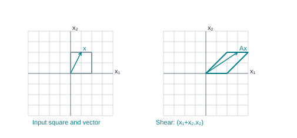

A horizontal shear sends (x₁,x₂) to (x₁ + x₂,x₂), turning the input square into a parallelogram.

- The rule T(x) = rx scales every vector.

- For

@eq 0 ≤ r ≤ 1

it is a contraction in the lecture convention, including collapse at

@eq r = 0

and no change at

@eq r = 1

- For r > 1 it is a dilation.

- A negative r also reverses direction.

- Multiplying by a scalar remains linear even when the picture shrinks or reverses.

- The lecture shear has

@eq A = [1,3;0,1]

- so

@eq T(x₁,x₂) = (x₁ + 3x₂,x₂)

- Points on the horizontal axis stay fixed.

- A point at height 2 moves 6 units horizontally, while its height is unchanged.

- The corners (0,0),(2,0),(2,2),(0,2) map to (0,0),(2,0),(8,2),(6,2), making a parallelogram.

A horizontal shear sends (x₁,x₂) to (x₁ + x₂,x₂), turning the input square into a parallelogram.

- This figure uses shear factor 1 for a compact diagram: (`x₁`,`x₂`) becomes (`x₁` + `x₂`,`x₂`).

- Every horizontal strip moves by an amount proportional to its height.

- A shear changes angles and lengths but still preserves vector addition and scalar multiplication.

- Linearity is about these algebraic properties, not preservation of every geometric measurement.

## 7.5 Using superposition without finding the entire matrix

SEE THE IDEA

### Use known images as building blocks

If the input is already expressed as a combination, apply the same weights to the known images.

@eq T(3u + 2v) = 3T(u) + 2T(v)

**Remember.** This shortcut requires the assumption that T is linear.

- Suppose

@eq T(u) = (2,1)

and

@eq T(v) = (-1,3)

, as in Course Exercise 1.8.17.

- Then

@eq T(3u) = 3(2,1) = (6,3), T(2v) = 2(-1,3) = (-2,6)

, and

@eq T(3u + 2v) = (6,3) + (-2,6) = (4,9)

- The known input vectors may have different coordinates from their outputs;

- keep u and T(u) distinct.

- If a picture shows

@eq w = u + 2v

, linearity gives

@eq T(w) = T(u) + 2T(v)

- Draw the two output displacements head to tail.

- Do not assume the coordinates of w are unchanged unless the transformation is known to be the identity.

## 7.6 Practice

TRY IT YOURSELF · T1

**T1.** For T(`x₁`,`x₂`) = (`x₁` + 2`x₂`, -`x₁` + `x₂`), find T(3,-1), then find every input sent to (5,1).

**Show Detailed Solution · T1**

**T1.**

#### Compute the image of the given input

@eq T(3,-1) = (3 + 2(-1), -3 + (-1))

@eq T(3,-1) = (3-2,-3-1) = (1,-4)

#### A preimage is an input giving the requested output

@eq x_1 + 2x_2 = 5

@eq -x_1 + x_2 = 1

#### Add the equations to eliminate `x₁`

@eq 3x_2 = 6

@eq x_2 = 2

@eq x_1 = 5 - 2(2) = 1

#### Verify the preimage and its uniqueness

@eq T(1,2) = (1 + 4,-1 + 2) = (5,1)

Each input coordinate is fixed by the equations; neither is free. Equivalently, both coefficient columns have pivots.

FINAL ANSWER

The image of (3,−1) is (1,−4). The unique input for output (5,1) is (1,2).

TRY IT YOURSELF · T2

**T2.** Decide whether S(`x₁`,`x₂`) = (`x₁`,`x₂` + 3) and Q(`x₁`,`x₂`) = (`x₁``x₂`,0) are linear. Give precise reasons.

**Show Detailed Solution · T2**

**T2.**

#### Test S at zero

@eq S(0,0) = (0,3)

A linear map must send the zero input to the zero output. This nonzero output already disproves linearity of S.

#### Passing the zero test is not enough for Q

@eq Q(0,0) = (0,0)

We must also test whether addition is preserved.

#### Compare the two sides of additivity

@eq Q((1,0)+(0,1)) = Q(1,1) = (1,0)

@eq Q(1,0) + Q(0,1) = (0,0) + (0,0) = (0,0)

The two outputs differ. One valid failure is enough to disprove a property required for all inputs.

FINAL ANSWER

Neither S nor Q is linear. S fails the zero test; Q fails the addition test.

TRY IT YOURSELF · T3

**T3.** If T(u) = (1,2), T(v) = (3,-1), find T(2u - v), explaining the assumption needed.

**Show Detailed Solution · T3**

**T3.**

#### Use the given linearity assumption

@eq T(2u-v) = 2T(u) - T(v)

Linearity allows the same input weights to be used on the output vectors.

#### Scale the first known image

@eq 2[1;2] = [2;4]

#### Subtract the other image coordinate by coordinate

@eq [2;4] - [3;-1] = [2-3;4-(-1)] = [-1;5]

FINAL ANSWER

@eq T(2u-v) = [-1;5]

Without linearity, knowing only T(u) and T(v) would not determine this image.

# 8. Section 1.9 - The matrix of a linear transformation

Source correspondence: Combined PDF pages 71-79; exercise PDF page 12.

## 8.1 Standard basis vectors isolate one coordinate

SEE THE IDEA

### Standard basis vectors turn on one input at a time

Because `e_j` has a single 1, multiplying by it selects column j.

@matrix {"a": [["1"], ["0"]], "bar": null}

`e₁` selects the first column.

@matrix {"a": [["0"], ["1"]], "bar": null}

`e₂` selects the second column.

@eq A = [T(e_1),T(e_2)]

- The standard basis vector `e_j` has a 1 in coordinate j and 0 in every other coordinate.

- In

@eq ℝ^3, e₁ = (1,0,0), e₂ = (0,1,0), e₃ = (0,0,1)

- Every

@eq x = (x₁,x₂,x₃)

equals `x₁``e₁` + `x₂``e₂` + `x₃``e₃`.

- This is a coordinate identity: the coefficients simply reconstruct the entries.

- If T is linear,

@eq T(x) = x₁T(e₁) +

... + `x_n`T(`e_n`).

- Therefore the standard matrix is A = [T(`e₁`) ...

- T(`e_n`)].

- The output vectors become columns, not rows, because Ax combines columns with input weights.

- A has m rows when each T(`e_j`) has m entries, and n columns when there are n input coordinates.

- **Theorem (supplied Theorem 10).** Every linear transformation `ℝ^n` → `ℝ^m` has a unique such matrix.

- Existence follows from the expansion just given.

- For uniqueness, if B also represents T, then its jth column is Be

@eq _j = T(e_j)

- so every column of B equals the corresponding column of A.

- Thus

@eq B = A

- This is a proof for arbitrary dimensions, not a pattern guessed from one example.

## 8.2 Reading the matrix from a rule

SEE THE IDEA

### Read coefficients by output row

Each output coordinate becomes one row of the standard matrix.

@eq T(x_1,x_2) = (x_1 - 3x_2, -2x_1 + x_2, x_1)

@matrix {"a": [["1", "-3"], ["-2", "1"], ["1", "0"]], "bar": null}

3 outputs → 3 rows; 2 inputs → 2 columns.

- For

@eq T(x₁,x₂) = (x₁ - 3x₂,-2x₁ + x₂,x₁)

, substituting

@eq e₁ = (1,0)

gives (1,-2,1), and

@eq e₂ = (0,1)

gives (-3,1,0).

- Hence:

@matrix {"a": [["1", "-3"], ["-2", "1"], ["1", "0"]], "bar": null}

- The first row computes `x₁` - 3`x₂`, the second computes -2`x₁` + `x₂`, and the third computes `x₁`.

- A zero coefficient is an actual matrix entry;

- do not omit the 0 at the lower right.

- You may read coefficients directly once you understand why the column construction works.

## 8.3 Transformation reference with geometric meaning

SEE THE IDEA

### A familiar picture has a precise rule

A reflection changes a sign; a projection deletes a coordinate.

#### Horizontal reflection

@matrix {"a": [["1", "0"], ["0", "-1"]], "bar": null}

(a,b) ↦ (a,−b).

#### Horizontal projection

@matrix {"a": [["1", "0"], ["0", "0"]], "bar": null}

(a,b) ↦ (a,0).

- The following matrices reproduce the types in the supplied geometric tables.

- Each is 2 × 2 and acts on a column (`x₁`,`x₂`).

- You can recover every matrix by applying the rule to `e₁` and `e₂`.

- **Reflection in the horizontal axis:**

@eq (x₁,x₂) ↦ (x₁,-x₂)

, matrix `[1,0;0,-1]`. **Reflection in the vertical axis:**

@eq (x₁,x₂) ↦ (-x₁,x₂)

, matrix `[-1,0;0,1]`. **Reflection in

@eq x₂ = x₁

:** swap coordinates, matrix `[0,1;1,0]`. **Reflection in

@eq x₂ = -x₁

:** swap and negate, matrix `[0,-1;-1,0]`. **Reflection in the origin:** negate both coordinates, matrix `[-1,0;0,-1]`.

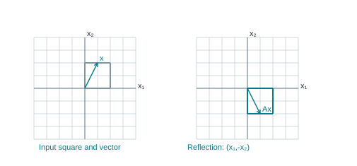

Reflection across the horizontal axis sends (x₁,x₂) to (x₁,−x₂).

- **Horizontal scale by k:** (k`x₁`,`x₂`), matrix `[k,0;0,1]`. **Vertical scale by k:** (`x₁`,k`x₂`), matrix `[1,0;0,k]`.

- For the positive-scale tables, 0 < k < 1 contracts the named direction and k > 1 stretches it.

- Scaling both directions by k uses k`I₂`.

- **Horizontal shear by k:** (`x₁` + k`x₂`,`x₂`), matrix `[1,k;0,1]`. **Vertical shear by k:** (`x₁`,k`x₁` + `x₂`), matrix `[1,0;k,1]`.

- The sign of k chooses the direction of the slant.

- **Projection onto the horizontal axis:** (`x₁`,0), matrix `[1,0;0,0]`. **Projection onto the vertical axis:** (0,`x₂`), matrix `[0,0;0,1]`.

- A projection discards a coordinate and cannot later recover it uniquely.

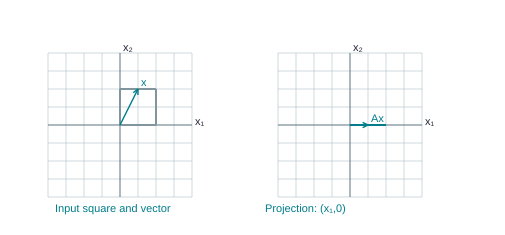

Projection onto the horizontal axis sends (x₁,x₂) to (x₁,0). The square collapses to a line segment.

- The supplied exercises also require rotations.

- For counterclockwise angle θ, the standard matrix is `[cos θ,-sin θ;sin θ,cos θ]`.

- The first column is the rotated unit vector (cos θ,sin θ);

- the second is its perpendicular companion (-sin θ,cos θ).

- A clockwise rotation uses negative θ.

- For

@eq θ = π/2

the columns are (0,1) and (-1,0);

- for

@eq θ = π

they are (-1,0) and (0,-1).

- Angles in the course exercises are in radians: π radians is a half-turn, π/2 a quarter-turn, and 2π a full turn.

- The values at π/4 use

@eq cos(π/4) = sin(π/4) = 1/√2

## 8.4 Composing geometric actions

SEE THE IDEA

### The rightmost matrix acts first

Keep the action order visible before multiplying.

- Input x

- First S: A_S x

- Then T: A_T(A_S x)

- Combined matrix A_T A_S

- When a rule says 'first S, then T,' apply S to `e₁` and then T to that result;

- repeat with `e₂`.

- Put the two final outputs into columns.

- After matrix multiplication is introduced, the same process has matrix A_T A_S.

- The action performed first is the rightmost factor.

- For the supplied Exercise 1.9.8, first reflect in the horizontal axis and then in

@eq x₂ = x₁

- The first reflection sends (`x₁`,`x₂`) to (`x₁`,-`x₂`);

- the second swaps entries, giving (-`x₂`,`x₁`).

- Thus `e₁` becomes `e₂` and `e₂` becomes -`e₁`.

- The matrix `[0,-1;1,0]` is a counterclockwise quarter-turn.

- Reversing the order produces a different rotation.

## 8.5 Onto asks about existence for every codomain vector

SEE THE IDEA

### Onto asks whether every output is reachable

There must be a pivot in every output row of the coefficient matrix.

@matrix {"a": [["1", "0", "2"], ["0", "1", "-1"]], "bar": null}

2 pivots in 2 rows: onto `ℝ²`, even with a free input variable.

- A mapping T: `ℝ^n` → `ℝ^m` is onto `ℝ^m` if every b in that declared codomain equals T(x) for at least one input x.

- In matrix language,

@eq Ax = b

is consistent for every

@eq b ∈ ℝ^m

- This is equivalent to the columns spanning `ℝ^m` and to a pivot in every row of A.

- Being able to find an input for one specific b is insufficient.

- The map

@eq T(x₁,x₂) = (x₁,0)

produces (3,0) but cannot produce (0,1),

- so it is not onto `ℝ^2`.

- It would be onto the horizontal axis if that were the declared codomain,

- but that is a different mapping specification.

## 8.6 One-to-one asks about collisions of inputs

SEE THE IDEA

### One-to-one asks whether inputs collide

If a nonzero input produces zero, it collides with the zero input.

- Au = Av

- A(u − v) = 0

- Only zero solves Az = 0?

- Then u − v = 0, so u = v

- A mapping is one-to-one when different inputs cannot produce the same output.

- Equivalently, each codomain vector has at most one preimage.

- Unreachable outputs are allowed in this definition.

- For a linear mapping, one-to-one is equivalent to

@eq Ax = 0

having only the trivial solution, to independent columns, and to a pivot in every column of A.

**Explore the Full Proof · Deeper Mathematical Explanation**

- State the assumptions

- Use the definition

- Justify each implication

- Reach the claimed conclusion

- Here is the proof linking collisions to the homogeneous test.

- If

@eq Au = Av

, then

@eq A(u - v) = 0

- If only zero goes to zero,

@eq u - v = 0

and therefore

@eq u = v

- Conversely, if a nonzero z satisfies

@eq Az = 0

, then z and 0 are different inputs with the same output.

- So the mapping fails to be one-to-one.

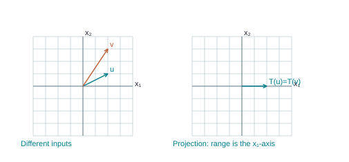

Projection sends u = (2,1) and v = (2,3) to the same (2,0). Its range is the horizontal axis, so it is neither one-to-one nor onto ℝ².

- The diagram shows projection.

- Two distinct inputs with the same first coordinate collide, and outputs with nonzero second coordinate are missed.

- Projection is neither one-to-one nor onto `ℝ^2`.

- It supplies a visible reason for both failures, which are logically separate.

## 8.7 Compare all four possibilities

SEE THE IDEA

### Existence and uniqueness are different axes

Square and invertible gives both; rectangular maps can have just one.

| Map | Onto? | One-to-one? |
| --- | --- | --- |
| (x,y) ↦ (x,y) | Yes, into `ℝ²` | Yes |
| (x,y) ↦ x | Yes, into ℝ | No |
| x ↦ (x,0) | No, into `ℝ²` | Yes |
| (x,y) ↦ (x,0) | No, into `ℝ²` | No |

- The inclusion T:

@eq ℝ^2 → ℝ^3, T(a,b) = (a,b,0)

, has a pivot in each of its two columns.

- It is one-to-one because the input can be read back from the first two output entries.

- It is not onto `ℝ^3` because outputs with nonzero third entry are impossible.

- The map T:

@eq ℝ^3 → ℝ^2, T(a,b,c) = (a,b)

, has a pivot in each of its two rows.

- It is onto because every (a,b) is attained,

- but not one-to-one because c can vary freely.

- An invertible 2 × 2 scaling with nonzero factors is both.

- The zero map `ℝ^2` → `ℝ^2` is neither.

- For an m × n matrix, onto requires m pivots and therefore

@eq n ≥ m

- One-to-one requires n pivots and therefore

@eq m ≥ n

- For a square matrix these conditions coincide.

- For rectangular matrices they need not.

- The lecture's 3 × 4 echelon example `[1,-4,8,1;0,2,-1,3;0,0,0,5]` is onto `ℝ^3` but not one-to-one: it has three row pivots and one nonpivot input column.

## 8.8 Practice

TRY IT YOURSELF · M1

**M1.** Find the standard matrix for T(a,b) = (2a + b,a - b,3b). Decide whether it is one-to-one and onto its declared codomain `ℝ^3`.

**Show Detailed Solution · M1**

**M1.**

#### Put the two basis images in columns

@eq T(e_1) = [2;1;0]

@eq T(e_2) = [1;-1;3]

@matrix {"a": [["2", "1"], ["1", "-1"], ["0", "3"]], "bar": null}

Three output coordinates, two input coordinates: size 3 × 2.

#### Test one-to-one behavior with zero output

@eq A x = 0

@eq 3x_2 = 0

@eq x_2 = 0

@eq 2x_1 + 0 = 0

@eq x_1 = 0

Only the zero input produces zero. Therefore different inputs cannot collide: if Au = Av, then A(u − v) = 0 forces u = v.

#### Test onto behavior separately

Two columns can supply at most two pivots. Three output rows would require three pivots for onto `ℝ³`.

#### Exhibit an unreachable output

@eq A x = [0;0;1]

@eq 3x_2 = 1

@eq x_2 = 1/3

@eq x_1 - x_2 = 0

@eq x_1 = 1/3

@eq 2(1/3) + 1/3 = 1

The first requested output is 0, but these forced input values produce 1. The target is unreachable.

FINAL ANSWER

The standard matrix is the displayed 3 × 2 matrix. The map is one-to-one and is not onto `ℝ³`.

TRY IT YOURSELF · M2

**M2.** Find the matrix for first reflecting in the vertical axis and then projecting onto the horizontal axis. Explain both lost information and attainable outputs.

**Show Detailed Solution · M2**

**M2.**

#### Apply the reflection first

@eq (a,b) ↦ (-a,b)

#### Apply the horizontal projection second

@eq (-a,b) ↦ (-a,0)

@matrix {"a": [["-1", "0"], ["0", "0"]], "bar": null}

#### Inspect the possible outputs

Every output has second coordinate 0, so (0,1) can never occur. Every horizontal output (c,0) occurs by choosing a = −c. Thus the range is exactly the horizontal axis.

#### Find distinct inputs with the same output

@eq (1,0) ↦ (-1,0)

@eq (1,2) ↦ (-1,0)

The second input coordinate is erased. These distinct inputs collide.

FINAL ANSWER

The map is neither onto `ℝ²` nor one-to-one. Its standard matrix is the displayed diagonal matrix.

TRY IT YOURSELF · M3

**M3.** Give a matrix mapping `ℝ^3` onto `ℝ^2` that is not one-to-one, and a matrix mapping `ℝ^2` one-to-one into `ℝ^3` that is not onto. Justify by pivots.

**Show Detailed Solution · M3**

**M3.**

#### Onto does not force one-to-one

@matrix {"a": [["1", "0", "0"], ["0", "1", "0"]], "bar": null}

@eq (a,b,c) ↦ (a,b)

Every two-entry output is reached, but c can be anything. There is a pivot in each row and a free third input.

#### One-to-one does not force onto

@matrix {"a": [["1", "0"], ["0", "1"], ["0", "0"]], "bar": null}

@eq (a,b) ↦ (a,b,0)

The output uniquely records both inputs. But any three-entry target with nonzero last coordinate is missed. There is a pivot in each column and no pivot in row 3.

FINAL ANSWER

The first matrix is onto `ℝ²` and not one-to-one. The second is one-to-one into `ℝ³` and not onto `ℝ³`.

# 9. Section 2.1 - Matrix operations

Source correspondence: Combined PDF pages 80-90; exercise PDF pages 13-14.

## 9.1 Entries, equality, and entrywise operations

SEE THE IDEA

### Rows first, columns second

A matrix entry `aᵢⱼ` is in row i and column j. Entrywise operations require the same shape.

@matrix {"a": [["1", "2", "3"], ["4", "5", "6"]], "bar": null}

A 2 × 3 matrix. Highlighted entry `a₂₃` = 6.

@eq 2[1,2;3,4] + [0,1;1,0] = [2,5;7,8]

- If A is m × n, `a_{ij}` is its entry in row i, column j.

- The column `a_j` consists of `a_{1j}`,...,`a_{mj}`.

- A diagonal entry has matching indices.

- A diagonal matrix is square and has zero entries off its main diagonal.

- An identity matrix is a diagonal matrix whose diagonal entries are all 1.

- A zero matrix can be any size;

- all its entries are zero.

- Matrices are equal only if their dimensions match and every corresponding entry agrees.

- Addition and subtraction require equal dimensions and operate entrywise.

- Multiplying by a scalar scales every entry.

- For

@eq A = [1,-2;3,4]

and

@eq B = [2,5;-1,0], A + B = [3,3;2,4], A - B = [-1,-7;4,4]

, and

@eq -2A = [-2,4;-6,-8]

- These operations retain the original dimensions.

- Addition is commutative and associative.

- @eq A + 0 = A

- Scalars distribute over a sum of matrices and a sum of scalars: r(A + B) = rA + rB and (r + s)A = rA + sA.

- Also r(sA) = (rs)A.

- Matching dimensions are part of every statement.

- A 2 × 3 matrix cannot be added to a 3 × 2 matrix just because both contain six entries.

## 9.2 Why matrix multiplication is defined differently

SEE THE IDEA

### One row and one column make one entry

Matrix multiplication composes weighted sums; it is not entrywise multiplication.

#### Choose one row

@matrix {"a": [["2", "3"], ["1", "-5"]], "bar": null}

Row 1 of A is (2,3).

#### Choose one column

@matrix {"a": [["4", "3", "6"], ["1", "-2", "3"]], "bar": null}

Column 1 of B is (4,1).

@eq c_{11} = (2)(4) + (3)(1) = 11

- Pair corresponding entries

- Multiply each pair

- Add to get one output entry

- Suppose B transforms x into Bx, then A transforms that output into A(Bx).

- We want one matrix C that has the same effect.

- Each column `b_j` of B is the image of `e_j` after the first transformation,

- so the final image is A`b_j`.

- Therefore

@eq C = AB

has columns A`b₁`,...,A`b_p`.

- If A is m × n and B is n × p, then AB is m × p.

- The matching n is the number of entries in each column of B, which A must be able to multiply.

- The output has m entries for each of the p input coordinate directions.

- Thus the mnemonic 'inside sizes agree, outside sizes give the answer' has a mathematical reason.

- The entry formula is

@eq (AB)_{ij} = a_{i1}b_{1j} +

... + `a_{in}``b_{nj}`.

- It multiplies a row by a column, not matching entries in place.

- Entrywise multiplication is a different operation and is not what AB denotes here.

## 9.3 Full lecture product: square times rectangular

SEE THE IDEA

### Place each computed entry in its own location

The source example calculates a 2 × 3 output, six entries in all.

#### Choose one row

@matrix {"a": [["2", "3"], ["1", "-5"]], "bar": null}

Row 1 of A is (2,3).

#### Choose one column

@matrix {"a": [["4", "3", "6"], ["1", "-2", "3"]], "bar": null}

Column 1 of B is (4,1).

@eq c_{11} = (2)(4) + (3)(1) = 11

- Pair corresponding entries

- Multiply each pair

- Add to get one output entry

**Remember.** Compute `c₁₁` first, then use the same rule for each remaining row–column pair.

- Combined PDF pages 85-86 use

@eq A = [2,3;1,-5]

and

@eq B = [4,3,6;1,-2,3]

- A is 2 × 2, B is 2 × 3,

- so AB is 2 × 3.

- There are six entries to compute, and all six are shown.

In this calculation, A is the left factor and B is the right factor.

#### Read A: 2 rows, 2 columns

A row runs horizontally, from left to right. A column runs vertically, from top to bottom. Count rows first when writing a size.

@matrix {"a": [["2", "3"], ["1", "-5"]], "bar": null}

A has size 2 × 2.

#### Read B: 2 rows, 3 columns

@matrix {"a": [["4", "3", "6"], ["1", "-2", "3"]], "bar": null}

B has size 2 × 3.

#### Check that multiplication is allowed

(2 × **2**)(**2** × 3)→ 2 × 3

The highlighted inner counts are both 2: every row of the left factor has one entry for every row of the right factor. The outside counts tell us the output has 2 rows and 3 columns.

#### Calculate output row 1, column 1

Take row 1 of A and column 1 of B. Pair entries in their original order: multiply the first pair, the second pair, and so on. Then add.

@matrix {"a": [["2", "3"], ["1", "-5"]], "bar": null}

Use this highlighted row 1.

@matrix {"a": [["4", "3", "6"], ["1", "-2", "3"]], "bar": null}

Pair it with highlighted column 1.

@eq c_{11} = (2)(4) + (3)(1) = 11

@eq 8 + 3

@eq 11

#### Calculate output row 1, column 2

Take row 1 of A and column 2 of B. Pair entries in their original order: multiply the first pair, the second pair, and so on. Then add.

@matrix {"a": [["2", "3"], ["1", "-5"]], "bar": null}

Use this highlighted row 1.

@matrix {"a": [["4", "3", "6"], ["1", "-2", "3"]], "bar": null}

Pair it with highlighted column 2.

@eq c_{12} = (2)(3) + (3)(-2) = 0

@eq 6 - 6

@eq 0

#### Calculate output row 1, column 3

Take row 1 of A and column 3 of B. Pair entries in their original order: multiply the first pair, the second pair, and so on. Then add.

@matrix {"a": [["2", "3"], ["1", "-5"]], "bar": null}

Use this highlighted row 1.

@matrix {"a": [["4", "3", "6"], ["1", "-2", "3"]], "bar": null}

Pair it with highlighted column 3.

@eq c_{13} = (2)(6) + (3)(3) = 21

@eq 12 + 9

@eq 21

#### Calculate output row 2, column 1

Take row 2 of A and column 1 of B. Pair entries in their original order: multiply the first pair, the second pair, and so on. Then add.

@matrix {"a": [["2", "3"], ["1", "-5"]], "bar": null}

Use this highlighted row 2.

@matrix {"a": [["4", "3", "6"], ["1", "-2", "3"]], "bar": null}

Pair it with highlighted column 1.

@eq c_{21} = (1)(4) + (-5)(1) = -1

@eq 4 - 5

@eq -1

#### Calculate output row 2, column 2

Take row 2 of A and column 2 of B. Pair entries in their original order: multiply the first pair, the second pair, and so on. Then add.

@matrix {"a": [["2", "3"], ["1", "-5"]], "bar": null}

Use this highlighted row 2.

@matrix {"a": [["4", "3", "6"], ["1", "-2", "3"]], "bar": null}

Pair it with highlighted column 2.

@eq c_{22} = (1)(3) + (-5)(-2) = 13

@eq 3 + 10

@eq 13

#### Calculate output row 2, column 3

Take row 2 of A and column 3 of B. Pair entries in their original order: multiply the first pair, the second pair, and so on. Then add.

@matrix {"a": [["2", "3"], ["1", "-5"]], "bar": null}

Use this highlighted row 2.

@matrix {"a": [["4", "3", "6"], ["1", "-2", "3"]], "bar": null}

Pair it with highlighted column 3.

@eq c_{23} = (1)(6) + (-5)(3) = -9

@eq 6 - 15

@eq -9

#### Put the entries into their output positions

@matrix {"a": [["11", "0", "21"], ["-1", "13", "-9"]], "bar": null}

The result has 2 rows and 3 columns.

#### Check the result one output column at a time

For each output column, use the matching column of the right factor as weights on all columns of the left factor. This is the same row arithmetic grouped vertically.

@eq c_1 = (4)[2;1] + (1)[3;-5] = [11;-1]

@eq c_2 = (3)[2;1] + (-2)[3;-5] = [0;13]

@eq c_3 = (6)[2;1] + (3)[3;-5] = [21;-9]

FINAL ANSWER

@eq AB = [11,0,21;-1,13,-9]

Dimensions: (2 × 2)(2 × 3) = 2 × 3.

- The other order BA is undefined here: B has three columns and A has two rows.

- Noncommutativity can therefore mean that one order is not even meaningful.

- For square matrices both orders exist,

- but their entries can still differ.

## 9.4 Associativity does not permit reordering

SEE THE IDEA

### Regrouping is different from reordering

Associativity moves parentheses. It does not move factors past each other.

@eq (AB)C = A(BC)

@eq AB = BA

The second equation is generally false.

- For compatible sizes,

@eq (AB)C = A(BC)

- This allows regrouping, not exchanging A and B.

- Acting on a vector, both sides perform C first, then B, then A.

- The column definition also proves the identity: the jth column of (AB)C is (AB)`c_j` = A(B`c_j`), the jth column of A(BC).

- The distributive laws are

@eq A(B + C) = AB + AC

and

@eq (B + C)A = BA + CA

- A scalar may be factored consistently: r(AB) = (rA

@eq )B = A(

rB).

- Identity matrices have the appropriate side sizes:

@eq I_m A = A

and

@eq A I_n = A

when A is m × n.

- For

@eq A = [1,1;0,1]

and

@eq B = [1,0;0,2], AB = [1,2;0,2]

whereas

@eq BA = [1,1;0,2]

- Applying B first doubles vertical coordinates before the shear mixes them horizontally;

- reversing the order changes the result.

- Hence

@eq AB = BA

is a special property, called commuting, not a general multiplication law.

## 9.5 Zero products and failed cancellation

SEE THE IDEA

### A matrix may erase information

A zero product does not force a zero factor.

@matrix {"a": [["1", "0"], ["0", "0"]], "bar": null}

A is nonzero.

@matrix {"a": [["0", "0"], ["0", "1"]], "bar": null}

B is nonzero.

@eq AB = [0,0;0,0]

**Remember.** An invertible factor is needed for cancellation.

- Nonzero matrices can multiply to zero.

- Let

@eq A = [1,0;0,0]

and

@eq B = [0,0;0,1]

- Both are nonzero,

- but

@eq AB = 0

because A removes the output direction produced by B.

- Therefore

@eq AB = 0

does not imply

@eq A = 0

or

@eq B = 0

- For the same A, take

@eq C = 0

- Then

@eq AB = AC

even though

@eq B ≠ C

- You cannot cancel A without an appropriate invertibility assumption.

- Matrix 'division' is not an operation that can be used without checking such assumptions.

- Similarly, (A + B)^2 expands to `A^2` + AB + BA + `B^2`;

- it becomes `A^2` + 2AB + `B^2` only if A and B commute.

## 9.6 Powers and repeated transformations

SEE THE IDEA

### A power repeats the same action

For a square A, `A²`x applies A twice to x.

- x

- Ax

- A(Ax) = `A²`x

**Remember.** `A⁰` = I. Negative powers require an inverse.

- For square A and positive integer k, `A^k` means k copies multiplied in order.

- It does not raise each entry to the kth power.

- For

@eq A = [1,1;0,1], A^2 = [1,2;0,1]

because two horizontal shears add their effects.

- Its top right entry is 2, even though

@eq 1^2 = 1

- By convention

@eq A^0 = I

of the matching size.

- Powers with negative exponents require invertibility and are discussed through inverses.

## 9.7 Transpose switches rows and columns

SEE THE IDEA

### Transpose swaps the two indices

Turn each row into the corresponding column.

@matrix {"a": [["1", "2", "3"], ["4", "5", "6"]], "bar": null}

A: 2 × 3.

@matrix {"a": [["1", "4"], ["2", "5"], ["3", "6"]], "bar": null}

`Aᵀ`: 3 × 2.

@eq (AB)^T = B^T A^T

- For an m × n matrix A, `A^T` is n × m and has

@eq (A^T)_{ij} = a_{ji}

- For

@eq A = [1,2,3;4,5,6]

, the transpose is `[1,4;2,5;3,6]`.

- A transpose is not an inverse: it changes the arrangement and size, not necessarily the effect of a transformation in reverse.

- The supplied transpose identities are (`A^T`)^T = A, (A + B)^T = `A^T` + `B^T`, (rA)^T = r`A^T`, and

@eq (AB)^T = B^T A^T

- The product order reverses.

- If A is m × n and B is n × p, (AB)^T is p × m.

- The product `B^T` `A^T` has size (p × n)(n × m), which matches;

- `A^T` `B^T` often fails even the size test.

- A proof of the last identity examines entry i,j.

- Entry i,j of (AB)^T is entry j,i of AB, namely Σ over k of `a_{jk}``b_{ki}`.

- Entry i,j of `B^T` `A^T` is Σ over k of

@eq (B^T)_{ik}(A^T)_{kj} = Σ

over k of `b_{ki}``a_{jk}`, the same real-number sum.

- Equal dimensions and entrywise equality prove the identity.

## 9.8 Practice

TRY IT YOURSELF · O1

**O1.** Compute AB and BA for A = `[1,2;0,1]`, B = `[2,0;1,3]`. Explain their difference.

**Show Detailed Solution · O1**

**O1.**

**O1.** Each order requires a separate row-column calculation.

In this calculation, A is the left factor and B is the right factor.

#### Read A: 2 rows, 2 columns

A row runs horizontally, from left to right. A column runs vertically, from top to bottom. Count rows first when writing a size.

@matrix {"a": [["1", "2"], ["0", "1"]], "bar": null}

A has size 2 × 2.

#### Read B: 2 rows, 2 columns

@matrix {"a": [["2", "0"], ["1", "3"]], "bar": null}

B has size 2 × 2.

#### Check that multiplication is allowed

(2 × **2**)(**2** × 2)→ 2 × 2

The highlighted inner counts are both 2: every row of the left factor has one entry for every row of the right factor. The outside counts tell us the output has 2 rows and 2 columns.

#### Calculate output row 1, column 1

Take row 1 of A and column 1 of B. Pair entries in their original order: multiply the first pair, the second pair, and so on. Then add.

@matrix {"a": [["1", "2"], ["0", "1"]], "bar": null}

Use this highlighted row 1.

@matrix {"a": [["2", "0"], ["1", "3"]], "bar": null}

Pair it with highlighted column 1.

@eq c_{11} = (1)(2) + (2)(1) = 4

@eq 2 + 2

@eq 4

#### Calculate output row 1, column 2

Take row 1 of A and column 2 of B. Pair entries in their original order: multiply the first pair, the second pair, and so on. Then add.

@matrix {"a": [["1", "2"], ["0", "1"]], "bar": null}

Use this highlighted row 1.

@matrix {"a": [["2", "0"], ["1", "3"]], "bar": null}

Pair it with highlighted column 2.

@eq c_{12} = (1)(0) + (2)(3) = 6

@eq 0 + 6

@eq 6

#### Calculate output row 2, column 1

Take row 2 of A and column 1 of B. Pair entries in their original order: multiply the first pair, the second pair, and so on. Then add.

@matrix {"a": [["1", "2"], ["0", "1"]], "bar": null}

Use this highlighted row 2.

@matrix {"a": [["2", "0"], ["1", "3"]], "bar": null}

Pair it with highlighted column 1.

@eq c_{21} = (0)(2) + (1)(1) = 1

@eq 0 + 1

@eq 1

#### Calculate output row 2, column 2

Take row 2 of A and column 2 of B. Pair entries in their original order: multiply the first pair, the second pair, and so on. Then add.

@matrix {"a": [["1", "2"], ["0", "1"]], "bar": null}

Use this highlighted row 2.

@matrix {"a": [["2", "0"], ["1", "3"]], "bar": null}

Pair it with highlighted column 2.

@eq c_{22} = (0)(0) + (1)(3) = 3

@eq 0 + 3

@eq 3

#### Put the entries into their output positions

@matrix {"a": [["4", "6"], ["1", "3"]], "bar": null}

The result has 2 rows and 2 columns.

#### Check the result one output column at a time

For each output column, use the matching column of the right factor as weights on all columns of the left factor. This is the same row arithmetic grouped vertically.

@eq c_1 = (2)[1;0] + (1)[2;1] = [4;1]

@eq c_2 = (0)[1;0] + (3)[2;1] = [6;3]

FINAL ANSWER

@eq AB = [4,6;1,3]

Dimensions: (2 × 2)(2 × 2) = 2 × 2.

In this calculation, B is the left factor and A is the right factor.

#### Read B: 2 rows, 2 columns

A row runs horizontally, from left to right. A column runs vertically, from top to bottom. Count rows first when writing a size.

@matrix {"a": [["2", "0"], ["1", "3"]], "bar": null}

B has size 2 × 2.

#### Read A: 2 rows, 2 columns

@matrix {"a": [["1", "2"], ["0", "1"]], "bar": null}

A has size 2 × 2.

#### Check that multiplication is allowed

(2 × **2**)(**2** × 2)→ 2 × 2

The highlighted inner counts are both 2: every row of the left factor has one entry for every row of the right factor. The outside counts tell us the output has 2 rows and 2 columns.

#### Calculate output row 1, column 1

Take row 1 of B and column 1 of A. Pair entries in their original order: multiply the first pair, the second pair, and so on. Then add.

@matrix {"a": [["2", "0"], ["1", "3"]], "bar": null}

Use this highlighted row 1.

@matrix {"a": [["1", "2"], ["0", "1"]], "bar": null}

Pair it with highlighted column 1.

@eq c_{11} = (2)(1) + (0)(0) = 2

@eq 2 + 0

@eq 2

#### Calculate output row 1, column 2

Take row 1 of B and column 2 of A. Pair entries in their original order: multiply the first pair, the second pair, and so on. Then add.

@matrix {"a": [["2", "0"], ["1", "3"]], "bar": null}

Use this highlighted row 1.

@matrix {"a": [["1", "2"], ["0", "1"]], "bar": null}

Pair it with highlighted column 2.

@eq c_{12} = (2)(2) + (0)(1) = 4

@eq 4 + 0

@eq 4

#### Calculate output row 2, column 1

Take row 2 of B and column 1 of A. Pair entries in their original order: multiply the first pair, the second pair, and so on. Then add.

@matrix {"a": [["2", "0"], ["1", "3"]], "bar": null}

Use this highlighted row 2.

@matrix {"a": [["1", "2"], ["0", "1"]], "bar": null}

Pair it with highlighted column 1.

@eq c_{21} = (1)(1) + (3)(0) = 1

@eq 1 + 0

@eq 1

#### Calculate output row 2, column 2

Take row 2 of B and column 2 of A. Pair entries in their original order: multiply the first pair, the second pair, and so on. Then add.

@matrix {"a": [["2", "0"], ["1", "3"]], "bar": null}

Use this highlighted row 2.

@matrix {"a": [["1", "2"], ["0", "1"]], "bar": null}

Pair it with highlighted column 2.

@eq c_{22} = (1)(2) + (3)(1) = 5

@eq 2 + 3

@eq 5

#### Put the entries into their output positions

@matrix {"a": [["2", "4"], ["1", "5"]], "bar": null}

The result has 2 rows and 2 columns.

#### Check the result one output column at a time

For each output column, use the matching column of the right factor as weights on all columns of the left factor. This is the same row arithmetic grouped vertically.

@eq c_1 = (1)[2;1] + (0)[0;3] = [2;1]

@eq c_2 = (2)[2;1] + (1)[0;3] = [4;5]

FINAL ANSWER

@eq BA = [2,4;1,5]

Dimensions: (2 × 2)(2 × 2) = 2 × 2.

- The products are `[4,6;1,3]` and `[2,4;1,5]`, respectively,

- so

@eq AB ≠ BA

FINAL ANSWER

@eq AB = [4,6;1,3]

@eq BA = [2,4;1,5]

The two orders give different matrices, so AB ≠ BA.

TRY IT YOURSELF · O2

**O2.** Compute the transpose of AB in O1 and verify `B^T` `A^T` gives the same matrix.

**Show Detailed Solution · O2**

**O2.**

#### Transpose the known product

@matrix {"a": [["4", "6"], ["1", "3"]], "bar": null}

AB: rows are (4,6) and (1,3).

@matrix {"a": [["4", "1"], ["6", "3"]], "bar": null}

(AB)ᵀ: those rows become columns.

#### Reverse the factors and transpose each

@eq (AB)^T = B^T A^T

@matrix {"a": [["2", "1"], ["0", "3"]], "bar": null}

`Bᵀ`

@matrix {"a": [["1", "0"], ["2", "1"]], "bar": null}

`Aᵀ`

#### Calculate all four entries

@eq 2(1) + 1(2) = 2 + 2 = 4

@eq 2(0) + 1(1) = 0 + 1 = 1

@eq 0(1) + 3(2) = 0 + 6 = 6

@eq 0(0) + 3(1) = 0 + 3 = 3

FINAL ANSWER

@eq (AB)^T = B^T A^T = [4,1;6,3]

TRY IT YOURSELF · O3

**O3.** Construct two nonzero 2 × 2 matrices whose product is zero. Explain why they disprove a cancellation claim.

**Show Detailed Solution · O3**

**O3.**

#### Choose two nonzero matrices

@matrix {"a": [["1", "0"], ["0", "0"]], "bar": null}

A

@matrix {"a": [["0", "0"], ["0", "1"]], "bar": null}

B

#### Check all entries of AB

@eq 1(0) + 0(0) = 0

@eq 1(0) + 0(1) = 0

@eq 0(0) + 0(0) = 0

@eq 0(0) + 0(1) = 0

#### Compare with the zero right factor

@eq AB = [0,0;0,0] = A0

B is not zero: it has a 1. A has erased the distinction between B and zero, so it cannot be canceled.

FINAL ANSWER

AB = A0 does not force B = 0. Cancellation fails here because A is singular.

TRY IT YOURSELF · O4

**O4.** If A is 3 × 2 and B is 2 × 4, state the sizes of AB, (AB)^T, and `B^T` `A^T`. Is BA defined?

**Show Detailed Solution · O4**

**O4.**

#### Compute the product size

@eq (3 × 2)(2 × 4) → 3 × 4

The two inner dimensions match. AB therefore has 3 rows and 4 columns.

#### Transpose swaps the two output counts

@eq (AB)^T: 4 × 3

#### Check the reversed transposed product

@eq B^T: 4 × 2

@eq A^T: 2 × 3

@eq (4 × 2)(2 × 3) → 4 × 3

#### Check BA before attempting arithmetic

@eq (2 × 4)(3 × 2)

The inner counts 4 and 3 differ. BA is undefined.

FINAL ANSWER

AB is 3 × 4. Both (AB)ᵀ and `Bᵀ``Aᵀ` are 4 × 3. BA is undefined.

# 10. Section 2.2 - The inverse of a matrix

Source correspondence: Combined PDF pages 91-100; exercise PDF pages 15-16.

## 10.1 Undoing a transformation

SEE THE IDEA

### Undo the change in the opposite direction

A shear changes the first coordinate by adding the second; its inverse subtracts it.

- (`x₁`,`x₂`)

- A: (`x₁`+`x₂`,`x₂`)

- `A⁻¹`: ((`x₁`+`x₂`)−`x₂`,`x₂`)

- Original (`x₁`,`x₂`) restored

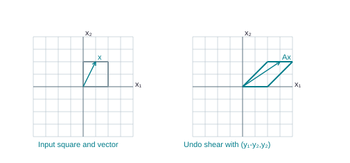

The shear sends (x₁,x₂) to (x₁ + x₂,x₂). Its inverse recovers x by (y₁−y₂,y₂).

- An inverse reverses the effect of a square matrix on every input.

- An n × n matrix A is invertible if an n × n matrix C satisfies both

@eq AC = I_n

and

@eq CA = I_n

- This C is `A^(-1)`.

- A noninvertible square matrix is singular;

- an invertible one is nonsingular.

- In this course definition, an ordinary two-sided inverse is only defined for square matrices.

- The notation `A^(-1)` is not formed by taking reciprocals of entries.

- The identity conditions involve matrix multiplication.

- A projection is singular because it sends many different inputs to the same output;

- no inverse can know which original input to restore.

- A nonzero uniform scaling is invertible: scaling by r is undone by scaling by 1/r.

- If B and C are both inverses of

@eq A, B = BI = B(AC) = (BA)C = IC = C

- Thus the inverse, when it exists, is unique.

- Each equality has a reason: identity, inverse condition, associativity, inverse condition, identity.

- This short chain is a model university proof.

The shear sends (x₁,x₂) to (x₁ + x₂,x₂). Its inverse recovers x by (y₁−y₂,y₂).

- The figure shears by (`x₁` + `x₂`,`x₂`).

- Given the output y, subtract `y₂` from `y₁` to recover the input: (`y₁` - `y₂`,`y₂`).

- The forward matrix `[1,1;0,1]` and backward matrix `[1,-1;0,1]` multiply in either order to `I₂`.

## 10.2 Deriving the 2 × 2 formula

SEE THE IDEA

### Check the denominator before dividing

The determinant ad − bc tells whether this two-dimensional map can be undone.

@eq A^(-1) = (1/(ad-bc))[d,-b;-c,a]

| Condition | Meaning |
| --- | --- |
| ad − bc ≠ 0 | The formula is defined; A is invertible. |
| ad − bc = 0 | No two-sided inverse exists. |

- Let

@eq A = [a,b;c,d]

- Seek a matrix that removes the off-diagonal effects.

- Try

@eq C = [d,-b;-c,a]

- Multiplying gives AC = [ad - bc, -ab + ba;

- cd - dc, -cb + da] = (ad - bc)`I₂`.

- Multiplying in the reverse order also gives (ad - bc)`I₂`.

- If

@eq δ = ad - bc

is nonzero, divide C by δ to obtain the inverse.

@eq A^(-1) = (1/(ad - bc)) [d,-b; -c,a], provided ad - bc ≠ 0.

- Here a,b,c,d are the four entries of A.

- The scalar ad - bc is its 2 × 2 determinant.

- The formula swaps the two diagonal entries, negates the two off-diagonal entries, and divides every resulting entry by the determinant.

- The order of ad and bc matters.

- The condition is

@eq ad - bc ≠ 0

, not

@eq ab - cd ≠ 0

- Why is A singular when

@eq ad - bc = 0

?

- If the first row is nonzero,

@eq z = (-b,a)

is a nonzero vector and

@eq Az = (0,ad - bc) = 0

- An inverse would imply

@eq z = A^(-1)0 = 0

, a contradiction.

- If the first row is zero and the second is nonzero, use

@eq z = (-d,c)

- If both rows are zero, every nonzero vector is sent to zero.

- These cases establish the determinant condition without dividing by a possibly zero entry.

## 10.3 Numerical examples and direct verification

SEE THE IDEA

### Verify with multiplication, not resemblance

For A = `[1,2;4,7]`, the candidate inverse is `[−7,2;4,−1]`.

@eq [1,2;4,7][-7,2;4,-1] = [1,0;0,1]

**Remember.** Check the reverse product too. Entrywise reciprocals are not an inverse.

- For

@eq A = [8,3;5,2], δ = 16 - 15 = 1

and

@eq A^(-1) = [2,-3;-5,8]

- The product A`A^(-1)` has entries

@eq 16 - 15 = 1, -24 + 24 = 0, 10 - 10 = 0, -15 + 16 = 1

- The reverse product also gives `I₂`.

- For

@eq A = [3,1;7,2], δ = 6 - 7 = -1

- so

@eq A^(-1) = [-2,1;7,-3]

- The negative determinant changes every entry after division.

- Check:

@eq [3,1;7,2][-2,1;7,-3] = [1,0;0,1]

- For

@eq A = [1,2;2,4], δ = 0

and the formula is unavailable.

- The second column is twice the first, giving a nonzero input (-2,1) mapped to zero;

- this explains the failure.

## 10.4 Solving Ax = b by an inverse

SEE THE IDEA

### Multiply by the undo operation

When A is invertible, left-multiplication isolates the input.

- Ax = b

- `A⁻¹`Ax = `A⁻¹`b

- Ix = `A⁻¹`b

- x = `A⁻¹`b

- Assume A is invertible.

- Left-multiply

@eq Ax = b

by `A^(-1)`:

@eq A^(-1)Ax = A^(-1)b

- so Ix

@eq = A^(-1)b

and

@eq x = A^(-1)b

- This supplies a solution because

@eq A(A^(-1)b) = b

- It supplies the only solution because any solution must equal that expression.

- The multiplication must be on the left to bring `A^(-1)` beside A in the correct order.

- For

@eq [8,3;5,2]x = (2,-1), x = [2,-3;-5,8](2,-1) = (7,-18)

- Verify

@eq 8(7) + 3(-18) = 2

and

@eq 5(7) + 2(-18) = -1

- When several right-hand sides share one A, an inverse or a single reduction with multiple appended columns can solve them together.

- Computing an inverse solely for one system is not always the most efficient method;

- ordinary elimination already solves it.

## 10.5 Elementary matrices turn row operations into products

SEE THE IDEA

### An elementary matrix performs one row operation

Apply the row operation to I to get E; left-multiplication EA performs it on A.

@matrix {"a": [["1", "0"], ["-3", "1"]], "bar": null}

E comes from `R₂` ← `R₂` − 3`R₁` on `I₂`.

- Row 1 of EA = row 1 of A

- Row 2 of EA = row 2 of A − 3 row 1 of A

- An elementary matrix is obtained from I by performing exactly one elementary row operation.

- Left-multiplying a compatible A by E performs that same operation on A.

- For example,

@eq E = [1,0,0;0,1,0;-4,0,1]

replaces row 3 of A by row 3 minus four times row 1.

- This follows directly from the row-column multiplication rule: the third output row combines input rows with weights -4,0,1.

- Swapping rows 1 and 2 of `I₃` gives `[0,1,0;1,0,0;0,0,1]`.

- Scaling row 3 by 5 gives `[1,0,0;0,1,0;0,0,5]`.

- Each elementary matrix is invertible because its row operation is reversible.

- Their inverses respectively add four times row 1 to row 3, swap the same rows again, and scale row 3 by `1/5`.

- Right multiplication would act on columns and is not the row-operation model used in this theorem.

## 10.6 Why augmenting with I finds the inverse

SEE THE IDEA

### Carry the identity through the same operations

The row operations that turn A into I simultaneously turn I into `A⁻¹`.

- [A | I]

- Apply every operation to both blocks

- [I | `A⁻¹`]

**Remember.** The right block is the answer only when the left block is exactly I.

- **Theorem (supplied Theorem 7).** A square matrix A is invertible exactly when it is row equivalent to I.

- A sequence of row operations that reduces A to I transforms I into `A^(-1)`.

- If the row operations correspond to `E₁`,...,`E_p`, their total effect is `E_p` ...

- @eq E₁ A = I

- Write

@eq E = E_p

...

- `E₁`.

- Since all elementary matrices are invertible, E is invertible and

@eq A = E^(-1)

- so

@eq E = A^(-1)

- Applying the same operations to I gives

@eq EI = E = A^(-1)

- Therefore [A | I] reduces to [I | `A^(-1)`].

- The augmented columns are carried along exactly as right-hand sides were in solving systems.

- If A is invertible,

@eq Ax = b

is solvable for every b,

- so A has a pivot in every row.

- Since it is square, there is also a pivot in every column, and

@eq RREF(A) = I

- This proves the other direction and connects inversion with the earlier pivot criteria.

## 10.7 A larger inverse with every row operation

SEE THE IDEA

### Keep the two printed matrices separate

The source prints one entry inconsistently. The two original verified calculations below deliberately invert different matrices.

| Lecture source | First row |
| --- | --- |
| Initial A on physical page 98 | (0,1,0) |
| Augmented calculation and verification | (0,1,2) |

**Remember.** Read the qualification before interpreting either inverse.

- There is a source discrepancy on Combined PDF page 98.

- The displayed initial A has first row (0,1,0),

- but its augmented matrix, subsequent steps, and page 99 verification use (0,1,2).

- The following example explicitly uses the latter matrix

@eq A = [0,1,2;1,0,3;4,-3,8]

, which is the matrix actually reduced in the slides.

- Its result is not asserted to invert the differently printed initial matrix.

The starting matrix is:

@matrix {"a": [["0", "1", "2", "1", "0", "0"], ["1", "0", "3", "0", "1", "0"], ["4", "-3", "8", "0", "0", "1"]], "bar": 3}

**Step 1: `R_1` ↔ `R_2`.** Move a nonzero entry into row 1 so that it can be used as a pivot.

Before

@matrix {"a": [["0", "1", "2", "1", "0", "0"], ["1", "0", "3", "0", "1", "0"], ["4", "-3", "8", "0", "0", "1"]], "bar": 3}

After

@matrix {"a": [["1", "0", "3", "0", "1", "0"], ["0", "1", "2", "1", "0", "0"], ["4", "-3", "8", "0", "0", "1"]], "bar": 3}

Lavender: affected rows. Sage: pivot used.

#### What changes in this swap?

Row 1 takes the complete contents of old row 2. Row 2 takes the complete contents of old row 1. No entry is multiplied or added; we only exchange the two equations.

**Step 2: `R_3` ← `R_3` + (-4)`R_1`.** Add -4 times row 1 to row 3. This cancels the entry in the pivot column while preserving the solutions. All other rows stay as displayed.

Before

@matrix {"a": [["1", "0", "3", "0", "1", "0"], ["0", "1", "2", "1", "0", "0"], ["4", "-3", "8", "0", "0", "1"]], "bar": 3}

After

@matrix {"a": [["1", "0", "3", "0", "1", "0"], ["0", "1", "2", "1", "0", "0"], ["0", "-3", "-4", "0", "-4", "1"]], "bar": 3}

Lavender: affected row. Sage: pivot used.

#### Calculate every entry in the changed row

Multiply each entry of old row 1 by -4, then add it to the matching entry of old row 3. The other row is retained.

Row 3, column 1

@eq 4 + (-4)(1) = 4 - 4 = 0

Row 3, column 2

@eq -3 + (-4)(0) = -3 + 0 = -3

Row 3, column 3

@eq 8 + (-4)(3) = 8 - 12 = -4

Row 3, column 4 (right-hand side)

@eq 0 + (-4)(0) = 0 + 0 = 0

Row 3, column 5

@eq 0 + (-4)(1) = 0 - 4 = -4

Row 3, column 6

@eq 1 + (-4)(0) = 1 + 0 = 1

**Step 3: `R_3` ← `R_3` + (3)`R_2`.** Add 3 times row 2 to row 3. This cancels the entry in the pivot column while preserving the solutions. All other rows stay as displayed.

Before

@matrix {"a": [["1", "0", "3", "0", "1", "0"], ["0", "1", "2", "1", "0", "0"], ["0", "-3", "-4", "0", "-4", "1"]], "bar": 3}

After

@matrix {"a": [["1", "0", "3", "0", "1", "0"], ["0", "1", "2", "1", "0", "0"], ["0", "0", "2", "3", "-4", "1"]], "bar": 3}

Lavender: affected row. Sage: pivot used.

#### Calculate every entry in the changed row

Multiply each entry of old row 2 by 3, then add it to the matching entry of old row 3. The other row is retained.

Row 3, column 1

@eq 0 + (3)(0) = 0 + 0 = 0

Row 3, column 2

@eq -3 + (3)(1) = -3 + 3 = 0

Row 3, column 3

@eq -4 + (3)(2) = -4 + 6 = 2

Row 3, column 4 (right-hand side)

@eq 0 + (3)(1) = 0 + 3 = 3

Row 3, column 5

@eq -4 + (3)(0) = -4 + 0 = -4

Row 3, column 6

@eq 1 + (3)(0) = 1 + 0 = 1

**Step 4: `R_3` ← (`1/2`)`R_3`.** Multiply every entry of row 3, including any right-hand side, by `1/2`. The pivot becomes 1; the multiplier is nonzero, so this step is reversible.

Before

@matrix {"a": [["1", "0", "3", "0", "1", "0"], ["0", "1", "2", "1", "0", "0"], ["0", "0", "2", "3", "-4", "1"]], "bar": 3}

After

@matrix {"a": [["1", "0", "3", "0", "1", "0"], ["0", "1", "2", "1", "0", "0"], ["0", "0", "1", "3/2", "-2", "1/2"]], "bar": 3}

Lavender: affected row. Sage: pivot used.

#### Calculate every entry in the changed row

Multiply every entry of old row 3 by `1/2`. This includes the constant column when one is present. The multiplier is nonzero, so division by it undoes the step.

Row 3, column 1

@eq (1/2)(0) = 0/2 = 0

Row 3, column 2

@eq (1/2)(0) = 0/2 = 0

Row 3, column 3

@eq (1/2)(2) = 2/2 = 1

Row 3, column 4 (right-hand side)

@eq (1/2)(3) = 3/2 = 3/2

Row 3, column 5

@eq (1/2)(-4) = -4/2 = -2

Row 3, column 6

@eq (1/2)(1) = 1/2 = 1/2

**Step 5: `R_1` ← `R_1` + (-3)`R_3`.** Add -3 times row 3 to row 1. This cancels the entry in the pivot column while preserving the solutions. All other rows stay as displayed.

Before

@matrix {"a": [["1", "0", "3", "0", "1", "0"], ["0", "1", "2", "1", "0", "0"], ["0", "0", "1", "3/2", "-2", "1/2"]], "bar": 3}

After

@matrix {"a": [["1", "0", "0", "-9/2", "7", "-3/2"], ["0", "1", "2", "1", "0", "0"], ["0", "0", "1", "3/2", "-2", "1/2"]], "bar": 3}

Lavender: affected row. Sage: pivot used.

#### Calculate every entry in the changed row

Multiply each entry of old row 3 by -3, then add it to the matching entry of old row 1. The other row is retained.

Row 1, column 1

@eq 1 + (-3)(0) = 1 + 0 = 1

Row 1, column 2

@eq 0 + (-3)(0) = 0 + 0 = 0

Row 1, column 3

@eq 3 + (-3)(1) = 3 - 3 = 0

Row 1, column 4 (right-hand side)

@eq 0 + (-3)(3/2) = 0 - 9/2 = -9/2

Row 1, column 5

@eq 1 + (-3)(-2) = 1 + 6 = 7

Row 1, column 6

@eq 0 + (-3)(1/2) = 0 - 3/2 = -3/2

**Step 6: `R_2` ← `R_2` + (-2)`R_3`.** Add -2 times row 3 to row 2. This cancels the entry in the pivot column while preserving the solutions. All other rows stay as displayed.

Before

@matrix {"a": [["1", "0", "0", "-9/2", "7", "-3/2"], ["0", "1", "2", "1", "0", "0"], ["0", "0", "1", "3/2", "-2", "1/2"]], "bar": 3}

After

@matrix {"a": [["1", "0", "0", "-9/2", "7", "-3/2"], ["0", "1", "0", "-2", "4", "-1"], ["0", "0", "1", "3/2", "-2", "1/2"]], "bar": 3}

Lavender: affected row. Sage: pivot used.

#### Calculate every entry in the changed row

Multiply each entry of old row 3 by -2, then add it to the matching entry of old row 2. The other row is retained.

Row 2, column 1

@eq 0 + (-2)(0) = 0 + 0 = 0

Row 2, column 2

@eq 1 + (-2)(0) = 1 + 0 = 1

Row 2, column 3

@eq 2 + (-2)(1) = 2 - 2 = 0

Row 2, column 4 (right-hand side)

@eq 1 + (-2)(3/2) = 1 - 3 = -2

Row 2, column 5

@eq 0 + (-2)(-2) = 0 + 4 = 4

Row 2, column 6

@eq 0 + (-2)(1/2) = 0 - 1 = -1

- The left block is I.

- The right block is therefore `A^(-1)`:

@matrix {"a": [["-9/2", "7", "-3/2"], ["-2", "4", "-1"], ["3/2", "-2", "1/2"]], "bar": null}

**Verification.** Multiplying in each order gives the identity:

@matrix {"a": [["1", "0", "0"], ["0", "1", "0"], ["0", "0", "1"]], "bar": null}

The same elementary operations changed A into I and I into `A^(-1)`. They amount to multiplication on the left by `A^(-1)`, which explains why the procedure works.

- For comparison, the matrix literally printed in the initial display, with first row (0,1,0), has a different inverse.

- Here is its independently computed reduction, preserving that version of the data.

The starting matrix is:

@matrix {"a": [["0", "1", "0", "1", "0", "0"], ["1", "0", "3", "0", "1", "0"], ["4", "-3", "8", "0", "0", "1"]], "bar": 3}

**Step 1: `R_1` ↔ `R_2`.** Move a nonzero entry into row 1 so that it can be used as a pivot.

Before

@matrix {"a": [["0", "1", "0", "1", "0", "0"], ["1", "0", "3", "0", "1", "0"], ["4", "-3", "8", "0", "0", "1"]], "bar": 3}

After

@matrix {"a": [["1", "0", "3", "0", "1", "0"], ["0", "1", "0", "1", "0", "0"], ["4", "-3", "8", "0", "0", "1"]], "bar": 3}

Lavender: affected rows. Sage: pivot used.

#### What changes in this swap?

Row 1 takes the complete contents of old row 2. Row 2 takes the complete contents of old row 1. No entry is multiplied or added; we only exchange the two equations.

**Step 2: `R_3` ← `R_3` + (-4)`R_1`.** Add -4 times row 1 to row 3. This cancels the entry in the pivot column while preserving the solutions. All other rows stay as displayed.

Before

@matrix {"a": [["1", "0", "3", "0", "1", "0"], ["0", "1", "0", "1", "0", "0"], ["4", "-3", "8", "0", "0", "1"]], "bar": 3}

After

@matrix {"a": [["1", "0", "3", "0", "1", "0"], ["0", "1", "0", "1", "0", "0"], ["0", "-3", "-4", "0", "-4", "1"]], "bar": 3}

Lavender: affected row. Sage: pivot used.

#### Calculate every entry in the changed row

Multiply each entry of old row 1 by -4, then add it to the matching entry of old row 3. The other row is retained.

Row 3, column 1

@eq 4 + (-4)(1) = 4 - 4 = 0

Row 3, column 2

@eq -3 + (-4)(0) = -3 + 0 = -3

Row 3, column 3

@eq 8 + (-4)(3) = 8 - 12 = -4

Row 3, column 4 (right-hand side)

@eq 0 + (-4)(0) = 0 + 0 = 0

Row 3, column 5

@eq 0 + (-4)(1) = 0 - 4 = -4

Row 3, column 6

@eq 1 + (-4)(0) = 1 + 0 = 1

**Step 3: `R_3` ← `R_3` + (3)`R_2`.** Add 3 times row 2 to row 3. This cancels the entry in the pivot column while preserving the solutions. All other rows stay as displayed.

Before

@matrix {"a": [["1", "0", "3", "0", "1", "0"], ["0", "1", "0", "1", "0", "0"], ["0", "-3", "-4", "0", "-4", "1"]], "bar": 3}

After

@matrix {"a": [["1", "0", "3", "0", "1", "0"], ["0", "1", "0", "1", "0", "0"], ["0", "0", "-4", "3", "-4", "1"]], "bar": 3}

Lavender: affected row. Sage: pivot used.

#### Calculate every entry in the changed row

Multiply each entry of old row 2 by 3, then add it to the matching entry of old row 3. The other row is retained.

Row 3, column 1

@eq 0 + (3)(0) = 0 + 0 = 0

Row 3, column 2

@eq -3 + (3)(1) = -3 + 3 = 0

Row 3, column 3

@eq -4 + (3)(0) = -4 + 0 = -4

Row 3, column 4 (right-hand side)

@eq 0 + (3)(1) = 0 + 3 = 3

Row 3, column 5

@eq -4 + (3)(0) = -4 + 0 = -4

Row 3, column 6

@eq 1 + (3)(0) = 1 + 0 = 1

**Step 4: `R_3` ← (`-1/4`)`R_3`.** Multiply every entry of row 3, including any right-hand side, by `-1/4`. The pivot becomes 1; the multiplier is nonzero, so this step is reversible.

Before

@matrix {"a": [["1", "0", "3", "0", "1", "0"], ["0", "1", "0", "1", "0", "0"], ["0", "0", "-4", "3", "-4", "1"]], "bar": 3}

After

@matrix {"a": [["1", "0", "3", "0", "1", "0"], ["0", "1", "0", "1", "0", "0"], ["0", "0", "1", "-3/4", "1", "-1/4"]], "bar": 3}

Lavender: affected row. Sage: pivot used.

#### Calculate every entry in the changed row

Multiply every entry of old row 3 by `-1/4`. This includes the constant column when one is present. The multiplier is nonzero, so division by it undoes the step.

Row 3, column 1

@eq (-1/4)(0) = 0/4 = 0

Row 3, column 2

@eq (-1/4)(0) = 0/4 = 0

Row 3, column 3

@eq (-1/4)(-4) = 4/4 = 1

Row 3, column 4 (right-hand side)

@eq (-1/4)(3) = -3/4 = -3/4

Row 3, column 5

@eq (-1/4)(-4) = 4/4 = 1

Row 3, column 6

@eq (-1/4)(1) = -1/4 = -1/4

**Step 5: `R_1` ← `R_1` + (-3)`R_3`.** Add -3 times row 3 to row 1. This cancels the entry in the pivot column while preserving the solutions. All other rows stay as displayed.

Before

@matrix {"a": [["1", "0", "3", "0", "1", "0"], ["0", "1", "0", "1", "0", "0"], ["0", "0", "1", "-3/4", "1", "-1/4"]], "bar": 3}

After

@matrix {"a": [["1", "0", "0", "9/4", "-2", "3/4"], ["0", "1", "0", "1", "0", "0"], ["0", "0", "1", "-3/4", "1", "-1/4"]], "bar": 3}

Lavender: affected row. Sage: pivot used.

#### Calculate every entry in the changed row

Multiply each entry of old row 3 by -3, then add it to the matching entry of old row 1. The other row is retained.

Row 1, column 1

@eq 1 + (-3)(0) = 1 + 0 = 1

Row 1, column 2

@eq 0 + (-3)(0) = 0 + 0 = 0

Row 1, column 3

@eq 3 + (-3)(1) = 3 - 3 = 0

Row 1, column 4 (right-hand side)

@eq 0 + (-3)(-3/4) = 0 + 9/4 = 9/4

Row 1, column 5

@eq 1 + (-3)(1) = 1 - 3 = -2

Row 1, column 6

@eq 0 + (-3)(-1/4) = 0 + 3/4 = 3/4

- The left block is I.

- The right block is therefore `A^(-1)`:

@matrix {"a": [["9/4", "-2", "3/4"], ["1", "0", "0"], ["-3/4", "1", "-1/4"]], "bar": null}

**Verification.** Multiplying in each order gives the identity:

@matrix {"a": [["1", "0", "0"], ["0", "1", "0"], ["0", "0", "1"]], "bar": null}

The same elementary operations changed A into I and I into `A^(-1)`. They amount to multiplication on the left by `A^(-1)`, which explains why the procedure works.

## 10.8 Recognizing failure and finding selected columns

SEE THE IDEA

### One inverse column needs only one target

Column j of `A⁻¹` is the input that maps to `e_j`.

@eq A x = e_j

- Append only `e_j`

- Reduce [A | `e_j`]

- Read x as inverse column j

**Remember.** Use multiple target columns together when several columns are requested.

- For a singular A, reduction of [A | I] fails to make the left block I.

- The right block is then not an inverse, regardless of how many entries look convenient.

- One missing coefficient pivot is enough to establish noninvertibility.

- For

@eq A = [1,2;2,4], R₂ ← R₂ - 2R₁

creates `[0,0 | -2,1]`.

- Its left zero row proves a missing pivot;

- do not reinterpret all four columns as the coefficients of a different matrix and continue until the whole array has pivots.

- The jth column of `A^(-1)` is the solution of

@eq Ax = e_j

- To find only that column, reduce [A | `e_j`];

- the other inverse columns are unnecessary.

- The exercise collection uses this idea for 3 × 3 matrices.

- Reducing [A | `b₁` ... `b_k`] similarly solves several systems simultaneously.

- Each appended column remains tied to its own right-hand side.

## 10.9 Inverse identities and why order reverses

SEE THE IDEA

### Undo the last action first

If AB applies B and then A, its inverse must undo A and then B.

- x → Bx → ABx

- Undo A with `A⁻¹`

- Undo B with `B⁻¹`

@eq (AB)^(-1) = B^(-1)A^(-1)

- For invertible square matrices of matching size,

@eq (A^(-1))^(-1) = A, (AB)^(-1) = B^(-1)A^(-1)

, and

@eq (A^T)^(-1) = (A^(-1))^T

- For the product identity,

@eq (AB)(B^(-1)A^(-1)) = A(BB^(-1))A^(-1) = I

, and the reverse product is also I.

- You undo the last action first, just as a shear followed by a stretch is undone by undoing the stretch and then the shear.

- For the transpose identity, transpose

@eq AA^(-1) = I

to get

@eq (A^(-1))^T A^T = I

- Transpose the other inverse equation to get

@eq A^T(A^(-1))^T = I

- Thus both defining equations hold.

- There is no general identity

@eq (A + B)^(-1) = A^(-1) + B^(-1)

- even 1 × 1 matrices give a counterexample:

@eq (1 + 1)^(-1) = 1/2

- whereas

@eq 1^(-1) + 1^(-1) = 2

## 10.10 Practice

TRY IT YOURSELF · N1

**N1.** Find and verify the inverse of `[2,1;5,3]`. Use it to solve Ax = (1,2).

**Show Detailed Solution · N1**

**N1.**

#### Identify the four entries and the determinant

@matrix {"a": [["2", "1"], ["5", "3"]], "bar": null}

A

@eq ad - bc = 2(3) - 1(5) = 6 - 5 = 1

The denominator is nonzero, so the 2 × 2 inverse formula applies.

#### Swap the diagonal, negate the off-diagonal, divide by 1

@eq A^(-1) = (1/1)[3,-1;-5,2] = [3,-1;-5,2]

#### Verify A times its proposed inverse

@eq 2(3) + 1(-5) = 1

@eq 2(-1) + 1(2) = 0

@eq 5(3) + 3(-5) = 0

@eq 5(-1) + 3(2) = 1

#### Verify the reverse order too

@eq 3(2) + (-1)(5) = 1

@eq 3(1) + (-1)(3) = 0

@eq (-5)(2) + 2(5) = 0

@eq (-5)(1) + 2(3) = 1

#### Use the inverse on b = (1,2)

@eq x = [3,-1;-5,2][1;2]

@eq x_1 = 3(1) - 1(2) = 1

@eq x_2 = -5(1) + 2(2) = -1

#### Substitute into the original system

@eq 2(1) + 1(-1) = 1

@eq 5(1) + 3(-1) = 2

FINAL ANSWER

@eq A^(-1) = [3,-1;-5,2]

@eq x = [1;-1]

TRY IT YOURSELF · N2

**N2.** Find the inverse of `[1,1,0;0,1,1;0,0,1]` using [A | I].

**Show Detailed Solution · N2**

**N2.**

**N2.** Reduce the full augmented array, carrying three right-hand sides together.

The starting matrix is:

@matrix {"a": [["1", "1", "0", "1", "0", "0"], ["0", "1", "1", "0", "1", "0"], ["0", "0", "1", "0", "0", "1"]], "bar": 3}

**Step 1: `R_2` ← `R_2` + (-1)`R_3`.** Add -1 times row 3 to row 2. This cancels the entry in the pivot column while preserving the solutions. All other rows stay as displayed.

Before

@matrix {"a": [["1", "1", "0", "1", "0", "0"], ["0", "1", "1", "0", "1", "0"], ["0", "0", "1", "0", "0", "1"]], "bar": 3}

After

@matrix {"a": [["1", "1", "0", "1", "0", "0"], ["0", "1", "0", "0", "1", "-1"], ["0", "0", "1", "0", "0", "1"]], "bar": 3}

Lavender: affected row. Sage: pivot used.

#### Calculate every entry in the changed row

Multiply each entry of old row 3 by -1, then add it to the matching entry of old row 2. The other row is retained.

Row 2, column 1

@eq 0 + (-1)(0) = 0 + 0 = 0

Row 2, column 2

@eq 1 + (-1)(0) = 1 + 0 = 1

Row 2, column 3

@eq 1 + (-1)(1) = 1 - 1 = 0

Row 2, column 4 (right-hand side)

@eq 0 + (-1)(0) = 0 + 0 = 0

Row 2, column 5

@eq 1 + (-1)(0) = 1 + 0 = 1

Row 2, column 6

@eq 0 + (-1)(1) = 0 - 1 = -1

**Step 2: `R_1` ← `R_1` + (-1)`R_2`.** Add -1 times row 2 to row 1. This cancels the entry in the pivot column while preserving the solutions. All other rows stay as displayed.

Before

@matrix {"a": [["1", "1", "0", "1", "0", "0"], ["0", "1", "0", "0", "1", "-1"], ["0", "0", "1", "0", "0", "1"]], "bar": 3}

After

@matrix {"a": [["1", "0", "0", "1", "-1", "1"], ["0", "1", "0", "0", "1", "-1"], ["0", "0", "1", "0", "0", "1"]], "bar": 3}

Lavender: affected row. Sage: pivot used.

#### Calculate every entry in the changed row

Multiply each entry of old row 2 by -1, then add it to the matching entry of old row 1. The other row is retained.

Row 1, column 1

@eq 1 + (-1)(0) = 1 + 0 = 1

Row 1, column 2

@eq 1 + (-1)(1) = 1 - 1 = 0

Row 1, column 3

@eq 0 + (-1)(0) = 0 + 0 = 0

Row 1, column 4 (right-hand side)

@eq 1 + (-1)(0) = 1 + 0 = 1

Row 1, column 5

@eq 0 + (-1)(1) = 0 - 1 = -1

Row 1, column 6

@eq 0 + (-1)(-1) = 0 + 1 = 1

- The left block is I.

- The right block is therefore `A^(-1)`:

@matrix {"a": [["1", "-1", "1"], ["0", "1", "-1"], ["0", "0", "1"]], "bar": null}

**Verification.** Multiplying in each order gives the identity:

@matrix {"a": [["1", "0", "0"], ["0", "1", "0"], ["0", "0", "1"]], "bar": null}

The same elementary operations changed A into I and I into `A^(-1)`. They amount to multiplication on the left by `A^(-1)`, which explains why the procedure works.

#### Read the inverse from the right block

@matrix {"a": [["1", "0", "0", "1", "-1", "1"], ["0", "1", "0", "0", "1", "-1"], ["0", "0", "1", "0", "0", "1"]], "bar": 3}

The left block is now I: each input is selected once, with no mixing. The same reversible operations on the identity created the inverse in the right block.

#### Verify A times the proposed inverse

Output row 1, column 1

@eq (1)(1) + (1)(0) + (0)(0) = 1 + 0 + 0 = 1

Output row 1, column 2

@eq (1)(-1) + (1)(1) + (0)(0) = -1 + 1 + 0 = 0

Output row 1, column 3

@eq (1)(1) + (1)(-1) + (0)(1) = 1 - 1 + 0 = 0

Output row 2, column 1

@eq (0)(1) + (1)(0) + (1)(0) = 0 + 0 + 0 = 0

Output row 2, column 2

@eq (0)(-1) + (1)(1) + (1)(0) = 0 + 1 + 0 = 1

Output row 2, column 3

@eq (0)(1) + (1)(-1) + (1)(1) = 0 - 1 + 1 = 0

Output row 3, column 1

@eq (0)(1) + (0)(0) + (1)(0) = 0 + 0 + 0 = 0

Output row 3, column 2

@eq (0)(-1) + (0)(1) + (1)(0) = 0 + 0 + 0 = 0

Output row 3, column 3

@eq (0)(1) + (0)(-1) + (1)(1) = 0 + 0 + 1 = 1

@matrix {"a": [["1", "0", "0"], ["0", "1", "0"], ["0", "0", "1"]], "bar": null}

#### Verify the inverse times A

Output row 1, column 1

@eq (1)(1) + (-1)(0) + (1)(0) = 1 + 0 + 0 = 1

Output row 1, column 2

@eq (1)(1) + (-1)(1) + (1)(0) = 1 - 1 + 0 = 0

Output row 1, column 3

@eq (1)(0) + (-1)(1) + (1)(1) = 0 - 1 + 1 = 0

Output row 2, column 1

@eq (0)(1) + (1)(0) + (-1)(0) = 0 + 0 + 0 = 0

Output row 2, column 2

@eq (0)(1) + (1)(1) + (-1)(0) = 0 + 1 + 0 = 1

Output row 2, column 3

@eq (0)(0) + (1)(1) + (-1)(1) = 0 + 1 - 1 = 0

Output row 3, column 1

@eq (0)(1) + (0)(0) + (1)(0) = 0 + 0 + 0 = 0

Output row 3, column 2

@eq (0)(1) + (0)(1) + (1)(0) = 0 + 0 + 0 = 0

Output row 3, column 3

@eq (0)(0) + (0)(1) + (1)(1) = 0 + 0 + 1 = 1

@matrix {"a": [["1", "0", "0"], ["0", "1", "0"], ["0", "0", "1"]], "bar": null}

FINAL ANSWER

@eq A^(-1) = [1,-1,1;0,1,-1;0,0,1]

TRY IT YOURSELF · N3

**N3.** Find the third column of the inverse of the matrix in N2 without computing the other columns.

**Show Detailed Solution · N3**

**N3.**

#### One inverse column means one target

@eq A x = e_3

@eq e_3 = [0;0;1]

Multiplication by column 3 of `A⁻¹` must produce the third identity column. Use the same upper-triangular A as N2.

#### Read the last equation first

@eq x_3 = 1

#### Use row 2 to determine `x₂`

@eq x_2 + x_3 = 0

@eq x_2 + 1 = 0

@eq x_2 = -1

#### Use row 1 to determine `x₁`

@eq x_1 + x_2 = 0

@eq x_1 - 1 = 0

@eq x_1 = 1

#### Verify each output coordinate

@eq 1 + (-1) = 0

@eq -1 + 1 = 0

@eq 1 = 1

FINAL ANSWER

The third inverse column, agreeing with N2, is

@matrix {"a": [["1"], ["-1"], ["1"]], "bar": null}

TRY IT YOURSELF · N4

**N4.** Prove that if A is invertible and AB = AC, then B = C. Give a counterexample when A is singular.

**Show Detailed Solution · N4**

**N4.**

#### Given: A is invertible and AB = AC

@eq AB = AC

We want to prove B = C. We may use `A⁻¹` because invertibility is an assumption.

#### Multiply both sides on the left

@eq A^(-1)(AB) = A^(-1)(AC)

#### Regroup without changing factor order

@eq (A^(-1)A)B = (A^(-1)A)C

@eq IB = IC

@eq B = C

#### Check why the hypothesis matters

@matrix {"a": [["1", "0"], ["0", "0"]], "bar": null}

Singular A

@matrix {"a": [["0", "0"], ["0", "1"]], "bar": null}

B

@matrix {"a": [["0", "0"], ["0", "0"]], "bar": null}

C

@eq AB = [0,0;0,0] = AC

B and C are different even though these products are equal. A is not invertible in this counterexample.

FINAL ANSWER

An invertible left factor can be canceled. The displayed singular example shows the assumption cannot be omitted.

# 11. Writing proofs and solving unfamiliar questions

## 11.1 Translate the request before calculating

SEE THE IDEA

### Translate the request into a test

Start by identifying the mathematical object and the actual goal.

| Question asks | Translate into |
| --- | --- |
| Is b in the span? | Do weights exist: Ax = b? |
| Independent? | Are zero weights the only solution of Ac = 0? |
| Onto? | Is every coefficient row a pivot row? |
| Invertible? | Can a square A reduce to I? |

- 'Is b in a span?' asks for existence of weights,

- so build [A | b]. 'Are these vectors independent?' asks whether

@eq Ax = 0

has only zero as a solution. 'Does T map onto its codomain?' asks for a row pivot for every output coordinate. 'Is T one-to-one?' asks for a column pivot for every input coordinate. 'Find the standard matrix' asks for T(`e_j`) as columns. 'Find an inverse' asks for [A | I] to become [I | C], then verification.

- A question can ask for several of these at once.

- For example, if A is 3 × 4 with three pivots, it is onto `ℝ^3` and its columns span `ℝ^3`.

- It is not one-to-one and its columns are dependent.

- Every b has infinitely many solutions because every b is consistent and there is one free input variable.

- A single pivot count supports all these statements,

- but each needs its own interpretation.

## 11.2 A practical proof pattern

SEE THE IDEA

### Build an argument, one justified link at a time

Each theorem has assumptions; check them before using its conclusion.

- Assumptions

- Definition of the target

- A justified deduction

- Conclusion in the question’s language

**Explore the Full Proof · Deeper Mathematical Explanation**

- State the assumptions

- Use the definition

- Justify each implication

- Reach the claimed conclusion

- First state the assumptions.

- Next state the target in the relevant definition.

- Then use a theorem whose assumptions are satisfied.

- Finally connect the result back to the target.

- For instance, to prove that adding a vector in a span does not change the span, suppose

@eq w = c₁v₁ +

... + `c_p``v_p`.

- Every combination of the original vectors remains available after w is added, proving one inclusion.

- Conversely, a combination of the enlarged collection can replace its w term by that expression, producing a combination of the original vectors.

- Both inclusions prove equality of the spans.

- A counterexample must satisfy all stated assumptions.

- To disprove 'a consistent system has a unique solution,' use

@eq x₁ + x₂ = 1

- It is consistent because (1,0) works,

- but (0,1) is a different solution.

- An inconsistent system would not be a valid counterexample to that particular claim, because it violates the assumption of consistency.

## 11.3 True/false answers need mathematical evidence

SEE THE IDEA

### A counterexample must meet the assumptions

Use one example to disprove a universal claim, not to establish it.

| Claim | Evidence required |
| --- | --- |
| True for all A | A general proof covering all allowed A |
| False for some A | One allowed A for which it fails |
| If and only if | Both logical directions |

- Consider 'A matrix with a pivot in every column has columns spanning its codomain.' It is false for

@eq A = [1,0;0,1;0,0]

- Each column has a pivot,

- but

@eq b = (0,0,1)

cannot be produced.

- The missing row pivot is the precise reason.

- The counterexample states dimensions, verifies the hypothesis, and exhibits a failing output.

- Now consider 'If

@eq Ax = 0

has a nontrivial solution, then the columns of A are dependent.' This is true by the definition of column dependence: Ax is the weighted column combination, and a nontrivial x gives weights not all zero.

- The explanation names the definition and connects both pieces of language.

## 11.4 Integrated transfer practice

TRY IT YOURSELF · G1

**G1.** Let A = `[1,2,0;0,1,1]`. For b = (3,2), solve Ax = b; solve Ax = 0; decide spanning, independence, onto, and one-to-one. Explain how the solution sets are related.

**Show Detailed Solution · G1**

**G1.**

#### Solve the system for a general output (3,2)

@matrix {"a": [["1", "2", "0"], ["0", "1", "1"]], "bar": null}

A

@eq x_1 + 2x_2 = 3

@eq x_2 + x_3 = 2

#### Choose `x₂` and calculate the other coordinates

@eq x_2 = t

@eq x_1 = 3 - 2t

@eq x_3 = 2 - t

@eq x = [3;0;2] + t[-2;1;-1]

#### Check both equations for every t

@eq (3-2t) + 2t = 3

@eq t + (2-t) = 2

#### Solve with zero on the right instead

@eq x_1 + 2x_2 = 0

@eq x_2 + x_3 = 0

@eq x = t[-2;1;-1]

The homogeneous directions are unchanged. The earlier solution set starts at (3,0,2), so it is a translated copy.

#### Read spanning and onto from the rows

Column 1 pivots in row 1; column 2 pivots in row 2. Every row has a pivot. Thus the columns span `ℝ²` and the map is onto `ℝ²`.

#### Read independence and one-to-one from the columns

@eq 3 - 2 = 1

Three columns but only two pivots leave one free weight. For example, t = 1 gives the nonzero homogeneous input (−2,1,−1). The columns are dependent and the map is not one-to-one.

FINAL ANSWER

@eq Ax = (3,2): x = [3;0;2] + t[-2;1;-1]

@eq Ax = 0: x = t[-2;1;-1]

All t are real. The columns span `ℝ²` but are dependent. T is onto and not one-to-one.

TRY IT YOURSELF · G2

**G2.** Let S(`x₁`,`x₂`) = (`x₁` + 2`x₂`,`x₂`) and R(`x₁`,`x₂`) = (-`x₂`,`x₁`). Find the matrix of R after S, compute the image of (1,2), and find an inverse rule.

**Show Detailed Solution · G2**

**G2.**

#### Record each rule in the correct action order

@matrix {"a": [["1", "2"], ["0", "1"]], "bar": null}

S acts first.

@matrix {"a": [["0", "-1"], ["1", "0"]], "bar": null}

R acts second.

@eq (a,b) ↦ (a+2b,b) ↦ (-b,a+2b)

#### Read the composite coefficients

@matrix {"a": [["0", "-1"], ["1", "2"]], "bar": null}

RS: coefficient rows for (−b,a + 2b).

#### Apply the rule to (1,2)

@eq (-2,1+2(2)) = (-2,5)

#### Solve the output equations to undo the map

@eq y_1 = -b

@eq b = -y_1

@eq y_2 = a + 2b

@eq a = y_2 - 2(-y_1) = 2y_1 + y_2

@matrix {"a": [["2", "1"], ["-1", "0"]], "bar": null}

Inverse matrix.

#### Check both matrix products

@eq [0,-1;1,2][2,1;-1,0] = [1,0;0,1]

@eq [2,1;-1,0][0,-1;1,2] = [1,0;0,1]

The products can also be checked entry by entry: the off-diagonal cancellations are 2 − 2 and −2 + 2; the diagonal entries are 1.

#### Undo the numerical output

@eq (2(-2)+5,-(-2)) = (1,2)

FINAL ANSWER

The composite sends (a,b) to (−b,a + 2b). Its inverse sends (`y₁`,`y₂`) to (2`y₁` + `y₂`,−`y₁`).

TRY IT YOURSELF · G3

**G3.** Suppose A is 3 × 3 and for every b ∈ `ℝ^3` there is at least one solution of Ax = b. Prove that the solution is always unique and A is invertible. Explain which part of the reasoning uses the fact that A is square.

**Show Detailed Solution · G3**

**G3.**

#### Given and goal

A is 3 × 3, and Ax = b can be solved for every b in `ℝ³`. We must prove that each solution is unique and that A is invertible.

#### Convert existence into row information

The all-right-hand-side existence theorem gives a pivot in every coefficient row. Three rows therefore mean three pivots.

#### Use the fact that A is square

Those three pivots occupy three different columns. Since there are exactly three columns, every column is a pivot column. There are no free variables.

#### Conclude uniqueness and invertibility

Consistency is given for every b. With no free variables, each such system has exactly one solution. In RREF every column now has its own leading 1 and zeros elsewhere, so RREF(A) is `I₃`.

@eq RREF(A) = I_3

The inverse theorem says a square matrix reducible to I is invertible.

#### Identify where squareness was essential

For a 3 × 4 matrix, three row pivots would leave a fourth column without a pivot. Existence would still hold for every three-entry b, but uniqueness would fail.

FINAL ANSWER

Every Ax = b has exactly one solution, and A is invertible.

# 12. Worked answers to textbook practice

These answers correspond to every practice question in this textbook. Course exercise answers are in the separate workbook. Calculations use the definitions and methods just developed; alternate equivalent parameters are acceptable.

## 12.1 Foundations

**F1.**

#### Work inside the parentheses first

@eq 3 - 5 = -2

The minus sign means move five units left from 3. The result is negative.

#### Multiply by the outside −2

@eq (-2)(-2) = 4

A negative times a negative is positive. The outside −2 multiplies the entire parenthesis.

#### Give the fractions a common denominator

@eq 1/2 = 3/6

@eq 1/2 - 5/6 = 3/6 - 5/6 = -2/6 = -1/3

Sixths have the same size, so subtract their numerators. Divide numerator and denominator by 2 to simplify.

#### Combine the integer and the fraction

@eq 4 - 1/3 = 12/3 - 1/3 = 11/3

FINAL ANSWER

@eq 11/3

**F2.**

#### Start with the given equation

@eq 2(x - 3)/5 = 4

The fraction applies to all of 2(x − 3), not just to the 3.

#### Undo division by 5

@eq 5(2(x - 3)/5) = 5(4)

@eq 2(x - 3) = 20

Multiply both sides by the same nonzero number to preserve equality.

#### Undo multiplication by 2

@eq 2(x - 3)/2 = 20/2

@eq x - 3 = 10

#### Undo subtraction of 3

@eq x - 3 + 3 = 10 + 3

@eq x = 13

#### Check in the original equation

@eq 2(13 - 3)/5 = 2(10)/5 = 20/5 = 4

FINAL ANSWER

@eq x = 13

**F3 and S11.**

**F3 and S11.** The same system appears twice so that you can compare the substitution and matrix methods. Here is the complete matrix solution; the answer must satisfy both original equations.

- Each coefficient column corresponds to one unknown;

- the column after the vertical divider records the right-hand sides.

- We use reversible row operations to reveal the constraints.

The starting matrix is:

@matrix {"a": [["1", "2", "7"], ["3", "-1", "7"]], "bar": 2}

**Step 1: `R_2` ← `R_2` + (-3)`R_1`.** Add -3 times row 1 to row 2. This cancels the entry in the pivot column while preserving the solutions. All other rows stay as displayed.

Before

@matrix {"a": [["1", "2", "7"], ["3", "-1", "7"]], "bar": 2}

After

@matrix {"a": [["1", "2", "7"], ["0", "-7", "-14"]], "bar": 2}

Lavender: affected row. Sage: pivot used.

#### Calculate every entry in the changed row

Multiply each entry of old row 1 by -3, then add it to the matching entry of old row 2. The other row is retained.

Row 2, column 1

@eq 3 + (-3)(1) = 3 - 3 = 0

Row 2, column 2

@eq -1 + (-3)(2) = -1 - 6 = -7

Row 2, column 3 (right-hand side)

@eq 7 + (-3)(7) = 7 - 21 = -14

**Step 2: `R_2` ← (`-1/7`)`R_2`.** Multiply every entry of row 2, including any right-hand side, by `-1/7`. The pivot becomes 1; the multiplier is nonzero, so this step is reversible.

Before

@matrix {"a": [["1", "2", "7"], ["0", "-7", "-14"]], "bar": 2}

After

@matrix {"a": [["1", "2", "7"], ["0", "1", "2"]], "bar": 2}

Lavender: affected row. Sage: pivot used.

#### Calculate every entry in the changed row

Multiply every entry of old row 2 by `-1/7`. This includes the constant column when one is present. The multiplier is nonzero, so division by it undoes the step.

Row 2, column 1

@eq (-1/7)(0) = 0/7 = 0

Row 2, column 2

@eq (-1/7)(-7) = 7/7 = 1

Row 2, column 3 (right-hand side)

@eq (-1/7)(-14) = 14/7 = 2

**Step 3: `R_1` ← `R_1` + (-2)`R_2`.** Add -2 times row 2 to row 1. This cancels the entry in the pivot column while preserving the solutions. All other rows stay as displayed.

Before

@matrix {"a": [["1", "2", "7"], ["0", "1", "2"]], "bar": 2}

After

@matrix {"a": [["1", "0", "3"], ["0", "1", "2"]], "bar": 2}

Lavender: affected row. Sage: pivot used.

#### Calculate every entry in the changed row

Multiply each entry of old row 2 by -2, then add it to the matching entry of old row 1. The other row is retained.

Row 1, column 1

@eq 1 + (-2)(0) = 1 + 0 = 1

Row 1, column 2

@eq 2 + (-2)(1) = 2 - 2 = 0

Row 1, column 3 (right-hand side)

@eq 7 + (-2)(2) = 7 - 4 = 3

- **Read the equations.**

@eq x_1 = 3

- @eq x_2 = 2

- Every unknown is basic,

- so no arbitrary choices remain.

- There is exactly one solution:

@matrix {"a": [["3"], ["2"]], "bar": null}

**Verification in the original equations.** For p, the left-hand sides A p are:

@matrix {"a": [["7"], ["7"]], "bar": null}

These entries equal the original right-hand sides, in order.

#### What does the reduced matrix say?

@matrix {"a": [["1", "0", "3"], ["0", "1", "2"]], "bar": 2}

There are 2 equations and 2 unknown weights or coordinates. The divider separates the constants from those unknowns.

#### Separate determined coordinates from free choices

| Coordinate | Look at its column | What you may do |
| --- | --- | --- |
| `x_1` | Pivot column → basic | Determined by its pivot equation |
| `x_2` | Pivot column → basic | Determined by its pivot equation |

#### Determine x1 from its row

@eq x_1 = 3

@eq x_1 = 3

Subtract each free-variable term from both sides. The pivot coefficient is 1, so no further division is needed.

#### Determine x2 from its row

@eq x_2 = 2

@eq x_2 = 2

Subtract each free-variable term from both sides. The pivot coefficient is 1, so no further division is needed.

#### Verify the starting point in every original equation

@eq (1)(3) + (2)(2) = 3 + 4 = 7

@eq (3)(3) + (-1)(2) = 9 - 2 = 7

FINAL ANSWER

@eq x = [3;2]

Every coordinate is fixed. There are no free choices, so the solution is unique.

**F4.**

#### A subscript is a label

@eq x_2

This means the unknown labeled 2. It does not tell you to multiply x by 2 or square it.

#### A superscript can be a power

@eq x^2 = x x

This means multiply x by itself. If x = 3, the result is 9.

#### Existence and uniqueness ask different questions

| Question | What must be true |
| --- | --- |
| Does a solution exist? | At least one input satisfies every equation. |
| Is the solution unique? | One input works, and no different input works. |

A whole line of solutions has many inputs, so existence holds but uniqueness fails.

FINAL ANSWER

A label and a power have different meanings. Having a solution and having exactly one solution are different claims.

**F5.**

#### Choose equations with one shared point

@eq x + y = 1

@eq x - y = 1

#### Check the shared point (1,0)

@eq 1 + 0 = 1

@eq 1 - 0 = 1

It satisfies both equations.

#### Find a point that belongs to only one equation

@eq 0 + 1 = 1

@eq 0 - 1 = -1

The point (0,1) satisfies the first equation and fails the second. The two solution sets therefore differ.

FINAL ANSWER

The statement is false. One shared point does not mean two sets contain exactly the same points.

## 12.2 Systems and reduction

**S12, first system.**

#### First system: write its augmented matrix

@matrix {"a": [["1", "1", "2"], ["2", "2", "5"]], "bar": 2}

@eq R_2 ← R_2 - 2R_1

#### Calculate the new second row

@eq 2 - 2(1) = 0

@eq 2 - 2(1) = 0

@eq 5 - 2(2) = 1

It says 0 = 1. No input can satisfy this.

#### Second system: the constant is 4 instead

@matrix {"a": [["1", "1", "2"], ["2", "2", "4"]], "bar": 2}

@eq 4 - 2(2) = 0

The second row is now 0 = 0. It imposes no restriction, so only `x₁` + `x₂` = 2 remains.

#### Describe every solution of the second system

@eq x_2 = t

@eq x_1 = 2 - t

@eq (2-t) + t = 2

Any real t works. Conversely, choosing `x₂` forces exactly this value of `x₁`.

FINAL ANSWER

First system: no solution.

@eq x = [2-t;t]

Second system: the displayed vector for every real t.

**S13.**

#### Keep row 1 and change row 2

@eq R_2 ← R_2 - 3R_1

Subtract three copies of row 1 from the old row 2.

#### Undo that change

@eq (R_2 - 3R_1) + 3R_1 = R_2

Adding back the same three copies recovers the original row.

#### Compare multiplication by zero

@eq 0[1,2] = [0,0]

@eq 0[7,-3] = [0,0]

Different rows become the same zero row. Nothing in that zero row tells you which original row to recover.

FINAL ANSWER

Adding a multiple of a retained different row is reversible. Multiplying a row by zero is not.

**`R_1`.**

#### Locate the first nonzero entry of each nonzero row

@matrix {"a": [["1", "2", "0"], ["0", "0", "1"], ["0", "0", "0"]], "bar": null}

They are the 1 in column 1 and the 1 in column 3. These are the leading entries.

#### Check the three REF rules

| Rule | What the actual matrix shows |
| --- | --- |
| Zero rows last | The all-zero row is row 3, at the bottom. |
| Leading entries move right | Column 3 lies to the right of column 1. |
| Zeros below each leading entry | Column 1 has zeros below its leading 1; column 3 also has a zero below its leading 1. |

#### Check the two extra RREF rules

| Extra rule | Check |
| --- | --- |
| Leading entries equal 1 | Both leading entries are already 1. |
| Each leading 1 is alone in its column | Column 1 is (1,0,0); column 3 is (0,1,0). |

Column 2 has no pivot. The 2 in that column does not violate a pivot-column rule.

FINAL ANSWER

The matrix is RREF and therefore also REF.

**`R_2`.**

**`R_2`.** Reduce the two-row augmented system. Its second equation repeats twice the first. There are two free variables, so the solution is a plane in `ℝ^3`.

- Each coefficient column corresponds to one unknown;

- the column after the vertical divider records the right-hand sides.

- We use reversible row operations to reveal the constraints.

The starting matrix is:

@matrix {"a": [["1", "2", "-1", "4"], ["2", "4", "-2", "8"]], "bar": 3}

**Step 1: `R_2` ← `R_2` + (-2)`R_1`.** Add -2 times row 1 to row 2. This cancels the entry in the pivot column while preserving the solutions. All other rows stay as displayed.

Before

@matrix {"a": [["1", "2", "-1", "4"], ["2", "4", "-2", "8"]], "bar": 3}

After

@matrix {"a": [["1", "2", "-1", "4"], ["0", "0", "0", "0"]], "bar": 3}

Lavender: affected row. Sage: pivot used.

#### Calculate every entry in the changed row

Multiply each entry of old row 1 by -2, then add it to the matching entry of old row 2. The other row is retained.

Row 2, column 1

@eq 2 + (-2)(1) = 2 - 2 = 0

Row 2, column 2

@eq 4 + (-2)(2) = 4 - 4 = 0

Row 2, column 3

@eq -2 + (-2)(-1) = -2 + 2 = 0

Row 2, column 4 (right-hand side)

@eq 8 + (-2)(4) = 8 - 8 = 0

**Read the equations.** `x_1` + 2 `x_2` - `x_3` = 4

- The pivot columns are 1.

- Thus `x_1` are basic variables. `x_2`, `x_3` have no leading pivots.

- Their values may be chosen arbitrarily;

- the pivot equations then determine the remaining entries.

- A zero row means

@eq 0 = 0

and imposes no additional restriction.

- Set

@eq x_2 = s, x_3 = t

with all parameters real.

- The complete coordinate answer is:

@eq x_1 = 4 - 2 s + t

@eq x_2 = s

@eq x_3 = t

- In vector form, assemble the constant entries into p and the coefficients of each parameter into a direction vector.

- Every solution is

@eq x = p + s v_1 + t v_2

, where:

p =

@matrix {"a": [["4"], ["0"], ["0"]], "bar": null}

`v_1` =

@matrix {"a": [["-2"], ["1"], ["0"]], "bar": null}

`v_2` =

@matrix {"a": [["1"], ["0"], ["1"]], "bar": null}

- For example, setting all parameters to 0 gives

@eq x = p

- Setting

@eq s = 1

and all other parameters to 0 gives:

@matrix {"a": [["2"], ["1"], ["0"]], "bar": null}

These are different because the selected free coordinate changes. Infinitely many real parameter values give infinitely many different solutions.

**Verification in the original equations.** For p, the left-hand sides A p are:

@matrix {"a": [["4"], ["8"]], "bar": null}

- These entries equal the original right-hand sides, in order.

- For direction `v_1`, multiplying by the original A gives the zero vector.

- For direction `v_2`, multiplying by the original A gives the zero vector.

- Therefore

@eq A(p + s v_1 + t v_2) = A p + s A v_1 + t A v_2 = b

for every parameter choice.

- Conversely, the pivot equations show that every solution has this form.

#### What does the reduced matrix say?

@matrix {"a": [["1", "2", "-1", "4"], ["0", "0", "0", "0"]], "bar": 3}

There are 2 equations and 3 unknown weights or coordinates. The divider separates the constants from those unknowns.

#### Separate determined coordinates from free choices

| Coordinate | Look at its column | What you may do |
| --- | --- | --- |
| `x_1` | Pivot column → basic | Determined by its pivot equation |
| `x_2` | No pivot → free | Choose an arbitrary real parameter |
| `x_3` | No pivot → free | Choose an arbitrary real parameter |

#### Determine x1 from its row

@eq x_1 + (2)x_2 + (-1)x_3 = 4

@eq x_2 = s

@eq x_3 = t

@eq x_1 = 4 + (-2)s + (1)t

Subtract each free-variable term from both sides. The pivot coefficient is 1, so no further division is needed.

#### See the freedom with actual choices

| Independent choice | Resulting solution |
| --- | --- |
| All parameters 0 | (4,0,0) |
| s = 1; all other parameters 0 | (2,1,0) |
| t = 1; all other parameters 0 | (5,0,1) |

Changing a free coordinate changes the input. Each parameter is independent; forcing two parameters to have the same value would wrongly discard solutions.

#### Verify the starting point in every original equation

@eq (1)(4) + (2)(0) + (-1)(0) = 4 + 0 + 0 = 4

@eq (2)(4) + (4)(0) + (-2)(0) = 8 + 0 + 0 = 8

#### Verify the s direction produces zero

@eq (1)(-2) + (2)(1) + (-1)(0) = -2 + 2 + 0 = 0

@eq (2)(-2) + (4)(1) + (-2)(0) = -4 + 4 + 0 = 0

#### Verify the t direction produces zero

@eq (1)(1) + (2)(0) + (-1)(1) = 1 + 0 - 1 = 0

@eq (2)(1) + (4)(0) + (-2)(1) = 2 + 0 - 2 = 0

#### Why this is the whole solution set

A times the starting point gives the original right side. A times every direction gives zero. Therefore every parameter choice still gives that right side. Conversely, the pivot equations force exactly these coordinates, so no solution is missing.

FINAL ANSWER

@eq x = [4;0;0] + s[-2;1;0] + t[1;0;1]

All displayed parameters are arbitrary real numbers.

**`R_3`.**

#### Read the dimensions

A 3 × 5 coefficient matrix records 3 equations in 5 unknowns. The right-hand-side vector b has 3 entries.

#### Ask about existence: inspect rows

There are 3 pivots distributed among 3 rows.

Pivots occupy different rows. Three pivots among three rows therefore give a pivot in every row. There is no unused coefficient row that could turn into 0 = a nonzero constant.

#### Apply the existence theorem

@eq A x = b

A pivot in every coefficient row means this equation can be solved for every three-entry b.

#### Ask about uniqueness: inspect columns

@eq 5 - 3 = 2

Five unknowns but only three pivot columns leave two free variables. They can vary independently; the pivot equations determine the other unknowns.

FINAL ANSWER

Every b in `ℝ³` has a solution. Every such system has infinitely many solutions, with two free parameters; none has a unique solution.

## 12.3 Vectors and Ax = b

**V1.**

#### Multiply all coordinates by their weights

@eq 4[1;-2] = [4;-8]

@eq (-3)[2;-5] = [-6;15]

The positive factor 4 stretches u in its original direction. The negative factor −3 stretches v and reverses its direction.

#### Add coordinates in matching positions

@eq 4 + (-6) = -2

@eq -8 + 15 = 7

FINAL ANSWER

@eq 4u - 3v = [-2;7]

**V2.**

#### Name the two unknown weights

@eq c_1[1;1] + c_2[2;-1] = [5;1]

We are asking whether some amounts of the two supplied vectors add to the target.

#### Match the first and second coordinates

@eq c_1 + 2c_2 = 5

@eq c_1 - c_2 = 1

#### Subtract the second equation from the first

@eq (c_1 + 2c_2) - (c_1 - c_2) = 5 - 1

@eq 3c_2 = 4

@eq c_2 = 4/3

#### Use the second equation to find the other weight

@eq c_1 - 4/3 = 1

@eq c_1 = 1 + 4/3 = 3/3 + 4/3 = 7/3

#### Verify the actual weighted sum

@eq (7/3)[1;1] + (4/3)[2;-1] = [7/3;7/3] + [8/3;-4/3]

@eq [15/3;3/3] = [5;1]

FINAL ANSWER

Yes, the target belongs to the span.

@eq c_1 = 7/3

@eq c_2 = 4/3

**V3.**

#### Compare the two generators

@eq (3/2)[2;4;0] = [3;6;0]

The second arrow points along the same line as the first; it supplies no new direction.

#### Describe everything they can build

@eq s[2;4;0] + t[3;6;0] = (s + (3/2)t)[2;4;0]

Every combination is a multiple of (2,4,0). All multiples are attainable, so the span is precisely the line through that vector and the origin.

#### Test the target (1,0,0)

@eq 2k = 1

@eq k = 1/2

@eq 4k = 4(1/2) = 2

The first coordinate would force k = `1/2`. That would make the second coordinate 2, but the target needs 0.

FINAL ANSWER

The span is a line through the origin. The target (1,0,0) is outside it.

**V4.**

#### Use batch amounts as the unknowns

Let a be the number of type-A batches and b the number of type-B batches. Match each resource separately.

@eq 2a + 3b = 13

@eq 5a + b = 13

#### Express b using the second equation

@eq b = 13 - 5a

#### Substitute into the first equation

@eq 2a + 3(13 - 5a) = 13

@eq 2a + 39 - 15a = 13

@eq -13a = -26

@eq a = 2

#### Recover b and check both resources

@eq b = 13 - 5(2) = 3

@eq 2(2) + 3(3) = 4 + 9 = 13

@eq 5(2) + 3 = 10 + 3 = 13

FINAL ANSWER

Use 2 type-A batches and 3 type-B batches. Both amounts are nonnegative.

**A1.**

**A1.** The vector equation is `x₁`(2,1) + `x₂`(-1,4) = (3,5). The matrix equation is `[2,-1;1,4]`(`x₁`,`x₂`) = (3,5). Solving the system gives the following.

- Each coefficient column corresponds to one unknown;

- the column after the vertical divider records the right-hand sides.

- We use reversible row operations to reveal the constraints.

The starting matrix is:

@matrix {"a": [["2", "-1", "3"], ["1", "4", "5"]], "bar": 2}

**Step 1: `R_1` ← (`1/2`)`R_1`.** Multiply every entry of row 1, including any right-hand side, by `1/2`. The pivot becomes 1; the multiplier is nonzero, so this step is reversible.

Before

@matrix {"a": [["2", "-1", "3"], ["1", "4", "5"]], "bar": 2}

After

@matrix {"a": [["1", "-1/2", "3/2"], ["1", "4", "5"]], "bar": 2}

Lavender: affected row. Sage: pivot used.

#### Calculate every entry in the changed row

Multiply every entry of old row 1 by `1/2`. This includes the constant column when one is present. The multiplier is nonzero, so division by it undoes the step.

Row 1, column 1

@eq (1/2)(2) = 2/2 = 1

Row 1, column 2

@eq (1/2)(-1) = -1/2 = -1/2

Row 1, column 3 (right-hand side)

@eq (1/2)(3) = 3/2 = 3/2

**Step 2: `R_2` ← `R_2` + (-1)`R_1`.** Add -1 times row 1 to row 2. This cancels the entry in the pivot column while preserving the solutions. All other rows stay as displayed.

Before

@matrix {"a": [["1", "-1/2", "3/2"], ["1", "4", "5"]], "bar": 2}

After

@matrix {"a": [["1", "-1/2", "3/2"], ["0", "9/2", "7/2"]], "bar": 2}

Lavender: affected row. Sage: pivot used.

#### Calculate every entry in the changed row

Multiply each entry of old row 1 by -1, then add it to the matching entry of old row 2. The other row is retained.

Row 2, column 1

@eq 1 + (-1)(1) = 1 - 1 = 0

Row 2, column 2

@eq 4 + (-1)(-1/2) = 4 + 1/2 = 9/2

Row 2, column 3 (right-hand side)

@eq 5 + (-1)(3/2) = 5 - 3/2 = 7/2

**Step 3: `R_2` ← (`2/9`)`R_2`.** Multiply every entry of row 2, including any right-hand side, by `2/9`. The pivot becomes 1; the multiplier is nonzero, so this step is reversible.

Before

@matrix {"a": [["1", "-1/2", "3/2"], ["0", "9/2", "7/2"]], "bar": 2}

After

@matrix {"a": [["1", "-1/2", "3/2"], ["0", "1", "7/9"]], "bar": 2}

Lavender: affected row. Sage: pivot used.

#### Calculate every entry in the changed row

Multiply every entry of old row 2 by `2/9`. This includes the constant column when one is present. The multiplier is nonzero, so division by it undoes the step.

Row 2, column 1

@eq (2/9)(0) = 0/9 = 0

Row 2, column 2

@eq (2/9)(9/2) = 18/18 = 1

Row 2, column 3 (right-hand side)

@eq (2/9)(7/2) = 14/18 = 7/9

**Step 4: `R_1` ← `R_1` + (`1/2`)`R_2`.** Add `1/2` times row 2 to row 1. This cancels the entry in the pivot column while preserving the solutions. All other rows stay as displayed.

Before

@matrix {"a": [["1", "-1/2", "3/2"], ["0", "1", "7/9"]], "bar": 2}

After

@matrix {"a": [["1", "0", "17/9"], ["0", "1", "7/9"]], "bar": 2}

Lavender: affected row. Sage: pivot used.

#### Calculate every entry in the changed row

Multiply each entry of old row 2 by `1/2`, then add it to the matching entry of old row 1. The other row is retained.

Row 1, column 1

@eq 1 + (1/2)(0) = 1 + 0 = 1

Row 1, column 2

@eq -1/2 + (1/2)(1) = -1/2 + 1/2 = 0

Row 1, column 3 (right-hand side)

@eq 3/2 + (1/2)(7/9) = 3/2 + 7/18 = 17/9

- **Read the equations.**

@eq x_1 = 17/9

- @eq x_2 = 7/9

- Every unknown is basic,

- so no arbitrary choices remain.

- There is exactly one solution:

@matrix {"a": [["17/9"], ["7/9"]], "bar": null}

**Verification in the original equations.** For p, the left-hand sides A p are:

@matrix {"a": [["3"], ["5"]], "bar": null}

These entries equal the original right-hand sides, in order.

#### What does the reduced matrix say?

@matrix {"a": [["1", "0", "17/9"], ["0", "1", "7/9"]], "bar": 2}

There are 2 equations and 2 unknown weights or coordinates. The divider separates the constants from those unknowns.

#### Separate determined coordinates from free choices

| Coordinate | Look at its column | What you may do |
| --- | --- | --- |
| `x_1` | Pivot column → basic | Determined by its pivot equation |
| `x_2` | Pivot column → basic | Determined by its pivot equation |

#### Determine x1 from its row

@eq x_1 = 17/9

@eq x_1 = 17/9

Subtract each free-variable term from both sides. The pivot coefficient is 1, so no further division is needed.

#### Determine x2 from its row

@eq x_2 = 7/9

@eq x_2 = 7/9

Subtract each free-variable term from both sides. The pivot coefficient is 1, so no further division is needed.

#### Verify the starting point in every original equation

@eq (2)(17/9) + (-1)(7/9) = 34/9 - 7/9 = 3

@eq (1)(17/9) + (4)(7/9) = 17/9 + 28/9 = 5

FINAL ANSWER

@eq x = [17/9;7/9]

Every coordinate is fixed. There are no free choices, so the solution is unique.

**A2.**

#### Count the output equations and input coordinates

A has 2 rows and 3 columns. It takes a three-entry input and returns a two-entry output.

#### Two pivots fill both rows

There is a pivot in each coefficient row. The existence theorem says Ax = b is consistent for every b in `ℝ²`. This is what onto `ℝ²` means.

#### Two pivots cannot fill three columns

@eq 3 - 2 = 1

One coefficient column is nonpivot. Its input coordinate is free; choosing it determines the remaining basic coordinates.

FINAL ANSWER

The map is onto `ℝ²`. Every b has infinitely many inputs, with one free parameter. It is not one-to-one.

**A3.**

#### Read A: 2 rows, 3 columns

A row runs horizontally, from left to right. A column runs vertically, from top to bottom. Count rows first when writing a size.

@matrix {"a": [["1", "2", "3"], ["0", "-1", "4"]], "bar": null}

A has size 2 × 3.

Row 1 is (1,2,3). Row 2 is (0,−1,4). Each row has three entries, so there are three columns.

#### Read x: 3 rows, 1 column

@matrix {"a": [["2"], ["1"], ["-1"]], "bar": null}

x has size 3 × 1.

#### Check that multiplication is allowed

(2 × **3**)(**3** × 1)→ 2 × 1

The highlighted inner counts are both 3: every row of the left factor has one entry for every row of the right factor. The outside counts tell us the output has 2 rows and 1 column.

#### Calculate output row 1

Take row 1 of A and column 1 of x. Pair entries in their original order: multiply the first pair, the second pair, and so on. Then add.

@matrix {"a": [["1", "2", "3"], ["0", "-1", "4"]], "bar": null}

Use this highlighted row 1.

@matrix {"a": [["2"], ["1"], ["-1"]], "bar": null}

Pair it with highlighted column 1.

@eq (1)(2) + (2)(1) + (3)(-1)

@eq 2 + 2 - 3

@eq 1

#### Calculate output row 2

Take row 2 of A and column 1 of x. Pair entries in their original order: multiply the first pair, the second pair, and so on. Then add.

@matrix {"a": [["1", "2", "3"], ["0", "-1", "4"]], "bar": null}

Use this highlighted row 2.

@matrix {"a": [["2"], ["1"], ["-1"]], "bar": null}

Pair it with highlighted column 1.

@eq (0)(2) + (-1)(1) + (4)(-1)

@eq 0 - 1 - 4

@eq -5

#### Put the entries into their output positions

@matrix {"a": [["1"], ["-5"]], "bar": null}

The result has 2 rows and 1 column.

#### Check with the column method

The entries of x are weights. Weight 1 multiplies column 1 of A, weight 2 multiplies column 2, and so on. A negative weight reverses the sign of every entry in that column.

Column 1, with weight 2:

@eq 2 [1;0] = [2;0]

Column 2, with weight 1:

@eq 1 [2;-1] = [2;-1]

Column 3, with weight -1:

@eq -1 [3;4] = [-3;-4]

@eq y_1 = 2 + 2 - 3 = 1

@eq y_2 = 0 - 1 - 4 = -5

@matrix {"a": [["1"], ["-5"]], "bar": null}

Both methods add exactly the same products. The row method groups them by output entry. The column method groups them by input weight. Regrouping a finite sum does not change its value.

#### Why the row and column methods agree

Each output entry adds exactly the same three products in both methods. The row method gathers the products for one output entry. The column method first builds each whole weighted column, then adds corresponding entries. Neither method changes the order of the coordinates.

FINAL ANSWER

@eq Ax = [1;-5]

Dimensions: (2 × 3)(3 × 1) = 2 × 1.

## 12.4 Homogeneous systems and independence

**H1.**

#### Choose the coordinates that are not determined

@eq x_1 - 2x_2 + x_3 = 0

@eq x_2 = s

@eq x_3 = t

The one equation can determine `x₁` once `x₂` and `x₃` are chosen. The choices s and t are independent real numbers.

#### Calculate `x₁` from those choices

@eq x_1 - 2s + t = 0

@eq x_1 = 2s - t

#### Collect one direction for each parameter

@eq x = [2s-t;s;t] = s[2;1;0] + t[-1;0;1]

#### Check the entire family, not only one point

@eq (2s - t) - 2s + t = 0

This identity holds for every s,t. Conversely, the equation forces exactly `x₁` = 2s − t, so no solutions are omitted.

FINAL ANSWER

@eq x = s[2;1;0] + t[-1;0;1]

All s,t are real. For s = 1,t = 0 the solution is (2,1,0), which is nontrivial because it is not the zero vector.

**H2.**

#### Choose two independent free coordinates

@eq x_2 = s

@eq x_3 = t

#### Use the equation with right side 5

@eq x_1 - 2s + t = 5

@eq x_1 = 5 + 2s - t

#### Separate the starting point from the directions

@eq x = [5;0;0] + s[2;1;0] + t[-1;0;1]

#### Verify for arbitrary parameters

@eq (5 + 2s - t) - 2s + t = 5

The cancellation works for every pair of real parameters. Conversely, every solution must have these coordinates.

FINAL ANSWER

@eq x = [5;0;0] + s[2;1;0] + t[-1;0;1]

This plane is H1 shifted by (5,0,0). The directions are unchanged, so the planes are parallel. The new plane does not pass through the origin.

**H3.**

#### Given: two inputs produce the same b

@eq Ap = b

@eq Aq = b

We must show that their difference produces zero. A homogeneous equation has zero on the right.

#### Apply distributivity

@eq A(p - q) = Ap - Aq

A acts on the subtraction coordinate by coordinate.

#### Substitute the two known outputs

@eq Ap - Aq = b - b = 0

#### Use the extra hypothesis if only zero is homogeneous

@eq A(p-q) = 0

@eq p - q = 0

@eq p = q

Under that hypothesis the difference cannot be any nonzero vector.

FINAL ANSWER

The difference p − q is a homogeneous solution. If the homogeneous equation has only zero, any two solutions of Ax = b coincide; every consistent system then has exactly one solution.

**I1.**

#### What does a dependence relation ask for?

Find weights that are not all zero but whose weighted vectors add to zero. A zero weight on one vector is allowed.

#### Use the fact that the second vector is twice the first

@eq 2[1;2] - [2;4] + 0[0;1] = [2;4] - [2;4] + [0;0]

@eq [0;0]

#### Check the weights

@eq [2;-1;0]

At least the weights 2 and −1 are nonzero. This is different from choosing all three weights zero, which always works and proves no dependence.

FINAL ANSWER

The three vectors are dependent. They also outnumber the 2 entries in each vector, which independently gives the same conclusion.

**I2.**

**I2.** Use the vectors as columns and solve the homogeneous system.

The starting matrix is:

@matrix {"a": [["1", "0", "1", "0"], ["0", "1", "1", "0"], ["1", "1", "0", "0"]], "bar": 3}

**Step 1: `R_3` ← `R_3` + (-1)`R_1`.** Add -1 times row 1 to row 3. This cancels the entry in the pivot column while preserving the solutions. All other rows stay as displayed.

Before

@matrix {"a": [["1", "0", "1", "0"], ["0", "1", "1", "0"], ["1", "1", "0", "0"]], "bar": 3}

After

@matrix {"a": [["1", "0", "1", "0"], ["0", "1", "1", "0"], ["0", "1", "-1", "0"]], "bar": 3}

Lavender: affected row. Sage: pivot used.

#### Calculate every entry in the changed row

Multiply each entry of old row 1 by -1, then add it to the matching entry of old row 3. The other row is retained.

Row 3, column 1

@eq 1 + (-1)(1) = 1 - 1 = 0

Row 3, column 2

@eq 1 + (-1)(0) = 1 + 0 = 1

Row 3, column 3

@eq 0 + (-1)(1) = 0 - 1 = -1

Row 3, column 4 (right-hand side)

@eq 0 + (-1)(0) = 0 + 0 = 0

**Step 2: `R_3` ← `R_3` + (-1)`R_2`.** Add -1 times row 2 to row 3. This cancels the entry in the pivot column while preserving the solutions. All other rows stay as displayed.

Before

@matrix {"a": [["1", "0", "1", "0"], ["0", "1", "1", "0"], ["0", "1", "-1", "0"]], "bar": 3}

After

@matrix {"a": [["1", "0", "1", "0"], ["0", "1", "1", "0"], ["0", "0", "-2", "0"]], "bar": 3}

Lavender: affected row. Sage: pivot used.

#### Calculate every entry in the changed row

Multiply each entry of old row 2 by -1, then add it to the matching entry of old row 3. The other row is retained.

Row 3, column 1

@eq 0 + (-1)(0) = 0 + 0 = 0

Row 3, column 2

@eq 1 + (-1)(1) = 1 - 1 = 0

Row 3, column 3

@eq -1 + (-1)(1) = -1 - 1 = -2

Row 3, column 4 (right-hand side)

@eq 0 + (-1)(0) = 0 + 0 = 0

**Step 3: `R_3` ← (`-1/2`)`R_3`.** Multiply every entry of row 3, including any right-hand side, by `-1/2`. The pivot becomes 1; the multiplier is nonzero, so this step is reversible.

Before

@matrix {"a": [["1", "0", "1", "0"], ["0", "1", "1", "0"], ["0", "0", "-2", "0"]], "bar": 3}

After

@matrix {"a": [["1", "0", "1", "0"], ["0", "1", "1", "0"], ["0", "0", "1", "0"]], "bar": 3}

Lavender: affected row. Sage: pivot used.

#### Calculate every entry in the changed row

Multiply every entry of old row 3 by `-1/2`. This includes the constant column when one is present. The multiplier is nonzero, so division by it undoes the step.

Row 3, column 1

@eq (-1/2)(0) = 0/2 = 0

Row 3, column 2

@eq (-1/2)(0) = 0/2 = 0

Row 3, column 3

@eq (-1/2)(-2) = 2/2 = 1

Row 3, column 4 (right-hand side)

@eq (-1/2)(0) = 0/2 = 0

**Step 4: `R_1` ← `R_1` + (-1)`R_3`.** Add -1 times row 3 to row 1. This cancels the entry in the pivot column while preserving the solutions. All other rows stay as displayed.

Before

@matrix {"a": [["1", "0", "1", "0"], ["0", "1", "1", "0"], ["0", "0", "1", "0"]], "bar": 3}

After

@matrix {"a": [["1", "0", "0", "0"], ["0", "1", "1", "0"], ["0", "0", "1", "0"]], "bar": 3}

Lavender: affected row. Sage: pivot used.

#### Calculate every entry in the changed row

Multiply each entry of old row 3 by -1, then add it to the matching entry of old row 1. The other row is retained.

Row 1, column 1

@eq 1 + (-1)(0) = 1 + 0 = 1

Row 1, column 2

@eq 0 + (-1)(0) = 0 + 0 = 0

Row 1, column 3

@eq 1 + (-1)(1) = 1 - 1 = 0

Row 1, column 4 (right-hand side)

@eq 0 + (-1)(0) = 0 + 0 = 0

**Step 5: `R_2` ← `R_2` + (-1)`R_3`.** Add -1 times row 3 to row 2. This cancels the entry in the pivot column while preserving the solutions. All other rows stay as displayed.

Before

@matrix {"a": [["1", "0", "0", "0"], ["0", "1", "1", "0"], ["0", "0", "1", "0"]], "bar": 3}

After

@matrix {"a": [["1", "0", "0", "0"], ["0", "1", "0", "0"], ["0", "0", "1", "0"]], "bar": 3}

Lavender: affected row. Sage: pivot used.

#### Calculate every entry in the changed row

Multiply each entry of old row 3 by -1, then add it to the matching entry of old row 2. The other row is retained.

Row 2, column 1

@eq 0 + (-1)(0) = 0 + 0 = 0

Row 2, column 2

@eq 1 + (-1)(0) = 1 + 0 = 1

Row 2, column 3

@eq 1 + (-1)(1) = 1 - 1 = 0

Row 2, column 4 (right-hand side)

@eq 0 + (-1)(0) = 0 + 0 = 0

- Every coefficient column has a pivot.

- The equations force every weight to be zero.

- Hence the columns are linearly independent: no nontrivial dependence relation exists.

#### What does the reduced matrix say?

@matrix {"a": [["1", "0", "0", "0"], ["0", "1", "0", "0"], ["0", "0", "1", "0"]], "bar": 3}

There are 3 equations and 3 unknown weights or coordinates. The divider separates the constants from those unknowns.

#### Separate determined coordinates from free choices

| Coordinate | Look at its column | What you may do |
| --- | --- | --- |
| `x_1` | Pivot column → basic | Determined by its pivot equation |
| `x_2` | Pivot column → basic | Determined by its pivot equation |
| `x_3` | Pivot column → basic | Determined by its pivot equation |

#### Determine x1 from its row

@eq x_1 = 0

@eq x_1 = 0

Subtract each free-variable term from both sides. The pivot coefficient is 1, so no further division is needed.

#### Determine x2 from its row

@eq x_2 = 0

@eq x_2 = 0

Subtract each free-variable term from both sides. The pivot coefficient is 1, so no further division is needed.

#### Determine x3 from its row

@eq x_3 = 0

@eq x_3 = 0

Subtract each free-variable term from both sides. The pivot coefficient is 1, so no further division is needed.

#### Verify the starting point in every original equation

@eq (1)(0) + (0)(0) + (1)(0) = 0 + 0 + 0 = 0

@eq (0)(0) + (1)(0) + (1)(0) = 0 + 0 + 0 = 0

@eq (1)(0) + (1)(0) + (0)(0) = 0 + 0 + 0 = 0

FINAL ANSWER

@eq x = [0;0;0]

Every coordinate is fixed. There are no free choices, so the solution is unique.

The only zero-producing input is zero, so the given columns are linearly independent.

**I3.**

#### First claim: take a subset of an independent collection

Suppose a weighted sum of the subset vectors is zero. Assign weight 0 to every vector omitted from the full collection. The extended sum is still zero.

#### Apply independence of the full collection

Its only zero-producing weights are all zero. In particular, the original subset weights must all be zero. That is exactly independence of the subset.

#### Second claim: enlarge a dependent collection

Start with its known zero combination whose weights are not all zero. Give each added vector weight 0. The old nonzero weights remain nonzero, and the extended sum is still zero.

FINAL ANSWER

Every subset of an independent collection is independent. Every superset of a dependent collection is dependent. The argument uses zero weights to pass between collections without changing the sum.

**I4.**

#### Choose two nonzero vectors on the same line

@matrix {"a": [["1"], ["0"]], "bar": null}

@matrix {"a": [["2"], ["0"]], "bar": null}

#### Find a nontrivial zero combination

@eq 2[1;0] - [2;0] = [2;0] - [2;0] = [0;0]

The weights 2 and −1 are not both zero.

FINAL ANSWER

The statement is false. Excluding the zero vector is necessary for independence, but is not sufficient: nonzero vectors may still repeat a direction.

## 12.5 Transformations and standard matrices

**T1.**

#### Compute the image of the given input

@eq T(3,-1) = (3 + 2(-1), -3 + (-1))

@eq T(3,-1) = (3-2,-3-1) = (1,-4)

#### A preimage is an input giving the requested output

@eq x_1 + 2x_2 = 5

@eq -x_1 + x_2 = 1

#### Add the equations to eliminate `x₁`

@eq 3x_2 = 6

@eq x_2 = 2

@eq x_1 = 5 - 2(2) = 1

#### Verify the preimage and its uniqueness

@eq T(1,2) = (1 + 4,-1 + 2) = (5,1)

Each input coordinate is fixed by the equations; neither is free. Equivalently, both coefficient columns have pivots.

FINAL ANSWER

The image of (3,−1) is (1,−4). The unique input for output (5,1) is (1,2).

**T2.**

#### Test S at zero

@eq S(0,0) = (0,3)

A linear map must send the zero input to the zero output. This nonzero output already disproves linearity of S.

#### Passing the zero test is not enough for Q

@eq Q(0,0) = (0,0)

We must also test whether addition is preserved.

#### Compare the two sides of additivity

@eq Q((1,0)+(0,1)) = Q(1,1) = (1,0)

@eq Q(1,0) + Q(0,1) = (0,0) + (0,0) = (0,0)

The two outputs differ. One valid failure is enough to disprove a property required for all inputs.

FINAL ANSWER

Neither S nor Q is linear. S fails the zero test; Q fails the addition test.

**T3.**

#### Use the given linearity assumption

@eq T(2u-v) = 2T(u) - T(v)

Linearity allows the same input weights to be used on the output vectors.

#### Scale the first known image

@eq 2[1;2] = [2;4]

#### Subtract the other image coordinate by coordinate

@eq [2;4] - [3;-1] = [2-3;4-(-1)] = [-1;5]

FINAL ANSWER

@eq T(2u-v) = [-1;5]

Without linearity, knowing only T(u) and T(v) would not determine this image.

**M1.**

#### Put the two basis images in columns

@eq T(e_1) = [2;1;0]

@eq T(e_2) = [1;-1;3]

@matrix {"a": [["2", "1"], ["1", "-1"], ["0", "3"]], "bar": null}

Three output coordinates, two input coordinates: size 3 × 2.

#### Test one-to-one behavior with zero output

@eq A x = 0

@eq 3x_2 = 0

@eq x_2 = 0

@eq 2x_1 + 0 = 0

@eq x_1 = 0

Only the zero input produces zero. Therefore different inputs cannot collide: if Au = Av, then A(u − v) = 0 forces u = v.

#### Test onto behavior separately

Two columns can supply at most two pivots. Three output rows would require three pivots for onto `ℝ³`.

#### Exhibit an unreachable output

@eq A x = [0;0;1]

@eq 3x_2 = 1

@eq x_2 = 1/3

@eq x_1 - x_2 = 0

@eq x_1 = 1/3

@eq 2(1/3) + 1/3 = 1

The first requested output is 0, but these forced input values produce 1. The target is unreachable.

FINAL ANSWER

The standard matrix is the displayed 3 × 2 matrix. The map is one-to-one and is not onto `ℝ³`.

**M2.**

#### Apply the reflection first

@eq (a,b) ↦ (-a,b)

#### Apply the horizontal projection second

@eq (-a,b) ↦ (-a,0)

@matrix {"a": [["-1", "0"], ["0", "0"]], "bar": null}

#### Inspect the possible outputs

Every output has second coordinate 0, so (0,1) can never occur. Every horizontal output (c,0) occurs by choosing a = −c. Thus the range is exactly the horizontal axis.

#### Find distinct inputs with the same output

@eq (1,0) ↦ (-1,0)

@eq (1,2) ↦ (-1,0)

The second input coordinate is erased. These distinct inputs collide.

FINAL ANSWER

The map is neither onto `ℝ²` nor one-to-one. Its standard matrix is the displayed diagonal matrix.

**M3.**

#### Onto does not force one-to-one

@matrix {"a": [["1", "0", "0"], ["0", "1", "0"]], "bar": null}

@eq (a,b,c) ↦ (a,b)

Every two-entry output is reached, but c can be anything. There is a pivot in each row and a free third input.

#### One-to-one does not force onto

@matrix {"a": [["1", "0"], ["0", "1"], ["0", "0"]], "bar": null}

@eq (a,b) ↦ (a,b,0)

The output uniquely records both inputs. But any three-entry target with nonzero last coordinate is missed. There is a pivot in each column and no pivot in row 3.

FINAL ANSWER

The first matrix is onto `ℝ²` and not one-to-one. The second is one-to-one into `ℝ³` and not onto `ℝ³`.

## 12.6 Operations and inverses

**O1.**

**O1.** Each order requires a separate row-column calculation.

In this calculation, A is the left factor and B is the right factor.

#### Read A: 2 rows, 2 columns

A row runs horizontally, from left to right. A column runs vertically, from top to bottom. Count rows first when writing a size.

@matrix {"a": [["1", "2"], ["0", "1"]], "bar": null}

A has size 2 × 2.

#### Read B: 2 rows, 2 columns

@matrix {"a": [["2", "0"], ["1", "3"]], "bar": null}

B has size 2 × 2.

#### Check that multiplication is allowed

(2 × **2**)(**2** × 2)→ 2 × 2

The highlighted inner counts are both 2: every row of the left factor has one entry for every row of the right factor. The outside counts tell us the output has 2 rows and 2 columns.

#### Calculate output row 1, column 1

Take row 1 of A and column 1 of B. Pair entries in their original order: multiply the first pair, the second pair, and so on. Then add.

@matrix {"a": [["1", "2"], ["0", "1"]], "bar": null}

Use this highlighted row 1.

@matrix {"a": [["2", "0"], ["1", "3"]], "bar": null}

Pair it with highlighted column 1.

@eq c_{11} = (1)(2) + (2)(1) = 4

@eq 2 + 2

@eq 4

#### Calculate output row 1, column 2

Take row 1 of A and column 2 of B. Pair entries in their original order: multiply the first pair, the second pair, and so on. Then add.

@matrix {"a": [["1", "2"], ["0", "1"]], "bar": null}

Use this highlighted row 1.

@matrix {"a": [["2", "0"], ["1", "3"]], "bar": null}

Pair it with highlighted column 2.

@eq c_{12} = (1)(0) + (2)(3) = 6

@eq 0 + 6

@eq 6

#### Calculate output row 2, column 1

Take row 2 of A and column 1 of B. Pair entries in their original order: multiply the first pair, the second pair, and so on. Then add.

@matrix {"a": [["1", "2"], ["0", "1"]], "bar": null}

Use this highlighted row 2.

@matrix {"a": [["2", "0"], ["1", "3"]], "bar": null}

Pair it with highlighted column 1.

@eq c_{21} = (0)(2) + (1)(1) = 1

@eq 0 + 1

@eq 1

#### Calculate output row 2, column 2

Take row 2 of A and column 2 of B. Pair entries in their original order: multiply the first pair, the second pair, and so on. Then add.

@matrix {"a": [["1", "2"], ["0", "1"]], "bar": null}

Use this highlighted row 2.

@matrix {"a": [["2", "0"], ["1", "3"]], "bar": null}

Pair it with highlighted column 2.

@eq c_{22} = (0)(0) + (1)(3) = 3

@eq 0 + 3

@eq 3

#### Put the entries into their output positions

@matrix {"a": [["4", "6"], ["1", "3"]], "bar": null}

The result has 2 rows and 2 columns.

#### Check the result one output column at a time

For each output column, use the matching column of the right factor as weights on all columns of the left factor. This is the same row arithmetic grouped vertically.

@eq c_1 = (2)[1;0] + (1)[2;1] = [4;1]

@eq c_2 = (0)[1;0] + (3)[2;1] = [6;3]

FINAL ANSWER

@eq AB = [4,6;1,3]

Dimensions: (2 × 2)(2 × 2) = 2 × 2.

In this calculation, B is the left factor and A is the right factor.

#### Read B: 2 rows, 2 columns

A row runs horizontally, from left to right. A column runs vertically, from top to bottom. Count rows first when writing a size.

@matrix {"a": [["2", "0"], ["1", "3"]], "bar": null}

B has size 2 × 2.

#### Read A: 2 rows, 2 columns

@matrix {"a": [["1", "2"], ["0", "1"]], "bar": null}

A has size 2 × 2.

#### Check that multiplication is allowed

(2 × **2**)(**2** × 2)→ 2 × 2

The highlighted inner counts are both 2: every row of the left factor has one entry for every row of the right factor. The outside counts tell us the output has 2 rows and 2 columns.

#### Calculate output row 1, column 1

Take row 1 of B and column 1 of A. Pair entries in their original order: multiply the first pair, the second pair, and so on. Then add.

@matrix {"a": [["2", "0"], ["1", "3"]], "bar": null}

Use this highlighted row 1.

@matrix {"a": [["1", "2"], ["0", "1"]], "bar": null}

Pair it with highlighted column 1.

@eq c_{11} = (2)(1) + (0)(0) = 2

@eq 2 + 0

@eq 2

#### Calculate output row 1, column 2

Take row 1 of B and column 2 of A. Pair entries in their original order: multiply the first pair, the second pair, and so on. Then add.

@matrix {"a": [["2", "0"], ["1", "3"]], "bar": null}

Use this highlighted row 1.

@matrix {"a": [["1", "2"], ["0", "1"]], "bar": null}

Pair it with highlighted column 2.

@eq c_{12} = (2)(2) + (0)(1) = 4

@eq 4 + 0

@eq 4

#### Calculate output row 2, column 1

Take row 2 of B and column 1 of A. Pair entries in their original order: multiply the first pair, the second pair, and so on. Then add.

@matrix {"a": [["2", "0"], ["1", "3"]], "bar": null}

Use this highlighted row 2.

@matrix {"a": [["1", "2"], ["0", "1"]], "bar": null}

Pair it with highlighted column 1.

@eq c_{21} = (1)(1) + (3)(0) = 1

@eq 1 + 0

@eq 1

#### Calculate output row 2, column 2

Take row 2 of B and column 2 of A. Pair entries in their original order: multiply the first pair, the second pair, and so on. Then add.

@matrix {"a": [["2", "0"], ["1", "3"]], "bar": null}

Use this highlighted row 2.

@matrix {"a": [["1", "2"], ["0", "1"]], "bar": null}

Pair it with highlighted column 2.

@eq c_{22} = (1)(2) + (3)(1) = 5

@eq 2 + 3

@eq 5

#### Put the entries into their output positions

@matrix {"a": [["2", "4"], ["1", "5"]], "bar": null}

The result has 2 rows and 2 columns.

#### Check the result one output column at a time

For each output column, use the matching column of the right factor as weights on all columns of the left factor. This is the same row arithmetic grouped vertically.

@eq c_1 = (1)[2;1] + (0)[0;3] = [2;1]

@eq c_2 = (2)[2;1] + (1)[0;3] = [4;5]

FINAL ANSWER

@eq BA = [2,4;1,5]

Dimensions: (2 × 2)(2 × 2) = 2 × 2.

- The products are `[4,6;1,3]` and `[2,4;1,5]`, respectively,

- so

@eq AB ≠ BA

FINAL ANSWER

@eq AB = [4,6;1,3]

@eq BA = [2,4;1,5]

The two orders give different matrices, so AB ≠ BA.

**O2.**

#### Transpose the known product

@matrix {"a": [["4", "6"], ["1", "3"]], "bar": null}

AB: rows are (4,6) and (1,3).

@matrix {"a": [["4", "1"], ["6", "3"]], "bar": null}

(AB)ᵀ: those rows become columns.

#### Reverse the factors and transpose each

@eq (AB)^T = B^T A^T

@matrix {"a": [["2", "1"], ["0", "3"]], "bar": null}

`Bᵀ`

@matrix {"a": [["1", "0"], ["2", "1"]], "bar": null}

`Aᵀ`

#### Calculate all four entries

@eq 2(1) + 1(2) = 2 + 2 = 4

@eq 2(0) + 1(1) = 0 + 1 = 1

@eq 0(1) + 3(2) = 0 + 6 = 6

@eq 0(0) + 3(1) = 0 + 3 = 3

FINAL ANSWER

@eq (AB)^T = B^T A^T = [4,1;6,3]

**O3.**

#### Choose two nonzero matrices

@matrix {"a": [["1", "0"], ["0", "0"]], "bar": null}

A

@matrix {"a": [["0", "0"], ["0", "1"]], "bar": null}

B

#### Check all entries of AB

@eq 1(0) + 0(0) = 0

@eq 1(0) + 0(1) = 0

@eq 0(0) + 0(0) = 0

@eq 0(0) + 0(1) = 0

#### Compare with the zero right factor

@eq AB = [0,0;0,0] = A0

B is not zero: it has a 1. A has erased the distinction between B and zero, so it cannot be canceled.

FINAL ANSWER

AB = A0 does not force B = 0. Cancellation fails here because A is singular.

**O4.**

#### Compute the product size

@eq (3 × 2)(2 × 4) → 3 × 4

The two inner dimensions match. AB therefore has 3 rows and 4 columns.

#### Transpose swaps the two output counts

@eq (AB)^T: 4 × 3

#### Check the reversed transposed product

@eq B^T: 4 × 2

@eq A^T: 2 × 3

@eq (4 × 2)(2 × 3) → 4 × 3

#### Check BA before attempting arithmetic

@eq (2 × 4)(3 × 2)

The inner counts 4 and 3 differ. BA is undefined.

FINAL ANSWER

AB is 3 × 4. Both (AB)ᵀ and `Bᵀ``Aᵀ` are 4 × 3. BA is undefined.

**N1.**

#### Identify the four entries and the determinant

@matrix {"a": [["2", "1"], ["5", "3"]], "bar": null}

A

@eq ad - bc = 2(3) - 1(5) = 6 - 5 = 1

The denominator is nonzero, so the 2 × 2 inverse formula applies.

#### Swap the diagonal, negate the off-diagonal, divide by 1

@eq A^(-1) = (1/1)[3,-1;-5,2] = [3,-1;-5,2]

#### Verify A times its proposed inverse

@eq 2(3) + 1(-5) = 1

@eq 2(-1) + 1(2) = 0

@eq 5(3) + 3(-5) = 0

@eq 5(-1) + 3(2) = 1

#### Verify the reverse order too

@eq 3(2) + (-1)(5) = 1

@eq 3(1) + (-1)(3) = 0

@eq (-5)(2) + 2(5) = 0

@eq (-5)(1) + 2(3) = 1

#### Use the inverse on b = (1,2)

@eq x = [3,-1;-5,2][1;2]

@eq x_1 = 3(1) - 1(2) = 1

@eq x_2 = -5(1) + 2(2) = -1

#### Substitute into the original system

@eq 2(1) + 1(-1) = 1

@eq 5(1) + 3(-1) = 2

FINAL ANSWER

@eq A^(-1) = [3,-1;-5,2]

@eq x = [1;-1]

**N2.**

**N2.** Reduce the full augmented array, carrying three right-hand sides together.

The starting matrix is:

@matrix {"a": [["1", "1", "0", "1", "0", "0"], ["0", "1", "1", "0", "1", "0"], ["0", "0", "1", "0", "0", "1"]], "bar": 3}

**Step 1: `R_2` ← `R_2` + (-1)`R_3`.** Add -1 times row 3 to row 2. This cancels the entry in the pivot column while preserving the solutions. All other rows stay as displayed.

Before

@matrix {"a": [["1", "1", "0", "1", "0", "0"], ["0", "1", "1", "0", "1", "0"], ["0", "0", "1", "0", "0", "1"]], "bar": 3}

After

@matrix {"a": [["1", "1", "0", "1", "0", "0"], ["0", "1", "0", "0", "1", "-1"], ["0", "0", "1", "0", "0", "1"]], "bar": 3}

Lavender: affected row. Sage: pivot used.

#### Calculate every entry in the changed row

Multiply each entry of old row 3 by -1, then add it to the matching entry of old row 2. The other row is retained.

Row 2, column 1

@eq 0 + (-1)(0) = 0 + 0 = 0

Row 2, column 2

@eq 1 + (-1)(0) = 1 + 0 = 1

Row 2, column 3

@eq 1 + (-1)(1) = 1 - 1 = 0

Row 2, column 4 (right-hand side)

@eq 0 + (-1)(0) = 0 + 0 = 0

Row 2, column 5

@eq 1 + (-1)(0) = 1 + 0 = 1

Row 2, column 6

@eq 0 + (-1)(1) = 0 - 1 = -1

**Step 2: `R_1` ← `R_1` + (-1)`R_2`.** Add -1 times row 2 to row 1. This cancels the entry in the pivot column while preserving the solutions. All other rows stay as displayed.

Before

@matrix {"a": [["1", "1", "0", "1", "0", "0"], ["0", "1", "0", "0", "1", "-1"], ["0", "0", "1", "0", "0", "1"]], "bar": 3}

After

@matrix {"a": [["1", "0", "0", "1", "-1", "1"], ["0", "1", "0", "0", "1", "-1"], ["0", "0", "1", "0", "0", "1"]], "bar": 3}

Lavender: affected row. Sage: pivot used.

#### Calculate every entry in the changed row

Multiply each entry of old row 2 by -1, then add it to the matching entry of old row 1. The other row is retained.

Row 1, column 1

@eq 1 + (-1)(0) = 1 + 0 = 1

Row 1, column 2

@eq 1 + (-1)(1) = 1 - 1 = 0

Row 1, column 3

@eq 0 + (-1)(0) = 0 + 0 = 0

Row 1, column 4 (right-hand side)

@eq 1 + (-1)(0) = 1 + 0 = 1

Row 1, column 5

@eq 0 + (-1)(1) = 0 - 1 = -1

Row 1, column 6

@eq 0 + (-1)(-1) = 0 + 1 = 1

- The left block is I.

- The right block is therefore `A^(-1)`:

@matrix {"a": [["1", "-1", "1"], ["0", "1", "-1"], ["0", "0", "1"]], "bar": null}

**Verification.** Multiplying in each order gives the identity:

@matrix {"a": [["1", "0", "0"], ["0", "1", "0"], ["0", "0", "1"]], "bar": null}

The same elementary operations changed A into I and I into `A^(-1)`. They amount to multiplication on the left by `A^(-1)`, which explains why the procedure works.

#### Read the inverse from the right block

@matrix {"a": [["1", "0", "0", "1", "-1", "1"], ["0", "1", "0", "0", "1", "-1"], ["0", "0", "1", "0", "0", "1"]], "bar": 3}

The left block is now I: each input is selected once, with no mixing. The same reversible operations on the identity created the inverse in the right block.

#### Verify A times the proposed inverse

Output row 1, column 1

@eq (1)(1) + (1)(0) + (0)(0) = 1 + 0 + 0 = 1

Output row 1, column 2

@eq (1)(-1) + (1)(1) + (0)(0) = -1 + 1 + 0 = 0

Output row 1, column 3

@eq (1)(1) + (1)(-1) + (0)(1) = 1 - 1 + 0 = 0

Output row 2, column 1

@eq (0)(1) + (1)(0) + (1)(0) = 0 + 0 + 0 = 0

Output row 2, column 2

@eq (0)(-1) + (1)(1) + (1)(0) = 0 + 1 + 0 = 1

Output row 2, column 3

@eq (0)(1) + (1)(-1) + (1)(1) = 0 - 1 + 1 = 0

Output row 3, column 1

@eq (0)(1) + (0)(0) + (1)(0) = 0 + 0 + 0 = 0

Output row 3, column 2

@eq (0)(-1) + (0)(1) + (1)(0) = 0 + 0 + 0 = 0

Output row 3, column 3

@eq (0)(1) + (0)(-1) + (1)(1) = 0 + 0 + 1 = 1

@matrix {"a": [["1", "0", "0"], ["0", "1", "0"], ["0", "0", "1"]], "bar": null}

#### Verify the inverse times A

Output row 1, column 1

@eq (1)(1) + (-1)(0) + (1)(0) = 1 + 0 + 0 = 1

Output row 1, column 2

@eq (1)(1) + (-1)(1) + (1)(0) = 1 - 1 + 0 = 0

Output row 1, column 3

@eq (1)(0) + (-1)(1) + (1)(1) = 0 - 1 + 1 = 0

Output row 2, column 1

@eq (0)(1) + (1)(0) + (-1)(0) = 0 + 0 + 0 = 0

Output row 2, column 2

@eq (0)(1) + (1)(1) + (-1)(0) = 0 + 1 + 0 = 1

Output row 2, column 3

@eq (0)(0) + (1)(1) + (-1)(1) = 0 + 1 - 1 = 0

Output row 3, column 1

@eq (0)(1) + (0)(0) + (1)(0) = 0 + 0 + 0 = 0

Output row 3, column 2

@eq (0)(1) + (0)(1) + (1)(0) = 0 + 0 + 0 = 0

Output row 3, column 3

@eq (0)(0) + (0)(1) + (1)(1) = 0 + 0 + 1 = 1

@matrix {"a": [["1", "0", "0"], ["0", "1", "0"], ["0", "0", "1"]], "bar": null}

FINAL ANSWER

@eq A^(-1) = [1,-1,1;0,1,-1;0,0,1]

**N3.**

#### One inverse column means one target

@eq A x = e_3

@eq e_3 = [0;0;1]

Multiplication by column 3 of `A⁻¹` must produce the third identity column. Use the same upper-triangular A as N2.

#### Read the last equation first

@eq x_3 = 1

#### Use row 2 to determine `x₂`

@eq x_2 + x_3 = 0

@eq x_2 + 1 = 0

@eq x_2 = -1

#### Use row 1 to determine `x₁`

@eq x_1 + x_2 = 0

@eq x_1 - 1 = 0

@eq x_1 = 1

#### Verify each output coordinate

@eq 1 + (-1) = 0

@eq -1 + 1 = 0

@eq 1 = 1

FINAL ANSWER

The third inverse column, agreeing with N2, is

@matrix {"a": [["1"], ["-1"], ["1"]], "bar": null}

**N4.**

#### Given: A is invertible and AB = AC

@eq AB = AC

We want to prove B = C. We may use `A⁻¹` because invertibility is an assumption.

#### Multiply both sides on the left

@eq A^(-1)(AB) = A^(-1)(AC)

#### Regroup without changing factor order

@eq (A^(-1)A)B = (A^(-1)A)C

@eq IB = IC

@eq B = C

#### Check why the hypothesis matters

@matrix {"a": [["1", "0"], ["0", "0"]], "bar": null}

Singular A

@matrix {"a": [["0", "0"], ["0", "1"]], "bar": null}

B

@matrix {"a": [["0", "0"], ["0", "0"]], "bar": null}

C

@eq AB = [0,0;0,0] = AC

B and C are different even though these products are equal. A is not invertible in this counterexample.

FINAL ANSWER

An invertible left factor can be canceled. The displayed singular example shows the assumption cannot be omitted.

## 12.7 Integrated practice

**G1.**

#### Solve the system for a general output (3,2)

@matrix {"a": [["1", "2", "0"], ["0", "1", "1"]], "bar": null}

A

@eq x_1 + 2x_2 = 3

@eq x_2 + x_3 = 2

#### Choose `x₂` and calculate the other coordinates

@eq x_2 = t

@eq x_1 = 3 - 2t

@eq x_3 = 2 - t

@eq x = [3;0;2] + t[-2;1;-1]

#### Check both equations for every t

@eq (3-2t) + 2t = 3

@eq t + (2-t) = 2

#### Solve with zero on the right instead

@eq x_1 + 2x_2 = 0

@eq x_2 + x_3 = 0

@eq x = t[-2;1;-1]

The homogeneous directions are unchanged. The earlier solution set starts at (3,0,2), so it is a translated copy.

#### Read spanning and onto from the rows

Column 1 pivots in row 1; column 2 pivots in row 2. Every row has a pivot. Thus the columns span `ℝ²` and the map is onto `ℝ²`.

#### Read independence and one-to-one from the columns

@eq 3 - 2 = 1

Three columns but only two pivots leave one free weight. For example, t = 1 gives the nonzero homogeneous input (−2,1,−1). The columns are dependent and the map is not one-to-one.

FINAL ANSWER

@eq Ax = (3,2): x = [3;0;2] + t[-2;1;-1]

@eq Ax = 0: x = t[-2;1;-1]

All t are real. The columns span `ℝ²` but are dependent. T is onto and not one-to-one.

**G2.**

#### Record each rule in the correct action order

@matrix {"a": [["1", "2"], ["0", "1"]], "bar": null}

S acts first.

@matrix {"a": [["0", "-1"], ["1", "0"]], "bar": null}

R acts second.

@eq (a,b) ↦ (a+2b,b) ↦ (-b,a+2b)

#### Read the composite coefficients

@matrix {"a": [["0", "-1"], ["1", "2"]], "bar": null}

RS: coefficient rows for (−b,a + 2b).

#### Apply the rule to (1,2)

@eq (-2,1+2(2)) = (-2,5)

#### Solve the output equations to undo the map

@eq y_1 = -b

@eq b = -y_1

@eq y_2 = a + 2b

@eq a = y_2 - 2(-y_1) = 2y_1 + y_2

@matrix {"a": [["2", "1"], ["-1", "0"]], "bar": null}

Inverse matrix.

#### Check both matrix products

@eq [0,-1;1,2][2,1;-1,0] = [1,0;0,1]

@eq [2,1;-1,0][0,-1;1,2] = [1,0;0,1]

The products can also be checked entry by entry: the off-diagonal cancellations are 2 − 2 and −2 + 2; the diagonal entries are 1.

#### Undo the numerical output

@eq (2(-2)+5,-(-2)) = (1,2)

FINAL ANSWER

The composite sends (a,b) to (−b,a + 2b). Its inverse sends (`y₁`,`y₂`) to (2`y₁` + `y₂`,−`y₁`).

**G3.**

#### Given and goal

A is 3 × 3, and Ax = b can be solved for every b in `ℝ³`. We must prove that each solution is unique and that A is invertible.

#### Convert existence into row information

The all-right-hand-side existence theorem gives a pivot in every coefficient row. Three rows therefore mean three pivots.

#### Use the fact that A is square

Those three pivots occupy three different columns. Since there are exactly three columns, every column is a pivot column. There are no free variables.

#### Conclude uniqueness and invertibility

Consistency is given for every b. With no free variables, each such system has exactly one solution. In RREF every column now has its own leading 1 and zeros elsewhere, so RREF(A) is `I₃`.

@eq RREF(A) = I_3

The inverse theorem says a square matrix reducible to I is invertible.

#### Identify where squareness was essential

For a 3 × 4 matrix, three row pivots would leave a fourth column without a pivot. Existence would still hold for every three-entry b, but uniqueness would fail.

FINAL ANSWER

Every Ax = b has exactly one solution, and A is invertible.

# 13. Glossary, formulas, and theorem reference

## 13.1 Glossary

SEE THE IDEA

### Use the words as labels for visible features

Choose a term, then connect it to the matrices, systems, or maps where it is used.

- Pivot: a leading location

- Free variable: a coefficient column without a pivot

- Span: every obtainable weighted sum

- Inverse: an operation that undoes A

Augmented matrix

coefficient columns together with one or more right-hand-side columns.

Basic variable

a variable whose coefficient column contains a pivot.

Coefficient

a fixed number multiplying an unknown.

Codomain

declared output space of a function.

Consistent

possessing at least one solution.

Dependent

admitting a zero combination with weights not all zero.

Domain

allowed input space.

Echelon form

zero rows last, leading entries moving right, zeros below leading entries.

Elementary matrix

identity after one elementary row operation.

Equivalent systems

systems with the same solution set.

Free variable

a nonpivot coefficient variable that can be chosen arbitrarily in a consistent system.

Homogeneous

having zero right-hand side.

Identity matrix

square matrix with diagonal 1 and off-diagonal 0.

Image

output of a specified input.

Independent

only the all-zero weights combine the vectors to zero.

Inverse

square matrix undoing another matrix in both multiplication orders.

Linear combination

weighted sum of vectors.

Linear transformation

function preserving addition and scalar multiplication.

Matrix dimensions

rows × columns.

Nontrivial solution

a solution vector other than zero.

One-to-one

different inputs always have different outputs.

Onto

every codomain vector is attained.

Parametric vector form

a fixed vector plus arbitrary scalar multiples of fixed direction vectors.

Particular solution

any one fixed solution of Ax = b.

Pivot column

original matrix column corresponding to a leading entry in its echelon form.

Pivot position

location corresponding to a leading 1 in RREF.

Range

set of outputs actually attained.

Reduced echelon form

echelon form with leading 1s, each alone as a nonzero entry in its column.

Row equivalent

connected by elementary row operations.

Scalar

real-number multiplier in this book.

Singular

square and not invertible.

Solution set

all lists satisfying every equation.

Span

all linear combinations of the listed generators.

Standard matrix

matrix whose columns are images of standard basis vectors.

Transpose

matrix with rows and columns exchanged.

Trivial solution

zero input in a homogeneous system.

## 13.2 Formula reference

SEE THE IDEA

### Keep each formula attached to its condition

Read the assumptions before choosing a rule.

| Formula family | Check first |
| --- | --- |
| Matrix product | Inner dimensions match |
| Unique system solution | Consistency, then no free variables |
| Inverse | A is square and invertible |
| Plane span | Two generators are independent |

- **Vectors:** cu + dv is computed entrywise.

- Span{`v₁`,...,

@eq v_p} = {c₁v₁ +

... + `c_p``v_p` : `c_i` ∈ ℝ}.

- For A = [`a₁` ... `a_n`], Ax = `x₁``a₁` + ... + `x_n` `a_n` and entry i is `a_{i1}``x₁` + ... + `a_{in}``x_n`.

- **Solutions:** homogeneous solutions satisfy

@eq Ax = 0

- A consistent nonhomogeneous solution set is

@eq x = p + s₁v₁ +

... + `s_k``v_k`, where

@eq Ap = b

and

@eq Av_j = 0

- Each free variable needs its own parameter.

- **Products:** (m × n)(n × p) gives m × p.

- Entry (i,j) of AB is Σ from

@eq k=1

to n of `a_{ik}``b_{kj}`.

- The standard matrix of T is [T(`e₁`) ...

- T(`e_n`)].

- The matrix of first S then T is A_T A_S.

- **Transpose:**

@eq (A^T)^T = A

- @eq (A + B)^T = A^T + B^T

- (rA)^T = r`A^T`;

- @eq (AB)^T = B^T A^T

, with matching dimensions throughout.

- **Inverses:** for

@eq A = [a,b;c,d], det A = ad - bc

and

@eq A^(-1) = [d,-b;-c,a]/(ad - bc)

when

@eq det A ≠ 0

- For larger square A, [A | I] reduces to [I | `A^(-1)`] exactly when A is invertible.

- When invertible,

@eq Ax = b

has

@eq x = A^(-1)b

- Also

@eq (AB)^(-1) = B^(-1)A^(-1), (A^T)^(-1) = (A^(-1))^T

, and

@eq (A^(-1))^(-1) = A

- **Plane transformations:** horizontal reflection `[1,0;0,-1]`;

- vertical reflection `[-1,0;0,1]`;

- coordinate swap `[0,1;1,0]`;

- reflection in negative diagonal `[0,-1;-1,0]`;

- origin reflection -`I₂`;

- horizontal scale `[k,0;0,1]`;

- vertical scale `[1,0;0,k]`;

- horizontal shear `[1,k;0,1]`;

- vertical shear `[1,0;k,1]`;

- horizontal projection `[1,0;0,0]`;

- vertical projection `[0,0;0,1]`;

- counterclockwise rotation `[cos θ,-sin θ;sin θ,cos θ]`.

## 13.3 Theorem correspondence

SEE THE IDEA

### The section identifies the theorem numbering

Chapter 2 restarts its theorem numbers. Use the course section and theorem number together.

- Identify the topic

- Read the exact theorem and assumptions

- Check the physical source-page reference

- Combined PDF Chapter 1 numbers its theorems continuously: Theorem 1 is uniqueness of RREF (PDF page 13);

- Theorem 2 is consistency and uniqueness (26);

- Theorem 3 equates system, vector, and matrix equations (39);

- Theorem 4 equates row pivots, spanning, and existence for every b (40);

- Theorem 5 gives matrix-vector linearity (42-43);

- Theorem 6 describes translated homogeneous solution sets (52);

- Theorem 7 characterizes dependence (58-59);

- Theorem 8 treats more vectors than entries (61-62);

- Theorem 9 treats collections containing zero (62);

- Theorem 10 gives the standard matrix (71-72);

- Theorem 11 equates one-to-one behavior with the trivial homogeneous solution (78-79);

- Theorem 12 equates onto with spanning and one-to-one with independence (79).

- The Chapter 2 numbering restarts: Theorem 1 states addition and scalar laws (82-83);

- Theorem 2 states product laws (87-88);

- Theorem 3 states transpose identities (89-90);

- Theorem 4 gives the 2 × 2 inverse condition (92);

- Theorem 5 gives the unique solution `A^(-1)`b (92);

- Theorem 6 gives inverse identities (93);

- Theorem 7 equates invertibility with row equivalence to identity (96-97).

- Use both the course section and theorem number to identify a theorem unambiguously.

## 13.4 Common mistakes and their repairs

SEE THE IDEA

### Name the distinction that prevents the mistake

Many errors swap two similar-sounding conditions.

| Keep separate | Why |
| --- | --- |
| Rows / columns | Rows ask existence; columns ask uniqueness |
| Zero row / contradictory row | 0 = 0 is harmless; 0 = 1 is impossible |
| AB / BA | Actions occur in a different order |
| A span / one vector in it | A set is not one of its members |

- A pivot in every row answers an existence question for all right-hand sides.

- A pivot in every column answers uniqueness of inputs.

- Write the words 'row/output/existence' and 'column/input/uniqueness' beside a rectangular matrix before deciding.

- A free coefficient variable yields infinitely many solutions only when the system is consistent.

- First search for an impossible row.

- A zero row

@eq 0 = 0

adds no constraint;

- a row

@eq 0 = 1

rules out all solutions.

- A vector equation uses the supplied vectors as columns, not rows.

- The unknown weights become input entries.

- Original pivot columns are found by their indices;

- reduced columns generally have different entries and should not be substituted as the original vectors.

- A zero vector in a collection guarantees dependence;

- a nonzero vector does not guarantee independence of a collection.

- A dependence relation needs weights not all zero.

- A theorem about all inputs needs a general proof;

- a failed universal statement needs only one valid counterexample.

- Matrix multiplication is row by column, not entrywise.

- Inner dimensions must match.

- You may regroup associative products but may not reorder factors.

- Transpose and inverse reverse the order of products.

- Cancellation needs an invertible factor in the correct position.

- Inversion requires a square matrix.

- For a 2 × 2 matrix check ad - bc before dividing.

- For row reduction carry the whole identity block with every operation.

- Verify against the original A, especially when the source contains a typographical discrepancy.

# 14. Sources, scope, and verification notes

## 14.1 Section correspondence

The supplied Combined PDF has lecture sections at physical PDF pages 1-11 (1.1), 12-27 (1.2), 28-36 (1.3), 37-43 (1.4), 44-52 (1.5), 53-62 (1.7), 63-70 (1.8), 71-79 (1.9), 80-90 (2.1), and 91-100 (2.2). Selected worked answers occupy pages 101-116. These are physical PDF page numbers, not the printed slide numbers.

The Exercise PDF pages are mapped in the companion workbook. Its full readable question inventory is solved there, with the two truncated question continuations identified. Section 1.4 questions 33-34 and Section 1.9 questions 31-32 are mentioned by printed group directions but their statements are absent from the supplied scans; they are not silently invented. The later exam cheat sheet is outside these two volumes.

## 14.2 Source discrepancies and assumptions

- The inverse example mismatch on Combined PDF page 98 is preserved and explained in Chapter 10, with both matrices independently inverted.

- The nonhomogeneous slide on page 48 labels its augmented block [A 0] although the actual constants are

@eq b = (7,-1,-4)

- the computation is of [A b].

- The phrase 'plane' for s u + t v requires u,v independent if it is to mean a genuine two-dimensional plane;

- dependent directions instead produce a line or {0}.

- Those assumptions are made explicit here.

- All source pages were visually reviewed, alongside text extraction for the lectures.

- No missing exercise continuation has been reconstructed from a different edition.

- Original pedagogical explanations, diagrams, practice questions, and their answers were authored for this resource.

- Mathematical identities were justified with the assumptions stated.

- Exact computational checks accompany generated reductions: the row-operation product maps the original matrix to its reduced matrix;

- particular and direction vectors satisfy the original systems;

- products agree by two constructions;

- inverse products equal I in both orders.

- These checks support arithmetic accuracy without replacing the written reasoning.

## 14.3 A complete solution is more than a final vector

- A university solution identifies the mathematical request, records the data in the right form, shows valid operations, interprets the pivots or parameters, and returns to the question's wording.

- Verification tests the answer against the original data.

- The purpose of this book is to make that chain understandable enough that the method can be carried to an unfamiliar problem.

**Typeface attribution and licence**

0
Copyright 2001-2021 The STIX Fonts Project Authors (https://github.com/stipub/stixfonts)

7
STIX Fonts and STIX Two are trademarks of The Institute of Electrical and Electronics Engineers, Inc.

8
Tiro Typeworks Ltd

9
Ross Mills, John Hudson & Paul Hanslow, Tiro Typeworks Ltd; with prior portions MicroPress Inc., and Coen Hoffman. Math alphanumeric sans derived from Source Sans, designed by Paul Hunt.

13
This Font Software is licensed under the SIL Open Font License, Version 1.1. This license is available with a FAQ at: https://scripts.sil.org/OFL

14
https://scripts.sil.org/OFL

Copyright 2001-2021 The STIX Fonts Project Authors (https://github.com/stipub/stixfonts), with Reserved Font Name "TM Math". STIX Fonts™ is a trademark of The Institute of Electrical and Electronics Engineers, Inc.

This Font Software is licensed under the SIL Open Font License, Version 1.1.
This license is copied below, and is also available with a FAQ at:
http://scripts.sil.org/OFL
-----------------------------------------------------------
SIL OPEN FONT LICENSE Version 1.1 - 26 February 2007
-----------------------------------------------------------

PREAMBLE
The goals of the Open Font License (OFL) are to stimulate worldwide
development of collaborative font projects, to support the font creation
efforts of academic and linguistic communities, and to provide a free and
open framework in which fonts may be shared and improved in partnership
with others.
The OFL allows the licensed fonts to be used, studied, modified and
redistributed freely as long as they are not sold by themselves. The
fonts, including any derivative works, can be bundled, embedded,
redistributed and/or sold with any software provided that any reserved
names are not used by derivative works. The fonts and derivatives,
however, cannot be released under any other type of license. The
requirement for fonts to remain under this license does not apply
to any document created using the fonts or their derivatives.
DEFINITIONS
"Font Software" refers to the set of files released by the Copyright
Holder(s) under this license and clearly marked as such. This may
include source files, build scripts and documentation.

"Reserved Font Name" refers to any names specified as such after the
copyright statement(s).

"Original Version" refers to the collection of Font Software components as
distributed by the Copyright Holder(s).
"Modified Version" refers to any derivative made by adding to, deleting,
or substituting -- in part or in whole -- any of the components of the
Original Version, by changing formats or by porting the Font Software to a
new environment.

"Author" refers to any designer, engineer, programmer, technical
writer or other person who contributed to the Font Software.
PERMISSION & CONDITIONS
Permission is hereby granted, free of charge, to any person obtaining
a copy of the Font Software, to use, study, copy, merge, embed, modify,
redistribute, and sell modified and unmodified copies of the Font
Software, subject to the following conditions:

1) Neither the Font Software nor any of its individual components,
in Original or Modified Versions, may be sold by itself.
2) Original or Modified Versions of the Font Software may be bundled,
redistributed and/or sold with any software, provided that each copy
contains the above copyright notice and this license. These can be
included either as stand-alone text files, human-readable headers or
in the appropriate machine-readable metadata fields within text or
binary files as long as those fields can be easily viewed by the user.
3) No Modified Version of the Font Software may use the Reserved Font
Name(s) unless explicit written permission is granted by the corresponding
Copyright Holder. This restriction only applies to the primary font name as
presented to the users.
4) The name(s) of the Copyright Holder(s) or the Author(s) of the Font
Software shall not be used to promote, endorse or advertise any
Modified Version, except to acknowledge the contribution(s) of the
Copyright Holder(s) and the Author(s) or with their explicit written
permission.
5) The Font Software, modified or unmodified, in part or in whole,
must be distributed entirely under this license, and must not be
distributed under any other license. The requirement for fonts to
remain under this license does not apply to any document created
using the Font Software.

TERMINATION
This license becomes null and void if any of the above conditions are
not met.
DISCLAIMER
THE FONT SOFTWARE IS PROVIDED "AS IS", WITHOUT WARRANTY OF ANY KIND,
EXPRESS OR IMPLIED, INCLUDING BUT NOT LIMITED TO ANY WARRANTIES OF
MERCHANTABILITY, FITNESS FOR A PARTICULAR PURPOSE AND NONINFRINGEMENT
OF COPYRIGHT, PATENT, TRADEMARK, OR OTHER RIGHT. IN NO EVENT SHALL THE
COPYRIGHT HOLDER BE LIABLE FOR ANY CLAIM, DAMAGES OR OTHER LIABILITY,
INCLUDING ANY GENERAL, SPECIAL, INDIRECT, INCIDENTAL, OR CONSEQUENTIAL
DAMAGES, WHETHER IN AN ACTION OF CONTRACT, TORT OR OTHERWISE, ARISING
FROM, OUT OF THE USE OR INABILITY TO USE THE FONT SOFTWARE OR FROM
OTHER DEALINGS IN THE FONT SOFTWARE.
