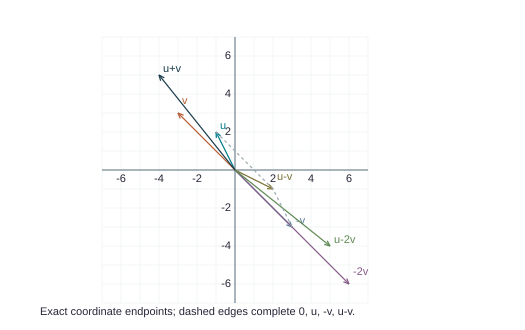
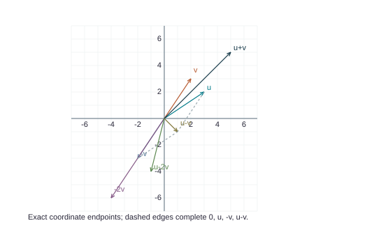
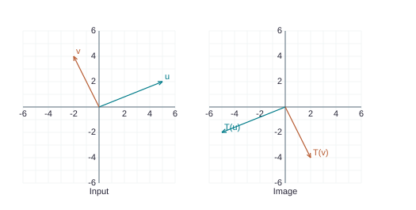
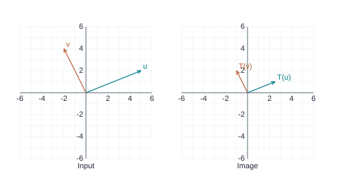
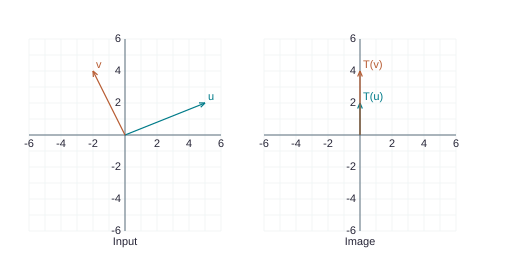
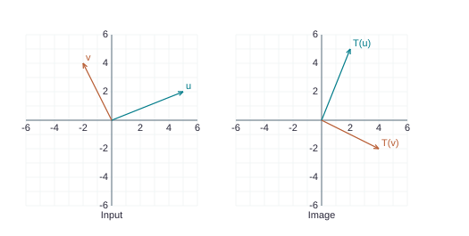
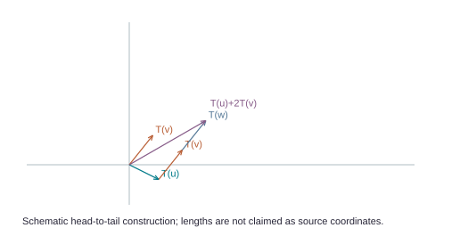
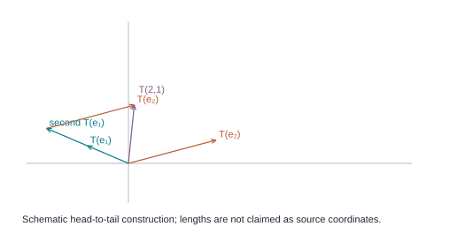
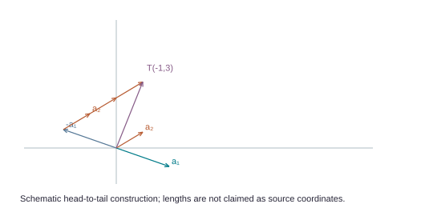

> Fully revised teaching manuscript exported from the delivered reader. Native display equations use @eq; complete matrices use @matrix JSON. Figures are editable SVGs. The build uses the original source manuscripts plus beginner-content.json as its canonical teaching records; edit those records to persist changes, then rebuild and export again.

## 1.1.1 · Solve the system / find the common point

Solve each system by using elementary row operations on the equations or on the augmented matrix. Follow the systematic elimination procedure described in this section.

@eq x_1 + 5 x_2 = 7

@eq - 2 x_1 - 7 x_2 = -5

### Explanation

Independently derived teaching solution; no matching selected answer is present on Combined PDF pages 101-116.

**Your task.** Solve the system / find the common point.

The calculation below starts with 2 rows. Its 2 columns before the divider record the coefficients; the 1 column after the divider record the right-hand side.

#### Read the actual first row

@eq (1)x_1 + (5)x_2 = 7

**Words used in this question**

A coefficient is the number multiplying an unknown. A missing term has coefficient 0.

In a row staircase, a leading entry is the first nonzero entry when reading a nonzero row from left to right. Its position is a pivot position. A pivot coefficient column determines a basic coordinate; a nonpivot coefficient column allows a free coordinate.

- Each coefficient column corresponds to one unknown;

- the column after the vertical divider records the right-hand sides.

- We use reversible row operations to reveal the constraints.

The starting matrix is:

@matrix {"a": [["1", "5", "7"], ["-2", "-7", "-5"]], "bar": 2}

**Step 1: `R_2` ← `R_2` + (2)`R_1`.** Add 2 times row 1 to row 2. This cancels the entry in the pivot column while preserving the solutions. All other rows stay as displayed.

Before

@matrix {"a": [["1", "5", "7"], ["-2", "-7", "-5"]], "bar": 2}

After

@matrix {"a": [["1", "5", "7"], ["0", "3", "9"]], "bar": 2}

Lavender: affected row. Sage: pivot used.

#### Calculate every entry in the changed row

Multiply each entry of old row 1 by 2, then add it to the matching entry of old row 2. The other row is retained.

Row 2, column 1

@eq -2 + (2)(1) = -2 + 2 = 0

Row 2, column 2

@eq -7 + (2)(5) = -7 + 10 = 3

Row 2, column 3 (right-hand side)

@eq -5 + (2)(7) = -5 + 14 = 9

**Step 2: `R_2` ← (`1/3`)`R_2`.** Multiply every entry of row 2, including any right-hand side, by `1/3`. The pivot becomes 1; the multiplier is nonzero, so this step is reversible.

Before

@matrix {"a": [["1", "5", "7"], ["0", "3", "9"]], "bar": 2}

After

@matrix {"a": [["1", "5", "7"], ["0", "1", "3"]], "bar": 2}

Lavender: affected row. Sage: pivot used.

#### Calculate every entry in the changed row

Multiply every entry of old row 2 by `1/3`. This includes the constant column when one is present. The multiplier is nonzero, so division by it undoes the step.

Row 2, column 1

@eq (1/3)(0) = 0/3 = 0

Row 2, column 2

@eq (1/3)(3) = 3/3 = 1

Row 2, column 3 (right-hand side)

@eq (1/3)(9) = 9/3 = 3

**Step 3: `R_1` ← `R_1` + (-5)`R_2`.** Add -5 times row 2 to row 1. This cancels the entry in the pivot column while preserving the solutions. All other rows stay as displayed.

Before

@matrix {"a": [["1", "5", "7"], ["0", "1", "3"]], "bar": 2}

After

@matrix {"a": [["1", "0", "-8"], ["0", "1", "3"]], "bar": 2}

Lavender: affected row. Sage: pivot used.

#### Calculate every entry in the changed row

Multiply each entry of old row 2 by -5, then add it to the matching entry of old row 1. The other row is retained.

Row 1, column 1

@eq 1 + (-5)(0) = 1 + 0 = 1

Row 1, column 2

@eq 5 + (-5)(1) = 5 - 5 = 0

Row 1, column 3 (right-hand side)

@eq 7 + (-5)(3) = 7 - 15 = -8

- **Read the equations.**

@eq x_1 = -8

- @eq x_2 = 3

- Every unknown is basic,

- so no arbitrary choices remain.

- There is exactly one solution:

@matrix {"a": [["-8"], ["3"]], "bar": null}

**Verification in the original equations.** For p, the left-hand sides A p are:

@matrix {"a": [["7"], ["-5"]], "bar": null}

These entries equal the original right-hand sides, in order.

#### What does the reduced matrix say?

@matrix {"a": [["1", "0", "-8"], ["0", "1", "3"]], "bar": 2}

There are 2 equations and 2 unknown weights or coordinates. The divider separates the constants from those unknowns.

#### Separate determined coordinates from free choices

| Coordinate | Look at its column | What you may do |
| --- | --- | --- |
| `x_1` | Pivot column → basic | Determined by its pivot equation |
| `x_2` | Pivot column → basic | Determined by its pivot equation |

#### Determine x1 from its row

@eq x_1 = -8

@eq x_1 = -8

Subtract each free-variable term from both sides. The pivot coefficient is 1, so no further division is needed.

#### Determine x2 from its row

@eq x_2 = 3

@eq x_2 = 3

Subtract each free-variable term from both sides. The pivot coefficient is 1, so no further division is needed.

#### Verify the starting point in every original equation

@eq (1)(-8) + (5)(3) = -8 + 15 = 7

@eq (-2)(-8) + (-7)(3) = 16 - 21 = -5

FINAL ANSWER

@eq x = [-8;3]

Every coordinate is fixed. There are no free choices, so the solution is unique.

## 1.1.2 · Solve the system / find the common point

Solve each system by using elementary row operations on the equations or on the augmented matrix. Follow the systematic elimination procedure described in this section.

@eq 2 x_1 + 4 x_2 = -4

@eq 5 x_1 + 7 x_2 = 11

### Explanation

Independently derived teaching solution; no matching selected answer is present on Combined PDF pages 101-116.

**Your task.** Solve the system / find the common point.

The calculation below starts with 2 rows. Its 2 columns before the divider record the coefficients; the 1 column after the divider record the right-hand side.

#### Read the actual first row

@eq (2)x_1 + (4)x_2 = -4

**Words used in this question**

A coefficient is the number multiplying an unknown. A missing term has coefficient 0.

In a row staircase, a leading entry is the first nonzero entry when reading a nonzero row from left to right. Its position is a pivot position. A pivot coefficient column determines a basic coordinate; a nonpivot coefficient column allows a free coordinate.

- Each coefficient column corresponds to one unknown;

- the column after the vertical divider records the right-hand sides.

- We use reversible row operations to reveal the constraints.

The starting matrix is:

@matrix {"a": [["2", "4", "-4"], ["5", "7", "11"]], "bar": 2}

**Step 1: `R_1` ← (`1/2`)`R_1`.** Multiply every entry of row 1, including any right-hand side, by `1/2`. The pivot becomes 1; the multiplier is nonzero, so this step is reversible.

Before

@matrix {"a": [["2", "4", "-4"], ["5", "7", "11"]], "bar": 2}

After

@matrix {"a": [["1", "2", "-2"], ["5", "7", "11"]], "bar": 2}

Lavender: affected row. Sage: pivot used.

#### Calculate every entry in the changed row

Multiply every entry of old row 1 by `1/2`. This includes the constant column when one is present. The multiplier is nonzero, so division by it undoes the step.

Row 1, column 1

@eq (1/2)(2) = 2/2 = 1

Row 1, column 2

@eq (1/2)(4) = 4/2 = 2

Row 1, column 3 (right-hand side)

@eq (1/2)(-4) = -4/2 = -2

**Step 2: `R_2` ← `R_2` + (-5)`R_1`.** Add -5 times row 1 to row 2. This cancels the entry in the pivot column while preserving the solutions. All other rows stay as displayed.

Before

@matrix {"a": [["1", "2", "-2"], ["5", "7", "11"]], "bar": 2}

After

@matrix {"a": [["1", "2", "-2"], ["0", "-3", "21"]], "bar": 2}

Lavender: affected row. Sage: pivot used.

#### Calculate every entry in the changed row

Multiply each entry of old row 1 by -5, then add it to the matching entry of old row 2. The other row is retained.

Row 2, column 1

@eq 5 + (-5)(1) = 5 - 5 = 0

Row 2, column 2

@eq 7 + (-5)(2) = 7 - 10 = -3

Row 2, column 3 (right-hand side)

@eq 11 + (-5)(-2) = 11 + 10 = 21

**Step 3: `R_2` ← (`-1/3`)`R_2`.** Multiply every entry of row 2, including any right-hand side, by `-1/3`. The pivot becomes 1; the multiplier is nonzero, so this step is reversible.

Before

@matrix {"a": [["1", "2", "-2"], ["0", "-3", "21"]], "bar": 2}

After

@matrix {"a": [["1", "2", "-2"], ["0", "1", "-7"]], "bar": 2}

Lavender: affected row. Sage: pivot used.

#### Calculate every entry in the changed row

Multiply every entry of old row 2 by `-1/3`. This includes the constant column when one is present. The multiplier is nonzero, so division by it undoes the step.

Row 2, column 1

@eq (-1/3)(0) = 0/3 = 0

Row 2, column 2

@eq (-1/3)(-3) = 3/3 = 1

Row 2, column 3 (right-hand side)

@eq (-1/3)(21) = -21/3 = -7

**Step 4: `R_1` ← `R_1` + (-2)`R_2`.** Add -2 times row 2 to row 1. This cancels the entry in the pivot column while preserving the solutions. All other rows stay as displayed.

Before

@matrix {"a": [["1", "2", "-2"], ["0", "1", "-7"]], "bar": 2}

After

@matrix {"a": [["1", "0", "12"], ["0", "1", "-7"]], "bar": 2}

Lavender: affected row. Sage: pivot used.

#### Calculate every entry in the changed row

Multiply each entry of old row 2 by -2, then add it to the matching entry of old row 1. The other row is retained.

Row 1, column 1

@eq 1 + (-2)(0) = 1 + 0 = 1

Row 1, column 2

@eq 2 + (-2)(1) = 2 - 2 = 0

Row 1, column 3 (right-hand side)

@eq -2 + (-2)(-7) = -2 + 14 = 12

- **Read the equations.**

@eq x_1 = 12

- @eq x_2 = -7

- Every unknown is basic,

- so no arbitrary choices remain.

- There is exactly one solution:

@matrix {"a": [["12"], ["-7"]], "bar": null}

**Verification in the original equations.** For p, the left-hand sides A p are:

@matrix {"a": [["-4"], ["11"]], "bar": null}

These entries equal the original right-hand sides, in order.

#### What does the reduced matrix say?

@matrix {"a": [["1", "0", "12"], ["0", "1", "-7"]], "bar": 2}

There are 2 equations and 2 unknown weights or coordinates. The divider separates the constants from those unknowns.

#### Separate determined coordinates from free choices

| Coordinate | Look at its column | What you may do |
| --- | --- | --- |
| `x_1` | Pivot column → basic | Determined by its pivot equation |
| `x_2` | Pivot column → basic | Determined by its pivot equation |

#### Determine x1 from its row

@eq x_1 = 12

@eq x_1 = 12

Subtract each free-variable term from both sides. The pivot coefficient is 1, so no further division is needed.

#### Determine x2 from its row

@eq x_2 = -7

@eq x_2 = -7

Subtract each free-variable term from both sides. The pivot coefficient is 1, so no further division is needed.

#### Verify the starting point in every original equation

@eq (2)(12) + (4)(-7) = 24 - 28 = -4

@eq (5)(12) + (7)(-7) = 60 - 49 = 11

FINAL ANSWER

@eq x = [12;-7]

Every coordinate is fixed. There are no free choices, so the solution is unique.

## 1.1.3 · Solve the system / find the common point

Find the point (`x₁`,`x₂`) that lies on both lines. See the figure.

@eq x_1 + 5 x_2 = 7

@eq x_1 - 2 x_2 = -2

### Explanation

Independently derived and cross-checked against the selected supplied solution on Combined PDF page 101.

**Your task.** Solve the system / find the common point.

The calculation below starts with 2 rows. Its 2 columns before the divider record the coefficients; the 1 column after the divider record the right-hand side.

#### Read the actual first row

@eq (1)x_1 + (5)x_2 = 7

**Words used in this question**

A coefficient is the number multiplying an unknown. A missing term has coefficient 0.

In a row staircase, a leading entry is the first nonzero entry when reading a nonzero row from left to right. Its position is a pivot position. A pivot coefficient column determines a basic coordinate; a nonpivot coefficient column allows a free coordinate.

- Each coefficient column corresponds to one unknown;

- the column after the vertical divider records the right-hand sides.

- We use reversible row operations to reveal the constraints.

The starting matrix is:

@matrix {"a": [["1", "5", "7"], ["1", "-2", "-2"]], "bar": 2}

**Step 1: `R_2` ← `R_2` + (-1)`R_1`.** Add -1 times row 1 to row 2. This cancels the entry in the pivot column while preserving the solutions. All other rows stay as displayed.

Before

@matrix {"a": [["1", "5", "7"], ["1", "-2", "-2"]], "bar": 2}

After

@matrix {"a": [["1", "5", "7"], ["0", "-7", "-9"]], "bar": 2}

Lavender: affected row. Sage: pivot used.

#### Calculate every entry in the changed row

Multiply each entry of old row 1 by -1, then add it to the matching entry of old row 2. The other row is retained.

Row 2, column 1

@eq 1 + (-1)(1) = 1 - 1 = 0

Row 2, column 2

@eq -2 + (-1)(5) = -2 - 5 = -7

Row 2, column 3 (right-hand side)

@eq -2 + (-1)(7) = -2 - 7 = -9

**Step 2: `R_2` ← (`-1/7`)`R_2`.** Multiply every entry of row 2, including any right-hand side, by `-1/7`. The pivot becomes 1; the multiplier is nonzero, so this step is reversible.

Before

@matrix {"a": [["1", "5", "7"], ["0", "-7", "-9"]], "bar": 2}

After

@matrix {"a": [["1", "5", "7"], ["0", "1", "9/7"]], "bar": 2}

Lavender: affected row. Sage: pivot used.

#### Calculate every entry in the changed row

Multiply every entry of old row 2 by `-1/7`. This includes the constant column when one is present. The multiplier is nonzero, so division by it undoes the step.

Row 2, column 1

@eq (-1/7)(0) = 0/7 = 0

Row 2, column 2

@eq (-1/7)(-7) = 7/7 = 1

Row 2, column 3 (right-hand side)

@eq (-1/7)(-9) = 9/7 = 9/7

**Step 3: `R_1` ← `R_1` + (-5)`R_2`.** Add -5 times row 2 to row 1. This cancels the entry in the pivot column while preserving the solutions. All other rows stay as displayed.

Before

@matrix {"a": [["1", "5", "7"], ["0", "1", "9/7"]], "bar": 2}

After

@matrix {"a": [["1", "0", "4/7"], ["0", "1", "9/7"]], "bar": 2}

Lavender: affected row. Sage: pivot used.

#### Calculate every entry in the changed row

Multiply each entry of old row 2 by -5, then add it to the matching entry of old row 1. The other row is retained.

Row 1, column 1

@eq 1 + (-5)(0) = 1 + 0 = 1

Row 1, column 2

@eq 5 + (-5)(1) = 5 - 5 = 0

Row 1, column 3 (right-hand side)

@eq 7 + (-5)(9/7) = 7 - 45/7 = 4/7

- **Read the equations.**

@eq x_1 = 4/7

- @eq x_2 = 9/7

- Every unknown is basic,

- so no arbitrary choices remain.

- There is exactly one solution:

@matrix {"a": [["4/7"], ["9/7"]], "bar": null}

**Verification in the original equations.** For p, the left-hand sides A p are:

@matrix {"a": [["7"], ["-2"]], "bar": null}

These entries equal the original right-hand sides, in order.

#### What does the reduced matrix say?

@matrix {"a": [["1", "0", "4/7"], ["0", "1", "9/7"]], "bar": 2}

There are 2 equations and 2 unknown weights or coordinates. The divider separates the constants from those unknowns.

#### Separate determined coordinates from free choices

| Coordinate | Look at its column | What you may do |
| --- | --- | --- |
| `x_1` | Pivot column → basic | Determined by its pivot equation |
| `x_2` | Pivot column → basic | Determined by its pivot equation |

#### Determine x1 from its row

@eq x_1 = 4/7

@eq x_1 = 4/7

Subtract each free-variable term from both sides. The pivot coefficient is 1, so no further division is needed.

#### Determine x2 from its row

@eq x_2 = 9/7

@eq x_2 = 9/7

Subtract each free-variable term from both sides. The pivot coefficient is 1, so no further division is needed.

#### Verify the starting point in every original equation

@eq (1)(4/7) + (5)(9/7) = 4/7 + 45/7 = 7

@eq (1)(4/7) + (-2)(9/7) = 4/7 - 18/7 = -2

FINAL ANSWER

@eq x = [4/7;9/7]

Every coordinate is fixed. There are no free choices, so the solution is unique.

## 1.1.4 · Solve the system / find the common point

Find the point of intersection of the lines.

@eq x_1 - 5 x_2 = 1

@eq 3 x_1 - 7 x_2 = 5

### Explanation

Independently derived teaching solution; no matching selected answer is present on Combined PDF pages 101-116.

**Your task.** Solve the system / find the common point.

The calculation below starts with 2 rows. Its 2 columns before the divider record the coefficients; the 1 column after the divider record the right-hand side.

#### Read the actual first row

@eq (1)x_1 + (-5)x_2 = 1

**Words used in this question**

A coefficient is the number multiplying an unknown. A missing term has coefficient 0.

In a row staircase, a leading entry is the first nonzero entry when reading a nonzero row from left to right. Its position is a pivot position. A pivot coefficient column determines a basic coordinate; a nonpivot coefficient column allows a free coordinate.

- Each coefficient column corresponds to one unknown;

- the column after the vertical divider records the right-hand sides.

- We use reversible row operations to reveal the constraints.

The starting matrix is:

@matrix {"a": [["1", "-5", "1"], ["3", "-7", "5"]], "bar": 2}

**Step 1: `R_2` ← `R_2` + (-3)`R_1`.** Add -3 times row 1 to row 2. This cancels the entry in the pivot column while preserving the solutions. All other rows stay as displayed.

Before

@matrix {"a": [["1", "-5", "1"], ["3", "-7", "5"]], "bar": 2}

After

@matrix {"a": [["1", "-5", "1"], ["0", "8", "2"]], "bar": 2}

Lavender: affected row. Sage: pivot used.

#### Calculate every entry in the changed row

Multiply each entry of old row 1 by -3, then add it to the matching entry of old row 2. The other row is retained.

Row 2, column 1

@eq 3 + (-3)(1) = 3 - 3 = 0

Row 2, column 2

@eq -7 + (-3)(-5) = -7 + 15 = 8

Row 2, column 3 (right-hand side)

@eq 5 + (-3)(1) = 5 - 3 = 2

**Step 2: `R_2` ← (`1/8`)`R_2`.** Multiply every entry of row 2, including any right-hand side, by `1/8`. The pivot becomes 1; the multiplier is nonzero, so this step is reversible.

Before

@matrix {"a": [["1", "-5", "1"], ["0", "8", "2"]], "bar": 2}

After

@matrix {"a": [["1", "-5", "1"], ["0", "1", "1/4"]], "bar": 2}

Lavender: affected row. Sage: pivot used.

#### Calculate every entry in the changed row

Multiply every entry of old row 2 by `1/8`. This includes the constant column when one is present. The multiplier is nonzero, so division by it undoes the step.

Row 2, column 1

@eq (1/8)(0) = 0/8 = 0

Row 2, column 2

@eq (1/8)(8) = 8/8 = 1

Row 2, column 3 (right-hand side)

@eq (1/8)(2) = 2/8 = 1/4

**Step 3: `R_1` ← `R_1` + (5)`R_2`.** Add 5 times row 2 to row 1. This cancels the entry in the pivot column while preserving the solutions. All other rows stay as displayed.

Before

@matrix {"a": [["1", "-5", "1"], ["0", "1", "1/4"]], "bar": 2}

After

@matrix {"a": [["1", "0", "9/4"], ["0", "1", "1/4"]], "bar": 2}

Lavender: affected row. Sage: pivot used.

#### Calculate every entry in the changed row

Multiply each entry of old row 2 by 5, then add it to the matching entry of old row 1. The other row is retained.

Row 1, column 1

@eq 1 + (5)(0) = 1 + 0 = 1

Row 1, column 2

@eq -5 + (5)(1) = -5 + 5 = 0

Row 1, column 3 (right-hand side)

@eq 1 + (5)(1/4) = 1 + 5/4 = 9/4

- **Read the equations.**

@eq x_1 = 9/4

- @eq x_2 = 1/4

- Every unknown is basic,

- so no arbitrary choices remain.

- There is exactly one solution:

@matrix {"a": [["9/4"], ["1/4"]], "bar": null}

**Verification in the original equations.** For p, the left-hand sides A p are:

@matrix {"a": [["1"], ["5"]], "bar": null}

These entries equal the original right-hand sides, in order.

#### What does the reduced matrix say?

@matrix {"a": [["1", "0", "9/4"], ["0", "1", "1/4"]], "bar": 2}

There are 2 equations and 2 unknown weights or coordinates. The divider separates the constants from those unknowns.

#### Separate determined coordinates from free choices

| Coordinate | Look at its column | What you may do |
| --- | --- | --- |
| `x_1` | Pivot column → basic | Determined by its pivot equation |
| `x_2` | Pivot column → basic | Determined by its pivot equation |

#### Determine x1 from its row

@eq x_1 = 9/4

@eq x_1 = 9/4

Subtract each free-variable term from both sides. The pivot coefficient is 1, so no further division is needed.

#### Determine x2 from its row

@eq x_2 = 1/4

@eq x_2 = 1/4

Subtract each free-variable term from both sides. The pivot coefficient is 1, so no further division is needed.

#### Verify the starting point in every original equation

@eq (1)(9/4) + (-5)(1/4) = 9/4 - 5/4 = 1

@eq (3)(9/4) + (-7)(1/4) = 27/4 - 7/4 = 5

FINAL ANSWER

@eq x = [9/4;1/4]

Every coordinate is fixed. There are no free choices, so the solution is unique.

## 1.1.5 · Describe the next two row operations

Consider this matrix as the augmented matrix of a linear system. State in words the next two elementary row operations that should be performed in the process of solving the system.

@matrix {"a": [["1", "-4", "5", "0", "7"], ["0", "1", "-3", "0", "6"], ["0", "0", "1", "0", "2"], ["0", "0", "0", "1", "-5"]], "bar": 4}

### Explanation

Independently derived teaching solution; no matching selected answer is present on Combined PDF pages 101-116.

**Your task.** Describe the next two row operations.

**Words used in this question**

In a row staircase, a leading entry is the first nonzero entry when reading a nonzero row from left to right. Its position is a pivot position. A pivot coefficient column determines a basic coordinate; a nonpivot coefficient column allows a free coordinate.

- The last row already gives

@eq x₄ = -5

, and the third row gives

@eq x₃ = 2

- To continue the backward phase, first replace `R₂` by `R₂` + 3`R₃`, clearing -3 above the pivot in column 3.

- Then replace `R₁` by `R₁` - 5`R₃`, clearing 5 in that column.

- The complete updated arrays are:

@matrix {"a": [["1", "-4", "5", "0", "7"], ["0", "1", "0", "0", "12"], ["0", "0", "1", "0", "2"], ["0", "0", "0", "1", "-5"]], "bar": 4}

@matrix {"a": [["1", "-4", "0", "0", "-3"], ["0", "1", "0", "0", "12"], ["0", "0", "1", "0", "2"], ["0", "0", "0", "1", "-5"]], "bar": 4}

These are valid next operations; other equivalent backward-phase orders may also be used.

#### What does the reduced matrix say?

@matrix {"a": [["1", "0", "0", "0", "45"], ["0", "1", "0", "0", "12"], ["0", "0", "1", "0", "2"], ["0", "0", "0", "1", "-5"]], "bar": 4}

There are 4 equations and 4 unknown weights or coordinates. The divider separates the constants from those unknowns.

#### Separate determined coordinates from free choices

| Coordinate | Look at its column | What you may do |
| --- | --- | --- |
| `x_1` | Pivot column → basic | Determined by its pivot equation |
| `x_2` | Pivot column → basic | Determined by its pivot equation |
| `x_3` | Pivot column → basic | Determined by its pivot equation |
| `x_4` | Pivot column → basic | Determined by its pivot equation |

#### Determine x1 from its row

@eq x_1 = 45

@eq x_1 = 45

Subtract each free-variable term from both sides. The pivot coefficient is 1, so no further division is needed.

#### Determine x2 from its row

@eq x_2 = 12

@eq x_2 = 12

Subtract each free-variable term from both sides. The pivot coefficient is 1, so no further division is needed.

#### Determine x3 from its row

@eq x_3 = 2

@eq x_3 = 2

Subtract each free-variable term from both sides. The pivot coefficient is 1, so no further division is needed.

#### Determine x4 from its row

@eq x_4 = -5

@eq x_4 = -5

Subtract each free-variable term from both sides. The pivot coefficient is 1, so no further division is needed.

#### Verify the starting point in every original equation

@eq (1)(45) + (-4)(12) + (5)(2) + (0)(-5) = 45 - 48 + 10 + 0 = 7

@eq (0)(45) + (1)(12) + (0)(2) + (0)(-5) = 0 + 12 + 0 + 0 = 12

@eq (0)(45) + (0)(12) + (1)(2) + (0)(-5) = 0 + 0 + 2 + 0 = 2

@eq (0)(45) + (0)(12) + (0)(2) + (1)(-5) = 0 + 0 + 0 - 5 = -5

FINAL ANSWER

@eq x = [45;12;2;-5]

Every coordinate is fixed. There are no free choices, so the solution is unique.

## 1.1.6 · Describe the next two row operations

Consider this matrix as the augmented matrix of a linear system. State in words the next two elementary row operations that should be performed in the process of solving the system.

@matrix {"a": [["1", "-6", "4", "0", "-1"], ["0", "2", "-7", "0", "4"], ["0", "0", "1", "2", "-3"], ["0", "0", "3", "1", "6"]], "bar": 4}

### Explanation

Independently derived teaching solution; no matching selected answer is present on Combined PDF pages 101-116.

**Your task.** Describe the next two row operations.

**Words used in this question**

In a row staircase, a leading entry is the first nonzero entry when reading a nonzero row from left to right. Its position is a pivot position. A pivot coefficient column determines a basic coordinate; a nonpivot coefficient column allows a free coordinate.

- There is still a 3 below the pivot in column 3.

- Replace `R₄` by `R₄` - 3`R₃` to eliminate it.

- Then scale `R₄` by `-1/5` so its leading entry becomes 1.

- Carry the appended constant through both operations:

@matrix {"a": [["1", "-6", "4", "0", "-1"], ["0", "2", "-7", "0", "4"], ["0", "0", "1", "2", "-3"], ["0", "0", "0", "-5", "15"]], "bar": 4}

@matrix {"a": [["1", "-6", "4", "0", "-1"], ["0", "2", "-7", "0", "4"], ["0", "0", "1", "2", "-3"], ["0", "0", "0", "1", "-3"]], "bar": 4}

The fourth equation is now `x₄` = -3, ready for backward elimination.

#### What does the reduced matrix say?

@matrix {"a": [["1", "0", "0", "0", "62"], ["0", "1", "0", "0", "25/2"], ["0", "0", "1", "0", "3"], ["0", "0", "0", "1", "-3"]], "bar": 4}

There are 4 equations and 4 unknown weights or coordinates. The divider separates the constants from those unknowns.

#### Separate determined coordinates from free choices

| Coordinate | Look at its column | What you may do |
| --- | --- | --- |
| `x_1` | Pivot column → basic | Determined by its pivot equation |
| `x_2` | Pivot column → basic | Determined by its pivot equation |
| `x_3` | Pivot column → basic | Determined by its pivot equation |
| `x_4` | Pivot column → basic | Determined by its pivot equation |

#### Determine x1 from its row

@eq x_1 = 62

@eq x_1 = 62

Subtract each free-variable term from both sides. The pivot coefficient is 1, so no further division is needed.

#### Determine x2 from its row

@eq x_2 = 25/2

@eq x_2 = 25/2

Subtract each free-variable term from both sides. The pivot coefficient is 1, so no further division is needed.

#### Determine x3 from its row

@eq x_3 = 3

@eq x_3 = 3

Subtract each free-variable term from both sides. The pivot coefficient is 1, so no further division is needed.

#### Determine x4 from its row

@eq x_4 = -3

@eq x_4 = -3

Subtract each free-variable term from both sides. The pivot coefficient is 1, so no further division is needed.

#### Verify the starting point in every original equation

@eq (1)(62) + (-6)(25/2) + (4)(3) + (0)(-3) = 62 - 75 + 12 + 0 = -1

@eq (0)(62) + (2)(25/2) + (-7)(3) + (0)(-3) = 0 + 25 - 21 + 0 = 4

@eq (0)(62) + (0)(25/2) + (1)(3) + (2)(-3) = 0 + 0 + 3 - 6 = -3

@eq (0)(62) + (0)(25/2) + (0)(3) + (-5)(-3) = 0 + 0 + 0 + 15 = 15

FINAL ANSWER

@eq x = [62;25/2;3;-3]

Every coordinate is fixed. There are no free choices, so the solution is unique.

## 1.1.7 · Continue reduction and describe the full solution set

The augmented matrix of a linear system has been reduced by row operations to the form shown. Continue the appropriate row operations and describe the solution set of the original system.

@matrix {"a": [["1", "7", "3", "-4"], ["0", "1", "-1", "3"], ["0", "0", "0", "1"], ["0", "0", "1", "-2"]], "bar": 3}

### Explanation

Independently derived and cross-checked against the selected supplied solution on Combined PDF page 101.

**Your task.** Continue reduction and describe the full solution set.

The calculation below starts with 4 rows. Its 3 columns before the divider record the coefficients; the 1 column after the divider record the right-hand side.

#### Read the actual first row

@eq (1)x_1 + (7)x_2 + (3)x_3 = -4

**Words used in this question**

A coefficient is the number multiplying an unknown. A missing term has coefficient 0.

In a row staircase, a leading entry is the first nonzero entry when reading a nonzero row from left to right. Its position is a pivot position. A pivot coefficient column determines a basic coordinate; a nonpivot coefficient column allows a free coordinate.

- Each coefficient column corresponds to one unknown;

- the column after the vertical divider records the right-hand sides.

- We use reversible row operations to reveal the constraints.

The starting matrix is:

@matrix {"a": [["1", "7", "3", "-4"], ["0", "1", "-1", "3"], ["0", "0", "0", "1"], ["0", "0", "1", "-2"]], "bar": 3}

**Step 1: `R_3` ↔ `R_4`.** Move a nonzero entry into row 3 so that it can be used as a pivot.

Before

@matrix {"a": [["1", "7", "3", "-4"], ["0", "1", "-1", "3"], ["0", "0", "0", "1"], ["0", "0", "1", "-2"]], "bar": 3}

After

@matrix {"a": [["1", "7", "3", "-4"], ["0", "1", "-1", "3"], ["0", "0", "1", "-2"], ["0", "0", "0", "1"]], "bar": 3}

Lavender: affected rows. Sage: pivot used.

#### What changes in this swap?

Row 3 takes the complete contents of old row 4. Row 4 takes the complete contents of old row 3. No entry is multiplied or added; we only exchange the two equations.

**Step 2: `R_1` ← `R_1` + (4)`R_4`.** Add 4 times row 4 to row 1. This cancels the entry in the pivot column while preserving the solutions. All other rows stay as displayed.

Before

@matrix {"a": [["1", "7", "3", "-4"], ["0", "1", "-1", "3"], ["0", "0", "1", "-2"], ["0", "0", "0", "1"]], "bar": 3}

After

@matrix {"a": [["1", "7", "3", "0"], ["0", "1", "-1", "3"], ["0", "0", "1", "-2"], ["0", "0", "0", "1"]], "bar": 3}

Lavender: affected row. Sage: pivot used.

#### Calculate every entry in the changed row

Multiply each entry of old row 4 by 4, then add it to the matching entry of old row 1. The other row is retained.

Row 1, column 1

@eq 1 + (4)(0) = 1 + 0 = 1

Row 1, column 2

@eq 7 + (4)(0) = 7 + 0 = 7

Row 1, column 3

@eq 3 + (4)(0) = 3 + 0 = 3

Row 1, column 4 (right-hand side)

@eq -4 + (4)(1) = -4 + 4 = 0

**Step 3: `R_2` ← `R_2` + (-3)`R_4`.** Add -3 times row 4 to row 2. This cancels the entry in the pivot column while preserving the solutions. All other rows stay as displayed.

Before

@matrix {"a": [["1", "7", "3", "0"], ["0", "1", "-1", "3"], ["0", "0", "1", "-2"], ["0", "0", "0", "1"]], "bar": 3}

After

@matrix {"a": [["1", "7", "3", "0"], ["0", "1", "-1", "0"], ["0", "0", "1", "-2"], ["0", "0", "0", "1"]], "bar": 3}

Lavender: affected row. Sage: pivot used.

#### Calculate every entry in the changed row

Multiply each entry of old row 4 by -3, then add it to the matching entry of old row 2. The other row is retained.

Row 2, column 1

@eq 0 + (-3)(0) = 0 + 0 = 0

Row 2, column 2

@eq 1 + (-3)(0) = 1 + 0 = 1

Row 2, column 3

@eq -1 + (-3)(0) = -1 + 0 = -1

Row 2, column 4 (right-hand side)

@eq 3 + (-3)(1) = 3 - 3 = 0

**Step 4: `R_3` ← `R_3` + (2)`R_4`.** Add 2 times row 4 to row 3. This cancels the entry in the pivot column while preserving the solutions. All other rows stay as displayed.

Before

@matrix {"a": [["1", "7", "3", "0"], ["0", "1", "-1", "0"], ["0", "0", "1", "-2"], ["0", "0", "0", "1"]], "bar": 3}

After

@matrix {"a": [["1", "7", "3", "0"], ["0", "1", "-1", "0"], ["0", "0", "1", "0"], ["0", "0", "0", "1"]], "bar": 3}

Lavender: affected row. Sage: pivot used.

#### Calculate every entry in the changed row

Multiply each entry of old row 4 by 2, then add it to the matching entry of old row 3. The other row is retained.

Row 3, column 1

@eq 0 + (2)(0) = 0 + 0 = 0

Row 3, column 2

@eq 0 + (2)(0) = 0 + 0 = 0

Row 3, column 3

@eq 1 + (2)(0) = 1 + 0 = 1

Row 3, column 4 (right-hand side)

@eq -2 + (2)(1) = -2 + 2 = 0

**Step 5: `R_1` ← `R_1` + (-3)`R_3`.** Add -3 times row 3 to row 1. This cancels the entry in the pivot column while preserving the solutions. All other rows stay as displayed.

Before

@matrix {"a": [["1", "7", "3", "0"], ["0", "1", "-1", "0"], ["0", "0", "1", "0"], ["0", "0", "0", "1"]], "bar": 3}

After

@matrix {"a": [["1", "7", "0", "0"], ["0", "1", "-1", "0"], ["0", "0", "1", "0"], ["0", "0", "0", "1"]], "bar": 3}

Lavender: affected row. Sage: pivot used.

#### Calculate every entry in the changed row

Multiply each entry of old row 3 by -3, then add it to the matching entry of old row 1. The other row is retained.

Row 1, column 1

@eq 1 + (-3)(0) = 1 + 0 = 1

Row 1, column 2

@eq 7 + (-3)(0) = 7 + 0 = 7

Row 1, column 3

@eq 3 + (-3)(1) = 3 - 3 = 0

Row 1, column 4 (right-hand side)

@eq 0 + (-3)(0) = 0 + 0 = 0

**Step 6: `R_2` ← `R_2` + (1)`R_3`.** Add 1 times row 3 to row 2. This cancels the entry in the pivot column while preserving the solutions. All other rows stay as displayed.

Before

@matrix {"a": [["1", "7", "0", "0"], ["0", "1", "-1", "0"], ["0", "0", "1", "0"], ["0", "0", "0", "1"]], "bar": 3}

After

@matrix {"a": [["1", "7", "0", "0"], ["0", "1", "0", "0"], ["0", "0", "1", "0"], ["0", "0", "0", "1"]], "bar": 3}

Lavender: affected row. Sage: pivot used.

#### Calculate every entry in the changed row

Multiply each entry of old row 3 by 1, then add it to the matching entry of old row 2. The other row is retained.

Row 2, column 1

@eq 0 + (1)(0) = 0 + 0 = 0

Row 2, column 2

@eq 1 + (1)(0) = 1 + 0 = 1

Row 2, column 3

@eq -1 + (1)(1) = -1 + 1 = 0

Row 2, column 4 (right-hand side)

@eq 0 + (1)(0) = 0 + 0 = 0

**Step 7: `R_1` ← `R_1` + (-7)`R_2`.** Add -7 times row 2 to row 1. This cancels the entry in the pivot column while preserving the solutions. All other rows stay as displayed.

Before

@matrix {"a": [["1", "7", "0", "0"], ["0", "1", "0", "0"], ["0", "0", "1", "0"], ["0", "0", "0", "1"]], "bar": 3}

After

@matrix {"a": [["1", "0", "0", "0"], ["0", "1", "0", "0"], ["0", "0", "1", "0"], ["0", "0", "0", "1"]], "bar": 3}

Lavender: affected row. Sage: pivot used.

#### Calculate every entry in the changed row

Multiply each entry of old row 2 by -7, then add it to the matching entry of old row 1. The other row is retained.

Row 1, column 1

@eq 1 + (-7)(0) = 1 + 0 = 1

Row 1, column 2

@eq 7 + (-7)(1) = 7 - 7 = 0

Row 1, column 3

@eq 0 + (-7)(0) = 0 + 0 = 0

Row 1, column 4 (right-hand side)

@eq 0 + (-7)(0) = 0 + 0 = 0

- A row now states

@eq 0 = 1

- No choices of the unknowns can make that true.

- The system is inconsistent, and its solution set is empty.

- Free-looking coefficient columns cannot remove a contradiction.

#### What does the reduced matrix say?

@matrix {"a": [["1", "0", "0", "-5"], ["0", "1", "0", "1"], ["0", "0", "1", "-2"], ["0", "0", "0", "1"]], "bar": 3}

There are 4 equations and 3 unknown weights or coordinates. The divider separates the constants from those unknowns.

#### Read the contradictory row

@eq 0 = 1

All coefficients on the left are zero. No choice of unknowns can make zero equal this nonzero constant.

FINAL ANSWER

No solution exists for this target. If the question asks about span or range, the target is outside it.

## 1.1.8 · Continue reduction and describe the full solution set

The augmented matrix of a linear system has been reduced by row operations to the form shown. Continue the appropriate row operations and describe the solution set of the original system.

@matrix {"a": [["1", "1", "2", "0"], ["0", "1", "7", "0"], ["0", "0", "2", "-2"]], "bar": 3}

### Explanation

Independently derived teaching solution; no matching selected answer is present on Combined PDF pages 101-116.

**Your task.** Continue reduction and describe the full solution set.

The calculation below starts with 3 rows. Its 3 columns before the divider record the coefficients; the 1 column after the divider record the right-hand side.

#### Read the actual first row

@eq (1)x_1 + (1)x_2 + (2)x_3 = 0

**Words used in this question**

A coefficient is the number multiplying an unknown. A missing term has coefficient 0.

In a row staircase, a leading entry is the first nonzero entry when reading a nonzero row from left to right. Its position is a pivot position. A pivot coefficient column determines a basic coordinate; a nonpivot coefficient column allows a free coordinate.

- Each coefficient column corresponds to one unknown;

- the column after the vertical divider records the right-hand sides.

- We use reversible row operations to reveal the constraints.

The starting matrix is:

@matrix {"a": [["1", "1", "2", "0"], ["0", "1", "7", "0"], ["0", "0", "2", "-2"]], "bar": 3}

**Step 1: `R_3` ← (`1/2`)`R_3`.** Multiply every entry of row 3, including any right-hand side, by `1/2`. The pivot becomes 1; the multiplier is nonzero, so this step is reversible.

Before

@matrix {"a": [["1", "1", "2", "0"], ["0", "1", "7", "0"], ["0", "0", "2", "-2"]], "bar": 3}

After

@matrix {"a": [["1", "1", "2", "0"], ["0", "1", "7", "0"], ["0", "0", "1", "-1"]], "bar": 3}

Lavender: affected row. Sage: pivot used.

#### Calculate every entry in the changed row

Multiply every entry of old row 3 by `1/2`. This includes the constant column when one is present. The multiplier is nonzero, so division by it undoes the step.

Row 3, column 1

@eq (1/2)(0) = 0/2 = 0

Row 3, column 2

@eq (1/2)(0) = 0/2 = 0

Row 3, column 3

@eq (1/2)(2) = 2/2 = 1

Row 3, column 4 (right-hand side)

@eq (1/2)(-2) = -2/2 = -1

**Step 2: `R_1` ← `R_1` + (-2)`R_3`.** Add -2 times row 3 to row 1. This cancels the entry in the pivot column while preserving the solutions. All other rows stay as displayed.

Before

@matrix {"a": [["1", "1", "2", "0"], ["0", "1", "7", "0"], ["0", "0", "1", "-1"]], "bar": 3}

After

@matrix {"a": [["1", "1", "0", "2"], ["0", "1", "7", "0"], ["0", "0", "1", "-1"]], "bar": 3}

Lavender: affected row. Sage: pivot used.

#### Calculate every entry in the changed row

Multiply each entry of old row 3 by -2, then add it to the matching entry of old row 1. The other row is retained.

Row 1, column 1

@eq 1 + (-2)(0) = 1 + 0 = 1

Row 1, column 2

@eq 1 + (-2)(0) = 1 + 0 = 1

Row 1, column 3

@eq 2 + (-2)(1) = 2 - 2 = 0

Row 1, column 4 (right-hand side)

@eq 0 + (-2)(-1) = 0 + 2 = 2

**Step 3: `R_2` ← `R_2` + (-7)`R_3`.** Add -7 times row 3 to row 2. This cancels the entry in the pivot column while preserving the solutions. All other rows stay as displayed.

Before

@matrix {"a": [["1", "1", "0", "2"], ["0", "1", "7", "0"], ["0", "0", "1", "-1"]], "bar": 3}

After

@matrix {"a": [["1", "1", "0", "2"], ["0", "1", "0", "7"], ["0", "0", "1", "-1"]], "bar": 3}

Lavender: affected row. Sage: pivot used.

#### Calculate every entry in the changed row

Multiply each entry of old row 3 by -7, then add it to the matching entry of old row 2. The other row is retained.

Row 2, column 1

@eq 0 + (-7)(0) = 0 + 0 = 0

Row 2, column 2

@eq 1 + (-7)(0) = 1 + 0 = 1

Row 2, column 3

@eq 7 + (-7)(1) = 7 - 7 = 0

Row 2, column 4 (right-hand side)

@eq 0 + (-7)(-1) = 0 + 7 = 7

**Step 4: `R_1` ← `R_1` + (-1)`R_2`.** Add -1 times row 2 to row 1. This cancels the entry in the pivot column while preserving the solutions. All other rows stay as displayed.

Before

@matrix {"a": [["1", "1", "0", "2"], ["0", "1", "0", "7"], ["0", "0", "1", "-1"]], "bar": 3}

After

@matrix {"a": [["1", "0", "0", "-5"], ["0", "1", "0", "7"], ["0", "0", "1", "-1"]], "bar": 3}

Lavender: affected row. Sage: pivot used.

#### Calculate every entry in the changed row

Multiply each entry of old row 2 by -1, then add it to the matching entry of old row 1. The other row is retained.

Row 1, column 1

@eq 1 + (-1)(0) = 1 + 0 = 1

Row 1, column 2

@eq 1 + (-1)(1) = 1 - 1 = 0

Row 1, column 3

@eq 0 + (-1)(0) = 0 + 0 = 0

Row 1, column 4 (right-hand side)

@eq 2 + (-1)(7) = 2 - 7 = -5

- **Read the equations.**

@eq x_1 = -5

- @eq x_2 = 7

- @eq x_3 = -1

- Every unknown is basic,

- so no arbitrary choices remain.

- There is exactly one solution:

@matrix {"a": [["-5"], ["7"], ["-1"]], "bar": null}

**Verification in the original equations.** For p, the left-hand sides A p are:

@matrix {"a": [["0"], ["0"], ["-2"]], "bar": null}

These entries equal the original right-hand sides, in order.

#### What does the reduced matrix say?

@matrix {"a": [["1", "0", "0", "-5"], ["0", "1", "0", "7"], ["0", "0", "1", "-1"]], "bar": 3}

There are 3 equations and 3 unknown weights or coordinates. The divider separates the constants from those unknowns.

#### Separate determined coordinates from free choices

| Coordinate | Look at its column | What you may do |
| --- | --- | --- |
| `x_1` | Pivot column → basic | Determined by its pivot equation |
| `x_2` | Pivot column → basic | Determined by its pivot equation |
| `x_3` | Pivot column → basic | Determined by its pivot equation |

#### Determine x1 from its row

@eq x_1 = -5

@eq x_1 = -5

Subtract each free-variable term from both sides. The pivot coefficient is 1, so no further division is needed.

#### Determine x2 from its row

@eq x_2 = 7

@eq x_2 = 7

Subtract each free-variable term from both sides. The pivot coefficient is 1, so no further division is needed.

#### Determine x3 from its row

@eq x_3 = -1

@eq x_3 = -1

Subtract each free-variable term from both sides. The pivot coefficient is 1, so no further division is needed.

#### Verify the starting point in every original equation

@eq (1)(-5) + (1)(7) + (2)(-1) = -5 + 7 - 2 = 0

@eq (0)(-5) + (1)(7) + (7)(-1) = 0 + 7 - 7 = 0

@eq (0)(-5) + (0)(7) + (2)(-1) = 0 + 0 - 2 = -2

FINAL ANSWER

@eq x = [-5;7;-1]

Every coordinate is fixed. There are no free choices, so the solution is unique.

## 1.1.9 · Continue reduction and describe the full solution set

The augmented matrix of a linear system has been reduced by row operations to the form shown. Continue the appropriate row operations and describe the solution set of the original system.

@matrix {"a": [["1", "-1", "0", "0", "-4"], ["0", "1", "-3", "0", "-7"], ["0", "0", "1", "-3", "-1"], ["0", "0", "0", "0", "4"]], "bar": 4}

### Explanation

Independently derived and cross-checked against the selected supplied solution on Combined PDF page 101.

**Your task.** Continue reduction and describe the full solution set.

The calculation below starts with 4 rows. Its 4 columns before the divider record the coefficients; the 1 column after the divider record the right-hand side.

#### Read the actual first row

@eq (1)x_1 + (-1)x_2 + (0)x_3 + (0)x_4 = -4

**Words used in this question**

A coefficient is the number multiplying an unknown. A missing term has coefficient 0.

In a row staircase, a leading entry is the first nonzero entry when reading a nonzero row from left to right. Its position is a pivot position. A pivot coefficient column determines a basic coordinate; a nonpivot coefficient column allows a free coordinate.

- Each coefficient column corresponds to one unknown;

- the column after the vertical divider records the right-hand sides.

- We use reversible row operations to reveal the constraints.

The starting matrix is:

@matrix {"a": [["1", "-1", "0", "0", "-4"], ["0", "1", "-3", "0", "-7"], ["0", "0", "1", "-3", "-1"], ["0", "0", "0", "0", "4"]], "bar": 4}

**Step 1: `R_4` ← (`1/4`)`R_4`.** Multiply every entry of row 4, including any right-hand side, by `1/4`. The pivot becomes 1; the multiplier is nonzero, so this step is reversible.

Before

@matrix {"a": [["1", "-1", "0", "0", "-4"], ["0", "1", "-3", "0", "-7"], ["0", "0", "1", "-3", "-1"], ["0", "0", "0", "0", "4"]], "bar": 4}

After

@matrix {"a": [["1", "-1", "0", "0", "-4"], ["0", "1", "-3", "0", "-7"], ["0", "0", "1", "-3", "-1"], ["0", "0", "0", "0", "1"]], "bar": 4}

Lavender: affected row. Sage: pivot used.

#### Calculate every entry in the changed row

Multiply every entry of old row 4 by `1/4`. This includes the constant column when one is present. The multiplier is nonzero, so division by it undoes the step.

Row 4, column 1

@eq (1/4)(0) = 0/4 = 0

Row 4, column 2

@eq (1/4)(0) = 0/4 = 0

Row 4, column 3

@eq (1/4)(0) = 0/4 = 0

Row 4, column 4

@eq (1/4)(0) = 0/4 = 0

Row 4, column 5 (right-hand side)

@eq (1/4)(4) = 4/4 = 1

**Step 2: `R_1` ← `R_1` + (4)`R_4`.** Add 4 times row 4 to row 1. This cancels the entry in the pivot column while preserving the solutions. All other rows stay as displayed.

Before

@matrix {"a": [["1", "-1", "0", "0", "-4"], ["0", "1", "-3", "0", "-7"], ["0", "0", "1", "-3", "-1"], ["0", "0", "0", "0", "1"]], "bar": 4}

After

@matrix {"a": [["1", "-1", "0", "0", "0"], ["0", "1", "-3", "0", "-7"], ["0", "0", "1", "-3", "-1"], ["0", "0", "0", "0", "1"]], "bar": 4}

Lavender: affected row. Sage: pivot used.

#### Calculate every entry in the changed row

Multiply each entry of old row 4 by 4, then add it to the matching entry of old row 1. The other row is retained.

Row 1, column 1

@eq 1 + (4)(0) = 1 + 0 = 1

Row 1, column 2

@eq -1 + (4)(0) = -1 + 0 = -1

Row 1, column 3

@eq 0 + (4)(0) = 0 + 0 = 0

Row 1, column 4

@eq 0 + (4)(0) = 0 + 0 = 0

Row 1, column 5 (right-hand side)

@eq -4 + (4)(1) = -4 + 4 = 0

**Step 3: `R_2` ← `R_2` + (7)`R_4`.** Add 7 times row 4 to row 2. This cancels the entry in the pivot column while preserving the solutions. All other rows stay as displayed.

Before

@matrix {"a": [["1", "-1", "0", "0", "0"], ["0", "1", "-3", "0", "-7"], ["0", "0", "1", "-3", "-1"], ["0", "0", "0", "0", "1"]], "bar": 4}

After

@matrix {"a": [["1", "-1", "0", "0", "0"], ["0", "1", "-3", "0", "0"], ["0", "0", "1", "-3", "-1"], ["0", "0", "0", "0", "1"]], "bar": 4}

Lavender: affected row. Sage: pivot used.

#### Calculate every entry in the changed row

Multiply each entry of old row 4 by 7, then add it to the matching entry of old row 2. The other row is retained.

Row 2, column 1

@eq 0 + (7)(0) = 0 + 0 = 0

Row 2, column 2

@eq 1 + (7)(0) = 1 + 0 = 1

Row 2, column 3

@eq -3 + (7)(0) = -3 + 0 = -3

Row 2, column 4

@eq 0 + (7)(0) = 0 + 0 = 0

Row 2, column 5 (right-hand side)

@eq -7 + (7)(1) = -7 + 7 = 0

**Step 4: `R_3` ← `R_3` + (1)`R_4`.** Add 1 times row 4 to row 3. This cancels the entry in the pivot column while preserving the solutions. All other rows stay as displayed.

Before

@matrix {"a": [["1", "-1", "0", "0", "0"], ["0", "1", "-3", "0", "0"], ["0", "0", "1", "-3", "-1"], ["0", "0", "0", "0", "1"]], "bar": 4}

After

@matrix {"a": [["1", "-1", "0", "0", "0"], ["0", "1", "-3", "0", "0"], ["0", "0", "1", "-3", "0"], ["0", "0", "0", "0", "1"]], "bar": 4}

Lavender: affected row. Sage: pivot used.

#### Calculate every entry in the changed row

Multiply each entry of old row 4 by 1, then add it to the matching entry of old row 3. The other row is retained.

Row 3, column 1

@eq 0 + (1)(0) = 0 + 0 = 0

Row 3, column 2

@eq 0 + (1)(0) = 0 + 0 = 0

Row 3, column 3

@eq 1 + (1)(0) = 1 + 0 = 1

Row 3, column 4

@eq -3 + (1)(0) = -3 + 0 = -3

Row 3, column 5 (right-hand side)

@eq -1 + (1)(1) = -1 + 1 = 0

**Step 5: `R_2` ← `R_2` + (3)`R_3`.** Add 3 times row 3 to row 2. This cancels the entry in the pivot column while preserving the solutions. All other rows stay as displayed.

Before

@matrix {"a": [["1", "-1", "0", "0", "0"], ["0", "1", "-3", "0", "0"], ["0", "0", "1", "-3", "0"], ["0", "0", "0", "0", "1"]], "bar": 4}

After

@matrix {"a": [["1", "-1", "0", "0", "0"], ["0", "1", "0", "-9", "0"], ["0", "0", "1", "-3", "0"], ["0", "0", "0", "0", "1"]], "bar": 4}

Lavender: affected row. Sage: pivot used.

#### Calculate every entry in the changed row

Multiply each entry of old row 3 by 3, then add it to the matching entry of old row 2. The other row is retained.

Row 2, column 1

@eq 0 + (3)(0) = 0 + 0 = 0

Row 2, column 2

@eq 1 + (3)(0) = 1 + 0 = 1

Row 2, column 3

@eq -3 + (3)(1) = -3 + 3 = 0

Row 2, column 4

@eq 0 + (3)(-3) = 0 - 9 = -9

Row 2, column 5 (right-hand side)

@eq 0 + (3)(0) = 0 + 0 = 0

**Step 6: `R_1` ← `R_1` + (1)`R_2`.** Add 1 times row 2 to row 1. This cancels the entry in the pivot column while preserving the solutions. All other rows stay as displayed.

Before

@matrix {"a": [["1", "-1", "0", "0", "0"], ["0", "1", "0", "-9", "0"], ["0", "0", "1", "-3", "0"], ["0", "0", "0", "0", "1"]], "bar": 4}

After

@matrix {"a": [["1", "0", "0", "-9", "0"], ["0", "1", "0", "-9", "0"], ["0", "0", "1", "-3", "0"], ["0", "0", "0", "0", "1"]], "bar": 4}

Lavender: affected row. Sage: pivot used.

#### Calculate every entry in the changed row

Multiply each entry of old row 2 by 1, then add it to the matching entry of old row 1. The other row is retained.

Row 1, column 1

@eq 1 + (1)(0) = 1 + 0 = 1

Row 1, column 2

@eq -1 + (1)(1) = -1 + 1 = 0

Row 1, column 3

@eq 0 + (1)(0) = 0 + 0 = 0

Row 1, column 4

@eq 0 + (1)(-9) = 0 - 9 = -9

Row 1, column 5 (right-hand side)

@eq 0 + (1)(0) = 0 + 0 = 0

- A row now states

@eq 0 = 1

- No choices of the unknowns can make that true.

- The system is inconsistent, and its solution set is empty.

- Free-looking coefficient columns cannot remove a contradiction.

#### What does the reduced matrix say?

@matrix {"a": [["1", "0", "0", "-9", "-14"], ["0", "1", "0", "-9", "-10"], ["0", "0", "1", "-3", "-1"], ["0", "0", "0", "0", "4"]], "bar": 4}

There are 4 equations and 4 unknown weights or coordinates. The divider separates the constants from those unknowns.

#### Read the contradictory row

@eq 0 = 4

All coefficients on the left are zero. No choice of unknowns can make zero equal this nonzero constant.

FINAL ANSWER

No solution exists for this target. If the question asks about span or range, the target is outside it.

## 1.1.10 · Continue reduction and describe the full solution set

The augmented matrix of a linear system has been reduced by row operations to the form shown. Continue the appropriate row operations and describe the solution set of the original system.

@matrix {"a": [["1", "-2", "0", "3", "0"], ["0", "1", "0", "-4", "0"], ["0", "0", "1", "0", "0"], ["0", "0", "0", "1", "0"]], "bar": 4}

### Explanation

Independently derived teaching solution; no matching selected answer is present on Combined PDF pages 101-116.

**Your task.** Continue reduction and describe the full solution set.

The calculation below starts with 4 rows. Its 4 columns before the divider record the coefficients; the 1 column after the divider record the right-hand side.

#### Read the actual first row

@eq (1)x_1 + (-2)x_2 + (0)x_3 + (3)x_4 = 0

**Words used in this question**

A coefficient is the number multiplying an unknown. A missing term has coefficient 0.

In a row staircase, a leading entry is the first nonzero entry when reading a nonzero row from left to right. Its position is a pivot position. A pivot coefficient column determines a basic coordinate; a nonpivot coefficient column allows a free coordinate.

- Each coefficient column corresponds to one unknown;

- the column after the vertical divider records the right-hand sides.

- We use reversible row operations to reveal the constraints.

The starting matrix is:

@matrix {"a": [["1", "-2", "0", "3", "0"], ["0", "1", "0", "-4", "0"], ["0", "0", "1", "0", "0"], ["0", "0", "0", "1", "0"]], "bar": 4}

**Step 1: `R_1` ← `R_1` + (-3)`R_4`.** Add -3 times row 4 to row 1. This cancels the entry in the pivot column while preserving the solutions. All other rows stay as displayed.

Before

@matrix {"a": [["1", "-2", "0", "3", "0"], ["0", "1", "0", "-4", "0"], ["0", "0", "1", "0", "0"], ["0", "0", "0", "1", "0"]], "bar": 4}

After

@matrix {"a": [["1", "-2", "0", "0", "0"], ["0", "1", "0", "-4", "0"], ["0", "0", "1", "0", "0"], ["0", "0", "0", "1", "0"]], "bar": 4}

Lavender: affected row. Sage: pivot used.

#### Calculate every entry in the changed row

Multiply each entry of old row 4 by -3, then add it to the matching entry of old row 1. The other row is retained.

Row 1, column 1

@eq 1 + (-3)(0) = 1 + 0 = 1

Row 1, column 2

@eq -2 + (-3)(0) = -2 + 0 = -2

Row 1, column 3

@eq 0 + (-3)(0) = 0 + 0 = 0

Row 1, column 4

@eq 3 + (-3)(1) = 3 - 3 = 0

Row 1, column 5 (right-hand side)

@eq 0 + (-3)(0) = 0 + 0 = 0

**Step 2: `R_2` ← `R_2` + (4)`R_4`.** Add 4 times row 4 to row 2. This cancels the entry in the pivot column while preserving the solutions. All other rows stay as displayed.

Before

@matrix {"a": [["1", "-2", "0", "0", "0"], ["0", "1", "0", "-4", "0"], ["0", "0", "1", "0", "0"], ["0", "0", "0", "1", "0"]], "bar": 4}

After

@matrix {"a": [["1", "-2", "0", "0", "0"], ["0", "1", "0", "0", "0"], ["0", "0", "1", "0", "0"], ["0", "0", "0", "1", "0"]], "bar": 4}

Lavender: affected row. Sage: pivot used.

#### Calculate every entry in the changed row

Multiply each entry of old row 4 by 4, then add it to the matching entry of old row 2. The other row is retained.

Row 2, column 1

@eq 0 + (4)(0) = 0 + 0 = 0

Row 2, column 2

@eq 1 + (4)(0) = 1 + 0 = 1

Row 2, column 3

@eq 0 + (4)(0) = 0 + 0 = 0

Row 2, column 4

@eq -4 + (4)(1) = -4 + 4 = 0

Row 2, column 5 (right-hand side)

@eq 0 + (4)(0) = 0 + 0 = 0

**Step 3: `R_1` ← `R_1` + (2)`R_2`.** Add 2 times row 2 to row 1. This cancels the entry in the pivot column while preserving the solutions. All other rows stay as displayed.

Before

@matrix {"a": [["1", "-2", "0", "0", "0"], ["0", "1", "0", "0", "0"], ["0", "0", "1", "0", "0"], ["0", "0", "0", "1", "0"]], "bar": 4}

After

@matrix {"a": [["1", "0", "0", "0", "0"], ["0", "1", "0", "0", "0"], ["0", "0", "1", "0", "0"], ["0", "0", "0", "1", "0"]], "bar": 4}

Lavender: affected row. Sage: pivot used.

#### Calculate every entry in the changed row

Multiply each entry of old row 2 by 2, then add it to the matching entry of old row 1. The other row is retained.

Row 1, column 1

@eq 1 + (2)(0) = 1 + 0 = 1

Row 1, column 2

@eq -2 + (2)(1) = -2 + 2 = 0

Row 1, column 3

@eq 0 + (2)(0) = 0 + 0 = 0

Row 1, column 4

@eq 0 + (2)(0) = 0 + 0 = 0

Row 1, column 5 (right-hand side)

@eq 0 + (2)(0) = 0 + 0 = 0

- **Read the equations.**

@eq x_1 = 0

- @eq x_2 = 0

- @eq x_3 = 0

- @eq x_4 = 0

- Every unknown is basic,

- so no arbitrary choices remain.

- There is exactly one solution:

@matrix {"a": [["0"], ["0"], ["0"], ["0"]], "bar": null}

**Verification in the original equations.** For p, the left-hand sides A p are:

@matrix {"a": [["0"], ["0"], ["0"], ["0"]], "bar": null}

These entries equal the original right-hand sides, in order.

#### What does the reduced matrix say?

@matrix {"a": [["1", "0", "0", "0", "0"], ["0", "1", "0", "0", "0"], ["0", "0", "1", "0", "0"], ["0", "0", "0", "1", "0"]], "bar": 4}

There are 4 equations and 4 unknown weights or coordinates. The divider separates the constants from those unknowns.

#### Separate determined coordinates from free choices

| Coordinate | Look at its column | What you may do |
| --- | --- | --- |
| `x_1` | Pivot column → basic | Determined by its pivot equation |
| `x_2` | Pivot column → basic | Determined by its pivot equation |
| `x_3` | Pivot column → basic | Determined by its pivot equation |
| `x_4` | Pivot column → basic | Determined by its pivot equation |

#### Determine x1 from its row

@eq x_1 = 0

@eq x_1 = 0

Subtract each free-variable term from both sides. The pivot coefficient is 1, so no further division is needed.

#### Determine x2 from its row

@eq x_2 = 0

@eq x_2 = 0

Subtract each free-variable term from both sides. The pivot coefficient is 1, so no further division is needed.

#### Determine x3 from its row

@eq x_3 = 0

@eq x_3 = 0

Subtract each free-variable term from both sides. The pivot coefficient is 1, so no further division is needed.

#### Determine x4 from its row

@eq x_4 = 0

@eq x_4 = 0

Subtract each free-variable term from both sides. The pivot coefficient is 1, so no further division is needed.

#### Verify the starting point in every original equation

@eq (1)(0) + (-2)(0) + (0)(0) + (3)(0) = 0 + 0 + 0 + 0 = 0

@eq (0)(0) + (1)(0) + (0)(0) + (-4)(0) = 0 + 0 + 0 + 0 = 0

@eq (0)(0) + (0)(0) + (1)(0) + (0)(0) = 0 + 0 + 0 + 0 = 0

@eq (0)(0) + (0)(0) + (0)(0) + (1)(0) = 0 + 0 + 0 + 0 = 0

FINAL ANSWER

@eq x = [0;0;0;0]

Every coordinate is fixed. There are no free choices, so the solution is unique.

## 1.1.11 · Continue reduction and describe the full solution set

Solve the system.

@eq x_2 + 4 x_3 = -4

@eq x_1 + 3 x_2 + 3 x_3 = -2

@eq 3 x_1 + 7 x_2 + 5 x_3 = 6

### Explanation

Independently derived and cross-checked against the selected supplied solution on Combined PDF page 101.

**Your task.** Continue reduction and describe the full solution set.

The calculation below starts with 3 rows. Its 3 columns before the divider record the coefficients; the 1 column after the divider record the right-hand side.

#### Read the actual first row

@eq (0)x_1 + (1)x_2 + (4)x_3 = -4

**Words used in this question**

A coefficient is the number multiplying an unknown. A missing term has coefficient 0.

In a row staircase, a leading entry is the first nonzero entry when reading a nonzero row from left to right. Its position is a pivot position. A pivot coefficient column determines a basic coordinate; a nonpivot coefficient column allows a free coordinate.

- Each coefficient column corresponds to one unknown;

- the column after the vertical divider records the right-hand sides.

- We use reversible row operations to reveal the constraints.

The starting matrix is:

@matrix {"a": [["0", "1", "4", "-4"], ["1", "3", "3", "-2"], ["3", "7", "5", "6"]], "bar": 3}

**Step 1: `R_1` ↔ `R_2`.** Move a nonzero entry into row 1 so that it can be used as a pivot.

Before

@matrix {"a": [["0", "1", "4", "-4"], ["1", "3", "3", "-2"], ["3", "7", "5", "6"]], "bar": 3}

After

@matrix {"a": [["1", "3", "3", "-2"], ["0", "1", "4", "-4"], ["3", "7", "5", "6"]], "bar": 3}

Lavender: affected rows. Sage: pivot used.

#### What changes in this swap?

Row 1 takes the complete contents of old row 2. Row 2 takes the complete contents of old row 1. No entry is multiplied or added; we only exchange the two equations.

**Step 2: `R_3` ← `R_3` + (-3)`R_1`.** Add -3 times row 1 to row 3. This cancels the entry in the pivot column while preserving the solutions. All other rows stay as displayed.

Before

@matrix {"a": [["1", "3", "3", "-2"], ["0", "1", "4", "-4"], ["3", "7", "5", "6"]], "bar": 3}

After

@matrix {"a": [["1", "3", "3", "-2"], ["0", "1", "4", "-4"], ["0", "-2", "-4", "12"]], "bar": 3}

Lavender: affected row. Sage: pivot used.

#### Calculate every entry in the changed row

Multiply each entry of old row 1 by -3, then add it to the matching entry of old row 3. The other row is retained.

Row 3, column 1

@eq 3 + (-3)(1) = 3 - 3 = 0

Row 3, column 2

@eq 7 + (-3)(3) = 7 - 9 = -2

Row 3, column 3

@eq 5 + (-3)(3) = 5 - 9 = -4

Row 3, column 4 (right-hand side)

@eq 6 + (-3)(-2) = 6 + 6 = 12

**Step 3: `R_3` ← `R_3` + (2)`R_2`.** Add 2 times row 2 to row 3. This cancels the entry in the pivot column while preserving the solutions. All other rows stay as displayed.

Before

@matrix {"a": [["1", "3", "3", "-2"], ["0", "1", "4", "-4"], ["0", "-2", "-4", "12"]], "bar": 3}

After

@matrix {"a": [["1", "3", "3", "-2"], ["0", "1", "4", "-4"], ["0", "0", "4", "4"]], "bar": 3}

Lavender: affected row. Sage: pivot used.

#### Calculate every entry in the changed row

Multiply each entry of old row 2 by 2, then add it to the matching entry of old row 3. The other row is retained.

Row 3, column 1

@eq 0 + (2)(0) = 0 + 0 = 0

Row 3, column 2

@eq -2 + (2)(1) = -2 + 2 = 0

Row 3, column 3

@eq -4 + (2)(4) = -4 + 8 = 4

Row 3, column 4 (right-hand side)

@eq 12 + (2)(-4) = 12 - 8 = 4

**Step 4: `R_3` ← (`1/4`)`R_3`.** Multiply every entry of row 3, including any right-hand side, by `1/4`. The pivot becomes 1; the multiplier is nonzero, so this step is reversible.

Before

@matrix {"a": [["1", "3", "3", "-2"], ["0", "1", "4", "-4"], ["0", "0", "4", "4"]], "bar": 3}

After

@matrix {"a": [["1", "3", "3", "-2"], ["0", "1", "4", "-4"], ["0", "0", "1", "1"]], "bar": 3}

Lavender: affected row. Sage: pivot used.

#### Calculate every entry in the changed row

Multiply every entry of old row 3 by `1/4`. This includes the constant column when one is present. The multiplier is nonzero, so division by it undoes the step.

Row 3, column 1

@eq (1/4)(0) = 0/4 = 0

Row 3, column 2

@eq (1/4)(0) = 0/4 = 0

Row 3, column 3

@eq (1/4)(4) = 4/4 = 1

Row 3, column 4 (right-hand side)

@eq (1/4)(4) = 4/4 = 1

**Step 5: `R_1` ← `R_1` + (-3)`R_3`.** Add -3 times row 3 to row 1. This cancels the entry in the pivot column while preserving the solutions. All other rows stay as displayed.

Before

@matrix {"a": [["1", "3", "3", "-2"], ["0", "1", "4", "-4"], ["0", "0", "1", "1"]], "bar": 3}

After

@matrix {"a": [["1", "3", "0", "-5"], ["0", "1", "4", "-4"], ["0", "0", "1", "1"]], "bar": 3}

Lavender: affected row. Sage: pivot used.

#### Calculate every entry in the changed row

Multiply each entry of old row 3 by -3, then add it to the matching entry of old row 1. The other row is retained.

Row 1, column 1

@eq 1 + (-3)(0) = 1 + 0 = 1

Row 1, column 2

@eq 3 + (-3)(0) = 3 + 0 = 3

Row 1, column 3

@eq 3 + (-3)(1) = 3 - 3 = 0

Row 1, column 4 (right-hand side)

@eq -2 + (-3)(1) = -2 - 3 = -5

**Step 6: `R_2` ← `R_2` + (-4)`R_3`.** Add -4 times row 3 to row 2. This cancels the entry in the pivot column while preserving the solutions. All other rows stay as displayed.

Before

@matrix {"a": [["1", "3", "0", "-5"], ["0", "1", "4", "-4"], ["0", "0", "1", "1"]], "bar": 3}

After

@matrix {"a": [["1", "3", "0", "-5"], ["0", "1", "0", "-8"], ["0", "0", "1", "1"]], "bar": 3}

Lavender: affected row. Sage: pivot used.

#### Calculate every entry in the changed row

Multiply each entry of old row 3 by -4, then add it to the matching entry of old row 2. The other row is retained.

Row 2, column 1

@eq 0 + (-4)(0) = 0 + 0 = 0

Row 2, column 2

@eq 1 + (-4)(0) = 1 + 0 = 1

Row 2, column 3

@eq 4 + (-4)(1) = 4 - 4 = 0

Row 2, column 4 (right-hand side)

@eq -4 + (-4)(1) = -4 - 4 = -8

**Step 7: `R_1` ← `R_1` + (-3)`R_2`.** Add -3 times row 2 to row 1. This cancels the entry in the pivot column while preserving the solutions. All other rows stay as displayed.

Before

@matrix {"a": [["1", "3", "0", "-5"], ["0", "1", "0", "-8"], ["0", "0", "1", "1"]], "bar": 3}

After

@matrix {"a": [["1", "0", "0", "19"], ["0", "1", "0", "-8"], ["0", "0", "1", "1"]], "bar": 3}

Lavender: affected row. Sage: pivot used.

#### Calculate every entry in the changed row

Multiply each entry of old row 2 by -3, then add it to the matching entry of old row 1. The other row is retained.

Row 1, column 1

@eq 1 + (-3)(0) = 1 + 0 = 1

Row 1, column 2

@eq 3 + (-3)(1) = 3 - 3 = 0

Row 1, column 3

@eq 0 + (-3)(0) = 0 + 0 = 0

Row 1, column 4 (right-hand side)

@eq -5 + (-3)(-8) = -5 + 24 = 19

- **Read the equations.**

@eq x_1 = 19

- @eq x_2 = -8

- @eq x_3 = 1

- Every unknown is basic,

- so no arbitrary choices remain.

- There is exactly one solution:

@matrix {"a": [["19"], ["-8"], ["1"]], "bar": null}

**Verification in the original equations.** For p, the left-hand sides A p are:

@matrix {"a": [["-4"], ["-2"], ["6"]], "bar": null}

These entries equal the original right-hand sides, in order.

#### What does the reduced matrix say?

@matrix {"a": [["1", "0", "0", "19"], ["0", "1", "0", "-8"], ["0", "0", "1", "1"]], "bar": 3}

There are 3 equations and 3 unknown weights or coordinates. The divider separates the constants from those unknowns.

#### Separate determined coordinates from free choices

| Coordinate | Look at its column | What you may do |
| --- | --- | --- |
| `x_1` | Pivot column → basic | Determined by its pivot equation |
| `x_2` | Pivot column → basic | Determined by its pivot equation |
| `x_3` | Pivot column → basic | Determined by its pivot equation |

#### Determine x1 from its row

@eq x_1 = 19

@eq x_1 = 19

Subtract each free-variable term from both sides. The pivot coefficient is 1, so no further division is needed.

#### Determine x2 from its row

@eq x_2 = -8

@eq x_2 = -8

Subtract each free-variable term from both sides. The pivot coefficient is 1, so no further division is needed.

#### Determine x3 from its row

@eq x_3 = 1

@eq x_3 = 1

Subtract each free-variable term from both sides. The pivot coefficient is 1, so no further division is needed.

#### Verify the starting point in every original equation

@eq (0)(19) + (1)(-8) + (4)(1) = 0 - 8 + 4 = -4

@eq (1)(19) + (3)(-8) + (3)(1) = 19 - 24 + 3 = -2

@eq (3)(19) + (7)(-8) + (5)(1) = 57 - 56 + 5 = 6

FINAL ANSWER

@eq x = [19;-8;1]

Every coordinate is fixed. There are no free choices, so the solution is unique.

## 1.1.12 · Continue reduction and describe the full solution set

Solve the system.

@eq x_1 - 3 x_2 + 4 x_3 = -4

@eq 3 x_1 - 7 x_2 + 7 x_3 = -8

@eq - 4 x_1 + 6 x_2 + 2 x_3 = 4

### Explanation

Independently derived teaching solution; no matching selected answer is present on Combined PDF pages 101-116.

**Your task.** Continue reduction and describe the full solution set.

The calculation below starts with 3 rows. Its 3 columns before the divider record the coefficients; the 1 column after the divider record the right-hand side.

#### Read the actual first row

@eq (1)x_1 + (-3)x_2 + (4)x_3 = -4

**Words used in this question**

A coefficient is the number multiplying an unknown. A missing term has coefficient 0.

In a row staircase, a leading entry is the first nonzero entry when reading a nonzero row from left to right. Its position is a pivot position. A pivot coefficient column determines a basic coordinate; a nonpivot coefficient column allows a free coordinate.

- Each coefficient column corresponds to one unknown;

- the column after the vertical divider records the right-hand sides.

- We use reversible row operations to reveal the constraints.

The starting matrix is:

@matrix {"a": [["1", "-3", "4", "-4"], ["3", "-7", "7", "-8"], ["-4", "6", "2", "4"]], "bar": 3}

**Step 1: `R_2` ← `R_2` + (-3)`R_1`.** Add -3 times row 1 to row 2. This cancels the entry in the pivot column while preserving the solutions. All other rows stay as displayed.

Before

@matrix {"a": [["1", "-3", "4", "-4"], ["3", "-7", "7", "-8"], ["-4", "6", "2", "4"]], "bar": 3}

After

@matrix {"a": [["1", "-3", "4", "-4"], ["0", "2", "-5", "4"], ["-4", "6", "2", "4"]], "bar": 3}

Lavender: affected row. Sage: pivot used.

#### Calculate every entry in the changed row

Multiply each entry of old row 1 by -3, then add it to the matching entry of old row 2. The other row is retained.

Row 2, column 1

@eq 3 + (-3)(1) = 3 - 3 = 0

Row 2, column 2

@eq -7 + (-3)(-3) = -7 + 9 = 2

Row 2, column 3

@eq 7 + (-3)(4) = 7 - 12 = -5

Row 2, column 4 (right-hand side)

@eq -8 + (-3)(-4) = -8 + 12 = 4

**Step 2: `R_3` ← `R_3` + (4)`R_1`.** Add 4 times row 1 to row 3. This cancels the entry in the pivot column while preserving the solutions. All other rows stay as displayed.

Before

@matrix {"a": [["1", "-3", "4", "-4"], ["0", "2", "-5", "4"], ["-4", "6", "2", "4"]], "bar": 3}

After

@matrix {"a": [["1", "-3", "4", "-4"], ["0", "2", "-5", "4"], ["0", "-6", "18", "-12"]], "bar": 3}

Lavender: affected row. Sage: pivot used.

#### Calculate every entry in the changed row

Multiply each entry of old row 1 by 4, then add it to the matching entry of old row 3. The other row is retained.

Row 3, column 1

@eq -4 + (4)(1) = -4 + 4 = 0

Row 3, column 2

@eq 6 + (4)(-3) = 6 - 12 = -6

Row 3, column 3

@eq 2 + (4)(4) = 2 + 16 = 18

Row 3, column 4 (right-hand side)

@eq 4 + (4)(-4) = 4 - 16 = -12

**Step 3: `R_2` ← (`1/2`)`R_2`.** Multiply every entry of row 2, including any right-hand side, by `1/2`. The pivot becomes 1; the multiplier is nonzero, so this step is reversible.

Before

@matrix {"a": [["1", "-3", "4", "-4"], ["0", "2", "-5", "4"], ["0", "-6", "18", "-12"]], "bar": 3}

After

@matrix {"a": [["1", "-3", "4", "-4"], ["0", "1", "-5/2", "2"], ["0", "-6", "18", "-12"]], "bar": 3}

Lavender: affected row. Sage: pivot used.

#### Calculate every entry in the changed row

Multiply every entry of old row 2 by `1/2`. This includes the constant column when one is present. The multiplier is nonzero, so division by it undoes the step.

Row 2, column 1

@eq (1/2)(0) = 0/2 = 0

Row 2, column 2

@eq (1/2)(2) = 2/2 = 1

Row 2, column 3

@eq (1/2)(-5) = -5/2 = -5/2

Row 2, column 4 (right-hand side)

@eq (1/2)(4) = 4/2 = 2

**Step 4: `R_3` ← `R_3` + (6)`R_2`.** Add 6 times row 2 to row 3. This cancels the entry in the pivot column while preserving the solutions. All other rows stay as displayed.

Before

@matrix {"a": [["1", "-3", "4", "-4"], ["0", "1", "-5/2", "2"], ["0", "-6", "18", "-12"]], "bar": 3}

After

@matrix {"a": [["1", "-3", "4", "-4"], ["0", "1", "-5/2", "2"], ["0", "0", "3", "0"]], "bar": 3}

Lavender: affected row. Sage: pivot used.

#### Calculate every entry in the changed row

Multiply each entry of old row 2 by 6, then add it to the matching entry of old row 3. The other row is retained.

Row 3, column 1

@eq 0 + (6)(0) = 0 + 0 = 0

Row 3, column 2

@eq -6 + (6)(1) = -6 + 6 = 0

Row 3, column 3

@eq 18 + (6)(-5/2) = 18 - 15 = 3

Row 3, column 4 (right-hand side)

@eq -12 + (6)(2) = -12 + 12 = 0

**Step 5: `R_3` ← (`1/3`)`R_3`.** Multiply every entry of row 3, including any right-hand side, by `1/3`. The pivot becomes 1; the multiplier is nonzero, so this step is reversible.

Before

@matrix {"a": [["1", "-3", "4", "-4"], ["0", "1", "-5/2", "2"], ["0", "0", "3", "0"]], "bar": 3}

After

@matrix {"a": [["1", "-3", "4", "-4"], ["0", "1", "-5/2", "2"], ["0", "0", "1", "0"]], "bar": 3}

Lavender: affected row. Sage: pivot used.

#### Calculate every entry in the changed row

Multiply every entry of old row 3 by `1/3`. This includes the constant column when one is present. The multiplier is nonzero, so division by it undoes the step.

Row 3, column 1

@eq (1/3)(0) = 0/3 = 0

Row 3, column 2

@eq (1/3)(0) = 0/3 = 0

Row 3, column 3

@eq (1/3)(3) = 3/3 = 1

Row 3, column 4 (right-hand side)

@eq (1/3)(0) = 0/3 = 0

**Step 6: `R_1` ← `R_1` + (-4)`R_3`.** Add -4 times row 3 to row 1. This cancels the entry in the pivot column while preserving the solutions. All other rows stay as displayed.

Before

@matrix {"a": [["1", "-3", "4", "-4"], ["0", "1", "-5/2", "2"], ["0", "0", "1", "0"]], "bar": 3}

After

@matrix {"a": [["1", "-3", "0", "-4"], ["0", "1", "-5/2", "2"], ["0", "0", "1", "0"]], "bar": 3}

Lavender: affected row. Sage: pivot used.

#### Calculate every entry in the changed row

Multiply each entry of old row 3 by -4, then add it to the matching entry of old row 1. The other row is retained.

Row 1, column 1

@eq 1 + (-4)(0) = 1 + 0 = 1

Row 1, column 2

@eq -3 + (-4)(0) = -3 + 0 = -3

Row 1, column 3

@eq 4 + (-4)(1) = 4 - 4 = 0

Row 1, column 4 (right-hand side)

@eq -4 + (-4)(0) = -4 + 0 = -4

**Step 7: `R_2` ← `R_2` + (`5/2`)`R_3`.** Add `5/2` times row 3 to row 2. This cancels the entry in the pivot column while preserving the solutions. All other rows stay as displayed.

Before

@matrix {"a": [["1", "-3", "0", "-4"], ["0", "1", "-5/2", "2"], ["0", "0", "1", "0"]], "bar": 3}

After

@matrix {"a": [["1", "-3", "0", "-4"], ["0", "1", "0", "2"], ["0", "0", "1", "0"]], "bar": 3}

Lavender: affected row. Sage: pivot used.

#### Calculate every entry in the changed row

Multiply each entry of old row 3 by `5/2`, then add it to the matching entry of old row 2. The other row is retained.

Row 2, column 1

@eq 0 + (5/2)(0) = 0 + 0 = 0

Row 2, column 2

@eq 1 + (5/2)(0) = 1 + 0 = 1

Row 2, column 3

@eq -5/2 + (5/2)(1) = -5/2 + 5/2 = 0

Row 2, column 4 (right-hand side)

@eq 2 + (5/2)(0) = 2 + 0 = 2

**Step 8: `R_1` ← `R_1` + (3)`R_2`.** Add 3 times row 2 to row 1. This cancels the entry in the pivot column while preserving the solutions. All other rows stay as displayed.

Before

@matrix {"a": [["1", "-3", "0", "-4"], ["0", "1", "0", "2"], ["0", "0", "1", "0"]], "bar": 3}

After

@matrix {"a": [["1", "0", "0", "2"], ["0", "1", "0", "2"], ["0", "0", "1", "0"]], "bar": 3}

Lavender: affected row. Sage: pivot used.

#### Calculate every entry in the changed row

Multiply each entry of old row 2 by 3, then add it to the matching entry of old row 1. The other row is retained.

Row 1, column 1

@eq 1 + (3)(0) = 1 + 0 = 1

Row 1, column 2

@eq -3 + (3)(1) = -3 + 3 = 0

Row 1, column 3

@eq 0 + (3)(0) = 0 + 0 = 0

Row 1, column 4 (right-hand side)

@eq -4 + (3)(2) = -4 + 6 = 2

- **Read the equations.**

@eq x_1 = 2

- @eq x_2 = 2

- @eq x_3 = 0

- Every unknown is basic,

- so no arbitrary choices remain.

- There is exactly one solution:

@matrix {"a": [["2"], ["2"], ["0"]], "bar": null}

**Verification in the original equations.** For p, the left-hand sides A p are:

@matrix {"a": [["-4"], ["-8"], ["4"]], "bar": null}

These entries equal the original right-hand sides, in order.

#### What does the reduced matrix say?

@matrix {"a": [["1", "0", "0", "2"], ["0", "1", "0", "2"], ["0", "0", "1", "0"]], "bar": 3}

There are 3 equations and 3 unknown weights or coordinates. The divider separates the constants from those unknowns.

#### Separate determined coordinates from free choices

| Coordinate | Look at its column | What you may do |
| --- | --- | --- |
| `x_1` | Pivot column → basic | Determined by its pivot equation |
| `x_2` | Pivot column → basic | Determined by its pivot equation |
| `x_3` | Pivot column → basic | Determined by its pivot equation |

#### Determine x1 from its row

@eq x_1 = 2

@eq x_1 = 2

Subtract each free-variable term from both sides. The pivot coefficient is 1, so no further division is needed.

#### Determine x2 from its row

@eq x_2 = 2

@eq x_2 = 2

Subtract each free-variable term from both sides. The pivot coefficient is 1, so no further division is needed.

#### Determine x3 from its row

@eq x_3 = 0

@eq x_3 = 0

Subtract each free-variable term from both sides. The pivot coefficient is 1, so no further division is needed.

#### Verify the starting point in every original equation

@eq (1)(2) + (-3)(2) + (4)(0) = 2 - 6 + 0 = -4

@eq (3)(2) + (-7)(2) + (7)(0) = 6 - 14 + 0 = -8

@eq (-4)(2) + (6)(2) + (2)(0) = -8 + 12 + 0 = 4

FINAL ANSWER

@eq x = [2;2;0]

Every coordinate is fixed. There are no free choices, so the solution is unique.

## 1.1.13 · Continue reduction and describe the full solution set

Solve the system.

@eq x_1 - 3 x_3 = 8

@eq 2 x_1 + 2 x_2 + 9 x_3 = 7

@eq x_2 + 5 x_3 = -2

### Explanation

Independently derived teaching solution; no matching selected answer is present on Combined PDF pages 101-116.

**Your task.** Continue reduction and describe the full solution set.

The calculation below starts with 3 rows. Its 3 columns before the divider record the coefficients; the 1 column after the divider record the right-hand side.

#### Read the actual first row

@eq (1)x_1 + (0)x_2 + (-3)x_3 = 8

**Words used in this question**

A coefficient is the number multiplying an unknown. A missing term has coefficient 0.

In a row staircase, a leading entry is the first nonzero entry when reading a nonzero row from left to right. Its position is a pivot position. A pivot coefficient column determines a basic coordinate; a nonpivot coefficient column allows a free coordinate.

- Each coefficient column corresponds to one unknown;

- the column after the vertical divider records the right-hand sides.

- We use reversible row operations to reveal the constraints.

The starting matrix is:

@matrix {"a": [["1", "0", "-3", "8"], ["2", "2", "9", "7"], ["0", "1", "5", "-2"]], "bar": 3}

**Step 1: `R_2` ← `R_2` + (-2)`R_1`.** Add -2 times row 1 to row 2. This cancels the entry in the pivot column while preserving the solutions. All other rows stay as displayed.

Before

@matrix {"a": [["1", "0", "-3", "8"], ["2", "2", "9", "7"], ["0", "1", "5", "-2"]], "bar": 3}

After

@matrix {"a": [["1", "0", "-3", "8"], ["0", "2", "15", "-9"], ["0", "1", "5", "-2"]], "bar": 3}

Lavender: affected row. Sage: pivot used.

#### Calculate every entry in the changed row

Multiply each entry of old row 1 by -2, then add it to the matching entry of old row 2. The other row is retained.

Row 2, column 1

@eq 2 + (-2)(1) = 2 - 2 = 0

Row 2, column 2

@eq 2 + (-2)(0) = 2 + 0 = 2

Row 2, column 3

@eq 9 + (-2)(-3) = 9 + 6 = 15

Row 2, column 4 (right-hand side)

@eq 7 + (-2)(8) = 7 - 16 = -9

**Step 2: `R_2` ← (`1/2`)`R_2`.** Multiply every entry of row 2, including any right-hand side, by `1/2`. The pivot becomes 1; the multiplier is nonzero, so this step is reversible.

Before

@matrix {"a": [["1", "0", "-3", "8"], ["0", "2", "15", "-9"], ["0", "1", "5", "-2"]], "bar": 3}

After

@matrix {"a": [["1", "0", "-3", "8"], ["0", "1", "15/2", "-9/2"], ["0", "1", "5", "-2"]], "bar": 3}

Lavender: affected row. Sage: pivot used.

#### Calculate every entry in the changed row

Multiply every entry of old row 2 by `1/2`. This includes the constant column when one is present. The multiplier is nonzero, so division by it undoes the step.

Row 2, column 1

@eq (1/2)(0) = 0/2 = 0

Row 2, column 2

@eq (1/2)(2) = 2/2 = 1

Row 2, column 3

@eq (1/2)(15) = 15/2 = 15/2

Row 2, column 4 (right-hand side)

@eq (1/2)(-9) = -9/2 = -9/2

**Step 3: `R_3` ← `R_3` + (-1)`R_2`.** Add -1 times row 2 to row 3. This cancels the entry in the pivot column while preserving the solutions. All other rows stay as displayed.

Before

@matrix {"a": [["1", "0", "-3", "8"], ["0", "1", "15/2", "-9/2"], ["0", "1", "5", "-2"]], "bar": 3}

After

@matrix {"a": [["1", "0", "-3", "8"], ["0", "1", "15/2", "-9/2"], ["0", "0", "-5/2", "5/2"]], "bar": 3}

Lavender: affected row. Sage: pivot used.

#### Calculate every entry in the changed row

Multiply each entry of old row 2 by -1, then add it to the matching entry of old row 3. The other row is retained.

Row 3, column 1

@eq 0 + (-1)(0) = 0 + 0 = 0

Row 3, column 2

@eq 1 + (-1)(1) = 1 - 1 = 0

Row 3, column 3

@eq 5 + (-1)(15/2) = 5 - 15/2 = -5/2

Row 3, column 4 (right-hand side)

@eq -2 + (-1)(-9/2) = -2 + 9/2 = 5/2

**Step 4: `R_3` ← (`-2/5`)`R_3`.** Multiply every entry of row 3, including any right-hand side, by `-2/5`. The pivot becomes 1; the multiplier is nonzero, so this step is reversible.

Before

@matrix {"a": [["1", "0", "-3", "8"], ["0", "1", "15/2", "-9/2"], ["0", "0", "-5/2", "5/2"]], "bar": 3}

After

@matrix {"a": [["1", "0", "-3", "8"], ["0", "1", "15/2", "-9/2"], ["0", "0", "1", "-1"]], "bar": 3}

Lavender: affected row. Sage: pivot used.

#### Calculate every entry in the changed row

Multiply every entry of old row 3 by `-2/5`. This includes the constant column when one is present. The multiplier is nonzero, so division by it undoes the step.

Row 3, column 1

@eq (-2/5)(0) = 0/5 = 0

Row 3, column 2

@eq (-2/5)(0) = 0/5 = 0

Row 3, column 3

@eq (-2/5)(-5/2) = 10/10 = 1

Row 3, column 4 (right-hand side)

@eq (-2/5)(5/2) = -10/10 = -1

**Step 5: `R_1` ← `R_1` + (3)`R_3`.** Add 3 times row 3 to row 1. This cancels the entry in the pivot column while preserving the solutions. All other rows stay as displayed.

Before

@matrix {"a": [["1", "0", "-3", "8"], ["0", "1", "15/2", "-9/2"], ["0", "0", "1", "-1"]], "bar": 3}

After

@matrix {"a": [["1", "0", "0", "5"], ["0", "1", "15/2", "-9/2"], ["0", "0", "1", "-1"]], "bar": 3}

Lavender: affected row. Sage: pivot used.

#### Calculate every entry in the changed row

Multiply each entry of old row 3 by 3, then add it to the matching entry of old row 1. The other row is retained.

Row 1, column 1

@eq 1 + (3)(0) = 1 + 0 = 1

Row 1, column 2

@eq 0 + (3)(0) = 0 + 0 = 0

Row 1, column 3

@eq -3 + (3)(1) = -3 + 3 = 0

Row 1, column 4 (right-hand side)

@eq 8 + (3)(-1) = 8 - 3 = 5

**Step 6: `R_2` ← `R_2` + (`-15/2`)`R_3`.** Add `-15/2` times row 3 to row 2. This cancels the entry in the pivot column while preserving the solutions. All other rows stay as displayed.

Before

@matrix {"a": [["1", "0", "0", "5"], ["0", "1", "15/2", "-9/2"], ["0", "0", "1", "-1"]], "bar": 3}

After

@matrix {"a": [["1", "0", "0", "5"], ["0", "1", "0", "3"], ["0", "0", "1", "-1"]], "bar": 3}

Lavender: affected row. Sage: pivot used.

#### Calculate every entry in the changed row

Multiply each entry of old row 3 by `-15/2`, then add it to the matching entry of old row 2. The other row is retained.

Row 2, column 1

@eq 0 + (-15/2)(0) = 0 + 0 = 0

Row 2, column 2

@eq 1 + (-15/2)(0) = 1 + 0 = 1

Row 2, column 3

@eq 15/2 + (-15/2)(1) = 15/2 - 15/2 = 0

Row 2, column 4 (right-hand side)

@eq -9/2 + (-15/2)(-1) = -9/2 + 15/2 = 3

- **Read the equations.**

@eq x_1 = 5

- @eq x_2 = 3

- @eq x_3 = -1

- Every unknown is basic,

- so no arbitrary choices remain.

- There is exactly one solution:

@matrix {"a": [["5"], ["3"], ["-1"]], "bar": null}

**Verification in the original equations.** For p, the left-hand sides A p are:

@matrix {"a": [["8"], ["7"], ["-2"]], "bar": null}

These entries equal the original right-hand sides, in order.

#### What does the reduced matrix say?

@matrix {"a": [["1", "0", "0", "5"], ["0", "1", "0", "3"], ["0", "0", "1", "-1"]], "bar": 3}

There are 3 equations and 3 unknown weights or coordinates. The divider separates the constants from those unknowns.

#### Separate determined coordinates from free choices

| Coordinate | Look at its column | What you may do |
| --- | --- | --- |
| `x_1` | Pivot column → basic | Determined by its pivot equation |
| `x_2` | Pivot column → basic | Determined by its pivot equation |
| `x_3` | Pivot column → basic | Determined by its pivot equation |

#### Determine x1 from its row

@eq x_1 = 5

@eq x_1 = 5

Subtract each free-variable term from both sides. The pivot coefficient is 1, so no further division is needed.

#### Determine x2 from its row

@eq x_2 = 3

@eq x_2 = 3

Subtract each free-variable term from both sides. The pivot coefficient is 1, so no further division is needed.

#### Determine x3 from its row

@eq x_3 = -1

@eq x_3 = -1

Subtract each free-variable term from both sides. The pivot coefficient is 1, so no further division is needed.

#### Verify the starting point in every original equation

@eq (1)(5) + (0)(3) + (-3)(-1) = 5 + 0 + 3 = 8

@eq (2)(5) + (2)(3) + (9)(-1) = 10 + 6 - 9 = 7

@eq (0)(5) + (1)(3) + (5)(-1) = 0 + 3 - 5 = -2

FINAL ANSWER

@eq x = [5;3;-1]

Every coordinate is fixed. There are no free choices, so the solution is unique.

## 1.1.14 · Continue reduction and describe the full solution set

Solve the system.

@eq x_1 - 3 x_2 = 5

@eq - x_1 + x_2 + 5 x_3 = 2

@eq x_2 + x_3 = 0

### Explanation

Independently derived teaching solution; no matching selected answer is present on Combined PDF pages 101-116.

**Your task.** Continue reduction and describe the full solution set.

The calculation below starts with 3 rows. Its 3 columns before the divider record the coefficients; the 1 column after the divider record the right-hand side.

#### Read the actual first row

@eq (1)x_1 + (-3)x_2 + (0)x_3 = 5

**Words used in this question**

A coefficient is the number multiplying an unknown. A missing term has coefficient 0.

In a row staircase, a leading entry is the first nonzero entry when reading a nonzero row from left to right. Its position is a pivot position. A pivot coefficient column determines a basic coordinate; a nonpivot coefficient column allows a free coordinate.

- Each coefficient column corresponds to one unknown;

- the column after the vertical divider records the right-hand sides.

- We use reversible row operations to reveal the constraints.

The starting matrix is:

@matrix {"a": [["1", "-3", "0", "5"], ["-1", "1", "5", "2"], ["0", "1", "1", "0"]], "bar": 3}

**Step 1: `R_2` ← `R_2` + (1)`R_1`.** Add 1 times row 1 to row 2. This cancels the entry in the pivot column while preserving the solutions. All other rows stay as displayed.

Before

@matrix {"a": [["1", "-3", "0", "5"], ["-1", "1", "5", "2"], ["0", "1", "1", "0"]], "bar": 3}

After

@matrix {"a": [["1", "-3", "0", "5"], ["0", "-2", "5", "7"], ["0", "1", "1", "0"]], "bar": 3}

Lavender: affected row. Sage: pivot used.

#### Calculate every entry in the changed row

Multiply each entry of old row 1 by 1, then add it to the matching entry of old row 2. The other row is retained.

Row 2, column 1

@eq -1 + (1)(1) = -1 + 1 = 0

Row 2, column 2

@eq 1 + (1)(-3) = 1 - 3 = -2

Row 2, column 3

@eq 5 + (1)(0) = 5 + 0 = 5

Row 2, column 4 (right-hand side)

@eq 2 + (1)(5) = 2 + 5 = 7

**Step 2: `R_2` ← (`-1/2`)`R_2`.** Multiply every entry of row 2, including any right-hand side, by `-1/2`. The pivot becomes 1; the multiplier is nonzero, so this step is reversible.

Before

@matrix {"a": [["1", "-3", "0", "5"], ["0", "-2", "5", "7"], ["0", "1", "1", "0"]], "bar": 3}

After

@matrix {"a": [["1", "-3", "0", "5"], ["0", "1", "-5/2", "-7/2"], ["0", "1", "1", "0"]], "bar": 3}

Lavender: affected row. Sage: pivot used.

#### Calculate every entry in the changed row

Multiply every entry of old row 2 by `-1/2`. This includes the constant column when one is present. The multiplier is nonzero, so division by it undoes the step.

Row 2, column 1

@eq (-1/2)(0) = 0/2 = 0

Row 2, column 2

@eq (-1/2)(-2) = 2/2 = 1

Row 2, column 3

@eq (-1/2)(5) = -5/2 = -5/2

Row 2, column 4 (right-hand side)

@eq (-1/2)(7) = -7/2 = -7/2

**Step 3: `R_3` ← `R_3` + (-1)`R_2`.** Add -1 times row 2 to row 3. This cancels the entry in the pivot column while preserving the solutions. All other rows stay as displayed.

Before

@matrix {"a": [["1", "-3", "0", "5"], ["0", "1", "-5/2", "-7/2"], ["0", "1", "1", "0"]], "bar": 3}

After

@matrix {"a": [["1", "-3", "0", "5"], ["0", "1", "-5/2", "-7/2"], ["0", "0", "7/2", "7/2"]], "bar": 3}

Lavender: affected row. Sage: pivot used.

#### Calculate every entry in the changed row

Multiply each entry of old row 2 by -1, then add it to the matching entry of old row 3. The other row is retained.

Row 3, column 1

@eq 0 + (-1)(0) = 0 + 0 = 0

Row 3, column 2

@eq 1 + (-1)(1) = 1 - 1 = 0

Row 3, column 3

@eq 1 + (-1)(-5/2) = 1 + 5/2 = 7/2

Row 3, column 4 (right-hand side)

@eq 0 + (-1)(-7/2) = 0 + 7/2 = 7/2

**Step 4: `R_3` ← (`2/7`)`R_3`.** Multiply every entry of row 3, including any right-hand side, by `2/7`. The pivot becomes 1; the multiplier is nonzero, so this step is reversible.

Before

@matrix {"a": [["1", "-3", "0", "5"], ["0", "1", "-5/2", "-7/2"], ["0", "0", "7/2", "7/2"]], "bar": 3}

After

@matrix {"a": [["1", "-3", "0", "5"], ["0", "1", "-5/2", "-7/2"], ["0", "0", "1", "1"]], "bar": 3}

Lavender: affected row. Sage: pivot used.

#### Calculate every entry in the changed row

Multiply every entry of old row 3 by `2/7`. This includes the constant column when one is present. The multiplier is nonzero, so division by it undoes the step.

Row 3, column 1

@eq (2/7)(0) = 0/7 = 0

Row 3, column 2

@eq (2/7)(0) = 0/7 = 0

Row 3, column 3

@eq (2/7)(7/2) = 14/14 = 1

Row 3, column 4 (right-hand side)

@eq (2/7)(7/2) = 14/14 = 1

**Step 5: `R_2` ← `R_2` + (`5/2`)`R_3`.** Add `5/2` times row 3 to row 2. This cancels the entry in the pivot column while preserving the solutions. All other rows stay as displayed.

Before

@matrix {"a": [["1", "-3", "0", "5"], ["0", "1", "-5/2", "-7/2"], ["0", "0", "1", "1"]], "bar": 3}

After

@matrix {"a": [["1", "-3", "0", "5"], ["0", "1", "0", "-1"], ["0", "0", "1", "1"]], "bar": 3}

Lavender: affected row. Sage: pivot used.

#### Calculate every entry in the changed row

Multiply each entry of old row 3 by `5/2`, then add it to the matching entry of old row 2. The other row is retained.

Row 2, column 1

@eq 0 + (5/2)(0) = 0 + 0 = 0

Row 2, column 2

@eq 1 + (5/2)(0) = 1 + 0 = 1

Row 2, column 3

@eq -5/2 + (5/2)(1) = -5/2 + 5/2 = 0

Row 2, column 4 (right-hand side)

@eq -7/2 + (5/2)(1) = -7/2 + 5/2 = -1

**Step 6: `R_1` ← `R_1` + (3)`R_2`.** Add 3 times row 2 to row 1. This cancels the entry in the pivot column while preserving the solutions. All other rows stay as displayed.

Before

@matrix {"a": [["1", "-3", "0", "5"], ["0", "1", "0", "-1"], ["0", "0", "1", "1"]], "bar": 3}

After

@matrix {"a": [["1", "0", "0", "2"], ["0", "1", "0", "-1"], ["0", "0", "1", "1"]], "bar": 3}

Lavender: affected row. Sage: pivot used.

#### Calculate every entry in the changed row

Multiply each entry of old row 2 by 3, then add it to the matching entry of old row 1. The other row is retained.

Row 1, column 1

@eq 1 + (3)(0) = 1 + 0 = 1

Row 1, column 2

@eq -3 + (3)(1) = -3 + 3 = 0

Row 1, column 3

@eq 0 + (3)(0) = 0 + 0 = 0

Row 1, column 4 (right-hand side)

@eq 5 + (3)(-1) = 5 - 3 = 2

- **Read the equations.**

@eq x_1 = 2

- @eq x_2 = -1

- @eq x_3 = 1

- Every unknown is basic,

- so no arbitrary choices remain.

- There is exactly one solution:

@matrix {"a": [["2"], ["-1"], ["1"]], "bar": null}

**Verification in the original equations.** For p, the left-hand sides A p are:

@matrix {"a": [["5"], ["2"], ["0"]], "bar": null}

These entries equal the original right-hand sides, in order.

#### What does the reduced matrix say?

@matrix {"a": [["1", "0", "0", "2"], ["0", "1", "0", "-1"], ["0", "0", "1", "1"]], "bar": 3}

There are 3 equations and 3 unknown weights or coordinates. The divider separates the constants from those unknowns.

#### Separate determined coordinates from free choices

| Coordinate | Look at its column | What you may do |
| --- | --- | --- |
| `x_1` | Pivot column → basic | Determined by its pivot equation |
| `x_2` | Pivot column → basic | Determined by its pivot equation |
| `x_3` | Pivot column → basic | Determined by its pivot equation |

#### Determine x1 from its row

@eq x_1 = 2

@eq x_1 = 2

Subtract each free-variable term from both sides. The pivot coefficient is 1, so no further division is needed.

#### Determine x2 from its row

@eq x_2 = -1

@eq x_2 = -1

Subtract each free-variable term from both sides. The pivot coefficient is 1, so no further division is needed.

#### Determine x3 from its row

@eq x_3 = 1

@eq x_3 = 1

Subtract each free-variable term from both sides. The pivot coefficient is 1, so no further division is needed.

#### Verify the starting point in every original equation

@eq (1)(2) + (-3)(-1) + (0)(1) = 2 + 3 + 0 = 5

@eq (-1)(2) + (1)(-1) + (5)(1) = -2 - 1 + 5 = 2

@eq (0)(2) + (1)(-1) + (1)(1) = 0 - 1 + 1 = 0

FINAL ANSWER

@eq x = [2;-1;1]

Every coordinate is fixed. There are no free choices, so the solution is unique.

## 1.1.15 · Verify the solution of Exercise 11

Verify that the solution you found to Exercise 11 is correct by substituting the values you obtained back into the original equations.

### Given in Exercise 1.1.11

Solve the system.

@eq x_2 + 4 x_3 = -4

@eq x_1 + 3 x_2 + 3 x_3 = -2

@eq 3 x_1 + 7 x_2 + 5 x_3 = 6

### Explanation

Independently derived and cross-checked against the selected supplied solution on Combined PDF page 102.

**Your task.** Verify the solution of Exercise 11.

The calculation below starts with 3 rows. Its 3 columns before the divider record the coefficients; the 1 column after the divider record the right-hand side.

#### Read the actual first row

@eq (0)x_1 + (1)x_2 + (4)x_3 = -4

**Words used in this question**

A coefficient is the number multiplying an unknown. A missing term has coefficient 0.

In a row staircase, a leading entry is the first nonzero entry when reading a nonzero row from left to right. Its position is a pivot position. A pivot coefficient column determines a basic coordinate; a nonpivot coefficient column allows a free coordinate.

- To verify the full solution set rather than one numerical sample, first obtain its exact parameterization and then substitute the constant and every parameter direction into the original coefficient matrix.

- The final verification below performs this check for all parameter values.

- Each coefficient column corresponds to one unknown;

- the column after the vertical divider records the right-hand sides.

- We use reversible row operations to reveal the constraints.

The starting matrix is:

@matrix {"a": [["0", "1", "4", "-4"], ["1", "3", "3", "-2"], ["3", "7", "5", "6"]], "bar": 3}

**Step 1: `R_1` ↔ `R_2`.** Move a nonzero entry into row 1 so that it can be used as a pivot.

Before

@matrix {"a": [["0", "1", "4", "-4"], ["1", "3", "3", "-2"], ["3", "7", "5", "6"]], "bar": 3}

After

@matrix {"a": [["1", "3", "3", "-2"], ["0", "1", "4", "-4"], ["3", "7", "5", "6"]], "bar": 3}

Lavender: affected rows. Sage: pivot used.

#### What changes in this swap?

Row 1 takes the complete contents of old row 2. Row 2 takes the complete contents of old row 1. No entry is multiplied or added; we only exchange the two equations.

**Step 2: `R_3` ← `R_3` + (-3)`R_1`.** Add -3 times row 1 to row 3. This cancels the entry in the pivot column while preserving the solutions. All other rows stay as displayed.

Before

@matrix {"a": [["1", "3", "3", "-2"], ["0", "1", "4", "-4"], ["3", "7", "5", "6"]], "bar": 3}

After

@matrix {"a": [["1", "3", "3", "-2"], ["0", "1", "4", "-4"], ["0", "-2", "-4", "12"]], "bar": 3}

Lavender: affected row. Sage: pivot used.

#### Calculate every entry in the changed row

Multiply each entry of old row 1 by -3, then add it to the matching entry of old row 3. The other row is retained.

Row 3, column 1

@eq 3 + (-3)(1) = 3 - 3 = 0

Row 3, column 2

@eq 7 + (-3)(3) = 7 - 9 = -2

Row 3, column 3

@eq 5 + (-3)(3) = 5 - 9 = -4

Row 3, column 4 (right-hand side)

@eq 6 + (-3)(-2) = 6 + 6 = 12

**Step 3: `R_3` ← `R_3` + (2)`R_2`.** Add 2 times row 2 to row 3. This cancels the entry in the pivot column while preserving the solutions. All other rows stay as displayed.

Before

@matrix {"a": [["1", "3", "3", "-2"], ["0", "1", "4", "-4"], ["0", "-2", "-4", "12"]], "bar": 3}

After

@matrix {"a": [["1", "3", "3", "-2"], ["0", "1", "4", "-4"], ["0", "0", "4", "4"]], "bar": 3}

Lavender: affected row. Sage: pivot used.

#### Calculate every entry in the changed row

Multiply each entry of old row 2 by 2, then add it to the matching entry of old row 3. The other row is retained.

Row 3, column 1

@eq 0 + (2)(0) = 0 + 0 = 0

Row 3, column 2

@eq -2 + (2)(1) = -2 + 2 = 0

Row 3, column 3

@eq -4 + (2)(4) = -4 + 8 = 4

Row 3, column 4 (right-hand side)

@eq 12 + (2)(-4) = 12 - 8 = 4

**Step 4: `R_3` ← (`1/4`)`R_3`.** Multiply every entry of row 3, including any right-hand side, by `1/4`. The pivot becomes 1; the multiplier is nonzero, so this step is reversible.

Before

@matrix {"a": [["1", "3", "3", "-2"], ["0", "1", "4", "-4"], ["0", "0", "4", "4"]], "bar": 3}

After

@matrix {"a": [["1", "3", "3", "-2"], ["0", "1", "4", "-4"], ["0", "0", "1", "1"]], "bar": 3}

Lavender: affected row. Sage: pivot used.

#### Calculate every entry in the changed row

Multiply every entry of old row 3 by `1/4`. This includes the constant column when one is present. The multiplier is nonzero, so division by it undoes the step.

Row 3, column 1

@eq (1/4)(0) = 0/4 = 0

Row 3, column 2

@eq (1/4)(0) = 0/4 = 0

Row 3, column 3

@eq (1/4)(4) = 4/4 = 1

Row 3, column 4 (right-hand side)

@eq (1/4)(4) = 4/4 = 1

**Step 5: `R_1` ← `R_1` + (-3)`R_3`.** Add -3 times row 3 to row 1. This cancels the entry in the pivot column while preserving the solutions. All other rows stay as displayed.

Before

@matrix {"a": [["1", "3", "3", "-2"], ["0", "1", "4", "-4"], ["0", "0", "1", "1"]], "bar": 3}

After

@matrix {"a": [["1", "3", "0", "-5"], ["0", "1", "4", "-4"], ["0", "0", "1", "1"]], "bar": 3}

Lavender: affected row. Sage: pivot used.

#### Calculate every entry in the changed row

Multiply each entry of old row 3 by -3, then add it to the matching entry of old row 1. The other row is retained.

Row 1, column 1

@eq 1 + (-3)(0) = 1 + 0 = 1

Row 1, column 2

@eq 3 + (-3)(0) = 3 + 0 = 3

Row 1, column 3

@eq 3 + (-3)(1) = 3 - 3 = 0

Row 1, column 4 (right-hand side)

@eq -2 + (-3)(1) = -2 - 3 = -5

**Step 6: `R_2` ← `R_2` + (-4)`R_3`.** Add -4 times row 3 to row 2. This cancels the entry in the pivot column while preserving the solutions. All other rows stay as displayed.

Before

@matrix {"a": [["1", "3", "0", "-5"], ["0", "1", "4", "-4"], ["0", "0", "1", "1"]], "bar": 3}

After

@matrix {"a": [["1", "3", "0", "-5"], ["0", "1", "0", "-8"], ["0", "0", "1", "1"]], "bar": 3}

Lavender: affected row. Sage: pivot used.

#### Calculate every entry in the changed row

Multiply each entry of old row 3 by -4, then add it to the matching entry of old row 2. The other row is retained.

Row 2, column 1

@eq 0 + (-4)(0) = 0 + 0 = 0

Row 2, column 2

@eq 1 + (-4)(0) = 1 + 0 = 1

Row 2, column 3

@eq 4 + (-4)(1) = 4 - 4 = 0

Row 2, column 4 (right-hand side)

@eq -4 + (-4)(1) = -4 - 4 = -8

**Step 7: `R_1` ← `R_1` + (-3)`R_2`.** Add -3 times row 2 to row 1. This cancels the entry in the pivot column while preserving the solutions. All other rows stay as displayed.

Before

@matrix {"a": [["1", "3", "0", "-5"], ["0", "1", "0", "-8"], ["0", "0", "1", "1"]], "bar": 3}

After

@matrix {"a": [["1", "0", "0", "19"], ["0", "1", "0", "-8"], ["0", "0", "1", "1"]], "bar": 3}

Lavender: affected row. Sage: pivot used.

#### Calculate every entry in the changed row

Multiply each entry of old row 2 by -3, then add it to the matching entry of old row 1. The other row is retained.

Row 1, column 1

@eq 1 + (-3)(0) = 1 + 0 = 1

Row 1, column 2

@eq 3 + (-3)(1) = 3 - 3 = 0

Row 1, column 3

@eq 0 + (-3)(0) = 0 + 0 = 0

Row 1, column 4 (right-hand side)

@eq -5 + (-3)(-8) = -5 + 24 = 19

- **Read the equations.**

@eq x_1 = 19

- @eq x_2 = -8

- @eq x_3 = 1

- Every unknown is basic,

- so no arbitrary choices remain.

- There is exactly one solution:

@matrix {"a": [["19"], ["-8"], ["1"]], "bar": null}

**Verification in the original equations.** For p, the left-hand sides A p are:

@matrix {"a": [["-4"], ["-2"], ["6"]], "bar": null}

These entries equal the original right-hand sides, in order.

#### What does the reduced matrix say?

@matrix {"a": [["1", "0", "0", "19"], ["0", "1", "0", "-8"], ["0", "0", "1", "1"]], "bar": 3}

There are 3 equations and 3 unknown weights or coordinates. The divider separates the constants from those unknowns.

#### Separate determined coordinates from free choices

| Coordinate | Look at its column | What you may do |
| --- | --- | --- |
| `x_1` | Pivot column → basic | Determined by its pivot equation |
| `x_2` | Pivot column → basic | Determined by its pivot equation |
| `x_3` | Pivot column → basic | Determined by its pivot equation |

#### Determine x1 from its row

@eq x_1 = 19

@eq x_1 = 19

Subtract each free-variable term from both sides. The pivot coefficient is 1, so no further division is needed.

#### Determine x2 from its row

@eq x_2 = -8

@eq x_2 = -8

Subtract each free-variable term from both sides. The pivot coefficient is 1, so no further division is needed.

#### Determine x3 from its row

@eq x_3 = 1

@eq x_3 = 1

Subtract each free-variable term from both sides. The pivot coefficient is 1, so no further division is needed.

#### Verify the starting point in every original equation

@eq (0)(19) + (1)(-8) + (4)(1) = 0 - 8 + 4 = -4

@eq (1)(19) + (3)(-8) + (3)(1) = 19 - 24 + 3 = -2

@eq (3)(19) + (7)(-8) + (5)(1) = 57 - 56 + 5 = 6

FINAL ANSWER

@eq x = [19;-8;1]

Every coordinate is fixed. There are no free choices, so the solution is unique.

## 1.1.16 · Verify the solution of Exercise 12

Verify that the solution you found to Exercise 12 is correct by substituting the values you obtained back into the original equations.

### Given in Exercise 1.1.12

Solve the system.

@eq x_1 - 3 x_2 + 4 x_3 = -4

@eq 3 x_1 - 7 x_2 + 7 x_3 = -8

@eq - 4 x_1 + 6 x_2 + 2 x_3 = 4

### Explanation

Independently derived teaching solution; no matching selected answer is present on Combined PDF pages 101-116.

**Your task.** Verify the solution of Exercise 12.

The calculation below starts with 3 rows. Its 3 columns before the divider record the coefficients; the 1 column after the divider record the right-hand side.

#### Read the actual first row

@eq (1)x_1 + (-3)x_2 + (4)x_3 = -4

**Words used in this question**

A coefficient is the number multiplying an unknown. A missing term has coefficient 0.

In a row staircase, a leading entry is the first nonzero entry when reading a nonzero row from left to right. Its position is a pivot position. A pivot coefficient column determines a basic coordinate; a nonpivot coefficient column allows a free coordinate.

- To verify the full solution set rather than one numerical sample, first obtain its exact parameterization and then substitute the constant and every parameter direction into the original coefficient matrix.

- The final verification below performs this check for all parameter values.

- Each coefficient column corresponds to one unknown;

- the column after the vertical divider records the right-hand sides.

- We use reversible row operations to reveal the constraints.

The starting matrix is:

@matrix {"a": [["1", "-3", "4", "-4"], ["3", "-7", "7", "-8"], ["-4", "6", "2", "4"]], "bar": 3}

**Step 1: `R_2` ← `R_2` + (-3)`R_1`.** Add -3 times row 1 to row 2. This cancels the entry in the pivot column while preserving the solutions. All other rows stay as displayed.

Before

@matrix {"a": [["1", "-3", "4", "-4"], ["3", "-7", "7", "-8"], ["-4", "6", "2", "4"]], "bar": 3}

After

@matrix {"a": [["1", "-3", "4", "-4"], ["0", "2", "-5", "4"], ["-4", "6", "2", "4"]], "bar": 3}

Lavender: affected row. Sage: pivot used.

#### Calculate every entry in the changed row

Multiply each entry of old row 1 by -3, then add it to the matching entry of old row 2. The other row is retained.

Row 2, column 1

@eq 3 + (-3)(1) = 3 - 3 = 0

Row 2, column 2

@eq -7 + (-3)(-3) = -7 + 9 = 2

Row 2, column 3

@eq 7 + (-3)(4) = 7 - 12 = -5

Row 2, column 4 (right-hand side)

@eq -8 + (-3)(-4) = -8 + 12 = 4

**Step 2: `R_3` ← `R_3` + (4)`R_1`.** Add 4 times row 1 to row 3. This cancels the entry in the pivot column while preserving the solutions. All other rows stay as displayed.

Before

@matrix {"a": [["1", "-3", "4", "-4"], ["0", "2", "-5", "4"], ["-4", "6", "2", "4"]], "bar": 3}

After

@matrix {"a": [["1", "-3", "4", "-4"], ["0", "2", "-5", "4"], ["0", "-6", "18", "-12"]], "bar": 3}

Lavender: affected row. Sage: pivot used.

#### Calculate every entry in the changed row

Multiply each entry of old row 1 by 4, then add it to the matching entry of old row 3. The other row is retained.

Row 3, column 1

@eq -4 + (4)(1) = -4 + 4 = 0

Row 3, column 2

@eq 6 + (4)(-3) = 6 - 12 = -6

Row 3, column 3

@eq 2 + (4)(4) = 2 + 16 = 18

Row 3, column 4 (right-hand side)

@eq 4 + (4)(-4) = 4 - 16 = -12

**Step 3: `R_2` ← (`1/2`)`R_2`.** Multiply every entry of row 2, including any right-hand side, by `1/2`. The pivot becomes 1; the multiplier is nonzero, so this step is reversible.

Before

@matrix {"a": [["1", "-3", "4", "-4"], ["0", "2", "-5", "4"], ["0", "-6", "18", "-12"]], "bar": 3}

After

@matrix {"a": [["1", "-3", "4", "-4"], ["0", "1", "-5/2", "2"], ["0", "-6", "18", "-12"]], "bar": 3}

Lavender: affected row. Sage: pivot used.

#### Calculate every entry in the changed row

Multiply every entry of old row 2 by `1/2`. This includes the constant column when one is present. The multiplier is nonzero, so division by it undoes the step.

Row 2, column 1

@eq (1/2)(0) = 0/2 = 0

Row 2, column 2

@eq (1/2)(2) = 2/2 = 1

Row 2, column 3

@eq (1/2)(-5) = -5/2 = -5/2

Row 2, column 4 (right-hand side)

@eq (1/2)(4) = 4/2 = 2

**Step 4: `R_3` ← `R_3` + (6)`R_2`.** Add 6 times row 2 to row 3. This cancels the entry in the pivot column while preserving the solutions. All other rows stay as displayed.

Before

@matrix {"a": [["1", "-3", "4", "-4"], ["0", "1", "-5/2", "2"], ["0", "-6", "18", "-12"]], "bar": 3}

After

@matrix {"a": [["1", "-3", "4", "-4"], ["0", "1", "-5/2", "2"], ["0", "0", "3", "0"]], "bar": 3}

Lavender: affected row. Sage: pivot used.

#### Calculate every entry in the changed row

Multiply each entry of old row 2 by 6, then add it to the matching entry of old row 3. The other row is retained.

Row 3, column 1

@eq 0 + (6)(0) = 0 + 0 = 0

Row 3, column 2

@eq -6 + (6)(1) = -6 + 6 = 0

Row 3, column 3

@eq 18 + (6)(-5/2) = 18 - 15 = 3

Row 3, column 4 (right-hand side)

@eq -12 + (6)(2) = -12 + 12 = 0

**Step 5: `R_3` ← (`1/3`)`R_3`.** Multiply every entry of row 3, including any right-hand side, by `1/3`. The pivot becomes 1; the multiplier is nonzero, so this step is reversible.

Before

@matrix {"a": [["1", "-3", "4", "-4"], ["0", "1", "-5/2", "2"], ["0", "0", "3", "0"]], "bar": 3}

After

@matrix {"a": [["1", "-3", "4", "-4"], ["0", "1", "-5/2", "2"], ["0", "0", "1", "0"]], "bar": 3}

Lavender: affected row. Sage: pivot used.

#### Calculate every entry in the changed row

Multiply every entry of old row 3 by `1/3`. This includes the constant column when one is present. The multiplier is nonzero, so division by it undoes the step.

Row 3, column 1

@eq (1/3)(0) = 0/3 = 0

Row 3, column 2

@eq (1/3)(0) = 0/3 = 0

Row 3, column 3

@eq (1/3)(3) = 3/3 = 1

Row 3, column 4 (right-hand side)

@eq (1/3)(0) = 0/3 = 0

**Step 6: `R_1` ← `R_1` + (-4)`R_3`.** Add -4 times row 3 to row 1. This cancels the entry in the pivot column while preserving the solutions. All other rows stay as displayed.

Before

@matrix {"a": [["1", "-3", "4", "-4"], ["0", "1", "-5/2", "2"], ["0", "0", "1", "0"]], "bar": 3}

After

@matrix {"a": [["1", "-3", "0", "-4"], ["0", "1", "-5/2", "2"], ["0", "0", "1", "0"]], "bar": 3}

Lavender: affected row. Sage: pivot used.

#### Calculate every entry in the changed row

Multiply each entry of old row 3 by -4, then add it to the matching entry of old row 1. The other row is retained.

Row 1, column 1

@eq 1 + (-4)(0) = 1 + 0 = 1

Row 1, column 2

@eq -3 + (-4)(0) = -3 + 0 = -3

Row 1, column 3

@eq 4 + (-4)(1) = 4 - 4 = 0

Row 1, column 4 (right-hand side)

@eq -4 + (-4)(0) = -4 + 0 = -4

**Step 7: `R_2` ← `R_2` + (`5/2`)`R_3`.** Add `5/2` times row 3 to row 2. This cancels the entry in the pivot column while preserving the solutions. All other rows stay as displayed.

Before

@matrix {"a": [["1", "-3", "0", "-4"], ["0", "1", "-5/2", "2"], ["0", "0", "1", "0"]], "bar": 3}

After

@matrix {"a": [["1", "-3", "0", "-4"], ["0", "1", "0", "2"], ["0", "0", "1", "0"]], "bar": 3}

Lavender: affected row. Sage: pivot used.

#### Calculate every entry in the changed row

Multiply each entry of old row 3 by `5/2`, then add it to the matching entry of old row 2. The other row is retained.

Row 2, column 1

@eq 0 + (5/2)(0) = 0 + 0 = 0

Row 2, column 2

@eq 1 + (5/2)(0) = 1 + 0 = 1

Row 2, column 3

@eq -5/2 + (5/2)(1) = -5/2 + 5/2 = 0

Row 2, column 4 (right-hand side)

@eq 2 + (5/2)(0) = 2 + 0 = 2

**Step 8: `R_1` ← `R_1` + (3)`R_2`.** Add 3 times row 2 to row 1. This cancels the entry in the pivot column while preserving the solutions. All other rows stay as displayed.

Before

@matrix {"a": [["1", "-3", "0", "-4"], ["0", "1", "0", "2"], ["0", "0", "1", "0"]], "bar": 3}

After

@matrix {"a": [["1", "0", "0", "2"], ["0", "1", "0", "2"], ["0", "0", "1", "0"]], "bar": 3}

Lavender: affected row. Sage: pivot used.

#### Calculate every entry in the changed row

Multiply each entry of old row 2 by 3, then add it to the matching entry of old row 1. The other row is retained.

Row 1, column 1

@eq 1 + (3)(0) = 1 + 0 = 1

Row 1, column 2

@eq -3 + (3)(1) = -3 + 3 = 0

Row 1, column 3

@eq 0 + (3)(0) = 0 + 0 = 0

Row 1, column 4 (right-hand side)

@eq -4 + (3)(2) = -4 + 6 = 2

- **Read the equations.**

@eq x_1 = 2

- @eq x_2 = 2

- @eq x_3 = 0

- Every unknown is basic,

- so no arbitrary choices remain.

- There is exactly one solution:

@matrix {"a": [["2"], ["2"], ["0"]], "bar": null}

**Verification in the original equations.** For p, the left-hand sides A p are:

@matrix {"a": [["-4"], ["-8"], ["4"]], "bar": null}

These entries equal the original right-hand sides, in order.

#### What does the reduced matrix say?

@matrix {"a": [["1", "0", "0", "2"], ["0", "1", "0", "2"], ["0", "0", "1", "0"]], "bar": 3}

There are 3 equations and 3 unknown weights or coordinates. The divider separates the constants from those unknowns.

#### Separate determined coordinates from free choices

| Coordinate | Look at its column | What you may do |
| --- | --- | --- |
| `x_1` | Pivot column → basic | Determined by its pivot equation |
| `x_2` | Pivot column → basic | Determined by its pivot equation |
| `x_3` | Pivot column → basic | Determined by its pivot equation |

#### Determine x1 from its row

@eq x_1 = 2

@eq x_1 = 2

Subtract each free-variable term from both sides. The pivot coefficient is 1, so no further division is needed.

#### Determine x2 from its row

@eq x_2 = 2

@eq x_2 = 2

Subtract each free-variable term from both sides. The pivot coefficient is 1, so no further division is needed.

#### Determine x3 from its row

@eq x_3 = 0

@eq x_3 = 0

Subtract each free-variable term from both sides. The pivot coefficient is 1, so no further division is needed.

#### Verify the starting point in every original equation

@eq (1)(2) + (-3)(2) + (4)(0) = 2 - 6 + 0 = -4

@eq (3)(2) + (-7)(2) + (7)(0) = 6 - 14 + 0 = -8

@eq (-4)(2) + (6)(2) + (2)(0) = -8 + 12 + 0 = 4

FINAL ANSWER

@eq x = [2;2;0]

Every coordinate is fixed. There are no free choices, so the solution is unique.

## 1.1.17 · Verify the solution of Exercise 13

Verify that the solution you found to Exercise 13 is correct by substituting the values you obtained back into the original equations.

### Given in Exercise 1.1.13

Solve the system.

@eq x_1 - 3 x_3 = 8

@eq 2 x_1 + 2 x_2 + 9 x_3 = 7

@eq x_2 + 5 x_3 = -2

### Explanation

Independently derived teaching solution; no matching selected answer is present on Combined PDF pages 101-116.

**Your task.** Verify the solution of Exercise 13.

The calculation below starts with 3 rows. Its 3 columns before the divider record the coefficients; the 1 column after the divider record the right-hand side.

#### Read the actual first row

@eq (1)x_1 + (0)x_2 + (-3)x_3 = 8

**Words used in this question**

A coefficient is the number multiplying an unknown. A missing term has coefficient 0.

In a row staircase, a leading entry is the first nonzero entry when reading a nonzero row from left to right. Its position is a pivot position. A pivot coefficient column determines a basic coordinate; a nonpivot coefficient column allows a free coordinate.

- To verify the full solution set rather than one numerical sample, first obtain its exact parameterization and then substitute the constant and every parameter direction into the original coefficient matrix.

- The final verification below performs this check for all parameter values.

- Each coefficient column corresponds to one unknown;

- the column after the vertical divider records the right-hand sides.

- We use reversible row operations to reveal the constraints.

The starting matrix is:

@matrix {"a": [["1", "0", "-3", "8"], ["2", "2", "9", "7"], ["0", "1", "5", "-2"]], "bar": 3}

**Step 1: `R_2` ← `R_2` + (-2)`R_1`.** Add -2 times row 1 to row 2. This cancels the entry in the pivot column while preserving the solutions. All other rows stay as displayed.

Before

@matrix {"a": [["1", "0", "-3", "8"], ["2", "2", "9", "7"], ["0", "1", "5", "-2"]], "bar": 3}

After

@matrix {"a": [["1", "0", "-3", "8"], ["0", "2", "15", "-9"], ["0", "1", "5", "-2"]], "bar": 3}

Lavender: affected row. Sage: pivot used.

#### Calculate every entry in the changed row

Multiply each entry of old row 1 by -2, then add it to the matching entry of old row 2. The other row is retained.

Row 2, column 1

@eq 2 + (-2)(1) = 2 - 2 = 0

Row 2, column 2

@eq 2 + (-2)(0) = 2 + 0 = 2

Row 2, column 3

@eq 9 + (-2)(-3) = 9 + 6 = 15

Row 2, column 4 (right-hand side)

@eq 7 + (-2)(8) = 7 - 16 = -9

**Step 2: `R_2` ← (`1/2`)`R_2`.** Multiply every entry of row 2, including any right-hand side, by `1/2`. The pivot becomes 1; the multiplier is nonzero, so this step is reversible.

Before

@matrix {"a": [["1", "0", "-3", "8"], ["0", "2", "15", "-9"], ["0", "1", "5", "-2"]], "bar": 3}

After

@matrix {"a": [["1", "0", "-3", "8"], ["0", "1", "15/2", "-9/2"], ["0", "1", "5", "-2"]], "bar": 3}

Lavender: affected row. Sage: pivot used.

#### Calculate every entry in the changed row

Multiply every entry of old row 2 by `1/2`. This includes the constant column when one is present. The multiplier is nonzero, so division by it undoes the step.

Row 2, column 1

@eq (1/2)(0) = 0/2 = 0

Row 2, column 2

@eq (1/2)(2) = 2/2 = 1

Row 2, column 3

@eq (1/2)(15) = 15/2 = 15/2

Row 2, column 4 (right-hand side)

@eq (1/2)(-9) = -9/2 = -9/2

**Step 3: `R_3` ← `R_3` + (-1)`R_2`.** Add -1 times row 2 to row 3. This cancels the entry in the pivot column while preserving the solutions. All other rows stay as displayed.

Before

@matrix {"a": [["1", "0", "-3", "8"], ["0", "1", "15/2", "-9/2"], ["0", "1", "5", "-2"]], "bar": 3}

After

@matrix {"a": [["1", "0", "-3", "8"], ["0", "1", "15/2", "-9/2"], ["0", "0", "-5/2", "5/2"]], "bar": 3}

Lavender: affected row. Sage: pivot used.

#### Calculate every entry in the changed row

Multiply each entry of old row 2 by -1, then add it to the matching entry of old row 3. The other row is retained.

Row 3, column 1

@eq 0 + (-1)(0) = 0 + 0 = 0

Row 3, column 2

@eq 1 + (-1)(1) = 1 - 1 = 0

Row 3, column 3

@eq 5 + (-1)(15/2) = 5 - 15/2 = -5/2

Row 3, column 4 (right-hand side)

@eq -2 + (-1)(-9/2) = -2 + 9/2 = 5/2

**Step 4: `R_3` ← (`-2/5`)`R_3`.** Multiply every entry of row 3, including any right-hand side, by `-2/5`. The pivot becomes 1; the multiplier is nonzero, so this step is reversible.

Before

@matrix {"a": [["1", "0", "-3", "8"], ["0", "1", "15/2", "-9/2"], ["0", "0", "-5/2", "5/2"]], "bar": 3}

After

@matrix {"a": [["1", "0", "-3", "8"], ["0", "1", "15/2", "-9/2"], ["0", "0", "1", "-1"]], "bar": 3}

Lavender: affected row. Sage: pivot used.

#### Calculate every entry in the changed row

Multiply every entry of old row 3 by `-2/5`. This includes the constant column when one is present. The multiplier is nonzero, so division by it undoes the step.

Row 3, column 1

@eq (-2/5)(0) = 0/5 = 0

Row 3, column 2

@eq (-2/5)(0) = 0/5 = 0

Row 3, column 3

@eq (-2/5)(-5/2) = 10/10 = 1

Row 3, column 4 (right-hand side)

@eq (-2/5)(5/2) = -10/10 = -1

**Step 5: `R_1` ← `R_1` + (3)`R_3`.** Add 3 times row 3 to row 1. This cancels the entry in the pivot column while preserving the solutions. All other rows stay as displayed.

Before

@matrix {"a": [["1", "0", "-3", "8"], ["0", "1", "15/2", "-9/2"], ["0", "0", "1", "-1"]], "bar": 3}

After

@matrix {"a": [["1", "0", "0", "5"], ["0", "1", "15/2", "-9/2"], ["0", "0", "1", "-1"]], "bar": 3}

Lavender: affected row. Sage: pivot used.

#### Calculate every entry in the changed row

Multiply each entry of old row 3 by 3, then add it to the matching entry of old row 1. The other row is retained.

Row 1, column 1

@eq 1 + (3)(0) = 1 + 0 = 1

Row 1, column 2

@eq 0 + (3)(0) = 0 + 0 = 0

Row 1, column 3

@eq -3 + (3)(1) = -3 + 3 = 0

Row 1, column 4 (right-hand side)

@eq 8 + (3)(-1) = 8 - 3 = 5

**Step 6: `R_2` ← `R_2` + (`-15/2`)`R_3`.** Add `-15/2` times row 3 to row 2. This cancels the entry in the pivot column while preserving the solutions. All other rows stay as displayed.

Before

@matrix {"a": [["1", "0", "0", "5"], ["0", "1", "15/2", "-9/2"], ["0", "0", "1", "-1"]], "bar": 3}

After

@matrix {"a": [["1", "0", "0", "5"], ["0", "1", "0", "3"], ["0", "0", "1", "-1"]], "bar": 3}

Lavender: affected row. Sage: pivot used.

#### Calculate every entry in the changed row

Multiply each entry of old row 3 by `-15/2`, then add it to the matching entry of old row 2. The other row is retained.

Row 2, column 1

@eq 0 + (-15/2)(0) = 0 + 0 = 0

Row 2, column 2

@eq 1 + (-15/2)(0) = 1 + 0 = 1

Row 2, column 3

@eq 15/2 + (-15/2)(1) = 15/2 - 15/2 = 0

Row 2, column 4 (right-hand side)

@eq -9/2 + (-15/2)(-1) = -9/2 + 15/2 = 3

- **Read the equations.**

@eq x_1 = 5

- @eq x_2 = 3

- @eq x_3 = -1

- Every unknown is basic,

- so no arbitrary choices remain.

- There is exactly one solution:

@matrix {"a": [["5"], ["3"], ["-1"]], "bar": null}

**Verification in the original equations.** For p, the left-hand sides A p are:

@matrix {"a": [["8"], ["7"], ["-2"]], "bar": null}

These entries equal the original right-hand sides, in order.

#### What does the reduced matrix say?

@matrix {"a": [["1", "0", "0", "5"], ["0", "1", "0", "3"], ["0", "0", "1", "-1"]], "bar": 3}

There are 3 equations and 3 unknown weights or coordinates. The divider separates the constants from those unknowns.

#### Separate determined coordinates from free choices

| Coordinate | Look at its column | What you may do |
| --- | --- | --- |
| `x_1` | Pivot column → basic | Determined by its pivot equation |
| `x_2` | Pivot column → basic | Determined by its pivot equation |
| `x_3` | Pivot column → basic | Determined by its pivot equation |

#### Determine x1 from its row

@eq x_1 = 5

@eq x_1 = 5

Subtract each free-variable term from both sides. The pivot coefficient is 1, so no further division is needed.

#### Determine x2 from its row

@eq x_2 = 3

@eq x_2 = 3

Subtract each free-variable term from both sides. The pivot coefficient is 1, so no further division is needed.

#### Determine x3 from its row

@eq x_3 = -1

@eq x_3 = -1

Subtract each free-variable term from both sides. The pivot coefficient is 1, so no further division is needed.

#### Verify the starting point in every original equation

@eq (1)(5) + (0)(3) + (-3)(-1) = 5 + 0 + 3 = 8

@eq (2)(5) + (2)(3) + (9)(-1) = 10 + 6 - 9 = 7

@eq (0)(5) + (1)(3) + (5)(-1) = 0 + 3 - 5 = -2

FINAL ANSWER

@eq x = [5;3;-1]

Every coordinate is fixed. There are no free choices, so the solution is unique.

## 1.1.18 · Verify the solution of Exercise 14

Verify that the solution you found to Exercise 14 is correct by substituting the values you obtained back into the original equations.

### Given in Exercise 1.1.14

Solve the system.

@eq x_1 - 3 x_2 = 5

@eq - x_1 + x_2 + 5 x_3 = 2

@eq x_2 + x_3 = 0

### Explanation

Independently derived teaching solution; no matching selected answer is present on Combined PDF pages 101-116.

**Your task.** Verify the solution of Exercise 14.

The calculation below starts with 3 rows. Its 3 columns before the divider record the coefficients; the 1 column after the divider record the right-hand side.

#### Read the actual first row

@eq (1)x_1 + (-3)x_2 + (0)x_3 = 5

**Words used in this question**

A coefficient is the number multiplying an unknown. A missing term has coefficient 0.

In a row staircase, a leading entry is the first nonzero entry when reading a nonzero row from left to right. Its position is a pivot position. A pivot coefficient column determines a basic coordinate; a nonpivot coefficient column allows a free coordinate.

- To verify the full solution set rather than one numerical sample, first obtain its exact parameterization and then substitute the constant and every parameter direction into the original coefficient matrix.

- The final verification below performs this check for all parameter values.

- Each coefficient column corresponds to one unknown;

- the column after the vertical divider records the right-hand sides.

- We use reversible row operations to reveal the constraints.

The starting matrix is:

@matrix {"a": [["1", "-3", "0", "5"], ["-1", "1", "5", "2"], ["0", "1", "1", "0"]], "bar": 3}

**Step 1: `R_2` ← `R_2` + (1)`R_1`.** Add 1 times row 1 to row 2. This cancels the entry in the pivot column while preserving the solutions. All other rows stay as displayed.

Before

@matrix {"a": [["1", "-3", "0", "5"], ["-1", "1", "5", "2"], ["0", "1", "1", "0"]], "bar": 3}

After

@matrix {"a": [["1", "-3", "0", "5"], ["0", "-2", "5", "7"], ["0", "1", "1", "0"]], "bar": 3}

Lavender: affected row. Sage: pivot used.

#### Calculate every entry in the changed row

Multiply each entry of old row 1 by 1, then add it to the matching entry of old row 2. The other row is retained.

Row 2, column 1

@eq -1 + (1)(1) = -1 + 1 = 0

Row 2, column 2

@eq 1 + (1)(-3) = 1 - 3 = -2

Row 2, column 3

@eq 5 + (1)(0) = 5 + 0 = 5

Row 2, column 4 (right-hand side)

@eq 2 + (1)(5) = 2 + 5 = 7

**Step 2: `R_2` ← (`-1/2`)`R_2`.** Multiply every entry of row 2, including any right-hand side, by `-1/2`. The pivot becomes 1; the multiplier is nonzero, so this step is reversible.

Before

@matrix {"a": [["1", "-3", "0", "5"], ["0", "-2", "5", "7"], ["0", "1", "1", "0"]], "bar": 3}

After

@matrix {"a": [["1", "-3", "0", "5"], ["0", "1", "-5/2", "-7/2"], ["0", "1", "1", "0"]], "bar": 3}

Lavender: affected row. Sage: pivot used.

#### Calculate every entry in the changed row

Multiply every entry of old row 2 by `-1/2`. This includes the constant column when one is present. The multiplier is nonzero, so division by it undoes the step.

Row 2, column 1

@eq (-1/2)(0) = 0/2 = 0

Row 2, column 2

@eq (-1/2)(-2) = 2/2 = 1

Row 2, column 3

@eq (-1/2)(5) = -5/2 = -5/2

Row 2, column 4 (right-hand side)

@eq (-1/2)(7) = -7/2 = -7/2

**Step 3: `R_3` ← `R_3` + (-1)`R_2`.** Add -1 times row 2 to row 3. This cancels the entry in the pivot column while preserving the solutions. All other rows stay as displayed.

Before

@matrix {"a": [["1", "-3", "0", "5"], ["0", "1", "-5/2", "-7/2"], ["0", "1", "1", "0"]], "bar": 3}

After

@matrix {"a": [["1", "-3", "0", "5"], ["0", "1", "-5/2", "-7/2"], ["0", "0", "7/2", "7/2"]], "bar": 3}

Lavender: affected row. Sage: pivot used.

#### Calculate every entry in the changed row

Multiply each entry of old row 2 by -1, then add it to the matching entry of old row 3. The other row is retained.

Row 3, column 1

@eq 0 + (-1)(0) = 0 + 0 = 0

Row 3, column 2

@eq 1 + (-1)(1) = 1 - 1 = 0

Row 3, column 3

@eq 1 + (-1)(-5/2) = 1 + 5/2 = 7/2

Row 3, column 4 (right-hand side)

@eq 0 + (-1)(-7/2) = 0 + 7/2 = 7/2

**Step 4: `R_3` ← (`2/7`)`R_3`.** Multiply every entry of row 3, including any right-hand side, by `2/7`. The pivot becomes 1; the multiplier is nonzero, so this step is reversible.

Before

@matrix {"a": [["1", "-3", "0", "5"], ["0", "1", "-5/2", "-7/2"], ["0", "0", "7/2", "7/2"]], "bar": 3}

After

@matrix {"a": [["1", "-3", "0", "5"], ["0", "1", "-5/2", "-7/2"], ["0", "0", "1", "1"]], "bar": 3}

Lavender: affected row. Sage: pivot used.

#### Calculate every entry in the changed row

Multiply every entry of old row 3 by `2/7`. This includes the constant column when one is present. The multiplier is nonzero, so division by it undoes the step.

Row 3, column 1

@eq (2/7)(0) = 0/7 = 0

Row 3, column 2

@eq (2/7)(0) = 0/7 = 0

Row 3, column 3

@eq (2/7)(7/2) = 14/14 = 1

Row 3, column 4 (right-hand side)

@eq (2/7)(7/2) = 14/14 = 1

**Step 5: `R_2` ← `R_2` + (`5/2`)`R_3`.** Add `5/2` times row 3 to row 2. This cancels the entry in the pivot column while preserving the solutions. All other rows stay as displayed.

Before

@matrix {"a": [["1", "-3", "0", "5"], ["0", "1", "-5/2", "-7/2"], ["0", "0", "1", "1"]], "bar": 3}

After

@matrix {"a": [["1", "-3", "0", "5"], ["0", "1", "0", "-1"], ["0", "0", "1", "1"]], "bar": 3}

Lavender: affected row. Sage: pivot used.

#### Calculate every entry in the changed row

Multiply each entry of old row 3 by `5/2`, then add it to the matching entry of old row 2. The other row is retained.

Row 2, column 1

@eq 0 + (5/2)(0) = 0 + 0 = 0

Row 2, column 2

@eq 1 + (5/2)(0) = 1 + 0 = 1

Row 2, column 3

@eq -5/2 + (5/2)(1) = -5/2 + 5/2 = 0

Row 2, column 4 (right-hand side)

@eq -7/2 + (5/2)(1) = -7/2 + 5/2 = -1

**Step 6: `R_1` ← `R_1` + (3)`R_2`.** Add 3 times row 2 to row 1. This cancels the entry in the pivot column while preserving the solutions. All other rows stay as displayed.

Before

@matrix {"a": [["1", "-3", "0", "5"], ["0", "1", "0", "-1"], ["0", "0", "1", "1"]], "bar": 3}

After

@matrix {"a": [["1", "0", "0", "2"], ["0", "1", "0", "-1"], ["0", "0", "1", "1"]], "bar": 3}

Lavender: affected row. Sage: pivot used.

#### Calculate every entry in the changed row

Multiply each entry of old row 2 by 3, then add it to the matching entry of old row 1. The other row is retained.

Row 1, column 1

@eq 1 + (3)(0) = 1 + 0 = 1

Row 1, column 2

@eq -3 + (3)(1) = -3 + 3 = 0

Row 1, column 3

@eq 0 + (3)(0) = 0 + 0 = 0

Row 1, column 4 (right-hand side)

@eq 5 + (3)(-1) = 5 - 3 = 2

- **Read the equations.**

@eq x_1 = 2

- @eq x_2 = -1

- @eq x_3 = 1

- Every unknown is basic,

- so no arbitrary choices remain.

- There is exactly one solution:

@matrix {"a": [["2"], ["-1"], ["1"]], "bar": null}

**Verification in the original equations.** For p, the left-hand sides A p are:

@matrix {"a": [["5"], ["2"], ["0"]], "bar": null}

These entries equal the original right-hand sides, in order.

#### What does the reduced matrix say?

@matrix {"a": [["1", "0", "0", "2"], ["0", "1", "0", "-1"], ["0", "0", "1", "1"]], "bar": 3}

There are 3 equations and 3 unknown weights or coordinates. The divider separates the constants from those unknowns.

#### Separate determined coordinates from free choices

| Coordinate | Look at its column | What you may do |
| --- | --- | --- |
| `x_1` | Pivot column → basic | Determined by its pivot equation |
| `x_2` | Pivot column → basic | Determined by its pivot equation |
| `x_3` | Pivot column → basic | Determined by its pivot equation |

#### Determine x1 from its row

@eq x_1 = 2

@eq x_1 = 2

Subtract each free-variable term from both sides. The pivot coefficient is 1, so no further division is needed.

#### Determine x2 from its row

@eq x_2 = -1

@eq x_2 = -1

Subtract each free-variable term from both sides. The pivot coefficient is 1, so no further division is needed.

#### Determine x3 from its row

@eq x_3 = 1

@eq x_3 = 1

Subtract each free-variable term from both sides. The pivot coefficient is 1, so no further division is needed.

#### Verify the starting point in every original equation

@eq (1)(2) + (-3)(-1) + (0)(1) = 2 + 3 + 0 = 5

@eq (-1)(2) + (1)(-1) + (5)(1) = -2 - 1 + 5 = 2

@eq (0)(2) + (1)(-1) + (1)(1) = 0 - 1 + 1 = 0

FINAL ANSWER

@eq x = [2;-1;1]

Every coordinate is fixed. There are no free choices, so the solution is unique.

## 1.1.19 · Decide consistency without solving completely

Determine if the system is consistent. Do not completely solve the system.

@eq x_1 + 3 x_3 = 2

@eq x_2 - 3 x_4 = 3

@eq - 2 x_2 + 3 x_3 + 2 x_4 = 1

@eq 3 x_1 + 7 x_4 = -5

### Explanation

Independently derived and cross-checked against the selected supplied solution on Combined PDF page 102.

**Your task.** Decide consistency without solving completely.

The calculation below starts with 4 rows. Its 4 columns before the divider record the coefficients; the 1 column after the divider record the right-hand side.

#### Read the actual first row

@eq (1)x_1 + (0)x_2 + (3)x_3 + (0)x_4 = 2

**Words used in this question**

A coefficient is the number multiplying an unknown. A missing term has coefficient 0.

In a row staircase, a leading entry is the first nonzero entry when reading a nonzero row from left to right. Its position is a pivot position. A pivot coefficient column determines a basic coordinate; a nonpivot coefficient column allows a free coordinate.

The starting matrix is:

@matrix {"a": [["1", "0", "3", "0", "2"], ["0", "1", "0", "-3", "3"], ["0", "-2", "3", "2", "1"], ["3", "0", "0", "7", "-5"]], "bar": 4}

**Step 1: `R_4` ← `R_4` + (-3)`R_1`.** Add -3 times row 1 to row 4. This cancels the entry in the pivot column while preserving the solutions. All other rows stay as displayed.

Before

@matrix {"a": [["1", "0", "3", "0", "2"], ["0", "1", "0", "-3", "3"], ["0", "-2", "3", "2", "1"], ["3", "0", "0", "7", "-5"]], "bar": 4}

After

@matrix {"a": [["1", "0", "3", "0", "2"], ["0", "1", "0", "-3", "3"], ["0", "-2", "3", "2", "1"], ["0", "0", "-9", "7", "-11"]], "bar": 4}

Lavender: affected row. Sage: pivot used.

#### Calculate every entry in the changed row

Multiply each entry of old row 1 by -3, then add it to the matching entry of old row 4. The other row is retained.

Row 4, column 1

@eq 3 + (-3)(1) = 3 - 3 = 0

Row 4, column 2

@eq 0 + (-3)(0) = 0 + 0 = 0

Row 4, column 3

@eq 0 + (-3)(3) = 0 - 9 = -9

Row 4, column 4

@eq 7 + (-3)(0) = 7 + 0 = 7

Row 4, column 5 (right-hand side)

@eq -5 + (-3)(2) = -5 - 6 = -11

**Step 2: `R_3` ← `R_3` + (2)`R_2`.** Add 2 times row 2 to row 3. This cancels the entry in the pivot column while preserving the solutions. All other rows stay as displayed.

Before

@matrix {"a": [["1", "0", "3", "0", "2"], ["0", "1", "0", "-3", "3"], ["0", "-2", "3", "2", "1"], ["0", "0", "-9", "7", "-11"]], "bar": 4}

After

@matrix {"a": [["1", "0", "3", "0", "2"], ["0", "1", "0", "-3", "3"], ["0", "0", "3", "-4", "7"], ["0", "0", "-9", "7", "-11"]], "bar": 4}

Lavender: affected row. Sage: pivot used.

#### Calculate every entry in the changed row

Multiply each entry of old row 2 by 2, then add it to the matching entry of old row 3. The other row is retained.

Row 3, column 1

@eq 0 + (2)(0) = 0 + 0 = 0

Row 3, column 2

@eq -2 + (2)(1) = -2 + 2 = 0

Row 3, column 3

@eq 3 + (2)(0) = 3 + 0 = 3

Row 3, column 4

@eq 2 + (2)(-3) = 2 - 6 = -4

Row 3, column 5 (right-hand side)

@eq 1 + (2)(3) = 1 + 6 = 7

**Step 3: `R_3` ← (`1/3`)`R_3`.** Multiply every entry of row 3, including any right-hand side, by `1/3`. The pivot becomes 1; the multiplier is nonzero, so this step is reversible.

Before

@matrix {"a": [["1", "0", "3", "0", "2"], ["0", "1", "0", "-3", "3"], ["0", "0", "3", "-4", "7"], ["0", "0", "-9", "7", "-11"]], "bar": 4}

After

@matrix {"a": [["1", "0", "3", "0", "2"], ["0", "1", "0", "-3", "3"], ["0", "0", "1", "-4/3", "7/3"], ["0", "0", "-9", "7", "-11"]], "bar": 4}

Lavender: affected row. Sage: pivot used.

#### Calculate every entry in the changed row

Multiply every entry of old row 3 by `1/3`. This includes the constant column when one is present. The multiplier is nonzero, so division by it undoes the step.

Row 3, column 1

@eq (1/3)(0) = 0/3 = 0

Row 3, column 2

@eq (1/3)(0) = 0/3 = 0

Row 3, column 3

@eq (1/3)(3) = 3/3 = 1

Row 3, column 4

@eq (1/3)(-4) = -4/3 = -4/3

Row 3, column 5 (right-hand side)

@eq (1/3)(7) = 7/3 = 7/3

**Step 4: `R_4` ← `R_4` + (9)`R_3`.** Add 9 times row 3 to row 4. This cancels the entry in the pivot column while preserving the solutions. All other rows stay as displayed.

Before

@matrix {"a": [["1", "0", "3", "0", "2"], ["0", "1", "0", "-3", "3"], ["0", "0", "1", "-4/3", "7/3"], ["0", "0", "-9", "7", "-11"]], "bar": 4}

After

@matrix {"a": [["1", "0", "3", "0", "2"], ["0", "1", "0", "-3", "3"], ["0", "0", "1", "-4/3", "7/3"], ["0", "0", "0", "-5", "10"]], "bar": 4}

Lavender: affected row. Sage: pivot used.

#### Calculate every entry in the changed row

Multiply each entry of old row 3 by 9, then add it to the matching entry of old row 4. The other row is retained.

Row 4, column 1

@eq 0 + (9)(0) = 0 + 0 = 0

Row 4, column 2

@eq 0 + (9)(0) = 0 + 0 = 0

Row 4, column 3

@eq -9 + (9)(1) = -9 + 9 = 0

Row 4, column 4

@eq 7 + (9)(-4/3) = 7 - 12 = -5

Row 4, column 5 (right-hand side)

@eq -11 + (9)(7/3) = -11 + 21 = 10

**Step 5: `R_4` ← (`-1/5`)`R_4`.** Multiply every entry of row 4, including any right-hand side, by `-1/5`. The pivot becomes 1; the multiplier is nonzero, so this step is reversible.

Before

@matrix {"a": [["1", "0", "3", "0", "2"], ["0", "1", "0", "-3", "3"], ["0", "0", "1", "-4/3", "7/3"], ["0", "0", "0", "-5", "10"]], "bar": 4}

After

@matrix {"a": [["1", "0", "3", "0", "2"], ["0", "1", "0", "-3", "3"], ["0", "0", "1", "-4/3", "7/3"], ["0", "0", "0", "1", "-2"]], "bar": 4}

Lavender: affected row. Sage: pivot used.

#### Calculate every entry in the changed row

Multiply every entry of old row 4 by `-1/5`. This includes the constant column when one is present. The multiplier is nonzero, so division by it undoes the step.

Row 4, column 1

@eq (-1/5)(0) = 0/5 = 0

Row 4, column 2

@eq (-1/5)(0) = 0/5 = 0

Row 4, column 3

@eq (-1/5)(0) = 0/5 = 0

Row 4, column 4

@eq (-1/5)(-5) = 5/5 = 1

Row 4, column 5 (right-hand side)

@eq (-1/5)(10) = -10/5 = -2

**Step 6: `R_2` ← `R_2` + (3)`R_4`.** Add 3 times row 4 to row 2. This cancels the entry in the pivot column while preserving the solutions. All other rows stay as displayed.

Before

@matrix {"a": [["1", "0", "3", "0", "2"], ["0", "1", "0", "-3", "3"], ["0", "0", "1", "-4/3", "7/3"], ["0", "0", "0", "1", "-2"]], "bar": 4}

After

@matrix {"a": [["1", "0", "3", "0", "2"], ["0", "1", "0", "0", "-3"], ["0", "0", "1", "-4/3", "7/3"], ["0", "0", "0", "1", "-2"]], "bar": 4}

Lavender: affected row. Sage: pivot used.

#### Calculate every entry in the changed row

Multiply each entry of old row 4 by 3, then add it to the matching entry of old row 2. The other row is retained.

Row 2, column 1

@eq 0 + (3)(0) = 0 + 0 = 0

Row 2, column 2

@eq 1 + (3)(0) = 1 + 0 = 1

Row 2, column 3

@eq 0 + (3)(0) = 0 + 0 = 0

Row 2, column 4

@eq -3 + (3)(1) = -3 + 3 = 0

Row 2, column 5 (right-hand side)

@eq 3 + (3)(-2) = 3 - 6 = -3

**Step 7: `R_3` ← `R_3` + (`4/3`)`R_4`.** Add `4/3` times row 4 to row 3. This cancels the entry in the pivot column while preserving the solutions. All other rows stay as displayed.

Before

@matrix {"a": [["1", "0", "3", "0", "2"], ["0", "1", "0", "0", "-3"], ["0", "0", "1", "-4/3", "7/3"], ["0", "0", "0", "1", "-2"]], "bar": 4}

After

@matrix {"a": [["1", "0", "3", "0", "2"], ["0", "1", "0", "0", "-3"], ["0", "0", "1", "0", "-1/3"], ["0", "0", "0", "1", "-2"]], "bar": 4}

Lavender: affected row. Sage: pivot used.

#### Calculate every entry in the changed row

Multiply each entry of old row 4 by `4/3`, then add it to the matching entry of old row 3. The other row is retained.

Row 3, column 1

@eq 0 + (4/3)(0) = 0 + 0 = 0

Row 3, column 2

@eq 0 + (4/3)(0) = 0 + 0 = 0

Row 3, column 3

@eq 1 + (4/3)(0) = 1 + 0 = 1

Row 3, column 4

@eq -4/3 + (4/3)(1) = -4/3 + 4/3 = 0

Row 3, column 5 (right-hand side)

@eq 7/3 + (4/3)(-2) = 7/3 - 8/3 = -1/3

**Step 8: `R_1` ← `R_1` + (-3)`R_3`.** Add -3 times row 3 to row 1. This cancels the entry in the pivot column while preserving the solutions. All other rows stay as displayed.

Before

@matrix {"a": [["1", "0", "3", "0", "2"], ["0", "1", "0", "0", "-3"], ["0", "0", "1", "0", "-1/3"], ["0", "0", "0", "1", "-2"]], "bar": 4}

After

@matrix {"a": [["1", "0", "0", "0", "3"], ["0", "1", "0", "0", "-3"], ["0", "0", "1", "0", "-1/3"], ["0", "0", "0", "1", "-2"]], "bar": 4}

Lavender: affected row. Sage: pivot used.

#### Calculate every entry in the changed row

Multiply each entry of old row 3 by -3, then add it to the matching entry of old row 1. The other row is retained.

Row 1, column 1

@eq 1 + (-3)(0) = 1 + 0 = 1

Row 1, column 2

@eq 0 + (-3)(0) = 0 + 0 = 0

Row 1, column 3

@eq 3 + (-3)(1) = 3 - 3 = 0

Row 1, column 4

@eq 0 + (-3)(0) = 0 + 0 = 0

Row 1, column 5 (right-hand side)

@eq 2 + (-3)(-1/3) = 2 + 1 = 3

- The coefficient part has a leading entry in each of its four rows, and there is no row `[0,0,0,0 | nonzero]`.

- Back substitution is therefore possible,

- so the system is consistent.

- No input values need to be computed for this question.

- The four coefficient pivots also show uniqueness, although only consistency was requested.

FINAL ANSWER

The system is consistent: no reduced row states zero equals a nonzero constant. A consistency decision is all this question requests.

## 1.1.20 · Decide consistency without solving completely

Determine if the system is consistent. Do not completely solve the system.

@eq x_1 - 2 x_4 = -3

@eq 2 x_2 + 2 x_3 = 0

@eq x_3 + 3 x_4 = 1

@eq - 2 x_1 + 3 x_2 + 2 x_3 + x_4 = 5

### Explanation

Independently derived teaching solution; no matching selected answer is present on Combined PDF pages 101-116.

**Your task.** Decide consistency without solving completely.

The calculation below starts with 4 rows. Its 4 columns before the divider record the coefficients; the 1 column after the divider record the right-hand side.

#### Read the actual first row

@eq (1)x_1 + (0)x_2 + (0)x_3 + (-2)x_4 = -3

**Words used in this question**

A coefficient is the number multiplying an unknown. A missing term has coefficient 0.

In a row staircase, a leading entry is the first nonzero entry when reading a nonzero row from left to right. Its position is a pivot position. A pivot coefficient column determines a basic coordinate; a nonpivot coefficient column allows a free coordinate.

The starting matrix is:

@matrix {"a": [["1", "0", "0", "-2", "-3"], ["0", "2", "2", "0", "0"], ["0", "0", "1", "3", "1"], ["-2", "3", "2", "1", "5"]], "bar": 4}

**Step 1: `R_4` ← `R_4` + (2)`R_1`.** Add 2 times row 1 to row 4. This cancels the entry in the pivot column while preserving the solutions. All other rows stay as displayed.

Before

@matrix {"a": [["1", "0", "0", "-2", "-3"], ["0", "2", "2", "0", "0"], ["0", "0", "1", "3", "1"], ["-2", "3", "2", "1", "5"]], "bar": 4}

After

@matrix {"a": [["1", "0", "0", "-2", "-3"], ["0", "2", "2", "0", "0"], ["0", "0", "1", "3", "1"], ["0", "3", "2", "-3", "-1"]], "bar": 4}

Lavender: affected row. Sage: pivot used.

#### Calculate every entry in the changed row

Multiply each entry of old row 1 by 2, then add it to the matching entry of old row 4. The other row is retained.

Row 4, column 1

@eq -2 + (2)(1) = -2 + 2 = 0

Row 4, column 2

@eq 3 + (2)(0) = 3 + 0 = 3

Row 4, column 3

@eq 2 + (2)(0) = 2 + 0 = 2

Row 4, column 4

@eq 1 + (2)(-2) = 1 - 4 = -3

Row 4, column 5 (right-hand side)

@eq 5 + (2)(-3) = 5 - 6 = -1

**Step 2: `R_2` ← (`1/2`)`R_2`.** Multiply every entry of row 2, including any right-hand side, by `1/2`. The pivot becomes 1; the multiplier is nonzero, so this step is reversible.

Before

@matrix {"a": [["1", "0", "0", "-2", "-3"], ["0", "2", "2", "0", "0"], ["0", "0", "1", "3", "1"], ["0", "3", "2", "-3", "-1"]], "bar": 4}

After

@matrix {"a": [["1", "0", "0", "-2", "-3"], ["0", "1", "1", "0", "0"], ["0", "0", "1", "3", "1"], ["0", "3", "2", "-3", "-1"]], "bar": 4}

Lavender: affected row. Sage: pivot used.

#### Calculate every entry in the changed row

Multiply every entry of old row 2 by `1/2`. This includes the constant column when one is present. The multiplier is nonzero, so division by it undoes the step.

Row 2, column 1

@eq (1/2)(0) = 0/2 = 0

Row 2, column 2

@eq (1/2)(2) = 2/2 = 1

Row 2, column 3

@eq (1/2)(2) = 2/2 = 1

Row 2, column 4

@eq (1/2)(0) = 0/2 = 0

Row 2, column 5 (right-hand side)

@eq (1/2)(0) = 0/2 = 0

**Step 3: `R_4` ← `R_4` + (-3)`R_2`.** Add -3 times row 2 to row 4. This cancels the entry in the pivot column while preserving the solutions. All other rows stay as displayed.

Before

@matrix {"a": [["1", "0", "0", "-2", "-3"], ["0", "1", "1", "0", "0"], ["0", "0", "1", "3", "1"], ["0", "3", "2", "-3", "-1"]], "bar": 4}

After

@matrix {"a": [["1", "0", "0", "-2", "-3"], ["0", "1", "1", "0", "0"], ["0", "0", "1", "3", "1"], ["0", "0", "-1", "-3", "-1"]], "bar": 4}

Lavender: affected row. Sage: pivot used.

#### Calculate every entry in the changed row

Multiply each entry of old row 2 by -3, then add it to the matching entry of old row 4. The other row is retained.

Row 4, column 1

@eq 0 + (-3)(0) = 0 + 0 = 0

Row 4, column 2

@eq 3 + (-3)(1) = 3 - 3 = 0

Row 4, column 3

@eq 2 + (-3)(1) = 2 - 3 = -1

Row 4, column 4

@eq -3 + (-3)(0) = -3 + 0 = -3

Row 4, column 5 (right-hand side)

@eq -1 + (-3)(0) = -1 + 0 = -1

**Step 4: `R_4` ← `R_4` + (1)`R_3`.** Add 1 times row 3 to row 4. This cancels the entry in the pivot column while preserving the solutions. All other rows stay as displayed.

Before

@matrix {"a": [["1", "0", "0", "-2", "-3"], ["0", "1", "1", "0", "0"], ["0", "0", "1", "3", "1"], ["0", "0", "-1", "-3", "-1"]], "bar": 4}

After

@matrix {"a": [["1", "0", "0", "-2", "-3"], ["0", "1", "1", "0", "0"], ["0", "0", "1", "3", "1"], ["0", "0", "0", "0", "0"]], "bar": 4}

Lavender: affected row. Sage: pivot used.

#### Calculate every entry in the changed row

Multiply each entry of old row 3 by 1, then add it to the matching entry of old row 4. The other row is retained.

Row 4, column 1

@eq 0 + (1)(0) = 0 + 0 = 0

Row 4, column 2

@eq 0 + (1)(0) = 0 + 0 = 0

Row 4, column 3

@eq -1 + (1)(1) = -1 + 1 = 0

Row 4, column 4

@eq -3 + (1)(3) = -3 + 3 = 0

Row 4, column 5 (right-hand side)

@eq -1 + (1)(1) = -1 + 1 = 0

**Step 5: `R_2` ← `R_2` + (-1)`R_3`.** Add -1 times row 3 to row 2. This cancels the entry in the pivot column while preserving the solutions. All other rows stay as displayed.

Before

@matrix {"a": [["1", "0", "0", "-2", "-3"], ["0", "1", "1", "0", "0"], ["0", "0", "1", "3", "1"], ["0", "0", "0", "0", "0"]], "bar": 4}

After

@matrix {"a": [["1", "0", "0", "-2", "-3"], ["0", "1", "0", "-3", "-1"], ["0", "0", "1", "3", "1"], ["0", "0", "0", "0", "0"]], "bar": 4}

Lavender: affected row. Sage: pivot used.

#### Calculate every entry in the changed row

Multiply each entry of old row 3 by -1, then add it to the matching entry of old row 2. The other row is retained.

Row 2, column 1

@eq 0 + (-1)(0) = 0 + 0 = 0

Row 2, column 2

@eq 1 + (-1)(0) = 1 + 0 = 1

Row 2, column 3

@eq 1 + (-1)(1) = 1 - 1 = 0

Row 2, column 4

@eq 0 + (-1)(3) = 0 - 3 = -3

Row 2, column 5 (right-hand side)

@eq 0 + (-1)(1) = 0 - 1 = -1

- The coefficient part has a leading entry in each of its four rows, and there is no row `[0,0,0,0 | nonzero]`.

- Back substitution is therefore possible,

- so the system is consistent.

- No input values need to be computed for this question.

- The four coefficient pivots also show uniqueness, although only consistency was requested.

FINAL ANSWER

The system is consistent: no reduced row states zero equals a nonzero constant. A consistency decision is all this question requests.

## 1.1.21 · Do the three lines share a point?

Do these three lines have a common point of intersection? Explain.

@eq x_1 - 4 x_2 = 1

@eq 2 x_1 - x_2 = -3

@eq - x_1 - 3 x_2 = 4

### Explanation

Independently derived and cross-checked against the selected supplied solution on Combined PDF page 102.

**Your task.** Do the three lines share a point?.

The calculation below starts with 3 rows. Its 2 columns before the divider record the coefficients; the 1 column after the divider record the right-hand side.

#### Read the actual first row

@eq (1)x_1 + (-4)x_2 = 1

**Words used in this question**

A coefficient is the number multiplying an unknown. A missing term has coefficient 0.

In a row staircase, a leading entry is the first nonzero entry when reading a nonzero row from left to right. Its position is a pivot position. A pivot coefficient column determines a basic coordinate; a nonpivot coefficient column allows a free coordinate.

A common point must satisfy all three line equations simultaneously. Solve the combined system, not just two selected equations.

- Each coefficient column corresponds to one unknown;

- the column after the vertical divider records the right-hand sides.

- We use reversible row operations to reveal the constraints.

The starting matrix is:

@matrix {"a": [["1", "-4", "1"], ["2", "-1", "-3"], ["-1", "-3", "4"]], "bar": 2}

**Step 1: `R_2` ← `R_2` + (-2)`R_1`.** Add -2 times row 1 to row 2. This cancels the entry in the pivot column while preserving the solutions. All other rows stay as displayed.

Before

@matrix {"a": [["1", "-4", "1"], ["2", "-1", "-3"], ["-1", "-3", "4"]], "bar": 2}

After

@matrix {"a": [["1", "-4", "1"], ["0", "7", "-5"], ["-1", "-3", "4"]], "bar": 2}

Lavender: affected row. Sage: pivot used.

#### Calculate every entry in the changed row

Multiply each entry of old row 1 by -2, then add it to the matching entry of old row 2. The other row is retained.

Row 2, column 1

@eq 2 + (-2)(1) = 2 - 2 = 0

Row 2, column 2

@eq -1 + (-2)(-4) = -1 + 8 = 7

Row 2, column 3 (right-hand side)

@eq -3 + (-2)(1) = -3 - 2 = -5

**Step 2: `R_3` ← `R_3` + (1)`R_1`.** Add 1 times row 1 to row 3. This cancels the entry in the pivot column while preserving the solutions. All other rows stay as displayed.

Before

@matrix {"a": [["1", "-4", "1"], ["0", "7", "-5"], ["-1", "-3", "4"]], "bar": 2}

After

@matrix {"a": [["1", "-4", "1"], ["0", "7", "-5"], ["0", "-7", "5"]], "bar": 2}

Lavender: affected row. Sage: pivot used.

#### Calculate every entry in the changed row

Multiply each entry of old row 1 by 1, then add it to the matching entry of old row 3. The other row is retained.

Row 3, column 1

@eq -1 + (1)(1) = -1 + 1 = 0

Row 3, column 2

@eq -3 + (1)(-4) = -3 - 4 = -7

Row 3, column 3 (right-hand side)

@eq 4 + (1)(1) = 4 + 1 = 5

**Step 3: `R_2` ← (`1/7`)`R_2`.** Multiply every entry of row 2, including any right-hand side, by `1/7`. The pivot becomes 1; the multiplier is nonzero, so this step is reversible.

Before

@matrix {"a": [["1", "-4", "1"], ["0", "7", "-5"], ["0", "-7", "5"]], "bar": 2}

After

@matrix {"a": [["1", "-4", "1"], ["0", "1", "-5/7"], ["0", "-7", "5"]], "bar": 2}

Lavender: affected row. Sage: pivot used.

#### Calculate every entry in the changed row

Multiply every entry of old row 2 by `1/7`. This includes the constant column when one is present. The multiplier is nonzero, so division by it undoes the step.

Row 2, column 1

@eq (1/7)(0) = 0/7 = 0

Row 2, column 2

@eq (1/7)(7) = 7/7 = 1

Row 2, column 3 (right-hand side)

@eq (1/7)(-5) = -5/7 = -5/7

**Step 4: `R_3` ← `R_3` + (7)`R_2`.** Add 7 times row 2 to row 3. This cancels the entry in the pivot column while preserving the solutions. All other rows stay as displayed.

Before

@matrix {"a": [["1", "-4", "1"], ["0", "1", "-5/7"], ["0", "-7", "5"]], "bar": 2}

After

@matrix {"a": [["1", "-4", "1"], ["0", "1", "-5/7"], ["0", "0", "0"]], "bar": 2}

Lavender: affected row. Sage: pivot used.

#### Calculate every entry in the changed row

Multiply each entry of old row 2 by 7, then add it to the matching entry of old row 3. The other row is retained.

Row 3, column 1

@eq 0 + (7)(0) = 0 + 0 = 0

Row 3, column 2

@eq -7 + (7)(1) = -7 + 7 = 0

Row 3, column 3 (right-hand side)

@eq 5 + (7)(-5/7) = 5 - 5 = 0

**Step 5: `R_1` ← `R_1` + (4)`R_2`.** Add 4 times row 2 to row 1. This cancels the entry in the pivot column while preserving the solutions. All other rows stay as displayed.

Before

@matrix {"a": [["1", "-4", "1"], ["0", "1", "-5/7"], ["0", "0", "0"]], "bar": 2}

After

@matrix {"a": [["1", "0", "-13/7"], ["0", "1", "-5/7"], ["0", "0", "0"]], "bar": 2}

Lavender: affected row. Sage: pivot used.

#### Calculate every entry in the changed row

Multiply each entry of old row 2 by 4, then add it to the matching entry of old row 1. The other row is retained.

Row 1, column 1

@eq 1 + (4)(0) = 1 + 0 = 1

Row 1, column 2

@eq -4 + (4)(1) = -4 + 4 = 0

Row 1, column 3 (right-hand side)

@eq 1 + (4)(-5/7) = 1 - 20/7 = -13/7

- **Read the equations.**

@eq x_1 = -13/7

- @eq x_2 = -5/7

- Every unknown is basic,

- so no arbitrary choices remain.

- There is exactly one solution:

@matrix {"a": [["-13/7"], ["-5/7"]], "bar": null}

**Verification in the original equations.** For p, the left-hand sides A p are:

@matrix {"a": [["1"], ["-3"], ["4"]], "bar": null}

These entries equal the original right-hand sides, in order.

#### What does the reduced matrix say?

@matrix {"a": [["1", "0", "-13/7"], ["0", "1", "-5/7"], ["0", "0", "0"]], "bar": 2}

There are 3 equations and 2 unknown weights or coordinates. The divider separates the constants from those unknowns.

#### Separate determined coordinates from free choices

| Coordinate | Look at its column | What you may do |
| --- | --- | --- |
| `x_1` | Pivot column → basic | Determined by its pivot equation |
| `x_2` | Pivot column → basic | Determined by its pivot equation |

#### Determine x1 from its row

@eq x_1 = -13/7

@eq x_1 = -13/7

Subtract each free-variable term from both sides. The pivot coefficient is 1, so no further division is needed.

#### Determine x2 from its row

@eq x_2 = -5/7

@eq x_2 = -5/7

Subtract each free-variable term from both sides. The pivot coefficient is 1, so no further division is needed.

#### Verify the starting point in every original equation

@eq (1)(-13/7) + (-4)(-5/7) = -13/7 + 20/7 = 1

@eq (2)(-13/7) + (-1)(-5/7) = -26/7 + 5/7 = -3

@eq (-1)(-13/7) + (-3)(-5/7) = 13/7 + 15/7 = 4

FINAL ANSWER

@eq x = [-13/7;-5/7]

Every coordinate is fixed. There are no free choices, so the solution is unique.

## 1.1.22 · Do the three planes share a point?

Do these three planes have at least one common point of intersection? Explain.

@eq x_1 + 2 x_2 + x_3 = 4

@eq x_2 - x_3 = 1

@eq x_1 + 3 x_3 = 0

### Explanation

Independently derived teaching solution; no matching selected answer is present on Combined PDF pages 101-116.

**Your task.** Do the three planes share a point?.

The calculation below starts with 3 rows. Its 3 columns before the divider record the coefficients; the 1 column after the divider record the right-hand side.

#### Read the actual first row

@eq (1)x_1 + (2)x_2 + (1)x_3 = 4

**Words used in this question**

A coefficient is the number multiplying an unknown. A missing term has coefficient 0.

In a row staircase, a leading entry is the first nonzero entry when reading a nonzero row from left to right. Its position is a pivot position. A pivot coefficient column determines a basic coordinate; a nonpivot coefficient column allows a free coordinate.

Put all three plane equations into one system. A point common to only two planes would not answer the question.

- Each coefficient column corresponds to one unknown;

- the column after the vertical divider records the right-hand sides.

- We use reversible row operations to reveal the constraints.

The starting matrix is:

@matrix {"a": [["1", "2", "1", "4"], ["0", "1", "-1", "1"], ["1", "0", "3", "0"]], "bar": 3}

**Step 1: `R_3` ← `R_3` + (-1)`R_1`.** Add -1 times row 1 to row 3. This cancels the entry in the pivot column while preserving the solutions. All other rows stay as displayed.

Before

@matrix {"a": [["1", "2", "1", "4"], ["0", "1", "-1", "1"], ["1", "0", "3", "0"]], "bar": 3}

After

@matrix {"a": [["1", "2", "1", "4"], ["0", "1", "-1", "1"], ["0", "-2", "2", "-4"]], "bar": 3}

Lavender: affected row. Sage: pivot used.

#### Calculate every entry in the changed row

Multiply each entry of old row 1 by -1, then add it to the matching entry of old row 3. The other row is retained.

Row 3, column 1

@eq 1 + (-1)(1) = 1 - 1 = 0

Row 3, column 2

@eq 0 + (-1)(2) = 0 - 2 = -2

Row 3, column 3

@eq 3 + (-1)(1) = 3 - 1 = 2

Row 3, column 4 (right-hand side)

@eq 0 + (-1)(4) = 0 - 4 = -4

**Step 2: `R_3` ← `R_3` + (2)`R_2`.** Add 2 times row 2 to row 3. This cancels the entry in the pivot column while preserving the solutions. All other rows stay as displayed.

Before

@matrix {"a": [["1", "2", "1", "4"], ["0", "1", "-1", "1"], ["0", "-2", "2", "-4"]], "bar": 3}

After

@matrix {"a": [["1", "2", "1", "4"], ["0", "1", "-1", "1"], ["0", "0", "0", "-2"]], "bar": 3}

Lavender: affected row. Sage: pivot used.

#### Calculate every entry in the changed row

Multiply each entry of old row 2 by 2, then add it to the matching entry of old row 3. The other row is retained.

Row 3, column 1

@eq 0 + (2)(0) = 0 + 0 = 0

Row 3, column 2

@eq -2 + (2)(1) = -2 + 2 = 0

Row 3, column 3

@eq 2 + (2)(-1) = 2 - 2 = 0

Row 3, column 4 (right-hand side)

@eq -4 + (2)(1) = -4 + 2 = -2

**Step 3: `R_3` ← (`-1/2`)`R_3`.** Multiply every entry of row 3, including any right-hand side, by `-1/2`. The pivot becomes 1; the multiplier is nonzero, so this step is reversible.

Before

@matrix {"a": [["1", "2", "1", "4"], ["0", "1", "-1", "1"], ["0", "0", "0", "-2"]], "bar": 3}

After

@matrix {"a": [["1", "2", "1", "4"], ["0", "1", "-1", "1"], ["0", "0", "0", "1"]], "bar": 3}

Lavender: affected row. Sage: pivot used.

#### Calculate every entry in the changed row

Multiply every entry of old row 3 by `-1/2`. This includes the constant column when one is present. The multiplier is nonzero, so division by it undoes the step.

Row 3, column 1

@eq (-1/2)(0) = 0/2 = 0

Row 3, column 2

@eq (-1/2)(0) = 0/2 = 0

Row 3, column 3

@eq (-1/2)(0) = 0/2 = 0

Row 3, column 4 (right-hand side)

@eq (-1/2)(-2) = 2/2 = 1

**Step 4: `R_1` ← `R_1` + (-4)`R_3`.** Add -4 times row 3 to row 1. This cancels the entry in the pivot column while preserving the solutions. All other rows stay as displayed.

Before

@matrix {"a": [["1", "2", "1", "4"], ["0", "1", "-1", "1"], ["0", "0", "0", "1"]], "bar": 3}

After

@matrix {"a": [["1", "2", "1", "0"], ["0", "1", "-1", "1"], ["0", "0", "0", "1"]], "bar": 3}

Lavender: affected row. Sage: pivot used.

#### Calculate every entry in the changed row

Multiply each entry of old row 3 by -4, then add it to the matching entry of old row 1. The other row is retained.

Row 1, column 1

@eq 1 + (-4)(0) = 1 + 0 = 1

Row 1, column 2

@eq 2 + (-4)(0) = 2 + 0 = 2

Row 1, column 3

@eq 1 + (-4)(0) = 1 + 0 = 1

Row 1, column 4 (right-hand side)

@eq 4 + (-4)(1) = 4 - 4 = 0

**Step 5: `R_2` ← `R_2` + (-1)`R_3`.** Add -1 times row 3 to row 2. This cancels the entry in the pivot column while preserving the solutions. All other rows stay as displayed.

Before

@matrix {"a": [["1", "2", "1", "0"], ["0", "1", "-1", "1"], ["0", "0", "0", "1"]], "bar": 3}

After

@matrix {"a": [["1", "2", "1", "0"], ["0", "1", "-1", "0"], ["0", "0", "0", "1"]], "bar": 3}

Lavender: affected row. Sage: pivot used.

#### Calculate every entry in the changed row

Multiply each entry of old row 3 by -1, then add it to the matching entry of old row 2. The other row is retained.

Row 2, column 1

@eq 0 + (-1)(0) = 0 + 0 = 0

Row 2, column 2

@eq 1 + (-1)(0) = 1 + 0 = 1

Row 2, column 3

@eq -1 + (-1)(0) = -1 + 0 = -1

Row 2, column 4 (right-hand side)

@eq 1 + (-1)(1) = 1 - 1 = 0

**Step 6: `R_1` ← `R_1` + (-2)`R_2`.** Add -2 times row 2 to row 1. This cancels the entry in the pivot column while preserving the solutions. All other rows stay as displayed.

Before

@matrix {"a": [["1", "2", "1", "0"], ["0", "1", "-1", "0"], ["0", "0", "0", "1"]], "bar": 3}

After

@matrix {"a": [["1", "0", "3", "0"], ["0", "1", "-1", "0"], ["0", "0", "0", "1"]], "bar": 3}

Lavender: affected row. Sage: pivot used.

#### Calculate every entry in the changed row

Multiply each entry of old row 2 by -2, then add it to the matching entry of old row 1. The other row is retained.

Row 1, column 1

@eq 1 + (-2)(0) = 1 + 0 = 1

Row 1, column 2

@eq 2 + (-2)(1) = 2 - 2 = 0

Row 1, column 3

@eq 1 + (-2)(-1) = 1 + 2 = 3

Row 1, column 4 (right-hand side)

@eq 0 + (-2)(0) = 0 + 0 = 0

- A row now states

@eq 0 = 1

- No choices of the unknowns can make that true.

- The system is inconsistent, and its solution set is empty.

- Free-looking coefficient columns cannot remove a contradiction.

#### What does the reduced matrix say?

@matrix {"a": [["1", "0", "3", "2"], ["0", "1", "-1", "1"], ["0", "0", "0", "-2"]], "bar": 3}

There are 3 equations and 3 unknown weights or coordinates. The divider separates the constants from those unknowns.

#### Read the contradictory row

@eq 0 = -2

All coefficients on the left are zero. No choice of unknowns can make zero equal this nonzero constant.

FINAL ANSWER

No solution exists for this target. If the question asks about span or range, the target is outside it.

## 1.1.23 · Choose h for consistency

Determine the value(s) of h such that the matrix is the augmented matrix of a consistent linear system.

@matrix {"a": [["1", "h", "4"], ["3", "6", "8"]], "bar": 2}

### Explanation

Independently derived and cross-checked against the selected supplied solution on Combined PDF page 102.

**Your task.** Choose h for consistency.

#### Eliminate `x₁` from the second equation

@eq R_2 ← R_2 - 3R_1

Subtract three copies of equation 1 from equation 2. The `x₁` terms cancel.

@eq [0,6-3h|-4]

@eq (6-3h)x_2 = -4

#### Find the value that makes division impossible

@eq 6 - 3h = 0

@eq -3h = -6

@eq h = 2

At this value the equation becomes:

@eq 0x_2 = -4

@eq 0 = -4

No choice of either unknown can make this true.

#### Check all other values

@eq x_2 = -4/(6-3h)

If h ≠ 2, the denominator is nonzero. This fixes `x₂`, and the first equation then fixes `x₁`. There is no contradictory row.

FINAL ANSWER

@eq h ≠ 2

Exactly these values give a consistent system. Consistent means at least one solution exists.

## 1.1.24 · Choose h for consistency

Determine the value(s) of h such that the matrix is the augmented matrix of a consistent linear system.

@matrix {"a": [["1", "h", "-3"], ["-2", "4", "6"]], "bar": 2}

### Explanation

Independently derived teaching solution; no matching selected answer is present on Combined PDF pages 101-116.

**Your task.** Choose h for consistency.

#### Remove `x₁` from equation 2

@eq R_2 ← R_2 + 2R_1

@eq [0,4+2h|0]

@eq (4+2h)x_2 = 0

The right side is zero. A zero coefficient is harmless if the right side is also zero.

#### Case 1: the coefficient is nonzero

@eq 4 + 2h ≠ 0

@eq h ≠ -2

@eq x_2 = 0/(4+2h) = 0

The first row can then be solved for `x₁`.

#### Case 2: the coefficient is zero

@eq 4 + 2h = 0

@eq 2h = -4

@eq h = -2

@eq 0x_2 = 0

This equation is true for every `x₂`. Choose `x₂` and use row 1 to determine `x₁`.

FINAL ANSWER

Every real h gives a consistent system. Both cases have solutions.

## 1.1.25 · Choose h for consistency

Determine the value(s) of h such that the matrix is the augmented matrix of a consistent linear system.

@matrix {"a": [["1", "3", "-2"], ["-4", "h", "8"]], "bar": 2}

### Explanation

Independently derived and cross-checked against the selected supplied solution on Combined PDF page 102.

**Your task.** Choose h for consistency.

**Words used in this question**

A coefficient is the number multiplying an unknown. A missing term has coefficient 0.

#### Cancel the first coefficient in row 2

@eq R_2 ← R_2 + 4R_1

@eq [0,h+12|0]

@eq (h+12)x_2 = 0

#### When h ≠ −12, divide by the nonzero coefficient

@eq x_2 = 0/(h+12) = 0

Row 1 then determines `x₁`.

#### When h = −12, read the equation without dividing

@eq (-12+12)x_2 = 0

@eq 0 = 0

This is true for any `x₂`. The first equation still supplies a compatible `x₁`.

FINAL ANSWER

Every real h is allowed. A row of zeros with a zero right side adds no restriction.

## 1.1.26 · Choose h for consistency

Determine the value(s) of h such that the matrix is the augmented matrix of a consistent linear system.

@matrix {"a": [["2", "-3", "h"], ["-6", "9", "5"]], "bar": 2}

### Explanation

Independently derived teaching solution; no matching selected answer is present on Combined PDF pages 101-116.

**Your task.** Choose h for consistency.

#### Eliminate the second equation’s unknown terms

@eq R_2 ← R_2 + 3R_1

@eq [0,0|5+3h]

@eq 0x_1 + 0x_2 = 5+3h

@eq 0 = 5+3h

#### Make the remaining equality true

@eq 5+3h = 0

@eq 3h = -5

@eq h = -5/3

We subtract 5 from both sides, then divide both sides by 3.

#### Check the value and rule out the others

@eq 5+3(-5/3) = 5-5 = 0

The last row is now 0 = 0. The first equation still has solutions. Every other h leaves zero equal to a nonzero number.

FINAL ANSWER

@eq h = -5/3

## 1.1.27 · True/false: Every elementary row operation is reversible

Mark this statement True or False. Justify your answer.

Every elementary row operation is reversible.

### Explanation

Independently derived teaching solution; no matching selected answer is present on Combined PDF pages 101-116.

**Your task.** True/false: Every elementary row operation is reversible.

Read the exact statement above. The verdict below concerns all of its assumptions; the reason or counterexample is part of the answer.

- **True.** Interchanging twice restores the rows;

- scaling by

@eq c ≠ 0

is undone by 1/c;

- adding c times another row is undone by adding -c times that retained row.

- Reversal is precisely why these operations preserve the solution set.

FINAL ANSWER

**True.** Every elementary row operation is reversible

## 1.1.28 · True/false: Row operations on an augmented matrix preserve the solution set

Mark this statement True or False. Justify your answer.

Elementary row operations on an augmented matrix never change the solution set of the associated linear system.

### Explanation

Independently derived teaching solution; no matching selected answer is present on Combined PDF pages 101-116.

**Your task.** True/false: Row operations on an augmented matrix preserve the solution set.

Read the exact statement above. The verdict below concerns all of its assumptions; the reason or counterexample is part of the answer.

- **True.** Each operation transforms equations by a reversible change.

- Any original solution satisfies the new equations, and reversing the operations proves that every new solution satisfies the old equations.

- The right-hand-side column must participate in the operations.

FINAL ANSWER

**True.** Row operations on an augmented matrix preserve the solution set

## 1.1.29 · True/false: A 5 × 6 matrix has six rows

Mark this statement True or False. Justify your answer.

A 5 × 6 matrix has six rows.

### Explanation

Independently derived teaching solution; no matching selected answer is present on Combined PDF pages 101-116.

**Your task.** True/false: A 5 × 6 matrix has six rows.

Read the exact statement above. The verdict below concerns all of its assumptions; the reason or counterexample is part of the answer.

- **False.** Rows are counted first.

- A 5 × 6 matrix has five rows and six columns.

- For example, writing five horizontal lists each with six entries constructs exactly this size.

FINAL ANSWER

**False.** A 5 × 6 matrix has six rows

## 1.1.30 · True/false: Same number of rows implies row equivalence

Mark this statement True or False. Justify your answer.

Two matrices are row equivalent if they have the same number of rows.

### Explanation

Independently derived teaching solution; no matching selected answer is present on Combined PDF pages 101-116.

**Your task.** True/false: Same number of rows implies row equivalence.

Read the exact statement above. The verdict below concerns all of its assumptions; the reason or counterexample is part of the answer.

- **False.** The 2 × 2 zero matrix and `I₂` have the same row count but cannot be row equivalent.

- Every row operation on a zero matrix leaves it zero,

- so it cannot become `I₂`.

FINAL ANSWER

**False.** Same number of rows implies row equivalence

## 1.1.31 · True/false: A solution set is one list satisfying every equation

Mark this statement True or False. Justify your answer.

The solution set of a linear system involving variables `x₁`,…,`xₙ` is a list of numbers (`s₁`,…,`sₙ`) that makes each equation in the system a true statement when the values `s₁`,…,`sₙ` are substituted for `x₁`,…,`xₙ`, respectively.

### Explanation

Independently derived teaching solution; no matching selected answer is present on Combined PDF pages 101-116.

**Your task.** True/false: A solution set is one list satisfying every equation.

Read the exact statement above. The verdict below concerns all of its assumptions; the reason or counterexample is part of the answer.

- **False.** One such list is a solution.

- The solution set is the collection of all such lists.

- The equation

@eq x₁ + x₂ = 1

has solutions (1,0) and (0,1), among infinitely many others;

- neither individual list is its entire solution set.

FINAL ANSWER

**False.** A solution set is one list satisfying every equation

## 1.1.32 · True/false: An inconsistent system has more than one solution

Mark this statement True or False. Justify your answer.

An inconsistent system has more than one solution.

### Explanation

Independently derived teaching solution; no matching selected answer is present on Combined PDF pages 101-116.

**Your task.** True/false: An inconsistent system has more than one solution.

Read the exact statement above. The verdict below concerns all of its assumptions; the reason or counterexample is part of the answer.

- **False.** Inconsistent means no solutions at all.

- For instance,

@eq x₁ = 0

and

@eq x₁ = 1

cannot both hold,

- so the solution set is empty.

- More than one solution belongs to the consistent category.

FINAL ANSWER

**False.** An inconsistent system has more than one solution

## 1.1.33 · True/false: Existence and uniqueness are fundamental questions

Mark this statement True or False. Justify your answer.

Two fundamental questions about a linear system involve existence and uniqueness.

### Explanation

Independently derived teaching solution; no matching selected answer is present on Combined PDF pages 101-116.

**Your task.** True/false: Existence and uniqueness are fundamental questions.

Read the exact statement above. The verdict below concerns all of its assumptions; the reason or counterexample is part of the answer.

- **True.** Existence asks whether at least one input list satisfies all equations.

- If one exists, uniqueness asks whether there is any different one.

- These decisions distinguish no solution, one solution, and infinitely many solutions.

FINAL ANSWER

**True.** Existence and uniqueness are fundamental questions

## 1.1.34 · True/false: Equivalent systems have the same solution set

Mark this statement True or False. Justify your answer.

Two linear systems are equivalent if they have the same solution set.

### Explanation

Independently derived teaching solution; no matching selected answer is present on Combined PDF pages 101-116.

**Your task.** True/false: Equivalent systems have the same solution set.

Read the exact statement above. The verdict below concerns all of its assumptions; the reason or counterexample is part of the answer.

- **True.** This is the definition of equivalent systems.

- Their equations may look different;

- the requirement is that exactly the same lists satisfy every equation in each system.

FINAL ANSWER

**True.** Equivalent systems have the same solution set

## 1.1.35 · Find the consistency relation among g,h,k

Find an equation involving g,h,k that makes this augmented matrix correspond to a consistent system:

@matrix {"a": [["1", "-4", "7", "g"], ["0", "3", "-5", "h"], ["-2", "5", "-9", "k"]], "bar": 3}

### Explanation

Independently derived teaching solution; no matching selected answer is present on Combined PDF pages 101-116.

**Your task.** Find the consistency relation among g,h,k.

**Words used in this question**

A coefficient is the number multiplying an unknown. A missing term has coefficient 0.

In a row staircase, a leading entry is the first nonzero entry when reading a nonzero row from left to right. Its position is a pivot position. A pivot coefficient column determines a basic coordinate; a nonpivot coefficient column allows a free coordinate.

#### First remove the `x₁` term from row 3

@eq R_3 ← R_3 + 2R_1

@eq [0,-3,5|k+2g]

Apply the same operation to the right side: k becomes k + 2g.

#### Then cancel the remaining `x₂` and `x₃` terms

@eq R_3 ← R_3 + R_2

@eq -3 + 3 = 0

@eq 5 + (-5) = 0

@eq [0,0,0|k+2g+h]

#### Interpret the last row

@eq 0 = k+2g+h

The first two coefficient rows have pivots, meaning leading nonzero coefficients that determine basic variables. The last row is the only possible contradiction.

FINAL ANSWER

@eq 2g+h+k = 0

This condition is necessary and sufficient for consistency.

## 1.1.36 · Construct three systems with the prescribed unique solution

Construct three different augmented matrices for linear systems whose solution set is `x₁` = −2, `x₂` = 1, `x₃` = 0.

### Explanation

Independently derived teaching solution; no matching selected answer is present on Combined PDF pages 101-116.

**Your task.** Construct three systems with the prescribed unique solution.

**Words used in this question**

In a row staircase, a leading entry is the first nonzero entry when reading a nonzero row from left to right. Its position is a pivot position. A pivot coefficient column determines a basic coordinate; a nonpivot coefficient column allows a free coordinate.

- Start with the augmented matrix [`I₃` | p], where

@eq p = (-2,1,0)

- It clearly states those three values and has one pivot per unknown.

- Reversible row operations produce other systems with exactly the same unique solution.

- Three examples are:

@matrix {"a": [["1", "0", "0", "-2"], ["0", "1", "0", "1"], ["0", "0", "1", "0"]], "bar": 3}

@matrix {"a": [["1", "1", "0", "-1"], ["0", "1", "0", "1"], ["0", "0", "1", "0"]], "bar": 3}

@matrix {"a": [["2", "0", "0", "-4"], ["0", "1", "1", "1"], ["0", "0", "1", "0"]], "bar": 3}

- The second adds row 2 to row 1 of the first.

- The third scales row 1 by 2 and adds row 3 to row 2.

- Substitute p into every row to verify the appended constants.

#### What does the reduced matrix say?

@matrix {"a": [["1", "0", "0", "-2"], ["0", "1", "0", "1"], ["0", "0", "1", "0"]], "bar": 3}

There are 3 equations and 3 unknown weights or coordinates. The divider separates the constants from those unknowns.

#### Separate determined coordinates from free choices

| Coordinate | Look at its column | What you may do |
| --- | --- | --- |
| `x_1` | Pivot column → basic | Determined by its pivot equation |
| `x_2` | Pivot column → basic | Determined by its pivot equation |
| `x_3` | Pivot column → basic | Determined by its pivot equation |

#### Determine x1 from its row

@eq x_1 = -2

@eq x_1 = -2

Subtract each free-variable term from both sides. The pivot coefficient is 1, so no further division is needed.

#### Determine x2 from its row

@eq x_2 = 1

@eq x_2 = 1

Subtract each free-variable term from both sides. The pivot coefficient is 1, so no further division is needed.

#### Determine x3 from its row

@eq x_3 = 0

@eq x_3 = 0

Subtract each free-variable term from both sides. The pivot coefficient is 1, so no further division is needed.

#### Verify the starting point in every original equation

@eq (1)(-2) + (0)(1) + (0)(0) = -2 + 0 + 0 = -2

@eq (0)(-2) + (1)(1) + (0)(0) = 0 + 1 + 0 = 1

@eq (0)(-2) + (0)(1) + (1)(0) = 0 + 0 + 0 = 0

FINAL ANSWER

@eq x = [-2;1;0]

Every coordinate is fixed. There are no free choices, so the solution is unique.

## 1.1.37 · What must c,d satisfy if all f,g are allowed?

Suppose the system below is consistent for all possible values of f and g. What can you say about the coefficients c and d? Justify your answer.

@eq x_1 + 3 x_2 = f

@eq c x_1 + d x_2 = g

### Explanation

Independently derived teaching solution; no matching selected answer is present on Combined PDF pages 101-116.

**Your task.** What must c,d satisfy if all f,g are allowed?.

**Words used in this question**

A coefficient is the number multiplying an unknown. A missing term has coefficient 0.

#### Given and what “every f,g” requires

@eq x_1 + 3x_2 = f

@eq cx_1 + dx_2 = g

The numbers c,d stay fixed. A solution must exist for every possible right side f,g.

#### Subtract c times equation 1 from equation 2

@eq (cx_1+dx_2) - c(x_1+3x_2) = g-cf

@eq cx_1+dx_2-cx_1-3cx_2 = g-cf

@eq (d-3c)x_2 = g-cf

#### Why d = 3c fails the requirement

@eq f = 0

@eq g = 1

@eq 0x_2 = 1-c(0) = 1

This choice gives 0 = 1, so at least one right side fails.

#### Why d ≠ 3c succeeds for every right side

@eq x_2 = (g-cf)/(d-3c)

@eq x_1 = f-3x_2

The denominator is nonzero. These formulas therefore produce both unknowns for any real f,g.

#### Verify the formulas in the second equation

@eq cx_1+dx_2 = c(f-3x_2)+dx_2

@eq cx_1+dx_2 = cf+(d-3c)x_2

@eq cx_1+dx_2 = cf+(g-cf) = g

FINAL ANSWER

@eq d ≠ 3c

This is both necessary and sufficient.

## 1.2.1 · Classify each displayed matrix

Determine which matrices are in reduced echelon form and which others are only in echelon form.

### Explanation

Independently derived and cross-checked against the selected supplied solution on Combined PDF page 103.

**Your task.** Classify each displayed matrix.

**Words used in this question**

In a row staircase, a leading entry is the first nonzero entry when reading a nonzero row from left to right. Its position is a pivot position. A pivot coefficient column determines a basic coordinate; a nonpivot coefficient column allows a free coordinate.

- (a) is RREF: its leading entries are 1 in columns 1,2,3 and each pivot column is otherwise zero. (b) is REF only: the leading 1 in column 3 has a nonzero entry above it. (c) is RREF: its pivots are in columns 1 and 2, and zero rows are at the bottom;

- entries in column 3 are allowed because it is nonpivot. (d) is REF only: the leading entries progress through columns 1,2,4,5,

- but some are 2,3,4 instead of 1 and pivot columns have entries above.

- None of these four matrices fails REF.

FINAL ANSWER

- (a) is RREF: its leading entries are 1 in columns 1,2,3 and each pivot column is otherwise zero. (b) is REF only: the leading 1 in column 3 has a nonzero entry above it. (c) is RREF: its pivots are in columns 1 and 2, and zero rows are at the bottom;

- entries in column 3 are allowed because it is nonpivot. (d) is REF only: the leading entries progress through columns 1,2,4,5,

- but some are 2,3,4 instead of 1 and pivot columns have entries above.

- None of these four matrices fails REF.

## 1.2.2 · Classify each displayed matrix

Determine which matrices are in reduced echelon form and which others are only in echelon form.

### Explanation

Independently derived teaching solution; no matching selected answer is present on Combined PDF pages 101-116.

**Your task.** Classify each displayed matrix.

**Words used in this question**

In a row staircase, a leading entry is the first nonzero entry when reading a nonzero row from left to right. Its position is a pivot position. A pivot coefficient column determines a basic coordinate; a nonpivot coefficient column allows a free coordinate.

- (a) is RREF: pivots in columns 1 and 3 are 1 and alone in their columns. (b) is not REF, since the second and third rows have leading entries in the same column 2;

- a leading entry must move strictly right. (c) is not REF, because a zero row lies above nonzero rows. (d) is REF only: leading columns are 2,3,5,

- but leading entries 2 and 3 are not normalized and entries above them are nonzero.

- Check REF conditions before the extra RREF conditions.

FINAL ANSWER

- (a) is RREF: pivots in columns 1 and 3 are 1 and alone in their columns. (b) is not REF, since the second and third rows have leading entries in the same column 2;

- a leading entry must move strictly right. (c) is not REF, because a zero row lies above nonzero rows. (d) is REF only: leading columns are 2,3,5,

- but leading entries 2 and 3 are not normalized and entries above them are nonzero.

- Check REF conditions before the extra RREF conditions.

## 1.2.3 · Reduce and identify original pivot positions

Row reduce the matrix to reduced echelon form. Circle the pivot positions in the final matrix and in the original matrix, and list the pivot columns.

@matrix {"a": [["1", "2", "3", "4"], ["4", "5", "6", "7"], ["6", "7", "8", "9"]], "bar": null}

### Explanation

Independently derived and cross-checked against the selected supplied solution on Combined PDF page 103.

**Your task.** Reduce and identify original pivot positions.

The starting matrix below has 3 rows and 4 columns. Its last column is an ordinary matrix column; no augmented divider is declared.

#### Read the actual first row

@matrix {"a": [["1", "2", "3", "4"]], "bar": null}

The actual first row of the matrix being reduced.

**Words used in this question**

In a row staircase, a leading entry is the first nonzero entry when reading a nonzero row from left to right. Its position is a pivot position. A pivot coefficient column determines a basic coordinate; a nonpivot coefficient column allows a free coordinate.

The starting matrix is:

@matrix {"a": [["1", "2", "3", "4"], ["4", "5", "6", "7"], ["6", "7", "8", "9"]], "bar": null}

**Step 1: `R_2` ← `R_2` + (-4)`R_1`.** Add -4 times row 1 to row 2. This cancels the entry in the pivot column while preserving the solutions. All other rows stay as displayed.

Before

@matrix {"a": [["1", "2", "3", "4"], ["4", "5", "6", "7"], ["6", "7", "8", "9"]], "bar": null}

After

@matrix {"a": [["1", "2", "3", "4"], ["0", "-3", "-6", "-9"], ["6", "7", "8", "9"]], "bar": null}

Lavender: affected row. Sage: pivot used.

#### Calculate every entry in the changed row

Multiply each entry of old row 1 by -4, then add it to the matching entry of old row 2. The other row is retained.

Row 2, column 1

@eq 4 + (-4)(1) = 4 - 4 = 0

Row 2, column 2

@eq 5 + (-4)(2) = 5 - 8 = -3

Row 2, column 3

@eq 6 + (-4)(3) = 6 - 12 = -6

Row 2, column 4

@eq 7 + (-4)(4) = 7 - 16 = -9

**Step 2: `R_3` ← `R_3` + (-6)`R_1`.** Add -6 times row 1 to row 3. This cancels the entry in the pivot column while preserving the solutions. All other rows stay as displayed.

Before

@matrix {"a": [["1", "2", "3", "4"], ["0", "-3", "-6", "-9"], ["6", "7", "8", "9"]], "bar": null}

After

@matrix {"a": [["1", "2", "3", "4"], ["0", "-3", "-6", "-9"], ["0", "-5", "-10", "-15"]], "bar": null}

Lavender: affected row. Sage: pivot used.

#### Calculate every entry in the changed row

Multiply each entry of old row 1 by -6, then add it to the matching entry of old row 3. The other row is retained.

Row 3, column 1

@eq 6 + (-6)(1) = 6 - 6 = 0

Row 3, column 2

@eq 7 + (-6)(2) = 7 - 12 = -5

Row 3, column 3

@eq 8 + (-6)(3) = 8 - 18 = -10

Row 3, column 4

@eq 9 + (-6)(4) = 9 - 24 = -15

**Step 3: `R_2` ← (`-1/3`)`R_2`.** Multiply every entry of row 2, including any right-hand side, by `-1/3`. The pivot becomes 1; the multiplier is nonzero, so this step is reversible.

Before

@matrix {"a": [["1", "2", "3", "4"], ["0", "-3", "-6", "-9"], ["0", "-5", "-10", "-15"]], "bar": null}

After

@matrix {"a": [["1", "2", "3", "4"], ["0", "1", "2", "3"], ["0", "-5", "-10", "-15"]], "bar": null}

Lavender: affected row. Sage: pivot used.

#### Calculate every entry in the changed row

Multiply every entry of old row 2 by `-1/3`. This includes the constant column when one is present. The multiplier is nonzero, so division by it undoes the step.

Row 2, column 1

@eq (-1/3)(0) = 0/3 = 0

Row 2, column 2

@eq (-1/3)(-3) = 3/3 = 1

Row 2, column 3

@eq (-1/3)(-6) = 6/3 = 2

Row 2, column 4

@eq (-1/3)(-9) = 9/3 = 3

**Step 4: `R_3` ← `R_3` + (5)`R_2`.** Add 5 times row 2 to row 3. This cancels the entry in the pivot column while preserving the solutions. All other rows stay as displayed.

Before

@matrix {"a": [["1", "2", "3", "4"], ["0", "1", "2", "3"], ["0", "-5", "-10", "-15"]], "bar": null}

After

@matrix {"a": [["1", "2", "3", "4"], ["0", "1", "2", "3"], ["0", "0", "0", "0"]], "bar": null}

Lavender: affected row. Sage: pivot used.

#### Calculate every entry in the changed row

Multiply each entry of old row 2 by 5, then add it to the matching entry of old row 3. The other row is retained.

Row 3, column 1

@eq 0 + (5)(0) = 0 + 0 = 0

Row 3, column 2

@eq -5 + (5)(1) = -5 + 5 = 0

Row 3, column 3

@eq -10 + (5)(2) = -10 + 10 = 0

Row 3, column 4

@eq -15 + (5)(3) = -15 + 15 = 0

**Step 5: `R_1` ← `R_1` + (-2)`R_2`.** Add -2 times row 2 to row 1. This cancels the entry in the pivot column while preserving the solutions. All other rows stay as displayed.

Before

@matrix {"a": [["1", "2", "3", "4"], ["0", "1", "2", "3"], ["0", "0", "0", "0"]], "bar": null}

After

@matrix {"a": [["1", "0", "-1", "-2"], ["0", "1", "2", "3"], ["0", "0", "0", "0"]], "bar": null}

Lavender: affected row. Sage: pivot used.

#### Calculate every entry in the changed row

Multiply each entry of old row 2 by -2, then add it to the matching entry of old row 1. The other row is retained.

Row 1, column 1

@eq 1 + (-2)(0) = 1 + 0 = 1

Row 1, column 2

@eq 2 + (-2)(1) = 2 - 2 = 0

Row 1, column 3

@eq 3 + (-2)(2) = 3 - 4 = -1

Row 1, column 4

@eq 4 + (-2)(3) = 4 - 6 = -2

- The pivot columns, numbered in the original matrix, are 1, 2.

- The corresponding pivot positions are (1,1), (2,2).

- Mark these same locations in the original array.

- A pivot position is a location, not necessarily a nonzero original entry.

FINAL ANSWER

- The pivot columns, numbered in the original matrix, are 1, 2.

- The corresponding pivot positions are (1,1), (2,2).

- Mark these same locations in the original array.

- A pivot position is a location, not necessarily a nonzero original entry.

## 1.2.4 · Reduce and identify original pivot positions

Row reduce the matrix to reduced echelon form. Circle the pivot positions in the final matrix and in the original matrix, and list the pivot columns.

@matrix {"a": [["1", "3", "5", "7"], ["3", "5", "7", "9"], ["5", "7", "9", "1"]], "bar": null}

### Explanation

Independently derived teaching solution; no matching selected answer is present on Combined PDF pages 101-116.

**Your task.** Reduce and identify original pivot positions.

The starting matrix below has 3 rows and 4 columns. Its last column is an ordinary matrix column; no augmented divider is declared.

#### Read the actual first row

@matrix {"a": [["1", "3", "5", "7"]], "bar": null}

The actual first row of the matrix being reduced.

**Words used in this question**

In a row staircase, a leading entry is the first nonzero entry when reading a nonzero row from left to right. Its position is a pivot position. A pivot coefficient column determines a basic coordinate; a nonpivot coefficient column allows a free coordinate.

The starting matrix is:

@matrix {"a": [["1", "3", "5", "7"], ["3", "5", "7", "9"], ["5", "7", "9", "1"]], "bar": null}

**Step 1: `R_2` ← `R_2` + (-3)`R_1`.** Add -3 times row 1 to row 2. This cancels the entry in the pivot column while preserving the solutions. All other rows stay as displayed.

Before

@matrix {"a": [["1", "3", "5", "7"], ["3", "5", "7", "9"], ["5", "7", "9", "1"]], "bar": null}

After

@matrix {"a": [["1", "3", "5", "7"], ["0", "-4", "-8", "-12"], ["5", "7", "9", "1"]], "bar": null}

Lavender: affected row. Sage: pivot used.

#### Calculate every entry in the changed row

Multiply each entry of old row 1 by -3, then add it to the matching entry of old row 2. The other row is retained.

Row 2, column 1

@eq 3 + (-3)(1) = 3 - 3 = 0

Row 2, column 2

@eq 5 + (-3)(3) = 5 - 9 = -4

Row 2, column 3

@eq 7 + (-3)(5) = 7 - 15 = -8

Row 2, column 4

@eq 9 + (-3)(7) = 9 - 21 = -12

**Step 2: `R_3` ← `R_3` + (-5)`R_1`.** Add -5 times row 1 to row 3. This cancels the entry in the pivot column while preserving the solutions. All other rows stay as displayed.

Before

@matrix {"a": [["1", "3", "5", "7"], ["0", "-4", "-8", "-12"], ["5", "7", "9", "1"]], "bar": null}

After

@matrix {"a": [["1", "3", "5", "7"], ["0", "-4", "-8", "-12"], ["0", "-8", "-16", "-34"]], "bar": null}

Lavender: affected row. Sage: pivot used.

#### Calculate every entry in the changed row

Multiply each entry of old row 1 by -5, then add it to the matching entry of old row 3. The other row is retained.

Row 3, column 1

@eq 5 + (-5)(1) = 5 - 5 = 0

Row 3, column 2

@eq 7 + (-5)(3) = 7 - 15 = -8

Row 3, column 3

@eq 9 + (-5)(5) = 9 - 25 = -16

Row 3, column 4

@eq 1 + (-5)(7) = 1 - 35 = -34

**Step 3: `R_2` ← (`-1/4`)`R_2`.** Multiply every entry of row 2, including any right-hand side, by `-1/4`. The pivot becomes 1; the multiplier is nonzero, so this step is reversible.

Before

@matrix {"a": [["1", "3", "5", "7"], ["0", "-4", "-8", "-12"], ["0", "-8", "-16", "-34"]], "bar": null}

After

@matrix {"a": [["1", "3", "5", "7"], ["0", "1", "2", "3"], ["0", "-8", "-16", "-34"]], "bar": null}

Lavender: affected row. Sage: pivot used.

#### Calculate every entry in the changed row

Multiply every entry of old row 2 by `-1/4`. This includes the constant column when one is present. The multiplier is nonzero, so division by it undoes the step.

Row 2, column 1

@eq (-1/4)(0) = 0/4 = 0

Row 2, column 2

@eq (-1/4)(-4) = 4/4 = 1

Row 2, column 3

@eq (-1/4)(-8) = 8/4 = 2

Row 2, column 4

@eq (-1/4)(-12) = 12/4 = 3

**Step 4: `R_3` ← `R_3` + (8)`R_2`.** Add 8 times row 2 to row 3. This cancels the entry in the pivot column while preserving the solutions. All other rows stay as displayed.

Before

@matrix {"a": [["1", "3", "5", "7"], ["0", "1", "2", "3"], ["0", "-8", "-16", "-34"]], "bar": null}

After

@matrix {"a": [["1", "3", "5", "7"], ["0", "1", "2", "3"], ["0", "0", "0", "-10"]], "bar": null}

Lavender: affected row. Sage: pivot used.

#### Calculate every entry in the changed row

Multiply each entry of old row 2 by 8, then add it to the matching entry of old row 3. The other row is retained.

Row 3, column 1

@eq 0 + (8)(0) = 0 + 0 = 0

Row 3, column 2

@eq -8 + (8)(1) = -8 + 8 = 0

Row 3, column 3

@eq -16 + (8)(2) = -16 + 16 = 0

Row 3, column 4

@eq -34 + (8)(3) = -34 + 24 = -10

**Step 5: `R_3` ← (`-1/10`)`R_3`.** Multiply every entry of row 3, including any right-hand side, by `-1/10`. The pivot becomes 1; the multiplier is nonzero, so this step is reversible.

Before

@matrix {"a": [["1", "3", "5", "7"], ["0", "1", "2", "3"], ["0", "0", "0", "-10"]], "bar": null}

After

@matrix {"a": [["1", "3", "5", "7"], ["0", "1", "2", "3"], ["0", "0", "0", "1"]], "bar": null}

Lavender: affected row. Sage: pivot used.

#### Calculate every entry in the changed row

Multiply every entry of old row 3 by `-1/10`. This includes the constant column when one is present. The multiplier is nonzero, so division by it undoes the step.

Row 3, column 1

@eq (-1/10)(0) = 0/10 = 0

Row 3, column 2

@eq (-1/10)(0) = 0/10 = 0

Row 3, column 3

@eq (-1/10)(0) = 0/10 = 0

Row 3, column 4

@eq (-1/10)(-10) = 10/10 = 1

**Step 6: `R_1` ← `R_1` + (-7)`R_3`.** Add -7 times row 3 to row 1. This cancels the entry in the pivot column while preserving the solutions. All other rows stay as displayed.

Before

@matrix {"a": [["1", "3", "5", "7"], ["0", "1", "2", "3"], ["0", "0", "0", "1"]], "bar": null}

After

@matrix {"a": [["1", "3", "5", "0"], ["0", "1", "2", "3"], ["0", "0", "0", "1"]], "bar": null}

Lavender: affected row. Sage: pivot used.

#### Calculate every entry in the changed row

Multiply each entry of old row 3 by -7, then add it to the matching entry of old row 1. The other row is retained.

Row 1, column 1

@eq 1 + (-7)(0) = 1 + 0 = 1

Row 1, column 2

@eq 3 + (-7)(0) = 3 + 0 = 3

Row 1, column 3

@eq 5 + (-7)(0) = 5 + 0 = 5

Row 1, column 4

@eq 7 + (-7)(1) = 7 - 7 = 0

**Step 7: `R_2` ← `R_2` + (-3)`R_3`.** Add -3 times row 3 to row 2. This cancels the entry in the pivot column while preserving the solutions. All other rows stay as displayed.

Before

@matrix {"a": [["1", "3", "5", "0"], ["0", "1", "2", "3"], ["0", "0", "0", "1"]], "bar": null}

After

@matrix {"a": [["1", "3", "5", "0"], ["0", "1", "2", "0"], ["0", "0", "0", "1"]], "bar": null}

Lavender: affected row. Sage: pivot used.

#### Calculate every entry in the changed row

Multiply each entry of old row 3 by -3, then add it to the matching entry of old row 2. The other row is retained.

Row 2, column 1

@eq 0 + (-3)(0) = 0 + 0 = 0

Row 2, column 2

@eq 1 + (-3)(0) = 1 + 0 = 1

Row 2, column 3

@eq 2 + (-3)(0) = 2 + 0 = 2

Row 2, column 4

@eq 3 + (-3)(1) = 3 - 3 = 0

**Step 8: `R_1` ← `R_1` + (-3)`R_2`.** Add -3 times row 2 to row 1. This cancels the entry in the pivot column while preserving the solutions. All other rows stay as displayed.

Before

@matrix {"a": [["1", "3", "5", "0"], ["0", "1", "2", "0"], ["0", "0", "0", "1"]], "bar": null}

After

@matrix {"a": [["1", "0", "-1", "0"], ["0", "1", "2", "0"], ["0", "0", "0", "1"]], "bar": null}

Lavender: affected row. Sage: pivot used.

#### Calculate every entry in the changed row

Multiply each entry of old row 2 by -3, then add it to the matching entry of old row 1. The other row is retained.

Row 1, column 1

@eq 1 + (-3)(0) = 1 + 0 = 1

Row 1, column 2

@eq 3 + (-3)(1) = 3 - 3 = 0

Row 1, column 3

@eq 5 + (-3)(2) = 5 - 6 = -1

Row 1, column 4

@eq 0 + (-3)(0) = 0 + 0 = 0

- The pivot columns, numbered in the original matrix, are 1, 2, 4.

- The corresponding pivot positions are (1,1), (2,2), (3,4).

- Mark these same locations in the original array.

- A pivot position is a location, not necessarily a nonzero original entry.

FINAL ANSWER

- The pivot columns, numbered in the original matrix, are 1, 2, 4.

- The corresponding pivot positions are (1,1), (2,2), (3,4).

- Mark these same locations in the original array.

- A pivot position is a location, not necessarily a nonzero original entry.

## 1.2.5 · All possible REF patterns for a nonzero 2 × 2 matrix

Describe the possible echelon forms of a nonzero 2 × 2 matrix. Use the symbols ■, *, and 0, as in the first part of Example 1. Here ■ denotes a nonzero leading entry and * is arbitrary.

### Explanation

Independently derived teaching solution; no matching selected answer is present on Combined PDF pages 101-116.

**Your task.** All possible REF patterns for a nonzero 2 × 2 matrix.

**Words used in this question**

In a row staircase, a leading entry is the first nonzero entry when reading a nonzero row from left to right. Its position is a pivot position. A pivot coefficient column determines a basic coordinate; a nonpivot coefficient column allows a free coordinate.

- Use p for a required nonzero leading entry and * for an arbitrary entry, possibly zero.

- There may be one pivot in column 1, one pivot in column 2, or two pivots.

- The exhaustive patterns are `[p,*;0,0]`, `[0,p;0,0]`, and `[p,*;0,p]`.

- A zero matrix is excluded by the question.

- There cannot be a second pivot in the same column, nor a nonzero row below a zero row.

FINAL ANSWER

- Use p for a required nonzero leading entry and * for an arbitrary entry, possibly zero.

- There may be one pivot in column 1, one pivot in column 2, or two pivots.

- The exhaustive patterns are `[p,*;0,0]`, `[0,p;0,0]`, and `[p,*;0,p]`.

- A zero matrix is excluded by the question.

- There cannot be a second pivot in the same column, nor a nonzero row below a zero row.

## 1.2.6 · All possible REF patterns for a nonzero 3 × 2 matrix

Repeat Exercise 5 for a nonzero 3 × 2 matrix.

### Given in Exercise 1.2.5

Describe the possible echelon forms of a nonzero 2 × 2 matrix. Use the symbols ■, *, and 0, as in the first part of Example 1. Here ■ denotes a nonzero leading entry and * is arbitrary.

### Explanation

Independently derived teaching solution; no matching selected answer is present on Combined PDF pages 101-116.

**Your task.** All possible REF patterns for a nonzero 3 × 2 matrix.

**Words used in this question**

In a row staircase, a leading entry is the first nonzero entry when reading a nonzero row from left to right. Its position is a pivot position. A pivot coefficient column determines a basic coordinate; a nonpivot coefficient column allows a free coordinate.

- There are at most two pivots because there are two columns.

- Append a zero third row to each pattern in Exercise 5: `[p,*;0,0;0,0]`, `[0,p;0,0;0,0]`, `[p,*;0,p;0,0]`.

- Here p is nonzero and * is arbitrary.

- These cover one pivot in either column and two pivots in successive columns.

- No three-pivot pattern is possible.

FINAL ANSWER

- There are at most two pivots because there are two columns.

- Append a zero third row to each pattern in Exercise 5: `[p,*;0,0;0,0]`, `[0,p;0,0;0,0]`, `[p,*;0,p;0,0]`.

- Here p is nonzero and * is arbitrary.

- These cover one pivot in either column and two pivots in successive columns.

- No three-pivot pattern is possible.

## 1.2.7 · Find every solution

Find the general solution of the system whose augmented matrix is given.

@matrix {"a": [["1", "3", "4", "7"], ["3", "9", "7", "6"]], "bar": 3}

### Explanation

Independently derived and cross-checked against the selected supplied solution on Combined PDF page 103.

**Your task.** Find every solution.

The calculation below starts with 2 rows. Its 3 columns before the divider record the coefficients; the 1 column after the divider record the right-hand side.

#### Read the actual first row

@eq (1)x_1 + (3)x_2 + (4)x_3 = 7

**Words used in this question**

A coefficient is the number multiplying an unknown. A missing term has coefficient 0.

In a row staircase, a leading entry is the first nonzero entry when reading a nonzero row from left to right. Its position is a pivot position. A pivot coefficient column determines a basic coordinate; a nonpivot coefficient column allows a free coordinate.

- Each coefficient column corresponds to one unknown;

- the column after the vertical divider records the right-hand sides.

- We use reversible row operations to reveal the constraints.

The starting matrix is:

@matrix {"a": [["1", "3", "4", "7"], ["3", "9", "7", "6"]], "bar": 3}

**Step 1: `R_2` ← `R_2` + (-3)`R_1`.** Add -3 times row 1 to row 2. This cancels the entry in the pivot column while preserving the solutions. All other rows stay as displayed.

Before

@matrix {"a": [["1", "3", "4", "7"], ["3", "9", "7", "6"]], "bar": 3}

After

@matrix {"a": [["1", "3", "4", "7"], ["0", "0", "-5", "-15"]], "bar": 3}

Lavender: affected row. Sage: pivot used.

#### Calculate every entry in the changed row

Multiply each entry of old row 1 by -3, then add it to the matching entry of old row 2. The other row is retained.

Row 2, column 1

@eq 3 + (-3)(1) = 3 - 3 = 0

Row 2, column 2

@eq 9 + (-3)(3) = 9 - 9 = 0

Row 2, column 3

@eq 7 + (-3)(4) = 7 - 12 = -5

Row 2, column 4 (right-hand side)

@eq 6 + (-3)(7) = 6 - 21 = -15

**Step 2: `R_2` ← (`-1/5`)`R_2`.** Multiply every entry of row 2, including any right-hand side, by `-1/5`. The pivot becomes 1; the multiplier is nonzero, so this step is reversible.

Before

@matrix {"a": [["1", "3", "4", "7"], ["0", "0", "-5", "-15"]], "bar": 3}

After

@matrix {"a": [["1", "3", "4", "7"], ["0", "0", "1", "3"]], "bar": 3}

Lavender: affected row. Sage: pivot used.

#### Calculate every entry in the changed row

Multiply every entry of old row 2 by `-1/5`. This includes the constant column when one is present. The multiplier is nonzero, so division by it undoes the step.

Row 2, column 1

@eq (-1/5)(0) = 0/5 = 0

Row 2, column 2

@eq (-1/5)(0) = 0/5 = 0

Row 2, column 3

@eq (-1/5)(-5) = 5/5 = 1

Row 2, column 4 (right-hand side)

@eq (-1/5)(-15) = 15/5 = 3

**Step 3: `R_1` ← `R_1` + (-4)`R_2`.** Add -4 times row 2 to row 1. This cancels the entry in the pivot column while preserving the solutions. All other rows stay as displayed.

Before

@matrix {"a": [["1", "3", "4", "7"], ["0", "0", "1", "3"]], "bar": 3}

After

@matrix {"a": [["1", "3", "0", "-5"], ["0", "0", "1", "3"]], "bar": 3}

Lavender: affected row. Sage: pivot used.

#### Calculate every entry in the changed row

Multiply each entry of old row 2 by -4, then add it to the matching entry of old row 1. The other row is retained.

Row 1, column 1

@eq 1 + (-4)(0) = 1 + 0 = 1

Row 1, column 2

@eq 3 + (-4)(0) = 3 + 0 = 3

Row 1, column 3

@eq 4 + (-4)(1) = 4 - 4 = 0

Row 1, column 4 (right-hand side)

@eq 7 + (-4)(3) = 7 - 12 = -5

- **Read the equations.**

@eq x_1 + 3 x_2 = -5

- @eq x_3 = 3

- The pivot columns are 1, 3.

- Thus `x_1`, `x_3` are basic variables. `x_2` have no leading pivots.

- Their values may be chosen arbitrarily;

- the pivot equations then determine the remaining entries.

- A zero row means

@eq 0 = 0

and imposes no additional restriction.

- Set

@eq x_2 = s

with all parameters real.

- The complete coordinate answer is:

@eq x_1 = -5 - 3 s

@eq x_2 = s

@eq x_3 = 3

- In vector form, assemble the constant entries into p and the coefficients of each parameter into a direction vector.

- Every solution is

@eq x = p + s v_1

, where:

p =

@matrix {"a": [["-5"], ["0"], ["3"]], "bar": null}

`v_1` =

@matrix {"a": [["-3"], ["1"], ["0"]], "bar": null}

- For example, setting all parameters to 0 gives

@eq x = p

- Setting

@eq s = 1

and all other parameters to 0 gives:

@matrix {"a": [["-8"], ["1"], ["3"]], "bar": null}

These are different because the selected free coordinate changes. Infinitely many real parameter values give infinitely many different solutions.

**Verification in the original equations.** For p, the left-hand sides A p are:

@matrix {"a": [["7"], ["6"]], "bar": null}

- These entries equal the original right-hand sides, in order.

- For direction `v_1`, multiplying by the original A gives the zero vector.

- Therefore

@eq A(p + s v_1) = A p + s A v_1 = b

for every parameter choice.

- Conversely, the pivot equations show that every solution has this form.

#### What does the reduced matrix say?

@matrix {"a": [["1", "3", "0", "-5"], ["0", "0", "1", "3"]], "bar": 3}

There are 2 equations and 3 unknown weights or coordinates. The divider separates the constants from those unknowns.

#### Separate determined coordinates from free choices

| Coordinate | Look at its column | What you may do |
| --- | --- | --- |
| `x_1` | Pivot column → basic | Determined by its pivot equation |
| `x_2` | No pivot → free | Choose an arbitrary real parameter |
| `x_3` | Pivot column → basic | Determined by its pivot equation |

#### Determine x1 from its row

@eq x_1 + (3)x_2 = -5

@eq x_2 = s

@eq x_1 = -5 + (-3)s

Subtract each free-variable term from both sides. The pivot coefficient is 1, so no further division is needed.

#### Determine x3 from its row

@eq x_3 = 3

@eq x_2 = s

@eq x_3 = 3

Subtract each free-variable term from both sides. The pivot coefficient is 1, so no further division is needed.

#### See the freedom with actual choices

| Independent choice | Resulting solution |
| --- | --- |
| All parameters 0 | (-5,0,3) |
| s = 1; all other parameters 0 | (-8,1,3) |

Changing a free coordinate changes the input. Each parameter is independent; forcing two parameters to have the same value would wrongly discard solutions.

#### Verify the starting point in every original equation

@eq (1)(-5) + (3)(0) + (4)(3) = -5 + 0 + 12 = 7

@eq (3)(-5) + (9)(0) + (7)(3) = -15 + 0 + 21 = 6

#### Verify the s direction produces zero

@eq (1)(-3) + (3)(1) + (4)(0) = -3 + 3 + 0 = 0

@eq (3)(-3) + (9)(1) + (7)(0) = -9 + 9 + 0 = 0

#### Why this is the whole solution set

A times the starting point gives the original right side. A times every direction gives zero. Therefore every parameter choice still gives that right side. Conversely, the pivot equations force exactly these coordinates, so no solution is missing.

FINAL ANSWER

@eq x = [-5;0;3] + s[-3;1;0]

All displayed parameters are arbitrary real numbers.

## 1.2.8 · Find every solution

Find the general solution of the system whose augmented matrix is given.

@matrix {"a": [["1", "4", "0", "7"], ["2", "7", "0", "11"]], "bar": 3}

### Explanation

Independently derived teaching solution; no matching selected answer is present on Combined PDF pages 101-116.

**Your task.** Find every solution.

The calculation below starts with 2 rows. Its 3 columns before the divider record the coefficients; the 1 column after the divider record the right-hand side.

#### Read the actual first row

@eq (1)x_1 + (4)x_2 + (0)x_3 = 7

**Words used in this question**

A coefficient is the number multiplying an unknown. A missing term has coefficient 0.

In a row staircase, a leading entry is the first nonzero entry when reading a nonzero row from left to right. Its position is a pivot position. A pivot coefficient column determines a basic coordinate; a nonpivot coefficient column allows a free coordinate.

- Each coefficient column corresponds to one unknown;

- the column after the vertical divider records the right-hand sides.

- We use reversible row operations to reveal the constraints.

The starting matrix is:

@matrix {"a": [["1", "4", "0", "7"], ["2", "7", "0", "11"]], "bar": 3}

**Step 1: `R_2` ← `R_2` + (-2)`R_1`.** Add -2 times row 1 to row 2. This cancels the entry in the pivot column while preserving the solutions. All other rows stay as displayed.

Before

@matrix {"a": [["1", "4", "0", "7"], ["2", "7", "0", "11"]], "bar": 3}

After

@matrix {"a": [["1", "4", "0", "7"], ["0", "-1", "0", "-3"]], "bar": 3}

Lavender: affected row. Sage: pivot used.

#### Calculate every entry in the changed row

Multiply each entry of old row 1 by -2, then add it to the matching entry of old row 2. The other row is retained.

Row 2, column 1

@eq 2 + (-2)(1) = 2 - 2 = 0

Row 2, column 2

@eq 7 + (-2)(4) = 7 - 8 = -1

Row 2, column 3

@eq 0 + (-2)(0) = 0 + 0 = 0

Row 2, column 4 (right-hand side)

@eq 11 + (-2)(7) = 11 - 14 = -3

**Step 2: `R_2` ← (-1)`R_2`.** Multiply every entry of row 2, including any right-hand side, by -1. The pivot becomes 1; the multiplier is nonzero, so this step is reversible.

Before

@matrix {"a": [["1", "4", "0", "7"], ["0", "-1", "0", "-3"]], "bar": 3}

After

@matrix {"a": [["1", "4", "0", "7"], ["0", "1", "0", "3"]], "bar": 3}

Lavender: affected row. Sage: pivot used.

#### Calculate every entry in the changed row

Multiply every entry of old row 2 by -1. This includes the constant column when one is present. The multiplier is nonzero, so division by it undoes the step.

Row 2, column 1

@eq (-1)(0) = 0/1 = 0

Row 2, column 2

@eq (-1)(-1) = 1/1 = 1

Row 2, column 3

@eq (-1)(0) = 0/1 = 0

Row 2, column 4 (right-hand side)

@eq (-1)(-3) = 3/1 = 3

**Step 3: `R_1` ← `R_1` + (-4)`R_2`.** Add -4 times row 2 to row 1. This cancels the entry in the pivot column while preserving the solutions. All other rows stay as displayed.

Before

@matrix {"a": [["1", "4", "0", "7"], ["0", "1", "0", "3"]], "bar": 3}

After

@matrix {"a": [["1", "0", "0", "-5"], ["0", "1", "0", "3"]], "bar": 3}

Lavender: affected row. Sage: pivot used.

#### Calculate every entry in the changed row

Multiply each entry of old row 2 by -4, then add it to the matching entry of old row 1. The other row is retained.

Row 1, column 1

@eq 1 + (-4)(0) = 1 + 0 = 1

Row 1, column 2

@eq 4 + (-4)(1) = 4 - 4 = 0

Row 1, column 3

@eq 0 + (-4)(0) = 0 + 0 = 0

Row 1, column 4 (right-hand side)

@eq 7 + (-4)(3) = 7 - 12 = -5

- **Read the equations.**

@eq x_1 = -5

- @eq x_2 = 3

- The pivot columns are 1, 2.

- Thus `x_1`, `x_2` are basic variables. `x_3` have no leading pivots.

- Their values may be chosen arbitrarily;

- the pivot equations then determine the remaining entries.

- A zero row means

@eq 0 = 0

and imposes no additional restriction.

- Set

@eq x_3 = s

with all parameters real.

- The complete coordinate answer is:

@eq x_1 = -5

@eq x_2 = 3

@eq x_3 = s

- In vector form, assemble the constant entries into p and the coefficients of each parameter into a direction vector.

- Every solution is

@eq x = p + s v_1

, where:

p =

@matrix {"a": [["-5"], ["3"], ["0"]], "bar": null}

`v_1` =

@matrix {"a": [["0"], ["0"], ["1"]], "bar": null}

- For example, setting all parameters to 0 gives

@eq x = p

- Setting

@eq s = 1

and all other parameters to 0 gives:

@matrix {"a": [["-5"], ["3"], ["1"]], "bar": null}

These are different because the selected free coordinate changes. Infinitely many real parameter values give infinitely many different solutions.

**Verification in the original equations.** For p, the left-hand sides A p are:

@matrix {"a": [["7"], ["11"]], "bar": null}

- These entries equal the original right-hand sides, in order.

- For direction `v_1`, multiplying by the original A gives the zero vector.

- Therefore

@eq A(p + s v_1) = A p + s A v_1 = b

for every parameter choice.

- Conversely, the pivot equations show that every solution has this form.

#### What does the reduced matrix say?

@matrix {"a": [["1", "0", "0", "-5"], ["0", "1", "0", "3"]], "bar": 3}

There are 2 equations and 3 unknown weights or coordinates. The divider separates the constants from those unknowns.

#### Separate determined coordinates from free choices

| Coordinate | Look at its column | What you may do |
| --- | --- | --- |
| `x_1` | Pivot column → basic | Determined by its pivot equation |
| `x_2` | Pivot column → basic | Determined by its pivot equation |
| `x_3` | No pivot → free | Choose an arbitrary real parameter |

#### Determine x1 from its row

@eq x_1 = -5

@eq x_3 = s

@eq x_1 = -5

Subtract each free-variable term from both sides. The pivot coefficient is 1, so no further division is needed.

#### Determine x2 from its row

@eq x_2 = 3

@eq x_3 = s

@eq x_2 = 3

Subtract each free-variable term from both sides. The pivot coefficient is 1, so no further division is needed.

#### See the freedom with actual choices

| Independent choice | Resulting solution |
| --- | --- |
| All parameters 0 | (-5,3,0) |
| s = 1; all other parameters 0 | (-5,3,1) |

Changing a free coordinate changes the input. Each parameter is independent; forcing two parameters to have the same value would wrongly discard solutions.

#### Verify the starting point in every original equation

@eq (1)(-5) + (4)(3) + (0)(0) = -5 + 12 + 0 = 7

@eq (2)(-5) + (7)(3) + (0)(0) = -10 + 21 + 0 = 11

#### Verify the s direction produces zero

@eq (1)(0) + (4)(0) + (0)(1) = 0 + 0 + 0 = 0

@eq (2)(0) + (7)(0) + (0)(1) = 0 + 0 + 0 = 0

#### Why this is the whole solution set

A times the starting point gives the original right side. A times every direction gives zero. Therefore every parameter choice still gives that right side. Conversely, the pivot equations force exactly these coordinates, so no solution is missing.

FINAL ANSWER

@eq x = [-5;3;0] + s[0;0;1]

All displayed parameters are arbitrary real numbers.

## 1.2.9 · Find every solution

Find the general solution of the system whose augmented matrix is given.

@matrix {"a": [["0", "1", "-6", "5"], ["1", "-2", "7", "-4"]], "bar": 3}

### Explanation

Independently derived and cross-checked against the selected supplied solution on Combined PDF page 103.

**Your task.** Find every solution.

The calculation below starts with 2 rows. Its 3 columns before the divider record the coefficients; the 1 column after the divider record the right-hand side.

#### Read the actual first row

@eq (0)x_1 + (1)x_2 + (-6)x_3 = 5

**Words used in this question**

A coefficient is the number multiplying an unknown. A missing term has coefficient 0.

In a row staircase, a leading entry is the first nonzero entry when reading a nonzero row from left to right. Its position is a pivot position. A pivot coefficient column determines a basic coordinate; a nonpivot coefficient column allows a free coordinate.

- Each coefficient column corresponds to one unknown;

- the column after the vertical divider records the right-hand sides.

- We use reversible row operations to reveal the constraints.

The starting matrix is:

@matrix {"a": [["0", "1", "-6", "5"], ["1", "-2", "7", "-4"]], "bar": 3}

**Step 1: `R_1` ↔ `R_2`.** Move a nonzero entry into row 1 so that it can be used as a pivot.

Before

@matrix {"a": [["0", "1", "-6", "5"], ["1", "-2", "7", "-4"]], "bar": 3}

After

@matrix {"a": [["1", "-2", "7", "-4"], ["0", "1", "-6", "5"]], "bar": 3}

Lavender: affected rows. Sage: pivot used.

#### What changes in this swap?

Row 1 takes the complete contents of old row 2. Row 2 takes the complete contents of old row 1. No entry is multiplied or added; we only exchange the two equations.

**Step 2: `R_1` ← `R_1` + (2)`R_2`.** Add 2 times row 2 to row 1. This cancels the entry in the pivot column while preserving the solutions. All other rows stay as displayed.

Before

@matrix {"a": [["1", "-2", "7", "-4"], ["0", "1", "-6", "5"]], "bar": 3}

After

@matrix {"a": [["1", "0", "-5", "6"], ["0", "1", "-6", "5"]], "bar": 3}

Lavender: affected row. Sage: pivot used.

#### Calculate every entry in the changed row

Multiply each entry of old row 2 by 2, then add it to the matching entry of old row 1. The other row is retained.

Row 1, column 1

@eq 1 + (2)(0) = 1 + 0 = 1

Row 1, column 2

@eq -2 + (2)(1) = -2 + 2 = 0

Row 1, column 3

@eq 7 + (2)(-6) = 7 - 12 = -5

Row 1, column 4 (right-hand side)

@eq -4 + (2)(5) = -4 + 10 = 6

- **Read the equations.**

@eq x_1 - 5 x_3 = 6

- @eq x_2 - 6 x_3 = 5

- The pivot columns are 1, 2.

- Thus `x_1`, `x_2` are basic variables. `x_3` have no leading pivots.

- Their values may be chosen arbitrarily;

- the pivot equations then determine the remaining entries.

- A zero row means

@eq 0 = 0

and imposes no additional restriction.

- Set

@eq x_3 = s

with all parameters real.

- The complete coordinate answer is:

@eq x_1 = 6 + 5 s

@eq x_2 = 5 + 6 s

@eq x_3 = s

- In vector form, assemble the constant entries into p and the coefficients of each parameter into a direction vector.

- Every solution is

@eq x = p + s v_1

, where:

p =

@matrix {"a": [["6"], ["5"], ["0"]], "bar": null}

`v_1` =

@matrix {"a": [["5"], ["6"], ["1"]], "bar": null}

- For example, setting all parameters to 0 gives

@eq x = p

- Setting

@eq s = 1

and all other parameters to 0 gives:

@matrix {"a": [["11"], ["11"], ["1"]], "bar": null}

These are different because the selected free coordinate changes. Infinitely many real parameter values give infinitely many different solutions.

**Verification in the original equations.** For p, the left-hand sides A p are:

@matrix {"a": [["5"], ["-4"]], "bar": null}

- These entries equal the original right-hand sides, in order.

- For direction `v_1`, multiplying by the original A gives the zero vector.

- Therefore

@eq A(p + s v_1) = A p + s A v_1 = b

for every parameter choice.

- Conversely, the pivot equations show that every solution has this form.

#### What does the reduced matrix say?

@matrix {"a": [["1", "0", "-5", "6"], ["0", "1", "-6", "5"]], "bar": 3}

There are 2 equations and 3 unknown weights or coordinates. The divider separates the constants from those unknowns.

#### Separate determined coordinates from free choices

| Coordinate | Look at its column | What you may do |
| --- | --- | --- |
| `x_1` | Pivot column → basic | Determined by its pivot equation |
| `x_2` | Pivot column → basic | Determined by its pivot equation |
| `x_3` | No pivot → free | Choose an arbitrary real parameter |

#### Determine x1 from its row

@eq x_1 + (-5)x_3 = 6

@eq x_3 = s

@eq x_1 = 6 + (5)s

Subtract each free-variable term from both sides. The pivot coefficient is 1, so no further division is needed.

#### Determine x2 from its row

@eq x_2 + (-6)x_3 = 5

@eq x_3 = s

@eq x_2 = 5 + (6)s

Subtract each free-variable term from both sides. The pivot coefficient is 1, so no further division is needed.

#### See the freedom with actual choices

| Independent choice | Resulting solution |
| --- | --- |
| All parameters 0 | (6,5,0) |
| s = 1; all other parameters 0 | (11,11,1) |

Changing a free coordinate changes the input. Each parameter is independent; forcing two parameters to have the same value would wrongly discard solutions.

#### Verify the starting point in every original equation

@eq (0)(6) + (1)(5) + (-6)(0) = 0 + 5 + 0 = 5

@eq (1)(6) + (-2)(5) + (7)(0) = 6 - 10 + 0 = -4

#### Verify the s direction produces zero

@eq (0)(5) + (1)(6) + (-6)(1) = 0 + 6 - 6 = 0

@eq (1)(5) + (-2)(6) + (7)(1) = 5 - 12 + 7 = 0

#### Why this is the whole solution set

A times the starting point gives the original right side. A times every direction gives zero. Therefore every parameter choice still gives that right side. Conversely, the pivot equations force exactly these coordinates, so no solution is missing.

FINAL ANSWER

@eq x = [6;5;0] + s[5;6;1]

All displayed parameters are arbitrary real numbers.

## 1.2.10 · Find every solution

Find the general solution of the system whose augmented matrix is given.

@matrix {"a": [["1", "-2", "-1", "3"], ["3", "-6", "-2", "2"]], "bar": 3}

### Explanation

Independently derived teaching solution; no matching selected answer is present on Combined PDF pages 101-116.

**Your task.** Find every solution.

The calculation below starts with 2 rows. Its 3 columns before the divider record the coefficients; the 1 column after the divider record the right-hand side.

#### Read the actual first row

@eq (1)x_1 + (-2)x_2 + (-1)x_3 = 3

**Words used in this question**

A coefficient is the number multiplying an unknown. A missing term has coefficient 0.

In a row staircase, a leading entry is the first nonzero entry when reading a nonzero row from left to right. Its position is a pivot position. A pivot coefficient column determines a basic coordinate; a nonpivot coefficient column allows a free coordinate.

- Each coefficient column corresponds to one unknown;

- the column after the vertical divider records the right-hand sides.

- We use reversible row operations to reveal the constraints.

The starting matrix is:

@matrix {"a": [["1", "-2", "-1", "3"], ["3", "-6", "-2", "2"]], "bar": 3}

**Step 1: `R_2` ← `R_2` + (-3)`R_1`.** Add -3 times row 1 to row 2. This cancels the entry in the pivot column while preserving the solutions. All other rows stay as displayed.

Before

@matrix {"a": [["1", "-2", "-1", "3"], ["3", "-6", "-2", "2"]], "bar": 3}

After

@matrix {"a": [["1", "-2", "-1", "3"], ["0", "0", "1", "-7"]], "bar": 3}

Lavender: affected row. Sage: pivot used.

#### Calculate every entry in the changed row

Multiply each entry of old row 1 by -3, then add it to the matching entry of old row 2. The other row is retained.

Row 2, column 1

@eq 3 + (-3)(1) = 3 - 3 = 0

Row 2, column 2

@eq -6 + (-3)(-2) = -6 + 6 = 0

Row 2, column 3

@eq -2 + (-3)(-1) = -2 + 3 = 1

Row 2, column 4 (right-hand side)

@eq 2 + (-3)(3) = 2 - 9 = -7

**Step 2: `R_1` ← `R_1` + (1)`R_2`.** Add 1 times row 2 to row 1. This cancels the entry in the pivot column while preserving the solutions. All other rows stay as displayed.

Before

@matrix {"a": [["1", "-2", "-1", "3"], ["0", "0", "1", "-7"]], "bar": 3}

After

@matrix {"a": [["1", "-2", "0", "-4"], ["0", "0", "1", "-7"]], "bar": 3}

Lavender: affected row. Sage: pivot used.

#### Calculate every entry in the changed row

Multiply each entry of old row 2 by 1, then add it to the matching entry of old row 1. The other row is retained.

Row 1, column 1

@eq 1 + (1)(0) = 1 + 0 = 1

Row 1, column 2

@eq -2 + (1)(0) = -2 + 0 = -2

Row 1, column 3

@eq -1 + (1)(1) = -1 + 1 = 0

Row 1, column 4 (right-hand side)

@eq 3 + (1)(-7) = 3 - 7 = -4

- **Read the equations.**

@eq x_1 - 2 x_2 = -4

- @eq x_3 = -7

- The pivot columns are 1, 3.

- Thus `x_1`, `x_3` are basic variables. `x_2` have no leading pivots.

- Their values may be chosen arbitrarily;

- the pivot equations then determine the remaining entries.

- A zero row means

@eq 0 = 0

and imposes no additional restriction.

- Set

@eq x_2 = s

with all parameters real.

- The complete coordinate answer is:

@eq x_1 = -4 + 2 s

@eq x_2 = s

@eq x_3 = -7

- In vector form, assemble the constant entries into p and the coefficients of each parameter into a direction vector.

- Every solution is

@eq x = p + s v_1

, where:

p =

@matrix {"a": [["-4"], ["0"], ["-7"]], "bar": null}

`v_1` =

@matrix {"a": [["2"], ["1"], ["0"]], "bar": null}

- For example, setting all parameters to 0 gives

@eq x = p

- Setting

@eq s = 1

and all other parameters to 0 gives:

@matrix {"a": [["-2"], ["1"], ["-7"]], "bar": null}

These are different because the selected free coordinate changes. Infinitely many real parameter values give infinitely many different solutions.

**Verification in the original equations.** For p, the left-hand sides A p are:

@matrix {"a": [["3"], ["2"]], "bar": null}

- These entries equal the original right-hand sides, in order.

- For direction `v_1`, multiplying by the original A gives the zero vector.

- Therefore

@eq A(p + s v_1) = A p + s A v_1 = b

for every parameter choice.

- Conversely, the pivot equations show that every solution has this form.

#### What does the reduced matrix say?

@matrix {"a": [["1", "-2", "0", "-4"], ["0", "0", "1", "-7"]], "bar": 3}

There are 2 equations and 3 unknown weights or coordinates. The divider separates the constants from those unknowns.

#### Separate determined coordinates from free choices

| Coordinate | Look at its column | What you may do |
| --- | --- | --- |
| `x_1` | Pivot column → basic | Determined by its pivot equation |
| `x_2` | No pivot → free | Choose an arbitrary real parameter |
| `x_3` | Pivot column → basic | Determined by its pivot equation |

#### Determine x1 from its row

@eq x_1 + (-2)x_2 = -4

@eq x_2 = s

@eq x_1 = -4 + (2)s

Subtract each free-variable term from both sides. The pivot coefficient is 1, so no further division is needed.

#### Determine x3 from its row

@eq x_3 = -7

@eq x_2 = s

@eq x_3 = -7

Subtract each free-variable term from both sides. The pivot coefficient is 1, so no further division is needed.

#### See the freedom with actual choices

| Independent choice | Resulting solution |
| --- | --- |
| All parameters 0 | (-4,0,-7) |
| s = 1; all other parameters 0 | (-2,1,-7) |

Changing a free coordinate changes the input. Each parameter is independent; forcing two parameters to have the same value would wrongly discard solutions.

#### Verify the starting point in every original equation

@eq (1)(-4) + (-2)(0) + (-1)(-7) = -4 + 0 + 7 = 3

@eq (3)(-4) + (-6)(0) + (-2)(-7) = -12 + 0 + 14 = 2

#### Verify the s direction produces zero

@eq (1)(2) + (-2)(1) + (-1)(0) = 2 - 2 + 0 = 0

@eq (3)(2) + (-6)(1) + (-2)(0) = 6 - 6 + 0 = 0

#### Why this is the whole solution set

A times the starting point gives the original right side. A times every direction gives zero. Therefore every parameter choice still gives that right side. Conversely, the pivot equations force exactly these coordinates, so no solution is missing.

FINAL ANSWER

@eq x = [-4;0;-7] + s[2;1;0]

All displayed parameters are arbitrary real numbers.

## 1.2.11 · Find every solution

Find the general solution of the system whose augmented matrix is given.

@matrix {"a": [["3", "-4", "2", "0"], ["-9", "12", "-6", "0"], ["-6", "8", "-4", "0"]], "bar": 3}

### Explanation

Independently derived and cross-checked against the selected supplied solution on Combined PDF page 104.

**Your task.** Find every solution.

The calculation below starts with 3 rows. Its 3 columns before the divider record the coefficients; the 1 column after the divider record the right-hand side.

#### Read the actual first row

@eq (3)x_1 + (-4)x_2 + (2)x_3 = 0

**Words used in this question**

A coefficient is the number multiplying an unknown. A missing term has coefficient 0.

In a row staircase, a leading entry is the first nonzero entry when reading a nonzero row from left to right. Its position is a pivot position. A pivot coefficient column determines a basic coordinate; a nonpivot coefficient column allows a free coordinate.

- Each coefficient column corresponds to one unknown;

- the column after the vertical divider records the right-hand sides.

- We use reversible row operations to reveal the constraints.

The starting matrix is:

@matrix {"a": [["3", "-4", "2", "0"], ["-9", "12", "-6", "0"], ["-6", "8", "-4", "0"]], "bar": 3}

**Step 1: `R_1` ← (`1/3`)`R_1`.** Multiply every entry of row 1, including any right-hand side, by `1/3`. The pivot becomes 1; the multiplier is nonzero, so this step is reversible.

Before

@matrix {"a": [["3", "-4", "2", "0"], ["-9", "12", "-6", "0"], ["-6", "8", "-4", "0"]], "bar": 3}

After

@matrix {"a": [["1", "-4/3", "2/3", "0"], ["-9", "12", "-6", "0"], ["-6", "8", "-4", "0"]], "bar": 3}

Lavender: affected row. Sage: pivot used.

#### Calculate every entry in the changed row

Multiply every entry of old row 1 by `1/3`. This includes the constant column when one is present. The multiplier is nonzero, so division by it undoes the step.

Row 1, column 1

@eq (1/3)(3) = 3/3 = 1

Row 1, column 2

@eq (1/3)(-4) = -4/3 = -4/3

Row 1, column 3

@eq (1/3)(2) = 2/3 = 2/3

Row 1, column 4 (right-hand side)

@eq (1/3)(0) = 0/3 = 0

**Step 2: `R_2` ← `R_2` + (9)`R_1`.** Add 9 times row 1 to row 2. This cancels the entry in the pivot column while preserving the solutions. All other rows stay as displayed.

Before

@matrix {"a": [["1", "-4/3", "2/3", "0"], ["-9", "12", "-6", "0"], ["-6", "8", "-4", "0"]], "bar": 3}

After

@matrix {"a": [["1", "-4/3", "2/3", "0"], ["0", "0", "0", "0"], ["-6", "8", "-4", "0"]], "bar": 3}

Lavender: affected row. Sage: pivot used.

#### Calculate every entry in the changed row

Multiply each entry of old row 1 by 9, then add it to the matching entry of old row 2. The other row is retained.

Row 2, column 1

@eq -9 + (9)(1) = -9 + 9 = 0

Row 2, column 2

@eq 12 + (9)(-4/3) = 12 - 12 = 0

Row 2, column 3

@eq -6 + (9)(2/3) = -6 + 6 = 0

Row 2, column 4 (right-hand side)

@eq 0 + (9)(0) = 0 + 0 = 0

**Step 3: `R_3` ← `R_3` + (6)`R_1`.** Add 6 times row 1 to row 3. This cancels the entry in the pivot column while preserving the solutions. All other rows stay as displayed.

Before

@matrix {"a": [["1", "-4/3", "2/3", "0"], ["0", "0", "0", "0"], ["-6", "8", "-4", "0"]], "bar": 3}

After

@matrix {"a": [["1", "-4/3", "2/3", "0"], ["0", "0", "0", "0"], ["0", "0", "0", "0"]], "bar": 3}

Lavender: affected row. Sage: pivot used.

#### Calculate every entry in the changed row

Multiply each entry of old row 1 by 6, then add it to the matching entry of old row 3. The other row is retained.

Row 3, column 1

@eq -6 + (6)(1) = -6 + 6 = 0

Row 3, column 2

@eq 8 + (6)(-4/3) = 8 - 8 = 0

Row 3, column 3

@eq -4 + (6)(2/3) = -4 + 4 = 0

Row 3, column 4 (right-hand side)

@eq 0 + (6)(0) = 0 + 0 = 0

**Read the equations.** `x_1` - `4/3` `x_2` + `2/3` `x_3` = 0

- The pivot columns are 1.

- Thus `x_1` are basic variables. `x_2`, `x_3` have no leading pivots.

- Their values may be chosen arbitrarily;

- the pivot equations then determine the remaining entries.

- A zero row means

@eq 0 = 0

and imposes no additional restriction.

- Set

@eq x_2 = s, x_3 = t

with all parameters real.

- The complete coordinate answer is:

@eq x_1 = 4/3 s - 2/3 t

@eq x_2 = s

@eq x_3 = t

- In vector form, assemble the constant entries into p and the coefficients of each parameter into a direction vector.

- Every solution is

@eq x = p + s v_1 + t v_2

, where:

p =

@matrix {"a": [["0"], ["0"], ["0"]], "bar": null}

`v_1` =

@matrix {"a": [["4/3"], ["1"], ["0"]], "bar": null}

`v_2` =

@matrix {"a": [["-2/3"], ["0"], ["1"]], "bar": null}

- For example, setting all parameters to 0 gives

@eq x = p

- Setting

@eq s = 1

and all other parameters to 0 gives:

@matrix {"a": [["4/3"], ["1"], ["0"]], "bar": null}

These are different because the selected free coordinate changes. Infinitely many real parameter values give infinitely many different solutions.

**Verification in the original equations.** For p, the left-hand sides A p are:

@matrix {"a": [["0"], ["0"], ["0"]], "bar": null}

- These entries equal the original right-hand sides, in order.

- For direction `v_1`, multiplying by the original A gives the zero vector.

- For direction `v_2`, multiplying by the original A gives the zero vector.

- Therefore

@eq A(p + s v_1 + t v_2) = A p + s A v_1 + t A v_2 = b

for every parameter choice.

- Conversely, the pivot equations show that every solution has this form.

#### What does the reduced matrix say?

@matrix {"a": [["1", "-4/3", "2/3", "0"], ["0", "0", "0", "0"], ["0", "0", "0", "0"]], "bar": 3}

There are 3 equations and 3 unknown weights or coordinates. The divider separates the constants from those unknowns.

#### Separate determined coordinates from free choices

| Coordinate | Look at its column | What you may do |
| --- | --- | --- |
| `x_1` | Pivot column → basic | Determined by its pivot equation |
| `x_2` | No pivot → free | Choose an arbitrary real parameter |
| `x_3` | No pivot → free | Choose an arbitrary real parameter |

#### Determine x1 from its row

@eq x_1 + (-4/3)x_2 + (2/3)x_3 = 0

@eq x_2 = s

@eq x_3 = t

@eq x_1 = 0 + (4/3)s + (-2/3)t

Subtract each free-variable term from both sides. The pivot coefficient is 1, so no further division is needed.

#### See the freedom with actual choices

| Independent choice | Resulting solution |
| --- | --- |
| All parameters 0 | (0,0,0) |
| s = 1; all other parameters 0 | (`4/3`,1,0) |
| t = 1; all other parameters 0 | (`-2/3`,0,1) |

Changing a free coordinate changes the input. Each parameter is independent; forcing two parameters to have the same value would wrongly discard solutions.

#### Verify the starting point in every original equation

@eq (3)(0) + (-4)(0) + (2)(0) = 0 + 0 + 0 = 0

@eq (-9)(0) + (12)(0) + (-6)(0) = 0 + 0 + 0 = 0

@eq (-6)(0) + (8)(0) + (-4)(0) = 0 + 0 + 0 = 0

#### Verify the s direction produces zero

@eq (3)(4/3) + (-4)(1) + (2)(0) = 4 - 4 + 0 = 0

@eq (-9)(4/3) + (12)(1) + (-6)(0) = -12 + 12 + 0 = 0

@eq (-6)(4/3) + (8)(1) + (-4)(0) = -8 + 8 + 0 = 0

#### Verify the t direction produces zero

@eq (3)(-2/3) + (-4)(0) + (2)(1) = -2 + 0 + 2 = 0

@eq (-9)(-2/3) + (12)(0) + (-6)(1) = 6 + 0 - 6 = 0

@eq (-6)(-2/3) + (8)(0) + (-4)(1) = 4 + 0 - 4 = 0

#### Why this is the whole solution set

A times the starting point gives the original right side. A times every direction gives zero. Therefore every parameter choice still gives that right side. Conversely, the pivot equations force exactly these coordinates, so no solution is missing.

FINAL ANSWER

@eq x = [0;0;0] + s[4/3;1;0] + t[-2/3;0;1]

All displayed parameters are arbitrary real numbers.

## 1.2.12 · Find every solution

Find the general solution of the system whose augmented matrix is given.

@matrix {"a": [["1", "-7", "0", "6", "5"], ["0", "0", "1", "-2", "-3"], ["-1", "7", "-4", "2", "7"]], "bar": 4}

### Explanation

Independently derived teaching solution; no matching selected answer is present on Combined PDF pages 101-116.

**Your task.** Find every solution.

The calculation below starts with 3 rows. Its 4 columns before the divider record the coefficients; the 1 column after the divider record the right-hand side.

#### Read the actual first row

@eq (1)x_1 + (-7)x_2 + (0)x_3 + (6)x_4 = 5

**Words used in this question**

A coefficient is the number multiplying an unknown. A missing term has coefficient 0.

In a row staircase, a leading entry is the first nonzero entry when reading a nonzero row from left to right. Its position is a pivot position. A pivot coefficient column determines a basic coordinate; a nonpivot coefficient column allows a free coordinate.

- Each coefficient column corresponds to one unknown;

- the column after the vertical divider records the right-hand sides.

- We use reversible row operations to reveal the constraints.

The starting matrix is:

@matrix {"a": [["1", "-7", "0", "6", "5"], ["0", "0", "1", "-2", "-3"], ["-1", "7", "-4", "2", "7"]], "bar": 4}

**Step 1: `R_3` ← `R_3` + (1)`R_1`.** Add 1 times row 1 to row 3. This cancels the entry in the pivot column while preserving the solutions. All other rows stay as displayed.

Before

@matrix {"a": [["1", "-7", "0", "6", "5"], ["0", "0", "1", "-2", "-3"], ["-1", "7", "-4", "2", "7"]], "bar": 4}

After

@matrix {"a": [["1", "-7", "0", "6", "5"], ["0", "0", "1", "-2", "-3"], ["0", "0", "-4", "8", "12"]], "bar": 4}

Lavender: affected row. Sage: pivot used.

#### Calculate every entry in the changed row

Multiply each entry of old row 1 by 1, then add it to the matching entry of old row 3. The other row is retained.

Row 3, column 1

@eq -1 + (1)(1) = -1 + 1 = 0

Row 3, column 2

@eq 7 + (1)(-7) = 7 - 7 = 0

Row 3, column 3

@eq -4 + (1)(0) = -4 + 0 = -4

Row 3, column 4

@eq 2 + (1)(6) = 2 + 6 = 8

Row 3, column 5 (right-hand side)

@eq 7 + (1)(5) = 7 + 5 = 12

**Step 2: `R_3` ← `R_3` + (4)`R_2`.** Add 4 times row 2 to row 3. This cancels the entry in the pivot column while preserving the solutions. All other rows stay as displayed.

Before

@matrix {"a": [["1", "-7", "0", "6", "5"], ["0", "0", "1", "-2", "-3"], ["0", "0", "-4", "8", "12"]], "bar": 4}

After

@matrix {"a": [["1", "-7", "0", "6", "5"], ["0", "0", "1", "-2", "-3"], ["0", "0", "0", "0", "0"]], "bar": 4}

Lavender: affected row. Sage: pivot used.

#### Calculate every entry in the changed row

Multiply each entry of old row 2 by 4, then add it to the matching entry of old row 3. The other row is retained.

Row 3, column 1

@eq 0 + (4)(0) = 0 + 0 = 0

Row 3, column 2

@eq 0 + (4)(0) = 0 + 0 = 0

Row 3, column 3

@eq -4 + (4)(1) = -4 + 4 = 0

Row 3, column 4

@eq 8 + (4)(-2) = 8 - 8 = 0

Row 3, column 5 (right-hand side)

@eq 12 + (4)(-3) = 12 - 12 = 0

- **Read the equations.**

@eq x_1 - 7 x_2 + 6 x_4 = 5

- @eq x_3 - 2 x_4 = -3

- The pivot columns are 1, 3.

- Thus `x_1`, `x_3` are basic variables. `x_2`, `x_4` have no leading pivots.

- Their values may be chosen arbitrarily;

- the pivot equations then determine the remaining entries.

- A zero row means

@eq 0 = 0

and imposes no additional restriction.

- Set

@eq x_2 = s, x_4 = t

with all parameters real.

- The complete coordinate answer is:

@eq x_1 = 5 + 7 s - 6 t

@eq x_2 = s

@eq x_3 = -3 + 2 t

@eq x_4 = t

- In vector form, assemble the constant entries into p and the coefficients of each parameter into a direction vector.

- Every solution is

@eq x = p + s v_1 + t v_2

, where:

p =

@matrix {"a": [["5"], ["0"], ["-3"], ["0"]], "bar": null}

`v_1` =

@matrix {"a": [["7"], ["1"], ["0"], ["0"]], "bar": null}

`v_2` =

@matrix {"a": [["-6"], ["0"], ["2"], ["1"]], "bar": null}

- For example, setting all parameters to 0 gives

@eq x = p

- Setting

@eq s = 1

and all other parameters to 0 gives:

@matrix {"a": [["12"], ["1"], ["-3"], ["0"]], "bar": null}

These are different because the selected free coordinate changes. Infinitely many real parameter values give infinitely many different solutions.

**Verification in the original equations.** For p, the left-hand sides A p are:

@matrix {"a": [["5"], ["-3"], ["7"]], "bar": null}

- These entries equal the original right-hand sides, in order.

- For direction `v_1`, multiplying by the original A gives the zero vector.

- For direction `v_2`, multiplying by the original A gives the zero vector.

- Therefore

@eq A(p + s v_1 + t v_2) = A p + s A v_1 + t A v_2 = b

for every parameter choice.

- Conversely, the pivot equations show that every solution has this form.

#### What does the reduced matrix say?

@matrix {"a": [["1", "-7", "0", "6", "5"], ["0", "0", "1", "-2", "-3"], ["0", "0", "0", "0", "0"]], "bar": 4}

There are 3 equations and 4 unknown weights or coordinates. The divider separates the constants from those unknowns.

#### Separate determined coordinates from free choices

| Coordinate | Look at its column | What you may do |
| --- | --- | --- |
| `x_1` | Pivot column → basic | Determined by its pivot equation |
| `x_2` | No pivot → free | Choose an arbitrary real parameter |
| `x_3` | Pivot column → basic | Determined by its pivot equation |
| `x_4` | No pivot → free | Choose an arbitrary real parameter |

#### Determine x1 from its row

@eq x_1 + (-7)x_2 + (6)x_4 = 5

@eq x_2 = s

@eq x_4 = t

@eq x_1 = 5 + (7)s + (-6)t

Subtract each free-variable term from both sides. The pivot coefficient is 1, so no further division is needed.

#### Determine x3 from its row

@eq x_3 + (-2)x_4 = -3

@eq x_2 = s

@eq x_4 = t

@eq x_3 = -3 + (2)t

Subtract each free-variable term from both sides. The pivot coefficient is 1, so no further division is needed.

#### See the freedom with actual choices

| Independent choice | Resulting solution |
| --- | --- |
| All parameters 0 | (5,0,-3,0) |
| s = 1; all other parameters 0 | (12,1,-3,0) |
| t = 1; all other parameters 0 | (-1,0,-1,1) |

Changing a free coordinate changes the input. Each parameter is independent; forcing two parameters to have the same value would wrongly discard solutions.

#### Verify the starting point in every original equation

@eq (1)(5) + (-7)(0) + (0)(-3) + (6)(0) = 5 + 0 + 0 + 0 = 5

@eq (0)(5) + (0)(0) + (1)(-3) + (-2)(0) = 0 + 0 - 3 + 0 = -3

@eq (-1)(5) + (7)(0) + (-4)(-3) + (2)(0) = -5 + 0 + 12 + 0 = 7

#### Verify the s direction produces zero

@eq (1)(7) + (-7)(1) + (0)(0) + (6)(0) = 7 - 7 + 0 + 0 = 0

@eq (0)(7) + (0)(1) + (1)(0) + (-2)(0) = 0 + 0 + 0 + 0 = 0

@eq (-1)(7) + (7)(1) + (-4)(0) + (2)(0) = -7 + 7 + 0 + 0 = 0

#### Verify the t direction produces zero

@eq (1)(-6) + (-7)(0) + (0)(2) + (6)(1) = -6 + 0 + 0 + 6 = 0

@eq (0)(-6) + (0)(0) + (1)(2) + (-2)(1) = 0 + 0 + 2 - 2 = 0

@eq (-1)(-6) + (7)(0) + (-4)(2) + (2)(1) = 6 + 0 - 8 + 2 = 0

#### Why this is the whole solution set

A times the starting point gives the original right side. A times every direction gives zero. Therefore every parameter choice still gives that right side. Conversely, the pivot equations force exactly these coordinates, so no solution is missing.

FINAL ANSWER

@eq x = [5;0;-3;0] + s[7;1;0;0] + t[-6;0;2;1]

All displayed parameters are arbitrary real numbers.

## 1.2.13 · Find every solution

Find the general solution of the system whose augmented matrix is given.

@matrix {"a": [["1", "-3", "0", "-1", "0", "-2"], ["0", "1", "0", "0", "-4", "1"], ["0", "0", "0", "1", "9", "-4"], ["0", "0", "0", "0", "0", "0"]], "bar": 5}

### Explanation

Independently derived and cross-checked against the selected supplied solution on Combined PDF page 104.

**Your task.** Find every solution.

The calculation below starts with 4 rows. Its 5 columns before the divider record the coefficients; the 1 column after the divider record the right-hand side.

#### Read the actual first row

@eq (1)x_1 + (-3)x_2 + (0)x_3 + (-1)x_4 + (0)x_5 = -2

**Words used in this question**

A coefficient is the number multiplying an unknown. A missing term has coefficient 0.

In a row staircase, a leading entry is the first nonzero entry when reading a nonzero row from left to right. Its position is a pivot position. A pivot coefficient column determines a basic coordinate; a nonpivot coefficient column allows a free coordinate.

- Each coefficient column corresponds to one unknown;

- the column after the vertical divider records the right-hand sides.

- We use reversible row operations to reveal the constraints.

The starting matrix is:

@matrix {"a": [["1", "-3", "0", "-1", "0", "-2"], ["0", "1", "0", "0", "-4", "1"], ["0", "0", "0", "1", "9", "-4"], ["0", "0", "0", "0", "0", "0"]], "bar": 5}

**Step 1: `R_1` ← `R_1` + (1)`R_3`.** Add 1 times row 3 to row 1. This cancels the entry in the pivot column while preserving the solutions. All other rows stay as displayed.

Before

@matrix {"a": [["1", "-3", "0", "-1", "0", "-2"], ["0", "1", "0", "0", "-4", "1"], ["0", "0", "0", "1", "9", "-4"], ["0", "0", "0", "0", "0", "0"]], "bar": 5}

After

@matrix {"a": [["1", "-3", "0", "0", "9", "-6"], ["0", "1", "0", "0", "-4", "1"], ["0", "0", "0", "1", "9", "-4"], ["0", "0", "0", "0", "0", "0"]], "bar": 5}

Lavender: affected row. Sage: pivot used.

#### Calculate every entry in the changed row

Multiply each entry of old row 3 by 1, then add it to the matching entry of old row 1. The other row is retained.

Row 1, column 1

@eq 1 + (1)(0) = 1 + 0 = 1

Row 1, column 2

@eq -3 + (1)(0) = -3 + 0 = -3

Row 1, column 3

@eq 0 + (1)(0) = 0 + 0 = 0

Row 1, column 4

@eq -1 + (1)(1) = -1 + 1 = 0

Row 1, column 5

@eq 0 + (1)(9) = 0 + 9 = 9

Row 1, column 6 (right-hand side)

@eq -2 + (1)(-4) = -2 - 4 = -6

**Step 2: `R_1` ← `R_1` + (3)`R_2`.** Add 3 times row 2 to row 1. This cancels the entry in the pivot column while preserving the solutions. All other rows stay as displayed.

Before

@matrix {"a": [["1", "-3", "0", "0", "9", "-6"], ["0", "1", "0", "0", "-4", "1"], ["0", "0", "0", "1", "9", "-4"], ["0", "0", "0", "0", "0", "0"]], "bar": 5}

After

@matrix {"a": [["1", "0", "0", "0", "-3", "-3"], ["0", "1", "0", "0", "-4", "1"], ["0", "0", "0", "1", "9", "-4"], ["0", "0", "0", "0", "0", "0"]], "bar": 5}

Lavender: affected row. Sage: pivot used.

#### Calculate every entry in the changed row

Multiply each entry of old row 2 by 3, then add it to the matching entry of old row 1. The other row is retained.

Row 1, column 1

@eq 1 + (3)(0) = 1 + 0 = 1

Row 1, column 2

@eq -3 + (3)(1) = -3 + 3 = 0

Row 1, column 3

@eq 0 + (3)(0) = 0 + 0 = 0

Row 1, column 4

@eq 0 + (3)(0) = 0 + 0 = 0

Row 1, column 5

@eq 9 + (3)(-4) = 9 - 12 = -3

Row 1, column 6 (right-hand side)

@eq -6 + (3)(1) = -6 + 3 = -3

- **Read the equations.**

@eq x_1 - 3 x_5 = -3

- @eq x_2 - 4 x_5 = 1

- @eq x_4 + 9 x_5 = -4

- The pivot columns are 1, 2, 4.

- Thus `x_1`, `x_2`, `x_4` are basic variables. `x_3`, `x_5` have no leading pivots.

- Their values may be chosen arbitrarily;

- the pivot equations then determine the remaining entries.

- A zero row means

@eq 0 = 0

and imposes no additional restriction.

- Set

@eq x_3 = s, x_5 = t

with all parameters real.

- The complete coordinate answer is:

@eq x_1 = -3 + 3 t

@eq x_2 = 1 + 4 t

@eq x_3 = s

@eq x_4 = -4 - 9 t

@eq x_5 = t

- In vector form, assemble the constant entries into p and the coefficients of each parameter into a direction vector.

- Every solution is

@eq x = p + s v_1 + t v_2

, where:

p =

@matrix {"a": [["-3"], ["1"], ["0"], ["-4"], ["0"]], "bar": null}

`v_1` =

@matrix {"a": [["0"], ["0"], ["1"], ["0"], ["0"]], "bar": null}

`v_2` =

@matrix {"a": [["3"], ["4"], ["0"], ["-9"], ["1"]], "bar": null}

- For example, setting all parameters to 0 gives

@eq x = p

- Setting

@eq s = 1

and all other parameters to 0 gives:

@matrix {"a": [["-3"], ["1"], ["1"], ["-4"], ["0"]], "bar": null}

These are different because the selected free coordinate changes. Infinitely many real parameter values give infinitely many different solutions.

**Verification in the original equations.** For p, the left-hand sides A p are:

@matrix {"a": [["-2"], ["1"], ["-4"], ["0"]], "bar": null}

- These entries equal the original right-hand sides, in order.

- For direction `v_1`, multiplying by the original A gives the zero vector.

- For direction `v_2`, multiplying by the original A gives the zero vector.

- Therefore

@eq A(p + s v_1 + t v_2) = A p + s A v_1 + t A v_2 = b

for every parameter choice.

- Conversely, the pivot equations show that every solution has this form.

#### What does the reduced matrix say?

@matrix {"a": [["1", "0", "0", "0", "-3", "-3"], ["0", "1", "0", "0", "-4", "1"], ["0", "0", "0", "1", "9", "-4"], ["0", "0", "0", "0", "0", "0"]], "bar": 5}

There are 4 equations and 5 unknown weights or coordinates. The divider separates the constants from those unknowns.

#### Separate determined coordinates from free choices

| Coordinate | Look at its column | What you may do |
| --- | --- | --- |
| `x_1` | Pivot column → basic | Determined by its pivot equation |
| `x_2` | Pivot column → basic | Determined by its pivot equation |
| `x_3` | No pivot → free | Choose an arbitrary real parameter |
| `x_4` | Pivot column → basic | Determined by its pivot equation |
| `x_5` | No pivot → free | Choose an arbitrary real parameter |

#### Determine x1 from its row

@eq x_1 + (-3)x_5 = -3

@eq x_3 = s

@eq x_5 = t

@eq x_1 = -3 + (3)t

Subtract each free-variable term from both sides. The pivot coefficient is 1, so no further division is needed.

#### Determine x2 from its row

@eq x_2 + (-4)x_5 = 1

@eq x_3 = s

@eq x_5 = t

@eq x_2 = 1 + (4)t

Subtract each free-variable term from both sides. The pivot coefficient is 1, so no further division is needed.

#### Determine x4 from its row

@eq x_4 + (9)x_5 = -4

@eq x_3 = s

@eq x_5 = t

@eq x_4 = -4 + (-9)t

Subtract each free-variable term from both sides. The pivot coefficient is 1, so no further division is needed.

#### See the freedom with actual choices

| Independent choice | Resulting solution |
| --- | --- |
| All parameters 0 | (-3,1,0,-4,0) |
| s = 1; all other parameters 0 | (-3,1,1,-4,0) |
| t = 1; all other parameters 0 | (0,5,0,-13,1) |

Changing a free coordinate changes the input. Each parameter is independent; forcing two parameters to have the same value would wrongly discard solutions.

#### Verify the starting point in every original equation

@eq (1)(-3) + (-3)(1) + (0)(0) + (-1)(-4) + (0)(0) = -3 - 3 + 0 + 4 + 0 = -2

@eq (0)(-3) + (1)(1) + (0)(0) + (0)(-4) + (-4)(0) = 0 + 1 + 0 + 0 + 0 = 1

@eq (0)(-3) + (0)(1) + (0)(0) + (1)(-4) + (9)(0) = 0 + 0 + 0 - 4 + 0 = -4

@eq (0)(-3) + (0)(1) + (0)(0) + (0)(-4) + (0)(0) = 0 + 0 + 0 + 0 + 0 = 0

#### Verify the s direction produces zero

@eq (1)(0) + (-3)(0) + (0)(1) + (-1)(0) + (0)(0) = 0 + 0 + 0 + 0 + 0 = 0

@eq (0)(0) + (1)(0) + (0)(1) + (0)(0) + (-4)(0) = 0 + 0 + 0 + 0 + 0 = 0

@eq (0)(0) + (0)(0) + (0)(1) + (1)(0) + (9)(0) = 0 + 0 + 0 + 0 + 0 = 0

@eq (0)(0) + (0)(0) + (0)(1) + (0)(0) + (0)(0) = 0 + 0 + 0 + 0 + 0 = 0

#### Verify the t direction produces zero

@eq (1)(3) + (-3)(4) + (0)(0) + (-1)(-9) + (0)(1) = 3 - 12 + 0 + 9 + 0 = 0

@eq (0)(3) + (1)(4) + (0)(0) + (0)(-9) + (-4)(1) = 0 + 4 + 0 + 0 - 4 = 0

@eq (0)(3) + (0)(4) + (0)(0) + (1)(-9) + (9)(1) = 0 + 0 + 0 - 9 + 9 = 0

@eq (0)(3) + (0)(4) + (0)(0) + (0)(-9) + (0)(1) = 0 + 0 + 0 + 0 + 0 = 0

#### Why this is the whole solution set

A times the starting point gives the original right side. A times every direction gives zero. Therefore every parameter choice still gives that right side. Conversely, the pivot equations force exactly these coordinates, so no solution is missing.

FINAL ANSWER

@eq x = [-3;1;0;-4;0] + s[0;0;1;0;0] + t[3;4;0;-9;1]

All displayed parameters are arbitrary real numbers.

## 1.2.14 · Find every solution

Find the general solution of the system whose augmented matrix is given.

@matrix {"a": [["1", "2", "-5", "-4", "0", "-5"], ["0", "1", "-6", "-4", "0", "2"], ["0", "0", "0", "0", "1", "0"], ["0", "0", "0", "0", "0", "0"]], "bar": 5}

### Explanation

Independently derived teaching solution; no matching selected answer is present on Combined PDF pages 101-116.

**Your task.** Find every solution.

The calculation below starts with 4 rows. Its 5 columns before the divider record the coefficients; the 1 column after the divider record the right-hand side.

#### Read the actual first row

@eq (1)x_1 + (2)x_2 + (-5)x_3 + (-4)x_4 + (0)x_5 = -5

**Words used in this question**

A coefficient is the number multiplying an unknown. A missing term has coefficient 0.

In a row staircase, a leading entry is the first nonzero entry when reading a nonzero row from left to right. Its position is a pivot position. A pivot coefficient column determines a basic coordinate; a nonpivot coefficient column allows a free coordinate.

- Each coefficient column corresponds to one unknown;

- the column after the vertical divider records the right-hand sides.

- We use reversible row operations to reveal the constraints.

The starting matrix is:

@matrix {"a": [["1", "2", "-5", "-4", "0", "-5"], ["0", "1", "-6", "-4", "0", "2"], ["0", "0", "0", "0", "1", "0"], ["0", "0", "0", "0", "0", "0"]], "bar": 5}

**Step 1: `R_1` ← `R_1` + (-2)`R_2`.** Add -2 times row 2 to row 1. This cancels the entry in the pivot column while preserving the solutions. All other rows stay as displayed.

Before

@matrix {"a": [["1", "2", "-5", "-4", "0", "-5"], ["0", "1", "-6", "-4", "0", "2"], ["0", "0", "0", "0", "1", "0"], ["0", "0", "0", "0", "0", "0"]], "bar": 5}

After

@matrix {"a": [["1", "0", "7", "4", "0", "-9"], ["0", "1", "-6", "-4", "0", "2"], ["0", "0", "0", "0", "1", "0"], ["0", "0", "0", "0", "0", "0"]], "bar": 5}

Lavender: affected row. Sage: pivot used.

#### Calculate every entry in the changed row

Multiply each entry of old row 2 by -2, then add it to the matching entry of old row 1. The other row is retained.

Row 1, column 1

@eq 1 + (-2)(0) = 1 + 0 = 1

Row 1, column 2

@eq 2 + (-2)(1) = 2 - 2 = 0

Row 1, column 3

@eq -5 + (-2)(-6) = -5 + 12 = 7

Row 1, column 4

@eq -4 + (-2)(-4) = -4 + 8 = 4

Row 1, column 5

@eq 0 + (-2)(0) = 0 + 0 = 0

Row 1, column 6 (right-hand side)

@eq -5 + (-2)(2) = -5 - 4 = -9

- **Read the equations.**

@eq x_1 + 7 x_3 + 4 x_4 = -9

- @eq x_2 - 6 x_3 - 4 x_4 = 2

- @eq x_5 = 0

- The pivot columns are 1, 2, 5.

- Thus `x_1`, `x_2`, `x_5` are basic variables. `x_3`, `x_4` have no leading pivots.

- Their values may be chosen arbitrarily;

- the pivot equations then determine the remaining entries.

- A zero row means

@eq 0 = 0

and imposes no additional restriction.

- Set

@eq x_3 = s, x_4 = t

with all parameters real.

- The complete coordinate answer is:

@eq x_1 = -9 - 7 s - 4 t

@eq x_2 = 2 + 6 s + 4 t

@eq x_3 = s

@eq x_4 = t

@eq x_5 = 0

- In vector form, assemble the constant entries into p and the coefficients of each parameter into a direction vector.

- Every solution is

@eq x = p + s v_1 + t v_2

, where:

p =

@matrix {"a": [["-9"], ["2"], ["0"], ["0"], ["0"]], "bar": null}

`v_1` =

@matrix {"a": [["-7"], ["6"], ["1"], ["0"], ["0"]], "bar": null}

`v_2` =

@matrix {"a": [["-4"], ["4"], ["0"], ["1"], ["0"]], "bar": null}

- For example, setting all parameters to 0 gives

@eq x = p

- Setting

@eq s = 1

and all other parameters to 0 gives:

@matrix {"a": [["-16"], ["8"], ["1"], ["0"], ["0"]], "bar": null}

These are different because the selected free coordinate changes. Infinitely many real parameter values give infinitely many different solutions.

**Verification in the original equations.** For p, the left-hand sides A p are:

@matrix {"a": [["-5"], ["2"], ["0"], ["0"]], "bar": null}

- These entries equal the original right-hand sides, in order.

- For direction `v_1`, multiplying by the original A gives the zero vector.

- For direction `v_2`, multiplying by the original A gives the zero vector.

- Therefore

@eq A(p + s v_1 + t v_2) = A p + s A v_1 + t A v_2 = b

for every parameter choice.

- Conversely, the pivot equations show that every solution has this form.

#### What does the reduced matrix say?

@matrix {"a": [["1", "0", "7", "4", "0", "-9"], ["0", "1", "-6", "-4", "0", "2"], ["0", "0", "0", "0", "1", "0"], ["0", "0", "0", "0", "0", "0"]], "bar": 5}

There are 4 equations and 5 unknown weights or coordinates. The divider separates the constants from those unknowns.

#### Separate determined coordinates from free choices

| Coordinate | Look at its column | What you may do |
| --- | --- | --- |
| `x_1` | Pivot column → basic | Determined by its pivot equation |
| `x_2` | Pivot column → basic | Determined by its pivot equation |
| `x_3` | No pivot → free | Choose an arbitrary real parameter |
| `x_4` | No pivot → free | Choose an arbitrary real parameter |
| `x_5` | Pivot column → basic | Determined by its pivot equation |

#### Determine x1 from its row

@eq x_1 + (7)x_3 + (4)x_4 = -9

@eq x_3 = s

@eq x_4 = t

@eq x_1 = -9 + (-7)s + (-4)t

Subtract each free-variable term from both sides. The pivot coefficient is 1, so no further division is needed.

#### Determine x2 from its row

@eq x_2 + (-6)x_3 + (-4)x_4 = 2

@eq x_3 = s

@eq x_4 = t

@eq x_2 = 2 + (6)s + (4)t

Subtract each free-variable term from both sides. The pivot coefficient is 1, so no further division is needed.

#### Determine x5 from its row

@eq x_5 = 0

@eq x_3 = s

@eq x_4 = t

@eq x_5 = 0

Subtract each free-variable term from both sides. The pivot coefficient is 1, so no further division is needed.

#### See the freedom with actual choices

| Independent choice | Resulting solution |
| --- | --- |
| All parameters 0 | (-9,2,0,0,0) |
| s = 1; all other parameters 0 | (-16,8,1,0,0) |
| t = 1; all other parameters 0 | (-13,6,0,1,0) |

Changing a free coordinate changes the input. Each parameter is independent; forcing two parameters to have the same value would wrongly discard solutions.

#### Verify the starting point in every original equation

@eq (1)(-9) + (2)(2) + (-5)(0) + (-4)(0) + (0)(0) = -9 + 4 + 0 + 0 + 0 = -5

@eq (0)(-9) + (1)(2) + (-6)(0) + (-4)(0) + (0)(0) = 0 + 2 + 0 + 0 + 0 = 2

@eq (0)(-9) + (0)(2) + (0)(0) + (0)(0) + (1)(0) = 0 + 0 + 0 + 0 + 0 = 0

@eq (0)(-9) + (0)(2) + (0)(0) + (0)(0) + (0)(0) = 0 + 0 + 0 + 0 + 0 = 0

#### Verify the s direction produces zero

@eq (1)(-7) + (2)(6) + (-5)(1) + (-4)(0) + (0)(0) = -7 + 12 - 5 + 0 + 0 = 0

@eq (0)(-7) + (1)(6) + (-6)(1) + (-4)(0) + (0)(0) = 0 + 6 - 6 + 0 + 0 = 0

@eq (0)(-7) + (0)(6) + (0)(1) + (0)(0) + (1)(0) = 0 + 0 + 0 + 0 + 0 = 0

@eq (0)(-7) + (0)(6) + (0)(1) + (0)(0) + (0)(0) = 0 + 0 + 0 + 0 + 0 = 0

#### Verify the t direction produces zero

@eq (1)(-4) + (2)(4) + (-5)(0) + (-4)(1) + (0)(0) = -4 + 8 + 0 - 4 + 0 = 0

@eq (0)(-4) + (1)(4) + (-6)(0) + (-4)(1) + (0)(0) = 0 + 4 + 0 - 4 + 0 = 0

@eq (0)(-4) + (0)(4) + (0)(0) + (0)(1) + (1)(0) = 0 + 0 + 0 + 0 + 0 = 0

@eq (0)(-4) + (0)(4) + (0)(0) + (0)(1) + (0)(0) = 0 + 0 + 0 + 0 + 0 = 0

#### Why this is the whole solution set

A times the starting point gives the original right side. A times every direction gives zero. Therefore every parameter choice still gives that right side. Conversely, the pivot equations force exactly these coordinates, so no solution is missing.

FINAL ANSWER

@eq x = [-9;2;0;0;0] + s[-7;6;1;0;0] + t[-4;4;0;1;0]

All displayed parameters are arbitrary real numbers.

## 1.2.15 · Write the equations and verify Exercise 9

Write down the equations corresponding to the augmented matrix in Exercise 9 and verify that your answer to Exercise 9 is correct by substituting the solutions you obtained back into the original equations.

### Given in Exercise 1.2.9

Find the general solution of the system whose augmented matrix is given.

@matrix {"a": [["0", "1", "-6", "5"], ["1", "-2", "7", "-4"]], "bar": 3}

### Explanation

Independently derived and cross-checked against the selected supplied solution on Combined PDF page 105.

**Your task.** Write the equations and verify Exercise 9.

The calculation below starts with 2 rows. Its 3 columns before the divider record the coefficients; the 1 column after the divider record the right-hand side.

#### Read the actual first row

@eq (0)x_1 + (1)x_2 + (-6)x_3 = 5

**Words used in this question**

A coefficient is the number multiplying an unknown. A missing term has coefficient 0.

In a row staircase, a leading entry is the first nonzero entry when reading a nonzero row from left to right. Its position is a pivot position. A pivot coefficient column determines a basic coordinate; a nonpivot coefficient column allows a free coordinate.

- To verify the full solution set rather than one numerical sample, first obtain its exact parameterization and then substitute the constant and every parameter direction into the original coefficient matrix.

- The final verification below performs this check for all parameter values.

- Each coefficient column corresponds to one unknown;

- the column after the vertical divider records the right-hand sides.

- We use reversible row operations to reveal the constraints.

The starting matrix is:

@matrix {"a": [["0", "1", "-6", "5"], ["1", "-2", "7", "-4"]], "bar": 3}

**Step 1: `R_1` ↔ `R_2`.** Move a nonzero entry into row 1 so that it can be used as a pivot.

Before

@matrix {"a": [["0", "1", "-6", "5"], ["1", "-2", "7", "-4"]], "bar": 3}

After

@matrix {"a": [["1", "-2", "7", "-4"], ["0", "1", "-6", "5"]], "bar": 3}

Lavender: affected rows. Sage: pivot used.

#### What changes in this swap?

Row 1 takes the complete contents of old row 2. Row 2 takes the complete contents of old row 1. No entry is multiplied or added; we only exchange the two equations.

**Step 2: `R_1` ← `R_1` + (2)`R_2`.** Add 2 times row 2 to row 1. This cancels the entry in the pivot column while preserving the solutions. All other rows stay as displayed.

Before

@matrix {"a": [["1", "-2", "7", "-4"], ["0", "1", "-6", "5"]], "bar": 3}

After

@matrix {"a": [["1", "0", "-5", "6"], ["0", "1", "-6", "5"]], "bar": 3}

Lavender: affected row. Sage: pivot used.

#### Calculate every entry in the changed row

Multiply each entry of old row 2 by 2, then add it to the matching entry of old row 1. The other row is retained.

Row 1, column 1

@eq 1 + (2)(0) = 1 + 0 = 1

Row 1, column 2

@eq -2 + (2)(1) = -2 + 2 = 0

Row 1, column 3

@eq 7 + (2)(-6) = 7 - 12 = -5

Row 1, column 4 (right-hand side)

@eq -4 + (2)(5) = -4 + 10 = 6

- **Read the equations.**

@eq x_1 - 5 x_3 = 6

- @eq x_2 - 6 x_3 = 5

- The pivot columns are 1, 2.

- Thus `x_1`, `x_2` are basic variables. `x_3` have no leading pivots.

- Their values may be chosen arbitrarily;

- the pivot equations then determine the remaining entries.

- A zero row means

@eq 0 = 0

and imposes no additional restriction.

- Set

@eq x_3 = s

with all parameters real.

- The complete coordinate answer is:

@eq x_1 = 6 + 5 s

@eq x_2 = 5 + 6 s

@eq x_3 = s

- In vector form, assemble the constant entries into p and the coefficients of each parameter into a direction vector.

- Every solution is

@eq x = p + s v_1

, where:

p =

@matrix {"a": [["6"], ["5"], ["0"]], "bar": null}

`v_1` =

@matrix {"a": [["5"], ["6"], ["1"]], "bar": null}

- For example, setting all parameters to 0 gives

@eq x = p

- Setting

@eq s = 1

and all other parameters to 0 gives:

@matrix {"a": [["11"], ["11"], ["1"]], "bar": null}

These are different because the selected free coordinate changes. Infinitely many real parameter values give infinitely many different solutions.

**Verification in the original equations.** For p, the left-hand sides A p are:

@matrix {"a": [["5"], ["-4"]], "bar": null}

- These entries equal the original right-hand sides, in order.

- For direction `v_1`, multiplying by the original A gives the zero vector.

- Therefore

@eq A(p + s v_1) = A p + s A v_1 = b

for every parameter choice.

- Conversely, the pivot equations show that every solution has this form.

#### What does the reduced matrix say?

@matrix {"a": [["1", "0", "-5", "6"], ["0", "1", "-6", "5"]], "bar": 3}

There are 2 equations and 3 unknown weights or coordinates. The divider separates the constants from those unknowns.

#### Separate determined coordinates from free choices

| Coordinate | Look at its column | What you may do |
| --- | --- | --- |
| `x_1` | Pivot column → basic | Determined by its pivot equation |
| `x_2` | Pivot column → basic | Determined by its pivot equation |
| `x_3` | No pivot → free | Choose an arbitrary real parameter |

#### Determine x1 from its row

@eq x_1 + (-5)x_3 = 6

@eq x_3 = s

@eq x_1 = 6 + (5)s

Subtract each free-variable term from both sides. The pivot coefficient is 1, so no further division is needed.

#### Determine x2 from its row

@eq x_2 + (-6)x_3 = 5

@eq x_3 = s

@eq x_2 = 5 + (6)s

Subtract each free-variable term from both sides. The pivot coefficient is 1, so no further division is needed.

#### See the freedom with actual choices

| Independent choice | Resulting solution |
| --- | --- |
| All parameters 0 | (6,5,0) |
| s = 1; all other parameters 0 | (11,11,1) |

Changing a free coordinate changes the input. Each parameter is independent; forcing two parameters to have the same value would wrongly discard solutions.

#### Verify the starting point in every original equation

@eq (0)(6) + (1)(5) + (-6)(0) = 0 + 5 + 0 = 5

@eq (1)(6) + (-2)(5) + (7)(0) = 6 - 10 + 0 = -4

#### Verify the s direction produces zero

@eq (0)(5) + (1)(6) + (-6)(1) = 0 + 6 - 6 = 0

@eq (1)(5) + (-2)(6) + (7)(1) = 5 - 12 + 7 = 0

#### Why this is the whole solution set

A times the starting point gives the original right side. A times every direction gives zero. Therefore every parameter choice still gives that right side. Conversely, the pivot equations force exactly these coordinates, so no solution is missing.

FINAL ANSWER

@eq x = [6;5;0] + s[5;6;1]

All displayed parameters are arbitrary real numbers.

## 1.2.16 · Write the equations and verify Exercise 10

Write down the equations corresponding to the augmented matrix in Exercise 10 and verify that your answer to Exercise 10 is correct by substituting the solutions you obtained back into the original equations.

### Given in Exercise 1.2.10

Find the general solution of the system whose augmented matrix is given.

@matrix {"a": [["1", "-2", "-1", "3"], ["3", "-6", "-2", "2"]], "bar": 3}

### Explanation

Independently derived teaching solution; no matching selected answer is present on Combined PDF pages 101-116.

**Your task.** Write the equations and verify Exercise 10.

The calculation below starts with 2 rows. Its 3 columns before the divider record the coefficients; the 1 column after the divider record the right-hand side.

#### Read the actual first row

@eq (1)x_1 + (-2)x_2 + (-1)x_3 = 3

**Words used in this question**

A coefficient is the number multiplying an unknown. A missing term has coefficient 0.

In a row staircase, a leading entry is the first nonzero entry when reading a nonzero row from left to right. Its position is a pivot position. A pivot coefficient column determines a basic coordinate; a nonpivot coefficient column allows a free coordinate.

- To verify the full solution set rather than one numerical sample, first obtain its exact parameterization and then substitute the constant and every parameter direction into the original coefficient matrix.

- The final verification below performs this check for all parameter values.

- Each coefficient column corresponds to one unknown;

- the column after the vertical divider records the right-hand sides.

- We use reversible row operations to reveal the constraints.

The starting matrix is:

@matrix {"a": [["1", "-2", "-1", "3"], ["3", "-6", "-2", "2"]], "bar": 3}

**Step 1: `R_2` ← `R_2` + (-3)`R_1`.** Add -3 times row 1 to row 2. This cancels the entry in the pivot column while preserving the solutions. All other rows stay as displayed.

Before

@matrix {"a": [["1", "-2", "-1", "3"], ["3", "-6", "-2", "2"]], "bar": 3}

After

@matrix {"a": [["1", "-2", "-1", "3"], ["0", "0", "1", "-7"]], "bar": 3}

Lavender: affected row. Sage: pivot used.

#### Calculate every entry in the changed row

Multiply each entry of old row 1 by -3, then add it to the matching entry of old row 2. The other row is retained.

Row 2, column 1

@eq 3 + (-3)(1) = 3 - 3 = 0

Row 2, column 2

@eq -6 + (-3)(-2) = -6 + 6 = 0

Row 2, column 3

@eq -2 + (-3)(-1) = -2 + 3 = 1

Row 2, column 4 (right-hand side)

@eq 2 + (-3)(3) = 2 - 9 = -7

**Step 2: `R_1` ← `R_1` + (1)`R_2`.** Add 1 times row 2 to row 1. This cancels the entry in the pivot column while preserving the solutions. All other rows stay as displayed.

Before

@matrix {"a": [["1", "-2", "-1", "3"], ["0", "0", "1", "-7"]], "bar": 3}

After

@matrix {"a": [["1", "-2", "0", "-4"], ["0", "0", "1", "-7"]], "bar": 3}

Lavender: affected row. Sage: pivot used.

#### Calculate every entry in the changed row

Multiply each entry of old row 2 by 1, then add it to the matching entry of old row 1. The other row is retained.

Row 1, column 1

@eq 1 + (1)(0) = 1 + 0 = 1

Row 1, column 2

@eq -2 + (1)(0) = -2 + 0 = -2

Row 1, column 3

@eq -1 + (1)(1) = -1 + 1 = 0

Row 1, column 4 (right-hand side)

@eq 3 + (1)(-7) = 3 - 7 = -4

- **Read the equations.**

@eq x_1 - 2 x_2 = -4

- @eq x_3 = -7

- The pivot columns are 1, 3.

- Thus `x_1`, `x_3` are basic variables. `x_2` have no leading pivots.

- Their values may be chosen arbitrarily;

- the pivot equations then determine the remaining entries.

- A zero row means

@eq 0 = 0

and imposes no additional restriction.

- Set

@eq x_2 = s

with all parameters real.

- The complete coordinate answer is:

@eq x_1 = -4 + 2 s

@eq x_2 = s

@eq x_3 = -7

- In vector form, assemble the constant entries into p and the coefficients of each parameter into a direction vector.

- Every solution is

@eq x = p + s v_1

, where:

p =

@matrix {"a": [["-4"], ["0"], ["-7"]], "bar": null}

`v_1` =

@matrix {"a": [["2"], ["1"], ["0"]], "bar": null}

- For example, setting all parameters to 0 gives

@eq x = p

- Setting

@eq s = 1

and all other parameters to 0 gives:

@matrix {"a": [["-2"], ["1"], ["-7"]], "bar": null}

These are different because the selected free coordinate changes. Infinitely many real parameter values give infinitely many different solutions.

**Verification in the original equations.** For p, the left-hand sides A p are:

@matrix {"a": [["3"], ["2"]], "bar": null}

- These entries equal the original right-hand sides, in order.

- For direction `v_1`, multiplying by the original A gives the zero vector.

- Therefore

@eq A(p + s v_1) = A p + s A v_1 = b

for every parameter choice.

- Conversely, the pivot equations show that every solution has this form.

#### What does the reduced matrix say?

@matrix {"a": [["1", "-2", "0", "-4"], ["0", "0", "1", "-7"]], "bar": 3}

There are 2 equations and 3 unknown weights or coordinates. The divider separates the constants from those unknowns.

#### Separate determined coordinates from free choices

| Coordinate | Look at its column | What you may do |
| --- | --- | --- |
| `x_1` | Pivot column → basic | Determined by its pivot equation |
| `x_2` | No pivot → free | Choose an arbitrary real parameter |
| `x_3` | Pivot column → basic | Determined by its pivot equation |

#### Determine x1 from its row

@eq x_1 + (-2)x_2 = -4

@eq x_2 = s

@eq x_1 = -4 + (2)s

Subtract each free-variable term from both sides. The pivot coefficient is 1, so no further division is needed.

#### Determine x3 from its row

@eq x_3 = -7

@eq x_2 = s

@eq x_3 = -7

Subtract each free-variable term from both sides. The pivot coefficient is 1, so no further division is needed.

#### See the freedom with actual choices

| Independent choice | Resulting solution |
| --- | --- |
| All parameters 0 | (-4,0,-7) |
| s = 1; all other parameters 0 | (-2,1,-7) |

Changing a free coordinate changes the input. Each parameter is independent; forcing two parameters to have the same value would wrongly discard solutions.

#### Verify the starting point in every original equation

@eq (1)(-4) + (-2)(0) + (-1)(-7) = -4 + 0 + 7 = 3

@eq (3)(-4) + (-6)(0) + (-2)(-7) = -12 + 0 + 14 = 2

#### Verify the s direction produces zero

@eq (1)(2) + (-2)(1) + (-1)(0) = 2 - 2 + 0 = 0

@eq (3)(2) + (-6)(1) + (-2)(0) = 6 - 6 + 0 = 0

#### Why this is the whole solution set

A times the starting point gives the original right side. A times every direction gives zero. Therefore every parameter choice still gives that right side. Conversely, the pivot equations force exactly these coordinates, so no solution is missing.

FINAL ANSWER

@eq x = [-4;0;-7] + s[2;1;0]

All displayed parameters are arbitrary real numbers.

## 1.2.17 · Write the equations and verify Exercise 11

Write down the equations corresponding to the augmented matrix in Exercise 11 and verify that your answer to Exercise 11 is correct by substituting the solutions you obtained back into the original equations.

### Given in Exercise 1.2.11

Find the general solution of the system whose augmented matrix is given.

@matrix {"a": [["3", "-4", "2", "0"], ["-9", "12", "-6", "0"], ["-6", "8", "-4", "0"]], "bar": 3}

### Explanation

Independently derived and cross-checked against the selected supplied solution on Combined PDF page 105.

**Your task.** Write the equations and verify Exercise 11.

The calculation below starts with 3 rows. Its 3 columns before the divider record the coefficients; the 1 column after the divider record the right-hand side.

#### Read the actual first row

@eq (3)x_1 + (-4)x_2 + (2)x_3 = 0

**Words used in this question**

A coefficient is the number multiplying an unknown. A missing term has coefficient 0.

In a row staircase, a leading entry is the first nonzero entry when reading a nonzero row from left to right. Its position is a pivot position. A pivot coefficient column determines a basic coordinate; a nonpivot coefficient column allows a free coordinate.

- To verify the full solution set rather than one numerical sample, first obtain its exact parameterization and then substitute the constant and every parameter direction into the original coefficient matrix.

- The final verification below performs this check for all parameter values.

- Each coefficient column corresponds to one unknown;

- the column after the vertical divider records the right-hand sides.

- We use reversible row operations to reveal the constraints.

The starting matrix is:

@matrix {"a": [["3", "-4", "2", "0"], ["-9", "12", "-6", "0"], ["-6", "8", "-4", "0"]], "bar": 3}

**Step 1: `R_1` ← (`1/3`)`R_1`.** Multiply every entry of row 1, including any right-hand side, by `1/3`. The pivot becomes 1; the multiplier is nonzero, so this step is reversible.

Before

@matrix {"a": [["3", "-4", "2", "0"], ["-9", "12", "-6", "0"], ["-6", "8", "-4", "0"]], "bar": 3}

After

@matrix {"a": [["1", "-4/3", "2/3", "0"], ["-9", "12", "-6", "0"], ["-6", "8", "-4", "0"]], "bar": 3}

Lavender: affected row. Sage: pivot used.

#### Calculate every entry in the changed row

Multiply every entry of old row 1 by `1/3`. This includes the constant column when one is present. The multiplier is nonzero, so division by it undoes the step.

Row 1, column 1

@eq (1/3)(3) = 3/3 = 1

Row 1, column 2

@eq (1/3)(-4) = -4/3 = -4/3

Row 1, column 3

@eq (1/3)(2) = 2/3 = 2/3

Row 1, column 4 (right-hand side)

@eq (1/3)(0) = 0/3 = 0

**Step 2: `R_2` ← `R_2` + (9)`R_1`.** Add 9 times row 1 to row 2. This cancels the entry in the pivot column while preserving the solutions. All other rows stay as displayed.

Before

@matrix {"a": [["1", "-4/3", "2/3", "0"], ["-9", "12", "-6", "0"], ["-6", "8", "-4", "0"]], "bar": 3}

After

@matrix {"a": [["1", "-4/3", "2/3", "0"], ["0", "0", "0", "0"], ["-6", "8", "-4", "0"]], "bar": 3}

Lavender: affected row. Sage: pivot used.

#### Calculate every entry in the changed row

Multiply each entry of old row 1 by 9, then add it to the matching entry of old row 2. The other row is retained.

Row 2, column 1

@eq -9 + (9)(1) = -9 + 9 = 0

Row 2, column 2

@eq 12 + (9)(-4/3) = 12 - 12 = 0

Row 2, column 3

@eq -6 + (9)(2/3) = -6 + 6 = 0

Row 2, column 4 (right-hand side)

@eq 0 + (9)(0) = 0 + 0 = 0

**Step 3: `R_3` ← `R_3` + (6)`R_1`.** Add 6 times row 1 to row 3. This cancels the entry in the pivot column while preserving the solutions. All other rows stay as displayed.

Before

@matrix {"a": [["1", "-4/3", "2/3", "0"], ["0", "0", "0", "0"], ["-6", "8", "-4", "0"]], "bar": 3}

After

@matrix {"a": [["1", "-4/3", "2/3", "0"], ["0", "0", "0", "0"], ["0", "0", "0", "0"]], "bar": 3}

Lavender: affected row. Sage: pivot used.

#### Calculate every entry in the changed row

Multiply each entry of old row 1 by 6, then add it to the matching entry of old row 3. The other row is retained.

Row 3, column 1

@eq -6 + (6)(1) = -6 + 6 = 0

Row 3, column 2

@eq 8 + (6)(-4/3) = 8 - 8 = 0

Row 3, column 3

@eq -4 + (6)(2/3) = -4 + 4 = 0

Row 3, column 4 (right-hand side)

@eq 0 + (6)(0) = 0 + 0 = 0

**Read the equations.** `x_1` - `4/3` `x_2` + `2/3` `x_3` = 0

- The pivot columns are 1.

- Thus `x_1` are basic variables. `x_2`, `x_3` have no leading pivots.

- Their values may be chosen arbitrarily;

- the pivot equations then determine the remaining entries.

- A zero row means

@eq 0 = 0

and imposes no additional restriction.

- Set

@eq x_2 = s, x_3 = t

with all parameters real.

- The complete coordinate answer is:

@eq x_1 = 4/3 s - 2/3 t

@eq x_2 = s

@eq x_3 = t

- In vector form, assemble the constant entries into p and the coefficients of each parameter into a direction vector.

- Every solution is

@eq x = p + s v_1 + t v_2

, where:

p =

@matrix {"a": [["0"], ["0"], ["0"]], "bar": null}

`v_1` =

@matrix {"a": [["4/3"], ["1"], ["0"]], "bar": null}

`v_2` =

@matrix {"a": [["-2/3"], ["0"], ["1"]], "bar": null}

- For example, setting all parameters to 0 gives

@eq x = p

- Setting

@eq s = 1

and all other parameters to 0 gives:

@matrix {"a": [["4/3"], ["1"], ["0"]], "bar": null}

These are different because the selected free coordinate changes. Infinitely many real parameter values give infinitely many different solutions.

**Verification in the original equations.** For p, the left-hand sides A p are:

@matrix {"a": [["0"], ["0"], ["0"]], "bar": null}

- These entries equal the original right-hand sides, in order.

- For direction `v_1`, multiplying by the original A gives the zero vector.

- For direction `v_2`, multiplying by the original A gives the zero vector.

- Therefore

@eq A(p + s v_1 + t v_2) = A p + s A v_1 + t A v_2 = b

for every parameter choice.

- Conversely, the pivot equations show that every solution has this form.

#### What does the reduced matrix say?

@matrix {"a": [["1", "-4/3", "2/3", "0"], ["0", "0", "0", "0"], ["0", "0", "0", "0"]], "bar": 3}

There are 3 equations and 3 unknown weights or coordinates. The divider separates the constants from those unknowns.

#### Separate determined coordinates from free choices

| Coordinate | Look at its column | What you may do |
| --- | --- | --- |
| `x_1` | Pivot column → basic | Determined by its pivot equation |
| `x_2` | No pivot → free | Choose an arbitrary real parameter |
| `x_3` | No pivot → free | Choose an arbitrary real parameter |

#### Determine x1 from its row

@eq x_1 + (-4/3)x_2 + (2/3)x_3 = 0

@eq x_2 = s

@eq x_3 = t

@eq x_1 = 0 + (4/3)s + (-2/3)t

Subtract each free-variable term from both sides. The pivot coefficient is 1, so no further division is needed.

#### See the freedom with actual choices

| Independent choice | Resulting solution |
| --- | --- |
| All parameters 0 | (0,0,0) |
| s = 1; all other parameters 0 | (`4/3`,1,0) |
| t = 1; all other parameters 0 | (`-2/3`,0,1) |

Changing a free coordinate changes the input. Each parameter is independent; forcing two parameters to have the same value would wrongly discard solutions.

#### Verify the starting point in every original equation

@eq (3)(0) + (-4)(0) + (2)(0) = 0 + 0 + 0 = 0

@eq (-9)(0) + (12)(0) + (-6)(0) = 0 + 0 + 0 = 0

@eq (-6)(0) + (8)(0) + (-4)(0) = 0 + 0 + 0 = 0

#### Verify the s direction produces zero

@eq (3)(4/3) + (-4)(1) + (2)(0) = 4 - 4 + 0 = 0

@eq (-9)(4/3) + (12)(1) + (-6)(0) = -12 + 12 + 0 = 0

@eq (-6)(4/3) + (8)(1) + (-4)(0) = -8 + 8 + 0 = 0

#### Verify the t direction produces zero

@eq (3)(-2/3) + (-4)(0) + (2)(1) = -2 + 0 + 2 = 0

@eq (-9)(-2/3) + (12)(0) + (-6)(1) = 6 + 0 - 6 = 0

@eq (-6)(-2/3) + (8)(0) + (-4)(1) = 4 + 0 - 4 = 0

#### Why this is the whole solution set

A times the starting point gives the original right side. A times every direction gives zero. Therefore every parameter choice still gives that right side. Conversely, the pivot equations force exactly these coordinates, so no solution is missing.

FINAL ANSWER

@eq x = [0;0;0] + s[4/3;1;0] + t[-2/3;0;1]

All displayed parameters are arbitrary real numbers.

## 1.2.18 · Write the equations and verify Exercise 12

Write down the equations corresponding to the augmented matrix in Exercise 12 and verify that your answer to Exercise 12 is correct by substituting the solutions you obtained back into the original equations.

### Given in Exercise 1.2.12

Find the general solution of the system whose augmented matrix is given.

@matrix {"a": [["1", "-7", "0", "6", "5"], ["0", "0", "1", "-2", "-3"], ["-1", "7", "-4", "2", "7"]], "bar": 4}

### Explanation

Independently derived teaching solution; no matching selected answer is present on Combined PDF pages 101-116.

**Your task.** Write the equations and verify Exercise 12.

The calculation below starts with 3 rows. Its 4 columns before the divider record the coefficients; the 1 column after the divider record the right-hand side.

#### Read the actual first row

@eq (1)x_1 + (-7)x_2 + (0)x_3 + (6)x_4 = 5

**Words used in this question**

A coefficient is the number multiplying an unknown. A missing term has coefficient 0.

In a row staircase, a leading entry is the first nonzero entry when reading a nonzero row from left to right. Its position is a pivot position. A pivot coefficient column determines a basic coordinate; a nonpivot coefficient column allows a free coordinate.

- To verify the full solution set rather than one numerical sample, first obtain its exact parameterization and then substitute the constant and every parameter direction into the original coefficient matrix.

- The final verification below performs this check for all parameter values.

- Each coefficient column corresponds to one unknown;

- the column after the vertical divider records the right-hand sides.

- We use reversible row operations to reveal the constraints.

The starting matrix is:

@matrix {"a": [["1", "-7", "0", "6", "5"], ["0", "0", "1", "-2", "-3"], ["-1", "7", "-4", "2", "7"]], "bar": 4}

**Step 1: `R_3` ← `R_3` + (1)`R_1`.** Add 1 times row 1 to row 3. This cancels the entry in the pivot column while preserving the solutions. All other rows stay as displayed.

Before

@matrix {"a": [["1", "-7", "0", "6", "5"], ["0", "0", "1", "-2", "-3"], ["-1", "7", "-4", "2", "7"]], "bar": 4}

After

@matrix {"a": [["1", "-7", "0", "6", "5"], ["0", "0", "1", "-2", "-3"], ["0", "0", "-4", "8", "12"]], "bar": 4}

Lavender: affected row. Sage: pivot used.

#### Calculate every entry in the changed row

Multiply each entry of old row 1 by 1, then add it to the matching entry of old row 3. The other row is retained.

Row 3, column 1

@eq -1 + (1)(1) = -1 + 1 = 0

Row 3, column 2

@eq 7 + (1)(-7) = 7 - 7 = 0

Row 3, column 3

@eq -4 + (1)(0) = -4 + 0 = -4

Row 3, column 4

@eq 2 + (1)(6) = 2 + 6 = 8

Row 3, column 5 (right-hand side)

@eq 7 + (1)(5) = 7 + 5 = 12

**Step 2: `R_3` ← `R_3` + (4)`R_2`.** Add 4 times row 2 to row 3. This cancels the entry in the pivot column while preserving the solutions. All other rows stay as displayed.

Before

@matrix {"a": [["1", "-7", "0", "6", "5"], ["0", "0", "1", "-2", "-3"], ["0", "0", "-4", "8", "12"]], "bar": 4}

After

@matrix {"a": [["1", "-7", "0", "6", "5"], ["0", "0", "1", "-2", "-3"], ["0", "0", "0", "0", "0"]], "bar": 4}

Lavender: affected row. Sage: pivot used.

#### Calculate every entry in the changed row

Multiply each entry of old row 2 by 4, then add it to the matching entry of old row 3. The other row is retained.

Row 3, column 1

@eq 0 + (4)(0) = 0 + 0 = 0

Row 3, column 2

@eq 0 + (4)(0) = 0 + 0 = 0

Row 3, column 3

@eq -4 + (4)(1) = -4 + 4 = 0

Row 3, column 4

@eq 8 + (4)(-2) = 8 - 8 = 0

Row 3, column 5 (right-hand side)

@eq 12 + (4)(-3) = 12 - 12 = 0

- **Read the equations.**

@eq x_1 - 7 x_2 + 6 x_4 = 5

- @eq x_3 - 2 x_4 = -3

- The pivot columns are 1, 3.

- Thus `x_1`, `x_3` are basic variables. `x_2`, `x_4` have no leading pivots.

- Their values may be chosen arbitrarily;

- the pivot equations then determine the remaining entries.

- A zero row means

@eq 0 = 0

and imposes no additional restriction.

- Set

@eq x_2 = s, x_4 = t

with all parameters real.

- The complete coordinate answer is:

@eq x_1 = 5 + 7 s - 6 t

@eq x_2 = s

@eq x_3 = -3 + 2 t

@eq x_4 = t

- In vector form, assemble the constant entries into p and the coefficients of each parameter into a direction vector.

- Every solution is

@eq x = p + s v_1 + t v_2

, where:

p =

@matrix {"a": [["5"], ["0"], ["-3"], ["0"]], "bar": null}

`v_1` =

@matrix {"a": [["7"], ["1"], ["0"], ["0"]], "bar": null}

`v_2` =

@matrix {"a": [["-6"], ["0"], ["2"], ["1"]], "bar": null}

- For example, setting all parameters to 0 gives

@eq x = p

- Setting

@eq s = 1

and all other parameters to 0 gives:

@matrix {"a": [["12"], ["1"], ["-3"], ["0"]], "bar": null}

These are different because the selected free coordinate changes. Infinitely many real parameter values give infinitely many different solutions.

**Verification in the original equations.** For p, the left-hand sides A p are:

@matrix {"a": [["5"], ["-3"], ["7"]], "bar": null}

- These entries equal the original right-hand sides, in order.

- For direction `v_1`, multiplying by the original A gives the zero vector.

- For direction `v_2`, multiplying by the original A gives the zero vector.

- Therefore

@eq A(p + s v_1 + t v_2) = A p + s A v_1 + t A v_2 = b

for every parameter choice.

- Conversely, the pivot equations show that every solution has this form.

#### What does the reduced matrix say?

@matrix {"a": [["1", "-7", "0", "6", "5"], ["0", "0", "1", "-2", "-3"], ["0", "0", "0", "0", "0"]], "bar": 4}

There are 3 equations and 4 unknown weights or coordinates. The divider separates the constants from those unknowns.

#### Separate determined coordinates from free choices

| Coordinate | Look at its column | What you may do |
| --- | --- | --- |
| `x_1` | Pivot column → basic | Determined by its pivot equation |
| `x_2` | No pivot → free | Choose an arbitrary real parameter |
| `x_3` | Pivot column → basic | Determined by its pivot equation |
| `x_4` | No pivot → free | Choose an arbitrary real parameter |

#### Determine x1 from its row

@eq x_1 + (-7)x_2 + (6)x_4 = 5

@eq x_2 = s

@eq x_4 = t

@eq x_1 = 5 + (7)s + (-6)t

Subtract each free-variable term from both sides. The pivot coefficient is 1, so no further division is needed.

#### Determine x3 from its row

@eq x_3 + (-2)x_4 = -3

@eq x_2 = s

@eq x_4 = t

@eq x_3 = -3 + (2)t

Subtract each free-variable term from both sides. The pivot coefficient is 1, so no further division is needed.

#### See the freedom with actual choices

| Independent choice | Resulting solution |
| --- | --- |
| All parameters 0 | (5,0,-3,0) |
| s = 1; all other parameters 0 | (12,1,-3,0) |
| t = 1; all other parameters 0 | (-1,0,-1,1) |

Changing a free coordinate changes the input. Each parameter is independent; forcing two parameters to have the same value would wrongly discard solutions.

#### Verify the starting point in every original equation

@eq (1)(5) + (-7)(0) + (0)(-3) + (6)(0) = 5 + 0 + 0 + 0 = 5

@eq (0)(5) + (0)(0) + (1)(-3) + (-2)(0) = 0 + 0 - 3 + 0 = -3

@eq (-1)(5) + (7)(0) + (-4)(-3) + (2)(0) = -5 + 0 + 12 + 0 = 7

#### Verify the s direction produces zero

@eq (1)(7) + (-7)(1) + (0)(0) + (6)(0) = 7 - 7 + 0 + 0 = 0

@eq (0)(7) + (0)(1) + (1)(0) + (-2)(0) = 0 + 0 + 0 + 0 = 0

@eq (-1)(7) + (7)(1) + (-4)(0) + (2)(0) = -7 + 7 + 0 + 0 = 0

#### Verify the t direction produces zero

@eq (1)(-6) + (-7)(0) + (0)(2) + (6)(1) = -6 + 0 + 0 + 6 = 0

@eq (0)(-6) + (0)(0) + (1)(2) + (-2)(1) = 0 + 0 + 2 - 2 = 0

@eq (-1)(-6) + (7)(0) + (-4)(2) + (2)(1) = 6 + 0 - 8 + 2 = 0

#### Why this is the whole solution set

A times the starting point gives the original right side. A times every direction gives zero. Therefore every parameter choice still gives that right side. Conversely, the pivot equations force exactly these coordinates, so no solution is missing.

FINAL ANSWER

@eq x = [5;0;-3;0] + s[7;1;0;0] + t[-6;0;2;1]

All displayed parameters are arbitrary real numbers.

## 1.2.19 · Consistency and uniqueness of symbolic echelon patterns

A filled square denotes a required nonzero leading entry; * is arbitrary (possibly zero). Suppose each matrix represents the augmented matrix for a system. Determine whether it is consistent, and if so, whether its solution is unique.

### Explanation

Independently derived and cross-checked against the selected supplied solution on Combined PDF page 105.

**Your task.** Consistency and uniqueness of symbolic echelon patterns.

**Words used in this question**

A coefficient is the number multiplying an unknown. A missing term has coefficient 0.

In a row staircase, a leading entry is the first nonzero entry when reading a nonzero row from left to right. Its position is a pivot position. A pivot coefficient column determines a basic coordinate; a nonpivot coefficient column allows a free coordinate.

- (a) has pivots in all three coefficient columns and none in the last column.

- There is no contradictory row and no free variable,

- so it is consistent with a unique solution. (b) has a required nonzero pivot in the final appended column of its last row.

- That row means

@eq 0 = p

with

@eq p ≠ 0

- so it is inconsistent regardless of the entries marked *.

- The number of other free columns cannot remove that contradiction.

FINAL ANSWER

- (a) has pivots in all three coefficient columns and none in the last column.

- There is no contradictory row and no free variable,

- so it is consistent with a unique solution. (b) has a required nonzero pivot in the final appended column of its last row.

- That row means

@eq 0 = p

with

@eq p ≠ 0

- so it is inconsistent regardless of the entries marked *.

- The number of other free columns cannot remove that contradiction.

## 1.2.20 · Consistency and uniqueness of symbolic echelon patterns

A filled square denotes a required nonzero leading entry; * is arbitrary (possibly zero). Suppose each matrix represents the augmented matrix for a system. Determine whether it is consistent, and if so, whether its solution is unique.

### Explanation

Independently derived teaching solution; no matching selected answer is present on Combined PDF pages 101-116.

**Your task.** Consistency and uniqueness of symbolic echelon patterns.

**Words used in this question**

A coefficient is the number multiplying an unknown. A missing term has coefficient 0.

In a row staircase, a leading entry is the first nonzero entry when reading a nonzero row from left to right. Its position is a pivot position. A pivot coefficient column determines a basic coordinate; a nonpivot coefficient column allows a free coordinate.

- (a) has two coefficient columns, both pivot columns, and a zero last row.

- The zero row is

@eq 0 = 0

- so the system is consistent with a unique solution. (b) has five columns in total: four coefficient columns and one appended column.

- Its three pivots are in coefficient columns 1,3,4.

- No last-column pivot appears,

- so the system is consistent.

- Column 2 is free, giving infinitely many solutions.

- In both parts, consistency must be decided before uniqueness.

FINAL ANSWER

- (a) has two coefficient columns, both pivot columns, and a zero last row.

- The zero row is

@eq 0 = 0

- so the system is consistent with a unique solution. (b) has five columns in total: four coefficient columns and one appended column.

- Its three pivots are in coefficient columns 1,3,4.

- No last-column pivot appears,

- so the system is consistent.

- Column 2 is free, giving infinitely many solutions.

- In both parts, consistency must be decided before uniqueness.

## 1.2.21 · Choose h for consistency

Determine the value(s) of h such that the matrix is the augmented matrix of a consistent linear system.

@matrix {"a": [["2", "3", "h"], ["4", "6", "7"]], "bar": 2}

### Explanation

Independently derived and cross-checked against the selected supplied solution on Combined PDF page 105.

**Your task.** Choose h for consistency.

#### Cancel the second row’s unknown terms

@eq R_2 ← R_2 - 2R_1

@eq 0 = 7-2h

A zero left side must have a zero right side.

#### Solve this condition for h

@eq 7-2h = 0

@eq -2h = -7

@eq h = 7/2

#### Check consistency

@eq 7-2(7/2) = 7-7 = 0

This makes row 2 redundant. Row 1 still has solutions. Any other h leaves a contradiction.

FINAL ANSWER

@eq h = 7/2

## 1.2.22 · Choose h for consistency

Determine the value(s) of h such that the matrix is the augmented matrix of a consistent linear system.

@matrix {"a": [["1", "-3", "-2"], ["5", "h", "-7"]], "bar": 2}

### Explanation

Independently derived teaching solution; no matching selected answer is present on Combined PDF pages 101-116.

**Your task.** Choose h for consistency.

#### Remove the first coefficient from row 2

@eq R_2 ← R_2 - 5R_1

@eq [0,h+15|3]

@eq (h+15)x_2 = 3

#### Test the zero coefficient case

@eq h+15 = 0

@eq h = -15

@eq 0x_2 = 3

This is impossible because multiplying any number by zero gives zero.

#### Solve when the coefficient is nonzero

@eq x_2 = 3/(h+15)

For every h ≠ −15, this is defined. Row 1 then determines `x₁`.

FINAL ANSWER

@eq h ≠ -15

## 1.2.23 · Choose h,k for none, one, or infinitely many

Choose h and k such that the system has (a) no solution, (b) a unique solution, and (c) many solutions. Give separate answers for each part.

@eq x_1 + h x_2 = 2

@eq 4 x_1 + 8 x_2 = k

### Explanation

Independently derived teaching solution; no matching selected answer is present on Combined PDF pages 101-116.

**Your task.** Choose h,k for none, one, or infinitely many.

**Words used in this question**

A coefficient is the number multiplying an unknown. A missing term has coefficient 0.

#### Reduce the problem to one remaining constraint

@eq R_2 ← R_2 - 4R_1

@eq (8-4h)x_2 = k-8

The number multiplying `x₂` decides whether `x₂` is determined or free. If that number is zero, check the right side before deciding.

#### Case 1: 8 − 4h is nonzero

@eq 8-4h ≠ 0

@eq h ≠ 2

@eq x_2 = (k-8)/(8-4h)

There is one `x₂` for every k. Equation 1 then fixes one `x₁`, so the solution is unique. Example: h = 0, k = 0.

#### Case 2: h = 2, but k ≠ 8

@eq (8-4(2))x_2 = k-8

@eq 0 = k-8

The right side is nonzero. There is no solution. Example: h = 2, k = 0 gives 0 = −8.

#### Case 3: h = 2 and k = 8

@eq 0x_2 = 8-8

@eq 0 = 0

There is no restriction on `x₂`. Choose `x₂` freely; equation 1 determines `x₁`. Different choices give infinitely many solutions.

FINAL ANSWER

No solution: h = 2 and k ≠ 8. Unique solution: h ≠ 2, with any k. Infinitely many: h = 2 and k = 8. These cases exhaust every possibility.

## 1.2.24 · Choose h,k for none, one, or infinitely many

Choose h and k such that the system has (a) no solution, (b) a unique solution, and (c) many solutions. Give separate answers for each part.

@eq x_1 + 3 x_2 = 2

@eq 3 x_1 + h x_2 = k

### Explanation

Independently derived teaching solution; no matching selected answer is present on Combined PDF pages 101-116.

**Your task.** Choose h,k for none, one, or infinitely many.

#### Eliminate `x₁` from equation 2

@eq R_2 ← R_2 - 3R_1

@eq (h-9)x_2 = k-6

#### Nonzero coefficient: h ≠ 9

@eq x_2 = (k-6)/(h-9)

@eq x_1 = 2-3x_2

Both unknowns are fixed. There is exactly one solution for any k. Example: h = 0, k = 0.

#### Zero coefficient, nonzero right side

@eq h = 9

@eq 0x_2 = k-6

If k ≠ 6, this is impossible. Example: h = 9, k = 0 gives 0 = −6.

#### Zero coefficient, zero right side

@eq h = 9

@eq k = 6

@eq 0 = 0

@eq x_2 = t

@eq x_1 = 2-3t

The letter t means any real choice. Two possible choices are:

@eq t = 0: [x_1;x_2] = [2;0]

@eq t = 1: [x_1;x_2] = [-1;1]

Both satisfy `x₁` + 3`x₂` = 2; the second equation repeats three times that equality.

FINAL ANSWER

No solution: h = 9 and k ≠ 6. Unique solution: h ≠ 9, any k. Infinitely many: h = 9 and k = 6.

## 1.2.25 · True/false: Different reductions may give different RREFs

Mark this statement True or False. Justify your answer.

In some cases, a matrix may be row reduced to more than one matrix in reduced echelon form, using different sequences of row operations.

### Explanation

Independently derived teaching solution; no matching selected answer is present on Combined PDF pages 101-116.

**Your task.** True/false: Different reductions may give different RREFs.

**Words used in this question**

In a row staircase, a leading entry is the first nonzero entry when reading a nonzero row from left to right. Its position is a pivot position. A pivot coefficient column determines a basic coordinate; a nonpivot coefficient column allows a free coordinate.

Read the exact statement above. The verdict below concerns all of its assumptions; the reason or counterexample is part of the answer.

- **False.** RREF is unique within a row-equivalence class.

- Different pivot choices can give different intermediate arrays and REF matrices,

- but satisfying all RREF conditions yields the same final matrix.

FINAL ANSWER

**False.** Different reductions may give different RREFs

## 1.2.26 · True/false: Echelon form is unique

Mark this statement True or False. Justify your answer.

The echelon form of a matrix is unique.

### Explanation

Independently derived teaching solution; no matching selected answer is present on Combined PDF pages 101-116.

**Your task.** True/false: Echelon form is unique.

Read the exact statement above. The verdict below concerns all of its assumptions; the reason or counterexample is part of the answer.

- **False.** The row matrices `[1,2]` and `[2,4]` are row equivalent and both REF,

- but unequal.

- Only the reduced echelon form is unique;

- scaling a leading entry can change an ordinary echelon form.

FINAL ANSWER

**False.** Echelon form is unique

## 1.2.27 · True/false: The algorithm applies only to augmented matrices

Mark this statement True or False. Justify your answer.

The row reduction algorithm applies only to augmented matrices for a linear system.

### Explanation

Independently derived teaching solution; no matching selected answer is present on Combined PDF pages 101-116.

**Your task.** True/false: The algorithm applies only to augmented matrices.

Read the exact statement above. The verdict below concerns all of its assumptions; the reason or counterexample is part of the answer.

- **False.** Row operations apply to any rectangular matrix.

- For example, Exercises 3 and 4 ask for reduction of a matrix without declaring its last column a right-hand side.

- The algorithm is not limited to system notation.

FINAL ANSWER

**False.** The algorithm applies only to augmented matrices

## 1.2.28 · True/false: Pivot positions depend on row interchange choices

Mark this statement True or False. Justify your answer.

The pivot positions in a matrix depend on whether row interchanges are used in the row reduction process.

### Explanation

Independently derived teaching solution; no matching selected answer is present on Combined PDF pages 101-116.

**Your task.** True/false: Pivot positions depend on row interchange choices.

**Words used in this question**

In a row staircase, a leading entry is the first nonzero entry when reading a nonzero row from left to right. Its position is a pivot position. A pivot coefficient column determines a basic coordinate; a nonpivot coefficient column allows a free coordinate.

Read the exact statement above. The verdict below concerns all of its assumptions; the reason or counterexample is part of the answer.

- **False.** Pivot positions are defined by the unique RREF,

- so choices during valid reduction cannot alter them.

- The actual numerical pivots used in intermediate steps may differ, which is a different notion.

FINAL ANSWER

**False.** Pivot positions depend on row interchange choices

## 1.2.29 · True/false: A basic variable corresponds to a coefficient pivot column

Mark this statement True or False. Justify your answer.

A basic variable in a linear system is a variable that corresponds to a pivot column in the coefficient matrix.

### Explanation

Independently derived teaching solution; no matching selected answer is present on Combined PDF pages 101-116.

**Your task.** True/false: A basic variable corresponds to a coefficient pivot column.

**Words used in this question**

A coefficient is the number multiplying an unknown. A missing term has coefficient 0.

In a row staircase, a leading entry is the first nonzero entry when reading a nonzero row from left to right. Its position is a pivot position. A pivot coefficient column determines a basic coordinate; a nonpivot coefficient column allows a free coordinate.

Read the exact statement above. The verdict below concerns all of its assumptions; the reason or counterexample is part of the answer.

- **True.** This is the definition.

- The restriction to coefficient columns matters because an appended pivot is a consistency obstruction, not another input variable.

FINAL ANSWER

**True.** A basic variable corresponds to a coefficient pivot column

## 1.2.30 · True/false: REF is obtained by the forward phase

Mark this statement True or False. Justify your answer.

Reducing a matrix to echelon form is called the forward phase of the row reduction process.

### Explanation

Independently derived teaching solution; no matching selected answer is present on Combined PDF pages 101-116.

**Your task.** True/false: REF is obtained by the forward phase.

**Words used in this question**

In a row staircase, a leading entry is the first nonzero entry when reading a nonzero row from left to right. Its position is a pivot position. A pivot coefficient column determines a basic coordinate; a nonpivot coefficient column allows a free coordinate.

Read the exact statement above. The verdict below concerns all of its assumptions; the reason or counterexample is part of the answer.

**True.** The forward phase places pivots from left to right and clears below them. Clearing above pivots and normalizing any remaining nonunit pivots completes the backward phase to RREF.

FINAL ANSWER

**True.** REF is obtained by the forward phase

## 1.2.31 · True/false: A parametric description solves the system

Mark this statement True or False. Justify your answer.

Finding a parametric description of the solution set of a linear system is the same as solving the system.

### Explanation

Independently derived teaching solution; no matching selected answer is present on Combined PDF pages 101-116.

**Your task.** True/false: A parametric description solves the system.

Read the exact statement above. The verdict below concerns all of its assumptions; the reason or counterexample is part of the answer.

- **True.** A complete parametric description lists every solution and only solutions.

- That is precisely what solving asks for.

- An incomplete subset, such as setting all free variables to zero, would not solve the whole system.

FINAL ANSWER

**True.** A parametric description solves the system

## 1.2.32 · True/false: Free variables imply a unique solution

Mark this statement True or False. Justify your answer.

Whenever a system has free variables, the solution set contains a unique solution.

### Explanation

Independently derived teaching solution; no matching selected answer is present on Combined PDF pages 101-116.

**Your task.** True/false: Free variables imply a unique solution.

**Words used in this question**

A coefficient is the number multiplying an unknown. A missing term has coefficient 0.

In a row staircase, a leading entry is the first nonzero entry when reading a nonzero row from left to right. Its position is a pivot position. A pivot coefficient column determines a basic coordinate; a nonpivot coefficient column allows a free coordinate.

Read the exact statement above. The verdict below concerns all of its assumptions; the reason or counterexample is part of the answer.

- **False.** A consistent system

@eq x₁ + x₂ = 1

has free `x₂` and solutions (1 - t,t), giving infinitely many.

- If a system with a nonpivot coefficient column is inconsistent, it has no solutions instead.

- Neither case establishes uniqueness.

FINAL ANSWER

**False.** Free variables imply a unique solution

## 1.2.33 · True/false: A final row [0,0,0,0,5] implies inconsistency

Mark this statement True or False. Justify your answer.

If one row in an echelon form of an augmented matrix is [0 0 0 0 5], then the associated linear system is inconsistent.

### Explanation

Independently derived teaching solution; no matching selected answer is present on Combined PDF pages 101-116.

**Your task.** True/false: A final row `[0,0,0,0,5]` implies inconsistency.

Read the exact statement above. The verdict below concerns all of its assumptions; the reason or counterexample is part of the answer.

- **True.** Interpreting the last entry as appended constant gives

@eq 0 = 5

- No variable values satisfy it, and row operations preserve solutions,

- so the original system has none.

FINAL ANSWER

**True.** A final row `[0,0,0,0,5]` implies inconsistency

## 1.2.34 · True/false: A general solution explicitly describes every solution

Mark this statement True or False. Justify your answer.

A general solution of a system is an explicit description of all solutions of the system.

### Explanation

Independently derived teaching solution; no matching selected answer is present on Combined PDF pages 101-116.

**Your task.** True/false: A general solution explicitly describes every solution.

Read the exact statement above. The verdict below concerns all of its assumptions; the reason or counterexample is part of the answer.

**True.** This is what general means: the parameters produce all possible solutions, rather than one example. It must include the values or formulas for each original variable and specify any free parameters.

FINAL ANSWER

**True.** A general solution explicitly describes every solution

## 1.2.35 · Three pivots in a 3 × 5 coefficient matrix

Suppose a 3 × 5 coefficient matrix for a system has three pivot columns. Is the system consistent? Why or why not?

### Explanation

Independently derived and cross-checked against the selected supplied solution on Combined PDF page 105.

**Your task.** Three pivots in a 3 × 5 coefficient matrix.

**Words used in this question**

A coefficient is the number multiplying an unknown. A missing term has coefficient 0.

In a row staircase, a leading entry is the first nonzero entry when reading a nonzero row from left to right. Its position is a pivot position. A pivot coefficient column determines a basic coordinate; a nonpivot coefficient column allows a free coordinate.

- Yes, the system is consistent for every right-hand side.

- Three pivots distributed among three rows put a pivot in every coefficient row.

- No zero coefficient row remains to support a nonzero appended pivot.

- The existence theorem therefore applies.

- There are still two nonpivot coefficient columns,

- so consistency does not mean uniqueness.

FINAL ANSWER

- Yes, the system is consistent for every right-hand side.

- Three pivots distributed among three rows put a pivot in every coefficient row.

- No zero coefficient row remains to support a nonzero appended pivot.

- The existence theorem therefore applies.

- There are still two nonpivot coefficient columns,

- so consistency does not mean uniqueness.

## 1.2.36 · Last column of a 3 × 5 augmented matrix is pivot

Suppose a system of linear equations has a 3 × 5 augmented matrix whose fifth column is a pivot column. Is the system consistent? Why or why not?

### Explanation

Independently derived teaching solution; no matching selected answer is present on Combined PDF pages 101-116.

**Your task.** Last column of a 3 × 5 augmented matrix is pivot.

**Words used in this question**

A coefficient is the number multiplying an unknown. A missing term has coefficient 0.

In a row staircase, a leading entry is the first nonzero entry when reading a nonzero row from left to right. Its position is a pivot position. A pivot coefficient column determines a basic coordinate; a nonpivot coefficient column allows a free coordinate.

- No, the system is inconsistent.

- There are four coefficient columns;

- the fifth is the appended right-hand side.

- A pivot there is a row with four coefficient zeros followed by a nonzero constant.

- It expresses an impossible equation.

- It is not a fifth unknown.

FINAL ANSWER

- No, the system is inconsistent.

- There are four coefficient columns;

- the fifth is the appended right-hand side.

- A pivot there is a row with four coefficient zeros followed by a nonzero constant.

- It expresses an impossible equation.

- It is not a fifth unknown.

## 1.2.37 · Why does a row pivot everywhere imply consistency?

Suppose the coefficient matrix of a system of linear equations has a pivot position in every row. Explain why the system is consistent.

### Explanation

Independently derived and cross-checked against the selected supplied solution on Combined PDF page 105.

#### Given

Every coefficient row has a pivot after reduction. The right-hand side is arbitrary.

#### What must be shown

Why does a row pivot everywhere imply consistency?

#### Main idea

A contradiction needs a row with all coefficient entries zero; there is no such row here.

### Proof steps and justification

**Your task.** Why does a row pivot everywhere imply consistency?.

**Words used in this question**

A coefficient is the number multiplying an unknown. A missing term has coefficient 0.

In a row staircase, a leading entry is the first nonzero entry when reading a nonzero row from left to right. Its position is a pivot position. A pivot coefficient column determines a basic coordinate; a nonpivot coefficient column allows a free coordinate.

- After row-reducing the coefficient matrix, each row has a nonzero leading coefficient.

- Carrying any right-hand side through the same operations cannot create an extra row beyond these coefficient rows.

- Thus no equation 0 = nonzero occurs.

- One can choose free variables and back substitute,

- so the system is consistent for every right-hand side.

FINAL ANSWER

Every right-hand side gives a consistent system, because every coefficient row has a pivot.

## 1.2.38 · Three equations, three variables, every column pivot

Suppose the coefficient matrix of a linear system of three equations in three variables has a pivot in each column. Explain why the system has a unique solution.

### Explanation

Independently derived teaching solution; no matching selected answer is present on Combined PDF pages 101-116.

**Your task.** Three equations, three variables, every column pivot.

**Words used in this question**

A coefficient is the number multiplying an unknown. A missing term has coefficient 0.

In a row staircase, a leading entry is the first nonzero entry when reading a nonzero row from left to right. Its position is a pivot position. A pivot coefficient column determines a basic coordinate; a nonpivot coefficient column allows a free coordinate.

- Three column pivots in a 3 × 3 coefficient matrix also occupy all three rows.

- Therefore every b is consistent.

- Every unknown is basic because each column has a pivot,

- so no free choices remain.

- Combining existence and absence of free variables proves exactly one solution.

- Squareness is needed to infer all-row pivots from all-column pivots here.

FINAL ANSWER

- Three column pivots in a 3 × 3 coefficient matrix also occupy all three rows.

- Therefore every b is consistent.

- Every unknown is basic because each column has a pivot,

- so no free choices remain.

- Combining existence and absence of free variables proves exactly one solution.

- Squareness is needed to infer all-row pivots from all-column pivots here.

## 1.2.39 · Restate uniqueness using pivot columns

Restate the last sentence in Theorem 2 using the concept of pivot columns: “If a linear system is consistent, then the solution is unique if and only if ______.”

### Explanation

Independently derived teaching solution; no matching selected answer is present on Combined PDF pages 101-116.

**Your task.** Restate uniqueness using pivot columns.

**Words used in this question**

A coefficient is the number multiplying an unknown. A missing term has coefficient 0.

In a row staircase, a leading entry is the first nonzero entry when reading a nonzero row from left to right. Its position is a pivot position. A pivot coefficient column determines a basic coordinate; a nonpivot coefficient column allows a free coordinate.

- For a consistent system, the solution is unique if and only if every coefficient column is a pivot column.

- A nonpivot coefficient column is a free variable and permits multiple solutions.

- The consistency assumption already rules out a pivot in the appended column;

- do not count that column as an unknown.

FINAL ANSWER

- For a consistent system, the solution is unique if and only if every coefficient column is a pivot column.

- A nonpivot coefficient column is a free variable and permits multiple solutions.

- The consistency assumption already rules out a pivot in the appended column;

- do not count that column as an unknown.

## 1.2.40 · Pivot information for a unique consistent solution

What would you have to know about the pivot columns in an augmented matrix in order to know that the linear system is consistent and has a unique solution?

### Explanation

Independently derived teaching solution; no matching selected answer is present on Combined PDF pages 101-116.

**Your task.** Pivot information for a unique consistent solution.

**Words used in this question**

A coefficient is the number multiplying an unknown. A missing term has coefficient 0.

In a row staircase, a leading entry is the first nonzero entry when reading a nonzero row from left to right. Its position is a pivot position. A pivot coefficient column determines a basic coordinate; a nonpivot coefficient column allows a free coordinate.

- The appended column must not be a pivot column, ensuring existence.

- Every coefficient column must be a pivot column, ensuring no free variables.

- Both conditions are required.

- If either fails, the system has no solution or infinitely many, respectively.

- Extra zero rows are allowed when there are more equations than unknowns.

FINAL ANSWER

- The appended column must not be a pivot column, ensuring existence.

- Every coefficient column must be a pivot column, ensuring no free variables.

- Both conditions are required.

- If either fails, the system has no solution or infinitely many, respectively.

- Extra zero rows are allowed when there are more equations than unknowns.

## 1.2.41 · Cut-off underdetermined-system question

**Incomplete original statement.** The supplied scan ends after: “A system of linear equations with fewer equations than unknowns is sometimes called an underdetermined system.” The question continuation is missing. No missing request is inferred.

### Explanation

Independently derived teaching solution; no matching selected answer is present on Combined PDF pages 101-116.

The scan supplies only the opening definition: fewer equations than unknowns is called underdetermined. Its actual requested subparts or continuation are absent. No specific answer to the missing task can be reconstructed faithfully. The readable mathematical statement implies that a consistent underdetermined system has a free variable and therefore infinitely many solutions; it may also be inconsistent. This observation addresses only the visible definition, not an invented continuation. A better scan of the following original textbook page is needed for the complete question.

## 1.3.1 · Compute u + v and u - 2v

Compute u + v and u − 2v.

u =

@matrix {"a": [["-1"], ["2"]], "bar": null}

v =

@matrix {"a": [["-3"], ["3"]], "bar": null}

### Explanation

Independently derived and cross-checked against the selected supplied solution on Combined PDF page 106.

**Your task.** Compute u + v and u - 2v.

#### Start with the actual input vectors

@matrix {"a": [["-1"], ["2"]], "bar": null}

u

@matrix {"a": [["-3"], ["3"]], "bar": null}

v

#### Add u + v coordinate by coordinate

Use the entry in the same row and column each time. A scalar multiplies every entry, including zeros and negative numbers.

Row 1, column 1:

@eq (1)(-1) + (1)(-3) = -1 - 3 = -4

Row 2, column 1:

@eq (1)(2) + (1)(3) = 2 + 3 = 5

@matrix {"a": [["-4"], ["5"]], "bar": null}

Collect the answers in their original positions.

#### For u − 2v: scale v first, then subtract

Use the entry in the same row and column each time. A scalar multiplies every entry, including zeros and negative numbers.

Row 1, column 1:

@eq (1)(-1) + (-2)(-3) = -1 + 6 = 5

Row 2, column 1:

@eq (1)(2) + (-2)(3) = 2 - 6 = -4

@matrix {"a": [["5"], ["-4"]], "bar": null}

Collect the answers in their original positions.

Add matching entries for u + v. For u - 2v, first multiply every entry of v by 2, then subtract matching entries.

u + v =

@matrix {"a": [["-4"], ["5"]], "bar": null}

u - 2v =

@matrix {"a": [["5"], ["-4"]], "bar": null}

- Each vector retains the original number of entries;

- the scalar 2 multiplies the entire vector v.

FINAL ANSWER

@eq u+v = [-4;5]

@eq u-2v = [5;-4]

## 1.3.2 · Compute u + v and u - 2v

Compute u + v and u − 2v.

u =

@matrix {"a": [["3"], ["2"]], "bar": null}

v =

@matrix {"a": [["2"], ["3"]], "bar": null}

### Explanation

Independently derived teaching solution; no matching selected answer is present on Combined PDF pages 101-116.

**Your task.** Compute u + v and u - 2v.

#### Start with the actual input vectors

@matrix {"a": [["3"], ["2"]], "bar": null}

u

@matrix {"a": [["2"], ["3"]], "bar": null}

v

#### Add u + v coordinate by coordinate

Use the entry in the same row and column each time. A scalar multiplies every entry, including zeros and negative numbers.

Row 1, column 1:

@eq (1)(3) + (1)(2) = 3 + 2 = 5

Row 2, column 1:

@eq (1)(2) + (1)(3) = 2 + 3 = 5

@matrix {"a": [["5"], ["5"]], "bar": null}

Collect the answers in their original positions.

#### For u − 2v: scale v first, then subtract

Use the entry in the same row and column each time. A scalar multiplies every entry, including zeros and negative numbers.

Row 1, column 1:

@eq (1)(3) + (-2)(2) = 3 - 4 = -1

Row 2, column 1:

@eq (1)(2) + (-2)(3) = 2 - 6 = -4

@matrix {"a": [["-1"], ["-4"]], "bar": null}

Collect the answers in their original positions.

Add matching entries for u + v. For u - 2v, first multiply every entry of v by 2, then subtract matching entries.

u + v =

@matrix {"a": [["5"], ["5"]], "bar": null}

u - 2v =

@matrix {"a": [["-1"], ["-4"]], "bar": null}

- Each vector retains the original number of entries;

- the scalar 2 multiplies the entire vector v.

FINAL ANSWER

@eq u+v = [5;5]

@eq u-2v = [-1;-4]

## 1.3.3 · Draw the requested vector arrows

Display the following vectors using arrows on an xy-graph: u, v, −v, −2v, u + v, u − v, and u − 2v. Notice that u − v is the vertex of a parallelogram whose other vertices are u, 0, and −v.

u and v as in Exercise 1; their given values are reproduced below.

### Given in Exercise 1.3.1

Compute u + v and u − 2v.

u =

@matrix {"a": [["-1"], ["2"]], "bar": null}

v =

@matrix {"a": [["-3"], ["3"]], "bar": null}

### Explanation

Independently derived and cross-checked against the selected supplied solution on Combined PDF page 106.

**Your task.** Draw the requested vector arrows.

- Draw every arrow from the origin to its endpoint:

@eq u = (-1,2), v = (-3,3), -v = (3,-3), -2v = (6,-6), u + v = (-4,5), u - v = (2,-1)

, and

@eq u - 2v = (5,-4)

- Multiplication by a negative scalar reverses the v direction.

- To check the parallelogram, its adjacent corners are 0,u,-v and its opposite corner is

@eq u + (-v) = (2,-1)

- The figure below is a coordinate sketch of these exact endpoints.

Exact endpoints for Exercise 1.3.3: u = (−1,2), v = (−3,3), −v = (3,−3), −2v = (6,−6), u + v = (−4,5), u − v = (2,−1), u − 2v = (5,−4).

FINAL ANSWER

- Draw every arrow from the origin to its endpoint:

@eq u = (-1,2), v = (-3,3), -v = (3,-3), -2v = (6,-6), u + v = (-4,5), u - v = (2,-1)

, and

@eq u - 2v = (5,-4)

- Multiplication by a negative scalar reverses the v direction.

- To check the parallelogram, its adjacent corners are 0,u,-v and its opposite corner is

@eq u + (-v) = (2,-1)

- The figure below is a coordinate sketch of these exact endpoints.

## 1.3.4 · Draw the requested vector arrows

Display the following vectors using arrows on an xy-graph: u, v, −v, −2v, u + v, u − v, and u − 2v. Notice that u − v is the vertex of a parallelogram whose other vertices are u, 0, and −v.

u and v as in Exercise 2; their given values are reproduced below.

### Given in Exercise 1.3.2

Compute u + v and u − 2v.

u =

@matrix {"a": [["3"], ["2"]], "bar": null}

v =

@matrix {"a": [["2"], ["3"]], "bar": null}

### Explanation

Independently derived teaching solution; no matching selected answer is present on Combined PDF pages 101-116.

**Your task.** Draw the requested vector arrows.

- Use endpoints

@eq u = (3,2), v = (2,3), -v = (-2,-3), -2v = (-4,-6), u + v = (5,5), u - v = (1,-1)

, and

@eq u - 2v = (-1,-4)

- These come from scaling every coordinate and then adding corresponding coordinates.

- The parallelogram with corners 0,u,-v has fourth corner

@eq u - v = (1,-1)

- All arrows and the parallelogram are shown below.

Exact endpoints for Exercise 1.3.4: u = (3,2), v = (2,3), −v = (−2,−3), −2v = (−4,−6), u + v = (5,5), u − v = (1,−1), u − 2v = (−1,−4).

FINAL ANSWER

- Use endpoints

@eq u = (3,2), v = (2,3), -v = (-2,-3), -2v = (-4,-6), u + v = (5,5), u - v = (1,-1)

, and

@eq u - 2v = (-1,-4)

- These come from scaling every coordinate and then adding corresponding coordinates.

- The parallelogram with corners 0,u,-v has fourth corner

@eq u - v = (1,-1)

- All arrows and the parallelogram are shown below.

## 1.3.5 · Convert the vector equation to a system

Write a system of equations equivalent to the given vector equation.

### Explanation

Independently derived teaching solution; no matching selected answer is present on Combined PDF pages 101-116.

**Your task.** Convert the vector equation to a system.

**Words used in this question**

A coefficient is the number multiplying an unknown. A missing term has coefficient 0.

- Equate corresponding entries.

- The first row gives

@eq 6x₁ - 3x₂ = 1

, the second gives

@eq -x₁ + 4x₂ = -7

, and the third gives

@eq 5x₁ + 0x₂ = -5

- Thus the equivalent system is

@eq 6x₁ - 3x₂ = 1; -x₁ + 4x₂ = -7; 5x₁ = -5

- This is a conversion question,

- so no solving is required.

- The zero entry in the second vector is why its coefficient vanishes in the last equation.

FINAL ANSWER

- Equate corresponding entries.

- The first row gives

@eq 6x₁ - 3x₂ = 1

, the second gives

@eq -x₁ + 4x₂ = -7

, and the third gives

@eq 5x₁ + 0x₂ = -5

- Thus the equivalent system is

@eq 6x₁ - 3x₂ = 1; -x₁ + 4x₂ = -7; 5x₁ = -5

- This is a conversion question,

- so no solving is required.

- The zero entry in the second vector is why its coefficient vanishes in the last equation.

## 1.3.6 · Convert the vector equation to a system

Write a system of equations equivalent to the given vector equation.

### Explanation

Independently derived teaching solution; no matching selected answer is present on Combined PDF pages 101-116.

**Your task.** Convert the vector equation to a system.

**Words used in this question**

A coefficient is the number multiplying an unknown. A missing term has coefficient 0.

- The vectors have two entries,

- so there are two equations, even though there are three weights.

- Entry 1 gives

@eq -2x₁ + 8x₂ + x₃ = 0

- entry 2 gives

@eq 3x₁ + 5x₂ - 6x₃ = 0

- The three supplied vectors are coefficient columns, not three separate equations.

- Conversely, collecting those two equations by unknown reproduces the given vector equation.

FINAL ANSWER

- The vectors have two entries,

- so there are two equations, even though there are three weights.

- Entry 1 gives

@eq -2x₁ + 8x₂ + x₃ = 0

- entry 2 gives

@eq 3x₁ + 5x₂ - 6x₃ = 0

- The three supplied vectors are coefficient columns, not three separate equations.

- Conversely, collecting those two equations by unknown reproduces the given vector equation.

## 1.3.7 · Read a,b,c,d from the oblique grid

Use the accompanying figure to write each listed vector as a linear combination of u and v. Is every vector in `ℝ²` a linear combination of u and v?

### Explanation

Independently derived and cross-checked against the selected supplied solution on Combined PDF page 107.

**Your task.** Read a,b,c,d from the oblique grid.

- Use the two slanted grid directions as u and v coordinates.

- Starting at 0, a is one step along u and two steps opposite v,

- so

@eq a = u - 2v

- Moving one more u step gives

@eq b = 2u - 2v

- Point c is `3/2` v-steps to the negative-v side of b,

- hence

@eq c = 2u - (7/2)v

- Point d is three u-steps and four negative v-steps from 0,

- so

@eq d = 3u - 4v

- The two directions are not parallel and their grid extends across the whole plane,

- so every vector in `ℝ^2` can be expressed using u,v.

- Half steps are allowed because the weights are real, not restricted to integers.

FINAL ANSWER

- Use the two slanted grid directions as u and v coordinates.

- Starting at 0, a is one step along u and two steps opposite v,

- so

@eq a = u - 2v

- Moving one more u step gives

@eq b = 2u - 2v

- Point c is `3/2` v-steps to the negative-v side of b,

- hence

@eq c = 2u - (7/2)v

- Point d is three u-steps and four negative v-steps from 0,

- so

@eq d = 3u - 4v

- The two directions are not parallel and their grid extends across the whole plane,

- so every vector in `ℝ^2` can be expressed using u,v.

- Half steps are allowed because the weights are real, not restricted to integers.

## 1.3.8 · Read w,x,y,z from the oblique grid

Use the accompanying figure to write each listed vector as a linear combination of u and v. Is every vector in `ℝ²` a linear combination of u and v?

### Explanation

Independently derived teaching solution; no matching selected answer is present on Combined PDF pages 101-116.

**Your task.** Read w,x,y,z from the oblique grid.

**Words used in this question**

Independence means the only weights producing the zero vector are all zero. A nonzero collection of weights producing zero is a dependence relation.

- The grid gives

@eq w = -u + 2v, x = -2u + 2v, y = -2u + (7/2)v

, and

@eq z = -3u + 4v

- For example, w lies one u-step below the point 2v, while x lies two u-steps below 2v.

- Points y and z can be obtained by reversing the walks for c and d in Exercise 7:

@eq y = -c

and

@eq z = -d

- All of `ℝ^2` is obtainable because the two displayed directions are independent,

- so their linear combinations fill the plane.

- The grid indicates geometric weights, not physical pixel distances along the printed page.

FINAL ANSWER

- The grid gives

@eq w = -u + 2v, x = -2u + 2v, y = -2u + (7/2)v

, and

@eq z = -3u + 4v

- For example, w lies one u-step below the point 2v, while x lies two u-steps below 2v.

- Points y and z can be obtained by reversing the walks for c and d in Exercise 7:

@eq y = -c

and

@eq z = -d

- All of `ℝ^2` is obtainable because the two displayed directions are independent,

- so their linear combinations fill the plane.

- The grid indicates geometric weights, not physical pixel distances along the printed page.

## 1.3.9 · Write an equivalent vector equation

Write a vector equation equivalent to the given system of equations.

@eq x_2 + 5 x_3 = 0

@eq 4 x_1 + 6 x_2 - x_3 = 0

@eq - x_1 + 3 x_2 - 8 x_3 = 0

### Explanation

Independently derived and cross-checked against the selected supplied solution on Combined PDF page 107.

**Your task.** Write an equivalent vector equation.

**Words used in this question**

A coefficient is the number multiplying an unknown. A missing term has coefficient 0.

- Read the coefficients vertically by variable.

- The `x₁` column is (0,4,-1), the `x₂` column is (1,6,3), and the `x₃` column is (5,-1,-8).

- Therefore

@eq x₁(0,4,-1) + x₂(1,6,3) + x₃(5,-1,-8) = (0,0,0)

- Expanding the three entries reproduces

@eq x₂ + 5x₃ = 0; 4x₁ + 6x₂ - x₃ = 0; -x₁ + 3x₂ - 8x₃ = 0

FINAL ANSWER

- Read the coefficients vertically by variable.

- The `x₁` column is (0,4,-1), the `x₂` column is (1,6,3), and the `x₃` column is (5,-1,-8).

- Therefore

@eq x₁(0,4,-1) + x₂(1,6,3) + x₃(5,-1,-8) = (0,0,0)

- Expanding the three entries reproduces

@eq x₂ + 5x₃ = 0; 4x₁ + 6x₂ - x₃ = 0; -x₁ + 3x₂ - 8x₃ = 0

## 1.3.10 · Write an equivalent vector equation

Write a vector equation equivalent to the given system of equations.

@eq 4 x_1 + x_2 + 3 x_3 = 9

@eq x_1 - 7 x_2 - 2 x_3 = 2

@eq 8 x_1 + 6 x_2 - 5 x_3 = 15

### Explanation

Independently derived teaching solution; no matching selected answer is present on Combined PDF pages 101-116.

**Your task.** Write an equivalent vector equation.

**Words used in this question**

A coefficient is the number multiplying an unknown. A missing term has coefficient 0.

- The coefficients of `x₁` are (4,1,8), those of `x₂` are (1,-7,6), and those of `x₃` are (3,-2,-5).

- Thus

@eq x₁(4,1,8) + x₂(1,-7,6) + x₃(3,-2,-5) = (9,2,15)

- The right side contains the original constants in equation order.

- Equality of corresponding entries proves equivalence of the vector equation and the three original equations.

FINAL ANSWER

- The coefficients of `x₁` are (4,1,8), those of `x₂` are (1,-7,6), and those of `x₃` are (3,-2,-5).

- Thus

@eq x₁(4,1,8) + x₂(1,-7,6) + x₃(3,-2,-5) = (9,2,15)

- The right side contains the original constants in equation order.

- Equality of corresponding entries proves equivalence of the vector equation and the three original equations.

## 1.3.11 · Is the target a linear combination of the columns?

Determine if b is a linear combination of `a₁`, `a₂`, and `a₃`.

[`a₁` `a₂` `a₃`] =

@matrix {"a": [["1", "0", "5"], ["-2", "1", "-6"], ["0", "2", "8"]], "bar": null}

b =

@matrix {"a": [["2"], ["-1"], ["6"]], "bar": null}

### Explanation

Independently derived and cross-checked against the selected supplied solution on Combined PDF page 108.

**Your task.** Is the target a linear combination of the columns?.

The calculation below starts with 3 rows. Its 3 columns before the divider record the coefficients; the 1 column after the divider record the right-hand side.

#### Read the actual first row

@eq (1)x_1 + (0)x_2 + (5)x_3 = 2

**Words used in this question**

A coefficient is the number multiplying an unknown. A missing term has coefficient 0.

In a row staircase, a leading entry is the first nonzero entry when reading a nonzero row from left to right. Its position is a pivot position. A pivot coefficient column determines a basic coordinate; a nonpivot coefficient column allows a free coordinate.

The span is the set of every weighted sum of the supplied vectors. Membership asks whether weights can produce this particular target.

- The target belongs to the requested span exactly when this augmented system has a solution.

- Its solution entries are the weights on the original columns.

- Each coefficient column corresponds to one unknown;

- the column after the vertical divider records the right-hand sides.

- We use reversible row operations to reveal the constraints.

The starting matrix is:

@matrix {"a": [["1", "0", "5", "2"], ["-2", "1", "-6", "-1"], ["0", "2", "8", "6"]], "bar": 3}

**Step 1: `R_2` ← `R_2` + (2)`R_1`.** Add 2 times row 1 to row 2. This cancels the entry in the pivot column while preserving the solutions. All other rows stay as displayed.

Before

@matrix {"a": [["1", "0", "5", "2"], ["-2", "1", "-6", "-1"], ["0", "2", "8", "6"]], "bar": 3}

After

@matrix {"a": [["1", "0", "5", "2"], ["0", "1", "4", "3"], ["0", "2", "8", "6"]], "bar": 3}

Lavender: affected row. Sage: pivot used.

#### Calculate every entry in the changed row

Multiply each entry of old row 1 by 2, then add it to the matching entry of old row 2. The other row is retained.

Row 2, column 1

@eq -2 + (2)(1) = -2 + 2 = 0

Row 2, column 2

@eq 1 + (2)(0) = 1 + 0 = 1

Row 2, column 3

@eq -6 + (2)(5) = -6 + 10 = 4

Row 2, column 4 (right-hand side)

@eq -1 + (2)(2) = -1 + 4 = 3

**Step 2: `R_3` ← `R_3` + (-2)`R_2`.** Add -2 times row 2 to row 3. This cancels the entry in the pivot column while preserving the solutions. All other rows stay as displayed.

Before

@matrix {"a": [["1", "0", "5", "2"], ["0", "1", "4", "3"], ["0", "2", "8", "6"]], "bar": 3}

After

@matrix {"a": [["1", "0", "5", "2"], ["0", "1", "4", "3"], ["0", "0", "0", "0"]], "bar": 3}

Lavender: affected row. Sage: pivot used.

#### Calculate every entry in the changed row

Multiply each entry of old row 2 by -2, then add it to the matching entry of old row 3. The other row is retained.

Row 3, column 1

@eq 0 + (-2)(0) = 0 + 0 = 0

Row 3, column 2

@eq 2 + (-2)(1) = 2 - 2 = 0

Row 3, column 3

@eq 8 + (-2)(4) = 8 - 8 = 0

Row 3, column 4 (right-hand side)

@eq 6 + (-2)(3) = 6 - 6 = 0

- **Read the equations.**

@eq x_1 + 5 x_3 = 2

- @eq x_2 + 4 x_3 = 3

- The pivot columns are 1, 2.

- Thus `x_1`, `x_2` are basic variables. `x_3` have no leading pivots.

- Their values may be chosen arbitrarily;

- the pivot equations then determine the remaining entries.

- A zero row means

@eq 0 = 0

and imposes no additional restriction.

- Set

@eq x_3 = s

with all parameters real.

- The complete coordinate answer is:

@eq x_1 = 2 - 5 s

@eq x_2 = 3 - 4 s

@eq x_3 = s

- In vector form, assemble the constant entries into p and the coefficients of each parameter into a direction vector.

- Every solution is

@eq x = p + s v_1

, where:

p =

@matrix {"a": [["2"], ["3"], ["0"]], "bar": null}

`v_1` =

@matrix {"a": [["-5"], ["-4"], ["1"]], "bar": null}

- For example, setting all parameters to 0 gives

@eq x = p

- Setting

@eq s = 1

and all other parameters to 0 gives:

@matrix {"a": [["-3"], ["-1"], ["1"]], "bar": null}

These are different because the selected free coordinate changes. Infinitely many real parameter values give infinitely many different solutions.

**Verification in the original equations.** For p, the left-hand sides A p are:

@matrix {"a": [["2"], ["-1"], ["6"]], "bar": null}

- These entries equal the original right-hand sides, in order.

- For direction `v_1`, multiplying by the original A gives the zero vector.

- Therefore

@eq A(p + s v_1) = A p + s A v_1 = b

for every parameter choice.

- Conversely, the pivot equations show that every solution has this form.

#### What does the reduced matrix say?

@matrix {"a": [["1", "0", "5", "2"], ["0", "1", "4", "3"], ["0", "0", "0", "0"]], "bar": 3}

There are 3 equations and 3 unknown weights or coordinates. The divider separates the constants from those unknowns.

#### Separate determined coordinates from free choices

| Coordinate | Look at its column | What you may do |
| --- | --- | --- |
| `x_1` | Pivot column → basic | Determined by its pivot equation |
| `x_2` | Pivot column → basic | Determined by its pivot equation |
| `x_3` | No pivot → free | Choose an arbitrary real parameter |

#### Determine x1 from its row

@eq x_1 + (5)x_3 = 2

@eq x_3 = s

@eq x_1 = 2 + (-5)s

Subtract each free-variable term from both sides. The pivot coefficient is 1, so no further division is needed.

#### Determine x2 from its row

@eq x_2 + (4)x_3 = 3

@eq x_3 = s

@eq x_2 = 3 + (-4)s

Subtract each free-variable term from both sides. The pivot coefficient is 1, so no further division is needed.

#### See the freedom with actual choices

| Independent choice | Resulting solution |
| --- | --- |
| All parameters 0 | (2,3,0) |
| s = 1; all other parameters 0 | (-3,-1,1) |

Changing a free coordinate changes the input. Each parameter is independent; forcing two parameters to have the same value would wrongly discard solutions.

#### Verify the starting point in every original equation

@eq (1)(2) + (0)(3) + (5)(0) = 2 + 0 + 0 = 2

@eq (-2)(2) + (1)(3) + (-6)(0) = -4 + 3 + 0 = -1

@eq (0)(2) + (2)(3) + (8)(0) = 0 + 6 + 0 = 6

#### Verify the s direction produces zero

@eq (1)(-5) + (0)(-4) + (5)(1) = -5 + 0 + 5 = 0

@eq (-2)(-5) + (1)(-4) + (-6)(1) = 10 - 4 - 6 = 0

@eq (0)(-5) + (2)(-4) + (8)(1) = 0 - 8 + 8 = 0

#### Why this is the whole solution set

A times the starting point gives the original right side. A times every direction gives zero. Therefore every parameter choice still gives that right side. Conversely, the pivot equations force exactly these coordinates, so no solution is missing.

FINAL ANSWER

@eq x = [2;3;0] + s[-5;-4;1]

All displayed parameters are arbitrary real numbers.

## 1.3.12 · Is the target a linear combination of the columns?

Determine if b is a linear combination of `a₁`, `a₂`, and `a₃`.

[`a₁` `a₂` `a₃`] =

@matrix {"a": [["1", "0", "2"], ["-2", "5", "0"], ["2", "5", "8"]], "bar": null}

b =

@matrix {"a": [["-5"], ["11"], ["-7"]], "bar": null}

### Explanation

Independently derived teaching solution; no matching selected answer is present on Combined PDF pages 101-116.

**Your task.** Is the target a linear combination of the columns?.

The calculation below starts with 3 rows. Its 3 columns before the divider record the coefficients; the 1 column after the divider record the right-hand side.

#### Read the actual first row

@eq (1)x_1 + (0)x_2 + (2)x_3 = -5

**Words used in this question**

A coefficient is the number multiplying an unknown. A missing term has coefficient 0.

In a row staircase, a leading entry is the first nonzero entry when reading a nonzero row from left to right. Its position is a pivot position. A pivot coefficient column determines a basic coordinate; a nonpivot coefficient column allows a free coordinate.

The span is the set of every weighted sum of the supplied vectors. Membership asks whether weights can produce this particular target.

- The target belongs to the requested span exactly when this augmented system has a solution.

- Its solution entries are the weights on the original columns.

- Each coefficient column corresponds to one unknown;

- the column after the vertical divider records the right-hand sides.

- We use reversible row operations to reveal the constraints.

The starting matrix is:

@matrix {"a": [["1", "0", "2", "-5"], ["-2", "5", "0", "11"], ["2", "5", "8", "-7"]], "bar": 3}

**Step 1: `R_2` ← `R_2` + (2)`R_1`.** Add 2 times row 1 to row 2. This cancels the entry in the pivot column while preserving the solutions. All other rows stay as displayed.

Before

@matrix {"a": [["1", "0", "2", "-5"], ["-2", "5", "0", "11"], ["2", "5", "8", "-7"]], "bar": 3}

After

@matrix {"a": [["1", "0", "2", "-5"], ["0", "5", "4", "1"], ["2", "5", "8", "-7"]], "bar": 3}

Lavender: affected row. Sage: pivot used.

#### Calculate every entry in the changed row

Multiply each entry of old row 1 by 2, then add it to the matching entry of old row 2. The other row is retained.

Row 2, column 1

@eq -2 + (2)(1) = -2 + 2 = 0

Row 2, column 2

@eq 5 + (2)(0) = 5 + 0 = 5

Row 2, column 3

@eq 0 + (2)(2) = 0 + 4 = 4

Row 2, column 4 (right-hand side)

@eq 11 + (2)(-5) = 11 - 10 = 1

**Step 2: `R_3` ← `R_3` + (-2)`R_1`.** Add -2 times row 1 to row 3. This cancels the entry in the pivot column while preserving the solutions. All other rows stay as displayed.

Before

@matrix {"a": [["1", "0", "2", "-5"], ["0", "5", "4", "1"], ["2", "5", "8", "-7"]], "bar": 3}

After

@matrix {"a": [["1", "0", "2", "-5"], ["0", "5", "4", "1"], ["0", "5", "4", "3"]], "bar": 3}

Lavender: affected row. Sage: pivot used.

#### Calculate every entry in the changed row

Multiply each entry of old row 1 by -2, then add it to the matching entry of old row 3. The other row is retained.

Row 3, column 1

@eq 2 + (-2)(1) = 2 - 2 = 0

Row 3, column 2

@eq 5 + (-2)(0) = 5 + 0 = 5

Row 3, column 3

@eq 8 + (-2)(2) = 8 - 4 = 4

Row 3, column 4 (right-hand side)

@eq -7 + (-2)(-5) = -7 + 10 = 3

**Step 3: `R_2` ← (`1/5`)`R_2`.** Multiply every entry of row 2, including any right-hand side, by `1/5`. The pivot becomes 1; the multiplier is nonzero, so this step is reversible.

Before

@matrix {"a": [["1", "0", "2", "-5"], ["0", "5", "4", "1"], ["0", "5", "4", "3"]], "bar": 3}

After

@matrix {"a": [["1", "0", "2", "-5"], ["0", "1", "4/5", "1/5"], ["0", "5", "4", "3"]], "bar": 3}

Lavender: affected row. Sage: pivot used.

#### Calculate every entry in the changed row

Multiply every entry of old row 2 by `1/5`. This includes the constant column when one is present. The multiplier is nonzero, so division by it undoes the step.

Row 2, column 1

@eq (1/5)(0) = 0/5 = 0

Row 2, column 2

@eq (1/5)(5) = 5/5 = 1

Row 2, column 3

@eq (1/5)(4) = 4/5 = 4/5

Row 2, column 4 (right-hand side)

@eq (1/5)(1) = 1/5 = 1/5

**Step 4: `R_3` ← `R_3` + (-5)`R_2`.** Add -5 times row 2 to row 3. This cancels the entry in the pivot column while preserving the solutions. All other rows stay as displayed.

Before

@matrix {"a": [["1", "0", "2", "-5"], ["0", "1", "4/5", "1/5"], ["0", "5", "4", "3"]], "bar": 3}

After

@matrix {"a": [["1", "0", "2", "-5"], ["0", "1", "4/5", "1/5"], ["0", "0", "0", "2"]], "bar": 3}

Lavender: affected row. Sage: pivot used.

#### Calculate every entry in the changed row

Multiply each entry of old row 2 by -5, then add it to the matching entry of old row 3. The other row is retained.

Row 3, column 1

@eq 0 + (-5)(0) = 0 + 0 = 0

Row 3, column 2

@eq 5 + (-5)(1) = 5 - 5 = 0

Row 3, column 3

@eq 4 + (-5)(4/5) = 4 - 4 = 0

Row 3, column 4 (right-hand side)

@eq 3 + (-5)(1/5) = 3 - 1 = 2

**Step 5: `R_3` ← (`1/2`)`R_3`.** Multiply every entry of row 3, including any right-hand side, by `1/2`. The pivot becomes 1; the multiplier is nonzero, so this step is reversible.

Before

@matrix {"a": [["1", "0", "2", "-5"], ["0", "1", "4/5", "1/5"], ["0", "0", "0", "2"]], "bar": 3}

After

@matrix {"a": [["1", "0", "2", "-5"], ["0", "1", "4/5", "1/5"], ["0", "0", "0", "1"]], "bar": 3}

Lavender: affected row. Sage: pivot used.

#### Calculate every entry in the changed row

Multiply every entry of old row 3 by `1/2`. This includes the constant column when one is present. The multiplier is nonzero, so division by it undoes the step.

Row 3, column 1

@eq (1/2)(0) = 0/2 = 0

Row 3, column 2

@eq (1/2)(0) = 0/2 = 0

Row 3, column 3

@eq (1/2)(0) = 0/2 = 0

Row 3, column 4 (right-hand side)

@eq (1/2)(2) = 2/2 = 1

**Step 6: `R_1` ← `R_1` + (5)`R_3`.** Add 5 times row 3 to row 1. This cancels the entry in the pivot column while preserving the solutions. All other rows stay as displayed.

Before

@matrix {"a": [["1", "0", "2", "-5"], ["0", "1", "4/5", "1/5"], ["0", "0", "0", "1"]], "bar": 3}

After

@matrix {"a": [["1", "0", "2", "0"], ["0", "1", "4/5", "1/5"], ["0", "0", "0", "1"]], "bar": 3}

Lavender: affected row. Sage: pivot used.

#### Calculate every entry in the changed row

Multiply each entry of old row 3 by 5, then add it to the matching entry of old row 1. The other row is retained.

Row 1, column 1

@eq 1 + (5)(0) = 1 + 0 = 1

Row 1, column 2

@eq 0 + (5)(0) = 0 + 0 = 0

Row 1, column 3

@eq 2 + (5)(0) = 2 + 0 = 2

Row 1, column 4 (right-hand side)

@eq -5 + (5)(1) = -5 + 5 = 0

**Step 7: `R_2` ← `R_2` + (`-1/5`)`R_3`.** Add `-1/5` times row 3 to row 2. This cancels the entry in the pivot column while preserving the solutions. All other rows stay as displayed.

Before

@matrix {"a": [["1", "0", "2", "0"], ["0", "1", "4/5", "1/5"], ["0", "0", "0", "1"]], "bar": 3}

After

@matrix {"a": [["1", "0", "2", "0"], ["0", "1", "4/5", "0"], ["0", "0", "0", "1"]], "bar": 3}

Lavender: affected row. Sage: pivot used.

#### Calculate every entry in the changed row

Multiply each entry of old row 3 by `-1/5`, then add it to the matching entry of old row 2. The other row is retained.

Row 2, column 1

@eq 0 + (-1/5)(0) = 0 + 0 = 0

Row 2, column 2

@eq 1 + (-1/5)(0) = 1 + 0 = 1

Row 2, column 3

@eq 4/5 + (-1/5)(0) = 4/5 + 0 = 4/5

Row 2, column 4 (right-hand side)

@eq 1/5 + (-1/5)(1) = 1/5 - 1/5 = 0

- A row now states

@eq 0 = 1

- No choices of the unknowns can make that true.

- The system is inconsistent, and its solution set is empty.

- Free-looking coefficient columns cannot remove a contradiction.

#### What does the reduced matrix say?

@matrix {"a": [["1", "0", "2", "-5"], ["0", "1", "4/5", "1/5"], ["0", "0", "0", "2"]], "bar": 3}

There are 3 equations and 3 unknown weights or coordinates. The divider separates the constants from those unknowns.

#### Read the contradictory row

@eq 0 = 2

All coefficients on the left are zero. No choice of unknowns can make zero equal this nonzero constant.

FINAL ANSWER

No solution exists for this target. If the question asks about span or range, the target is outside it.

## 1.3.13 · Is the target a linear combination of the columns?

Determine if b is a linear combination of the vectors formed from the columns of A.

A =

@matrix {"a": [["1", "-4", "2"], ["0", "3", "5"], ["-2", "8", "-4"]], "bar": null}

b =

@matrix {"a": [["3"], ["-7"], ["-3"]], "bar": null}

### Explanation

Independently derived and cross-checked against the selected supplied solution on Combined PDF page 108.

**Your task.** Is the target a linear combination of the columns?.

The calculation below starts with 3 rows. Its 3 columns before the divider record the coefficients; the 1 column after the divider record the right-hand side.

#### Read the actual first row

@eq (1)x_1 + (-4)x_2 + (2)x_3 = 3

**Words used in this question**

A coefficient is the number multiplying an unknown. A missing term has coefficient 0.

In a row staircase, a leading entry is the first nonzero entry when reading a nonzero row from left to right. Its position is a pivot position. A pivot coefficient column determines a basic coordinate; a nonpivot coefficient column allows a free coordinate.

The span is the set of every weighted sum of the supplied vectors. Membership asks whether weights can produce this particular target.

- The target belongs to the requested span exactly when this augmented system has a solution.

- Its solution entries are the weights on the original columns.

- Each coefficient column corresponds to one unknown;

- the column after the vertical divider records the right-hand sides.

- We use reversible row operations to reveal the constraints.

The starting matrix is:

@matrix {"a": [["1", "-4", "2", "3"], ["0", "3", "5", "-7"], ["-2", "8", "-4", "-3"]], "bar": 3}

**Step 1: `R_3` ← `R_3` + (2)`R_1`.** Add 2 times row 1 to row 3. This cancels the entry in the pivot column while preserving the solutions. All other rows stay as displayed.

Before

@matrix {"a": [["1", "-4", "2", "3"], ["0", "3", "5", "-7"], ["-2", "8", "-4", "-3"]], "bar": 3}

After

@matrix {"a": [["1", "-4", "2", "3"], ["0", "3", "5", "-7"], ["0", "0", "0", "3"]], "bar": 3}

Lavender: affected row. Sage: pivot used.

#### Calculate every entry in the changed row

Multiply each entry of old row 1 by 2, then add it to the matching entry of old row 3. The other row is retained.

Row 3, column 1

@eq -2 + (2)(1) = -2 + 2 = 0

Row 3, column 2

@eq 8 + (2)(-4) = 8 - 8 = 0

Row 3, column 3

@eq -4 + (2)(2) = -4 + 4 = 0

Row 3, column 4 (right-hand side)

@eq -3 + (2)(3) = -3 + 6 = 3

**Step 2: `R_2` ← (`1/3`)`R_2`.** Multiply every entry of row 2, including any right-hand side, by `1/3`. The pivot becomes 1; the multiplier is nonzero, so this step is reversible.

Before

@matrix {"a": [["1", "-4", "2", "3"], ["0", "3", "5", "-7"], ["0", "0", "0", "3"]], "bar": 3}

After

@matrix {"a": [["1", "-4", "2", "3"], ["0", "1", "5/3", "-7/3"], ["0", "0", "0", "3"]], "bar": 3}

Lavender: affected row. Sage: pivot used.

#### Calculate every entry in the changed row

Multiply every entry of old row 2 by `1/3`. This includes the constant column when one is present. The multiplier is nonzero, so division by it undoes the step.

Row 2, column 1

@eq (1/3)(0) = 0/3 = 0

Row 2, column 2

@eq (1/3)(3) = 3/3 = 1

Row 2, column 3

@eq (1/3)(5) = 5/3 = 5/3

Row 2, column 4 (right-hand side)

@eq (1/3)(-7) = -7/3 = -7/3

**Step 3: `R_3` ← (`1/3`)`R_3`.** Multiply every entry of row 3, including any right-hand side, by `1/3`. The pivot becomes 1; the multiplier is nonzero, so this step is reversible.

Before

@matrix {"a": [["1", "-4", "2", "3"], ["0", "1", "5/3", "-7/3"], ["0", "0", "0", "3"]], "bar": 3}

After

@matrix {"a": [["1", "-4", "2", "3"], ["0", "1", "5/3", "-7/3"], ["0", "0", "0", "1"]], "bar": 3}

Lavender: affected row. Sage: pivot used.

#### Calculate every entry in the changed row

Multiply every entry of old row 3 by `1/3`. This includes the constant column when one is present. The multiplier is nonzero, so division by it undoes the step.

Row 3, column 1

@eq (1/3)(0) = 0/3 = 0

Row 3, column 2

@eq (1/3)(0) = 0/3 = 0

Row 3, column 3

@eq (1/3)(0) = 0/3 = 0

Row 3, column 4 (right-hand side)

@eq (1/3)(3) = 3/3 = 1

**Step 4: `R_1` ← `R_1` + (-3)`R_3`.** Add -3 times row 3 to row 1. This cancels the entry in the pivot column while preserving the solutions. All other rows stay as displayed.

Before

@matrix {"a": [["1", "-4", "2", "3"], ["0", "1", "5/3", "-7/3"], ["0", "0", "0", "1"]], "bar": 3}

After

@matrix {"a": [["1", "-4", "2", "0"], ["0", "1", "5/3", "-7/3"], ["0", "0", "0", "1"]], "bar": 3}

Lavender: affected row. Sage: pivot used.

#### Calculate every entry in the changed row

Multiply each entry of old row 3 by -3, then add it to the matching entry of old row 1. The other row is retained.

Row 1, column 1

@eq 1 + (-3)(0) = 1 + 0 = 1

Row 1, column 2

@eq -4 + (-3)(0) = -4 + 0 = -4

Row 1, column 3

@eq 2 + (-3)(0) = 2 + 0 = 2

Row 1, column 4 (right-hand side)

@eq 3 + (-3)(1) = 3 - 3 = 0

**Step 5: `R_2` ← `R_2` + (`7/3`)`R_3`.** Add `7/3` times row 3 to row 2. This cancels the entry in the pivot column while preserving the solutions. All other rows stay as displayed.

Before

@matrix {"a": [["1", "-4", "2", "0"], ["0", "1", "5/3", "-7/3"], ["0", "0", "0", "1"]], "bar": 3}

After

@matrix {"a": [["1", "-4", "2", "0"], ["0", "1", "5/3", "0"], ["0", "0", "0", "1"]], "bar": 3}

Lavender: affected row. Sage: pivot used.

#### Calculate every entry in the changed row

Multiply each entry of old row 3 by `7/3`, then add it to the matching entry of old row 2. The other row is retained.

Row 2, column 1

@eq 0 + (7/3)(0) = 0 + 0 = 0

Row 2, column 2

@eq 1 + (7/3)(0) = 1 + 0 = 1

Row 2, column 3

@eq 5/3 + (7/3)(0) = 5/3 + 0 = 5/3

Row 2, column 4 (right-hand side)

@eq -7/3 + (7/3)(1) = -7/3 + 7/3 = 0

**Step 6: `R_1` ← `R_1` + (4)`R_2`.** Add 4 times row 2 to row 1. This cancels the entry in the pivot column while preserving the solutions. All other rows stay as displayed.

Before

@matrix {"a": [["1", "-4", "2", "0"], ["0", "1", "5/3", "0"], ["0", "0", "0", "1"]], "bar": 3}

After

@matrix {"a": [["1", "0", "26/3", "0"], ["0", "1", "5/3", "0"], ["0", "0", "0", "1"]], "bar": 3}

Lavender: affected row. Sage: pivot used.

#### Calculate every entry in the changed row

Multiply each entry of old row 2 by 4, then add it to the matching entry of old row 1. The other row is retained.

Row 1, column 1

@eq 1 + (4)(0) = 1 + 0 = 1

Row 1, column 2

@eq -4 + (4)(1) = -4 + 4 = 0

Row 1, column 3

@eq 2 + (4)(5/3) = 2 + 20/3 = 26/3

Row 1, column 4 (right-hand side)

@eq 0 + (4)(0) = 0 + 0 = 0

- A row now states

@eq 0 = 1

- No choices of the unknowns can make that true.

- The system is inconsistent, and its solution set is empty.

- Free-looking coefficient columns cannot remove a contradiction.

#### What does the reduced matrix say?

@matrix {"a": [["1", "0", "26/3", "-19/3"], ["0", "1", "5/3", "-7/3"], ["0", "0", "0", "3"]], "bar": 3}

There are 3 equations and 3 unknown weights or coordinates. The divider separates the constants from those unknowns.

#### Read the contradictory row

@eq 0 = 3

All coefficients on the left are zero. No choice of unknowns can make zero equal this nonzero constant.

FINAL ANSWER

No solution exists for this target. If the question asks about span or range, the target is outside it.

## 1.3.14 · Is the target a linear combination of the columns?

Determine if b is a linear combination of the vectors formed from the columns of A.

A =

@matrix {"a": [["1", "-2", "-6"], ["0", "3", "7"], ["1", "-2", "5"]], "bar": null}

b =

@matrix {"a": [["11"], ["-5"], ["9"]], "bar": null}

### Explanation

Independently derived teaching solution; no matching selected answer is present on Combined PDF pages 101-116.

**Your task.** Is the target a linear combination of the columns?.

The calculation below starts with 3 rows. Its 3 columns before the divider record the coefficients; the 1 column after the divider record the right-hand side.

#### Read the actual first row

@eq (1)x_1 + (-2)x_2 + (-6)x_3 = 11

**Words used in this question**

A coefficient is the number multiplying an unknown. A missing term has coefficient 0.

In a row staircase, a leading entry is the first nonzero entry when reading a nonzero row from left to right. Its position is a pivot position. A pivot coefficient column determines a basic coordinate; a nonpivot coefficient column allows a free coordinate.

The span is the set of every weighted sum of the supplied vectors. Membership asks whether weights can produce this particular target.

- The target belongs to the requested span exactly when this augmented system has a solution.

- Its solution entries are the weights on the original columns.

- Each coefficient column corresponds to one unknown;

- the column after the vertical divider records the right-hand sides.

- We use reversible row operations to reveal the constraints.

The starting matrix is:

@matrix {"a": [["1", "-2", "-6", "11"], ["0", "3", "7", "-5"], ["1", "-2", "5", "9"]], "bar": 3}

**Step 1: `R_3` ← `R_3` + (-1)`R_1`.** Add -1 times row 1 to row 3. This cancels the entry in the pivot column while preserving the solutions. All other rows stay as displayed.

Before

@matrix {"a": [["1", "-2", "-6", "11"], ["0", "3", "7", "-5"], ["1", "-2", "5", "9"]], "bar": 3}

After

@matrix {"a": [["1", "-2", "-6", "11"], ["0", "3", "7", "-5"], ["0", "0", "11", "-2"]], "bar": 3}

Lavender: affected row. Sage: pivot used.

#### Calculate every entry in the changed row

Multiply each entry of old row 1 by -1, then add it to the matching entry of old row 3. The other row is retained.

Row 3, column 1

@eq 1 + (-1)(1) = 1 - 1 = 0

Row 3, column 2

@eq -2 + (-1)(-2) = -2 + 2 = 0

Row 3, column 3

@eq 5 + (-1)(-6) = 5 + 6 = 11

Row 3, column 4 (right-hand side)

@eq 9 + (-1)(11) = 9 - 11 = -2

**Step 2: `R_2` ← (`1/3`)`R_2`.** Multiply every entry of row 2, including any right-hand side, by `1/3`. The pivot becomes 1; the multiplier is nonzero, so this step is reversible.

Before

@matrix {"a": [["1", "-2", "-6", "11"], ["0", "3", "7", "-5"], ["0", "0", "11", "-2"]], "bar": 3}

After

@matrix {"a": [["1", "-2", "-6", "11"], ["0", "1", "7/3", "-5/3"], ["0", "0", "11", "-2"]], "bar": 3}

Lavender: affected row. Sage: pivot used.

#### Calculate every entry in the changed row

Multiply every entry of old row 2 by `1/3`. This includes the constant column when one is present. The multiplier is nonzero, so division by it undoes the step.

Row 2, column 1

@eq (1/3)(0) = 0/3 = 0

Row 2, column 2

@eq (1/3)(3) = 3/3 = 1

Row 2, column 3

@eq (1/3)(7) = 7/3 = 7/3

Row 2, column 4 (right-hand side)

@eq (1/3)(-5) = -5/3 = -5/3

**Step 3: `R_3` ← (`1/11`)`R_3`.** Multiply every entry of row 3, including any right-hand side, by `1/11`. The pivot becomes 1; the multiplier is nonzero, so this step is reversible.

Before

@matrix {"a": [["1", "-2", "-6", "11"], ["0", "1", "7/3", "-5/3"], ["0", "0", "11", "-2"]], "bar": 3}

After

@matrix {"a": [["1", "-2", "-6", "11"], ["0", "1", "7/3", "-5/3"], ["0", "0", "1", "-2/11"]], "bar": 3}

Lavender: affected row. Sage: pivot used.

#### Calculate every entry in the changed row

Multiply every entry of old row 3 by `1/11`. This includes the constant column when one is present. The multiplier is nonzero, so division by it undoes the step.

Row 3, column 1

@eq (1/11)(0) = 0/11 = 0

Row 3, column 2

@eq (1/11)(0) = 0/11 = 0

Row 3, column 3

@eq (1/11)(11) = 11/11 = 1

Row 3, column 4 (right-hand side)

@eq (1/11)(-2) = -2/11 = -2/11

**Step 4: `R_1` ← `R_1` + (6)`R_3`.** Add 6 times row 3 to row 1. This cancels the entry in the pivot column while preserving the solutions. All other rows stay as displayed.

Before

@matrix {"a": [["1", "-2", "-6", "11"], ["0", "1", "7/3", "-5/3"], ["0", "0", "1", "-2/11"]], "bar": 3}

After

@matrix {"a": [["1", "-2", "0", "109/11"], ["0", "1", "7/3", "-5/3"], ["0", "0", "1", "-2/11"]], "bar": 3}

Lavender: affected row. Sage: pivot used.

#### Calculate every entry in the changed row

Multiply each entry of old row 3 by 6, then add it to the matching entry of old row 1. The other row is retained.

Row 1, column 1

@eq 1 + (6)(0) = 1 + 0 = 1

Row 1, column 2

@eq -2 + (6)(0) = -2 + 0 = -2

Row 1, column 3

@eq -6 + (6)(1) = -6 + 6 = 0

Row 1, column 4 (right-hand side)

@eq 11 + (6)(-2/11) = 11 - 12/11 = 109/11

**Step 5: `R_2` ← `R_2` + (`-7/3`)`R_3`.** Add `-7/3` times row 3 to row 2. This cancels the entry in the pivot column while preserving the solutions. All other rows stay as displayed.

Before

@matrix {"a": [["1", "-2", "0", "109/11"], ["0", "1", "7/3", "-5/3"], ["0", "0", "1", "-2/11"]], "bar": 3}

After

@matrix {"a": [["1", "-2", "0", "109/11"], ["0", "1", "0", "-41/33"], ["0", "0", "1", "-2/11"]], "bar": 3}

Lavender: affected row. Sage: pivot used.

#### Calculate every entry in the changed row

Multiply each entry of old row 3 by `-7/3`, then add it to the matching entry of old row 2. The other row is retained.

Row 2, column 1

@eq 0 + (-7/3)(0) = 0 + 0 = 0

Row 2, column 2

@eq 1 + (-7/3)(0) = 1 + 0 = 1

Row 2, column 3

@eq 7/3 + (-7/3)(1) = 7/3 - 7/3 = 0

Row 2, column 4 (right-hand side)

@eq -5/3 + (-7/3)(-2/11) = -5/3 + 14/33 = -41/33

**Step 6: `R_1` ← `R_1` + (2)`R_2`.** Add 2 times row 2 to row 1. This cancels the entry in the pivot column while preserving the solutions. All other rows stay as displayed.

Before

@matrix {"a": [["1", "-2", "0", "109/11"], ["0", "1", "0", "-41/33"], ["0", "0", "1", "-2/11"]], "bar": 3}

After

@matrix {"a": [["1", "0", "0", "245/33"], ["0", "1", "0", "-41/33"], ["0", "0", "1", "-2/11"]], "bar": 3}

Lavender: affected row. Sage: pivot used.

#### Calculate every entry in the changed row

Multiply each entry of old row 2 by 2, then add it to the matching entry of old row 1. The other row is retained.

Row 1, column 1

@eq 1 + (2)(0) = 1 + 0 = 1

Row 1, column 2

@eq -2 + (2)(1) = -2 + 2 = 0

Row 1, column 3

@eq 0 + (2)(0) = 0 + 0 = 0

Row 1, column 4 (right-hand side)

@eq 109/11 + (2)(-41/33) = 109/11 - 82/33 = 245/33

- **Read the equations.**

@eq x_1 = 245/33

- @eq x_2 = -41/33

- @eq x_3 = -2/11

- Every unknown is basic,

- so no arbitrary choices remain.

- There is exactly one solution:

@matrix {"a": [["245/33"], ["-41/33"], ["-2/11"]], "bar": null}

**Verification in the original equations.** For p, the left-hand sides A p are:

@matrix {"a": [["11"], ["-5"], ["9"]], "bar": null}

These entries equal the original right-hand sides, in order.

#### What does the reduced matrix say?

@matrix {"a": [["1", "0", "0", "245/33"], ["0", "1", "0", "-41/33"], ["0", "0", "1", "-2/11"]], "bar": 3}

There are 3 equations and 3 unknown weights or coordinates. The divider separates the constants from those unknowns.

#### Separate determined coordinates from free choices

| Coordinate | Look at its column | What you may do |
| --- | --- | --- |
| `x_1` | Pivot column → basic | Determined by its pivot equation |
| `x_2` | Pivot column → basic | Determined by its pivot equation |
| `x_3` | Pivot column → basic | Determined by its pivot equation |

#### Determine x1 from its row

@eq x_1 = 245/33

@eq x_1 = 245/33

Subtract each free-variable term from both sides. The pivot coefficient is 1, so no further division is needed.

#### Determine x2 from its row

@eq x_2 = -41/33

@eq x_2 = -41/33

Subtract each free-variable term from both sides. The pivot coefficient is 1, so no further division is needed.

#### Determine x3 from its row

@eq x_3 = -2/11

@eq x_3 = -2/11

Subtract each free-variable term from both sides. The pivot coefficient is 1, so no further division is needed.

#### Verify the starting point in every original equation

@eq (1)(245/33) + (-2)(-41/33) + (-6)(-2/11) = 245/33 + 82/33 + 12/11 = 11

@eq (0)(245/33) + (3)(-41/33) + (7)(-2/11) = 0 - 41/11 - 14/11 = -5

@eq (1)(245/33) + (-2)(-41/33) + (5)(-2/11) = 245/33 + 82/33 - 10/11 = 9

FINAL ANSWER

@eq x = [245/33;-41/33;-2/11]

Every coordinate is fixed. There are no free choices, so the solution is unique.

## 1.3.15 · List five vectors in the span with their weights

List five vectors in Span{`v₁`,`v₂`}. For each vector, show the weights on `v₁` and `v₂` used to generate the vector and list the three entries of the vector. Do not make a sketch.

`v₁` =

@matrix {"a": [["7"], ["1"], ["-6"]], "bar": null}

`v₂` =

@matrix {"a": [["-5"], ["3"], ["0"]], "bar": null}

### Explanation

Independently derived and cross-checked against the selected supplied solution on Combined PDF page 108.

**Your task.** List five vectors in the span with their weights.

**Words used in this question**

The span is the set of every weighted sum of the supplied vectors. Membership asks whether weights can produce this particular target.

Choose weights (0,0),(1,0),(0,1),(1,1),(1,-1). They give five explicit combinations:

0`v₁` + (0)`v₂` =

@matrix {"a": [["0"], ["0"], ["0"]], "bar": null}

1`v₁` + (0)`v₂` =

@matrix {"a": [["7"], ["1"], ["-6"]], "bar": null}

0`v₁` + (1)`v₂` =

@matrix {"a": [["-5"], ["3"], ["0"]], "bar": null}

1`v₁` + (1)`v₂` =

@matrix {"a": [["2"], ["4"], ["-6"]], "bar": null}

1`v₁` + (-1)`v₂` =

@matrix {"a": [["12"], ["-2"], ["-6"]], "bar": null}

- Each is in the span by its displayed construction.

- Zero weights are allowed,

- so the zero vector is included.

- No diagram is required by the source question.

FINAL ANSWER

- Each is in the span by its displayed construction.

- Zero weights are allowed,

- so the zero vector is included.

- No diagram is required by the source question.

## 1.3.16 · List five vectors in the span with their weights

List five vectors in Span{`v₁`,`v₂`}. For each vector, show the weights on `v₁` and `v₂` used to generate the vector and list the three entries of the vector. Do not make a sketch.

`v₁` =

@matrix {"a": [["3"], ["0"], ["2"]], "bar": null}

`v₂` =

@matrix {"a": [["-2"], ["0"], ["3"]], "bar": null}

### Explanation

Independently derived teaching solution; no matching selected answer is present on Combined PDF pages 101-116.

**Your task.** List five vectors in the span with their weights.

**Words used in this question**

The span is the set of every weighted sum of the supplied vectors. Membership asks whether weights can produce this particular target.

Choose weights (0,0),(1,0),(0,1),(1,1),(1,-1). They give five explicit combinations:

0`v₁` + (0)`v₂` =

@matrix {"a": [["0"], ["0"], ["0"]], "bar": null}

1`v₁` + (0)`v₂` =

@matrix {"a": [["3"], ["0"], ["2"]], "bar": null}

0`v₁` + (1)`v₂` =

@matrix {"a": [["-2"], ["0"], ["3"]], "bar": null}

1`v₁` + (1)`v₂` =

@matrix {"a": [["1"], ["0"], ["5"]], "bar": null}

1`v₁` + (-1)`v₂` =

@matrix {"a": [["5"], ["0"], ["-1"]], "bar": null}

- Each is in the span by its displayed construction.

- Zero weights are allowed,

- so the zero vector is included.

- No diagram is required by the source question.

FINAL ANSWER

- Each is in the span by its displayed construction.

- Zero weights are allowed,

- so the zero vector is included.

- No diagram is required by the source question.

## 1.3.17 · Choose h so b lies in the spanned plane

### Explanation

Independently derived teaching solution; no matching selected answer is present on Combined PDF pages 101-116.

**Your task.** Choose h so b lies in the spanned plane.

**Words used in this question**

The span is the set of every weighted sum of the supplied vectors. Membership asks whether weights can produce this particular target.

#### Membership means finding two weights

@eq b = αa_1+βa_2

α and β are numbers multiplying the two given vectors. Equality of vectors requires equality in every coordinate.

@eq α-2β = 4

@eq 4α-3β = 1

#### Use the first equation to replace α in the second

@eq α = 4+2β

@eq 4(4+2β)-3β = 1

@eq 16+8β-3β = 1

@eq 16+5β = 1

@eq 5β = -15

@eq β = -3

#### Find the other weight

@eq α = 4+2(-3)

@eq α = 4-6 = -2

#### Now calculate the required third coordinate

@eq h = -2α+7β

@eq h = -2(-2)+7(-3)

@eq h = 4-21 = -17

#### Verify every coordinate, not only the last

@eq (-2)(1)+(-3)(-2) = -2+6 = 4

@eq (-2)(4)+(-3)(-3) = -8+9 = 1

@eq (-2)(-2)+(-3)(7) = 4-21 = -17

FINAL ANSWER

@eq h = -17

@eq -2a_1-3a_2 = [4;1;-17]

The forced weights show necessity. The full coordinate check shows sufficiency.

## 1.3.18 · Choose h so y lies in the generated plane

### Explanation

Independently derived teaching solution; no matching selected answer is present on Combined PDF pages 101-116.

**Your task.** Choose h so y lies in the generated plane.

#### Write the target as a weighted sum

@eq y = αv_1+βv_2

@eq α-3β = h

@eq β = -5

@eq -2α+8β = -3

Each equation comes from one matching coordinate. Start with the second because it already gives β.

#### Use β = −5 in the third equation

@eq -2α+8(-5) = -3

@eq -2α-40 = -3

@eq -2α = 37

@eq α = -37/2

#### Use both weights to find h

@eq h = -37/2-3(-5)

@eq h = -37/2+15

@eq h = -37/2+30/2 = -7/2

#### Check the second and third coordinates too

@eq 0(-37/2)+1(-5) = -5

@eq (-2)(-37/2)+8(-5) = 37-40 = -3

FINAL ANSWER

@eq h = -7/2

@eq y = (-37/2)v_1-5v_2

The weights are forced by coordinates 2 and 3 and verify the entire target.

## 1.3.19 · Describe the span geometrically

### Explanation

Independently derived teaching solution; no matching selected answer is present on Combined PDF pages 101-116.

**Your task.** Describe the span geometrically.

**Words used in this question**

The span is the set of every weighted sum of the supplied vectors. Membership asks whether weights can produce this particular target.

- The vector (12,3,-9) is `3/2` times (8,2,-6).

- Hence every combination of the two is a multiple of the first.

- Their span is the line {t(8,2,-6): t ∈ ℝ}, passing through the origin.

- It is not a plane because the second generator supplies no new direction.

- The first vector is nonzero,

- so the span is more than just {0}.

FINAL ANSWER

- The vector (12,3,-9) is `3/2` times (8,2,-6).

- Hence every combination of the two is a multiple of the first.

- Their span is the line {t(8,2,-6): t ∈ ℝ}, passing through the origin.

- It is not a plane because the second generator supplies no new direction.

- The first vector is nonzero,

- so the span is more than just {0}.

## 1.3.20 · Describe the span of Exercise 16 geometrically

Give a geometric description of Span{`v₁`,`v₂`} for the vectors in Exercise 16.

### Given in Exercise 1.3.16

List five vectors in Span{`v₁`,`v₂`}. For each vector, show the weights on `v₁` and `v₂` used to generate the vector and list the three entries of the vector. Do not make a sketch.

`v₁` =

@matrix {"a": [["3"], ["0"], ["2"]], "bar": null}

`v₂` =

@matrix {"a": [["-2"], ["0"], ["3"]], "bar": null}

### Explanation

Independently derived teaching solution; no matching selected answer is present on Combined PDF pages 101-116.

**Your task.** Describe the span of Exercise 16 geometrically.

**Words used in this question**

The span is the set of every weighted sum of the supplied vectors. Membership asks whether weights can produce this particular target.

Independence means the only weights producing the zero vector are all zero. A nonzero collection of weights producing zero is a dependence relation.

- Both vectors (3,0,2) and (-2,0,3) have zero second coordinate,

- so their span is contained in the `x₁``x₃`-plane.

- They are independent because a scalar matching the first entries would be `-2/3`, which does not match the third entries.

- More explicitly, an arbitrary (r,0,s) is α(3,0,2) + β(-2,0,3) with

@eq α = (3r + 2s)/13

and

@eq β = (-2r + 3s)/13

- Thus every point of that plane is obtained, and the span equals the plane.

FINAL ANSWER

- Both vectors (3,0,2) and (-2,0,3) have zero second coordinate,

- so their span is contained in the `x₁``x₃`-plane.

- They are independent because a scalar matching the first entries would be `-2/3`, which does not match the third entries.

- More explicitly, an arbitrary (r,0,s) is α(3,0,2) + β(-2,0,3) with

@eq α = (3r + 2s)/13

and

@eq β = (-2r + 3s)/13

- Thus every point of that plane is obtained, and the span equals the plane.

## 1.3.21 · Show that every (h,k) is in Span{u,v}

### Explanation

Independently derived teaching solution; no matching selected answer is present on Combined PDF pages 101-116.

#### Given

u = (2,−1), v = (2,1), and the target (h,k) is arbitrary in `ℝ²`.

#### What must be shown

Show that every (h,k) is in Span{u,v}

#### Main idea

Find weights in terms of h and k, then substitute them. Fixed nonzero denominators allow every target.

### Proof steps and justification

**Your task.** Show that every (h,k) is in Span{u,v}.

**Words used in this question**

The span is the set of every weighted sum of the supplied vectors. Membership asks whether weights can produce this particular target.

#### Given and what must be shown

@eq u = [2;-1]

@eq v = [2;1]

@eq αu+βv = [h;k]

h,k are any real target coordinates. We must find weights α,β for every such target. This is what spanning all of `ℝ²` means.

#### Translate the weighted sum into coordinate equations

@eq 2α+2β = h

@eq -α+β = k

#### Solve the second equation for β

@eq β = k+α

Add α to both sides. Substitute this expression for β in the first equation.

#### Solve carefully for α

@eq 2α+2(k+α) = h

@eq 2α+2k+2α = h

@eq 4α+2k = h

@eq 4α = h-2k

@eq α = (h-2k)/4 = h/4-k/2

#### Then calculate β

@eq β = k+h/4-k/2

@eq β = h/4+k/2

#### Verify the first coordinate

@eq 2α+2β = 2(h/4-k/2)+2(h/4+k/2)

@eq 2α+2β = h/2-k+h/2+k = h

#### Verify the second coordinate

@eq -α+β = -(h/4-k/2)+(h/4+k/2)

@eq -α+β = -h/4+k/2+h/4+k/2 = k

FINAL ANSWER

@eq α = h/4-k/2

@eq β = h/4+k/2

The fixed denominators 4 and 2 are nonzero. The weights exist for every real h,k, so u and v span `ℝ²`.

## 1.3.22 · Construct a nonzero-entry matrix whose columns miss b

### Explanation

Independently derived teaching solution; no matching selected answer is present on Combined PDF pages 101-116.

**Your task.** Construct a nonzero-entry matrix whose columns miss b.

- Choose A with every entry 1, and

@eq b = (1,0,0)

- Each column is (1,1,1),

- so any column combination has the form (t,t,t).

- It cannot equal b because its first and second entries would need to be both 1 and 0.

- All nine entries of A are nonzero and b lies in `ℝ^3`, satisfying the question.

- Dependence of the columns here leaves only a line of reachable outputs.

FINAL ANSWER

- Choose A with every entry 1, and

@eq b = (1,0,0)

- Each column is (1,1,1),

- so any column combination has the form (t,t,t).

- It cannot equal b because its first and second entries would need to be both 1 and 0.

- All nine entries of A are nonzero and b lies in `ℝ^3`, satisfying the question.

- Dependence of the columns here leaves only a line of reachable outputs.

## 1.3.23 · True/false: A column (-4,3) may also be denoted [-4 3]

Mark this statement True or False. Justify your answer.

Another notation for the column vector (−4,3) is the horizontal row matrix [−4 3].

### Explanation

Independently derived teaching solution; no matching selected answer is present on Combined PDF pages 101-116.

**Your task.** True/false: A column (-4,3) may also be denoted [-4 3].

Read the exact statement above. The verdict below concerns all of its assumptions; the reason or counterexample is part of the answer.

- **False.** The displayed horizontal array is a 1 × 2 row matrix,

- whereas the given vector is a 2 × 1 column.

- Equal matrices require matching sizes.

- An ordered-pair notation in prose can stand for a vector,

- but a displayed row matrix is not literally the same matrix.

FINAL ANSWER

**False.** A column (-4,3) may also be denoted [-4 3]

## 1.3.24 · True/false: A list of five real numbers is a vector in ℝ^5

Mark this statement True or False. Justify your answer.

Any list of five real numbers is a vector in `ℝ⁵`.

### Explanation

Independently derived teaching solution; no matching selected answer is present on Combined PDF pages 101-116.

**Your task.** True/false: A list of five real numbers is a vector in `ℝ^5`.

Read the exact statement above. The verdict below concerns all of its assumptions; the reason or counterexample is part of the answer.

- **True.** In the course convention, the ordered list supplies the five entries of a column vector.

- The coordinates may be arbitrary real numbers;

- the superscript 5 records the entry count.

FINAL ANSWER

**True.** A list of five real numbers is a vector in `ℝ^5`

## 1.3.25 · True/false: (-2,5) and (-5,2) lie on one line through zero

Mark this statement True or False. Justify your answer.

The points in the plane corresponding to (−2,5) and (−5,2) lie on a line through the origin.

### Explanation

Independently derived teaching solution; no matching selected answer is present on Combined PDF pages 101-116.

**Your task.** True/false: (-2,5) and (-5,2) lie on one line through zero.

Read the exact statement above. The verdict below concerns all of its assumptions; the reason or counterexample is part of the answer.

- **False.** If the second were c times the first, the first entries would give

@eq c = 5/2

- but the second entries would then give `25/2` rather than 2.

- Thus the vectors are not scalar multiples and do not lie on one origin line.

FINAL ANSWER

**False.** (-2,5) and (-5,2) lie on one line through zero

## 1.3.26 · True/false: Adding u - v to v gives u

Mark this statement True or False. Justify your answer.

The vector u results when a vector u − v is added to the vector v.

### Explanation

Independently derived teaching solution; no matching selected answer is present on Combined PDF pages 101-116.

**Your task.** True/false: Adding u - v to v gives u.

**Words used in this question**

An inverse undoes a square matrix: both multiplication orders must give the identity. The identity has diagonal 1s and all other entries 0.

Read the exact statement above. The verdict below concerns all of its assumptions; the reason or counterexample is part of the answer.

- **True.** Entrywise,

@eq (u_i - v_i) + v_i = u_i

for every i.

- Equivalently, associativity and additive inverses give

@eq (u - v) + v = u + (-v + v) = u

FINAL ANSWER

**True.** Adding u - v to v gives u

## 1.3.27 · True/false: One half of v₁ is a linear combination of v₁,v₂

Mark this statement True or False. Justify your answer.

An example of a linear combination of vectors `v₁` and `v₂` is the vector (`1/2`)`v₁`.

### Explanation

Independently derived teaching solution; no matching selected answer is present on Combined PDF pages 101-116.

**Your task.** True/false: One half of `v₁` is a linear combination of `v₁`,`v₂`.

**Words used in this question**

Linearity means addition and scalar weights are preserved. A scalar is a single real-number multiplier.

Read the exact statement above. The verdict below concerns all of its assumptions; the reason or counterexample is part of the answer.

- **True.** Use weights `1/2` and 0.

- The definition permits zero weights,

- so (`1/2`)`v₁` + 0`v₂` is a valid combination even though the second vector makes no contribution.

FINAL ANSWER

**True.** One half of `v₁` is a linear combination of `v₁`,`v₂`

## 1.3.28 · True/false: Linear-combination weights cannot all be zero

Mark this statement True or False. Justify your answer.

The weights `c₁`,…,cₚ in a linear combination `c₁``v₁` + … + cₚvₚ cannot all be zero.

### Explanation

Independently derived teaching solution; no matching selected answer is present on Combined PDF pages 101-116.

**Your task.** True/false: Linear-combination weights cannot all be zero.

**Words used in this question**

The span is the set of every weighted sum of the supplied vectors. Membership asks whether weights can produce this particular target.

Linearity means addition and scalar weights are preserved. A scalar is a single real-number multiplier.

Read the exact statement above. The verdict below concerns all of its assumptions; the reason or counterexample is part of the answer.

- **False.** That restriction belongs to a dependence relation, not an arbitrary linear combination.

- All-zero weights give the zero vector, which is always in a span.

FINAL ANSWER

**False.** Linear-combination weights cannot all be zero

## 1.3.29 · True/false: The augmented system and its vector equation have the same solutions

Mark this statement True or False. Justify your answer.

The solution set of the linear system whose augmented matrix is [`a₁` `a₂` `a₃` b] is the same as the solution set of the equation `x₁``a₁` + `x₂``a₂` + `x₃``a₃` = b.

### Explanation

Independently derived teaching solution; no matching selected answer is present on Combined PDF pages 101-116.

**Your task.** True/false: The augmented system and its vector equation have the same solutions.

Read the exact statement above. The verdict below concerns all of its assumptions; the reason or counterexample is part of the answer.

- **True.** The weighted column combination equals b exactly when each coordinate equation is satisfied.

- Those coordinate equations are precisely the rows of [`a₁` `a₂` `a₃` | b], with the same unknown weights.

FINAL ANSWER

**True.** The augmented system and its vector equation have the same solutions

## 1.3.30 · True/false: For nonzero u,v, the span includes the line through u and zero

Mark this statement True or False. Justify your answer.

When u and v are nonzero vectors, Span{u,v} contains the line through u and the origin.

### Explanation

Independently derived teaching solution; no matching selected answer is present on Combined PDF pages 101-116.

**Your task.** True/false: For nonzero u,v, the span includes the line through u and zero.

**Words used in this question**

The span is the set of every weighted sum of the supplied vectors. Membership asks whether weights can produce this particular target.

Read the exact statement above. The verdict below concerns all of its assumptions; the reason or counterexample is part of the answer.

**True.** Set the weight of v to 0 and let the weight of u vary over ℝ. This produces every tu, the entire origin line through u, regardless of whether v adds another direction.

FINAL ANSWER

**True.** For nonzero u,v, the span includes the line through u and zero

## 1.3.31 · True/false: Span{u,v} is always a plane

Mark this statement True or False. Justify your answer.

The set Span{u,v} is always visualized as a plane through the origin.

### Explanation

Independently derived teaching solution; no matching selected answer is present on Combined PDF pages 101-116.

**Your task.** True/false: Span{u,v} is always a plane.

**Words used in this question**

The span is the set of every weighted sum of the supplied vectors. Membership asks whether weights can produce this particular target.

Independence means the only weights producing the zero vector are all zero. A nonzero collection of weights producing zero is a dependence relation.

Read the exact statement above. The verdict below concerns all of its assumptions; the reason or counterexample is part of the answer.

- **False.** If

@eq v = 2u

with

@eq u ≠ 0

, all combinations are multiples of u,

- so the span is a line.

- If both vectors are zero it is {0}.

- A genuine plane requires independent directions.

FINAL ANSWER

**False.** Span{u,v} is always a plane

## 1.3.32 · True/false: Testing consistency of [a₁ a₂ a₃ | b] tests span membership

Mark this statement True or False. Justify your answer.

Asking whether the linear system corresponding to an augmented matrix [`a₁` `a₂` `a₃` b] has a solution amounts to asking whether b is in Span{`a₁`,`a₂`,`a₃`}.

### Explanation

Independently derived teaching solution; no matching selected answer is present on Combined PDF pages 101-116.

**Your task.** True/false: Testing consistency of [`a₁` `a₂` `a₃` | b] tests span membership.

**Words used in this question**

The span is the set of every weighted sum of the supplied vectors. Membership asks whether weights can produce this particular target.

Read the exact statement above. The verdict below concerns all of its assumptions; the reason or counterexample is part of the answer.

- **True.** A solution provides weights producing b from the three columns, which is exactly membership in their span.

- Inconsistency proves that no such weights exist.

FINAL ANSWER

**True.** Testing consistency of [`a₁` `a₂` `a₃` | b] tests span membership

## 1.3.33 · Distinguish the listed columns from their span

### Explanation

Independently derived and cross-checked against the selected supplied solution on Combined PDF page 109.

**Your task.** Distinguish the listed columns from their span.

The calculation below starts with 3 rows. Its 3 columns before the divider record the coefficients; the 1 column after the divider record the right-hand side.

#### Read the actual first row

@eq (1)x_1 + (0)x_2 + (-4)x_3 = 4

**Words used in this question**

A coefficient is the number multiplying an unknown. A missing term has coefficient 0.

In a row staircase, a leading entry is the first nonzero entry when reading a nonzero row from left to right. Its position is a pivot position. A pivot coefficient column determines a basic coordinate; a nonpivot coefficient column allows a free coordinate.

The span is the set of every weighted sum of the supplied vectors. Membership asks whether weights can produce this particular target.

- Part (a): b is not equal to any of the three listed columns,

- so it is not in {`a₁`,`a₂`,`a₃`}, a set with three vectors.

- Part (b): W is their span and contains infinitely many vectors since

@eq a₁ ≠ 0

- membership of b in W is decided by the following system.

- Part (c): independently of reduction,

@eq a₁ = 1a₁ + 0a₂ + 0a₃

- so `a₁` lies in W.

- Each coefficient column corresponds to one unknown;

- the column after the vertical divider records the right-hand sides.

- We use reversible row operations to reveal the constraints.

The starting matrix is:

@matrix {"a": [["1", "0", "-4", "4"], ["0", "3", "-2", "1"], ["-2", "6", "3", "-4"]], "bar": 3}

**Step 1: `R_3` ← `R_3` + (2)`R_1`.** Add 2 times row 1 to row 3. This cancels the entry in the pivot column while preserving the solutions. All other rows stay as displayed.

Before

@matrix {"a": [["1", "0", "-4", "4"], ["0", "3", "-2", "1"], ["-2", "6", "3", "-4"]], "bar": 3}

After

@matrix {"a": [["1", "0", "-4", "4"], ["0", "3", "-2", "1"], ["0", "6", "-5", "4"]], "bar": 3}

Lavender: affected row. Sage: pivot used.

#### Calculate every entry in the changed row

Multiply each entry of old row 1 by 2, then add it to the matching entry of old row 3. The other row is retained.

Row 3, column 1

@eq -2 + (2)(1) = -2 + 2 = 0

Row 3, column 2

@eq 6 + (2)(0) = 6 + 0 = 6

Row 3, column 3

@eq 3 + (2)(-4) = 3 - 8 = -5

Row 3, column 4 (right-hand side)

@eq -4 + (2)(4) = -4 + 8 = 4

**Step 2: `R_2` ← (`1/3`)`R_2`.** Multiply every entry of row 2, including any right-hand side, by `1/3`. The pivot becomes 1; the multiplier is nonzero, so this step is reversible.

Before

@matrix {"a": [["1", "0", "-4", "4"], ["0", "3", "-2", "1"], ["0", "6", "-5", "4"]], "bar": 3}

After

@matrix {"a": [["1", "0", "-4", "4"], ["0", "1", "-2/3", "1/3"], ["0", "6", "-5", "4"]], "bar": 3}

Lavender: affected row. Sage: pivot used.

#### Calculate every entry in the changed row

Multiply every entry of old row 2 by `1/3`. This includes the constant column when one is present. The multiplier is nonzero, so division by it undoes the step.

Row 2, column 1

@eq (1/3)(0) = 0/3 = 0

Row 2, column 2

@eq (1/3)(3) = 3/3 = 1

Row 2, column 3

@eq (1/3)(-2) = -2/3 = -2/3

Row 2, column 4 (right-hand side)

@eq (1/3)(1) = 1/3 = 1/3

**Step 3: `R_3` ← `R_3` + (-6)`R_2`.** Add -6 times row 2 to row 3. This cancels the entry in the pivot column while preserving the solutions. All other rows stay as displayed.

Before

@matrix {"a": [["1", "0", "-4", "4"], ["0", "1", "-2/3", "1/3"], ["0", "6", "-5", "4"]], "bar": 3}

After

@matrix {"a": [["1", "0", "-4", "4"], ["0", "1", "-2/3", "1/3"], ["0", "0", "-1", "2"]], "bar": 3}

Lavender: affected row. Sage: pivot used.

#### Calculate every entry in the changed row

Multiply each entry of old row 2 by -6, then add it to the matching entry of old row 3. The other row is retained.

Row 3, column 1

@eq 0 + (-6)(0) = 0 + 0 = 0

Row 3, column 2

@eq 6 + (-6)(1) = 6 - 6 = 0

Row 3, column 3

@eq -5 + (-6)(-2/3) = -5 + 4 = -1

Row 3, column 4 (right-hand side)

@eq 4 + (-6)(1/3) = 4 - 2 = 2

**Step 4: `R_3` ← (-1)`R_3`.** Multiply every entry of row 3, including any right-hand side, by -1. The pivot becomes 1; the multiplier is nonzero, so this step is reversible.

Before

@matrix {"a": [["1", "0", "-4", "4"], ["0", "1", "-2/3", "1/3"], ["0", "0", "-1", "2"]], "bar": 3}

After

@matrix {"a": [["1", "0", "-4", "4"], ["0", "1", "-2/3", "1/3"], ["0", "0", "1", "-2"]], "bar": 3}

Lavender: affected row. Sage: pivot used.

#### Calculate every entry in the changed row

Multiply every entry of old row 3 by -1. This includes the constant column when one is present. The multiplier is nonzero, so division by it undoes the step.

Row 3, column 1

@eq (-1)(0) = 0/1 = 0

Row 3, column 2

@eq (-1)(0) = 0/1 = 0

Row 3, column 3

@eq (-1)(-1) = 1/1 = 1

Row 3, column 4 (right-hand side)

@eq (-1)(2) = -2/1 = -2

**Step 5: `R_1` ← `R_1` + (4)`R_3`.** Add 4 times row 3 to row 1. This cancels the entry in the pivot column while preserving the solutions. All other rows stay as displayed.

Before

@matrix {"a": [["1", "0", "-4", "4"], ["0", "1", "-2/3", "1/3"], ["0", "0", "1", "-2"]], "bar": 3}

After

@matrix {"a": [["1", "0", "0", "-4"], ["0", "1", "-2/3", "1/3"], ["0", "0", "1", "-2"]], "bar": 3}

Lavender: affected row. Sage: pivot used.

#### Calculate every entry in the changed row

Multiply each entry of old row 3 by 4, then add it to the matching entry of old row 1. The other row is retained.

Row 1, column 1

@eq 1 + (4)(0) = 1 + 0 = 1

Row 1, column 2

@eq 0 + (4)(0) = 0 + 0 = 0

Row 1, column 3

@eq -4 + (4)(1) = -4 + 4 = 0

Row 1, column 4 (right-hand side)

@eq 4 + (4)(-2) = 4 - 8 = -4

**Step 6: `R_2` ← `R_2` + (`2/3`)`R_3`.** Add `2/3` times row 3 to row 2. This cancels the entry in the pivot column while preserving the solutions. All other rows stay as displayed.

Before

@matrix {"a": [["1", "0", "0", "-4"], ["0", "1", "-2/3", "1/3"], ["0", "0", "1", "-2"]], "bar": 3}

After

@matrix {"a": [["1", "0", "0", "-4"], ["0", "1", "0", "-1"], ["0", "0", "1", "-2"]], "bar": 3}

Lavender: affected row. Sage: pivot used.

#### Calculate every entry in the changed row

Multiply each entry of old row 3 by `2/3`, then add it to the matching entry of old row 2. The other row is retained.

Row 2, column 1

@eq 0 + (2/3)(0) = 0 + 0 = 0

Row 2, column 2

@eq 1 + (2/3)(0) = 1 + 0 = 1

Row 2, column 3

@eq -2/3 + (2/3)(1) = -2/3 + 2/3 = 0

Row 2, column 4 (right-hand side)

@eq 1/3 + (2/3)(-2) = 1/3 - 4/3 = -1

- **Read the equations.**

@eq x_1 = -4

- @eq x_2 = -1

- @eq x_3 = -2

- Every unknown is basic,

- so no arbitrary choices remain.

- There is exactly one solution:

@matrix {"a": [["-4"], ["-1"], ["-2"]], "bar": null}

**Verification in the original equations.** For p, the left-hand sides A p are:

@matrix {"a": [["4"], ["1"], ["-4"]], "bar": null}

These entries equal the original right-hand sides, in order.

#### What does the reduced matrix say?

@matrix {"a": [["1", "0", "0", "-4"], ["0", "1", "0", "-1"], ["0", "0", "1", "-2"]], "bar": 3}

There are 3 equations and 3 unknown weights or coordinates. The divider separates the constants from those unknowns.

#### Separate determined coordinates from free choices

| Coordinate | Look at its column | What you may do |
| --- | --- | --- |
| `x_1` | Pivot column → basic | Determined by its pivot equation |
| `x_2` | Pivot column → basic | Determined by its pivot equation |
| `x_3` | Pivot column → basic | Determined by its pivot equation |

#### Determine x1 from its row

@eq x_1 = -4

@eq x_1 = -4

Subtract each free-variable term from both sides. The pivot coefficient is 1, so no further division is needed.

#### Determine x2 from its row

@eq x_2 = -1

@eq x_2 = -1

Subtract each free-variable term from both sides. The pivot coefficient is 1, so no further division is needed.

#### Determine x3 from its row

@eq x_3 = -2

@eq x_3 = -2

Subtract each free-variable term from both sides. The pivot coefficient is 1, so no further division is needed.

#### Verify the starting point in every original equation

@eq (1)(-4) + (0)(-1) + (-4)(-2) = -4 + 0 + 8 = 4

@eq (0)(-4) + (3)(-1) + (-2)(-2) = 0 - 3 + 4 = 1

@eq (-2)(-4) + (6)(-1) + (3)(-2) = 8 - 6 - 6 = -4

FINAL ANSWER

@eq x = [-4;-1;-2]

Every coordinate is fixed. There are no free choices, so the solution is unique.

## 1.3.34 · Is b in W, and why is the third column in W?

### Explanation

Independently derived teaching solution; no matching selected answer is present on Combined PDF pages 101-116.

#### Given

W is the span of the three supplied columns; b is the specified target.

#### What must be shown

Is b in W, and why is the third column in W?

#### Main idea

Part (a) asks for weights producing b. Part (b) can select the third column with weights (0,0,1).

### Proof steps and justification

**Your task.** Is b in W, and why is the third column in W?.

The calculation below starts with 3 rows. Its 3 columns before the divider record the coefficients; the 1 column after the divider record the right-hand side.

#### Read the actual first row

@eq (2)x_1 + (0)x_2 + (6)x_3 = 10

**Words used in this question**

A coefficient is the number multiplying an unknown. A missing term has coefficient 0.

In a row staircase, a leading entry is the first nonzero entry when reading a nonzero row from left to right. Its position is a pivot position. A pivot coefficient column determines a basic coordinate; a nonpivot coefficient column allows a free coordinate.

- Part (a) is the consistency test below.

- Part (b) follows directly from the definition:

@eq a₃ = 0a₁ + 0a₂ + 1a₃

- so the third column belongs to W even without solving any equations.

- Each coefficient column corresponds to one unknown;

- the column after the vertical divider records the right-hand sides.

- We use reversible row operations to reveal the constraints.

The starting matrix is:

@matrix {"a": [["2", "0", "6", "10"], ["-1", "8", "5", "3"], ["1", "-2", "1", "3"]], "bar": 3}

**Step 1: `R_1` ← (`1/2`)`R_1`.** Multiply every entry of row 1, including any right-hand side, by `1/2`. The pivot becomes 1; the multiplier is nonzero, so this step is reversible.

Before

@matrix {"a": [["2", "0", "6", "10"], ["-1", "8", "5", "3"], ["1", "-2", "1", "3"]], "bar": 3}

After

@matrix {"a": [["1", "0", "3", "5"], ["-1", "8", "5", "3"], ["1", "-2", "1", "3"]], "bar": 3}

Lavender: affected row. Sage: pivot used.

#### Calculate every entry in the changed row

Multiply every entry of old row 1 by `1/2`. This includes the constant column when one is present. The multiplier is nonzero, so division by it undoes the step.

Row 1, column 1

@eq (1/2)(2) = 2/2 = 1

Row 1, column 2

@eq (1/2)(0) = 0/2 = 0

Row 1, column 3

@eq (1/2)(6) = 6/2 = 3

Row 1, column 4 (right-hand side)

@eq (1/2)(10) = 10/2 = 5

**Step 2: `R_2` ← `R_2` + (1)`R_1`.** Add 1 times row 1 to row 2. This cancels the entry in the pivot column while preserving the solutions. All other rows stay as displayed.

Before

@matrix {"a": [["1", "0", "3", "5"], ["-1", "8", "5", "3"], ["1", "-2", "1", "3"]], "bar": 3}

After

@matrix {"a": [["1", "0", "3", "5"], ["0", "8", "8", "8"], ["1", "-2", "1", "3"]], "bar": 3}

Lavender: affected row. Sage: pivot used.

#### Calculate every entry in the changed row

Multiply each entry of old row 1 by 1, then add it to the matching entry of old row 2. The other row is retained.

Row 2, column 1

@eq -1 + (1)(1) = -1 + 1 = 0

Row 2, column 2

@eq 8 + (1)(0) = 8 + 0 = 8

Row 2, column 3

@eq 5 + (1)(3) = 5 + 3 = 8

Row 2, column 4 (right-hand side)

@eq 3 + (1)(5) = 3 + 5 = 8

**Step 3: `R_3` ← `R_3` + (-1)`R_1`.** Add -1 times row 1 to row 3. This cancels the entry in the pivot column while preserving the solutions. All other rows stay as displayed.

Before

@matrix {"a": [["1", "0", "3", "5"], ["0", "8", "8", "8"], ["1", "-2", "1", "3"]], "bar": 3}

After

@matrix {"a": [["1", "0", "3", "5"], ["0", "8", "8", "8"], ["0", "-2", "-2", "-2"]], "bar": 3}

Lavender: affected row. Sage: pivot used.

#### Calculate every entry in the changed row

Multiply each entry of old row 1 by -1, then add it to the matching entry of old row 3. The other row is retained.

Row 3, column 1

@eq 1 + (-1)(1) = 1 - 1 = 0

Row 3, column 2

@eq -2 + (-1)(0) = -2 + 0 = -2

Row 3, column 3

@eq 1 + (-1)(3) = 1 - 3 = -2

Row 3, column 4 (right-hand side)

@eq 3 + (-1)(5) = 3 - 5 = -2

**Step 4: `R_2` ← (`1/8`)`R_2`.** Multiply every entry of row 2, including any right-hand side, by `1/8`. The pivot becomes 1; the multiplier is nonzero, so this step is reversible.

Before

@matrix {"a": [["1", "0", "3", "5"], ["0", "8", "8", "8"], ["0", "-2", "-2", "-2"]], "bar": 3}

After

@matrix {"a": [["1", "0", "3", "5"], ["0", "1", "1", "1"], ["0", "-2", "-2", "-2"]], "bar": 3}

Lavender: affected row. Sage: pivot used.

#### Calculate every entry in the changed row

Multiply every entry of old row 2 by `1/8`. This includes the constant column when one is present. The multiplier is nonzero, so division by it undoes the step.

Row 2, column 1

@eq (1/8)(0) = 0/8 = 0

Row 2, column 2

@eq (1/8)(8) = 8/8 = 1

Row 2, column 3

@eq (1/8)(8) = 8/8 = 1

Row 2, column 4 (right-hand side)

@eq (1/8)(8) = 8/8 = 1

**Step 5: `R_3` ← `R_3` + (2)`R_2`.** Add 2 times row 2 to row 3. This cancels the entry in the pivot column while preserving the solutions. All other rows stay as displayed.

Before

@matrix {"a": [["1", "0", "3", "5"], ["0", "1", "1", "1"], ["0", "-2", "-2", "-2"]], "bar": 3}

After

@matrix {"a": [["1", "0", "3", "5"], ["0", "1", "1", "1"], ["0", "0", "0", "0"]], "bar": 3}

Lavender: affected row. Sage: pivot used.

#### Calculate every entry in the changed row

Multiply each entry of old row 2 by 2, then add it to the matching entry of old row 3. The other row is retained.

Row 3, column 1

@eq 0 + (2)(0) = 0 + 0 = 0

Row 3, column 2

@eq -2 + (2)(1) = -2 + 2 = 0

Row 3, column 3

@eq -2 + (2)(1) = -2 + 2 = 0

Row 3, column 4 (right-hand side)

@eq -2 + (2)(1) = -2 + 2 = 0

- **Read the equations.**

@eq x_1 + 3 x_3 = 5

- @eq x_2 + x_3 = 1

- The pivot columns are 1, 2.

- Thus `x_1`, `x_2` are basic variables. `x_3` have no leading pivots.

- Their values may be chosen arbitrarily;

- the pivot equations then determine the remaining entries.

- A zero row means

@eq 0 = 0

and imposes no additional restriction.

- Set

@eq x_3 = s

with all parameters real.

- The complete coordinate answer is:

@eq x_1 = 5 - 3 s

@eq x_2 = 1 - s

@eq x_3 = s

- In vector form, assemble the constant entries into p and the coefficients of each parameter into a direction vector.

- Every solution is

@eq x = p + s v_1

, where:

p =

@matrix {"a": [["5"], ["1"], ["0"]], "bar": null}

`v_1` =

@matrix {"a": [["-3"], ["-1"], ["1"]], "bar": null}

- For example, setting all parameters to 0 gives

@eq x = p

- Setting

@eq s = 1

and all other parameters to 0 gives:

@matrix {"a": [["2"], ["0"], ["1"]], "bar": null}

These are different because the selected free coordinate changes. Infinitely many real parameter values give infinitely many different solutions.

**Verification in the original equations.** For p, the left-hand sides A p are:

@matrix {"a": [["10"], ["3"], ["3"]], "bar": null}

- These entries equal the original right-hand sides, in order.

- For direction `v_1`, multiplying by the original A gives the zero vector.

- Therefore

@eq A(p + s v_1) = A p + s A v_1 = b

for every parameter choice.

- Conversely, the pivot equations show that every solution has this form.

#### What does the reduced matrix say?

@matrix {"a": [["1", "0", "3", "5"], ["0", "1", "1", "1"], ["0", "0", "0", "0"]], "bar": 3}

There are 3 equations and 3 unknown weights or coordinates. The divider separates the constants from those unknowns.

#### Separate determined coordinates from free choices

| Coordinate | Look at its column | What you may do |
| --- | --- | --- |
| `x_1` | Pivot column → basic | Determined by its pivot equation |
| `x_2` | Pivot column → basic | Determined by its pivot equation |
| `x_3` | No pivot → free | Choose an arbitrary real parameter |

#### Determine x1 from its row

@eq x_1 + (3)x_3 = 5

@eq x_3 = s

@eq x_1 = 5 + (-3)s

Subtract each free-variable term from both sides. The pivot coefficient is 1, so no further division is needed.

#### Determine x2 from its row

@eq x_2 + (1)x_3 = 1

@eq x_3 = s

@eq x_2 = 1 + (-1)s

Subtract each free-variable term from both sides. The pivot coefficient is 1, so no further division is needed.

#### See the freedom with actual choices

| Independent choice | Resulting solution |
| --- | --- |
| All parameters 0 | (5,1,0) |
| s = 1; all other parameters 0 | (2,0,1) |

Changing a free coordinate changes the input. Each parameter is independent; forcing two parameters to have the same value would wrongly discard solutions.

#### Verify the starting point in every original equation

@eq (2)(5) + (0)(1) + (6)(0) = 10 + 0 + 0 = 10

@eq (-1)(5) + (8)(1) + (5)(0) = -5 + 8 + 0 = 3

@eq (1)(5) + (-2)(1) + (1)(0) = 5 - 2 + 0 = 3

#### Verify the s direction produces zero

@eq (2)(-3) + (0)(-1) + (6)(1) = -6 + 0 + 6 = 0

@eq (-1)(-3) + (8)(-1) + (5)(1) = 3 - 8 + 5 = 0

@eq (1)(-3) + (-2)(-1) + (1)(1) = -3 + 2 + 1 = 0

#### Why this is the whole solution set

A times the starting point gives the original right side. A times every direction gives zero. Therefore every parameter choice still gives that right side. Conversely, the pivot equations force exactly these coordinates, so no solution is missing.

FINAL ANSWER

@eq x = [5;1;0] + s[-3;-1;1]

All displayed parameters are arbitrary real numbers.

## 1.3.35 · Mine production: interpretation, model, and operating days

### Explanation

Independently derived teaching solution; no matching selected answer is present on Combined PDF pages 101-116.

**Your task.** Mine production: interpretation, model, and operating days.

The calculation below starts with 2 rows. Its 2 columns before the divider record the coefficients; the 1 column after the divider record the right-hand side.

#### Read the actual first row

@eq (20)x_1 + (30)x_2 = 150

**Words used in this question**

A coefficient is the number multiplying an unknown. A missing term has coefficient 0.

In a row staircase, a leading entry is the first nonzero entry when reading a nonzero row from left to right. Its position is a pivot position. A pivot coefficient column determines a basic coordinate; a nonpivot coefficient column allows a free coordinate.

- Part (a):

@eq 5v₁ = (100,2750)

is five days of mine 1 output, with copper in metric tons and silver in kilograms.

- Part (b):

@eq x₁v₁ + x₂v₂ = (150,2825)

, where the weights are operating days.

- Part (c): solve that two-coordinate system as follows.

- Each coefficient column corresponds to one unknown;

- the column after the vertical divider records the right-hand sides.

- We use reversible row operations to reveal the constraints.

The starting matrix is:

@matrix {"a": [["20", "30", "150"], ["550", "500", "2825"]], "bar": 2}

**Step 1: `R_1` ← (`1/20`)`R_1`.** Multiply every entry of row 1, including any right-hand side, by `1/20`. The pivot becomes 1; the multiplier is nonzero, so this step is reversible.

Before

@matrix {"a": [["20", "30", "150"], ["550", "500", "2825"]], "bar": 2}

After

@matrix {"a": [["1", "3/2", "15/2"], ["550", "500", "2825"]], "bar": 2}

Lavender: affected row. Sage: pivot used.

#### Calculate every entry in the changed row

Multiply every entry of old row 1 by `1/20`. This includes the constant column when one is present. The multiplier is nonzero, so division by it undoes the step.

Row 1, column 1

@eq (1/20)(20) = 20/20 = 1

Row 1, column 2

@eq (1/20)(30) = 30/20 = 3/2

Row 1, column 3 (right-hand side)

@eq (1/20)(150) = 150/20 = 15/2

**Step 2: `R_2` ← `R_2` + (-550)`R_1`.** Add -550 times row 1 to row 2. This cancels the entry in the pivot column while preserving the solutions. All other rows stay as displayed.

Before

@matrix {"a": [["1", "3/2", "15/2"], ["550", "500", "2825"]], "bar": 2}

After

@matrix {"a": [["1", "3/2", "15/2"], ["0", "-325", "-1300"]], "bar": 2}

Lavender: affected row. Sage: pivot used.

#### Calculate every entry in the changed row

Multiply each entry of old row 1 by -550, then add it to the matching entry of old row 2. The other row is retained.

Row 2, column 1

@eq 550 + (-550)(1) = 550 - 550 = 0

Row 2, column 2

@eq 500 + (-550)(3/2) = 500 - 825 = -325

Row 2, column 3 (right-hand side)

@eq 2825 + (-550)(15/2) = 2825 - 4125 = -1300

**Step 3: `R_2` ← (`-1/325`)`R_2`.** Multiply every entry of row 2, including any right-hand side, by `-1/325`. The pivot becomes 1; the multiplier is nonzero, so this step is reversible.

Before

@matrix {"a": [["1", "3/2", "15/2"], ["0", "-325", "-1300"]], "bar": 2}

After

@matrix {"a": [["1", "3/2", "15/2"], ["0", "1", "4"]], "bar": 2}

Lavender: affected row. Sage: pivot used.

#### Calculate every entry in the changed row

Multiply every entry of old row 2 by `-1/325`. This includes the constant column when one is present. The multiplier is nonzero, so division by it undoes the step.

Row 2, column 1

@eq (-1/325)(0) = 0/325 = 0

Row 2, column 2

@eq (-1/325)(-325) = 325/325 = 1

Row 2, column 3 (right-hand side)

@eq (-1/325)(-1300) = 1300/325 = 4

**Step 4: `R_1` ← `R_1` + (`-3/2`)`R_2`.** Add `-3/2` times row 2 to row 1. This cancels the entry in the pivot column while preserving the solutions. All other rows stay as displayed.

Before

@matrix {"a": [["1", "3/2", "15/2"], ["0", "1", "4"]], "bar": 2}

After

@matrix {"a": [["1", "0", "3/2"], ["0", "1", "4"]], "bar": 2}

Lavender: affected row. Sage: pivot used.

#### Calculate every entry in the changed row

Multiply each entry of old row 2 by `-3/2`, then add it to the matching entry of old row 1. The other row is retained.

Row 1, column 1

@eq 1 + (-3/2)(0) = 1 + 0 = 1

Row 1, column 2

@eq 3/2 + (-3/2)(1) = 3/2 - 3/2 = 0

Row 1, column 3 (right-hand side)

@eq 15/2 + (-3/2)(4) = 15/2 - 6 = 3/2

- **Read the equations.**

@eq x_1 = 3/2

- @eq x_2 = 4

- Every unknown is basic,

- so no arbitrary choices remain.

- There is exactly one solution:

@matrix {"a": [["3/2"], ["4"]], "bar": null}

**Verification in the original equations.** For p, the left-hand sides A p are:

@matrix {"a": [["150"], ["2825"]], "bar": null}

These entries equal the original right-hand sides, in order.

#### What does the reduced matrix say?

@matrix {"a": [["1", "0", "3/2"], ["0", "1", "4"]], "bar": 2}

There are 2 equations and 2 unknown weights or coordinates. The divider separates the constants from those unknowns.

#### Separate determined coordinates from free choices

| Coordinate | Look at its column | What you may do |
| --- | --- | --- |
| `x_1` | Pivot column → basic | Determined by its pivot equation |
| `x_2` | Pivot column → basic | Determined by its pivot equation |

#### Determine x1 from its row

@eq x_1 = 3/2

@eq x_1 = 3/2

Subtract each free-variable term from both sides. The pivot coefficient is 1, so no further division is needed.

#### Determine x2 from its row

@eq x_2 = 4

@eq x_2 = 4

Subtract each free-variable term from both sides. The pivot coefficient is 1, so no further division is needed.

#### Verify the starting point in every original equation

@eq (20)(3/2) + (30)(4) = 30 + 120 = 150

@eq (550)(3/2) + (500)(4) = 825 + 2000 = 2825

FINAL ANSWER

@eq x = [3/2;4]

Every coordinate is fixed. There are no free choices, so the solution is unique.

## 1.3.36 · Coal plant: heat, vector model, and fuel amounts

### Explanation

Independently derived teaching solution; no matching selected answer is present on Combined PDF pages 101-116.

**Your task.** Coal plant: heat, vector model, and fuel amounts.

The calculation below starts with 3 rows. Its 2 columns before the divider record the coefficients; the 1 column after the divider record the right-hand side.

#### Read the actual first row

@eq (138/5)x_1 + (151/5)x_2 = 162

**Words used in this question**

A coefficient is the number multiplying an unknown. A missing term has coefficient 0.

In a row staircase, a leading entry is the first nonzero entry when reading a nonzero row from left to right. Its position is a pivot position. A pivot coefficient column determines a basic coordinate; a nonpivot coefficient column allows a free coordinate.

- Part (a): heat is 27.6`x₁` + 30.2`x₂` million Btu.

- Part (b): total output is `x₁`(27.6,3100,250) + `x₂`(30.2,6400,360), whose coordinates measure heat, sulfur dioxide grams, and particulate grams.

- Part (c): set this vector equal to (162,23610,1623).

- Decimal source coefficients are represented exactly as fractions during reduction.

- The weights give tons of anthracite and bituminous coal, respectively.

- Each coefficient column corresponds to one unknown;

- the column after the vertical divider records the right-hand sides.

- We use reversible row operations to reveal the constraints.

The starting matrix is:

@matrix {"a": [["138/5", "151/5", "162"], ["3100", "6400", "23610"], ["250", "360", "1623"]], "bar": 2}

**Step 1: `R_1` ← (`5/138`)`R_1`.** Multiply every entry of row 1, including any right-hand side, by `5/138`. The pivot becomes 1; the multiplier is nonzero, so this step is reversible.

Before

@matrix {"a": [["138/5", "151/5", "162"], ["3100", "6400", "23610"], ["250", "360", "1623"]], "bar": 2}

After

@matrix {"a": [["1", "151/138", "135/23"], ["3100", "6400", "23610"], ["250", "360", "1623"]], "bar": 2}

Lavender: affected row. Sage: pivot used.

#### Calculate every entry in the changed row

Multiply every entry of old row 1 by `5/138`. This includes the constant column when one is present. The multiplier is nonzero, so division by it undoes the step.

Row 1, column 1

@eq (5/138)(138/5) = 690/690 = 1

Row 1, column 2

@eq (5/138)(151/5) = 755/690 = 151/138

Row 1, column 3 (right-hand side)

@eq (5/138)(162) = 810/138 = 135/23

**Step 2: `R_2` ← `R_2` + (-3100)`R_1`.** Add -3100 times row 1 to row 2. This cancels the entry in the pivot column while preserving the solutions. All other rows stay as displayed.

Before

@matrix {"a": [["1", "151/138", "135/23"], ["3100", "6400", "23610"], ["250", "360", "1623"]], "bar": 2}

After

@matrix {"a": [["1", "151/138", "135/23"], ["0", "207550/69", "124530/23"], ["250", "360", "1623"]], "bar": 2}

Lavender: affected row. Sage: pivot used.

#### Calculate every entry in the changed row

Multiply each entry of old row 1 by -3100, then add it to the matching entry of old row 2. The other row is retained.

Row 2, column 1

@eq 3100 + (-3100)(1) = 3100 - 3100 = 0

Row 2, column 2

@eq 6400 + (-3100)(151/138) = 6400 - 234050/69 = 207550/69

Row 2, column 3 (right-hand side)

@eq 23610 + (-3100)(135/23) = 23610 - 418500/23 = 124530/23

**Step 3: `R_3` ← `R_3` + (-250)`R_1`.** Add -250 times row 1 to row 3. This cancels the entry in the pivot column while preserving the solutions. All other rows stay as displayed.

Before

@matrix {"a": [["1", "151/138", "135/23"], ["0", "207550/69", "124530/23"], ["250", "360", "1623"]], "bar": 2}

After

@matrix {"a": [["1", "151/138", "135/23"], ["0", "207550/69", "124530/23"], ["0", "5965/69", "3579/23"]], "bar": 2}

Lavender: affected row. Sage: pivot used.

#### Calculate every entry in the changed row

Multiply each entry of old row 1 by -250, then add it to the matching entry of old row 3. The other row is retained.

Row 3, column 1

@eq 250 + (-250)(1) = 250 - 250 = 0

Row 3, column 2

@eq 360 + (-250)(151/138) = 360 - 18875/69 = 5965/69

Row 3, column 3 (right-hand side)

@eq 1623 + (-250)(135/23) = 1623 - 33750/23 = 3579/23

**Step 4: `R_2` ← (`69/207550`)`R_2`.** Multiply every entry of row 2, including any right-hand side, by `69/207550`. The pivot becomes 1; the multiplier is nonzero, so this step is reversible.

Before

@matrix {"a": [["1", "151/138", "135/23"], ["0", "207550/69", "124530/23"], ["0", "5965/69", "3579/23"]], "bar": 2}

After

@matrix {"a": [["1", "151/138", "135/23"], ["0", "1", "9/5"], ["0", "5965/69", "3579/23"]], "bar": 2}

Lavender: affected row. Sage: pivot used.

#### Calculate every entry in the changed row

Multiply every entry of old row 2 by `69/207550`. This includes the constant column when one is present. The multiplier is nonzero, so division by it undoes the step.

Row 2, column 1

@eq (69/207550)(0) = 0/207550 = 0

Row 2, column 2

@eq (69/207550)(207550/69) = 14320950/14320950 = 1

Row 2, column 3 (right-hand side)

@eq (69/207550)(124530/23) = 8592570/4773650 = 9/5

**Step 5: `R_3` ← `R_3` + (`-5965/69`)`R_2`.** Add `-5965/69` times row 2 to row 3. This cancels the entry in the pivot column while preserving the solutions. All other rows stay as displayed.

Before

@matrix {"a": [["1", "151/138", "135/23"], ["0", "1", "9/5"], ["0", "5965/69", "3579/23"]], "bar": 2}

After

@matrix {"a": [["1", "151/138", "135/23"], ["0", "1", "9/5"], ["0", "0", "0"]], "bar": 2}

Lavender: affected row. Sage: pivot used.

#### Calculate every entry in the changed row

Multiply each entry of old row 2 by `-5965/69`, then add it to the matching entry of old row 3. The other row is retained.

Row 3, column 1

@eq 0 + (-5965/69)(0) = 0 + 0 = 0

Row 3, column 2

@eq 5965/69 + (-5965/69)(1) = 5965/69 - 5965/69 = 0

Row 3, column 3 (right-hand side)

@eq 3579/23 + (-5965/69)(9/5) = 3579/23 - 3579/23 = 0

**Step 6: `R_1` ← `R_1` + (`-151/138`)`R_2`.** Add `-151/138` times row 2 to row 1. This cancels the entry in the pivot column while preserving the solutions. All other rows stay as displayed.

Before

@matrix {"a": [["1", "151/138", "135/23"], ["0", "1", "9/5"], ["0", "0", "0"]], "bar": 2}

After

@matrix {"a": [["1", "0", "39/10"], ["0", "1", "9/5"], ["0", "0", "0"]], "bar": 2}

Lavender: affected row. Sage: pivot used.

#### Calculate every entry in the changed row

Multiply each entry of old row 2 by `-151/138`, then add it to the matching entry of old row 1. The other row is retained.

Row 1, column 1

@eq 1 + (-151/138)(0) = 1 + 0 = 1

Row 1, column 2

@eq 151/138 + (-151/138)(1) = 151/138 - 151/138 = 0

Row 1, column 3 (right-hand side)

@eq 135/23 + (-151/138)(9/5) = 135/23 - 453/230 = 39/10

- **Read the equations.**

@eq x_1 = 39/10

- @eq x_2 = 9/5

- Every unknown is basic,

- so no arbitrary choices remain.

- There is exactly one solution:

@matrix {"a": [["39/10"], ["9/5"]], "bar": null}

**Verification in the original equations.** For p, the left-hand sides A p are:

@matrix {"a": [["162"], ["23610"], ["1623"]], "bar": null}

These entries equal the original right-hand sides, in order.

#### What does the reduced matrix say?

@matrix {"a": [["1", "0", "39/10"], ["0", "1", "9/5"], ["0", "0", "0"]], "bar": 2}

There are 3 equations and 2 unknown weights or coordinates. The divider separates the constants from those unknowns.

#### Separate determined coordinates from free choices

| Coordinate | Look at its column | What you may do |
| --- | --- | --- |
| `x_1` | Pivot column → basic | Determined by its pivot equation |
| `x_2` | Pivot column → basic | Determined by its pivot equation |

#### Determine x1 from its row

@eq x_1 = 39/10

@eq x_1 = 39/10

Subtract each free-variable term from both sides. The pivot coefficient is 1, so no further division is needed.

#### Determine x2 from its row

@eq x_2 = 9/5

@eq x_2 = 9/5

Subtract each free-variable term from both sides. The pivot coefficient is 1, so no further division is needed.

#### Verify the starting point in every original equation

@eq (138/5)(39/10) + (151/5)(9/5) = 2691/25 + 1359/25 = 162

@eq (3100)(39/10) + (6400)(9/5) = 12090 + 11520 = 23610

@eq (250)(39/10) + (360)(9/5) = 975 + 648 = 1623

FINAL ANSWER

@eq x = [39/10;9/5]

Every coordinate is fixed. There are no free choices, so the solution is unique.

## 1.4.1 · Compute the product, or explain why undefined

Compute the product using (a) the definition, and (b) the row–vector rule for computing Ax. If a product is undefined, explain why.

### Explanation

Independently derived teaching solution; no matching selected answer is present on Combined PDF pages 101-116.

**Your task.** Compute the product, or explain why undefined.

The left factor has 2 columns, whereas the right factor has 3 rows. The inner dimensions do not match, so this product is undefined. This is a dimension issue, not a product equal to zero.

FINAL ANSWER

The left factor has 2 columns, whereas the right factor has 3 rows. The inner dimensions do not match, so this product is undefined. This is a dimension issue, not a product equal to zero.

## 1.4.2 · Compute the product, or explain why undefined

Compute the product using (a) the definition, and (b) the row–vector rule for computing Ax. If a product is undefined, explain why.

### Explanation

Independently derived teaching solution; no matching selected answer is present on Combined PDF pages 101-116.

**Your task.** Compute the product, or explain why undefined.

The left factor has 1 columns, whereas the right factor has 2 rows. The inner dimensions do not match, so this product is undefined. This is a dimension issue, not a product equal to zero.

FINAL ANSWER

The left factor has 1 columns, whereas the right factor has 2 rows. The inner dimensions do not match, so this product is undefined. This is a dimension issue, not a product equal to zero.

## 1.4.3 · Compute the product, or explain why undefined

Compute the product using (a) the definition, and (b) the row–vector rule for computing Ax. If a product is undefined, explain why.

### Explanation

Independently derived teaching solution; no matching selected answer is present on Combined PDF pages 101-116.

**Your task.** Compute the product, or explain why undefined.

In this calculation, A is the left factor and x is the right factor.

#### Read A: 3 rows, 2 columns

A row runs horizontally, from left to right. A column runs vertically, from top to bottom. Count rows first when writing a size.

@matrix {"a": [["6", "5"], ["-4", "-3"], ["7", "6"]], "bar": null}

A has size 3 × 2.

#### Read x: 2 rows, 1 column

@matrix {"a": [["1"], ["-3"]], "bar": null}

x has size 2 × 1.

#### Check that multiplication is allowed

(3 × **2**)(**2** × 1)→ 3 × 1

The highlighted inner counts are both 2: every row of the left factor has one entry for every row of the right factor. The outside counts tell us the output has 3 rows and 1 column.

#### Calculate output row 1

Take row 1 of A and column 1 of x. Pair entries in their original order: multiply the first pair, the second pair, and so on. Then add.

@matrix {"a": [["6", "5"], ["-4", "-3"], ["7", "6"]], "bar": null}

Use this highlighted row 1.

@matrix {"a": [["1"], ["-3"]], "bar": null}

Pair it with highlighted column 1.

@eq c_{11} = (6)(1) + (5)(-3) = -9

@eq 6 - 15

@eq -9

#### Calculate output row 2

Take row 2 of A and column 1 of x. Pair entries in their original order: multiply the first pair, the second pair, and so on. Then add.

@matrix {"a": [["6", "5"], ["-4", "-3"], ["7", "6"]], "bar": null}

Use this highlighted row 2.

@matrix {"a": [["1"], ["-3"]], "bar": null}

Pair it with highlighted column 1.

@eq c_{21} = (-4)(1) + (-3)(-3) = 5

@eq -4 + 9

@eq 5

#### Calculate output row 3

Take row 3 of A and column 1 of x. Pair entries in their original order: multiply the first pair, the second pair, and so on. Then add.

@matrix {"a": [["6", "5"], ["-4", "-3"], ["7", "6"]], "bar": null}

Use this highlighted row 3.

@matrix {"a": [["1"], ["-3"]], "bar": null}

Pair it with highlighted column 1.

@eq c_{31} = (7)(1) + (6)(-3) = -11

@eq 7 - 18

@eq -11

#### Put the entries into their output positions

@matrix {"a": [["-9"], ["5"], ["-11"]], "bar": null}

The result has 3 rows and 1 column.

#### Check with the column method

The entries of x are weights. Weight 1 multiplies column 1 of A, weight 2 multiplies column 2, and so on. A negative weight reverses the sign of every entry in that column.

Column 1, with weight 1:

@eq 1 [6;-4;7] = [6;-4;7]

Column 2, with weight -3:

@eq -3 [5;-3;6] = [-15;9;-18]

@eq y_1 = 6 - 15 = -9

@eq y_2 = -4 + 9 = 5

@eq y_3 = 7 - 18 = -11

@matrix {"a": [["-9"], ["5"], ["-11"]], "bar": null}

Both methods add exactly the same products. The row method groups them by output entry. The column method groups them by input weight. Regrouping a finite sum does not change its value.

FINAL ANSWER

@eq Ax = [-9;5;-11]

Dimensions: (3 × 2)(2 × 1) = 3 × 1.

## 1.4.4 · Compute the product, or explain why undefined

Compute the product using (a) the definition, and (b) the row–vector rule for computing Ax. If a product is undefined, explain why.

### Explanation

Independently derived teaching solution; no matching selected answer is present on Combined PDF pages 101-116.

**Your task.** Compute the product, or explain why undefined.

In this calculation, A is the left factor and x is the right factor.

#### Read A: 2 rows, 3 columns

A row runs horizontally, from left to right. A column runs vertically, from top to bottom. Count rows first when writing a size.

@matrix {"a": [["8", "3", "1"], ["5", "1", "2"]], "bar": null}

A has size 2 × 3.

#### Read x: 3 rows, 1 column

@matrix {"a": [["1"], ["1"], ["1"]], "bar": null}

x has size 3 × 1.

#### Check that multiplication is allowed

(2 × **3**)(**3** × 1)→ 2 × 1

The highlighted inner counts are both 3: every row of the left factor has one entry for every row of the right factor. The outside counts tell us the output has 2 rows and 1 column.

#### Calculate output row 1

Take row 1 of A and column 1 of x. Pair entries in their original order: multiply the first pair, the second pair, and so on. Then add.

@matrix {"a": [["8", "3", "1"], ["5", "1", "2"]], "bar": null}

Use this highlighted row 1.

@matrix {"a": [["1"], ["1"], ["1"]], "bar": null}

Pair it with highlighted column 1.

@eq c_{11} = (8)(1) + (3)(1) + (1)(1) = 12

@eq 8 + 3 + 1

@eq 12

#### Calculate output row 2

Take row 2 of A and column 1 of x. Pair entries in their original order: multiply the first pair, the second pair, and so on. Then add.

@matrix {"a": [["8", "3", "1"], ["5", "1", "2"]], "bar": null}

Use this highlighted row 2.

@matrix {"a": [["1"], ["1"], ["1"]], "bar": null}

Pair it with highlighted column 1.

@eq c_{21} = (5)(1) + (1)(1) + (2)(1) = 8

@eq 5 + 1 + 2

@eq 8

#### Put the entries into their output positions

@matrix {"a": [["12"], ["8"]], "bar": null}

The result has 2 rows and 1 column.

#### Check with the column method

The entries of x are weights. Weight 1 multiplies column 1 of A, weight 2 multiplies column 2, and so on. A negative weight reverses the sign of every entry in that column.

Column 1, with weight 1:

@eq 1 [8;5] = [8;5]

Column 2, with weight 1:

@eq 1 [3;1] = [3;1]

Column 3, with weight 1:

@eq 1 [1;2] = [1;2]

@eq y_1 = 8 + 3 + 1 = 12

@eq y_2 = 5 + 1 + 2 = 8

@matrix {"a": [["12"], ["8"]], "bar": null}

Both methods add exactly the same products. The row method groups them by output entry. The column method groups them by input weight. Regrouping a finite sum does not change its value.

FINAL ANSWER

@eq Ax = [12;8]

Dimensions: (2 × 3)(3 × 1) = 2 × 1.

## 1.4.5 · Convert the matrix equation to a vector equation

Use the definition of Ax to write the matrix equation as a vector equation, or vice versa.

### Explanation

Independently derived teaching solution; no matching selected answer is present on Combined PDF pages 101-116.

**Your task.** Convert the matrix equation to a vector equation.

- Use each input entry as the weight of the corresponding matrix column:

@eq 5(5,-2) - (1,-7) + 3(-8,3) - 2(4,-5) = (-8,16)

- Check the coordinates:

@eq 25 - 1 - 24 - 8 = -8

and

@eq -10 + 7 + 9 + 10 = 16

- This matches the given equation and preserves the order of the four input weights.

FINAL ANSWER

- Use each input entry as the weight of the corresponding matrix column:

@eq 5(5,-2) - (1,-7) + 3(-8,3) - 2(4,-5) = (-8,16)

- Check the coordinates:

@eq 25 - 1 - 24 - 8 = -8

and

@eq -10 + 7 + 9 + 10 = 16

- This matches the given equation and preserves the order of the four input weights.

## 1.4.6 · Convert the matrix equation to a vector equation

Use the definition of Ax to write the matrix equation as a vector equation, or vice versa.

### Explanation

Independently derived teaching solution; no matching selected answer is present on Combined PDF pages 101-116.

**Your task.** Convert the matrix equation to a vector equation.

- The two columns are (7,2,9,-3) and (-3,1,-6,2), and the input weights are -2,-5.

- Thus

@eq -2(7,2,9,-3) - 5(-3,1,-6,2) = (1,-9,12,-4)

- Entrywise checks are

@eq -14 + 15 = 1, -4 - 5 = -9, -18 + 30 = 12

, and

@eq 6 - 10 = -4

FINAL ANSWER

- The two columns are (7,2,9,-3) and (-3,1,-6,2), and the input weights are -2,-5.

- Thus

@eq -2(7,2,9,-3) - 5(-3,1,-6,2) = (1,-9,12,-4)

- Entrywise checks are

@eq -14 + 15 = 1, -4 - 5 = -9, -18 + 30 = 12

, and

@eq 6 - 10 = -4

## 1.4.7 · Convert the vector equation to matrix form

Use the definition of Ax to write the matrix equation as a vector equation, or vice versa.

### Explanation

Independently derived teaching solution; no matching selected answer is present on Combined PDF pages 101-116.

**Your task.** Convert the vector equation to matrix form.

- Place the three four-entry vectors into columns, keeping their unknown weights in the same order.

- The equation is

@eq A(x₁,x₂,x₃) = (6,-8,0,-7)

, where:

@matrix {"a": [["4", "-5", "7"], ["-1", "3", "-8"], ["7", "-5", "0"], ["-4", "1", "2"]], "bar": null}

- A is 4 × 3,

- so multiplying its three-entry input produces the four-entry target.

- Expanding the product by columns recovers the original vector equation.

FINAL ANSWER

- A is 4 × 3,

- so multiplying its three-entry input produces the four-entry target.

- Expanding the product by columns recovers the original vector equation.

## 1.4.8 · Convert the vector equation to matrix form

Use the definition of Ax to write the matrix equation as a vector equation, or vice versa.

### Explanation

Independently derived teaching solution; no matching selected answer is present on Combined PDF pages 101-116.

**Your task.** Convert the vector equation to matrix form.

**Words used in this question**

A coefficient is the number multiplying an unknown. A missing term has coefficient 0.

- Use the four supplied two-entry vectors as columns.

- Then

@eq [4,-4,-5,3;-2,5,4,0](z₁,z₂,z₃,z₄) = (4,13)

- The coefficient matrix is 2 × 4 and the unknown vector has four entries.

- Multiplication sums the four weighted columns, giving exactly the original vector equation.

FINAL ANSWER

- Use the four supplied two-entry vectors as columns.

- Then

@eq [4,-4,-5,3;-2,5,4,0](z₁,z₂,z₃,z₄) = (4,13)

- The coefficient matrix is 2 × 4 and the unknown vector has four entries.

- Multiplication sums the four weighted columns, giving exactly the original vector equation.

## 1.4.9 · Write vector and matrix forms of the system

Write the system first as a vector equation and then as a matrix equation.

### Explanation

Independently derived and cross-checked against the selected supplied solution on Combined PDF page 110.

**Your task.** Write vector and matrix forms of the system.

- The vector equation is

@eq x₁(3,0) + x₂(1,1) + x₃(-5,4) = (9,0)

- The matrix equation is

@eq [3,1,-5;0,1,4](x₁,x₂,x₃) = (9,0)

- In both forms, the missing `x₁` term in the second equation is represented by a zero.

- Equating entries recovers the original system,

- so the solution sets agree.

FINAL ANSWER

- The vector equation is

@eq x₁(3,0) + x₂(1,1) + x₃(-5,4) = (9,0)

- The matrix equation is

@eq [3,1,-5;0,1,4](x₁,x₂,x₃) = (9,0)

- In both forms, the missing `x₁` term in the second equation is represented by a zero.

- Equating entries recovers the original system,

- so the solution sets agree.

## 1.4.10 · Write vector and matrix forms of the system

Write the system first as a vector equation and then as a matrix equation.

### Explanation

Independently derived teaching solution; no matching selected answer is present on Combined PDF pages 101-116.

**Your task.** Write vector and matrix forms of the system.

- The vector equation is

@eq x₁(8,5,1) + x₂(-1,4,-3) = (4,1,2)

- The matrix equation is

@eq [8,-1;5,4;1,-3](x₁,x₂) = (4,1,2)

- There are two unknowns and three equations,

- so the matrix must be 3 × 2.

- No solving is requested;

- the conversion is justified by expansion of Ax.

FINAL ANSWER

- The vector equation is

@eq x₁(8,5,1) + x₂(-1,4,-3) = (4,1,2)

- The matrix equation is

@eq [8,-1;5,4;1,-3](x₁,x₂) = (4,1,2)

- There are two unknowns and three equations,

- so the matrix must be 3 × 2.

- No solving is requested;

- the conversion is justified by expansion of Ax.

## 1.4.11 · Solve Ax = b and write the answer as a vector

Given A and b, write the augmented matrix for the linear system corresponding to Ax = b. Then solve the system and write the solution as a vector.

A =

@matrix {"a": [["1", "2", "4"], ["0", "1", "5"], ["-2", "-4", "-3"]], "bar": null}

b =

@matrix {"a": [["-2"], ["2"], ["9"]], "bar": null}

### Explanation

Independently derived and cross-checked against the selected supplied solution on Combined PDF page 110.

**Your task.** Solve Ax = b and write the answer as a vector.

The calculation below starts with 3 rows. Its 3 columns before the divider record the coefficients; the 1 column after the divider record the right-hand side.

#### Read the actual first row

@eq (1)x_1 + (2)x_2 + (4)x_3 = -2

**Words used in this question**

A coefficient is the number multiplying an unknown. A missing term has coefficient 0.

In a row staircase, a leading entry is the first nonzero entry when reading a nonzero row from left to right. Its position is a pivot position. A pivot coefficient column determines a basic coordinate; a nonpivot coefficient column allows a free coordinate.

- Each coefficient column corresponds to one unknown;

- the column after the vertical divider records the right-hand sides.

- We use reversible row operations to reveal the constraints.

The starting matrix is:

@matrix {"a": [["1", "2", "4", "-2"], ["0", "1", "5", "2"], ["-2", "-4", "-3", "9"]], "bar": 3}

**Step 1: `R_3` ← `R_3` + (2)`R_1`.** Add 2 times row 1 to row 3. This cancels the entry in the pivot column while preserving the solutions. All other rows stay as displayed.

Before

@matrix {"a": [["1", "2", "4", "-2"], ["0", "1", "5", "2"], ["-2", "-4", "-3", "9"]], "bar": 3}

After

@matrix {"a": [["1", "2", "4", "-2"], ["0", "1", "5", "2"], ["0", "0", "5", "5"]], "bar": 3}

Lavender: affected row. Sage: pivot used.

#### Calculate every entry in the changed row

Multiply each entry of old row 1 by 2, then add it to the matching entry of old row 3. The other row is retained.

Row 3, column 1

@eq -2 + (2)(1) = -2 + 2 = 0

Row 3, column 2

@eq -4 + (2)(2) = -4 + 4 = 0

Row 3, column 3

@eq -3 + (2)(4) = -3 + 8 = 5

Row 3, column 4 (right-hand side)

@eq 9 + (2)(-2) = 9 - 4 = 5

**Step 2: `R_3` ← (`1/5`)`R_3`.** Multiply every entry of row 3, including any right-hand side, by `1/5`. The pivot becomes 1; the multiplier is nonzero, so this step is reversible.

Before

@matrix {"a": [["1", "2", "4", "-2"], ["0", "1", "5", "2"], ["0", "0", "5", "5"]], "bar": 3}

After

@matrix {"a": [["1", "2", "4", "-2"], ["0", "1", "5", "2"], ["0", "0", "1", "1"]], "bar": 3}

Lavender: affected row. Sage: pivot used.

#### Calculate every entry in the changed row

Multiply every entry of old row 3 by `1/5`. This includes the constant column when one is present. The multiplier is nonzero, so division by it undoes the step.

Row 3, column 1

@eq (1/5)(0) = 0/5 = 0

Row 3, column 2

@eq (1/5)(0) = 0/5 = 0

Row 3, column 3

@eq (1/5)(5) = 5/5 = 1

Row 3, column 4 (right-hand side)

@eq (1/5)(5) = 5/5 = 1

**Step 3: `R_1` ← `R_1` + (-4)`R_3`.** Add -4 times row 3 to row 1. This cancels the entry in the pivot column while preserving the solutions. All other rows stay as displayed.

Before

@matrix {"a": [["1", "2", "4", "-2"], ["0", "1", "5", "2"], ["0", "0", "1", "1"]], "bar": 3}

After

@matrix {"a": [["1", "2", "0", "-6"], ["0", "1", "5", "2"], ["0", "0", "1", "1"]], "bar": 3}

Lavender: affected row. Sage: pivot used.

#### Calculate every entry in the changed row

Multiply each entry of old row 3 by -4, then add it to the matching entry of old row 1. The other row is retained.

Row 1, column 1

@eq 1 + (-4)(0) = 1 + 0 = 1

Row 1, column 2

@eq 2 + (-4)(0) = 2 + 0 = 2

Row 1, column 3

@eq 4 + (-4)(1) = 4 - 4 = 0

Row 1, column 4 (right-hand side)

@eq -2 + (-4)(1) = -2 - 4 = -6

**Step 4: `R_2` ← `R_2` + (-5)`R_3`.** Add -5 times row 3 to row 2. This cancels the entry in the pivot column while preserving the solutions. All other rows stay as displayed.

Before

@matrix {"a": [["1", "2", "0", "-6"], ["0", "1", "5", "2"], ["0", "0", "1", "1"]], "bar": 3}

After

@matrix {"a": [["1", "2", "0", "-6"], ["0", "1", "0", "-3"], ["0", "0", "1", "1"]], "bar": 3}

Lavender: affected row. Sage: pivot used.

#### Calculate every entry in the changed row

Multiply each entry of old row 3 by -5, then add it to the matching entry of old row 2. The other row is retained.

Row 2, column 1

@eq 0 + (-5)(0) = 0 + 0 = 0

Row 2, column 2

@eq 1 + (-5)(0) = 1 + 0 = 1

Row 2, column 3

@eq 5 + (-5)(1) = 5 - 5 = 0

Row 2, column 4 (right-hand side)

@eq 2 + (-5)(1) = 2 - 5 = -3

**Step 5: `R_1` ← `R_1` + (-2)`R_2`.** Add -2 times row 2 to row 1. This cancels the entry in the pivot column while preserving the solutions. All other rows stay as displayed.

Before

@matrix {"a": [["1", "2", "0", "-6"], ["0", "1", "0", "-3"], ["0", "0", "1", "1"]], "bar": 3}

After

@matrix {"a": [["1", "0", "0", "0"], ["0", "1", "0", "-3"], ["0", "0", "1", "1"]], "bar": 3}

Lavender: affected row. Sage: pivot used.

#### Calculate every entry in the changed row

Multiply each entry of old row 2 by -2, then add it to the matching entry of old row 1. The other row is retained.

Row 1, column 1

@eq 1 + (-2)(0) = 1 + 0 = 1

Row 1, column 2

@eq 2 + (-2)(1) = 2 - 2 = 0

Row 1, column 3

@eq 0 + (-2)(0) = 0 + 0 = 0

Row 1, column 4 (right-hand side)

@eq -6 + (-2)(-3) = -6 + 6 = 0

- **Read the equations.**

@eq x_1 = 0

- @eq x_2 = -3

- @eq x_3 = 1

- Every unknown is basic,

- so no arbitrary choices remain.

- There is exactly one solution:

@matrix {"a": [["0"], ["-3"], ["1"]], "bar": null}

**Verification in the original equations.** For p, the left-hand sides A p are:

@matrix {"a": [["-2"], ["2"], ["9"]], "bar": null}

These entries equal the original right-hand sides, in order.

#### What does the reduced matrix say?

@matrix {"a": [["1", "0", "0", "0"], ["0", "1", "0", "-3"], ["0", "0", "1", "1"]], "bar": 3}

There are 3 equations and 3 unknown weights or coordinates. The divider separates the constants from those unknowns.

#### Separate determined coordinates from free choices

| Coordinate | Look at its column | What you may do |
| --- | --- | --- |
| `x_1` | Pivot column → basic | Determined by its pivot equation |
| `x_2` | Pivot column → basic | Determined by its pivot equation |
| `x_3` | Pivot column → basic | Determined by its pivot equation |

#### Determine x1 from its row

@eq x_1 = 0

@eq x_1 = 0

Subtract each free-variable term from both sides. The pivot coefficient is 1, so no further division is needed.

#### Determine x2 from its row

@eq x_2 = -3

@eq x_2 = -3

Subtract each free-variable term from both sides. The pivot coefficient is 1, so no further division is needed.

#### Determine x3 from its row

@eq x_3 = 1

@eq x_3 = 1

Subtract each free-variable term from both sides. The pivot coefficient is 1, so no further division is needed.

#### Verify the starting point in every original equation

@eq (1)(0) + (2)(-3) + (4)(1) = 0 - 6 + 4 = -2

@eq (0)(0) + (1)(-3) + (5)(1) = 0 - 3 + 5 = 2

@eq (-2)(0) + (-4)(-3) + (-3)(1) = 0 + 12 - 3 = 9

FINAL ANSWER

@eq x = [0;-3;1]

Every coordinate is fixed. There are no free choices, so the solution is unique.

## 1.4.12 · Solve Ax = b and write the answer as a vector

Given A and b, write the augmented matrix for the linear system corresponding to Ax = b. Then solve the system and write the solution as a vector.

A =

@matrix {"a": [["1", "2", "1"], ["-3", "-1", "2"], ["0", "5", "3"]], "bar": null}

b =

@matrix {"a": [["0"], ["1"], ["-1"]], "bar": null}

### Explanation

Independently derived teaching solution; no matching selected answer is present on Combined PDF pages 101-116.

**Your task.** Solve Ax = b and write the answer as a vector.

The calculation below starts with 3 rows. Its 3 columns before the divider record the coefficients; the 1 column after the divider record the right-hand side.

#### Read the actual first row

@eq (1)x_1 + (2)x_2 + (1)x_3 = 0

**Words used in this question**

A coefficient is the number multiplying an unknown. A missing term has coefficient 0.

In a row staircase, a leading entry is the first nonzero entry when reading a nonzero row from left to right. Its position is a pivot position. A pivot coefficient column determines a basic coordinate; a nonpivot coefficient column allows a free coordinate.

- Each coefficient column corresponds to one unknown;

- the column after the vertical divider records the right-hand sides.

- We use reversible row operations to reveal the constraints.

The starting matrix is:

@matrix {"a": [["1", "2", "1", "0"], ["-3", "-1", "2", "1"], ["0", "5", "3", "-1"]], "bar": 3}

**Step 1: `R_2` ← `R_2` + (3)`R_1`.** Add 3 times row 1 to row 2. This cancels the entry in the pivot column while preserving the solutions. All other rows stay as displayed.

Before

@matrix {"a": [["1", "2", "1", "0"], ["-3", "-1", "2", "1"], ["0", "5", "3", "-1"]], "bar": 3}

After

@matrix {"a": [["1", "2", "1", "0"], ["0", "5", "5", "1"], ["0", "5", "3", "-1"]], "bar": 3}

Lavender: affected row. Sage: pivot used.

#### Calculate every entry in the changed row

Multiply each entry of old row 1 by 3, then add it to the matching entry of old row 2. The other row is retained.

Row 2, column 1

@eq -3 + (3)(1) = -3 + 3 = 0

Row 2, column 2

@eq -1 + (3)(2) = -1 + 6 = 5

Row 2, column 3

@eq 2 + (3)(1) = 2 + 3 = 5

Row 2, column 4 (right-hand side)

@eq 1 + (3)(0) = 1 + 0 = 1

**Step 2: `R_2` ← (`1/5`)`R_2`.** Multiply every entry of row 2, including any right-hand side, by `1/5`. The pivot becomes 1; the multiplier is nonzero, so this step is reversible.

Before

@matrix {"a": [["1", "2", "1", "0"], ["0", "5", "5", "1"], ["0", "5", "3", "-1"]], "bar": 3}

After

@matrix {"a": [["1", "2", "1", "0"], ["0", "1", "1", "1/5"], ["0", "5", "3", "-1"]], "bar": 3}

Lavender: affected row. Sage: pivot used.

#### Calculate every entry in the changed row

Multiply every entry of old row 2 by `1/5`. This includes the constant column when one is present. The multiplier is nonzero, so division by it undoes the step.

Row 2, column 1

@eq (1/5)(0) = 0/5 = 0

Row 2, column 2

@eq (1/5)(5) = 5/5 = 1

Row 2, column 3

@eq (1/5)(5) = 5/5 = 1

Row 2, column 4 (right-hand side)

@eq (1/5)(1) = 1/5 = 1/5

**Step 3: `R_3` ← `R_3` + (-5)`R_2`.** Add -5 times row 2 to row 3. This cancels the entry in the pivot column while preserving the solutions. All other rows stay as displayed.

Before

@matrix {"a": [["1", "2", "1", "0"], ["0", "1", "1", "1/5"], ["0", "5", "3", "-1"]], "bar": 3}

After

@matrix {"a": [["1", "2", "1", "0"], ["0", "1", "1", "1/5"], ["0", "0", "-2", "-2"]], "bar": 3}

Lavender: affected row. Sage: pivot used.

#### Calculate every entry in the changed row

Multiply each entry of old row 2 by -5, then add it to the matching entry of old row 3. The other row is retained.

Row 3, column 1

@eq 0 + (-5)(0) = 0 + 0 = 0

Row 3, column 2

@eq 5 + (-5)(1) = 5 - 5 = 0

Row 3, column 3

@eq 3 + (-5)(1) = 3 - 5 = -2

Row 3, column 4 (right-hand side)

@eq -1 + (-5)(1/5) = -1 - 1 = -2

**Step 4: `R_3` ← (`-1/2`)`R_3`.** Multiply every entry of row 3, including any right-hand side, by `-1/2`. The pivot becomes 1; the multiplier is nonzero, so this step is reversible.

Before

@matrix {"a": [["1", "2", "1", "0"], ["0", "1", "1", "1/5"], ["0", "0", "-2", "-2"]], "bar": 3}

After

@matrix {"a": [["1", "2", "1", "0"], ["0", "1", "1", "1/5"], ["0", "0", "1", "1"]], "bar": 3}

Lavender: affected row. Sage: pivot used.

#### Calculate every entry in the changed row

Multiply every entry of old row 3 by `-1/2`. This includes the constant column when one is present. The multiplier is nonzero, so division by it undoes the step.

Row 3, column 1

@eq (-1/2)(0) = 0/2 = 0

Row 3, column 2

@eq (-1/2)(0) = 0/2 = 0

Row 3, column 3

@eq (-1/2)(-2) = 2/2 = 1

Row 3, column 4 (right-hand side)

@eq (-1/2)(-2) = 2/2 = 1

**Step 5: `R_1` ← `R_1` + (-1)`R_3`.** Add -1 times row 3 to row 1. This cancels the entry in the pivot column while preserving the solutions. All other rows stay as displayed.

Before

@matrix {"a": [["1", "2", "1", "0"], ["0", "1", "1", "1/5"], ["0", "0", "1", "1"]], "bar": 3}

After

@matrix {"a": [["1", "2", "0", "-1"], ["0", "1", "1", "1/5"], ["0", "0", "1", "1"]], "bar": 3}

Lavender: affected row. Sage: pivot used.

#### Calculate every entry in the changed row

Multiply each entry of old row 3 by -1, then add it to the matching entry of old row 1. The other row is retained.

Row 1, column 1

@eq 1 + (-1)(0) = 1 + 0 = 1

Row 1, column 2

@eq 2 + (-1)(0) = 2 + 0 = 2

Row 1, column 3

@eq 1 + (-1)(1) = 1 - 1 = 0

Row 1, column 4 (right-hand side)

@eq 0 + (-1)(1) = 0 - 1 = -1

**Step 6: `R_2` ← `R_2` + (-1)`R_3`.** Add -1 times row 3 to row 2. This cancels the entry in the pivot column while preserving the solutions. All other rows stay as displayed.

Before

@matrix {"a": [["1", "2", "0", "-1"], ["0", "1", "1", "1/5"], ["0", "0", "1", "1"]], "bar": 3}

After

@matrix {"a": [["1", "2", "0", "-1"], ["0", "1", "0", "-4/5"], ["0", "0", "1", "1"]], "bar": 3}

Lavender: affected row. Sage: pivot used.

#### Calculate every entry in the changed row

Multiply each entry of old row 3 by -1, then add it to the matching entry of old row 2. The other row is retained.

Row 2, column 1

@eq 0 + (-1)(0) = 0 + 0 = 0

Row 2, column 2

@eq 1 + (-1)(0) = 1 + 0 = 1

Row 2, column 3

@eq 1 + (-1)(1) = 1 - 1 = 0

Row 2, column 4 (right-hand side)

@eq 1/5 + (-1)(1) = 1/5 - 1 = -4/5

**Step 7: `R_1` ← `R_1` + (-2)`R_2`.** Add -2 times row 2 to row 1. This cancels the entry in the pivot column while preserving the solutions. All other rows stay as displayed.

Before

@matrix {"a": [["1", "2", "0", "-1"], ["0", "1", "0", "-4/5"], ["0", "0", "1", "1"]], "bar": 3}

After

@matrix {"a": [["1", "0", "0", "3/5"], ["0", "1", "0", "-4/5"], ["0", "0", "1", "1"]], "bar": 3}

Lavender: affected row. Sage: pivot used.

#### Calculate every entry in the changed row

Multiply each entry of old row 2 by -2, then add it to the matching entry of old row 1. The other row is retained.

Row 1, column 1

@eq 1 + (-2)(0) = 1 + 0 = 1

Row 1, column 2

@eq 2 + (-2)(1) = 2 - 2 = 0

Row 1, column 3

@eq 0 + (-2)(0) = 0 + 0 = 0

Row 1, column 4 (right-hand side)

@eq -1 + (-2)(-4/5) = -1 + 8/5 = 3/5

- **Read the equations.**

@eq x_1 = 3/5

- @eq x_2 = -4/5

- @eq x_3 = 1

- Every unknown is basic,

- so no arbitrary choices remain.

- There is exactly one solution:

@matrix {"a": [["3/5"], ["-4/5"], ["1"]], "bar": null}

**Verification in the original equations.** For p, the left-hand sides A p are:

@matrix {"a": [["0"], ["1"], ["-1"]], "bar": null}

These entries equal the original right-hand sides, in order.

#### What does the reduced matrix say?

@matrix {"a": [["1", "0", "0", "3/5"], ["0", "1", "0", "-4/5"], ["0", "0", "1", "1"]], "bar": 3}

There are 3 equations and 3 unknown weights or coordinates. The divider separates the constants from those unknowns.

#### Separate determined coordinates from free choices

| Coordinate | Look at its column | What you may do |
| --- | --- | --- |
| `x_1` | Pivot column → basic | Determined by its pivot equation |
| `x_2` | Pivot column → basic | Determined by its pivot equation |
| `x_3` | Pivot column → basic | Determined by its pivot equation |

#### Determine x1 from its row

@eq x_1 = 3/5

@eq x_1 = 3/5

Subtract each free-variable term from both sides. The pivot coefficient is 1, so no further division is needed.

#### Determine x2 from its row

@eq x_2 = -4/5

@eq x_2 = -4/5

Subtract each free-variable term from both sides. The pivot coefficient is 1, so no further division is needed.

#### Determine x3 from its row

@eq x_3 = 1

@eq x_3 = 1

Subtract each free-variable term from both sides. The pivot coefficient is 1, so no further division is needed.

#### Verify the starting point in every original equation

@eq (1)(3/5) + (2)(-4/5) + (1)(1) = 3/5 - 8/5 + 1 = 0

@eq (-3)(3/5) + (-1)(-4/5) + (2)(1) = -9/5 + 4/5 + 2 = 1

@eq (0)(3/5) + (5)(-4/5) + (3)(1) = 0 - 4 + 3 = -1

FINAL ANSWER

@eq x = [3/5;-4/5;1]

Every coordinate is fixed. There are no free choices, so the solution is unique.

## 1.4.13 · Is the given vector in the column span?

### Explanation

Independently derived and cross-checked against the selected supplied solution on Combined PDF page 110.

**Your task.** Is the given vector in the column span?.

The calculation below starts with 3 rows. Its 2 columns before the divider record the coefficients; the 1 column after the divider record the right-hand side.

#### Read the actual first row

@eq (3)x_1 + (-5)x_2 = 0

**Words used in this question**

A coefficient is the number multiplying an unknown. A missing term has coefficient 0.

In a row staircase, a leading entry is the first nonzero entry when reading a nonzero row from left to right. Its position is a pivot position. A pivot coefficient column determines a basic coordinate; a nonpivot coefficient column allows a free coordinate.

The span is the set of every weighted sum of the supplied vectors. Membership asks whether weights can produce this particular target.

- Membership means that a weighted sum of A’s columns equals the given vector.

- Use that vector as the appended column;

- consistency answers yes and a contradiction answers no.

- Each coefficient column corresponds to one unknown;

- the column after the vertical divider records the right-hand sides.

- We use reversible row operations to reveal the constraints.

The starting matrix is:

@matrix {"a": [["3", "-5", "0"], ["-2", "6", "4"], ["1", "1", "4"]], "bar": 2}

**Step 1: `R_1` ← (`1/3`)`R_1`.** Multiply every entry of row 1, including any right-hand side, by `1/3`. The pivot becomes 1; the multiplier is nonzero, so this step is reversible.

Before

@matrix {"a": [["3", "-5", "0"], ["-2", "6", "4"], ["1", "1", "4"]], "bar": 2}

After

@matrix {"a": [["1", "-5/3", "0"], ["-2", "6", "4"], ["1", "1", "4"]], "bar": 2}

Lavender: affected row. Sage: pivot used.

#### Calculate every entry in the changed row

Multiply every entry of old row 1 by `1/3`. This includes the constant column when one is present. The multiplier is nonzero, so division by it undoes the step.

Row 1, column 1

@eq (1/3)(3) = 3/3 = 1

Row 1, column 2

@eq (1/3)(-5) = -5/3 = -5/3

Row 1, column 3 (right-hand side)

@eq (1/3)(0) = 0/3 = 0

**Step 2: `R_2` ← `R_2` + (2)`R_1`.** Add 2 times row 1 to row 2. This cancels the entry in the pivot column while preserving the solutions. All other rows stay as displayed.

Before

@matrix {"a": [["1", "-5/3", "0"], ["-2", "6", "4"], ["1", "1", "4"]], "bar": 2}

After

@matrix {"a": [["1", "-5/3", "0"], ["0", "8/3", "4"], ["1", "1", "4"]], "bar": 2}

Lavender: affected row. Sage: pivot used.

#### Calculate every entry in the changed row

Multiply each entry of old row 1 by 2, then add it to the matching entry of old row 2. The other row is retained.

Row 2, column 1

@eq -2 + (2)(1) = -2 + 2 = 0

Row 2, column 2

@eq 6 + (2)(-5/3) = 6 - 10/3 = 8/3

Row 2, column 3 (right-hand side)

@eq 4 + (2)(0) = 4 + 0 = 4

**Step 3: `R_3` ← `R_3` + (-1)`R_1`.** Add -1 times row 1 to row 3. This cancels the entry in the pivot column while preserving the solutions. All other rows stay as displayed.

Before

@matrix {"a": [["1", "-5/3", "0"], ["0", "8/3", "4"], ["1", "1", "4"]], "bar": 2}

After

@matrix {"a": [["1", "-5/3", "0"], ["0", "8/3", "4"], ["0", "8/3", "4"]], "bar": 2}

Lavender: affected row. Sage: pivot used.

#### Calculate every entry in the changed row

Multiply each entry of old row 1 by -1, then add it to the matching entry of old row 3. The other row is retained.

Row 3, column 1

@eq 1 + (-1)(1) = 1 - 1 = 0

Row 3, column 2

@eq 1 + (-1)(-5/3) = 1 + 5/3 = 8/3

Row 3, column 3 (right-hand side)

@eq 4 + (-1)(0) = 4 + 0 = 4

**Step 4: `R_2` ← (`3/8`)`R_2`.** Multiply every entry of row 2, including any right-hand side, by `3/8`. The pivot becomes 1; the multiplier is nonzero, so this step is reversible.

Before

@matrix {"a": [["1", "-5/3", "0"], ["0", "8/3", "4"], ["0", "8/3", "4"]], "bar": 2}

After

@matrix {"a": [["1", "-5/3", "0"], ["0", "1", "3/2"], ["0", "8/3", "4"]], "bar": 2}

Lavender: affected row. Sage: pivot used.

#### Calculate every entry in the changed row

Multiply every entry of old row 2 by `3/8`. This includes the constant column when one is present. The multiplier is nonzero, so division by it undoes the step.

Row 2, column 1

@eq (3/8)(0) = 0/8 = 0

Row 2, column 2

@eq (3/8)(8/3) = 24/24 = 1

Row 2, column 3 (right-hand side)

@eq (3/8)(4) = 12/8 = 3/2

**Step 5: `R_3` ← `R_3` + (`-8/3`)`R_2`.** Add `-8/3` times row 2 to row 3. This cancels the entry in the pivot column while preserving the solutions. All other rows stay as displayed.

Before

@matrix {"a": [["1", "-5/3", "0"], ["0", "1", "3/2"], ["0", "8/3", "4"]], "bar": 2}

After

@matrix {"a": [["1", "-5/3", "0"], ["0", "1", "3/2"], ["0", "0", "0"]], "bar": 2}

Lavender: affected row. Sage: pivot used.

#### Calculate every entry in the changed row

Multiply each entry of old row 2 by `-8/3`, then add it to the matching entry of old row 3. The other row is retained.

Row 3, column 1

@eq 0 + (-8/3)(0) = 0 + 0 = 0

Row 3, column 2

@eq 8/3 + (-8/3)(1) = 8/3 - 8/3 = 0

Row 3, column 3 (right-hand side)

@eq 4 + (-8/3)(3/2) = 4 - 4 = 0

**Step 6: `R_1` ← `R_1` + (`5/3`)`R_2`.** Add `5/3` times row 2 to row 1. This cancels the entry in the pivot column while preserving the solutions. All other rows stay as displayed.

Before

@matrix {"a": [["1", "-5/3", "0"], ["0", "1", "3/2"], ["0", "0", "0"]], "bar": 2}

After

@matrix {"a": [["1", "0", "5/2"], ["0", "1", "3/2"], ["0", "0", "0"]], "bar": 2}

Lavender: affected row. Sage: pivot used.

#### Calculate every entry in the changed row

Multiply each entry of old row 2 by `5/3`, then add it to the matching entry of old row 1. The other row is retained.

Row 1, column 1

@eq 1 + (5/3)(0) = 1 + 0 = 1

Row 1, column 2

@eq -5/3 + (5/3)(1) = -5/3 + 5/3 = 0

Row 1, column 3 (right-hand side)

@eq 0 + (5/3)(3/2) = 0 + 5/2 = 5/2

- **Read the equations.**

@eq x_1 = 5/2

- @eq x_2 = 3/2

- Every unknown is basic,

- so no arbitrary choices remain.

- There is exactly one solution:

@matrix {"a": [["5/2"], ["3/2"]], "bar": null}

**Verification in the original equations.** For p, the left-hand sides A p are:

@matrix {"a": [["0"], ["4"], ["4"]], "bar": null}

These entries equal the original right-hand sides, in order.

#### What does the reduced matrix say?

@matrix {"a": [["1", "0", "5/2"], ["0", "1", "3/2"], ["0", "0", "0"]], "bar": 2}

There are 3 equations and 2 unknown weights or coordinates. The divider separates the constants from those unknowns.

#### Separate determined coordinates from free choices

| Coordinate | Look at its column | What you may do |
| --- | --- | --- |
| `x_1` | Pivot column → basic | Determined by its pivot equation |
| `x_2` | Pivot column → basic | Determined by its pivot equation |

#### Determine x1 from its row

@eq x_1 = 5/2

@eq x_1 = 5/2

Subtract each free-variable term from both sides. The pivot coefficient is 1, so no further division is needed.

#### Determine x2 from its row

@eq x_2 = 3/2

@eq x_2 = 3/2

Subtract each free-variable term from both sides. The pivot coefficient is 1, so no further division is needed.

#### Verify the starting point in every original equation

@eq (3)(5/2) + (-5)(3/2) = 15/2 - 15/2 = 0

@eq (-2)(5/2) + (6)(3/2) = -5 + 9 = 4

@eq (1)(5/2) + (1)(3/2) = 5/2 + 3/2 = 4

FINAL ANSWER

@eq x = [5/2;3/2]

Every coordinate is fixed. There are no free choices, so the solution is unique.

## 1.4.14 · Is the given vector in the column span?

### Explanation

Independently derived teaching solution; no matching selected answer is present on Combined PDF pages 101-116.

**Your task.** Is the given vector in the column span?.

The calculation below starts with 3 rows. Its 3 columns before the divider record the coefficients; the 1 column after the divider record the right-hand side.

#### Read the actual first row

@eq (5)x_1 + (8)x_2 + (7)x_3 = 2

**Words used in this question**

A coefficient is the number multiplying an unknown. A missing term has coefficient 0.

In a row staircase, a leading entry is the first nonzero entry when reading a nonzero row from left to right. Its position is a pivot position. A pivot coefficient column determines a basic coordinate; a nonpivot coefficient column allows a free coordinate.

The span is the set of every weighted sum of the supplied vectors. Membership asks whether weights can produce this particular target.

- Membership means that a weighted sum of A’s columns equals the given vector.

- Use that vector as the appended column;

- consistency answers yes and a contradiction answers no.

- Each coefficient column corresponds to one unknown;

- the column after the vertical divider records the right-hand sides.

- We use reversible row operations to reveal the constraints.

The starting matrix is:

@matrix {"a": [["5", "8", "7", "2"], ["0", "1", "-1", "-3"], ["1", "3", "0", "2"]], "bar": 3}

**Step 1: `R_1` ← (`1/5`)`R_1`.** Multiply every entry of row 1, including any right-hand side, by `1/5`. The pivot becomes 1; the multiplier is nonzero, so this step is reversible.

Before

@matrix {"a": [["5", "8", "7", "2"], ["0", "1", "-1", "-3"], ["1", "3", "0", "2"]], "bar": 3}

After

@matrix {"a": [["1", "8/5", "7/5", "2/5"], ["0", "1", "-1", "-3"], ["1", "3", "0", "2"]], "bar": 3}

Lavender: affected row. Sage: pivot used.

#### Calculate every entry in the changed row

Multiply every entry of old row 1 by `1/5`. This includes the constant column when one is present. The multiplier is nonzero, so division by it undoes the step.

Row 1, column 1

@eq (1/5)(5) = 5/5 = 1

Row 1, column 2

@eq (1/5)(8) = 8/5 = 8/5

Row 1, column 3

@eq (1/5)(7) = 7/5 = 7/5

Row 1, column 4 (right-hand side)

@eq (1/5)(2) = 2/5 = 2/5

**Step 2: `R_3` ← `R_3` + (-1)`R_1`.** Add -1 times row 1 to row 3. This cancels the entry in the pivot column while preserving the solutions. All other rows stay as displayed.

Before

@matrix {"a": [["1", "8/5", "7/5", "2/5"], ["0", "1", "-1", "-3"], ["1", "3", "0", "2"]], "bar": 3}

After

@matrix {"a": [["1", "8/5", "7/5", "2/5"], ["0", "1", "-1", "-3"], ["0", "7/5", "-7/5", "8/5"]], "bar": 3}

Lavender: affected row. Sage: pivot used.

#### Calculate every entry in the changed row

Multiply each entry of old row 1 by -1, then add it to the matching entry of old row 3. The other row is retained.

Row 3, column 1

@eq 1 + (-1)(1) = 1 - 1 = 0

Row 3, column 2

@eq 3 + (-1)(8/5) = 3 - 8/5 = 7/5

Row 3, column 3

@eq 0 + (-1)(7/5) = 0 - 7/5 = -7/5

Row 3, column 4 (right-hand side)

@eq 2 + (-1)(2/5) = 2 - 2/5 = 8/5

**Step 3: `R_3` ← `R_3` + (`-7/5`)`R_2`.** Add `-7/5` times row 2 to row 3. This cancels the entry in the pivot column while preserving the solutions. All other rows stay as displayed.

Before

@matrix {"a": [["1", "8/5", "7/5", "2/5"], ["0", "1", "-1", "-3"], ["0", "7/5", "-7/5", "8/5"]], "bar": 3}

After

@matrix {"a": [["1", "8/5", "7/5", "2/5"], ["0", "1", "-1", "-3"], ["0", "0", "0", "29/5"]], "bar": 3}

Lavender: affected row. Sage: pivot used.

#### Calculate every entry in the changed row

Multiply each entry of old row 2 by `-7/5`, then add it to the matching entry of old row 3. The other row is retained.

Row 3, column 1

@eq 0 + (-7/5)(0) = 0 + 0 = 0

Row 3, column 2

@eq 7/5 + (-7/5)(1) = 7/5 - 7/5 = 0

Row 3, column 3

@eq -7/5 + (-7/5)(-1) = -7/5 + 7/5 = 0

Row 3, column 4 (right-hand side)

@eq 8/5 + (-7/5)(-3) = 8/5 + 21/5 = 29/5

**Step 4: `R_3` ← (`5/29`)`R_3`.** Multiply every entry of row 3, including any right-hand side, by `5/29`. The pivot becomes 1; the multiplier is nonzero, so this step is reversible.

Before

@matrix {"a": [["1", "8/5", "7/5", "2/5"], ["0", "1", "-1", "-3"], ["0", "0", "0", "29/5"]], "bar": 3}

After

@matrix {"a": [["1", "8/5", "7/5", "2/5"], ["0", "1", "-1", "-3"], ["0", "0", "0", "1"]], "bar": 3}

Lavender: affected row. Sage: pivot used.

#### Calculate every entry in the changed row

Multiply every entry of old row 3 by `5/29`. This includes the constant column when one is present. The multiplier is nonzero, so division by it undoes the step.

Row 3, column 1

@eq (5/29)(0) = 0/29 = 0

Row 3, column 2

@eq (5/29)(0) = 0/29 = 0

Row 3, column 3

@eq (5/29)(0) = 0/29 = 0

Row 3, column 4 (right-hand side)

@eq (5/29)(29/5) = 145/145 = 1

**Step 5: `R_1` ← `R_1` + (`-2/5`)`R_3`.** Add `-2/5` times row 3 to row 1. This cancels the entry in the pivot column while preserving the solutions. All other rows stay as displayed.

Before

@matrix {"a": [["1", "8/5", "7/5", "2/5"], ["0", "1", "-1", "-3"], ["0", "0", "0", "1"]], "bar": 3}

After

@matrix {"a": [["1", "8/5", "7/5", "0"], ["0", "1", "-1", "-3"], ["0", "0", "0", "1"]], "bar": 3}

Lavender: affected row. Sage: pivot used.

#### Calculate every entry in the changed row

Multiply each entry of old row 3 by `-2/5`, then add it to the matching entry of old row 1. The other row is retained.

Row 1, column 1

@eq 1 + (-2/5)(0) = 1 + 0 = 1

Row 1, column 2

@eq 8/5 + (-2/5)(0) = 8/5 + 0 = 8/5

Row 1, column 3

@eq 7/5 + (-2/5)(0) = 7/5 + 0 = 7/5

Row 1, column 4 (right-hand side)

@eq 2/5 + (-2/5)(1) = 2/5 - 2/5 = 0

**Step 6: `R_2` ← `R_2` + (3)`R_3`.** Add 3 times row 3 to row 2. This cancels the entry in the pivot column while preserving the solutions. All other rows stay as displayed.

Before

@matrix {"a": [["1", "8/5", "7/5", "0"], ["0", "1", "-1", "-3"], ["0", "0", "0", "1"]], "bar": 3}

After

@matrix {"a": [["1", "8/5", "7/5", "0"], ["0", "1", "-1", "0"], ["0", "0", "0", "1"]], "bar": 3}

Lavender: affected row. Sage: pivot used.

#### Calculate every entry in the changed row

Multiply each entry of old row 3 by 3, then add it to the matching entry of old row 2. The other row is retained.

Row 2, column 1

@eq 0 + (3)(0) = 0 + 0 = 0

Row 2, column 2

@eq 1 + (3)(0) = 1 + 0 = 1

Row 2, column 3

@eq -1 + (3)(0) = -1 + 0 = -1

Row 2, column 4 (right-hand side)

@eq -3 + (3)(1) = -3 + 3 = 0

**Step 7: `R_1` ← `R_1` + (`-8/5`)`R_2`.** Add `-8/5` times row 2 to row 1. This cancels the entry in the pivot column while preserving the solutions. All other rows stay as displayed.

Before

@matrix {"a": [["1", "8/5", "7/5", "0"], ["0", "1", "-1", "0"], ["0", "0", "0", "1"]], "bar": 3}

After

@matrix {"a": [["1", "0", "3", "0"], ["0", "1", "-1", "0"], ["0", "0", "0", "1"]], "bar": 3}

Lavender: affected row. Sage: pivot used.

#### Calculate every entry in the changed row

Multiply each entry of old row 2 by `-8/5`, then add it to the matching entry of old row 1. The other row is retained.

Row 1, column 1

@eq 1 + (-8/5)(0) = 1 + 0 = 1

Row 1, column 2

@eq 8/5 + (-8/5)(1) = 8/5 - 8/5 = 0

Row 1, column 3

@eq 7/5 + (-8/5)(-1) = 7/5 + 8/5 = 3

Row 1, column 4 (right-hand side)

@eq 0 + (-8/5)(0) = 0 + 0 = 0

- A row now states

@eq 0 = 1

- No choices of the unknowns can make that true.

- The system is inconsistent, and its solution set is empty.

- Free-looking coefficient columns cannot remove a contradiction.

#### What does the reduced matrix say?

@matrix {"a": [["1", "0", "3", "26/5"], ["0", "1", "-1", "-3"], ["0", "0", "0", "29/5"]], "bar": 3}

There are 3 equations and 3 unknown weights or coordinates. The divider separates the constants from those unknowns.

#### Read the contradictory row

@eq 0 = 29/5

All coefficients on the left are zero. No choice of unknowns can make zero equal this nonzero constant.

FINAL ANSWER

No solution exists for this target. If the question asks about span or range, the target is outside it.

## 1.4.15 · Describe all b for which Ax = b is consistent

### Explanation

Independently derived and cross-checked against the selected supplied solution on Combined PDF page 110.

**Your task.** Describe all b for which Ax = b is consistent.

- The second row of

@eq A = [2,-1;-6,3]

is -3 times its first.

- Applying `R₂` ← `R₂` + 3`R₁` to [A | b] gives `[0,0 | b₂ + 3b₁]`.

- Thus consistency holds exactly for

@eq b₂ = -3b₁

- These b form the origin line {t(1,-3):t ∈ ℝ}.

- For example

@eq b = (0,1)

fails,

- so existence does not hold for all `ℝ^2`.

- Conversely, when the condition holds, the first equation

@eq 2x₁ - x₂ = b₁

always has solutions.

FINAL ANSWER

- The second row of

@eq A = [2,-1;-6,3]

is -3 times its first.

- Applying `R₂` ← `R₂` + 3`R₁` to [A | b] gives `[0,0 | b₂ + 3b₁]`.

- Thus consistency holds exactly for

@eq b₂ = -3b₁

- These b form the origin line {t(1,-3):t ∈ ℝ}.

- For example

@eq b = (0,1)

fails,

- so existence does not hold for all `ℝ^2`.

- Conversely, when the condition holds, the first equation

@eq 2x₁ - x₂ = b₁

always has solutions.

## 1.4.16 · Describe all consistent right-hand sides for the 3 × 3 matrix

### Given in Exercise 1.4.15

### Explanation

Independently derived teaching solution; no matching selected answer is present on Combined PDF pages 101-116.

**Your task.** Describe all consistent right-hand sides for the 3 × 3 matrix.

**Words used in this question**

In a row staircase, a leading entry is the first nonzero entry when reading a nonzero row from left to right. Its position is a pivot position. A pivot coefficient column determines a basic coordinate; a nonpivot coefficient column allows a free coordinate.

- The rows of

@eq A = [1,-3,-4;-3,2,6;5,-1,-8]

satisfy row

@eq 3 = -

row 1 - 2 row 2.

- Therefore any solution must satisfy

@eq b₃ = -b₁ - 2b₂

- To see sufficiency, use `R₂` ← `R₂` + 3`R₁` to get `[0,-7,-6 | b₂ + 3b₁]`, and `R₃` ← `R₃` - 5`R₁` to get `[0,14,12 | b₃ - 5b₁]`.

- Adding twice the new row 2 to row 3 gives `[0,0,0 | b₃ + b₁ + 2b₂]`.

- If the stated relation holds, the first two rows have pivots and can be solved.

- The allowed b form a plane in `ℝ^3`, not all of `ℝ^3`.

FINAL ANSWER

- The rows of

@eq A = [1,-3,-4;-3,2,6;5,-1,-8]

satisfy row

@eq 3 = -

row 1 - 2 row 2.

- Therefore any solution must satisfy

@eq b₃ = -b₁ - 2b₂

- To see sufficiency, use `R₂` ← `R₂` + 3`R₁` to get `[0,-7,-6 | b₂ + 3b₁]`, and `R₃` ← `R₃` - 5`R₁` to get `[0,14,12 | b₃ - 5b₁]`.

- Adding twice the new row 2 to row 3 gives `[0,0,0 | b₃ + b₁ + 2b₂]`.

- If the stated relation holds, the first two rows have pivots and can be solved.

- The allowed b form a plane in `ℝ^3`, not all of `ℝ^3`.

## 1.4.17 · Determine spanning / all-right-hand-side existence

These questions refer to the matrices A and B shown below. Make appropriate calculations that justify your answers and mention an appropriate theorem.

### Explanation

Independently derived teaching solution; no matching selected answer is present on Combined PDF pages 101-116.

**Your task.** Determine spanning / all-right-hand-side existence.

The starting matrix below has 4 rows and 4 columns. Its last column is an ordinary matrix column; no augmented divider is declared.

#### Read the actual first row

@matrix {"a": [["1", "3", "0", "3"]], "bar": null}

The actual first row of the matrix being reduced.

**Words used in this question**

A coefficient is the number multiplying an unknown. A missing term has coefficient 0.

In a row staircase, a leading entry is the first nonzero entry when reading a nonzero row from left to right. Its position is a pivot position. A pivot coefficient column determines a basic coordinate; a nonpivot coefficient column allows a free coordinate.

The span is the set of every weighted sum of the supplied vectors. Membership asks whether weights can produce this particular target.

The starting matrix is:

@matrix {"a": [["1", "3", "0", "3"], ["-1", "-1", "-1", "1"], ["0", "-4", "2", "-8"], ["2", "0", "3", "-1"]], "bar": null}

**Step 1: `R_2` ← `R_2` + (1)`R_1`.** Add 1 times row 1 to row 2. This cancels the entry in the pivot column while preserving the solutions. All other rows stay as displayed.

Before

@matrix {"a": [["1", "3", "0", "3"], ["-1", "-1", "-1", "1"], ["0", "-4", "2", "-8"], ["2", "0", "3", "-1"]], "bar": null}

After

@matrix {"a": [["1", "3", "0", "3"], ["0", "2", "-1", "4"], ["0", "-4", "2", "-8"], ["2", "0", "3", "-1"]], "bar": null}

Lavender: affected row. Sage: pivot used.

#### Calculate every entry in the changed row

Multiply each entry of old row 1 by 1, then add it to the matching entry of old row 2. The other row is retained.

Row 2, column 1

@eq -1 + (1)(1) = -1 + 1 = 0

Row 2, column 2

@eq -1 + (1)(3) = -1 + 3 = 2

Row 2, column 3

@eq -1 + (1)(0) = -1 + 0 = -1

Row 2, column 4

@eq 1 + (1)(3) = 1 + 3 = 4

**Step 2: `R_4` ← `R_4` + (-2)`R_1`.** Add -2 times row 1 to row 4. This cancels the entry in the pivot column while preserving the solutions. All other rows stay as displayed.

Before

@matrix {"a": [["1", "3", "0", "3"], ["0", "2", "-1", "4"], ["0", "-4", "2", "-8"], ["2", "0", "3", "-1"]], "bar": null}

After

@matrix {"a": [["1", "3", "0", "3"], ["0", "2", "-1", "4"], ["0", "-4", "2", "-8"], ["0", "-6", "3", "-7"]], "bar": null}

Lavender: affected row. Sage: pivot used.

#### Calculate every entry in the changed row

Multiply each entry of old row 1 by -2, then add it to the matching entry of old row 4. The other row is retained.

Row 4, column 1

@eq 2 + (-2)(1) = 2 - 2 = 0

Row 4, column 2

@eq 0 + (-2)(3) = 0 - 6 = -6

Row 4, column 3

@eq 3 + (-2)(0) = 3 + 0 = 3

Row 4, column 4

@eq -1 + (-2)(3) = -1 - 6 = -7

**Step 3: `R_2` ← (`1/2`)`R_2`.** Multiply every entry of row 2, including any right-hand side, by `1/2`. The pivot becomes 1; the multiplier is nonzero, so this step is reversible.

Before

@matrix {"a": [["1", "3", "0", "3"], ["0", "2", "-1", "4"], ["0", "-4", "2", "-8"], ["0", "-6", "3", "-7"]], "bar": null}

After

@matrix {"a": [["1", "3", "0", "3"], ["0", "1", "-1/2", "2"], ["0", "-4", "2", "-8"], ["0", "-6", "3", "-7"]], "bar": null}

Lavender: affected row. Sage: pivot used.

#### Calculate every entry in the changed row

Multiply every entry of old row 2 by `1/2`. This includes the constant column when one is present. The multiplier is nonzero, so division by it undoes the step.

Row 2, column 1

@eq (1/2)(0) = 0/2 = 0

Row 2, column 2

@eq (1/2)(2) = 2/2 = 1

Row 2, column 3

@eq (1/2)(-1) = -1/2 = -1/2

Row 2, column 4

@eq (1/2)(4) = 4/2 = 2

**Step 4: `R_3` ← `R_3` + (4)`R_2`.** Add 4 times row 2 to row 3. This cancels the entry in the pivot column while preserving the solutions. All other rows stay as displayed.

Before

@matrix {"a": [["1", "3", "0", "3"], ["0", "1", "-1/2", "2"], ["0", "-4", "2", "-8"], ["0", "-6", "3", "-7"]], "bar": null}

After

@matrix {"a": [["1", "3", "0", "3"], ["0", "1", "-1/2", "2"], ["0", "0", "0", "0"], ["0", "-6", "3", "-7"]], "bar": null}

Lavender: affected row. Sage: pivot used.

#### Calculate every entry in the changed row

Multiply each entry of old row 2 by 4, then add it to the matching entry of old row 3. The other row is retained.

Row 3, column 1

@eq 0 + (4)(0) = 0 + 0 = 0

Row 3, column 2

@eq -4 + (4)(1) = -4 + 4 = 0

Row 3, column 3

@eq 2 + (4)(-1/2) = 2 - 2 = 0

Row 3, column 4

@eq -8 + (4)(2) = -8 + 8 = 0

**Step 5: `R_4` ← `R_4` + (6)`R_2`.** Add 6 times row 2 to row 4. This cancels the entry in the pivot column while preserving the solutions. All other rows stay as displayed.

Before

@matrix {"a": [["1", "3", "0", "3"], ["0", "1", "-1/2", "2"], ["0", "0", "0", "0"], ["0", "-6", "3", "-7"]], "bar": null}

After

@matrix {"a": [["1", "3", "0", "3"], ["0", "1", "-1/2", "2"], ["0", "0", "0", "0"], ["0", "0", "0", "5"]], "bar": null}

Lavender: affected row. Sage: pivot used.

#### Calculate every entry in the changed row

Multiply each entry of old row 2 by 6, then add it to the matching entry of old row 4. The other row is retained.

Row 4, column 1

@eq 0 + (6)(0) = 0 + 0 = 0

Row 4, column 2

@eq -6 + (6)(1) = -6 + 6 = 0

Row 4, column 3

@eq 3 + (6)(-1/2) = 3 - 3 = 0

Row 4, column 4

@eq -7 + (6)(2) = -7 + 12 = 5

**Step 6: `R_3` ↔ `R_4`.** Move a nonzero entry into row 3 so that it can be used as a pivot.

Before

@matrix {"a": [["1", "3", "0", "3"], ["0", "1", "-1/2", "2"], ["0", "0", "0", "0"], ["0", "0", "0", "5"]], "bar": null}

After

@matrix {"a": [["1", "3", "0", "3"], ["0", "1", "-1/2", "2"], ["0", "0", "0", "5"], ["0", "0", "0", "0"]], "bar": null}

Lavender: affected rows. Sage: pivot used.

#### What changes in this swap?

Row 3 takes the complete contents of old row 4. Row 4 takes the complete contents of old row 3. No entry is multiplied or added; we only exchange the two equations.

**Step 7: `R_3` ← (`1/5`)`R_3`.** Multiply every entry of row 3, including any right-hand side, by `1/5`. The pivot becomes 1; the multiplier is nonzero, so this step is reversible.

Before

@matrix {"a": [["1", "3", "0", "3"], ["0", "1", "-1/2", "2"], ["0", "0", "0", "5"], ["0", "0", "0", "0"]], "bar": null}

After

@matrix {"a": [["1", "3", "0", "3"], ["0", "1", "-1/2", "2"], ["0", "0", "0", "1"], ["0", "0", "0", "0"]], "bar": null}

Lavender: affected row. Sage: pivot used.

#### Calculate every entry in the changed row

Multiply every entry of old row 3 by `1/5`. This includes the constant column when one is present. The multiplier is nonzero, so division by it undoes the step.

Row 3, column 1

@eq (1/5)(0) = 0/5 = 0

Row 3, column 2

@eq (1/5)(0) = 0/5 = 0

Row 3, column 3

@eq (1/5)(0) = 0/5 = 0

Row 3, column 4

@eq (1/5)(5) = 5/5 = 1

**Step 8: `R_1` ← `R_1` + (-3)`R_3`.** Add -3 times row 3 to row 1. This cancels the entry in the pivot column while preserving the solutions. All other rows stay as displayed.

Before

@matrix {"a": [["1", "3", "0", "3"], ["0", "1", "-1/2", "2"], ["0", "0", "0", "1"], ["0", "0", "0", "0"]], "bar": null}

After

@matrix {"a": [["1", "3", "0", "0"], ["0", "1", "-1/2", "2"], ["0", "0", "0", "1"], ["0", "0", "0", "0"]], "bar": null}

Lavender: affected row. Sage: pivot used.

#### Calculate every entry in the changed row

Multiply each entry of old row 3 by -3, then add it to the matching entry of old row 1. The other row is retained.

Row 1, column 1

@eq 1 + (-3)(0) = 1 + 0 = 1

Row 1, column 2

@eq 3 + (-3)(0) = 3 + 0 = 3

Row 1, column 3

@eq 0 + (-3)(0) = 0 + 0 = 0

Row 1, column 4

@eq 3 + (-3)(1) = 3 - 3 = 0

**Step 9: `R_2` ← `R_2` + (-2)`R_3`.** Add -2 times row 3 to row 2. This cancels the entry in the pivot column while preserving the solutions. All other rows stay as displayed.

Before

@matrix {"a": [["1", "3", "0", "0"], ["0", "1", "-1/2", "2"], ["0", "0", "0", "1"], ["0", "0", "0", "0"]], "bar": null}

After

@matrix {"a": [["1", "3", "0", "0"], ["0", "1", "-1/2", "0"], ["0", "0", "0", "1"], ["0", "0", "0", "0"]], "bar": null}

Lavender: affected row. Sage: pivot used.

#### Calculate every entry in the changed row

Multiply each entry of old row 3 by -2, then add it to the matching entry of old row 2. The other row is retained.

Row 2, column 1

@eq 0 + (-2)(0) = 0 + 0 = 0

Row 2, column 2

@eq 1 + (-2)(0) = 1 + 0 = 1

Row 2, column 3

@eq -1/2 + (-2)(0) = -1/2 + 0 = -1/2

Row 2, column 4

@eq 2 + (-2)(1) = 2 - 2 = 0

**Step 10: `R_1` ← `R_1` + (-3)`R_2`.** Add -3 times row 2 to row 1. This cancels the entry in the pivot column while preserving the solutions. All other rows stay as displayed.

Before

@matrix {"a": [["1", "3", "0", "0"], ["0", "1", "-1/2", "0"], ["0", "0", "0", "1"], ["0", "0", "0", "0"]], "bar": null}

After

@matrix {"a": [["1", "0", "3/2", "0"], ["0", "1", "-1/2", "0"], ["0", "0", "0", "1"], ["0", "0", "0", "0"]], "bar": null}

Lavender: affected row. Sage: pivot used.

#### Calculate every entry in the changed row

Multiply each entry of old row 2 by -3, then add it to the matching entry of old row 1. The other row is retained.

Row 1, column 1

@eq 1 + (-3)(0) = 1 + 0 = 1

Row 1, column 2

@eq 3 + (-3)(1) = 3 - 3 = 0

Row 1, column 3

@eq 0 + (-3)(-1/2) = 0 + 3/2 = 3/2

Row 1, column 4

@eq 0 + (-3)(0) = 0 + 0 = 0

- There are 3 coefficient pivots among four rows.

- At least one row lacks a pivot.

- Hence the columns do not span `ℝ^4`, and some

@eq b ∈ ℝ^4

cannot be produced.

- Solvability for individual targets may still occur.

- This follows from the every-row pivot equivalence in Section 1.4.

FINAL ANSWER

- There are 3 coefficient pivots among four rows.

- At least one row lacks a pivot.

- Hence the columns do not span `ℝ^4`, and some

@eq b ∈ ℝ^4

cannot be produced.

- Solvability for individual targets may still occur.

- This follows from the every-row pivot equivalence in Section 1.4.

## 1.4.18 · Determine spanning / all-right-hand-side existence

These questions refer to the matrices A and B shown below. Make appropriate calculations that justify your answers and mention an appropriate theorem.

### Explanation

Independently derived teaching solution; no matching selected answer is present on Combined PDF pages 101-116.

**Your task.** Determine spanning / all-right-hand-side existence.

The starting matrix below has 4 rows and 4 columns. Its last column is an ordinary matrix column; no augmented divider is declared.

#### Read the actual first row

@matrix {"a": [["1", "3", "-2", "2"]], "bar": null}

The actual first row of the matrix being reduced.

**Words used in this question**

A coefficient is the number multiplying an unknown. A missing term has coefficient 0.

In a row staircase, a leading entry is the first nonzero entry when reading a nonzero row from left to right. Its position is a pivot position. A pivot coefficient column determines a basic coordinate; a nonpivot coefficient column allows a free coordinate.

The span is the set of every weighted sum of the supplied vectors. Membership asks whether weights can produce this particular target.

The starting matrix is:

@matrix {"a": [["1", "3", "-2", "2"], ["0", "1", "1", "-5"], ["1", "2", "-3", "7"], ["-2", "-8", "2", "-1"]], "bar": null}

**Step 1: `R_3` ← `R_3` + (-1)`R_1`.** Add -1 times row 1 to row 3. This cancels the entry in the pivot column while preserving the solutions. All other rows stay as displayed.

Before

@matrix {"a": [["1", "3", "-2", "2"], ["0", "1", "1", "-5"], ["1", "2", "-3", "7"], ["-2", "-8", "2", "-1"]], "bar": null}

After

@matrix {"a": [["1", "3", "-2", "2"], ["0", "1", "1", "-5"], ["0", "-1", "-1", "5"], ["-2", "-8", "2", "-1"]], "bar": null}

Lavender: affected row. Sage: pivot used.

#### Calculate every entry in the changed row

Multiply each entry of old row 1 by -1, then add it to the matching entry of old row 3. The other row is retained.

Row 3, column 1

@eq 1 + (-1)(1) = 1 - 1 = 0

Row 3, column 2

@eq 2 + (-1)(3) = 2 - 3 = -1

Row 3, column 3

@eq -3 + (-1)(-2) = -3 + 2 = -1

Row 3, column 4

@eq 7 + (-1)(2) = 7 - 2 = 5

**Step 2: `R_4` ← `R_4` + (2)`R_1`.** Add 2 times row 1 to row 4. This cancels the entry in the pivot column while preserving the solutions. All other rows stay as displayed.

Before

@matrix {"a": [["1", "3", "-2", "2"], ["0", "1", "1", "-5"], ["0", "-1", "-1", "5"], ["-2", "-8", "2", "-1"]], "bar": null}

After

@matrix {"a": [["1", "3", "-2", "2"], ["0", "1", "1", "-5"], ["0", "-1", "-1", "5"], ["0", "-2", "-2", "3"]], "bar": null}

Lavender: affected row. Sage: pivot used.

#### Calculate every entry in the changed row

Multiply each entry of old row 1 by 2, then add it to the matching entry of old row 4. The other row is retained.

Row 4, column 1

@eq -2 + (2)(1) = -2 + 2 = 0

Row 4, column 2

@eq -8 + (2)(3) = -8 + 6 = -2

Row 4, column 3

@eq 2 + (2)(-2) = 2 - 4 = -2

Row 4, column 4

@eq -1 + (2)(2) = -1 + 4 = 3

**Step 3: `R_3` ← `R_3` + (1)`R_2`.** Add 1 times row 2 to row 3. This cancels the entry in the pivot column while preserving the solutions. All other rows stay as displayed.

Before

@matrix {"a": [["1", "3", "-2", "2"], ["0", "1", "1", "-5"], ["0", "-1", "-1", "5"], ["0", "-2", "-2", "3"]], "bar": null}

After

@matrix {"a": [["1", "3", "-2", "2"], ["0", "1", "1", "-5"], ["0", "0", "0", "0"], ["0", "-2", "-2", "3"]], "bar": null}

Lavender: affected row. Sage: pivot used.

#### Calculate every entry in the changed row

Multiply each entry of old row 2 by 1, then add it to the matching entry of old row 3. The other row is retained.

Row 3, column 1

@eq 0 + (1)(0) = 0 + 0 = 0

Row 3, column 2

@eq -1 + (1)(1) = -1 + 1 = 0

Row 3, column 3

@eq -1 + (1)(1) = -1 + 1 = 0

Row 3, column 4

@eq 5 + (1)(-5) = 5 - 5 = 0

**Step 4: `R_4` ← `R_4` + (2)`R_2`.** Add 2 times row 2 to row 4. This cancels the entry in the pivot column while preserving the solutions. All other rows stay as displayed.

Before

@matrix {"a": [["1", "3", "-2", "2"], ["0", "1", "1", "-5"], ["0", "0", "0", "0"], ["0", "-2", "-2", "3"]], "bar": null}

After

@matrix {"a": [["1", "3", "-2", "2"], ["0", "1", "1", "-5"], ["0", "0", "0", "0"], ["0", "0", "0", "-7"]], "bar": null}

Lavender: affected row. Sage: pivot used.

#### Calculate every entry in the changed row

Multiply each entry of old row 2 by 2, then add it to the matching entry of old row 4. The other row is retained.

Row 4, column 1

@eq 0 + (2)(0) = 0 + 0 = 0

Row 4, column 2

@eq -2 + (2)(1) = -2 + 2 = 0

Row 4, column 3

@eq -2 + (2)(1) = -2 + 2 = 0

Row 4, column 4

@eq 3 + (2)(-5) = 3 - 10 = -7

**Step 5: `R_3` ↔ `R_4`.** Move a nonzero entry into row 3 so that it can be used as a pivot.

Before

@matrix {"a": [["1", "3", "-2", "2"], ["0", "1", "1", "-5"], ["0", "0", "0", "0"], ["0", "0", "0", "-7"]], "bar": null}

After

@matrix {"a": [["1", "3", "-2", "2"], ["0", "1", "1", "-5"], ["0", "0", "0", "-7"], ["0", "0", "0", "0"]], "bar": null}

Lavender: affected rows. Sage: pivot used.

#### What changes in this swap?

Row 3 takes the complete contents of old row 4. Row 4 takes the complete contents of old row 3. No entry is multiplied or added; we only exchange the two equations.

**Step 6: `R_3` ← (`-1/7`)`R_3`.** Multiply every entry of row 3, including any right-hand side, by `-1/7`. The pivot becomes 1; the multiplier is nonzero, so this step is reversible.

Before

@matrix {"a": [["1", "3", "-2", "2"], ["0", "1", "1", "-5"], ["0", "0", "0", "-7"], ["0", "0", "0", "0"]], "bar": null}

After

@matrix {"a": [["1", "3", "-2", "2"], ["0", "1", "1", "-5"], ["0", "0", "0", "1"], ["0", "0", "0", "0"]], "bar": null}

Lavender: affected row. Sage: pivot used.

#### Calculate every entry in the changed row

Multiply every entry of old row 3 by `-1/7`. This includes the constant column when one is present. The multiplier is nonzero, so division by it undoes the step.

Row 3, column 1

@eq (-1/7)(0) = 0/7 = 0

Row 3, column 2

@eq (-1/7)(0) = 0/7 = 0

Row 3, column 3

@eq (-1/7)(0) = 0/7 = 0

Row 3, column 4

@eq (-1/7)(-7) = 7/7 = 1

**Step 7: `R_1` ← `R_1` + (-2)`R_3`.** Add -2 times row 3 to row 1. This cancels the entry in the pivot column while preserving the solutions. All other rows stay as displayed.

Before

@matrix {"a": [["1", "3", "-2", "2"], ["0", "1", "1", "-5"], ["0", "0", "0", "1"], ["0", "0", "0", "0"]], "bar": null}

After

@matrix {"a": [["1", "3", "-2", "0"], ["0", "1", "1", "-5"], ["0", "0", "0", "1"], ["0", "0", "0", "0"]], "bar": null}

Lavender: affected row. Sage: pivot used.

#### Calculate every entry in the changed row

Multiply each entry of old row 3 by -2, then add it to the matching entry of old row 1. The other row is retained.

Row 1, column 1

@eq 1 + (-2)(0) = 1 + 0 = 1

Row 1, column 2

@eq 3 + (-2)(0) = 3 + 0 = 3

Row 1, column 3

@eq -2 + (-2)(0) = -2 + 0 = -2

Row 1, column 4

@eq 2 + (-2)(1) = 2 - 2 = 0

**Step 8: `R_2` ← `R_2` + (5)`R_3`.** Add 5 times row 3 to row 2. This cancels the entry in the pivot column while preserving the solutions. All other rows stay as displayed.

Before

@matrix {"a": [["1", "3", "-2", "0"], ["0", "1", "1", "-5"], ["0", "0", "0", "1"], ["0", "0", "0", "0"]], "bar": null}

After

@matrix {"a": [["1", "3", "-2", "0"], ["0", "1", "1", "0"], ["0", "0", "0", "1"], ["0", "0", "0", "0"]], "bar": null}

Lavender: affected row. Sage: pivot used.

#### Calculate every entry in the changed row

Multiply each entry of old row 3 by 5, then add it to the matching entry of old row 2. The other row is retained.

Row 2, column 1

@eq 0 + (5)(0) = 0 + 0 = 0

Row 2, column 2

@eq 1 + (5)(0) = 1 + 0 = 1

Row 2, column 3

@eq 1 + (5)(0) = 1 + 0 = 1

Row 2, column 4

@eq -5 + (5)(1) = -5 + 5 = 0

**Step 9: `R_1` ← `R_1` + (-3)`R_2`.** Add -3 times row 2 to row 1. This cancels the entry in the pivot column while preserving the solutions. All other rows stay as displayed.

Before

@matrix {"a": [["1", "3", "-2", "0"], ["0", "1", "1", "0"], ["0", "0", "0", "1"], ["0", "0", "0", "0"]], "bar": null}

After

@matrix {"a": [["1", "0", "-5", "0"], ["0", "1", "1", "0"], ["0", "0", "0", "1"], ["0", "0", "0", "0"]], "bar": null}

Lavender: affected row. Sage: pivot used.

#### Calculate every entry in the changed row

Multiply each entry of old row 2 by -3, then add it to the matching entry of old row 1. The other row is retained.

Row 1, column 1

@eq 1 + (-3)(0) = 1 + 0 = 1

Row 1, column 2

@eq 3 + (-3)(1) = 3 - 3 = 0

Row 1, column 3

@eq -2 + (-3)(1) = -2 - 3 = -5

Row 1, column 4

@eq 0 + (-3)(0) = 0 + 0 = 0

- There are 3 coefficient pivots among four rows.

- At least one row lacks a pivot.

- Hence the columns do not span `ℝ^4`, and some

@eq b ∈ ℝ^4

cannot be produced.

- Solvability for individual targets may still occur.

- This follows from the every-row pivot equivalence in Section 1.4.

FINAL ANSWER

- There are 3 coefficient pivots among four rows.

- At least one row lacks a pivot.

- Hence the columns do not span `ℝ^4`, and some

@eq b ∈ ℝ^4

cannot be produced.

- Solvability for individual targets may still occur.

- This follows from the every-row pivot equivalence in Section 1.4.

## 1.4.19 · Determine spanning / all-right-hand-side existence

These questions refer to the matrices A and B shown below. Make appropriate calculations that justify your answers and mention an appropriate theorem.

### Explanation

Independently derived teaching solution; no matching selected answer is present on Combined PDF pages 101-116.

**Your task.** Determine spanning / all-right-hand-side existence.

The starting matrix below has 4 rows and 4 columns. Its last column is an ordinary matrix column; no augmented divider is declared.

#### Read the actual first row

@matrix {"a": [["1", "3", "0", "3"]], "bar": null}

The actual first row of the matrix being reduced.

**Words used in this question**

A coefficient is the number multiplying an unknown. A missing term has coefficient 0.

In a row staircase, a leading entry is the first nonzero entry when reading a nonzero row from left to right. Its position is a pivot position. A pivot coefficient column determines a basic coordinate; a nonpivot coefficient column allows a free coordinate.

The span is the set of every weighted sum of the supplied vectors. Membership asks whether weights can produce this particular target.

The starting matrix is:

@matrix {"a": [["1", "3", "0", "3"], ["-1", "-1", "-1", "1"], ["0", "-4", "2", "-8"], ["2", "0", "3", "-1"]], "bar": null}

**Step 1: `R_2` ← `R_2` + (1)`R_1`.** Add 1 times row 1 to row 2. This cancels the entry in the pivot column while preserving the solutions. All other rows stay as displayed.

Before

@matrix {"a": [["1", "3", "0", "3"], ["-1", "-1", "-1", "1"], ["0", "-4", "2", "-8"], ["2", "0", "3", "-1"]], "bar": null}

After

@matrix {"a": [["1", "3", "0", "3"], ["0", "2", "-1", "4"], ["0", "-4", "2", "-8"], ["2", "0", "3", "-1"]], "bar": null}

Lavender: affected row. Sage: pivot used.

#### Calculate every entry in the changed row

Multiply each entry of old row 1 by 1, then add it to the matching entry of old row 2. The other row is retained.

Row 2, column 1

@eq -1 + (1)(1) = -1 + 1 = 0

Row 2, column 2

@eq -1 + (1)(3) = -1 + 3 = 2

Row 2, column 3

@eq -1 + (1)(0) = -1 + 0 = -1

Row 2, column 4

@eq 1 + (1)(3) = 1 + 3 = 4

**Step 2: `R_4` ← `R_4` + (-2)`R_1`.** Add -2 times row 1 to row 4. This cancels the entry in the pivot column while preserving the solutions. All other rows stay as displayed.

Before

@matrix {"a": [["1", "3", "0", "3"], ["0", "2", "-1", "4"], ["0", "-4", "2", "-8"], ["2", "0", "3", "-1"]], "bar": null}

After

@matrix {"a": [["1", "3", "0", "3"], ["0", "2", "-1", "4"], ["0", "-4", "2", "-8"], ["0", "-6", "3", "-7"]], "bar": null}

Lavender: affected row. Sage: pivot used.

#### Calculate every entry in the changed row

Multiply each entry of old row 1 by -2, then add it to the matching entry of old row 4. The other row is retained.

Row 4, column 1

@eq 2 + (-2)(1) = 2 - 2 = 0

Row 4, column 2

@eq 0 + (-2)(3) = 0 - 6 = -6

Row 4, column 3

@eq 3 + (-2)(0) = 3 + 0 = 3

Row 4, column 4

@eq -1 + (-2)(3) = -1 - 6 = -7

**Step 3: `R_2` ← (`1/2`)`R_2`.** Multiply every entry of row 2, including any right-hand side, by `1/2`. The pivot becomes 1; the multiplier is nonzero, so this step is reversible.

Before

@matrix {"a": [["1", "3", "0", "3"], ["0", "2", "-1", "4"], ["0", "-4", "2", "-8"], ["0", "-6", "3", "-7"]], "bar": null}

After

@matrix {"a": [["1", "3", "0", "3"], ["0", "1", "-1/2", "2"], ["0", "-4", "2", "-8"], ["0", "-6", "3", "-7"]], "bar": null}

Lavender: affected row. Sage: pivot used.

#### Calculate every entry in the changed row

Multiply every entry of old row 2 by `1/2`. This includes the constant column when one is present. The multiplier is nonzero, so division by it undoes the step.

Row 2, column 1

@eq (1/2)(0) = 0/2 = 0

Row 2, column 2

@eq (1/2)(2) = 2/2 = 1

Row 2, column 3

@eq (1/2)(-1) = -1/2 = -1/2

Row 2, column 4

@eq (1/2)(4) = 4/2 = 2

**Step 4: `R_3` ← `R_3` + (4)`R_2`.** Add 4 times row 2 to row 3. This cancels the entry in the pivot column while preserving the solutions. All other rows stay as displayed.

Before

@matrix {"a": [["1", "3", "0", "3"], ["0", "1", "-1/2", "2"], ["0", "-4", "2", "-8"], ["0", "-6", "3", "-7"]], "bar": null}

After

@matrix {"a": [["1", "3", "0", "3"], ["0", "1", "-1/2", "2"], ["0", "0", "0", "0"], ["0", "-6", "3", "-7"]], "bar": null}

Lavender: affected row. Sage: pivot used.

#### Calculate every entry in the changed row

Multiply each entry of old row 2 by 4, then add it to the matching entry of old row 3. The other row is retained.

Row 3, column 1

@eq 0 + (4)(0) = 0 + 0 = 0

Row 3, column 2

@eq -4 + (4)(1) = -4 + 4 = 0

Row 3, column 3

@eq 2 + (4)(-1/2) = 2 - 2 = 0

Row 3, column 4

@eq -8 + (4)(2) = -8 + 8 = 0

**Step 5: `R_4` ← `R_4` + (6)`R_2`.** Add 6 times row 2 to row 4. This cancels the entry in the pivot column while preserving the solutions. All other rows stay as displayed.

Before

@matrix {"a": [["1", "3", "0", "3"], ["0", "1", "-1/2", "2"], ["0", "0", "0", "0"], ["0", "-6", "3", "-7"]], "bar": null}

After

@matrix {"a": [["1", "3", "0", "3"], ["0", "1", "-1/2", "2"], ["0", "0", "0", "0"], ["0", "0", "0", "5"]], "bar": null}

Lavender: affected row. Sage: pivot used.

#### Calculate every entry in the changed row

Multiply each entry of old row 2 by 6, then add it to the matching entry of old row 4. The other row is retained.

Row 4, column 1

@eq 0 + (6)(0) = 0 + 0 = 0

Row 4, column 2

@eq -6 + (6)(1) = -6 + 6 = 0

Row 4, column 3

@eq 3 + (6)(-1/2) = 3 - 3 = 0

Row 4, column 4

@eq -7 + (6)(2) = -7 + 12 = 5

**Step 6: `R_3` ↔ `R_4`.** Move a nonzero entry into row 3 so that it can be used as a pivot.

Before

@matrix {"a": [["1", "3", "0", "3"], ["0", "1", "-1/2", "2"], ["0", "0", "0", "0"], ["0", "0", "0", "5"]], "bar": null}

After

@matrix {"a": [["1", "3", "0", "3"], ["0", "1", "-1/2", "2"], ["0", "0", "0", "5"], ["0", "0", "0", "0"]], "bar": null}

Lavender: affected rows. Sage: pivot used.

#### What changes in this swap?

Row 3 takes the complete contents of old row 4. Row 4 takes the complete contents of old row 3. No entry is multiplied or added; we only exchange the two equations.

**Step 7: `R_3` ← (`1/5`)`R_3`.** Multiply every entry of row 3, including any right-hand side, by `1/5`. The pivot becomes 1; the multiplier is nonzero, so this step is reversible.

Before

@matrix {"a": [["1", "3", "0", "3"], ["0", "1", "-1/2", "2"], ["0", "0", "0", "5"], ["0", "0", "0", "0"]], "bar": null}

After

@matrix {"a": [["1", "3", "0", "3"], ["0", "1", "-1/2", "2"], ["0", "0", "0", "1"], ["0", "0", "0", "0"]], "bar": null}

Lavender: affected row. Sage: pivot used.

#### Calculate every entry in the changed row

Multiply every entry of old row 3 by `1/5`. This includes the constant column when one is present. The multiplier is nonzero, so division by it undoes the step.

Row 3, column 1

@eq (1/5)(0) = 0/5 = 0

Row 3, column 2

@eq (1/5)(0) = 0/5 = 0

Row 3, column 3

@eq (1/5)(0) = 0/5 = 0

Row 3, column 4

@eq (1/5)(5) = 5/5 = 1

**Step 8: `R_1` ← `R_1` + (-3)`R_3`.** Add -3 times row 3 to row 1. This cancels the entry in the pivot column while preserving the solutions. All other rows stay as displayed.

Before

@matrix {"a": [["1", "3", "0", "3"], ["0", "1", "-1/2", "2"], ["0", "0", "0", "1"], ["0", "0", "0", "0"]], "bar": null}

After

@matrix {"a": [["1", "3", "0", "0"], ["0", "1", "-1/2", "2"], ["0", "0", "0", "1"], ["0", "0", "0", "0"]], "bar": null}

Lavender: affected row. Sage: pivot used.

#### Calculate every entry in the changed row

Multiply each entry of old row 3 by -3, then add it to the matching entry of old row 1. The other row is retained.

Row 1, column 1

@eq 1 + (-3)(0) = 1 + 0 = 1

Row 1, column 2

@eq 3 + (-3)(0) = 3 + 0 = 3

Row 1, column 3

@eq 0 + (-3)(0) = 0 + 0 = 0

Row 1, column 4

@eq 3 + (-3)(1) = 3 - 3 = 0

**Step 9: `R_2` ← `R_2` + (-2)`R_3`.** Add -2 times row 3 to row 2. This cancels the entry in the pivot column while preserving the solutions. All other rows stay as displayed.

Before

@matrix {"a": [["1", "3", "0", "0"], ["0", "1", "-1/2", "2"], ["0", "0", "0", "1"], ["0", "0", "0", "0"]], "bar": null}

After

@matrix {"a": [["1", "3", "0", "0"], ["0", "1", "-1/2", "0"], ["0", "0", "0", "1"], ["0", "0", "0", "0"]], "bar": null}

Lavender: affected row. Sage: pivot used.

#### Calculate every entry in the changed row

Multiply each entry of old row 3 by -2, then add it to the matching entry of old row 2. The other row is retained.

Row 2, column 1

@eq 0 + (-2)(0) = 0 + 0 = 0

Row 2, column 2

@eq 1 + (-2)(0) = 1 + 0 = 1

Row 2, column 3

@eq -1/2 + (-2)(0) = -1/2 + 0 = -1/2

Row 2, column 4

@eq 2 + (-2)(1) = 2 - 2 = 0

**Step 10: `R_1` ← `R_1` + (-3)`R_2`.** Add -3 times row 2 to row 1. This cancels the entry in the pivot column while preserving the solutions. All other rows stay as displayed.

Before

@matrix {"a": [["1", "3", "0", "0"], ["0", "1", "-1/2", "0"], ["0", "0", "0", "1"], ["0", "0", "0", "0"]], "bar": null}

After

@matrix {"a": [["1", "0", "3/2", "0"], ["0", "1", "-1/2", "0"], ["0", "0", "0", "1"], ["0", "0", "0", "0"]], "bar": null}

Lavender: affected row. Sage: pivot used.

#### Calculate every entry in the changed row

Multiply each entry of old row 2 by -3, then add it to the matching entry of old row 1. The other row is retained.

Row 1, column 1

@eq 1 + (-3)(0) = 1 + 0 = 1

Row 1, column 2

@eq 3 + (-3)(1) = 3 - 3 = 0

Row 1, column 3

@eq 0 + (-3)(-1/2) = 0 + 3/2 = 3/2

Row 1, column 4

@eq 0 + (-3)(0) = 0 + 0 = 0

- There are 3 coefficient pivots among four rows.

- At least one row lacks a pivot.

- Hence the columns do not span `ℝ^4`, and some

@eq b ∈ ℝ^4

cannot be produced.

- Solvability for individual targets may still occur.

- This follows from the every-row pivot equivalence in Section 1.4.

FINAL ANSWER

- There are 3 coefficient pivots among four rows.

- At least one row lacks a pivot.

- Hence the columns do not span `ℝ^4`, and some

@eq b ∈ ℝ^4

cannot be produced.

- Solvability for individual targets may still occur.

- This follows from the every-row pivot equivalence in Section 1.4.

## 1.4.20 · Determine spanning / all-right-hand-side existence

These questions refer to the matrices A and B shown below. Make appropriate calculations that justify your answers and mention an appropriate theorem.

### Explanation

Independently derived teaching solution; no matching selected answer is present on Combined PDF pages 101-116.

**Your task.** Determine spanning / all-right-hand-side existence.

The starting matrix below has 4 rows and 4 columns. Its last column is an ordinary matrix column; no augmented divider is declared.

#### Read the actual first row

@matrix {"a": [["1", "3", "-2", "2"]], "bar": null}

The actual first row of the matrix being reduced.

**Words used in this question**

A coefficient is the number multiplying an unknown. A missing term has coefficient 0.

In a row staircase, a leading entry is the first nonzero entry when reading a nonzero row from left to right. Its position is a pivot position. A pivot coefficient column determines a basic coordinate; a nonpivot coefficient column allows a free coordinate.

The span is the set of every weighted sum of the supplied vectors. Membership asks whether weights can produce this particular target.

The starting matrix is:

@matrix {"a": [["1", "3", "-2", "2"], ["0", "1", "1", "-5"], ["1", "2", "-3", "7"], ["-2", "-8", "2", "-1"]], "bar": null}

**Step 1: `R_3` ← `R_3` + (-1)`R_1`.** Add -1 times row 1 to row 3. This cancels the entry in the pivot column while preserving the solutions. All other rows stay as displayed.

Before

@matrix {"a": [["1", "3", "-2", "2"], ["0", "1", "1", "-5"], ["1", "2", "-3", "7"], ["-2", "-8", "2", "-1"]], "bar": null}

After

@matrix {"a": [["1", "3", "-2", "2"], ["0", "1", "1", "-5"], ["0", "-1", "-1", "5"], ["-2", "-8", "2", "-1"]], "bar": null}

Lavender: affected row. Sage: pivot used.

#### Calculate every entry in the changed row

Multiply each entry of old row 1 by -1, then add it to the matching entry of old row 3. The other row is retained.

Row 3, column 1

@eq 1 + (-1)(1) = 1 - 1 = 0

Row 3, column 2

@eq 2 + (-1)(3) = 2 - 3 = -1

Row 3, column 3

@eq -3 + (-1)(-2) = -3 + 2 = -1

Row 3, column 4

@eq 7 + (-1)(2) = 7 - 2 = 5

**Step 2: `R_4` ← `R_4` + (2)`R_1`.** Add 2 times row 1 to row 4. This cancels the entry in the pivot column while preserving the solutions. All other rows stay as displayed.

Before

@matrix {"a": [["1", "3", "-2", "2"], ["0", "1", "1", "-5"], ["0", "-1", "-1", "5"], ["-2", "-8", "2", "-1"]], "bar": null}

After

@matrix {"a": [["1", "3", "-2", "2"], ["0", "1", "1", "-5"], ["0", "-1", "-1", "5"], ["0", "-2", "-2", "3"]], "bar": null}

Lavender: affected row. Sage: pivot used.

#### Calculate every entry in the changed row

Multiply each entry of old row 1 by 2, then add it to the matching entry of old row 4. The other row is retained.

Row 4, column 1

@eq -2 + (2)(1) = -2 + 2 = 0

Row 4, column 2

@eq -8 + (2)(3) = -8 + 6 = -2

Row 4, column 3

@eq 2 + (2)(-2) = 2 - 4 = -2

Row 4, column 4

@eq -1 + (2)(2) = -1 + 4 = 3

**Step 3: `R_3` ← `R_3` + (1)`R_2`.** Add 1 times row 2 to row 3. This cancels the entry in the pivot column while preserving the solutions. All other rows stay as displayed.

Before

@matrix {"a": [["1", "3", "-2", "2"], ["0", "1", "1", "-5"], ["0", "-1", "-1", "5"], ["0", "-2", "-2", "3"]], "bar": null}

After

@matrix {"a": [["1", "3", "-2", "2"], ["0", "1", "1", "-5"], ["0", "0", "0", "0"], ["0", "-2", "-2", "3"]], "bar": null}

Lavender: affected row. Sage: pivot used.

#### Calculate every entry in the changed row

Multiply each entry of old row 2 by 1, then add it to the matching entry of old row 3. The other row is retained.

Row 3, column 1

@eq 0 + (1)(0) = 0 + 0 = 0

Row 3, column 2

@eq -1 + (1)(1) = -1 + 1 = 0

Row 3, column 3

@eq -1 + (1)(1) = -1 + 1 = 0

Row 3, column 4

@eq 5 + (1)(-5) = 5 - 5 = 0

**Step 4: `R_4` ← `R_4` + (2)`R_2`.** Add 2 times row 2 to row 4. This cancels the entry in the pivot column while preserving the solutions. All other rows stay as displayed.

Before

@matrix {"a": [["1", "3", "-2", "2"], ["0", "1", "1", "-5"], ["0", "0", "0", "0"], ["0", "-2", "-2", "3"]], "bar": null}

After

@matrix {"a": [["1", "3", "-2", "2"], ["0", "1", "1", "-5"], ["0", "0", "0", "0"], ["0", "0", "0", "-7"]], "bar": null}

Lavender: affected row. Sage: pivot used.

#### Calculate every entry in the changed row

Multiply each entry of old row 2 by 2, then add it to the matching entry of old row 4. The other row is retained.

Row 4, column 1

@eq 0 + (2)(0) = 0 + 0 = 0

Row 4, column 2

@eq -2 + (2)(1) = -2 + 2 = 0

Row 4, column 3

@eq -2 + (2)(1) = -2 + 2 = 0

Row 4, column 4

@eq 3 + (2)(-5) = 3 - 10 = -7

**Step 5: `R_3` ↔ `R_4`.** Move a nonzero entry into row 3 so that it can be used as a pivot.

Before

@matrix {"a": [["1", "3", "-2", "2"], ["0", "1", "1", "-5"], ["0", "0", "0", "0"], ["0", "0", "0", "-7"]], "bar": null}

After

@matrix {"a": [["1", "3", "-2", "2"], ["0", "1", "1", "-5"], ["0", "0", "0", "-7"], ["0", "0", "0", "0"]], "bar": null}

Lavender: affected rows. Sage: pivot used.

#### What changes in this swap?

Row 3 takes the complete contents of old row 4. Row 4 takes the complete contents of old row 3. No entry is multiplied or added; we only exchange the two equations.

**Step 6: `R_3` ← (`-1/7`)`R_3`.** Multiply every entry of row 3, including any right-hand side, by `-1/7`. The pivot becomes 1; the multiplier is nonzero, so this step is reversible.

Before

@matrix {"a": [["1", "3", "-2", "2"], ["0", "1", "1", "-5"], ["0", "0", "0", "-7"], ["0", "0", "0", "0"]], "bar": null}

After

@matrix {"a": [["1", "3", "-2", "2"], ["0", "1", "1", "-5"], ["0", "0", "0", "1"], ["0", "0", "0", "0"]], "bar": null}

Lavender: affected row. Sage: pivot used.

#### Calculate every entry in the changed row

Multiply every entry of old row 3 by `-1/7`. This includes the constant column when one is present. The multiplier is nonzero, so division by it undoes the step.

Row 3, column 1

@eq (-1/7)(0) = 0/7 = 0

Row 3, column 2

@eq (-1/7)(0) = 0/7 = 0

Row 3, column 3

@eq (-1/7)(0) = 0/7 = 0

Row 3, column 4

@eq (-1/7)(-7) = 7/7 = 1

**Step 7: `R_1` ← `R_1` + (-2)`R_3`.** Add -2 times row 3 to row 1. This cancels the entry in the pivot column while preserving the solutions. All other rows stay as displayed.

Before

@matrix {"a": [["1", "3", "-2", "2"], ["0", "1", "1", "-5"], ["0", "0", "0", "1"], ["0", "0", "0", "0"]], "bar": null}

After

@matrix {"a": [["1", "3", "-2", "0"], ["0", "1", "1", "-5"], ["0", "0", "0", "1"], ["0", "0", "0", "0"]], "bar": null}

Lavender: affected row. Sage: pivot used.

#### Calculate every entry in the changed row

Multiply each entry of old row 3 by -2, then add it to the matching entry of old row 1. The other row is retained.

Row 1, column 1

@eq 1 + (-2)(0) = 1 + 0 = 1

Row 1, column 2

@eq 3 + (-2)(0) = 3 + 0 = 3

Row 1, column 3

@eq -2 + (-2)(0) = -2 + 0 = -2

Row 1, column 4

@eq 2 + (-2)(1) = 2 - 2 = 0

**Step 8: `R_2` ← `R_2` + (5)`R_3`.** Add 5 times row 3 to row 2. This cancels the entry in the pivot column while preserving the solutions. All other rows stay as displayed.

Before

@matrix {"a": [["1", "3", "-2", "0"], ["0", "1", "1", "-5"], ["0", "0", "0", "1"], ["0", "0", "0", "0"]], "bar": null}

After

@matrix {"a": [["1", "3", "-2", "0"], ["0", "1", "1", "0"], ["0", "0", "0", "1"], ["0", "0", "0", "0"]], "bar": null}

Lavender: affected row. Sage: pivot used.

#### Calculate every entry in the changed row

Multiply each entry of old row 3 by 5, then add it to the matching entry of old row 2. The other row is retained.

Row 2, column 1

@eq 0 + (5)(0) = 0 + 0 = 0

Row 2, column 2

@eq 1 + (5)(0) = 1 + 0 = 1

Row 2, column 3

@eq 1 + (5)(0) = 1 + 0 = 1

Row 2, column 4

@eq -5 + (5)(1) = -5 + 5 = 0

**Step 9: `R_1` ← `R_1` + (-3)`R_2`.** Add -3 times row 2 to row 1. This cancels the entry in the pivot column while preserving the solutions. All other rows stay as displayed.

Before

@matrix {"a": [["1", "3", "-2", "0"], ["0", "1", "1", "0"], ["0", "0", "0", "1"], ["0", "0", "0", "0"]], "bar": null}

After

@matrix {"a": [["1", "0", "-5", "0"], ["0", "1", "1", "0"], ["0", "0", "0", "1"], ["0", "0", "0", "0"]], "bar": null}

Lavender: affected row. Sage: pivot used.

#### Calculate every entry in the changed row

Multiply each entry of old row 2 by -3, then add it to the matching entry of old row 1. The other row is retained.

Row 1, column 1

@eq 1 + (-3)(0) = 1 + 0 = 1

Row 1, column 2

@eq 3 + (-3)(1) = 3 - 3 = 0

Row 1, column 3

@eq -2 + (-3)(1) = -2 - 3 = -5

Row 1, column 4

@eq 0 + (-3)(0) = 0 + 0 = 0

- There are 3 coefficient pivots among four rows.

- At least one row lacks a pivot.

- Hence the columns do not span `ℝ^4`, and some

@eq b ∈ ℝ^4

cannot be produced.

- Solvability for individual targets may still occur.

- This follows from the every-row pivot equivalence in Section 1.4.

FINAL ANSWER

- There are 3 coefficient pivots among four rows.

- At least one row lacks a pivot.

- Hence the columns do not span `ℝ^4`, and some

@eq b ∈ ℝ^4

cannot be produced.

- Solvability for individual targets may still occur.

- This follows from the every-row pivot equivalence in Section 1.4.

## 1.4.21 · Do three vectors span ℝ^4?

### Explanation

Independently derived teaching solution; no matching selected answer is present on Combined PDF pages 101-116.

**Your task.** Do three vectors span `ℝ^4`?.

**Words used in this question**

In a row staircase, a leading entry is the first nonzero entry when reading a nonzero row from left to right. Its position is a pivot position. A pivot coefficient column determines a basic coordinate; a nonpivot coefficient column allows a free coordinate.

The span is the set of every weighted sum of the supplied vectors. Membership asks whether weights can produce this particular target.

- No.

- Put them into a 4 × 3 matrix.

- It has only three columns,

- so there can be at most three pivots, fewer than the four required row pivots.

- The columns therefore cannot span `ℝ^4` by the spanning theorem.

- This argument uses the dimensions and applies to any three vectors in `ℝ^4`, including the displayed ones.

FINAL ANSWER

- No.

- Put them into a 4 × 3 matrix.

- It has only three columns,

- so there can be at most three pivots, fewer than the four required row pivots.

- The columns therefore cannot span `ℝ^4` by the spanning theorem.

- This argument uses the dimensions and applies to any three vectors in `ℝ^4`, including the displayed ones.

## 1.4.22 · Do the three displayed vectors span ℝ^3?

### Explanation

Independently derived teaching solution; no matching selected answer is present on Combined PDF pages 101-116.

**Your task.** Do the three displayed vectors span `ℝ^3`?.

The calculation below starts with 3 rows. Its 3 columns before the divider record the coefficients; the 1 column after the divider record the right-hand side.

#### Read the actual first row

@eq (0)x_1 + (0)x_2 + (4)x_3 = 0

**Words used in this question**

A coefficient is the number multiplying an unknown. A missing term has coefficient 0.

In a row staircase, a leading entry is the first nonzero entry when reading a nonzero row from left to right. Its position is a pivot position. A pivot coefficient column determines a basic coordinate; a nonpivot coefficient column allows a free coordinate.

The span is the set of every weighted sum of the supplied vectors. Membership asks whether weights can produce this particular target.

The starting matrix is:

@matrix {"a": [["0", "0", "4", "0"], ["0", "-3", "-1", "0"], ["-2", "8", "-5", "0"]], "bar": 3}

**Step 1: `R_1` ↔ `R_3`.** Move a nonzero entry into row 1 so that it can be used as a pivot.

Before

@matrix {"a": [["0", "0", "4", "0"], ["0", "-3", "-1", "0"], ["-2", "8", "-5", "0"]], "bar": 3}

After

@matrix {"a": [["-2", "8", "-5", "0"], ["0", "-3", "-1", "0"], ["0", "0", "4", "0"]], "bar": 3}

Lavender: affected rows. Sage: pivot used.

#### What changes in this swap?

Row 1 takes the complete contents of old row 3. Row 3 takes the complete contents of old row 1. No entry is multiplied or added; we only exchange the two equations.

**Step 2: `R_1` ← (`-1/2`)`R_1`.** Multiply every entry of row 1, including any right-hand side, by `-1/2`. The pivot becomes 1; the multiplier is nonzero, so this step is reversible.

Before

@matrix {"a": [["-2", "8", "-5", "0"], ["0", "-3", "-1", "0"], ["0", "0", "4", "0"]], "bar": 3}

After

@matrix {"a": [["1", "-4", "5/2", "0"], ["0", "-3", "-1", "0"], ["0", "0", "4", "0"]], "bar": 3}

Lavender: affected row. Sage: pivot used.

#### Calculate every entry in the changed row

Multiply every entry of old row 1 by `-1/2`. This includes the constant column when one is present. The multiplier is nonzero, so division by it undoes the step.

Row 1, column 1

@eq (-1/2)(-2) = 2/2 = 1

Row 1, column 2

@eq (-1/2)(8) = -8/2 = -4

Row 1, column 3

@eq (-1/2)(-5) = 5/2 = 5/2

Row 1, column 4 (right-hand side)

@eq (-1/2)(0) = 0/2 = 0

**Step 3: `R_2` ← (`-1/3`)`R_2`.** Multiply every entry of row 2, including any right-hand side, by `-1/3`. The pivot becomes 1; the multiplier is nonzero, so this step is reversible.

Before

@matrix {"a": [["1", "-4", "5/2", "0"], ["0", "-3", "-1", "0"], ["0", "0", "4", "0"]], "bar": 3}

After

@matrix {"a": [["1", "-4", "5/2", "0"], ["0", "1", "1/3", "0"], ["0", "0", "4", "0"]], "bar": 3}

Lavender: affected row. Sage: pivot used.

#### Calculate every entry in the changed row

Multiply every entry of old row 2 by `-1/3`. This includes the constant column when one is present. The multiplier is nonzero, so division by it undoes the step.

Row 2, column 1

@eq (-1/3)(0) = 0/3 = 0

Row 2, column 2

@eq (-1/3)(-3) = 3/3 = 1

Row 2, column 3

@eq (-1/3)(-1) = 1/3 = 1/3

Row 2, column 4 (right-hand side)

@eq (-1/3)(0) = 0/3 = 0

**Step 4: `R_3` ← (`1/4`)`R_3`.** Multiply every entry of row 3, including any right-hand side, by `1/4`. The pivot becomes 1; the multiplier is nonzero, so this step is reversible.

Before

@matrix {"a": [["1", "-4", "5/2", "0"], ["0", "1", "1/3", "0"], ["0", "0", "4", "0"]], "bar": 3}

After

@matrix {"a": [["1", "-4", "5/2", "0"], ["0", "1", "1/3", "0"], ["0", "0", "1", "0"]], "bar": 3}

Lavender: affected row. Sage: pivot used.

#### Calculate every entry in the changed row

Multiply every entry of old row 3 by `1/4`. This includes the constant column when one is present. The multiplier is nonzero, so division by it undoes the step.

Row 3, column 1

@eq (1/4)(0) = 0/4 = 0

Row 3, column 2

@eq (1/4)(0) = 0/4 = 0

Row 3, column 3

@eq (1/4)(4) = 4/4 = 1

Row 3, column 4 (right-hand side)

@eq (1/4)(0) = 0/4 = 0

**Step 5: `R_1` ← `R_1` + (`-5/2`)`R_3`.** Add `-5/2` times row 3 to row 1. This cancels the entry in the pivot column while preserving the solutions. All other rows stay as displayed.

Before

@matrix {"a": [["1", "-4", "5/2", "0"], ["0", "1", "1/3", "0"], ["0", "0", "1", "0"]], "bar": 3}

After

@matrix {"a": [["1", "-4", "0", "0"], ["0", "1", "1/3", "0"], ["0", "0", "1", "0"]], "bar": 3}

Lavender: affected row. Sage: pivot used.

#### Calculate every entry in the changed row

Multiply each entry of old row 3 by `-5/2`, then add it to the matching entry of old row 1. The other row is retained.

Row 1, column 1

@eq 1 + (-5/2)(0) = 1 + 0 = 1

Row 1, column 2

@eq -4 + (-5/2)(0) = -4 + 0 = -4

Row 1, column 3

@eq 5/2 + (-5/2)(1) = 5/2 - 5/2 = 0

Row 1, column 4 (right-hand side)

@eq 0 + (-5/2)(0) = 0 + 0 = 0

**Step 6: `R_2` ← `R_2` + (`-1/3`)`R_3`.** Add `-1/3` times row 3 to row 2. This cancels the entry in the pivot column while preserving the solutions. All other rows stay as displayed.

Before

@matrix {"a": [["1", "-4", "0", "0"], ["0", "1", "1/3", "0"], ["0", "0", "1", "0"]], "bar": 3}

After

@matrix {"a": [["1", "-4", "0", "0"], ["0", "1", "0", "0"], ["0", "0", "1", "0"]], "bar": 3}

Lavender: affected row. Sage: pivot used.

#### Calculate every entry in the changed row

Multiply each entry of old row 3 by `-1/3`, then add it to the matching entry of old row 2. The other row is retained.

Row 2, column 1

@eq 0 + (-1/3)(0) = 0 + 0 = 0

Row 2, column 2

@eq 1 + (-1/3)(0) = 1 + 0 = 1

Row 2, column 3

@eq 1/3 + (-1/3)(1) = 1/3 - 1/3 = 0

Row 2, column 4 (right-hand side)

@eq 0 + (-1/3)(0) = 0 + 0 = 0

**Step 7: `R_1` ← `R_1` + (4)`R_2`.** Add 4 times row 2 to row 1. This cancels the entry in the pivot column while preserving the solutions. All other rows stay as displayed.

Before

@matrix {"a": [["1", "-4", "0", "0"], ["0", "1", "0", "0"], ["0", "0", "1", "0"]], "bar": 3}

After

@matrix {"a": [["1", "0", "0", "0"], ["0", "1", "0", "0"], ["0", "0", "1", "0"]], "bar": 3}

Lavender: affected row. Sage: pivot used.

#### Calculate every entry in the changed row

Multiply each entry of old row 2 by 4, then add it to the matching entry of old row 1. The other row is retained.

Row 1, column 1

@eq 1 + (4)(0) = 1 + 0 = 1

Row 1, column 2

@eq -4 + (4)(1) = -4 + 4 = 0

Row 1, column 3

@eq 0 + (4)(0) = 0 + 0 = 0

Row 1, column 4 (right-hand side)

@eq 0 + (4)(0) = 0 + 0 = 0

- Every coefficient column has a pivot.

- The equations force every weight to be zero.

- Hence the columns are linearly independent: no nontrivial dependence relation exists.

- For 1.4.22 specifically, the independent three-column conclusion gives three pivots in a 3 × 3 matrix,

- hence a pivot in every row.

- Thus the displayed vectors do span `ℝ^3`.

- Independence and spanning coincide here because the matrix is square.

#### What does the reduced matrix say?

@matrix {"a": [["1", "0", "0", "0"], ["0", "1", "0", "0"], ["0", "0", "1", "0"]], "bar": 3}

There are 3 equations and 3 unknown weights or coordinates. The divider separates the constants from those unknowns.

#### Separate determined coordinates from free choices

| Coordinate | Look at its column | What you may do |
| --- | --- | --- |
| `x_1` | Pivot column → basic | Determined by its pivot equation |
| `x_2` | Pivot column → basic | Determined by its pivot equation |
| `x_3` | Pivot column → basic | Determined by its pivot equation |

#### Determine x1 from its row

@eq x_1 = 0

@eq x_1 = 0

Subtract each free-variable term from both sides. The pivot coefficient is 1, so no further division is needed.

#### Determine x2 from its row

@eq x_2 = 0

@eq x_2 = 0

Subtract each free-variable term from both sides. The pivot coefficient is 1, so no further division is needed.

#### Determine x3 from its row

@eq x_3 = 0

@eq x_3 = 0

Subtract each free-variable term from both sides. The pivot coefficient is 1, so no further division is needed.

#### Verify the starting point in every original equation

@eq (0)(0) + (0)(0) + (4)(0) = 0 + 0 + 0 = 0

@eq (0)(0) + (-3)(0) + (-1)(0) = 0 + 0 + 0 = 0

@eq (-2)(0) + (8)(0) + (-5)(0) = 0 + 0 + 0 = 0

FINAL ANSWER

@eq x = [0;0;0]

Every coordinate is fixed. There are no free choices, so the solution is unique.

## 1.4.23 · True/false: Ax = b is called a vector equation

Mark this statement True or False. Justify your answer.

The equation Ax = b is referred to as a vector equation.

### Explanation

Independently derived teaching solution; no matching selected answer is present on Combined PDF pages 101-116.

**Your task.** True/false: Ax = b is called a vector equation.

Read the exact statement above. The verdict below concerns all of its assumptions; the reason or counterexample is part of the answer.

- **False.** In the course terminology it is a matrix equation.

- Its expanded column combination is the vector equation.

- These are equivalent descriptions,

- but the question asks for their names.

FINAL ANSWER

**False.** Ax = b is called a vector equation

## 1.4.24 · True/false: A matrix equation has an equivalent vector equation

Mark this statement True or False. Justify your answer.

Every matrix equation Ax = b corresponds to a vector equation with the same solution set.

### Explanation

Independently derived teaching solution; no matching selected answer is present on Combined PDF pages 101-116.

**Your task.** True/false: A matrix equation has an equivalent vector equation.

Read the exact statement above. The verdict below concerns all of its assumptions; the reason or counterexample is part of the answer.

- **True.** By definition, Ax is the weighted sum of A’s columns.

- Expanding it gives the vector equation with exactly the same unknown weights and solution set.

FINAL ANSWER

**True.** A matrix equation has an equivalent vector equation

## 1.4.25 · True/false: If Ax = b is inconsistent, b is outside the column span

Mark this statement True or False. Justify your answer.

If the equation Ax = b is inconsistent, then b is not in the set spanned by the columns of A.

### Explanation

Independently derived teaching solution; no matching selected answer is present on Combined PDF pages 101-116.

**Your task.** True/false: If Ax = b is inconsistent, b is outside the column span.

**Words used in this question**

The span is the set of every weighted sum of the supplied vectors. Membership asks whether weights can produce this particular target.

Read the exact statement above. The verdict below concerns all of its assumptions; the reason or counterexample is part of the answer.

- **True.** Membership in the span means some input weights produce b.

- Inconsistency means no input does.

- These are opposite outcomes of exactly the same test.

FINAL ANSWER

**True.** If Ax = b is inconsistent, b is outside the column span

## 1.4.26 · True/false: b is a column combination exactly when Ax = b has a solution

Mark this statement True or False. Justify your answer.

A vector b is a linear combination of the columns of a matrix A if and only if the equation Ax = b has at least one solution.

### Explanation

Independently derived teaching solution; no matching selected answer is present on Combined PDF pages 101-116.

**Your task.** True/false: b is a column combination exactly when Ax = b has a solution.

Read the exact statement above. The verdict below concerns all of its assumptions; the reason or counterexample is part of the answer.

- **True.** A solution x supplies the combination weights.

- Conversely, any combination weights can be assembled into x and produce a solution.

- This proves both directions.

FINAL ANSWER

**True.** b is a column combination exactly when Ax = b has a solution

## 1.4.27 · True/false: A pivot in every row of [A b] ensures consistency

Mark this statement True or False. Justify your answer.

The equation Ax = b is consistent if the augmented matrix [A b] has a pivot position in every row.

### Explanation

Independently derived teaching solution; no matching selected answer is present on Combined PDF pages 101-116.

**Your task.** True/false: A pivot in every row of [A b] ensures consistency.

**Words used in this question**

In a row staircase, a leading entry is the first nonzero entry when reading a nonzero row from left to right. Its position is a pivot position. A pivot coefficient column determines a basic coordinate; a nonpivot coefficient column allows a free coordinate.

Read the exact statement above. The verdict below concerns all of its assumptions; the reason or counterexample is part of the answer.

- **False.** For

@eq A = [0]

and

@eq b = [1]

, the augmented matrix [0 | 1] has a pivot in its only row,

- but the pivot is in the appended column and says

@eq 0 = 1

- The row-pivot condition must apply to A itself.

FINAL ANSWER

**False.** A pivot in every row of [A b] ensures consistency

## 1.4.28 · True/false: If columns do not span ℝ^m, some b is inconsistent

Mark this statement True or False. Justify your answer.

If A is an m × n matrix whose columns do not span ℝᵐ, then the equation Ax = b is inconsistent for some b in ℝᵐ.

### Explanation

Independently derived teaching solution; no matching selected answer is present on Combined PDF pages 101-116.

**Your task.** True/false: If columns do not span `ℝ^m`, some b is inconsistent.

**Words used in this question**

The span is the set of every weighted sum of the supplied vectors. Membership asks whether weights can produce this particular target.

Read the exact statement above. The verdict below concerns all of its assumptions; the reason or counterexample is part of the answer.

- **True.** Not spanning means at least one vector in `ℝ^m` is outside the set of column combinations.

- Selecting that b gives an inconsistent

@eq Ax = b

- It does not imply that every b is inconsistent;

- @eq b = 0

always works.

FINAL ANSWER

**True.** If columns do not span `ℝ^m`, some b is inconsistent

## 1.4.29 · True/false: The first entry of Ax is a sum of products

Mark this statement True or False. Justify your answer.

The first entry in the product Ax is a sum of products.

### Explanation

Independently derived teaching solution; no matching selected answer is present on Combined PDF pages 101-116.

**Your task.** True/false: The first entry of Ax is a sum of products.

Read the exact statement above. The verdict below concerns all of its assumptions; the reason or counterexample is part of the answer.

- **True.** It is `a_{11}``x₁` + ... + `a_{1n}``x_n`, pairing the first row with x.

- The column definition gives this same entry after collecting all first coordinates.

FINAL ANSWER

**True.** The first entry of Ax is a sum of products

## 1.4.30 · True/false: Every linear combination can be written as Ax

Mark this statement True or False. Justify your answer.

Any linear combination of vectors can always be written in the form Ax for a suitable matrix A and vector x.

### Explanation

Independently derived teaching solution; no matching selected answer is present on Combined PDF pages 101-116.

**Your task.** True/false: Every linear combination can be written as Ax.

**Words used in this question**

Linearity means addition and scalar weights are preserved. A scalar is a single real-number multiplier.

Read the exact statement above. The verdict below concerns all of its assumptions; the reason or counterexample is part of the answer.

**True.** Place its vectors as columns of A and its weights as entries of x. If the vectors all have the same number of entries, the dimensions match and the product is that combination.

FINAL ANSWER

**True.** Every linear combination can be written as Ax

## 1.4.31 · True/false: If columns span ℝ^m, every b gives consistency

Mark this statement True or False. Justify your answer.

If the columns of an m × n matrix A span ℝᵐ, then the equation Ax = b is consistent for each b in ℝᵐ.

### Explanation

Independently derived teaching solution; no matching selected answer is present on Combined PDF pages 101-116.

**Your task.** True/false: If columns span `ℝ^m`, every b gives consistency.

**Words used in this question**

The span is the set of every weighted sum of the supplied vectors. Membership asks whether weights can produce this particular target.

Read the exact statement above. The verdict below concerns all of its assumptions; the reason or counterexample is part of the answer.

- **True.** Spanning states that each

@eq b ∈ ℝ^m

is obtainable with some weights.

- Those weights form an x satisfying

@eq Ax = b

- This is one of the supplied equivalent conditions.

FINAL ANSWER

**True.** If columns span `ℝ^m`, every b gives consistency

## 1.4.32 · True/false: [a₁ a₂ a₃ b] and Ax = b have the same solutions

Mark this statement True or False. Justify your answer.

The solution set of a linear system whose augmented matrix is [`a₁` `a₂` `a₃` b] is the same as the solution set of Ax = b, if A = [`a₁` `a₂` `a₃`].

### Explanation

Independently derived teaching solution; no matching selected answer is present on Combined PDF pages 101-116.

**Your task.** True/false: [`a₁` `a₂` `a₃` b] and Ax = b have the same solutions.

Read the exact statement above. The verdict below concerns all of its assumptions; the reason or counterexample is part of the answer.

- **True.** With

@eq A = [a₁ a₂ a₃]

, the appended system equates each entry of `x₁``a₁` + `x₂``a₂` + `x₃``a₃` to b.

- This is exactly

@eq Ax = b

and has the same three unknown weights.

FINAL ANSWER

**True.** [`a₁` `a₂` `a₃` b] and Ax = b have the same solutions

## 1.5.1 · Does a nontrivial homogeneous solution exist?

Determine if the system has a nontrivial solution. Try to use as few row operations as possible.

@eq 2 x_1 - 5 x_2 + 8 x_3 = 0

@eq - 2 x_1 - 7 x_2 + x_3 = 0

@eq 4 x_1 + 2 x_2 + 7 x_3 = 0

### Explanation

Independently derived teaching solution; no matching selected answer is present on Combined PDF pages 101-116.

**Your task.** Does a nontrivial homogeneous solution exist?.

The calculation below starts with 3 rows. Its 3 columns before the divider record the coefficients; the 1 column after the divider record the right-hand side.

#### Read the actual first row

@eq (2)x_1 + (-5)x_2 + (8)x_3 = 0

**Words used in this question**

A coefficient is the number multiplying an unknown. A missing term has coefficient 0.

In a row staircase, a leading entry is the first nonzero entry when reading a nonzero row from left to right. Its position is a pivot position. A pivot coefficient column determines a basic coordinate; a nonpivot coefficient column allows a free coordinate.

Homogeneous means the right side is the zero vector. The zero input always works; nontrivial means a different, nonzero input.

- The all-zero input is always a solution.

- Nontrivial solutions exist precisely when a coefficient variable is free.

- Although a partial forward reduction often suffices, the full reduction here makes the distinction and verification explicit.

- Each coefficient column corresponds to one unknown;

- the column after the vertical divider records the right-hand sides.

- We use reversible row operations to reveal the constraints.

The starting matrix is:

@matrix {"a": [["2", "-5", "8", "0"], ["-2", "-7", "1", "0"], ["4", "2", "7", "0"]], "bar": 3}

**Step 1: `R_1` ← (`1/2`)`R_1`.** Multiply every entry of row 1, including any right-hand side, by `1/2`. The pivot becomes 1; the multiplier is nonzero, so this step is reversible.

Before

@matrix {"a": [["2", "-5", "8", "0"], ["-2", "-7", "1", "0"], ["4", "2", "7", "0"]], "bar": 3}

After

@matrix {"a": [["1", "-5/2", "4", "0"], ["-2", "-7", "1", "0"], ["4", "2", "7", "0"]], "bar": 3}

Lavender: affected row. Sage: pivot used.

#### Calculate every entry in the changed row

Multiply every entry of old row 1 by `1/2`. This includes the constant column when one is present. The multiplier is nonzero, so division by it undoes the step.

Row 1, column 1

@eq (1/2)(2) = 2/2 = 1

Row 1, column 2

@eq (1/2)(-5) = -5/2 = -5/2

Row 1, column 3

@eq (1/2)(8) = 8/2 = 4

Row 1, column 4 (right-hand side)

@eq (1/2)(0) = 0/2 = 0

**Step 2: `R_2` ← `R_2` + (2)`R_1`.** Add 2 times row 1 to row 2. This cancels the entry in the pivot column while preserving the solutions. All other rows stay as displayed.

Before

@matrix {"a": [["1", "-5/2", "4", "0"], ["-2", "-7", "1", "0"], ["4", "2", "7", "0"]], "bar": 3}

After

@matrix {"a": [["1", "-5/2", "4", "0"], ["0", "-12", "9", "0"], ["4", "2", "7", "0"]], "bar": 3}

Lavender: affected row. Sage: pivot used.

#### Calculate every entry in the changed row

Multiply each entry of old row 1 by 2, then add it to the matching entry of old row 2. The other row is retained.

Row 2, column 1

@eq -2 + (2)(1) = -2 + 2 = 0

Row 2, column 2

@eq -7 + (2)(-5/2) = -7 - 5 = -12

Row 2, column 3

@eq 1 + (2)(4) = 1 + 8 = 9

Row 2, column 4 (right-hand side)

@eq 0 + (2)(0) = 0 + 0 = 0

**Step 3: `R_3` ← `R_3` + (-4)`R_1`.** Add -4 times row 1 to row 3. This cancels the entry in the pivot column while preserving the solutions. All other rows stay as displayed.

Before

@matrix {"a": [["1", "-5/2", "4", "0"], ["0", "-12", "9", "0"], ["4", "2", "7", "0"]], "bar": 3}

After

@matrix {"a": [["1", "-5/2", "4", "0"], ["0", "-12", "9", "0"], ["0", "12", "-9", "0"]], "bar": 3}

Lavender: affected row. Sage: pivot used.

#### Calculate every entry in the changed row

Multiply each entry of old row 1 by -4, then add it to the matching entry of old row 3. The other row is retained.

Row 3, column 1

@eq 4 + (-4)(1) = 4 - 4 = 0

Row 3, column 2

@eq 2 + (-4)(-5/2) = 2 + 10 = 12

Row 3, column 3

@eq 7 + (-4)(4) = 7 - 16 = -9

Row 3, column 4 (right-hand side)

@eq 0 + (-4)(0) = 0 + 0 = 0

**Step 4: `R_2` ← (`-1/12`)`R_2`.** Multiply every entry of row 2, including any right-hand side, by `-1/12`. The pivot becomes 1; the multiplier is nonzero, so this step is reversible.

Before

@matrix {"a": [["1", "-5/2", "4", "0"], ["0", "-12", "9", "0"], ["0", "12", "-9", "0"]], "bar": 3}

After

@matrix {"a": [["1", "-5/2", "4", "0"], ["0", "1", "-3/4", "0"], ["0", "12", "-9", "0"]], "bar": 3}

Lavender: affected row. Sage: pivot used.

#### Calculate every entry in the changed row

Multiply every entry of old row 2 by `-1/12`. This includes the constant column when one is present. The multiplier is nonzero, so division by it undoes the step.

Row 2, column 1

@eq (-1/12)(0) = 0/12 = 0

Row 2, column 2

@eq (-1/12)(-12) = 12/12 = 1

Row 2, column 3

@eq (-1/12)(9) = -9/12 = -3/4

Row 2, column 4 (right-hand side)

@eq (-1/12)(0) = 0/12 = 0

**Step 5: `R_3` ← `R_3` + (-12)`R_2`.** Add -12 times row 2 to row 3. This cancels the entry in the pivot column while preserving the solutions. All other rows stay as displayed.

Before

@matrix {"a": [["1", "-5/2", "4", "0"], ["0", "1", "-3/4", "0"], ["0", "12", "-9", "0"]], "bar": 3}

After

@matrix {"a": [["1", "-5/2", "4", "0"], ["0", "1", "-3/4", "0"], ["0", "0", "0", "0"]], "bar": 3}

Lavender: affected row. Sage: pivot used.

#### Calculate every entry in the changed row

Multiply each entry of old row 2 by -12, then add it to the matching entry of old row 3. The other row is retained.

Row 3, column 1

@eq 0 + (-12)(0) = 0 + 0 = 0

Row 3, column 2

@eq 12 + (-12)(1) = 12 - 12 = 0

Row 3, column 3

@eq -9 + (-12)(-3/4) = -9 + 9 = 0

Row 3, column 4 (right-hand side)

@eq 0 + (-12)(0) = 0 + 0 = 0

**Step 6: `R_1` ← `R_1` + (`5/2`)`R_2`.** Add `5/2` times row 2 to row 1. This cancels the entry in the pivot column while preserving the solutions. All other rows stay as displayed.

Before

@matrix {"a": [["1", "-5/2", "4", "0"], ["0", "1", "-3/4", "0"], ["0", "0", "0", "0"]], "bar": 3}

After

@matrix {"a": [["1", "0", "17/8", "0"], ["0", "1", "-3/4", "0"], ["0", "0", "0", "0"]], "bar": 3}

Lavender: affected row. Sage: pivot used.

#### Calculate every entry in the changed row

Multiply each entry of old row 2 by `5/2`, then add it to the matching entry of old row 1. The other row is retained.

Row 1, column 1

@eq 1 + (5/2)(0) = 1 + 0 = 1

Row 1, column 2

@eq -5/2 + (5/2)(1) = -5/2 + 5/2 = 0

Row 1, column 3

@eq 4 + (5/2)(-3/4) = 4 - 15/8 = 17/8

Row 1, column 4 (right-hand side)

@eq 0 + (5/2)(0) = 0 + 0 = 0

- **Read the equations.**

@eq x_1 + 17/8 x_3 = 0

- @eq x_2 - 3/4 x_3 = 0

- The pivot columns are 1, 2.

- Thus `x_1`, `x_2` are basic variables. `x_3` have no leading pivots.

- Their values may be chosen arbitrarily;

- the pivot equations then determine the remaining entries.

- A zero row means

@eq 0 = 0

and imposes no additional restriction.

- Set

@eq x_3 = s

with all parameters real.

- The complete coordinate answer is:

@eq x_1 = -17/8 s

@eq x_2 = 3/4 s

@eq x_3 = s

- In vector form, assemble the constant entries into p and the coefficients of each parameter into a direction vector.

- Every solution is

@eq x = p + s v_1

, where:

p =

@matrix {"a": [["0"], ["0"], ["0"]], "bar": null}

`v_1` =

@matrix {"a": [["-17/8"], ["3/4"], ["1"]], "bar": null}

- For example, setting all parameters to 0 gives

@eq x = p

- Setting

@eq s = 1

and all other parameters to 0 gives:

@matrix {"a": [["-17/8"], ["3/4"], ["1"]], "bar": null}

These are different because the selected free coordinate changes. Infinitely many real parameter values give infinitely many different solutions. Because p = 0, choosing a nonzero parameter gives a nontrivial homogeneous solution.

**Verification in the original equations.** For p, the left-hand sides A p are:

@matrix {"a": [["0"], ["0"], ["0"]], "bar": null}

- These entries equal the original right-hand sides, in order.

- For direction `v_1`, multiplying by the original A gives the zero vector.

- Therefore

@eq A(p + s v_1) = A p + s A v_1 = b

for every parameter choice.

- Conversely, the pivot equations show that every solution has this form.

#### What does the reduced matrix say?

@matrix {"a": [["1", "0", "17/8", "0"], ["0", "1", "-3/4", "0"], ["0", "0", "0", "0"]], "bar": 3}

There are 3 equations and 3 unknown weights or coordinates. The divider separates the constants from those unknowns.

#### Separate determined coordinates from free choices

| Coordinate | Look at its column | What you may do |
| --- | --- | --- |
| `x_1` | Pivot column → basic | Determined by its pivot equation |
| `x_2` | Pivot column → basic | Determined by its pivot equation |
| `x_3` | No pivot → free | Choose an arbitrary real parameter |

#### Determine x1 from its row

@eq x_1 + (17/8)x_3 = 0

@eq x_3 = s

@eq x_1 = 0 + (-17/8)s

Subtract each free-variable term from both sides. The pivot coefficient is 1, so no further division is needed.

#### Determine x2 from its row

@eq x_2 + (-3/4)x_3 = 0

@eq x_3 = s

@eq x_2 = 0 + (3/4)s

Subtract each free-variable term from both sides. The pivot coefficient is 1, so no further division is needed.

#### See the freedom with actual choices

| Independent choice | Resulting solution |
| --- | --- |
| All parameters 0 | (0,0,0) |
| s = 1; all other parameters 0 | (`-17/8`,`3/4`,1) |

Changing a free coordinate changes the input. Each parameter is independent; forcing two parameters to have the same value would wrongly discard solutions.

#### Verify the starting point in every original equation

@eq (2)(0) + (-5)(0) + (8)(0) = 0 + 0 + 0 = 0

@eq (-2)(0) + (-7)(0) + (1)(0) = 0 + 0 + 0 = 0

@eq (4)(0) + (2)(0) + (7)(0) = 0 + 0 + 0 = 0

#### Verify the s direction produces zero

@eq (2)(-17/8) + (-5)(3/4) + (8)(1) = -17/4 - 15/4 + 8 = 0

@eq (-2)(-17/8) + (-7)(3/4) + (1)(1) = 17/4 - 21/4 + 1 = 0

@eq (4)(-17/8) + (2)(3/4) + (7)(1) = -17/2 + 3/2 + 7 = 0

#### Why this is the whole solution set

A times the starting point gives the original right side. A times every direction gives zero. Therefore every parameter choice still gives that right side. Conversely, the pivot equations force exactly these coordinates, so no solution is missing.

FINAL ANSWER

@eq x = [0;0;0] + s[-17/8;3/4;1]

All displayed parameters are arbitrary real numbers.

## 1.5.2 · Does a nontrivial homogeneous solution exist?

Determine if the system has a nontrivial solution. Try to use as few row operations as possible.

@eq x_1 - 3 x_2 + 7 x_3 = 0

@eq - 2 x_1 + x_2 - 4 x_3 = 0

@eq x_1 + 2 x_2 + 9 x_3 = 0

### Explanation

Independently derived teaching solution; no matching selected answer is present on Combined PDF pages 101-116.

**Your task.** Does a nontrivial homogeneous solution exist?.

The calculation below starts with 3 rows. Its 3 columns before the divider record the coefficients; the 1 column after the divider record the right-hand side.

#### Read the actual first row

@eq (1)x_1 + (-3)x_2 + (7)x_3 = 0

**Words used in this question**

A coefficient is the number multiplying an unknown. A missing term has coefficient 0.

In a row staircase, a leading entry is the first nonzero entry when reading a nonzero row from left to right. Its position is a pivot position. A pivot coefficient column determines a basic coordinate; a nonpivot coefficient column allows a free coordinate.

Homogeneous means the right side is the zero vector. The zero input always works; nontrivial means a different, nonzero input.

- The all-zero input is always a solution.

- Nontrivial solutions exist precisely when a coefficient variable is free.

- Although a partial forward reduction often suffices, the full reduction here makes the distinction and verification explicit.

- Each coefficient column corresponds to one unknown;

- the column after the vertical divider records the right-hand sides.

- We use reversible row operations to reveal the constraints.

The starting matrix is:

@matrix {"a": [["1", "-3", "7", "0"], ["-2", "1", "-4", "0"], ["1", "2", "9", "0"]], "bar": 3}

**Step 1: `R_2` ← `R_2` + (2)`R_1`.** Add 2 times row 1 to row 2. This cancels the entry in the pivot column while preserving the solutions. All other rows stay as displayed.

Before

@matrix {"a": [["1", "-3", "7", "0"], ["-2", "1", "-4", "0"], ["1", "2", "9", "0"]], "bar": 3}

After

@matrix {"a": [["1", "-3", "7", "0"], ["0", "-5", "10", "0"], ["1", "2", "9", "0"]], "bar": 3}

Lavender: affected row. Sage: pivot used.

#### Calculate every entry in the changed row

Multiply each entry of old row 1 by 2, then add it to the matching entry of old row 2. The other row is retained.

Row 2, column 1

@eq -2 + (2)(1) = -2 + 2 = 0

Row 2, column 2

@eq 1 + (2)(-3) = 1 - 6 = -5

Row 2, column 3

@eq -4 + (2)(7) = -4 + 14 = 10

Row 2, column 4 (right-hand side)

@eq 0 + (2)(0) = 0 + 0 = 0

**Step 2: `R_3` ← `R_3` + (-1)`R_1`.** Add -1 times row 1 to row 3. This cancels the entry in the pivot column while preserving the solutions. All other rows stay as displayed.

Before

@matrix {"a": [["1", "-3", "7", "0"], ["0", "-5", "10", "0"], ["1", "2", "9", "0"]], "bar": 3}

After

@matrix {"a": [["1", "-3", "7", "0"], ["0", "-5", "10", "0"], ["0", "5", "2", "0"]], "bar": 3}

Lavender: affected row. Sage: pivot used.

#### Calculate every entry in the changed row

Multiply each entry of old row 1 by -1, then add it to the matching entry of old row 3. The other row is retained.

Row 3, column 1

@eq 1 + (-1)(1) = 1 - 1 = 0

Row 3, column 2

@eq 2 + (-1)(-3) = 2 + 3 = 5

Row 3, column 3

@eq 9 + (-1)(7) = 9 - 7 = 2

Row 3, column 4 (right-hand side)

@eq 0 + (-1)(0) = 0 + 0 = 0

**Step 3: `R_2` ← (`-1/5`)`R_2`.** Multiply every entry of row 2, including any right-hand side, by `-1/5`. The pivot becomes 1; the multiplier is nonzero, so this step is reversible.

Before

@matrix {"a": [["1", "-3", "7", "0"], ["0", "-5", "10", "0"], ["0", "5", "2", "0"]], "bar": 3}

After

@matrix {"a": [["1", "-3", "7", "0"], ["0", "1", "-2", "0"], ["0", "5", "2", "0"]], "bar": 3}

Lavender: affected row. Sage: pivot used.

#### Calculate every entry in the changed row

Multiply every entry of old row 2 by `-1/5`. This includes the constant column when one is present. The multiplier is nonzero, so division by it undoes the step.

Row 2, column 1

@eq (-1/5)(0) = 0/5 = 0

Row 2, column 2

@eq (-1/5)(-5) = 5/5 = 1

Row 2, column 3

@eq (-1/5)(10) = -10/5 = -2

Row 2, column 4 (right-hand side)

@eq (-1/5)(0) = 0/5 = 0

**Step 4: `R_3` ← `R_3` + (-5)`R_2`.** Add -5 times row 2 to row 3. This cancels the entry in the pivot column while preserving the solutions. All other rows stay as displayed.

Before

@matrix {"a": [["1", "-3", "7", "0"], ["0", "1", "-2", "0"], ["0", "5", "2", "0"]], "bar": 3}

After

@matrix {"a": [["1", "-3", "7", "0"], ["0", "1", "-2", "0"], ["0", "0", "12", "0"]], "bar": 3}

Lavender: affected row. Sage: pivot used.

#### Calculate every entry in the changed row

Multiply each entry of old row 2 by -5, then add it to the matching entry of old row 3. The other row is retained.

Row 3, column 1

@eq 0 + (-5)(0) = 0 + 0 = 0

Row 3, column 2

@eq 5 + (-5)(1) = 5 - 5 = 0

Row 3, column 3

@eq 2 + (-5)(-2) = 2 + 10 = 12

Row 3, column 4 (right-hand side)

@eq 0 + (-5)(0) = 0 + 0 = 0

**Step 5: `R_3` ← (`1/12`)`R_3`.** Multiply every entry of row 3, including any right-hand side, by `1/12`. The pivot becomes 1; the multiplier is nonzero, so this step is reversible.

Before

@matrix {"a": [["1", "-3", "7", "0"], ["0", "1", "-2", "0"], ["0", "0", "12", "0"]], "bar": 3}

After

@matrix {"a": [["1", "-3", "7", "0"], ["0", "1", "-2", "0"], ["0", "0", "1", "0"]], "bar": 3}

Lavender: affected row. Sage: pivot used.

#### Calculate every entry in the changed row

Multiply every entry of old row 3 by `1/12`. This includes the constant column when one is present. The multiplier is nonzero, so division by it undoes the step.

Row 3, column 1

@eq (1/12)(0) = 0/12 = 0

Row 3, column 2

@eq (1/12)(0) = 0/12 = 0

Row 3, column 3

@eq (1/12)(12) = 12/12 = 1

Row 3, column 4 (right-hand side)

@eq (1/12)(0) = 0/12 = 0

**Step 6: `R_1` ← `R_1` + (-7)`R_3`.** Add -7 times row 3 to row 1. This cancels the entry in the pivot column while preserving the solutions. All other rows stay as displayed.

Before

@matrix {"a": [["1", "-3", "7", "0"], ["0", "1", "-2", "0"], ["0", "0", "1", "0"]], "bar": 3}

After

@matrix {"a": [["1", "-3", "0", "0"], ["0", "1", "-2", "0"], ["0", "0", "1", "0"]], "bar": 3}

Lavender: affected row. Sage: pivot used.

#### Calculate every entry in the changed row

Multiply each entry of old row 3 by -7, then add it to the matching entry of old row 1. The other row is retained.

Row 1, column 1

@eq 1 + (-7)(0) = 1 + 0 = 1

Row 1, column 2

@eq -3 + (-7)(0) = -3 + 0 = -3

Row 1, column 3

@eq 7 + (-7)(1) = 7 - 7 = 0

Row 1, column 4 (right-hand side)

@eq 0 + (-7)(0) = 0 + 0 = 0

**Step 7: `R_2` ← `R_2` + (2)`R_3`.** Add 2 times row 3 to row 2. This cancels the entry in the pivot column while preserving the solutions. All other rows stay as displayed.

Before

@matrix {"a": [["1", "-3", "0", "0"], ["0", "1", "-2", "0"], ["0", "0", "1", "0"]], "bar": 3}

After

@matrix {"a": [["1", "-3", "0", "0"], ["0", "1", "0", "0"], ["0", "0", "1", "0"]], "bar": 3}

Lavender: affected row. Sage: pivot used.

#### Calculate every entry in the changed row

Multiply each entry of old row 3 by 2, then add it to the matching entry of old row 2. The other row is retained.

Row 2, column 1

@eq 0 + (2)(0) = 0 + 0 = 0

Row 2, column 2

@eq 1 + (2)(0) = 1 + 0 = 1

Row 2, column 3

@eq -2 + (2)(1) = -2 + 2 = 0

Row 2, column 4 (right-hand side)

@eq 0 + (2)(0) = 0 + 0 = 0

**Step 8: `R_1` ← `R_1` + (3)`R_2`.** Add 3 times row 2 to row 1. This cancels the entry in the pivot column while preserving the solutions. All other rows stay as displayed.

Before

@matrix {"a": [["1", "-3", "0", "0"], ["0", "1", "0", "0"], ["0", "0", "1", "0"]], "bar": 3}

After

@matrix {"a": [["1", "0", "0", "0"], ["0", "1", "0", "0"], ["0", "0", "1", "0"]], "bar": 3}

Lavender: affected row. Sage: pivot used.

#### Calculate every entry in the changed row

Multiply each entry of old row 2 by 3, then add it to the matching entry of old row 1. The other row is retained.

Row 1, column 1

@eq 1 + (3)(0) = 1 + 0 = 1

Row 1, column 2

@eq -3 + (3)(1) = -3 + 3 = 0

Row 1, column 3

@eq 0 + (3)(0) = 0 + 0 = 0

Row 1, column 4 (right-hand side)

@eq 0 + (3)(0) = 0 + 0 = 0

- **Read the equations.**

@eq x_1 = 0

- @eq x_2 = 0

- @eq x_3 = 0

- Every unknown is basic,

- so no arbitrary choices remain.

- There is exactly one solution:

@matrix {"a": [["0"], ["0"], ["0"]], "bar": null}

**Verification in the original equations.** For p, the left-hand sides A p are:

@matrix {"a": [["0"], ["0"], ["0"]], "bar": null}

These entries equal the original right-hand sides, in order.

#### What does the reduced matrix say?

@matrix {"a": [["1", "0", "0", "0"], ["0", "1", "0", "0"], ["0", "0", "1", "0"]], "bar": 3}

There are 3 equations and 3 unknown weights or coordinates. The divider separates the constants from those unknowns.

#### Separate determined coordinates from free choices

| Coordinate | Look at its column | What you may do |
| --- | --- | --- |
| `x_1` | Pivot column → basic | Determined by its pivot equation |
| `x_2` | Pivot column → basic | Determined by its pivot equation |
| `x_3` | Pivot column → basic | Determined by its pivot equation |

#### Determine x1 from its row

@eq x_1 = 0

@eq x_1 = 0

Subtract each free-variable term from both sides. The pivot coefficient is 1, so no further division is needed.

#### Determine x2 from its row

@eq x_2 = 0

@eq x_2 = 0

Subtract each free-variable term from both sides. The pivot coefficient is 1, so no further division is needed.

#### Determine x3 from its row

@eq x_3 = 0

@eq x_3 = 0

Subtract each free-variable term from both sides. The pivot coefficient is 1, so no further division is needed.

#### Verify the starting point in every original equation

@eq (1)(0) + (-3)(0) + (7)(0) = 0 + 0 + 0 = 0

@eq (-2)(0) + (1)(0) + (-4)(0) = 0 + 0 + 0 = 0

@eq (1)(0) + (2)(0) + (9)(0) = 0 + 0 + 0 = 0

FINAL ANSWER

@eq x = [0;0;0]

Every coordinate is fixed. There are no free choices, so the solution is unique.

## 1.5.3 · Does a nontrivial homogeneous solution exist?

Determine if the system has a nontrivial solution. Try to use as few row operations as possible.

@eq - 3 x_1 + 5 x_2 - 7 x_3 = 0

@eq - 6 x_1 + 7 x_2 + x_3 = 0

### Explanation

Independently derived teaching solution; no matching selected answer is present on Combined PDF pages 101-116.

**Your task.** Does a nontrivial homogeneous solution exist?.

The calculation below starts with 2 rows. Its 3 columns before the divider record the coefficients; the 1 column after the divider record the right-hand side.

#### Read the actual first row

@eq (-3)x_1 + (5)x_2 + (-7)x_3 = 0

**Words used in this question**

A coefficient is the number multiplying an unknown. A missing term has coefficient 0.

In a row staircase, a leading entry is the first nonzero entry when reading a nonzero row from left to right. Its position is a pivot position. A pivot coefficient column determines a basic coordinate; a nonpivot coefficient column allows a free coordinate.

Homogeneous means the right side is the zero vector. The zero input always works; nontrivial means a different, nonzero input.

- The all-zero input is always a solution.

- Nontrivial solutions exist precisely when a coefficient variable is free.

- Although a partial forward reduction often suffices, the full reduction here makes the distinction and verification explicit.

- Each coefficient column corresponds to one unknown;

- the column after the vertical divider records the right-hand sides.

- We use reversible row operations to reveal the constraints.

The starting matrix is:

@matrix {"a": [["-3", "5", "-7", "0"], ["-6", "7", "1", "0"]], "bar": 3}

**Step 1: `R_1` ← (`-1/3`)`R_1`.** Multiply every entry of row 1, including any right-hand side, by `-1/3`. The pivot becomes 1; the multiplier is nonzero, so this step is reversible.

Before

@matrix {"a": [["-3", "5", "-7", "0"], ["-6", "7", "1", "0"]], "bar": 3}

After

@matrix {"a": [["1", "-5/3", "7/3", "0"], ["-6", "7", "1", "0"]], "bar": 3}

Lavender: affected row. Sage: pivot used.

#### Calculate every entry in the changed row

Multiply every entry of old row 1 by `-1/3`. This includes the constant column when one is present. The multiplier is nonzero, so division by it undoes the step.

Row 1, column 1

@eq (-1/3)(-3) = 3/3 = 1

Row 1, column 2

@eq (-1/3)(5) = -5/3 = -5/3

Row 1, column 3

@eq (-1/3)(-7) = 7/3 = 7/3

Row 1, column 4 (right-hand side)

@eq (-1/3)(0) = 0/3 = 0

**Step 2: `R_2` ← `R_2` + (6)`R_1`.** Add 6 times row 1 to row 2. This cancels the entry in the pivot column while preserving the solutions. All other rows stay as displayed.

Before

@matrix {"a": [["1", "-5/3", "7/3", "0"], ["-6", "7", "1", "0"]], "bar": 3}

After

@matrix {"a": [["1", "-5/3", "7/3", "0"], ["0", "-3", "15", "0"]], "bar": 3}

Lavender: affected row. Sage: pivot used.

#### Calculate every entry in the changed row

Multiply each entry of old row 1 by 6, then add it to the matching entry of old row 2. The other row is retained.

Row 2, column 1

@eq -6 + (6)(1) = -6 + 6 = 0

Row 2, column 2

@eq 7 + (6)(-5/3) = 7 - 10 = -3

Row 2, column 3

@eq 1 + (6)(7/3) = 1 + 14 = 15

Row 2, column 4 (right-hand side)

@eq 0 + (6)(0) = 0 + 0 = 0

**Step 3: `R_2` ← (`-1/3`)`R_2`.** Multiply every entry of row 2, including any right-hand side, by `-1/3`. The pivot becomes 1; the multiplier is nonzero, so this step is reversible.

Before

@matrix {"a": [["1", "-5/3", "7/3", "0"], ["0", "-3", "15", "0"]], "bar": 3}

After

@matrix {"a": [["1", "-5/3", "7/3", "0"], ["0", "1", "-5", "0"]], "bar": 3}

Lavender: affected row. Sage: pivot used.

#### Calculate every entry in the changed row

Multiply every entry of old row 2 by `-1/3`. This includes the constant column when one is present. The multiplier is nonzero, so division by it undoes the step.

Row 2, column 1

@eq (-1/3)(0) = 0/3 = 0

Row 2, column 2

@eq (-1/3)(-3) = 3/3 = 1

Row 2, column 3

@eq (-1/3)(15) = -15/3 = -5

Row 2, column 4 (right-hand side)

@eq (-1/3)(0) = 0/3 = 0

**Step 4: `R_1` ← `R_1` + (`5/3`)`R_2`.** Add `5/3` times row 2 to row 1. This cancels the entry in the pivot column while preserving the solutions. All other rows stay as displayed.

Before

@matrix {"a": [["1", "-5/3", "7/3", "0"], ["0", "1", "-5", "0"]], "bar": 3}

After

@matrix {"a": [["1", "0", "-6", "0"], ["0", "1", "-5", "0"]], "bar": 3}

Lavender: affected row. Sage: pivot used.

#### Calculate every entry in the changed row

Multiply each entry of old row 2 by `5/3`, then add it to the matching entry of old row 1. The other row is retained.

Row 1, column 1

@eq 1 + (5/3)(0) = 1 + 0 = 1

Row 1, column 2

@eq -5/3 + (5/3)(1) = -5/3 + 5/3 = 0

Row 1, column 3

@eq 7/3 + (5/3)(-5) = 7/3 - 25/3 = -6

Row 1, column 4 (right-hand side)

@eq 0 + (5/3)(0) = 0 + 0 = 0

- **Read the equations.**

@eq x_1 - 6 x_3 = 0

- @eq x_2 - 5 x_3 = 0

- The pivot columns are 1, 2.

- Thus `x_1`, `x_2` are basic variables. `x_3` have no leading pivots.

- Their values may be chosen arbitrarily;

- the pivot equations then determine the remaining entries.

- A zero row means

@eq 0 = 0

and imposes no additional restriction.

- Set

@eq x_3 = s

with all parameters real.

- The complete coordinate answer is:

@eq x_1 = 6 s

@eq x_2 = 5 s

@eq x_3 = s

- In vector form, assemble the constant entries into p and the coefficients of each parameter into a direction vector.

- Every solution is

@eq x = p + s v_1

, where:

p =

@matrix {"a": [["0"], ["0"], ["0"]], "bar": null}

`v_1` =

@matrix {"a": [["6"], ["5"], ["1"]], "bar": null}

- For example, setting all parameters to 0 gives

@eq x = p

- Setting

@eq s = 1

and all other parameters to 0 gives:

@matrix {"a": [["6"], ["5"], ["1"]], "bar": null}

These are different because the selected free coordinate changes. Infinitely many real parameter values give infinitely many different solutions. Because p = 0, choosing a nonzero parameter gives a nontrivial homogeneous solution.

**Verification in the original equations.** For p, the left-hand sides A p are:

@matrix {"a": [["0"], ["0"]], "bar": null}

- These entries equal the original right-hand sides, in order.

- For direction `v_1`, multiplying by the original A gives the zero vector.

- Therefore

@eq A(p + s v_1) = A p + s A v_1 = b

for every parameter choice.

- Conversely, the pivot equations show that every solution has this form.

#### What does the reduced matrix say?

@matrix {"a": [["1", "0", "-6", "0"], ["0", "1", "-5", "0"]], "bar": 3}

There are 2 equations and 3 unknown weights or coordinates. The divider separates the constants from those unknowns.

#### Separate determined coordinates from free choices

| Coordinate | Look at its column | What you may do |
| --- | --- | --- |
| `x_1` | Pivot column → basic | Determined by its pivot equation |
| `x_2` | Pivot column → basic | Determined by its pivot equation |
| `x_3` | No pivot → free | Choose an arbitrary real parameter |

#### Determine x1 from its row

@eq x_1 + (-6)x_3 = 0

@eq x_3 = s

@eq x_1 = 0 + (6)s

Subtract each free-variable term from both sides. The pivot coefficient is 1, so no further division is needed.

#### Determine x2 from its row

@eq x_2 + (-5)x_3 = 0

@eq x_3 = s

@eq x_2 = 0 + (5)s

Subtract each free-variable term from both sides. The pivot coefficient is 1, so no further division is needed.

#### See the freedom with actual choices

| Independent choice | Resulting solution |
| --- | --- |
| All parameters 0 | (0,0,0) |
| s = 1; all other parameters 0 | (6,5,1) |

Changing a free coordinate changes the input. Each parameter is independent; forcing two parameters to have the same value would wrongly discard solutions.

#### Verify the starting point in every original equation

@eq (-3)(0) + (5)(0) + (-7)(0) = 0 + 0 + 0 = 0

@eq (-6)(0) + (7)(0) + (1)(0) = 0 + 0 + 0 = 0

#### Verify the s direction produces zero

@eq (-3)(6) + (5)(5) + (-7)(1) = -18 + 25 - 7 = 0

@eq (-6)(6) + (7)(5) + (1)(1) = -36 + 35 + 1 = 0

#### Why this is the whole solution set

A times the starting point gives the original right side. A times every direction gives zero. Therefore every parameter choice still gives that right side. Conversely, the pivot equations force exactly these coordinates, so no solution is missing.

FINAL ANSWER

@eq x = [0;0;0] + s[6;5;1]

All displayed parameters are arbitrary real numbers.

## 1.5.4 · Does a nontrivial homogeneous solution exist?

Determine if the system has a nontrivial solution. Try to use as few row operations as possible.

@eq - 5 x_1 + 7 x_2 + 9 x_3 = 0

@eq x_1 - 2 x_2 + 6 x_3 = 0

### Explanation

Independently derived teaching solution; no matching selected answer is present on Combined PDF pages 101-116.

**Your task.** Does a nontrivial homogeneous solution exist?.

The calculation below starts with 2 rows. Its 3 columns before the divider record the coefficients; the 1 column after the divider record the right-hand side.

#### Read the actual first row

@eq (-5)x_1 + (7)x_2 + (9)x_3 = 0

**Words used in this question**

A coefficient is the number multiplying an unknown. A missing term has coefficient 0.

In a row staircase, a leading entry is the first nonzero entry when reading a nonzero row from left to right. Its position is a pivot position. A pivot coefficient column determines a basic coordinate; a nonpivot coefficient column allows a free coordinate.

Homogeneous means the right side is the zero vector. The zero input always works; nontrivial means a different, nonzero input.

- The all-zero input is always a solution.

- Nontrivial solutions exist precisely when a coefficient variable is free.

- Although a partial forward reduction often suffices, the full reduction here makes the distinction and verification explicit.

- Each coefficient column corresponds to one unknown;

- the column after the vertical divider records the right-hand sides.

- We use reversible row operations to reveal the constraints.

The starting matrix is:

@matrix {"a": [["-5", "7", "9", "0"], ["1", "-2", "6", "0"]], "bar": 3}

**Step 1: `R_1` ← (`-1/5`)`R_1`.** Multiply every entry of row 1, including any right-hand side, by `-1/5`. The pivot becomes 1; the multiplier is nonzero, so this step is reversible.

Before

@matrix {"a": [["-5", "7", "9", "0"], ["1", "-2", "6", "0"]], "bar": 3}

After

@matrix {"a": [["1", "-7/5", "-9/5", "0"], ["1", "-2", "6", "0"]], "bar": 3}

Lavender: affected row. Sage: pivot used.

#### Calculate every entry in the changed row

Multiply every entry of old row 1 by `-1/5`. This includes the constant column when one is present. The multiplier is nonzero, so division by it undoes the step.

Row 1, column 1

@eq (-1/5)(-5) = 5/5 = 1

Row 1, column 2

@eq (-1/5)(7) = -7/5 = -7/5

Row 1, column 3

@eq (-1/5)(9) = -9/5 = -9/5

Row 1, column 4 (right-hand side)

@eq (-1/5)(0) = 0/5 = 0

**Step 2: `R_2` ← `R_2` + (-1)`R_1`.** Add -1 times row 1 to row 2. This cancels the entry in the pivot column while preserving the solutions. All other rows stay as displayed.

Before

@matrix {"a": [["1", "-7/5", "-9/5", "0"], ["1", "-2", "6", "0"]], "bar": 3}

After

@matrix {"a": [["1", "-7/5", "-9/5", "0"], ["0", "-3/5", "39/5", "0"]], "bar": 3}

Lavender: affected row. Sage: pivot used.

#### Calculate every entry in the changed row

Multiply each entry of old row 1 by -1, then add it to the matching entry of old row 2. The other row is retained.

Row 2, column 1

@eq 1 + (-1)(1) = 1 - 1 = 0

Row 2, column 2

@eq -2 + (-1)(-7/5) = -2 + 7/5 = -3/5

Row 2, column 3

@eq 6 + (-1)(-9/5) = 6 + 9/5 = 39/5

Row 2, column 4 (right-hand side)

@eq 0 + (-1)(0) = 0 + 0 = 0

**Step 3: `R_2` ← (`-5/3`)`R_2`.** Multiply every entry of row 2, including any right-hand side, by `-5/3`. The pivot becomes 1; the multiplier is nonzero, so this step is reversible.

Before

@matrix {"a": [["1", "-7/5", "-9/5", "0"], ["0", "-3/5", "39/5", "0"]], "bar": 3}

After

@matrix {"a": [["1", "-7/5", "-9/5", "0"], ["0", "1", "-13", "0"]], "bar": 3}

Lavender: affected row. Sage: pivot used.

#### Calculate every entry in the changed row

Multiply every entry of old row 2 by `-5/3`. This includes the constant column when one is present. The multiplier is nonzero, so division by it undoes the step.

Row 2, column 1

@eq (-5/3)(0) = 0/3 = 0

Row 2, column 2

@eq (-5/3)(-3/5) = 15/15 = 1

Row 2, column 3

@eq (-5/3)(39/5) = -195/15 = -13

Row 2, column 4 (right-hand side)

@eq (-5/3)(0) = 0/3 = 0

**Step 4: `R_1` ← `R_1` + (`7/5`)`R_2`.** Add `7/5` times row 2 to row 1. This cancels the entry in the pivot column while preserving the solutions. All other rows stay as displayed.

Before

@matrix {"a": [["1", "-7/5", "-9/5", "0"], ["0", "1", "-13", "0"]], "bar": 3}

After

@matrix {"a": [["1", "0", "-20", "0"], ["0", "1", "-13", "0"]], "bar": 3}

Lavender: affected row. Sage: pivot used.

#### Calculate every entry in the changed row

Multiply each entry of old row 2 by `7/5`, then add it to the matching entry of old row 1. The other row is retained.

Row 1, column 1

@eq 1 + (7/5)(0) = 1 + 0 = 1

Row 1, column 2

@eq -7/5 + (7/5)(1) = -7/5 + 7/5 = 0

Row 1, column 3

@eq -9/5 + (7/5)(-13) = -9/5 - 91/5 = -20

Row 1, column 4 (right-hand side)

@eq 0 + (7/5)(0) = 0 + 0 = 0

- **Read the equations.**

@eq x_1 - 20 x_3 = 0

- @eq x_2 - 13 x_3 = 0

- The pivot columns are 1, 2.

- Thus `x_1`, `x_2` are basic variables. `x_3` have no leading pivots.

- Their values may be chosen arbitrarily;

- the pivot equations then determine the remaining entries.

- A zero row means

@eq 0 = 0

and imposes no additional restriction.

- Set

@eq x_3 = s

with all parameters real.

- The complete coordinate answer is:

@eq x_1 = 20 s

@eq x_2 = 13 s

@eq x_3 = s

- In vector form, assemble the constant entries into p and the coefficients of each parameter into a direction vector.

- Every solution is

@eq x = p + s v_1

, where:

p =

@matrix {"a": [["0"], ["0"], ["0"]], "bar": null}

`v_1` =

@matrix {"a": [["20"], ["13"], ["1"]], "bar": null}

- For example, setting all parameters to 0 gives

@eq x = p

- Setting

@eq s = 1

and all other parameters to 0 gives:

@matrix {"a": [["20"], ["13"], ["1"]], "bar": null}

These are different because the selected free coordinate changes. Infinitely many real parameter values give infinitely many different solutions. Because p = 0, choosing a nonzero parameter gives a nontrivial homogeneous solution.

**Verification in the original equations.** For p, the left-hand sides A p are:

@matrix {"a": [["0"], ["0"]], "bar": null}

- These entries equal the original right-hand sides, in order.

- For direction `v_1`, multiplying by the original A gives the zero vector.

- Therefore

@eq A(p + s v_1) = A p + s A v_1 = b

for every parameter choice.

- Conversely, the pivot equations show that every solution has this form.

#### What does the reduced matrix say?

@matrix {"a": [["1", "0", "-20", "0"], ["0", "1", "-13", "0"]], "bar": 3}

There are 2 equations and 3 unknown weights or coordinates. The divider separates the constants from those unknowns.

#### Separate determined coordinates from free choices

| Coordinate | Look at its column | What you may do |
| --- | --- | --- |
| `x_1` | Pivot column → basic | Determined by its pivot equation |
| `x_2` | Pivot column → basic | Determined by its pivot equation |
| `x_3` | No pivot → free | Choose an arbitrary real parameter |

#### Determine x1 from its row

@eq x_1 + (-20)x_3 = 0

@eq x_3 = s

@eq x_1 = 0 + (20)s

Subtract each free-variable term from both sides. The pivot coefficient is 1, so no further division is needed.

#### Determine x2 from its row

@eq x_2 + (-13)x_3 = 0

@eq x_3 = s

@eq x_2 = 0 + (13)s

Subtract each free-variable term from both sides. The pivot coefficient is 1, so no further division is needed.

#### See the freedom with actual choices

| Independent choice | Resulting solution |
| --- | --- |
| All parameters 0 | (0,0,0) |
| s = 1; all other parameters 0 | (20,13,1) |

Changing a free coordinate changes the input. Each parameter is independent; forcing two parameters to have the same value would wrongly discard solutions.

#### Verify the starting point in every original equation

@eq (-5)(0) + (7)(0) + (9)(0) = 0 + 0 + 0 = 0

@eq (1)(0) + (-2)(0) + (6)(0) = 0 + 0 + 0 = 0

#### Verify the s direction produces zero

@eq (-5)(20) + (7)(13) + (9)(1) = -100 + 91 + 9 = 0

@eq (1)(20) + (-2)(13) + (6)(1) = 20 - 26 + 6 = 0

#### Why this is the whole solution set

A times the starting point gives the original right side. A times every direction gives zero. Therefore every parameter choice still gives that right side. Conversely, the pivot equations force exactly these coordinates, so no solution is missing.

FINAL ANSWER

@eq x = [0;0;0] + s[20;13;1]

All displayed parameters are arbitrary real numbers.

## 1.5.5 · Describe all homogeneous solutions in parametric vector form

Follow the method of Examples 1 and 2 to write the solution set of the given homogeneous system in parametric vector form.

@eq x_1 + 3 x_2 + x_3 = 0

@eq - 4 x_1 - 9 x_2 + 2 x_3 = 0

@eq - 3 x_2 - 6 x_3 = 0

### Explanation

Independently derived teaching solution; no matching selected answer is present on Combined PDF pages 101-116.

**Your task.** Describe all homogeneous solutions in parametric vector form.

The calculation below starts with 3 rows. Its 3 columns before the divider record the coefficients; the 1 column after the divider record the right-hand side.

#### Read the actual first row

@eq (1)x_1 + (3)x_2 + (1)x_3 = 0

**Words used in this question**

A coefficient is the number multiplying an unknown. A missing term has coefficient 0.

In a row staircase, a leading entry is the first nonzero entry when reading a nonzero row from left to right. Its position is a pivot position. A pivot coefficient column determines a basic coordinate; a nonpivot coefficient column allows a free coordinate.

Homogeneous means the right side is the zero vector. The zero input always works; nontrivial means a different, nonzero input.

- In Exercises 7-12 the displayed source matrix is row equivalent to A, not an augmented matrix.

- Append a zero column to every displayed row;

- every original column remains a coefficient column.

- Each coefficient column corresponds to one unknown;

- the column after the vertical divider records the right-hand sides.

- We use reversible row operations to reveal the constraints.

The starting matrix is:

@matrix {"a": [["1", "3", "1", "0"], ["-4", "-9", "2", "0"], ["0", "-3", "-6", "0"]], "bar": 3}

**Step 1: `R_2` ← `R_2` + (4)`R_1`.** Add 4 times row 1 to row 2. This cancels the entry in the pivot column while preserving the solutions. All other rows stay as displayed.

Before

@matrix {"a": [["1", "3", "1", "0"], ["-4", "-9", "2", "0"], ["0", "-3", "-6", "0"]], "bar": 3}

After

@matrix {"a": [["1", "3", "1", "0"], ["0", "3", "6", "0"], ["0", "-3", "-6", "0"]], "bar": 3}

Lavender: affected row. Sage: pivot used.

#### Calculate every entry in the changed row

Multiply each entry of old row 1 by 4, then add it to the matching entry of old row 2. The other row is retained.

Row 2, column 1

@eq -4 + (4)(1) = -4 + 4 = 0

Row 2, column 2

@eq -9 + (4)(3) = -9 + 12 = 3

Row 2, column 3

@eq 2 + (4)(1) = 2 + 4 = 6

Row 2, column 4 (right-hand side)

@eq 0 + (4)(0) = 0 + 0 = 0

**Step 2: `R_2` ← (`1/3`)`R_2`.** Multiply every entry of row 2, including any right-hand side, by `1/3`. The pivot becomes 1; the multiplier is nonzero, so this step is reversible.

Before

@matrix {"a": [["1", "3", "1", "0"], ["0", "3", "6", "0"], ["0", "-3", "-6", "0"]], "bar": 3}

After

@matrix {"a": [["1", "3", "1", "0"], ["0", "1", "2", "0"], ["0", "-3", "-6", "0"]], "bar": 3}

Lavender: affected row. Sage: pivot used.

#### Calculate every entry in the changed row

Multiply every entry of old row 2 by `1/3`. This includes the constant column when one is present. The multiplier is nonzero, so division by it undoes the step.

Row 2, column 1

@eq (1/3)(0) = 0/3 = 0

Row 2, column 2

@eq (1/3)(3) = 3/3 = 1

Row 2, column 3

@eq (1/3)(6) = 6/3 = 2

Row 2, column 4 (right-hand side)

@eq (1/3)(0) = 0/3 = 0

**Step 3: `R_3` ← `R_3` + (3)`R_2`.** Add 3 times row 2 to row 3. This cancels the entry in the pivot column while preserving the solutions. All other rows stay as displayed.

Before

@matrix {"a": [["1", "3", "1", "0"], ["0", "1", "2", "0"], ["0", "-3", "-6", "0"]], "bar": 3}

After

@matrix {"a": [["1", "3", "1", "0"], ["0", "1", "2", "0"], ["0", "0", "0", "0"]], "bar": 3}

Lavender: affected row. Sage: pivot used.

#### Calculate every entry in the changed row

Multiply each entry of old row 2 by 3, then add it to the matching entry of old row 3. The other row is retained.

Row 3, column 1

@eq 0 + (3)(0) = 0 + 0 = 0

Row 3, column 2

@eq -3 + (3)(1) = -3 + 3 = 0

Row 3, column 3

@eq -6 + (3)(2) = -6 + 6 = 0

Row 3, column 4 (right-hand side)

@eq 0 + (3)(0) = 0 + 0 = 0

**Step 4: `R_1` ← `R_1` + (-3)`R_2`.** Add -3 times row 2 to row 1. This cancels the entry in the pivot column while preserving the solutions. All other rows stay as displayed.

Before

@matrix {"a": [["1", "3", "1", "0"], ["0", "1", "2", "0"], ["0", "0", "0", "0"]], "bar": 3}

After

@matrix {"a": [["1", "0", "-5", "0"], ["0", "1", "2", "0"], ["0", "0", "0", "0"]], "bar": 3}

Lavender: affected row. Sage: pivot used.

#### Calculate every entry in the changed row

Multiply each entry of old row 2 by -3, then add it to the matching entry of old row 1. The other row is retained.

Row 1, column 1

@eq 1 + (-3)(0) = 1 + 0 = 1

Row 1, column 2

@eq 3 + (-3)(1) = 3 - 3 = 0

Row 1, column 3

@eq 1 + (-3)(2) = 1 - 6 = -5

Row 1, column 4 (right-hand side)

@eq 0 + (-3)(0) = 0 + 0 = 0

- **Read the equations.**

@eq x_1 - 5 x_3 = 0

- @eq x_2 + 2 x_3 = 0

- The pivot columns are 1, 2.

- Thus `x_1`, `x_2` are basic variables. `x_3` have no leading pivots.

- Their values may be chosen arbitrarily;

- the pivot equations then determine the remaining entries.

- A zero row means

@eq 0 = 0

and imposes no additional restriction.

- Set

@eq x_3 = s

with all parameters real.

- The complete coordinate answer is:

@eq x_1 = 5 s

@eq x_2 = -2 s

@eq x_3 = s

- In vector form, assemble the constant entries into p and the coefficients of each parameter into a direction vector.

- Every solution is

@eq x = p + s v_1

, where:

p =

@matrix {"a": [["0"], ["0"], ["0"]], "bar": null}

`v_1` =

@matrix {"a": [["5"], ["-2"], ["1"]], "bar": null}

- For example, setting all parameters to 0 gives

@eq x = p

- Setting

@eq s = 1

and all other parameters to 0 gives:

@matrix {"a": [["5"], ["-2"], ["1"]], "bar": null}

These are different because the selected free coordinate changes. Infinitely many real parameter values give infinitely many different solutions. Because p = 0, choosing a nonzero parameter gives a nontrivial homogeneous solution.

**Verification in the original equations.** For p, the left-hand sides A p are:

@matrix {"a": [["0"], ["0"], ["0"]], "bar": null}

- These entries equal the original right-hand sides, in order.

- For direction `v_1`, multiplying by the original A gives the zero vector.

- Therefore

@eq A(p + s v_1) = A p + s A v_1 = b

for every parameter choice.

- Conversely, the pivot equations show that every solution has this form.

#### What does the reduced matrix say?

@matrix {"a": [["1", "0", "-5", "0"], ["0", "1", "2", "0"], ["0", "0", "0", "0"]], "bar": 3}

There are 3 equations and 3 unknown weights or coordinates. The divider separates the constants from those unknowns.

#### Separate determined coordinates from free choices

| Coordinate | Look at its column | What you may do |
| --- | --- | --- |
| `x_1` | Pivot column → basic | Determined by its pivot equation |
| `x_2` | Pivot column → basic | Determined by its pivot equation |
| `x_3` | No pivot → free | Choose an arbitrary real parameter |

#### Determine x1 from its row

@eq x_1 + (-5)x_3 = 0

@eq x_3 = s

@eq x_1 = 0 + (5)s

Subtract each free-variable term from both sides. The pivot coefficient is 1, so no further division is needed.

#### Determine x2 from its row

@eq x_2 + (2)x_3 = 0

@eq x_3 = s

@eq x_2 = 0 + (-2)s

Subtract each free-variable term from both sides. The pivot coefficient is 1, so no further division is needed.

#### See the freedom with actual choices

| Independent choice | Resulting solution |
| --- | --- |
| All parameters 0 | (0,0,0) |
| s = 1; all other parameters 0 | (5,-2,1) |

Changing a free coordinate changes the input. Each parameter is independent; forcing two parameters to have the same value would wrongly discard solutions.

#### Verify the starting point in every original equation

@eq (1)(0) + (3)(0) + (1)(0) = 0 + 0 + 0 = 0

@eq (-4)(0) + (-9)(0) + (2)(0) = 0 + 0 + 0 = 0

@eq (0)(0) + (-3)(0) + (-6)(0) = 0 + 0 + 0 = 0

#### Verify the s direction produces zero

@eq (1)(5) + (3)(-2) + (1)(1) = 5 - 6 + 1 = 0

@eq (-4)(5) + (-9)(-2) + (2)(1) = -20 + 18 + 2 = 0

@eq (0)(5) + (-3)(-2) + (-6)(1) = 0 + 6 - 6 = 0

#### Why this is the whole solution set

A times the starting point gives the original right side. A times every direction gives zero. Therefore every parameter choice still gives that right side. Conversely, the pivot equations force exactly these coordinates, so no solution is missing.

FINAL ANSWER

@eq x = [0;0;0] + s[5;-2;1]

All displayed parameters are arbitrary real numbers.

## 1.5.6 · Describe all homogeneous solutions in parametric vector form

Follow the method of Examples 1 and 2 to write the solution set of the given homogeneous system in parametric vector form.

@eq x_1 + 3 x_2 - 5 x_3 = 0

@eq x_1 + 4 x_2 - 8 x_3 = 0

@eq - 3 x_1 - 7 x_2 + 9 x_3 = 0

### Explanation

Independently derived teaching solution; no matching selected answer is present on Combined PDF pages 101-116.

**Your task.** Describe all homogeneous solutions in parametric vector form.

The calculation below starts with 3 rows. Its 3 columns before the divider record the coefficients; the 1 column after the divider record the right-hand side.

#### Read the actual first row

@eq (1)x_1 + (3)x_2 + (-5)x_3 = 0

**Words used in this question**

A coefficient is the number multiplying an unknown. A missing term has coefficient 0.

In a row staircase, a leading entry is the first nonzero entry when reading a nonzero row from left to right. Its position is a pivot position. A pivot coefficient column determines a basic coordinate; a nonpivot coefficient column allows a free coordinate.

Homogeneous means the right side is the zero vector. The zero input always works; nontrivial means a different, nonzero input.

- In Exercises 7-12 the displayed source matrix is row equivalent to A, not an augmented matrix.

- Append a zero column to every displayed row;

- every original column remains a coefficient column.

- Each coefficient column corresponds to one unknown;

- the column after the vertical divider records the right-hand sides.

- We use reversible row operations to reveal the constraints.

The starting matrix is:

@matrix {"a": [["1", "3", "-5", "0"], ["1", "4", "-8", "0"], ["-3", "-7", "9", "0"]], "bar": 3}

**Step 1: `R_2` ← `R_2` + (-1)`R_1`.** Add -1 times row 1 to row 2. This cancels the entry in the pivot column while preserving the solutions. All other rows stay as displayed.

Before

@matrix {"a": [["1", "3", "-5", "0"], ["1", "4", "-8", "0"], ["-3", "-7", "9", "0"]], "bar": 3}

After

@matrix {"a": [["1", "3", "-5", "0"], ["0", "1", "-3", "0"], ["-3", "-7", "9", "0"]], "bar": 3}

Lavender: affected row. Sage: pivot used.

#### Calculate every entry in the changed row

Multiply each entry of old row 1 by -1, then add it to the matching entry of old row 2. The other row is retained.

Row 2, column 1

@eq 1 + (-1)(1) = 1 - 1 = 0

Row 2, column 2

@eq 4 + (-1)(3) = 4 - 3 = 1

Row 2, column 3

@eq -8 + (-1)(-5) = -8 + 5 = -3

Row 2, column 4 (right-hand side)

@eq 0 + (-1)(0) = 0 + 0 = 0

**Step 2: `R_3` ← `R_3` + (3)`R_1`.** Add 3 times row 1 to row 3. This cancels the entry in the pivot column while preserving the solutions. All other rows stay as displayed.

Before

@matrix {"a": [["1", "3", "-5", "0"], ["0", "1", "-3", "0"], ["-3", "-7", "9", "0"]], "bar": 3}

After

@matrix {"a": [["1", "3", "-5", "0"], ["0", "1", "-3", "0"], ["0", "2", "-6", "0"]], "bar": 3}

Lavender: affected row. Sage: pivot used.

#### Calculate every entry in the changed row

Multiply each entry of old row 1 by 3, then add it to the matching entry of old row 3. The other row is retained.

Row 3, column 1

@eq -3 + (3)(1) = -3 + 3 = 0

Row 3, column 2

@eq -7 + (3)(3) = -7 + 9 = 2

Row 3, column 3

@eq 9 + (3)(-5) = 9 - 15 = -6

Row 3, column 4 (right-hand side)

@eq 0 + (3)(0) = 0 + 0 = 0

**Step 3: `R_3` ← `R_3` + (-2)`R_2`.** Add -2 times row 2 to row 3. This cancels the entry in the pivot column while preserving the solutions. All other rows stay as displayed.

Before

@matrix {"a": [["1", "3", "-5", "0"], ["0", "1", "-3", "0"], ["0", "2", "-6", "0"]], "bar": 3}

After

@matrix {"a": [["1", "3", "-5", "0"], ["0", "1", "-3", "0"], ["0", "0", "0", "0"]], "bar": 3}

Lavender: affected row. Sage: pivot used.

#### Calculate every entry in the changed row

Multiply each entry of old row 2 by -2, then add it to the matching entry of old row 3. The other row is retained.

Row 3, column 1

@eq 0 + (-2)(0) = 0 + 0 = 0

Row 3, column 2

@eq 2 + (-2)(1) = 2 - 2 = 0

Row 3, column 3

@eq -6 + (-2)(-3) = -6 + 6 = 0

Row 3, column 4 (right-hand side)

@eq 0 + (-2)(0) = 0 + 0 = 0

**Step 4: `R_1` ← `R_1` + (-3)`R_2`.** Add -3 times row 2 to row 1. This cancels the entry in the pivot column while preserving the solutions. All other rows stay as displayed.

Before

@matrix {"a": [["1", "3", "-5", "0"], ["0", "1", "-3", "0"], ["0", "0", "0", "0"]], "bar": 3}

After

@matrix {"a": [["1", "0", "4", "0"], ["0", "1", "-3", "0"], ["0", "0", "0", "0"]], "bar": 3}

Lavender: affected row. Sage: pivot used.

#### Calculate every entry in the changed row

Multiply each entry of old row 2 by -3, then add it to the matching entry of old row 1. The other row is retained.

Row 1, column 1

@eq 1 + (-3)(0) = 1 + 0 = 1

Row 1, column 2

@eq 3 + (-3)(1) = 3 - 3 = 0

Row 1, column 3

@eq -5 + (-3)(-3) = -5 + 9 = 4

Row 1, column 4 (right-hand side)

@eq 0 + (-3)(0) = 0 + 0 = 0

- **Read the equations.**

@eq x_1 + 4 x_3 = 0

- @eq x_2 - 3 x_3 = 0

- The pivot columns are 1, 2.

- Thus `x_1`, `x_2` are basic variables. `x_3` have no leading pivots.

- Their values may be chosen arbitrarily;

- the pivot equations then determine the remaining entries.

- A zero row means

@eq 0 = 0

and imposes no additional restriction.

- Set

@eq x_3 = s

with all parameters real.

- The complete coordinate answer is:

@eq x_1 = -4 s

@eq x_2 = 3 s

@eq x_3 = s

- In vector form, assemble the constant entries into p and the coefficients of each parameter into a direction vector.

- Every solution is

@eq x = p + s v_1

, where:

p =

@matrix {"a": [["0"], ["0"], ["0"]], "bar": null}

`v_1` =

@matrix {"a": [["-4"], ["3"], ["1"]], "bar": null}

- For example, setting all parameters to 0 gives

@eq x = p

- Setting

@eq s = 1

and all other parameters to 0 gives:

@matrix {"a": [["-4"], ["3"], ["1"]], "bar": null}

These are different because the selected free coordinate changes. Infinitely many real parameter values give infinitely many different solutions. Because p = 0, choosing a nonzero parameter gives a nontrivial homogeneous solution.

**Verification in the original equations.** For p, the left-hand sides A p are:

@matrix {"a": [["0"], ["0"], ["0"]], "bar": null}

- These entries equal the original right-hand sides, in order.

- For direction `v_1`, multiplying by the original A gives the zero vector.

- Therefore

@eq A(p + s v_1) = A p + s A v_1 = b

for every parameter choice.

- Conversely, the pivot equations show that every solution has this form.

#### What does the reduced matrix say?

@matrix {"a": [["1", "0", "4", "0"], ["0", "1", "-3", "0"], ["0", "0", "0", "0"]], "bar": 3}

There are 3 equations and 3 unknown weights or coordinates. The divider separates the constants from those unknowns.

#### Separate determined coordinates from free choices

| Coordinate | Look at its column | What you may do |
| --- | --- | --- |
| `x_1` | Pivot column → basic | Determined by its pivot equation |
| `x_2` | Pivot column → basic | Determined by its pivot equation |
| `x_3` | No pivot → free | Choose an arbitrary real parameter |

#### Determine x1 from its row

@eq x_1 + (4)x_3 = 0

@eq x_3 = s

@eq x_1 = 0 + (-4)s

Subtract each free-variable term from both sides. The pivot coefficient is 1, so no further division is needed.

#### Determine x2 from its row

@eq x_2 + (-3)x_3 = 0

@eq x_3 = s

@eq x_2 = 0 + (3)s

Subtract each free-variable term from both sides. The pivot coefficient is 1, so no further division is needed.

#### See the freedom with actual choices

| Independent choice | Resulting solution |
| --- | --- |
| All parameters 0 | (0,0,0) |
| s = 1; all other parameters 0 | (-4,3,1) |

Changing a free coordinate changes the input. Each parameter is independent; forcing two parameters to have the same value would wrongly discard solutions.

#### Verify the starting point in every original equation

@eq (1)(0) + (3)(0) + (-5)(0) = 0 + 0 + 0 = 0

@eq (1)(0) + (4)(0) + (-8)(0) = 0 + 0 + 0 = 0

@eq (-3)(0) + (-7)(0) + (9)(0) = 0 + 0 + 0 = 0

#### Verify the s direction produces zero

@eq (1)(-4) + (3)(3) + (-5)(1) = -4 + 9 - 5 = 0

@eq (1)(-4) + (4)(3) + (-8)(1) = -4 + 12 - 8 = 0

@eq (-3)(-4) + (-7)(3) + (9)(1) = 12 - 21 + 9 = 0

#### Why this is the whole solution set

A times the starting point gives the original right side. A times every direction gives zero. Therefore every parameter choice still gives that right side. Conversely, the pivot equations force exactly these coordinates, so no solution is missing.

FINAL ANSWER

@eq x = [0;0;0] + s[-4;3;1]

All displayed parameters are arbitrary real numbers.

## 1.5.7 · Describe all homogeneous solutions in parametric vector form

Describe all solutions of Ax = 0 in parametric vector form, where A is row equivalent to the given matrix. The displayed matrix is a coefficient matrix, not an augmented matrix.

@matrix {"a": [["1", "3", "-3", "7"], ["0", "1", "-4", "5"]], "bar": null}

### Explanation

Independently derived teaching solution; no matching selected answer is present on Combined PDF pages 101-116.

**Your task.** Describe all homogeneous solutions in parametric vector form.

The calculation below starts with 2 rows. Its 4 columns before the divider record the coefficients; the 1 column after the divider record the right-hand side.

#### Read the actual first row

@eq (1)x_1 + (3)x_2 + (-3)x_3 + (7)x_4 = 0

**Words used in this question**

A coefficient is the number multiplying an unknown. A missing term has coefficient 0.

In a row staircase, a leading entry is the first nonzero entry when reading a nonzero row from left to right. Its position is a pivot position. A pivot coefficient column determines a basic coordinate; a nonpivot coefficient column allows a free coordinate.

Homogeneous means the right side is the zero vector. The zero input always works; nontrivial means a different, nonzero input.

- In Exercises 7-12 the displayed source matrix is row equivalent to A, not an augmented matrix.

- Append a zero column to every displayed row;

- every original column remains a coefficient column.

- Each coefficient column corresponds to one unknown;

- the column after the vertical divider records the right-hand sides.

- We use reversible row operations to reveal the constraints.

The starting matrix is:

@matrix {"a": [["1", "3", "-3", "7", "0"], ["0", "1", "-4", "5", "0"]], "bar": 4}

**Step 1: `R_1` ← `R_1` + (-3)`R_2`.** Add -3 times row 2 to row 1. This cancels the entry in the pivot column while preserving the solutions. All other rows stay as displayed.

Before

@matrix {"a": [["1", "3", "-3", "7", "0"], ["0", "1", "-4", "5", "0"]], "bar": 4}

After

@matrix {"a": [["1", "0", "9", "-8", "0"], ["0", "1", "-4", "5", "0"]], "bar": 4}

Lavender: affected row. Sage: pivot used.

#### Calculate every entry in the changed row

Multiply each entry of old row 2 by -3, then add it to the matching entry of old row 1. The other row is retained.

Row 1, column 1

@eq 1 + (-3)(0) = 1 + 0 = 1

Row 1, column 2

@eq 3 + (-3)(1) = 3 - 3 = 0

Row 1, column 3

@eq -3 + (-3)(-4) = -3 + 12 = 9

Row 1, column 4

@eq 7 + (-3)(5) = 7 - 15 = -8

Row 1, column 5 (right-hand side)

@eq 0 + (-3)(0) = 0 + 0 = 0

- **Read the equations.**

@eq x_1 + 9 x_3 - 8 x_4 = 0

- @eq x_2 - 4 x_3 + 5 x_4 = 0

- The pivot columns are 1, 2.

- Thus `x_1`, `x_2` are basic variables. `x_3`, `x_4` have no leading pivots.

- Their values may be chosen arbitrarily;

- the pivot equations then determine the remaining entries.

- A zero row means

@eq 0 = 0

and imposes no additional restriction.

- Set

@eq x_3 = s, x_4 = t

with all parameters real.

- The complete coordinate answer is:

@eq x_1 = -9 s + 8 t

@eq x_2 = 4 s - 5 t

@eq x_3 = s

@eq x_4 = t

- In vector form, assemble the constant entries into p and the coefficients of each parameter into a direction vector.

- Every solution is

@eq x = p + s v_1 + t v_2

, where:

p =

@matrix {"a": [["0"], ["0"], ["0"], ["0"]], "bar": null}

`v_1` =

@matrix {"a": [["-9"], ["4"], ["1"], ["0"]], "bar": null}

`v_2` =

@matrix {"a": [["8"], ["-5"], ["0"], ["1"]], "bar": null}

- For example, setting all parameters to 0 gives

@eq x = p

- Setting

@eq s = 1

and all other parameters to 0 gives:

@matrix {"a": [["-9"], ["4"], ["1"], ["0"]], "bar": null}

These are different because the selected free coordinate changes. Infinitely many real parameter values give infinitely many different solutions. Because p = 0, choosing a nonzero parameter gives a nontrivial homogeneous solution.

**Verification in the original equations.** For p, the left-hand sides A p are:

@matrix {"a": [["0"], ["0"]], "bar": null}

- These entries equal the original right-hand sides, in order.

- For direction `v_1`, multiplying by the original A gives the zero vector.

- For direction `v_2`, multiplying by the original A gives the zero vector.

- Therefore

@eq A(p + s v_1 + t v_2) = A p + s A v_1 + t A v_2 = b

for every parameter choice.

- Conversely, the pivot equations show that every solution has this form.

#### What does the reduced matrix say?

@matrix {"a": [["1", "0", "9", "-8", "0"], ["0", "1", "-4", "5", "0"]], "bar": 4}

There are 2 equations and 4 unknown weights or coordinates. The divider separates the constants from those unknowns.

#### Separate determined coordinates from free choices

| Coordinate | Look at its column | What you may do |
| --- | --- | --- |
| `x_1` | Pivot column → basic | Determined by its pivot equation |
| `x_2` | Pivot column → basic | Determined by its pivot equation |
| `x_3` | No pivot → free | Choose an arbitrary real parameter |
| `x_4` | No pivot → free | Choose an arbitrary real parameter |

#### Determine x1 from its row

@eq x_1 + (9)x_3 + (-8)x_4 = 0

@eq x_3 = s

@eq x_4 = t

@eq x_1 = 0 + (-9)s + (8)t

Subtract each free-variable term from both sides. The pivot coefficient is 1, so no further division is needed.

#### Determine x2 from its row

@eq x_2 + (-4)x_3 + (5)x_4 = 0

@eq x_3 = s

@eq x_4 = t

@eq x_2 = 0 + (4)s + (-5)t

Subtract each free-variable term from both sides. The pivot coefficient is 1, so no further division is needed.

#### See the freedom with actual choices

| Independent choice | Resulting solution |
| --- | --- |
| All parameters 0 | (0,0,0,0) |
| s = 1; all other parameters 0 | (-9,4,1,0) |
| t = 1; all other parameters 0 | (8,-5,0,1) |

Changing a free coordinate changes the input. Each parameter is independent; forcing two parameters to have the same value would wrongly discard solutions.

#### Verify the starting point in every original equation

@eq (1)(0) + (3)(0) + (-3)(0) + (7)(0) = 0 + 0 + 0 + 0 = 0

@eq (0)(0) + (1)(0) + (-4)(0) + (5)(0) = 0 + 0 + 0 + 0 = 0

#### Verify the s direction produces zero

@eq (1)(-9) + (3)(4) + (-3)(1) + (7)(0) = -9 + 12 - 3 + 0 = 0

@eq (0)(-9) + (1)(4) + (-4)(1) + (5)(0) = 0 + 4 - 4 + 0 = 0

#### Verify the t direction produces zero

@eq (1)(8) + (3)(-5) + (-3)(0) + (7)(1) = 8 - 15 + 0 + 7 = 0

@eq (0)(8) + (1)(-5) + (-4)(0) + (5)(1) = 0 - 5 + 0 + 5 = 0

#### Why this is the whole solution set

A times the starting point gives the original right side. A times every direction gives zero. Therefore every parameter choice still gives that right side. Conversely, the pivot equations force exactly these coordinates, so no solution is missing.

FINAL ANSWER

@eq x = [0;0;0;0] + s[-9;4;1;0] + t[8;-5;0;1]

All displayed parameters are arbitrary real numbers.

## 1.5.8 · Describe all homogeneous solutions in parametric vector form

Describe all solutions of Ax = 0 in parametric vector form, where A is row equivalent to the given matrix. The displayed matrix is a coefficient matrix, not an augmented matrix.

@matrix {"a": [["1", "-2", "-9", "5"], ["0", "1", "2", "-6"]], "bar": null}

### Explanation

Independently derived teaching solution; no matching selected answer is present on Combined PDF pages 101-116.

**Your task.** Describe all homogeneous solutions in parametric vector form.

The calculation below starts with 2 rows. Its 4 columns before the divider record the coefficients; the 1 column after the divider record the right-hand side.

#### Read the actual first row

@eq (1)x_1 + (-2)x_2 + (-9)x_3 + (5)x_4 = 0

**Words used in this question**

A coefficient is the number multiplying an unknown. A missing term has coefficient 0.

In a row staircase, a leading entry is the first nonzero entry when reading a nonzero row from left to right. Its position is a pivot position. A pivot coefficient column determines a basic coordinate; a nonpivot coefficient column allows a free coordinate.

Homogeneous means the right side is the zero vector. The zero input always works; nontrivial means a different, nonzero input.

- In Exercises 7-12 the displayed source matrix is row equivalent to A, not an augmented matrix.

- Append a zero column to every displayed row;

- every original column remains a coefficient column.

- Each coefficient column corresponds to one unknown;

- the column after the vertical divider records the right-hand sides.

- We use reversible row operations to reveal the constraints.

The starting matrix is:

@matrix {"a": [["1", "-2", "-9", "5", "0"], ["0", "1", "2", "-6", "0"]], "bar": 4}

**Step 1: `R_1` ← `R_1` + (2)`R_2`.** Add 2 times row 2 to row 1. This cancels the entry in the pivot column while preserving the solutions. All other rows stay as displayed.

Before

@matrix {"a": [["1", "-2", "-9", "5", "0"], ["0", "1", "2", "-6", "0"]], "bar": 4}

After

@matrix {"a": [["1", "0", "-5", "-7", "0"], ["0", "1", "2", "-6", "0"]], "bar": 4}

Lavender: affected row. Sage: pivot used.

#### Calculate every entry in the changed row

Multiply each entry of old row 2 by 2, then add it to the matching entry of old row 1. The other row is retained.

Row 1, column 1

@eq 1 + (2)(0) = 1 + 0 = 1

Row 1, column 2

@eq -2 + (2)(1) = -2 + 2 = 0

Row 1, column 3

@eq -9 + (2)(2) = -9 + 4 = -5

Row 1, column 4

@eq 5 + (2)(-6) = 5 - 12 = -7

Row 1, column 5 (right-hand side)

@eq 0 + (2)(0) = 0 + 0 = 0

- **Read the equations.**

@eq x_1 - 5 x_3 - 7 x_4 = 0

- @eq x_2 + 2 x_3 - 6 x_4 = 0

- The pivot columns are 1, 2.

- Thus `x_1`, `x_2` are basic variables. `x_3`, `x_4` have no leading pivots.

- Their values may be chosen arbitrarily;

- the pivot equations then determine the remaining entries.

- A zero row means

@eq 0 = 0

and imposes no additional restriction.

- Set

@eq x_3 = s, x_4 = t

with all parameters real.

- The complete coordinate answer is:

@eq x_1 = 5 s + 7 t

@eq x_2 = -2 s + 6 t

@eq x_3 = s

@eq x_4 = t

- In vector form, assemble the constant entries into p and the coefficients of each parameter into a direction vector.

- Every solution is

@eq x = p + s v_1 + t v_2

, where:

p =

@matrix {"a": [["0"], ["0"], ["0"], ["0"]], "bar": null}

`v_1` =

@matrix {"a": [["5"], ["-2"], ["1"], ["0"]], "bar": null}

`v_2` =

@matrix {"a": [["7"], ["6"], ["0"], ["1"]], "bar": null}

- For example, setting all parameters to 0 gives

@eq x = p

- Setting

@eq s = 1

and all other parameters to 0 gives:

@matrix {"a": [["5"], ["-2"], ["1"], ["0"]], "bar": null}

These are different because the selected free coordinate changes. Infinitely many real parameter values give infinitely many different solutions. Because p = 0, choosing a nonzero parameter gives a nontrivial homogeneous solution.

**Verification in the original equations.** For p, the left-hand sides A p are:

@matrix {"a": [["0"], ["0"]], "bar": null}

- These entries equal the original right-hand sides, in order.

- For direction `v_1`, multiplying by the original A gives the zero vector.

- For direction `v_2`, multiplying by the original A gives the zero vector.

- Therefore

@eq A(p + s v_1 + t v_2) = A p + s A v_1 + t A v_2 = b

for every parameter choice.

- Conversely, the pivot equations show that every solution has this form.

#### What does the reduced matrix say?

@matrix {"a": [["1", "0", "-5", "-7", "0"], ["0", "1", "2", "-6", "0"]], "bar": 4}

There are 2 equations and 4 unknown weights or coordinates. The divider separates the constants from those unknowns.

#### Separate determined coordinates from free choices

| Coordinate | Look at its column | What you may do |
| --- | --- | --- |
| `x_1` | Pivot column → basic | Determined by its pivot equation |
| `x_2` | Pivot column → basic | Determined by its pivot equation |
| `x_3` | No pivot → free | Choose an arbitrary real parameter |
| `x_4` | No pivot → free | Choose an arbitrary real parameter |

#### Determine x1 from its row

@eq x_1 + (-5)x_3 + (-7)x_4 = 0

@eq x_3 = s

@eq x_4 = t

@eq x_1 = 0 + (5)s + (7)t

Subtract each free-variable term from both sides. The pivot coefficient is 1, so no further division is needed.

#### Determine x2 from its row

@eq x_2 + (2)x_3 + (-6)x_4 = 0

@eq x_3 = s

@eq x_4 = t

@eq x_2 = 0 + (-2)s + (6)t

Subtract each free-variable term from both sides. The pivot coefficient is 1, so no further division is needed.

#### See the freedom with actual choices

| Independent choice | Resulting solution |
| --- | --- |
| All parameters 0 | (0,0,0,0) |
| s = 1; all other parameters 0 | (5,-2,1,0) |
| t = 1; all other parameters 0 | (7,6,0,1) |

Changing a free coordinate changes the input. Each parameter is independent; forcing two parameters to have the same value would wrongly discard solutions.

#### Verify the starting point in every original equation

@eq (1)(0) + (-2)(0) + (-9)(0) + (5)(0) = 0 + 0 + 0 + 0 = 0

@eq (0)(0) + (1)(0) + (2)(0) + (-6)(0) = 0 + 0 + 0 + 0 = 0

#### Verify the s direction produces zero

@eq (1)(5) + (-2)(-2) + (-9)(1) + (5)(0) = 5 + 4 - 9 + 0 = 0

@eq (0)(5) + (1)(-2) + (2)(1) + (-6)(0) = 0 - 2 + 2 + 0 = 0

#### Verify the t direction produces zero

@eq (1)(7) + (-2)(6) + (-9)(0) + (5)(1) = 7 - 12 + 0 + 5 = 0

@eq (0)(7) + (1)(6) + (2)(0) + (-6)(1) = 0 + 6 + 0 - 6 = 0

#### Why this is the whole solution set

A times the starting point gives the original right side. A times every direction gives zero. Therefore every parameter choice still gives that right side. Conversely, the pivot equations force exactly these coordinates, so no solution is missing.

FINAL ANSWER

@eq x = [0;0;0;0] + s[5;-2;1;0] + t[7;6;0;1]

All displayed parameters are arbitrary real numbers.

## 1.5.9 · Describe all homogeneous solutions in parametric vector form

Describe all solutions of Ax = 0 in parametric vector form, where A is row equivalent to the given matrix. The displayed matrix is a coefficient matrix, not an augmented matrix.

@matrix {"a": [["3", "-9", "6"], ["-1", "3", "-2"]], "bar": null}

### Explanation

Independently derived teaching solution; no matching selected answer is present on Combined PDF pages 101-116.

**Your task.** Describe all homogeneous solutions in parametric vector form.

The calculation below starts with 2 rows. Its 3 columns before the divider record the coefficients; the 1 column after the divider record the right-hand side.

#### Read the actual first row

@eq (3)x_1 + (-9)x_2 + (6)x_3 = 0

**Words used in this question**

A coefficient is the number multiplying an unknown. A missing term has coefficient 0.

In a row staircase, a leading entry is the first nonzero entry when reading a nonzero row from left to right. Its position is a pivot position. A pivot coefficient column determines a basic coordinate; a nonpivot coefficient column allows a free coordinate.

Homogeneous means the right side is the zero vector. The zero input always works; nontrivial means a different, nonzero input.

- In Exercises 7-12 the displayed source matrix is row equivalent to A, not an augmented matrix.

- Append a zero column to every displayed row;

- every original column remains a coefficient column.

- Each coefficient column corresponds to one unknown;

- the column after the vertical divider records the right-hand sides.

- We use reversible row operations to reveal the constraints.

The starting matrix is:

@matrix {"a": [["3", "-9", "6", "0"], ["-1", "3", "-2", "0"]], "bar": 3}

**Step 1: `R_1` ← (`1/3`)`R_1`.** Multiply every entry of row 1, including any right-hand side, by `1/3`. The pivot becomes 1; the multiplier is nonzero, so this step is reversible.

Before

@matrix {"a": [["3", "-9", "6", "0"], ["-1", "3", "-2", "0"]], "bar": 3}

After

@matrix {"a": [["1", "-3", "2", "0"], ["-1", "3", "-2", "0"]], "bar": 3}

Lavender: affected row. Sage: pivot used.

#### Calculate every entry in the changed row

Multiply every entry of old row 1 by `1/3`. This includes the constant column when one is present. The multiplier is nonzero, so division by it undoes the step.

Row 1, column 1

@eq (1/3)(3) = 3/3 = 1

Row 1, column 2

@eq (1/3)(-9) = -9/3 = -3

Row 1, column 3

@eq (1/3)(6) = 6/3 = 2

Row 1, column 4 (right-hand side)

@eq (1/3)(0) = 0/3 = 0

**Step 2: `R_2` ← `R_2` + (1)`R_1`.** Add 1 times row 1 to row 2. This cancels the entry in the pivot column while preserving the solutions. All other rows stay as displayed.

Before

@matrix {"a": [["1", "-3", "2", "0"], ["-1", "3", "-2", "0"]], "bar": 3}

After

@matrix {"a": [["1", "-3", "2", "0"], ["0", "0", "0", "0"]], "bar": 3}

Lavender: affected row. Sage: pivot used.

#### Calculate every entry in the changed row

Multiply each entry of old row 1 by 1, then add it to the matching entry of old row 2. The other row is retained.

Row 2, column 1

@eq -1 + (1)(1) = -1 + 1 = 0

Row 2, column 2

@eq 3 + (1)(-3) = 3 - 3 = 0

Row 2, column 3

@eq -2 + (1)(2) = -2 + 2 = 0

Row 2, column 4 (right-hand side)

@eq 0 + (1)(0) = 0 + 0 = 0

**Read the equations.** `x_1` - 3 `x_2` + 2 `x_3` = 0

- The pivot columns are 1.

- Thus `x_1` are basic variables. `x_2`, `x_3` have no leading pivots.

- Their values may be chosen arbitrarily;

- the pivot equations then determine the remaining entries.

- A zero row means

@eq 0 = 0

and imposes no additional restriction.

- Set

@eq x_2 = s, x_3 = t

with all parameters real.

- The complete coordinate answer is:

@eq x_1 = 3 s - 2 t

@eq x_2 = s

@eq x_3 = t

- In vector form, assemble the constant entries into p and the coefficients of each parameter into a direction vector.

- Every solution is

@eq x = p + s v_1 + t v_2

, where:

p =

@matrix {"a": [["0"], ["0"], ["0"]], "bar": null}

`v_1` =

@matrix {"a": [["3"], ["1"], ["0"]], "bar": null}

`v_2` =

@matrix {"a": [["-2"], ["0"], ["1"]], "bar": null}

- For example, setting all parameters to 0 gives

@eq x = p

- Setting

@eq s = 1

and all other parameters to 0 gives:

@matrix {"a": [["3"], ["1"], ["0"]], "bar": null}

These are different because the selected free coordinate changes. Infinitely many real parameter values give infinitely many different solutions. Because p = 0, choosing a nonzero parameter gives a nontrivial homogeneous solution.

**Verification in the original equations.** For p, the left-hand sides A p are:

@matrix {"a": [["0"], ["0"]], "bar": null}

- These entries equal the original right-hand sides, in order.

- For direction `v_1`, multiplying by the original A gives the zero vector.

- For direction `v_2`, multiplying by the original A gives the zero vector.

- Therefore

@eq A(p + s v_1 + t v_2) = A p + s A v_1 + t A v_2 = b

for every parameter choice.

- Conversely, the pivot equations show that every solution has this form.

#### What does the reduced matrix say?

@matrix {"a": [["1", "-3", "2", "0"], ["0", "0", "0", "0"]], "bar": 3}

There are 2 equations and 3 unknown weights or coordinates. The divider separates the constants from those unknowns.

#### Separate determined coordinates from free choices

| Coordinate | Look at its column | What you may do |
| --- | --- | --- |
| `x_1` | Pivot column → basic | Determined by its pivot equation |
| `x_2` | No pivot → free | Choose an arbitrary real parameter |
| `x_3` | No pivot → free | Choose an arbitrary real parameter |

#### Determine x1 from its row

@eq x_1 + (-3)x_2 + (2)x_3 = 0

@eq x_2 = s

@eq x_3 = t

@eq x_1 = 0 + (3)s + (-2)t

Subtract each free-variable term from both sides. The pivot coefficient is 1, so no further division is needed.

#### See the freedom with actual choices

| Independent choice | Resulting solution |
| --- | --- |
| All parameters 0 | (0,0,0) |
| s = 1; all other parameters 0 | (3,1,0) |
| t = 1; all other parameters 0 | (-2,0,1) |

Changing a free coordinate changes the input. Each parameter is independent; forcing two parameters to have the same value would wrongly discard solutions.

#### Verify the starting point in every original equation

@eq (3)(0) + (-9)(0) + (6)(0) = 0 + 0 + 0 = 0

@eq (-1)(0) + (3)(0) + (-2)(0) = 0 + 0 + 0 = 0

#### Verify the s direction produces zero

@eq (3)(3) + (-9)(1) + (6)(0) = 9 - 9 + 0 = 0

@eq (-1)(3) + (3)(1) + (-2)(0) = -3 + 3 + 0 = 0

#### Verify the t direction produces zero

@eq (3)(-2) + (-9)(0) + (6)(1) = -6 + 0 + 6 = 0

@eq (-1)(-2) + (3)(0) + (-2)(1) = 2 + 0 - 2 = 0

#### Why this is the whole solution set

A times the starting point gives the original right side. A times every direction gives zero. Therefore every parameter choice still gives that right side. Conversely, the pivot equations force exactly these coordinates, so no solution is missing.

FINAL ANSWER

@eq x = [0;0;0] + s[3;1;0] + t[-2;0;1]

All displayed parameters are arbitrary real numbers.

## 1.5.10 · Describe all homogeneous solutions in parametric vector form

Describe all solutions of Ax = 0 in parametric vector form, where A is row equivalent to the given matrix. The displayed matrix is a coefficient matrix, not an augmented matrix.

@matrix {"a": [["1", "3", "0", "-4"], ["2", "6", "0", "-8"]], "bar": null}

### Explanation

Independently derived teaching solution; no matching selected answer is present on Combined PDF pages 101-116.

**Your task.** Describe all homogeneous solutions in parametric vector form.

The calculation below starts with 2 rows. Its 4 columns before the divider record the coefficients; the 1 column after the divider record the right-hand side.

#### Read the actual first row

@eq (1)x_1 + (3)x_2 + (0)x_3 + (-4)x_4 = 0

**Words used in this question**

A coefficient is the number multiplying an unknown. A missing term has coefficient 0.

In a row staircase, a leading entry is the first nonzero entry when reading a nonzero row from left to right. Its position is a pivot position. A pivot coefficient column determines a basic coordinate; a nonpivot coefficient column allows a free coordinate.

Homogeneous means the right side is the zero vector. The zero input always works; nontrivial means a different, nonzero input.

- In Exercises 7-12 the displayed source matrix is row equivalent to A, not an augmented matrix.

- Append a zero column to every displayed row;

- every original column remains a coefficient column.

- Each coefficient column corresponds to one unknown;

- the column after the vertical divider records the right-hand sides.

- We use reversible row operations to reveal the constraints.

The starting matrix is:

@matrix {"a": [["1", "3", "0", "-4", "0"], ["2", "6", "0", "-8", "0"]], "bar": 4}

**Step 1: `R_2` ← `R_2` + (-2)`R_1`.** Add -2 times row 1 to row 2. This cancels the entry in the pivot column while preserving the solutions. All other rows stay as displayed.

Before

@matrix {"a": [["1", "3", "0", "-4", "0"], ["2", "6", "0", "-8", "0"]], "bar": 4}

After

@matrix {"a": [["1", "3", "0", "-4", "0"], ["0", "0", "0", "0", "0"]], "bar": 4}

Lavender: affected row. Sage: pivot used.

#### Calculate every entry in the changed row

Multiply each entry of old row 1 by -2, then add it to the matching entry of old row 2. The other row is retained.

Row 2, column 1

@eq 2 + (-2)(1) = 2 - 2 = 0

Row 2, column 2

@eq 6 + (-2)(3) = 6 - 6 = 0

Row 2, column 3

@eq 0 + (-2)(0) = 0 + 0 = 0

Row 2, column 4

@eq -8 + (-2)(-4) = -8 + 8 = 0

Row 2, column 5 (right-hand side)

@eq 0 + (-2)(0) = 0 + 0 = 0

**Read the equations.** `x_1` + 3 `x_2` - 4 `x_4` = 0

- The pivot columns are 1.

- Thus `x_1` are basic variables. `x_2`, `x_3`, `x_4` have no leading pivots.

- Their values may be chosen arbitrarily;

- the pivot equations then determine the remaining entries.

- A zero row means

@eq 0 = 0

and imposes no additional restriction.

- Set

@eq x_2 = s, x_3 = t, x_4 = u

with all parameters real.

- The complete coordinate answer is:

@eq x_1 = -3 s + 4 u

@eq x_2 = s

@eq x_3 = t

@eq x_4 = u

- In vector form, assemble the constant entries into p and the coefficients of each parameter into a direction vector.

- Every solution is

@eq x = p + s v_1 + t v_2 + u v_3

, where:

p =

@matrix {"a": [["0"], ["0"], ["0"], ["0"]], "bar": null}

`v_1` =

@matrix {"a": [["-3"], ["1"], ["0"], ["0"]], "bar": null}

`v_2` =

@matrix {"a": [["0"], ["0"], ["1"], ["0"]], "bar": null}

`v_3` =

@matrix {"a": [["4"], ["0"], ["0"], ["1"]], "bar": null}

- For example, setting all parameters to 0 gives

@eq x = p

- Setting

@eq s = 1

and all other parameters to 0 gives:

@matrix {"a": [["-3"], ["1"], ["0"], ["0"]], "bar": null}

These are different because the selected free coordinate changes. Infinitely many real parameter values give infinitely many different solutions. Because p = 0, choosing a nonzero parameter gives a nontrivial homogeneous solution.

**Verification in the original equations.** For p, the left-hand sides A p are:

@matrix {"a": [["0"], ["0"]], "bar": null}

- These entries equal the original right-hand sides, in order.

- For direction `v_1`, multiplying by the original A gives the zero vector.

- For direction `v_2`, multiplying by the original A gives the zero vector.

- For direction `v_3`, multiplying by the original A gives the zero vector.

- Therefore

@eq A(p + s v_1 + t v_2 + u v_3) = A p + s A v_1 + t A v_2 + u A v_3 = b

for every parameter choice.

- Conversely, the pivot equations show that every solution has this form.

#### What does the reduced matrix say?

@matrix {"a": [["1", "3", "0", "-4", "0"], ["0", "0", "0", "0", "0"]], "bar": 4}

There are 2 equations and 4 unknown weights or coordinates. The divider separates the constants from those unknowns.

#### Separate determined coordinates from free choices

| Coordinate | Look at its column | What you may do |
| --- | --- | --- |
| `x_1` | Pivot column → basic | Determined by its pivot equation |
| `x_2` | No pivot → free | Choose an arbitrary real parameter |
| `x_3` | No pivot → free | Choose an arbitrary real parameter |
| `x_4` | No pivot → free | Choose an arbitrary real parameter |

#### Determine x1 from its row

@eq x_1 + (3)x_2 + (-4)x_4 = 0

@eq x_2 = s

@eq x_3 = t

@eq x_4 = u

@eq x_1 = 0 + (-3)s + (4)u

Subtract each free-variable term from both sides. The pivot coefficient is 1, so no further division is needed.

#### See the freedom with actual choices

| Independent choice | Resulting solution |
| --- | --- |
| All parameters 0 | (0,0,0,0) |
| s = 1; all other parameters 0 | (-3,1,0,0) |
| t = 1; all other parameters 0 | (0,0,1,0) |
| u = 1; all other parameters 0 | (4,0,0,1) |

Changing a free coordinate changes the input. Each parameter is independent; forcing two parameters to have the same value would wrongly discard solutions.

#### Verify the starting point in every original equation

@eq (1)(0) + (3)(0) + (0)(0) + (-4)(0) = 0 + 0 + 0 + 0 = 0

@eq (2)(0) + (6)(0) + (0)(0) + (-8)(0) = 0 + 0 + 0 + 0 = 0

#### Verify the s direction produces zero

@eq (1)(-3) + (3)(1) + (0)(0) + (-4)(0) = -3 + 3 + 0 + 0 = 0

@eq (2)(-3) + (6)(1) + (0)(0) + (-8)(0) = -6 + 6 + 0 + 0 = 0

#### Verify the t direction produces zero

@eq (1)(0) + (3)(0) + (0)(1) + (-4)(0) = 0 + 0 + 0 + 0 = 0

@eq (2)(0) + (6)(0) + (0)(1) + (-8)(0) = 0 + 0 + 0 + 0 = 0

#### Verify the u direction produces zero

@eq (1)(4) + (3)(0) + (0)(0) + (-4)(1) = 4 + 0 + 0 - 4 = 0

@eq (2)(4) + (6)(0) + (0)(0) + (-8)(1) = 8 + 0 + 0 - 8 = 0

#### Why this is the whole solution set

A times the starting point gives the original right side. A times every direction gives zero. Therefore every parameter choice still gives that right side. Conversely, the pivot equations force exactly these coordinates, so no solution is missing.

FINAL ANSWER

@eq x = [0;0;0;0] + s[-3;1;0;0] + t[0;0;1;0] + u[4;0;0;1]

All displayed parameters are arbitrary real numbers.

## 1.5.11 · Describe all homogeneous solutions in parametric vector form

Describe all solutions of Ax = 0 in parametric vector form, where A is row equivalent to the given matrix. The displayed matrix is a coefficient matrix, not an augmented matrix.

@matrix {"a": [["1", "-4", "-2", "0", "3", "-5"], ["0", "0", "1", "0", "0", "-1"], ["0", "0", "0", "0", "1", "-4"], ["0", "0", "0", "0", "0", "0"]], "bar": null}

### Explanation

Independently derived teaching solution; no matching selected answer is present on Combined PDF pages 101-116.

**Your task.** Describe all homogeneous solutions in parametric vector form.

The calculation below starts with 4 rows. Its 6 columns before the divider record the coefficients; the 1 column after the divider record the right-hand side.

#### Read the actual first row

@eq (1)x_1 + (-4)x_2 + (-2)x_3 + (0)x_4 + (3)x_5 + (-5)x_6 = 0

**Words used in this question**

A coefficient is the number multiplying an unknown. A missing term has coefficient 0.

In a row staircase, a leading entry is the first nonzero entry when reading a nonzero row from left to right. Its position is a pivot position. A pivot coefficient column determines a basic coordinate; a nonpivot coefficient column allows a free coordinate.

Homogeneous means the right side is the zero vector. The zero input always works; nontrivial means a different, nonzero input.

- In Exercises 7-12 the displayed source matrix is row equivalent to A, not an augmented matrix.

- Append a zero column to every displayed row;

- every original column remains a coefficient column.

- Each coefficient column corresponds to one unknown;

- the column after the vertical divider records the right-hand sides.

- We use reversible row operations to reveal the constraints.

The starting matrix is:

@matrix {"a": [["1", "-4", "-2", "0", "3", "-5", "0"], ["0", "0", "1", "0", "0", "-1", "0"], ["0", "0", "0", "0", "1", "-4", "0"], ["0", "0", "0", "0", "0", "0", "0"]], "bar": 6}

**Step 1: `R_1` ← `R_1` + (-3)`R_3`.** Add -3 times row 3 to row 1. This cancels the entry in the pivot column while preserving the solutions. All other rows stay as displayed.

Before

@matrix {"a": [["1", "-4", "-2", "0", "3", "-5", "0"], ["0", "0", "1", "0", "0", "-1", "0"], ["0", "0", "0", "0", "1", "-4", "0"], ["0", "0", "0", "0", "0", "0", "0"]], "bar": 6}

After

@matrix {"a": [["1", "-4", "-2", "0", "0", "7", "0"], ["0", "0", "1", "0", "0", "-1", "0"], ["0", "0", "0", "0", "1", "-4", "0"], ["0", "0", "0", "0", "0", "0", "0"]], "bar": 6}

Lavender: affected row. Sage: pivot used.

#### Calculate every entry in the changed row

Multiply each entry of old row 3 by -3, then add it to the matching entry of old row 1. The other row is retained.

Row 1, column 1

@eq 1 + (-3)(0) = 1 + 0 = 1

Row 1, column 2

@eq -4 + (-3)(0) = -4 + 0 = -4

Row 1, column 3

@eq -2 + (-3)(0) = -2 + 0 = -2

Row 1, column 4

@eq 0 + (-3)(0) = 0 + 0 = 0

Row 1, column 5

@eq 3 + (-3)(1) = 3 - 3 = 0

Row 1, column 6

@eq -5 + (-3)(-4) = -5 + 12 = 7

Row 1, column 7 (right-hand side)

@eq 0 + (-3)(0) = 0 + 0 = 0

**Step 2: `R_1` ← `R_1` + (2)`R_2`.** Add 2 times row 2 to row 1. This cancels the entry in the pivot column while preserving the solutions. All other rows stay as displayed.

Before

@matrix {"a": [["1", "-4", "-2", "0", "0", "7", "0"], ["0", "0", "1", "0", "0", "-1", "0"], ["0", "0", "0", "0", "1", "-4", "0"], ["0", "0", "0", "0", "0", "0", "0"]], "bar": 6}

After

@matrix {"a": [["1", "-4", "0", "0", "0", "5", "0"], ["0", "0", "1", "0", "0", "-1", "0"], ["0", "0", "0", "0", "1", "-4", "0"], ["0", "0", "0", "0", "0", "0", "0"]], "bar": 6}

Lavender: affected row. Sage: pivot used.

#### Calculate every entry in the changed row

Multiply each entry of old row 2 by 2, then add it to the matching entry of old row 1. The other row is retained.

Row 1, column 1

@eq 1 + (2)(0) = 1 + 0 = 1

Row 1, column 2

@eq -4 + (2)(0) = -4 + 0 = -4

Row 1, column 3

@eq -2 + (2)(1) = -2 + 2 = 0

Row 1, column 4

@eq 0 + (2)(0) = 0 + 0 = 0

Row 1, column 5

@eq 0 + (2)(0) = 0 + 0 = 0

Row 1, column 6

@eq 7 + (2)(-1) = 7 - 2 = 5

Row 1, column 7 (right-hand side)

@eq 0 + (2)(0) = 0 + 0 = 0

- **Read the equations.**

@eq x_1 - 4 x_2 + 5 x_6 = 0

- @eq x_3 - x_6 = 0

- @eq x_5 - 4 x_6 = 0

- The pivot columns are 1, 3, 5.

- Thus `x_1`, `x_3`, `x_5` are basic variables. `x_2`, `x_4`, `x_6` have no leading pivots.

- Their values may be chosen arbitrarily;

- the pivot equations then determine the remaining entries.

- A zero row means

@eq 0 = 0

and imposes no additional restriction.

- Set

@eq x_2 = s, x_4 = t, x_6 = u

with all parameters real.

- The complete coordinate answer is:

@eq x_1 = 4 s - 5 u

@eq x_2 = s

@eq x_3 = u

@eq x_4 = t

@eq x_5 = 4 u

@eq x_6 = u

- In vector form, assemble the constant entries into p and the coefficients of each parameter into a direction vector.

- Every solution is

@eq x = p + s v_1 + t v_2 + u v_3

, where:

p =

@matrix {"a": [["0"], ["0"], ["0"], ["0"], ["0"], ["0"]], "bar": null}

`v_1` =

@matrix {"a": [["4"], ["1"], ["0"], ["0"], ["0"], ["0"]], "bar": null}

`v_2` =

@matrix {"a": [["0"], ["0"], ["0"], ["1"], ["0"], ["0"]], "bar": null}

`v_3` =

@matrix {"a": [["-5"], ["0"], ["1"], ["0"], ["4"], ["1"]], "bar": null}

- For example, setting all parameters to 0 gives

@eq x = p

- Setting

@eq s = 1

and all other parameters to 0 gives:

@matrix {"a": [["4"], ["1"], ["0"], ["0"], ["0"], ["0"]], "bar": null}

These are different because the selected free coordinate changes. Infinitely many real parameter values give infinitely many different solutions. Because p = 0, choosing a nonzero parameter gives a nontrivial homogeneous solution.

**Verification in the original equations.** For p, the left-hand sides A p are:

@matrix {"a": [["0"], ["0"], ["0"], ["0"]], "bar": null}

- These entries equal the original right-hand sides, in order.

- For direction `v_1`, multiplying by the original A gives the zero vector.

- For direction `v_2`, multiplying by the original A gives the zero vector.

- For direction `v_3`, multiplying by the original A gives the zero vector.

- Therefore

@eq A(p + s v_1 + t v_2 + u v_3) = A p + s A v_1 + t A v_2 + u A v_3 = b

for every parameter choice.

- Conversely, the pivot equations show that every solution has this form.

#### What does the reduced matrix say?

@matrix {"a": [["1", "-4", "0", "0", "0", "5", "0"], ["0", "0", "1", "0", "0", "-1", "0"], ["0", "0", "0", "0", "1", "-4", "0"], ["0", "0", "0", "0", "0", "0", "0"]], "bar": 6}

There are 4 equations and 6 unknown weights or coordinates. The divider separates the constants from those unknowns.

#### Separate determined coordinates from free choices

| Coordinate | Look at its column | What you may do |
| --- | --- | --- |
| `x_1` | Pivot column → basic | Determined by its pivot equation |
| `x_2` | No pivot → free | Choose an arbitrary real parameter |
| `x_3` | Pivot column → basic | Determined by its pivot equation |
| `x_4` | No pivot → free | Choose an arbitrary real parameter |
| `x_5` | Pivot column → basic | Determined by its pivot equation |
| `x_6` | No pivot → free | Choose an arbitrary real parameter |

#### Determine x1 from its row

@eq x_1 + (-4)x_2 + (5)x_6 = 0

@eq x_2 = s

@eq x_4 = t

@eq x_6 = u

@eq x_1 = 0 + (4)s + (-5)u

Subtract each free-variable term from both sides. The pivot coefficient is 1, so no further division is needed.

#### Determine x3 from its row

@eq x_3 + (-1)x_6 = 0

@eq x_2 = s

@eq x_4 = t

@eq x_6 = u

@eq x_3 = 0 + (1)u

Subtract each free-variable term from both sides. The pivot coefficient is 1, so no further division is needed.

#### Determine x5 from its row

@eq x_5 + (-4)x_6 = 0

@eq x_2 = s

@eq x_4 = t

@eq x_6 = u

@eq x_5 = 0 + (4)u

Subtract each free-variable term from both sides. The pivot coefficient is 1, so no further division is needed.

#### See the freedom with actual choices

| Independent choice | Resulting solution |
| --- | --- |
| All parameters 0 | (0,0,0,0,0,0) |
| s = 1; all other parameters 0 | (4,1,0,0,0,0) |
| t = 1; all other parameters 0 | (0,0,0,1,0,0) |
| u = 1; all other parameters 0 | (-5,0,1,0,4,1) |

Changing a free coordinate changes the input. Each parameter is independent; forcing two parameters to have the same value would wrongly discard solutions.

#### Verify the starting point in every original equation

@eq (1)(0) + (-4)(0) + (-2)(0) + (0)(0) + (3)(0) + (-5)(0) = 0 + 0 + 0 + 0 + 0 + 0 = 0

@eq (0)(0) + (0)(0) + (1)(0) + (0)(0) + (0)(0) + (-1)(0) = 0 + 0 + 0 + 0 + 0 + 0 = 0

@eq (0)(0) + (0)(0) + (0)(0) + (0)(0) + (1)(0) + (-4)(0) = 0 + 0 + 0 + 0 + 0 + 0 = 0

@eq (0)(0) + (0)(0) + (0)(0) + (0)(0) + (0)(0) + (0)(0) = 0 + 0 + 0 + 0 + 0 + 0 = 0

#### Verify the s direction produces zero

@eq (1)(4) + (-4)(1) + (-2)(0) + (0)(0) + (3)(0) + (-5)(0) = 4 - 4 + 0 + 0 + 0 + 0 = 0

@eq (0)(4) + (0)(1) + (1)(0) + (0)(0) + (0)(0) + (-1)(0) = 0 + 0 + 0 + 0 + 0 + 0 = 0

@eq (0)(4) + (0)(1) + (0)(0) + (0)(0) + (1)(0) + (-4)(0) = 0 + 0 + 0 + 0 + 0 + 0 = 0

@eq (0)(4) + (0)(1) + (0)(0) + (0)(0) + (0)(0) + (0)(0) = 0 + 0 + 0 + 0 + 0 + 0 = 0

#### Verify the t direction produces zero

@eq (1)(0) + (-4)(0) + (-2)(0) + (0)(1) + (3)(0) + (-5)(0) = 0 + 0 + 0 + 0 + 0 + 0 = 0

@eq (0)(0) + (0)(0) + (1)(0) + (0)(1) + (0)(0) + (-1)(0) = 0 + 0 + 0 + 0 + 0 + 0 = 0

@eq (0)(0) + (0)(0) + (0)(0) + (0)(1) + (1)(0) + (-4)(0) = 0 + 0 + 0 + 0 + 0 + 0 = 0

@eq (0)(0) + (0)(0) + (0)(0) + (0)(1) + (0)(0) + (0)(0) = 0 + 0 + 0 + 0 + 0 + 0 = 0

#### Verify the u direction produces zero

@eq (1)(-5) + (-4)(0) + (-2)(1) + (0)(0) + (3)(4) + (-5)(1) = -5 + 0 - 2 + 0 + 12 - 5 = 0

@eq (0)(-5) + (0)(0) + (1)(1) + (0)(0) + (0)(4) + (-1)(1) = 0 + 0 + 1 + 0 + 0 - 1 = 0

@eq (0)(-5) + (0)(0) + (0)(1) + (0)(0) + (1)(4) + (-4)(1) = 0 + 0 + 0 + 0 + 4 - 4 = 0

@eq (0)(-5) + (0)(0) + (0)(1) + (0)(0) + (0)(4) + (0)(1) = 0 + 0 + 0 + 0 + 0 + 0 = 0

#### Why this is the whole solution set

A times the starting point gives the original right side. A times every direction gives zero. Therefore every parameter choice still gives that right side. Conversely, the pivot equations force exactly these coordinates, so no solution is missing.

FINAL ANSWER

@eq x = [0;0;0;0;0;0] + s[4;1;0;0;0;0] + t[0;0;0;1;0;0] + u[-5;0;1;0;4;1]

All displayed parameters are arbitrary real numbers.

## 1.5.12 · Describe all homogeneous solutions in parametric vector form

Describe all solutions of Ax = 0 in parametric vector form, where A is row equivalent to the given matrix. The displayed matrix is a coefficient matrix, not an augmented matrix.

@matrix {"a": [["1", "5", "2", "-6", "9", "0"], ["0", "0", "1", "-7", "4", "-8"], ["0", "0", "0", "0", "0", "1"], ["0", "0", "0", "0", "0", "0"]], "bar": null}

### Explanation

Independently derived teaching solution; no matching selected answer is present on Combined PDF pages 101-116.

**Your task.** Describe all homogeneous solutions in parametric vector form.

The calculation below starts with 4 rows. Its 6 columns before the divider record the coefficients; the 1 column after the divider record the right-hand side.

#### Read the actual first row

@eq (1)x_1 + (5)x_2 + (2)x_3 + (-6)x_4 + (9)x_5 + (0)x_6 = 0

**Words used in this question**

A coefficient is the number multiplying an unknown. A missing term has coefficient 0.

In a row staircase, a leading entry is the first nonzero entry when reading a nonzero row from left to right. Its position is a pivot position. A pivot coefficient column determines a basic coordinate; a nonpivot coefficient column allows a free coordinate.

Homogeneous means the right side is the zero vector. The zero input always works; nontrivial means a different, nonzero input.

- In Exercises 7-12 the displayed source matrix is row equivalent to A, not an augmented matrix.

- Append a zero column to every displayed row;

- every original column remains a coefficient column.

- Each coefficient column corresponds to one unknown;

- the column after the vertical divider records the right-hand sides.

- We use reversible row operations to reveal the constraints.

The starting matrix is:

@matrix {"a": [["1", "5", "2", "-6", "9", "0", "0"], ["0", "0", "1", "-7", "4", "-8", "0"], ["0", "0", "0", "0", "0", "1", "0"], ["0", "0", "0", "0", "0", "0", "0"]], "bar": 6}

**Step 1: `R_2` ← `R_2` + (8)`R_3`.** Add 8 times row 3 to row 2. This cancels the entry in the pivot column while preserving the solutions. All other rows stay as displayed.

Before

@matrix {"a": [["1", "5", "2", "-6", "9", "0", "0"], ["0", "0", "1", "-7", "4", "-8", "0"], ["0", "0", "0", "0", "0", "1", "0"], ["0", "0", "0", "0", "0", "0", "0"]], "bar": 6}

After

@matrix {"a": [["1", "5", "2", "-6", "9", "0", "0"], ["0", "0", "1", "-7", "4", "0", "0"], ["0", "0", "0", "0", "0", "1", "0"], ["0", "0", "0", "0", "0", "0", "0"]], "bar": 6}

Lavender: affected row. Sage: pivot used.

#### Calculate every entry in the changed row

Multiply each entry of old row 3 by 8, then add it to the matching entry of old row 2. The other row is retained.

Row 2, column 1

@eq 0 + (8)(0) = 0 + 0 = 0

Row 2, column 2

@eq 0 + (8)(0) = 0 + 0 = 0

Row 2, column 3

@eq 1 + (8)(0) = 1 + 0 = 1

Row 2, column 4

@eq -7 + (8)(0) = -7 + 0 = -7

Row 2, column 5

@eq 4 + (8)(0) = 4 + 0 = 4

Row 2, column 6

@eq -8 + (8)(1) = -8 + 8 = 0

Row 2, column 7 (right-hand side)

@eq 0 + (8)(0) = 0 + 0 = 0

**Step 2: `R_1` ← `R_1` + (-2)`R_2`.** Add -2 times row 2 to row 1. This cancels the entry in the pivot column while preserving the solutions. All other rows stay as displayed.

Before

@matrix {"a": [["1", "5", "2", "-6", "9", "0", "0"], ["0", "0", "1", "-7", "4", "0", "0"], ["0", "0", "0", "0", "0", "1", "0"], ["0", "0", "0", "0", "0", "0", "0"]], "bar": 6}

After

@matrix {"a": [["1", "5", "0", "8", "1", "0", "0"], ["0", "0", "1", "-7", "4", "0", "0"], ["0", "0", "0", "0", "0", "1", "0"], ["0", "0", "0", "0", "0", "0", "0"]], "bar": 6}

Lavender: affected row. Sage: pivot used.

#### Calculate every entry in the changed row

Multiply each entry of old row 2 by -2, then add it to the matching entry of old row 1. The other row is retained.

Row 1, column 1

@eq 1 + (-2)(0) = 1 + 0 = 1

Row 1, column 2

@eq 5 + (-2)(0) = 5 + 0 = 5

Row 1, column 3

@eq 2 + (-2)(1) = 2 - 2 = 0

Row 1, column 4

@eq -6 + (-2)(-7) = -6 + 14 = 8

Row 1, column 5

@eq 9 + (-2)(4) = 9 - 8 = 1

Row 1, column 6

@eq 0 + (-2)(0) = 0 + 0 = 0

Row 1, column 7 (right-hand side)

@eq 0 + (-2)(0) = 0 + 0 = 0

- **Read the equations.**

@eq x_1 + 5 x_2 + 8 x_4 + x_5 = 0

- @eq x_3 - 7 x_4 + 4 x_5 = 0

- @eq x_6 = 0

- The pivot columns are 1, 3, 6.

- Thus `x_1`, `x_3`, `x_6` are basic variables. `x_2`, `x_4`, `x_5` have no leading pivots.

- Their values may be chosen arbitrarily;

- the pivot equations then determine the remaining entries.

- A zero row means

@eq 0 = 0

and imposes no additional restriction.

- Set

@eq x_2 = s, x_4 = t, x_5 = u

with all parameters real.

- The complete coordinate answer is:

@eq x_1 = -5 s - 8 t - u

@eq x_2 = s

@eq x_3 = 7 t - 4 u

@eq x_4 = t

@eq x_5 = u

@eq x_6 = 0

- In vector form, assemble the constant entries into p and the coefficients of each parameter into a direction vector.

- Every solution is

@eq x = p + s v_1 + t v_2 + u v_3

, where:

p =

@matrix {"a": [["0"], ["0"], ["0"], ["0"], ["0"], ["0"]], "bar": null}

`v_1` =

@matrix {"a": [["-5"], ["1"], ["0"], ["0"], ["0"], ["0"]], "bar": null}

`v_2` =

@matrix {"a": [["-8"], ["0"], ["7"], ["1"], ["0"], ["0"]], "bar": null}

`v_3` =

@matrix {"a": [["-1"], ["0"], ["-4"], ["0"], ["1"], ["0"]], "bar": null}

- For example, setting all parameters to 0 gives

@eq x = p

- Setting

@eq s = 1

and all other parameters to 0 gives:

@matrix {"a": [["-5"], ["1"], ["0"], ["0"], ["0"], ["0"]], "bar": null}

These are different because the selected free coordinate changes. Infinitely many real parameter values give infinitely many different solutions. Because p = 0, choosing a nonzero parameter gives a nontrivial homogeneous solution.

**Verification in the original equations.** For p, the left-hand sides A p are:

@matrix {"a": [["0"], ["0"], ["0"], ["0"]], "bar": null}

- These entries equal the original right-hand sides, in order.

- For direction `v_1`, multiplying by the original A gives the zero vector.

- For direction `v_2`, multiplying by the original A gives the zero vector.

- For direction `v_3`, multiplying by the original A gives the zero vector.

- Therefore

@eq A(p + s v_1 + t v_2 + u v_3) = A p + s A v_1 + t A v_2 + u A v_3 = b

for every parameter choice.

- Conversely, the pivot equations show that every solution has this form.

#### What does the reduced matrix say?

@matrix {"a": [["1", "5", "0", "8", "1", "0", "0"], ["0", "0", "1", "-7", "4", "0", "0"], ["0", "0", "0", "0", "0", "1", "0"], ["0", "0", "0", "0", "0", "0", "0"]], "bar": 6}

There are 4 equations and 6 unknown weights or coordinates. The divider separates the constants from those unknowns.

#### Separate determined coordinates from free choices

| Coordinate | Look at its column | What you may do |
| --- | --- | --- |
| `x_1` | Pivot column → basic | Determined by its pivot equation |
| `x_2` | No pivot → free | Choose an arbitrary real parameter |
| `x_3` | Pivot column → basic | Determined by its pivot equation |
| `x_4` | No pivot → free | Choose an arbitrary real parameter |
| `x_5` | No pivot → free | Choose an arbitrary real parameter |
| `x_6` | Pivot column → basic | Determined by its pivot equation |

#### Determine x1 from its row

@eq x_1 + (5)x_2 + (8)x_4 + (1)x_5 = 0

@eq x_2 = s

@eq x_4 = t

@eq x_5 = u

@eq x_1 = 0 + (-5)s + (-8)t + (-1)u

Subtract each free-variable term from both sides. The pivot coefficient is 1, so no further division is needed.

#### Determine x3 from its row

@eq x_3 + (-7)x_4 + (4)x_5 = 0

@eq x_2 = s

@eq x_4 = t

@eq x_5 = u

@eq x_3 = 0 + (7)t + (-4)u

Subtract each free-variable term from both sides. The pivot coefficient is 1, so no further division is needed.

#### Determine x6 from its row

@eq x_6 = 0

@eq x_2 = s

@eq x_4 = t

@eq x_5 = u

@eq x_6 = 0

Subtract each free-variable term from both sides. The pivot coefficient is 1, so no further division is needed.

#### See the freedom with actual choices

| Independent choice | Resulting solution |
| --- | --- |
| All parameters 0 | (0,0,0,0,0,0) |
| s = 1; all other parameters 0 | (-5,1,0,0,0,0) |
| t = 1; all other parameters 0 | (-8,0,7,1,0,0) |
| u = 1; all other parameters 0 | (-1,0,-4,0,1,0) |

Changing a free coordinate changes the input. Each parameter is independent; forcing two parameters to have the same value would wrongly discard solutions.

#### Verify the starting point in every original equation

@eq (1)(0) + (5)(0) + (2)(0) + (-6)(0) + (9)(0) + (0)(0) = 0 + 0 + 0 + 0 + 0 + 0 = 0

@eq (0)(0) + (0)(0) + (1)(0) + (-7)(0) + (4)(0) + (-8)(0) = 0 + 0 + 0 + 0 + 0 + 0 = 0

@eq (0)(0) + (0)(0) + (0)(0) + (0)(0) + (0)(0) + (1)(0) = 0 + 0 + 0 + 0 + 0 + 0 = 0

@eq (0)(0) + (0)(0) + (0)(0) + (0)(0) + (0)(0) + (0)(0) = 0 + 0 + 0 + 0 + 0 + 0 = 0

#### Verify the s direction produces zero

@eq (1)(-5) + (5)(1) + (2)(0) + (-6)(0) + (9)(0) + (0)(0) = -5 + 5 + 0 + 0 + 0 + 0 = 0

@eq (0)(-5) + (0)(1) + (1)(0) + (-7)(0) + (4)(0) + (-8)(0) = 0 + 0 + 0 + 0 + 0 + 0 = 0

@eq (0)(-5) + (0)(1) + (0)(0) + (0)(0) + (0)(0) + (1)(0) = 0 + 0 + 0 + 0 + 0 + 0 = 0

@eq (0)(-5) + (0)(1) + (0)(0) + (0)(0) + (0)(0) + (0)(0) = 0 + 0 + 0 + 0 + 0 + 0 = 0

#### Verify the t direction produces zero

@eq (1)(-8) + (5)(0) + (2)(7) + (-6)(1) + (9)(0) + (0)(0) = -8 + 0 + 14 - 6 + 0 + 0 = 0

@eq (0)(-8) + (0)(0) + (1)(7) + (-7)(1) + (4)(0) + (-8)(0) = 0 + 0 + 7 - 7 + 0 + 0 = 0

@eq (0)(-8) + (0)(0) + (0)(7) + (0)(1) + (0)(0) + (1)(0) = 0 + 0 + 0 + 0 + 0 + 0 = 0

@eq (0)(-8) + (0)(0) + (0)(7) + (0)(1) + (0)(0) + (0)(0) = 0 + 0 + 0 + 0 + 0 + 0 = 0

#### Verify the u direction produces zero

@eq (1)(-1) + (5)(0) + (2)(-4) + (-6)(0) + (9)(1) + (0)(0) = -1 + 0 - 8 + 0 + 9 + 0 = 0

@eq (0)(-1) + (0)(0) + (1)(-4) + (-7)(0) + (4)(1) + (-8)(0) = 0 + 0 - 4 + 0 + 4 + 0 = 0

@eq (0)(-1) + (0)(0) + (0)(-4) + (0)(0) + (0)(1) + (1)(0) = 0 + 0 + 0 + 0 + 0 + 0 = 0

@eq (0)(-1) + (0)(0) + (0)(-4) + (0)(0) + (0)(1) + (0)(0) = 0 + 0 + 0 + 0 + 0 + 0 = 0

#### Why this is the whole solution set

A times the starting point gives the original right side. A times every direction gives zero. Therefore every parameter choice still gives that right side. Conversely, the pivot equations force exactly these coordinates, so no solution is missing.

FINAL ANSWER

@eq x = [0;0;0;0;0;0] + s[-5;1;0;0;0;0] + t[-8;0;7;1;0;0] + u[-1;0;-4;0;1;0]

All displayed parameters are arbitrary real numbers.

## 1.5.13 · Verify the full homogeneous set from Exercise 9

Verify that the solutions you found to Exercise 9 are indeed homogeneous solutions.

### Given in Exercise 1.5.9

Describe all solutions of Ax = 0 in parametric vector form, where A is row equivalent to the given matrix. The displayed matrix is a coefficient matrix, not an augmented matrix.

@matrix {"a": [["3", "-9", "6"], ["-1", "3", "-2"]], "bar": null}

### Explanation

Independently derived teaching solution; no matching selected answer is present on Combined PDF pages 101-116.

**Your task.** Verify the full homogeneous set from Exercise 9.

The calculation below starts with 2 rows. Its 3 columns before the divider record the coefficients; the 1 column after the divider record the right-hand side.

#### Read the actual first row

@eq (3)x_1 + (-9)x_2 + (6)x_3 = 0

**Words used in this question**

A coefficient is the number multiplying an unknown. A missing term has coefficient 0.

In a row staircase, a leading entry is the first nonzero entry when reading a nonzero row from left to right. Its position is a pivot position. A pivot coefficient column determines a basic coordinate; a nonpivot coefficient column allows a free coordinate.

Homogeneous means the right side is the zero vector. The zero input always works; nontrivial means a different, nonzero input.

- To verify the full solution set rather than one numerical sample, first obtain its exact parameterization and then substitute the constant and every parameter direction into the original coefficient matrix.

- The final verification below performs this check for all parameter values.

- Each coefficient column corresponds to one unknown;

- the column after the vertical divider records the right-hand sides.

- We use reversible row operations to reveal the constraints.

The starting matrix is:

@matrix {"a": [["3", "-9", "6", "0"], ["-1", "3", "-2", "0"]], "bar": 3}

**Step 1: `R_1` ← (`1/3`)`R_1`.** Multiply every entry of row 1, including any right-hand side, by `1/3`. The pivot becomes 1; the multiplier is nonzero, so this step is reversible.

Before

@matrix {"a": [["3", "-9", "6", "0"], ["-1", "3", "-2", "0"]], "bar": 3}

After

@matrix {"a": [["1", "-3", "2", "0"], ["-1", "3", "-2", "0"]], "bar": 3}

Lavender: affected row. Sage: pivot used.

#### Calculate every entry in the changed row

Multiply every entry of old row 1 by `1/3`. This includes the constant column when one is present. The multiplier is nonzero, so division by it undoes the step.

Row 1, column 1

@eq (1/3)(3) = 3/3 = 1

Row 1, column 2

@eq (1/3)(-9) = -9/3 = -3

Row 1, column 3

@eq (1/3)(6) = 6/3 = 2

Row 1, column 4 (right-hand side)

@eq (1/3)(0) = 0/3 = 0

**Step 2: `R_2` ← `R_2` + (1)`R_1`.** Add 1 times row 1 to row 2. This cancels the entry in the pivot column while preserving the solutions. All other rows stay as displayed.

Before

@matrix {"a": [["1", "-3", "2", "0"], ["-1", "3", "-2", "0"]], "bar": 3}

After

@matrix {"a": [["1", "-3", "2", "0"], ["0", "0", "0", "0"]], "bar": 3}

Lavender: affected row. Sage: pivot used.

#### Calculate every entry in the changed row

Multiply each entry of old row 1 by 1, then add it to the matching entry of old row 2. The other row is retained.

Row 2, column 1

@eq -1 + (1)(1) = -1 + 1 = 0

Row 2, column 2

@eq 3 + (1)(-3) = 3 - 3 = 0

Row 2, column 3

@eq -2 + (1)(2) = -2 + 2 = 0

Row 2, column 4 (right-hand side)

@eq 0 + (1)(0) = 0 + 0 = 0

**Read the equations.** `x_1` - 3 `x_2` + 2 `x_3` = 0

- The pivot columns are 1.

- Thus `x_1` are basic variables. `x_2`, `x_3` have no leading pivots.

- Their values may be chosen arbitrarily;

- the pivot equations then determine the remaining entries.

- A zero row means

@eq 0 = 0

and imposes no additional restriction.

- Set

@eq x_2 = s, x_3 = t

with all parameters real.

- The complete coordinate answer is:

@eq x_1 = 3 s - 2 t

@eq x_2 = s

@eq x_3 = t

- In vector form, assemble the constant entries into p and the coefficients of each parameter into a direction vector.

- Every solution is

@eq x = p + s v_1 + t v_2

, where:

p =

@matrix {"a": [["0"], ["0"], ["0"]], "bar": null}

`v_1` =

@matrix {"a": [["3"], ["1"], ["0"]], "bar": null}

`v_2` =

@matrix {"a": [["-2"], ["0"], ["1"]], "bar": null}

- For example, setting all parameters to 0 gives

@eq x = p

- Setting

@eq s = 1

and all other parameters to 0 gives:

@matrix {"a": [["3"], ["1"], ["0"]], "bar": null}

These are different because the selected free coordinate changes. Infinitely many real parameter values give infinitely many different solutions.

**Verification in the original equations.** For p, the left-hand sides A p are:

@matrix {"a": [["0"], ["0"]], "bar": null}

- These entries equal the original right-hand sides, in order.

- For direction `v_1`, multiplying by the original A gives the zero vector.

- For direction `v_2`, multiplying by the original A gives the zero vector.

- Therefore

@eq A(p + s v_1 + t v_2) = A p + s A v_1 + t A v_2 = b

for every parameter choice.

- Conversely, the pivot equations show that every solution has this form.

#### What does the reduced matrix say?

@matrix {"a": [["1", "-3", "2", "0"], ["0", "0", "0", "0"]], "bar": 3}

There are 2 equations and 3 unknown weights or coordinates. The divider separates the constants from those unknowns.

#### Separate determined coordinates from free choices

| Coordinate | Look at its column | What you may do |
| --- | --- | --- |
| `x_1` | Pivot column → basic | Determined by its pivot equation |
| `x_2` | No pivot → free | Choose an arbitrary real parameter |
| `x_3` | No pivot → free | Choose an arbitrary real parameter |

#### Determine x1 from its row

@eq x_1 + (-3)x_2 + (2)x_3 = 0

@eq x_2 = s

@eq x_3 = t

@eq x_1 = 0 + (3)s + (-2)t

Subtract each free-variable term from both sides. The pivot coefficient is 1, so no further division is needed.

#### See the freedom with actual choices

| Independent choice | Resulting solution |
| --- | --- |
| All parameters 0 | (0,0,0) |
| s = 1; all other parameters 0 | (3,1,0) |
| t = 1; all other parameters 0 | (-2,0,1) |

Changing a free coordinate changes the input. Each parameter is independent; forcing two parameters to have the same value would wrongly discard solutions.

#### Verify the starting point in every original equation

@eq (3)(0) + (-9)(0) + (6)(0) = 0 + 0 + 0 = 0

@eq (-1)(0) + (3)(0) + (-2)(0) = 0 + 0 + 0 = 0

#### Verify the s direction produces zero

@eq (3)(3) + (-9)(1) + (6)(0) = 9 - 9 + 0 = 0

@eq (-1)(3) + (3)(1) + (-2)(0) = -3 + 3 + 0 = 0

#### Verify the t direction produces zero

@eq (3)(-2) + (-9)(0) + (6)(1) = -6 + 0 + 6 = 0

@eq (-1)(-2) + (3)(0) + (-2)(1) = 2 + 0 - 2 = 0

#### Why this is the whole solution set

A times the starting point gives the original right side. A times every direction gives zero. Therefore every parameter choice still gives that right side. Conversely, the pivot equations force exactly these coordinates, so no solution is missing.

FINAL ANSWER

@eq x = [0;0;0] + s[3;1;0] + t[-2;0;1]

All displayed parameters are arbitrary real numbers.

## 1.5.14 · Verify the full homogeneous set from Exercise 10

Verify that the solutions you found to Exercise 10 are indeed homogeneous solutions.

### Given in Exercise 1.5.10

Describe all solutions of Ax = 0 in parametric vector form, where A is row equivalent to the given matrix. The displayed matrix is a coefficient matrix, not an augmented matrix.

@matrix {"a": [["1", "3", "0", "-4"], ["2", "6", "0", "-8"]], "bar": null}

### Explanation

Independently derived teaching solution; no matching selected answer is present on Combined PDF pages 101-116.

**Your task.** Verify the full homogeneous set from Exercise 10.

The calculation below starts with 2 rows. Its 4 columns before the divider record the coefficients; the 1 column after the divider record the right-hand side.

#### Read the actual first row

@eq (1)x_1 + (3)x_2 + (0)x_3 + (-4)x_4 = 0

**Words used in this question**

A coefficient is the number multiplying an unknown. A missing term has coefficient 0.

In a row staircase, a leading entry is the first nonzero entry when reading a nonzero row from left to right. Its position is a pivot position. A pivot coefficient column determines a basic coordinate; a nonpivot coefficient column allows a free coordinate.

Homogeneous means the right side is the zero vector. The zero input always works; nontrivial means a different, nonzero input.

- To verify the full solution set rather than one numerical sample, first obtain its exact parameterization and then substitute the constant and every parameter direction into the original coefficient matrix.

- The final verification below performs this check for all parameter values.

- Each coefficient column corresponds to one unknown;

- the column after the vertical divider records the right-hand sides.

- We use reversible row operations to reveal the constraints.

The starting matrix is:

@matrix {"a": [["1", "3", "0", "-4", "0"], ["2", "6", "0", "-8", "0"]], "bar": 4}

**Step 1: `R_2` ← `R_2` + (-2)`R_1`.** Add -2 times row 1 to row 2. This cancels the entry in the pivot column while preserving the solutions. All other rows stay as displayed.

Before

@matrix {"a": [["1", "3", "0", "-4", "0"], ["2", "6", "0", "-8", "0"]], "bar": 4}

After

@matrix {"a": [["1", "3", "0", "-4", "0"], ["0", "0", "0", "0", "0"]], "bar": 4}

Lavender: affected row. Sage: pivot used.

#### Calculate every entry in the changed row

Multiply each entry of old row 1 by -2, then add it to the matching entry of old row 2. The other row is retained.

Row 2, column 1

@eq 2 + (-2)(1) = 2 - 2 = 0

Row 2, column 2

@eq 6 + (-2)(3) = 6 - 6 = 0

Row 2, column 3

@eq 0 + (-2)(0) = 0 + 0 = 0

Row 2, column 4

@eq -8 + (-2)(-4) = -8 + 8 = 0

Row 2, column 5 (right-hand side)

@eq 0 + (-2)(0) = 0 + 0 = 0

**Read the equations.** `x_1` + 3 `x_2` - 4 `x_4` = 0

- The pivot columns are 1.

- Thus `x_1` are basic variables. `x_2`, `x_3`, `x_4` have no leading pivots.

- Their values may be chosen arbitrarily;

- the pivot equations then determine the remaining entries.

- A zero row means

@eq 0 = 0

and imposes no additional restriction.

- Set

@eq x_2 = s, x_3 = t, x_4 = u

with all parameters real.

- The complete coordinate answer is:

@eq x_1 = -3 s + 4 u

@eq x_2 = s

@eq x_3 = t

@eq x_4 = u

- In vector form, assemble the constant entries into p and the coefficients of each parameter into a direction vector.

- Every solution is

@eq x = p + s v_1 + t v_2 + u v_3

, where:

p =

@matrix {"a": [["0"], ["0"], ["0"], ["0"]], "bar": null}

`v_1` =

@matrix {"a": [["-3"], ["1"], ["0"], ["0"]], "bar": null}

`v_2` =

@matrix {"a": [["0"], ["0"], ["1"], ["0"]], "bar": null}

`v_3` =

@matrix {"a": [["4"], ["0"], ["0"], ["1"]], "bar": null}

- For example, setting all parameters to 0 gives

@eq x = p

- Setting

@eq s = 1

and all other parameters to 0 gives:

@matrix {"a": [["-3"], ["1"], ["0"], ["0"]], "bar": null}

These are different because the selected free coordinate changes. Infinitely many real parameter values give infinitely many different solutions.

**Verification in the original equations.** For p, the left-hand sides A p are:

@matrix {"a": [["0"], ["0"]], "bar": null}

- These entries equal the original right-hand sides, in order.

- For direction `v_1`, multiplying by the original A gives the zero vector.

- For direction `v_2`, multiplying by the original A gives the zero vector.

- For direction `v_3`, multiplying by the original A gives the zero vector.

- Therefore

@eq A(p + s v_1 + t v_2 + u v_3) = A p + s A v_1 + t A v_2 + u A v_3 = b

for every parameter choice.

- Conversely, the pivot equations show that every solution has this form.

#### What does the reduced matrix say?

@matrix {"a": [["1", "3", "0", "-4", "0"], ["0", "0", "0", "0", "0"]], "bar": 4}

There are 2 equations and 4 unknown weights or coordinates. The divider separates the constants from those unknowns.

#### Separate determined coordinates from free choices

| Coordinate | Look at its column | What you may do |
| --- | --- | --- |
| `x_1` | Pivot column → basic | Determined by its pivot equation |
| `x_2` | No pivot → free | Choose an arbitrary real parameter |
| `x_3` | No pivot → free | Choose an arbitrary real parameter |
| `x_4` | No pivot → free | Choose an arbitrary real parameter |

#### Determine x1 from its row

@eq x_1 + (3)x_2 + (-4)x_4 = 0

@eq x_2 = s

@eq x_3 = t

@eq x_4 = u

@eq x_1 = 0 + (-3)s + (4)u

Subtract each free-variable term from both sides. The pivot coefficient is 1, so no further division is needed.

#### See the freedom with actual choices

| Independent choice | Resulting solution |
| --- | --- |
| All parameters 0 | (0,0,0,0) |
| s = 1; all other parameters 0 | (-3,1,0,0) |
| t = 1; all other parameters 0 | (0,0,1,0) |
| u = 1; all other parameters 0 | (4,0,0,1) |

Changing a free coordinate changes the input. Each parameter is independent; forcing two parameters to have the same value would wrongly discard solutions.

#### Verify the starting point in every original equation

@eq (1)(0) + (3)(0) + (0)(0) + (-4)(0) = 0 + 0 + 0 + 0 = 0

@eq (2)(0) + (6)(0) + (0)(0) + (-8)(0) = 0 + 0 + 0 + 0 = 0

#### Verify the s direction produces zero

@eq (1)(-3) + (3)(1) + (0)(0) + (-4)(0) = -3 + 3 + 0 + 0 = 0

@eq (2)(-3) + (6)(1) + (0)(0) + (-8)(0) = -6 + 6 + 0 + 0 = 0

#### Verify the t direction produces zero

@eq (1)(0) + (3)(0) + (0)(1) + (-4)(0) = 0 + 0 + 0 + 0 = 0

@eq (2)(0) + (6)(0) + (0)(1) + (-8)(0) = 0 + 0 + 0 + 0 = 0

#### Verify the u direction produces zero

@eq (1)(4) + (3)(0) + (0)(0) + (-4)(1) = 4 + 0 + 0 - 4 = 0

@eq (2)(4) + (6)(0) + (0)(0) + (-8)(1) = 8 + 0 + 0 - 8 = 0

#### Why this is the whole solution set

A times the starting point gives the original right side. A times every direction gives zero. Therefore every parameter choice still gives that right side. Conversely, the pivot equations force exactly these coordinates, so no solution is missing.

FINAL ANSWER

@eq x = [0;0;0;0] + s[-3;1;0;0] + t[0;0;1;0] + u[4;0;0;1]

All displayed parameters are arbitrary real numbers.

## 1.5.15 · Verify the full homogeneous set from Exercise 11

Verify that the solutions you found to Exercise 11 are indeed homogeneous solutions.

### Given in Exercise 1.5.11

Describe all solutions of Ax = 0 in parametric vector form, where A is row equivalent to the given matrix. The displayed matrix is a coefficient matrix, not an augmented matrix.

@matrix {"a": [["1", "-4", "-2", "0", "3", "-5"], ["0", "0", "1", "0", "0", "-1"], ["0", "0", "0", "0", "1", "-4"], ["0", "0", "0", "0", "0", "0"]], "bar": null}

### Explanation

Independently derived teaching solution; no matching selected answer is present on Combined PDF pages 101-116.

**Your task.** Verify the full homogeneous set from Exercise 11.

The calculation below starts with 4 rows. Its 6 columns before the divider record the coefficients; the 1 column after the divider record the right-hand side.

#### Read the actual first row

@eq (1)x_1 + (-4)x_2 + (-2)x_3 + (0)x_4 + (3)x_5 + (-5)x_6 = 0

**Words used in this question**

A coefficient is the number multiplying an unknown. A missing term has coefficient 0.

In a row staircase, a leading entry is the first nonzero entry when reading a nonzero row from left to right. Its position is a pivot position. A pivot coefficient column determines a basic coordinate; a nonpivot coefficient column allows a free coordinate.

Homogeneous means the right side is the zero vector. The zero input always works; nontrivial means a different, nonzero input.

- To verify the full solution set rather than one numerical sample, first obtain its exact parameterization and then substitute the constant and every parameter direction into the original coefficient matrix.

- The final verification below performs this check for all parameter values.

- Each coefficient column corresponds to one unknown;

- the column after the vertical divider records the right-hand sides.

- We use reversible row operations to reveal the constraints.

The starting matrix is:

@matrix {"a": [["1", "-4", "-2", "0", "3", "-5", "0"], ["0", "0", "1", "0", "0", "-1", "0"], ["0", "0", "0", "0", "1", "-4", "0"], ["0", "0", "0", "0", "0", "0", "0"]], "bar": 6}

**Step 1: `R_1` ← `R_1` + (-3)`R_3`.** Add -3 times row 3 to row 1. This cancels the entry in the pivot column while preserving the solutions. All other rows stay as displayed.

Before

@matrix {"a": [["1", "-4", "-2", "0", "3", "-5", "0"], ["0", "0", "1", "0", "0", "-1", "0"], ["0", "0", "0", "0", "1", "-4", "0"], ["0", "0", "0", "0", "0", "0", "0"]], "bar": 6}

After

@matrix {"a": [["1", "-4", "-2", "0", "0", "7", "0"], ["0", "0", "1", "0", "0", "-1", "0"], ["0", "0", "0", "0", "1", "-4", "0"], ["0", "0", "0", "0", "0", "0", "0"]], "bar": 6}

Lavender: affected row. Sage: pivot used.

#### Calculate every entry in the changed row

Multiply each entry of old row 3 by -3, then add it to the matching entry of old row 1. The other row is retained.

Row 1, column 1

@eq 1 + (-3)(0) = 1 + 0 = 1

Row 1, column 2

@eq -4 + (-3)(0) = -4 + 0 = -4

Row 1, column 3

@eq -2 + (-3)(0) = -2 + 0 = -2

Row 1, column 4

@eq 0 + (-3)(0) = 0 + 0 = 0

Row 1, column 5

@eq 3 + (-3)(1) = 3 - 3 = 0

Row 1, column 6

@eq -5 + (-3)(-4) = -5 + 12 = 7

Row 1, column 7 (right-hand side)

@eq 0 + (-3)(0) = 0 + 0 = 0

**Step 2: `R_1` ← `R_1` + (2)`R_2`.** Add 2 times row 2 to row 1. This cancels the entry in the pivot column while preserving the solutions. All other rows stay as displayed.

Before

@matrix {"a": [["1", "-4", "-2", "0", "0", "7", "0"], ["0", "0", "1", "0", "0", "-1", "0"], ["0", "0", "0", "0", "1", "-4", "0"], ["0", "0", "0", "0", "0", "0", "0"]], "bar": 6}

After

@matrix {"a": [["1", "-4", "0", "0", "0", "5", "0"], ["0", "0", "1", "0", "0", "-1", "0"], ["0", "0", "0", "0", "1", "-4", "0"], ["0", "0", "0", "0", "0", "0", "0"]], "bar": 6}

Lavender: affected row. Sage: pivot used.

#### Calculate every entry in the changed row

Multiply each entry of old row 2 by 2, then add it to the matching entry of old row 1. The other row is retained.

Row 1, column 1

@eq 1 + (2)(0) = 1 + 0 = 1

Row 1, column 2

@eq -4 + (2)(0) = -4 + 0 = -4

Row 1, column 3

@eq -2 + (2)(1) = -2 + 2 = 0

Row 1, column 4

@eq 0 + (2)(0) = 0 + 0 = 0

Row 1, column 5

@eq 0 + (2)(0) = 0 + 0 = 0

Row 1, column 6

@eq 7 + (2)(-1) = 7 - 2 = 5

Row 1, column 7 (right-hand side)

@eq 0 + (2)(0) = 0 + 0 = 0

- **Read the equations.**

@eq x_1 - 4 x_2 + 5 x_6 = 0

- @eq x_3 - x_6 = 0

- @eq x_5 - 4 x_6 = 0

- The pivot columns are 1, 3, 5.

- Thus `x_1`, `x_3`, `x_5` are basic variables. `x_2`, `x_4`, `x_6` have no leading pivots.

- Their values may be chosen arbitrarily;

- the pivot equations then determine the remaining entries.

- A zero row means

@eq 0 = 0

and imposes no additional restriction.

- Set

@eq x_2 = s, x_4 = t, x_6 = u

with all parameters real.

- The complete coordinate answer is:

@eq x_1 = 4 s - 5 u

@eq x_2 = s

@eq x_3 = u

@eq x_4 = t

@eq x_5 = 4 u

@eq x_6 = u

- In vector form, assemble the constant entries into p and the coefficients of each parameter into a direction vector.

- Every solution is

@eq x = p + s v_1 + t v_2 + u v_3

, where:

p =

@matrix {"a": [["0"], ["0"], ["0"], ["0"], ["0"], ["0"]], "bar": null}

`v_1` =

@matrix {"a": [["4"], ["1"], ["0"], ["0"], ["0"], ["0"]], "bar": null}

`v_2` =

@matrix {"a": [["0"], ["0"], ["0"], ["1"], ["0"], ["0"]], "bar": null}

`v_3` =

@matrix {"a": [["-5"], ["0"], ["1"], ["0"], ["4"], ["1"]], "bar": null}

- For example, setting all parameters to 0 gives

@eq x = p

- Setting

@eq s = 1

and all other parameters to 0 gives:

@matrix {"a": [["4"], ["1"], ["0"], ["0"], ["0"], ["0"]], "bar": null}

These are different because the selected free coordinate changes. Infinitely many real parameter values give infinitely many different solutions.

**Verification in the original equations.** For p, the left-hand sides A p are:

@matrix {"a": [["0"], ["0"], ["0"], ["0"]], "bar": null}

- These entries equal the original right-hand sides, in order.

- For direction `v_1`, multiplying by the original A gives the zero vector.

- For direction `v_2`, multiplying by the original A gives the zero vector.

- For direction `v_3`, multiplying by the original A gives the zero vector.

- Therefore

@eq A(p + s v_1 + t v_2 + u v_3) = A p + s A v_1 + t A v_2 + u A v_3 = b

for every parameter choice.

- Conversely, the pivot equations show that every solution has this form.

#### What does the reduced matrix say?

@matrix {"a": [["1", "-4", "0", "0", "0", "5", "0"], ["0", "0", "1", "0", "0", "-1", "0"], ["0", "0", "0", "0", "1", "-4", "0"], ["0", "0", "0", "0", "0", "0", "0"]], "bar": 6}

There are 4 equations and 6 unknown weights or coordinates. The divider separates the constants from those unknowns.

#### Separate determined coordinates from free choices

| Coordinate | Look at its column | What you may do |
| --- | --- | --- |
| `x_1` | Pivot column → basic | Determined by its pivot equation |
| `x_2` | No pivot → free | Choose an arbitrary real parameter |
| `x_3` | Pivot column → basic | Determined by its pivot equation |
| `x_4` | No pivot → free | Choose an arbitrary real parameter |
| `x_5` | Pivot column → basic | Determined by its pivot equation |
| `x_6` | No pivot → free | Choose an arbitrary real parameter |

#### Determine x1 from its row

@eq x_1 + (-4)x_2 + (5)x_6 = 0

@eq x_2 = s

@eq x_4 = t

@eq x_6 = u

@eq x_1 = 0 + (4)s + (-5)u

Subtract each free-variable term from both sides. The pivot coefficient is 1, so no further division is needed.

#### Determine x3 from its row

@eq x_3 + (-1)x_6 = 0

@eq x_2 = s

@eq x_4 = t

@eq x_6 = u

@eq x_3 = 0 + (1)u

Subtract each free-variable term from both sides. The pivot coefficient is 1, so no further division is needed.

#### Determine x5 from its row

@eq x_5 + (-4)x_6 = 0

@eq x_2 = s

@eq x_4 = t

@eq x_6 = u

@eq x_5 = 0 + (4)u

Subtract each free-variable term from both sides. The pivot coefficient is 1, so no further division is needed.

#### See the freedom with actual choices

| Independent choice | Resulting solution |
| --- | --- |
| All parameters 0 | (0,0,0,0,0,0) |
| s = 1; all other parameters 0 | (4,1,0,0,0,0) |
| t = 1; all other parameters 0 | (0,0,0,1,0,0) |
| u = 1; all other parameters 0 | (-5,0,1,0,4,1) |

Changing a free coordinate changes the input. Each parameter is independent; forcing two parameters to have the same value would wrongly discard solutions.

#### Verify the starting point in every original equation

@eq (1)(0) + (-4)(0) + (-2)(0) + (0)(0) + (3)(0) + (-5)(0) = 0 + 0 + 0 + 0 + 0 + 0 = 0

@eq (0)(0) + (0)(0) + (1)(0) + (0)(0) + (0)(0) + (-1)(0) = 0 + 0 + 0 + 0 + 0 + 0 = 0

@eq (0)(0) + (0)(0) + (0)(0) + (0)(0) + (1)(0) + (-4)(0) = 0 + 0 + 0 + 0 + 0 + 0 = 0

@eq (0)(0) + (0)(0) + (0)(0) + (0)(0) + (0)(0) + (0)(0) = 0 + 0 + 0 + 0 + 0 + 0 = 0

#### Verify the s direction produces zero

@eq (1)(4) + (-4)(1) + (-2)(0) + (0)(0) + (3)(0) + (-5)(0) = 4 - 4 + 0 + 0 + 0 + 0 = 0

@eq (0)(4) + (0)(1) + (1)(0) + (0)(0) + (0)(0) + (-1)(0) = 0 + 0 + 0 + 0 + 0 + 0 = 0

@eq (0)(4) + (0)(1) + (0)(0) + (0)(0) + (1)(0) + (-4)(0) = 0 + 0 + 0 + 0 + 0 + 0 = 0

@eq (0)(4) + (0)(1) + (0)(0) + (0)(0) + (0)(0) + (0)(0) = 0 + 0 + 0 + 0 + 0 + 0 = 0

#### Verify the t direction produces zero

@eq (1)(0) + (-4)(0) + (-2)(0) + (0)(1) + (3)(0) + (-5)(0) = 0 + 0 + 0 + 0 + 0 + 0 = 0

@eq (0)(0) + (0)(0) + (1)(0) + (0)(1) + (0)(0) + (-1)(0) = 0 + 0 + 0 + 0 + 0 + 0 = 0

@eq (0)(0) + (0)(0) + (0)(0) + (0)(1) + (1)(0) + (-4)(0) = 0 + 0 + 0 + 0 + 0 + 0 = 0

@eq (0)(0) + (0)(0) + (0)(0) + (0)(1) + (0)(0) + (0)(0) = 0 + 0 + 0 + 0 + 0 + 0 = 0

#### Verify the u direction produces zero

@eq (1)(-5) + (-4)(0) + (-2)(1) + (0)(0) + (3)(4) + (-5)(1) = -5 + 0 - 2 + 0 + 12 - 5 = 0

@eq (0)(-5) + (0)(0) + (1)(1) + (0)(0) + (0)(4) + (-1)(1) = 0 + 0 + 1 + 0 + 0 - 1 = 0

@eq (0)(-5) + (0)(0) + (0)(1) + (0)(0) + (1)(4) + (-4)(1) = 0 + 0 + 0 + 0 + 4 - 4 = 0

@eq (0)(-5) + (0)(0) + (0)(1) + (0)(0) + (0)(4) + (0)(1) = 0 + 0 + 0 + 0 + 0 + 0 = 0

#### Why this is the whole solution set

A times the starting point gives the original right side. A times every direction gives zero. Therefore every parameter choice still gives that right side. Conversely, the pivot equations force exactly these coordinates, so no solution is missing.

FINAL ANSWER

@eq x = [0;0;0;0;0;0] + s[4;1;0;0;0;0] + t[0;0;0;1;0;0] + u[-5;0;1;0;4;1]

All displayed parameters are arbitrary real numbers.

## 1.5.16 · Verify the full homogeneous set from Exercise 12

Verify that the solutions you found to Exercise 12 are indeed homogeneous solutions.

### Given in Exercise 1.5.12

Describe all solutions of Ax = 0 in parametric vector form, where A is row equivalent to the given matrix. The displayed matrix is a coefficient matrix, not an augmented matrix.

@matrix {"a": [["1", "5", "2", "-6", "9", "0"], ["0", "0", "1", "-7", "4", "-8"], ["0", "0", "0", "0", "0", "1"], ["0", "0", "0", "0", "0", "0"]], "bar": null}

### Explanation

Independently derived teaching solution; no matching selected answer is present on Combined PDF pages 101-116.

**Your task.** Verify the full homogeneous set from Exercise 12.

The calculation below starts with 4 rows. Its 6 columns before the divider record the coefficients; the 1 column after the divider record the right-hand side.

#### Read the actual first row

@eq (1)x_1 + (5)x_2 + (2)x_3 + (-6)x_4 + (9)x_5 + (0)x_6 = 0

**Words used in this question**

A coefficient is the number multiplying an unknown. A missing term has coefficient 0.

In a row staircase, a leading entry is the first nonzero entry when reading a nonzero row from left to right. Its position is a pivot position. A pivot coefficient column determines a basic coordinate; a nonpivot coefficient column allows a free coordinate.

Homogeneous means the right side is the zero vector. The zero input always works; nontrivial means a different, nonzero input.

- To verify the full solution set rather than one numerical sample, first obtain its exact parameterization and then substitute the constant and every parameter direction into the original coefficient matrix.

- The final verification below performs this check for all parameter values.

- Each coefficient column corresponds to one unknown;

- the column after the vertical divider records the right-hand sides.

- We use reversible row operations to reveal the constraints.

The starting matrix is:

@matrix {"a": [["1", "5", "2", "-6", "9", "0", "0"], ["0", "0", "1", "-7", "4", "-8", "0"], ["0", "0", "0", "0", "0", "1", "0"], ["0", "0", "0", "0", "0", "0", "0"]], "bar": 6}

**Step 1: `R_2` ← `R_2` + (8)`R_3`.** Add 8 times row 3 to row 2. This cancels the entry in the pivot column while preserving the solutions. All other rows stay as displayed.

Before

@matrix {"a": [["1", "5", "2", "-6", "9", "0", "0"], ["0", "0", "1", "-7", "4", "-8", "0"], ["0", "0", "0", "0", "0", "1", "0"], ["0", "0", "0", "0", "0", "0", "0"]], "bar": 6}

After

@matrix {"a": [["1", "5", "2", "-6", "9", "0", "0"], ["0", "0", "1", "-7", "4", "0", "0"], ["0", "0", "0", "0", "0", "1", "0"], ["0", "0", "0", "0", "0", "0", "0"]], "bar": 6}

Lavender: affected row. Sage: pivot used.

#### Calculate every entry in the changed row

Multiply each entry of old row 3 by 8, then add it to the matching entry of old row 2. The other row is retained.

Row 2, column 1

@eq 0 + (8)(0) = 0 + 0 = 0

Row 2, column 2

@eq 0 + (8)(0) = 0 + 0 = 0

Row 2, column 3

@eq 1 + (8)(0) = 1 + 0 = 1

Row 2, column 4

@eq -7 + (8)(0) = -7 + 0 = -7

Row 2, column 5

@eq 4 + (8)(0) = 4 + 0 = 4

Row 2, column 6

@eq -8 + (8)(1) = -8 + 8 = 0

Row 2, column 7 (right-hand side)

@eq 0 + (8)(0) = 0 + 0 = 0

**Step 2: `R_1` ← `R_1` + (-2)`R_2`.** Add -2 times row 2 to row 1. This cancels the entry in the pivot column while preserving the solutions. All other rows stay as displayed.

Before

@matrix {"a": [["1", "5", "2", "-6", "9", "0", "0"], ["0", "0", "1", "-7", "4", "0", "0"], ["0", "0", "0", "0", "0", "1", "0"], ["0", "0", "0", "0", "0", "0", "0"]], "bar": 6}

After

@matrix {"a": [["1", "5", "0", "8", "1", "0", "0"], ["0", "0", "1", "-7", "4", "0", "0"], ["0", "0", "0", "0", "0", "1", "0"], ["0", "0", "0", "0", "0", "0", "0"]], "bar": 6}

Lavender: affected row. Sage: pivot used.

#### Calculate every entry in the changed row

Multiply each entry of old row 2 by -2, then add it to the matching entry of old row 1. The other row is retained.

Row 1, column 1

@eq 1 + (-2)(0) = 1 + 0 = 1

Row 1, column 2

@eq 5 + (-2)(0) = 5 + 0 = 5

Row 1, column 3

@eq 2 + (-2)(1) = 2 - 2 = 0

Row 1, column 4

@eq -6 + (-2)(-7) = -6 + 14 = 8

Row 1, column 5

@eq 9 + (-2)(4) = 9 - 8 = 1

Row 1, column 6

@eq 0 + (-2)(0) = 0 + 0 = 0

Row 1, column 7 (right-hand side)

@eq 0 + (-2)(0) = 0 + 0 = 0

- **Read the equations.**

@eq x_1 + 5 x_2 + 8 x_4 + x_5 = 0

- @eq x_3 - 7 x_4 + 4 x_5 = 0

- @eq x_6 = 0

- The pivot columns are 1, 3, 6.

- Thus `x_1`, `x_3`, `x_6` are basic variables. `x_2`, `x_4`, `x_5` have no leading pivots.

- Their values may be chosen arbitrarily;

- the pivot equations then determine the remaining entries.

- A zero row means

@eq 0 = 0

and imposes no additional restriction.

- Set

@eq x_2 = s, x_4 = t, x_5 = u

with all parameters real.

- The complete coordinate answer is:

@eq x_1 = -5 s - 8 t - u

@eq x_2 = s

@eq x_3 = 7 t - 4 u

@eq x_4 = t

@eq x_5 = u

@eq x_6 = 0

- In vector form, assemble the constant entries into p and the coefficients of each parameter into a direction vector.

- Every solution is

@eq x = p + s v_1 + t v_2 + u v_3

, where:

p =

@matrix {"a": [["0"], ["0"], ["0"], ["0"], ["0"], ["0"]], "bar": null}

`v_1` =

@matrix {"a": [["-5"], ["1"], ["0"], ["0"], ["0"], ["0"]], "bar": null}

`v_2` =

@matrix {"a": [["-8"], ["0"], ["7"], ["1"], ["0"], ["0"]], "bar": null}

`v_3` =

@matrix {"a": [["-1"], ["0"], ["-4"], ["0"], ["1"], ["0"]], "bar": null}

- For example, setting all parameters to 0 gives

@eq x = p

- Setting

@eq s = 1

and all other parameters to 0 gives:

@matrix {"a": [["-5"], ["1"], ["0"], ["0"], ["0"], ["0"]], "bar": null}

These are different because the selected free coordinate changes. Infinitely many real parameter values give infinitely many different solutions.

**Verification in the original equations.** For p, the left-hand sides A p are:

@matrix {"a": [["0"], ["0"], ["0"], ["0"]], "bar": null}

- These entries equal the original right-hand sides, in order.

- For direction `v_1`, multiplying by the original A gives the zero vector.

- For direction `v_2`, multiplying by the original A gives the zero vector.

- For direction `v_3`, multiplying by the original A gives the zero vector.

- Therefore

@eq A(p + s v_1 + t v_2 + u v_3) = A p + s A v_1 + t A v_2 + u A v_3 = b

for every parameter choice.

- Conversely, the pivot equations show that every solution has this form.

#### What does the reduced matrix say?

@matrix {"a": [["1", "5", "0", "8", "1", "0", "0"], ["0", "0", "1", "-7", "4", "0", "0"], ["0", "0", "0", "0", "0", "1", "0"], ["0", "0", "0", "0", "0", "0", "0"]], "bar": 6}

There are 4 equations and 6 unknown weights or coordinates. The divider separates the constants from those unknowns.

#### Separate determined coordinates from free choices

| Coordinate | Look at its column | What you may do |
| --- | --- | --- |
| `x_1` | Pivot column → basic | Determined by its pivot equation |
| `x_2` | No pivot → free | Choose an arbitrary real parameter |
| `x_3` | Pivot column → basic | Determined by its pivot equation |
| `x_4` | No pivot → free | Choose an arbitrary real parameter |
| `x_5` | No pivot → free | Choose an arbitrary real parameter |
| `x_6` | Pivot column → basic | Determined by its pivot equation |

#### Determine x1 from its row

@eq x_1 + (5)x_2 + (8)x_4 + (1)x_5 = 0

@eq x_2 = s

@eq x_4 = t

@eq x_5 = u

@eq x_1 = 0 + (-5)s + (-8)t + (-1)u

Subtract each free-variable term from both sides. The pivot coefficient is 1, so no further division is needed.

#### Determine x3 from its row

@eq x_3 + (-7)x_4 + (4)x_5 = 0

@eq x_2 = s

@eq x_4 = t

@eq x_5 = u

@eq x_3 = 0 + (7)t + (-4)u

Subtract each free-variable term from both sides. The pivot coefficient is 1, so no further division is needed.

#### Determine x6 from its row

@eq x_6 = 0

@eq x_2 = s

@eq x_4 = t

@eq x_5 = u

@eq x_6 = 0

Subtract each free-variable term from both sides. The pivot coefficient is 1, so no further division is needed.

#### See the freedom with actual choices

| Independent choice | Resulting solution |
| --- | --- |
| All parameters 0 | (0,0,0,0,0,0) |
| s = 1; all other parameters 0 | (-5,1,0,0,0,0) |
| t = 1; all other parameters 0 | (-8,0,7,1,0,0) |
| u = 1; all other parameters 0 | (-1,0,-4,0,1,0) |

Changing a free coordinate changes the input. Each parameter is independent; forcing two parameters to have the same value would wrongly discard solutions.

#### Verify the starting point in every original equation

@eq (1)(0) + (5)(0) + (2)(0) + (-6)(0) + (9)(0) + (0)(0) = 0 + 0 + 0 + 0 + 0 + 0 = 0

@eq (0)(0) + (0)(0) + (1)(0) + (-7)(0) + (4)(0) + (-8)(0) = 0 + 0 + 0 + 0 + 0 + 0 = 0

@eq (0)(0) + (0)(0) + (0)(0) + (0)(0) + (0)(0) + (1)(0) = 0 + 0 + 0 + 0 + 0 + 0 = 0

@eq (0)(0) + (0)(0) + (0)(0) + (0)(0) + (0)(0) + (0)(0) = 0 + 0 + 0 + 0 + 0 + 0 = 0

#### Verify the s direction produces zero

@eq (1)(-5) + (5)(1) + (2)(0) + (-6)(0) + (9)(0) + (0)(0) = -5 + 5 + 0 + 0 + 0 + 0 = 0

@eq (0)(-5) + (0)(1) + (1)(0) + (-7)(0) + (4)(0) + (-8)(0) = 0 + 0 + 0 + 0 + 0 + 0 = 0

@eq (0)(-5) + (0)(1) + (0)(0) + (0)(0) + (0)(0) + (1)(0) = 0 + 0 + 0 + 0 + 0 + 0 = 0

@eq (0)(-5) + (0)(1) + (0)(0) + (0)(0) + (0)(0) + (0)(0) = 0 + 0 + 0 + 0 + 0 + 0 = 0

#### Verify the t direction produces zero

@eq (1)(-8) + (5)(0) + (2)(7) + (-6)(1) + (9)(0) + (0)(0) = -8 + 0 + 14 - 6 + 0 + 0 = 0

@eq (0)(-8) + (0)(0) + (1)(7) + (-7)(1) + (4)(0) + (-8)(0) = 0 + 0 + 7 - 7 + 0 + 0 = 0

@eq (0)(-8) + (0)(0) + (0)(7) + (0)(1) + (0)(0) + (1)(0) = 0 + 0 + 0 + 0 + 0 + 0 = 0

@eq (0)(-8) + (0)(0) + (0)(7) + (0)(1) + (0)(0) + (0)(0) = 0 + 0 + 0 + 0 + 0 + 0 = 0

#### Verify the u direction produces zero

@eq (1)(-1) + (5)(0) + (2)(-4) + (-6)(0) + (9)(1) + (0)(0) = -1 + 0 - 8 + 0 + 9 + 0 = 0

@eq (0)(-1) + (0)(0) + (1)(-4) + (-7)(0) + (4)(1) + (-8)(0) = 0 + 0 - 4 + 0 + 4 + 0 = 0

@eq (0)(-1) + (0)(0) + (0)(-4) + (0)(0) + (0)(1) + (1)(0) = 0 + 0 + 0 + 0 + 0 + 0 = 0

@eq (0)(-1) + (0)(0) + (0)(-4) + (0)(0) + (0)(1) + (0)(0) = 0 + 0 + 0 + 0 + 0 + 0 = 0

#### Why this is the whole solution set

A times the starting point gives the original right side. A times every direction gives zero. Therefore every parameter choice still gives that right side. Conversely, the pivot equations force exactly these coordinates, so no solution is missing.

FINAL ANSWER

@eq x = [0;0;0;0;0;0] + s[-5;1;0;0;0;0] + t[-8;0;7;1;0;0] + u[-1;0;-4;0;1;0]

All displayed parameters are arbitrary real numbers.

## 1.5.17 · Write the given solution line using vectors

### Explanation

Independently derived teaching solution; no matching selected answer is present on Combined PDF pages 101-116.

**Your task.** Write the given solution line using vectors.

- Set

@eq x₃ = t

- Then

@eq x = (5 + 4t,-2 - 7t,t) = (5,-2,0) + t(4,-7,1)

- The first vector is one point on the line;

- the second is its nonzero direction.

- Conversely, every t supplies exactly the three stated coordinate formulas,

- so the vector equation describes the entire given set.

- It is a line in `ℝ^3` through (5,-2,0), parallel to (4,-7,1).

FINAL ANSWER

- Set

@eq x₃ = t

- Then

@eq x = (5 + 4t,-2 - 7t,t) = (5,-2,0) + t(4,-7,1)

- The first vector is one point on the line;

- the second is its nonzero direction.

- Conversely, every t supplies exactly the three stated coordinate formulas,

- so the vector equation describes the entire given set.

- It is a line in `ℝ^3` through (5,-2,0), parallel to (4,-7,1).

## 1.5.18 · Write the given line in ℝ^4 using vectors

### Explanation

Independently derived teaching solution; no matching selected answer is present on Combined PDF pages 101-116.

**Your task.** Write the given line in `ℝ^4` using vectors.

**Words used in this question**

A coefficient is the number multiplying an unknown. A missing term has coefficient 0.

- Let

@eq x₄ = t

- The entries become (3t,8 + t,2 - 5t,t).

- Separate the constants from the coefficient of t:

@eq x = (0,8,2,0) + t(3,1,-5,1)

- This is a line in `ℝ^4`, meaning a set with one real parameter and a nonzero direction, even though it cannot be drawn completely in a plane.

- At

@eq t = 0

it passes through the displayed fixed vector.

FINAL ANSWER

- Let

@eq x₄ = t

- The entries become (3t,8 + t,2 - 5t,t).

- Separate the constants from the coefficient of t:

@eq x = (0,8,2,0) + t(3,1,-5,1)

- This is a line in `ℝ^4`, meaning a set with one real parameter and a nonzero direction, even though it cannot be drawn completely in a plane.

- At

@eq t = 0

it passes through the displayed fixed vector.

## 1.5.19 · Solve and compare with Exercise 5

### Given in Exercise 1.5.5

Follow the method of Examples 1 and 2 to write the solution set of the given homogeneous system in parametric vector form.

@eq x_1 + 3 x_2 + x_3 = 0

@eq - 4 x_1 - 9 x_2 + 2 x_3 = 0

@eq - 3 x_2 - 6 x_3 = 0

### Explanation

Independently derived teaching solution; no matching selected answer is present on Combined PDF pages 101-116.

**Your task.** Solve and compare with Exercise 5.

The calculation below starts with 3 rows. Its 3 columns before the divider record the coefficients; the 1 column after the divider record the right-hand side.

#### Read the actual first row

@eq (1)x_1 + (3)x_2 + (1)x_3 = 1

**Words used in this question**

A coefficient is the number multiplying an unknown. A missing term has coefficient 0.

In a row staircase, a leading entry is the first nonzero entry when reading a nonzero row from left to right. Its position is a pivot position. A pivot coefficient column determines a basic coordinate; a nonpivot coefficient column allows a free coordinate.

Homogeneous means the right side is the zero vector. The zero input always works; nontrivial means a different, nonzero input.

- The coefficient matrix is exactly that of Exercise 5.

- Thus its homogeneous direction is the same.

- The particular vector below translates the origin line to a parallel line;

- check that its output is the new right-hand side.

- Each coefficient column corresponds to one unknown;

- the column after the vertical divider records the right-hand sides.

- We use reversible row operations to reveal the constraints.

The starting matrix is:

@matrix {"a": [["1", "3", "1", "1"], ["-4", "-9", "2", "-1"], ["0", "-3", "-6", "-3"]], "bar": 3}

**Step 1: `R_2` ← `R_2` + (4)`R_1`.** Add 4 times row 1 to row 2. This cancels the entry in the pivot column while preserving the solutions. All other rows stay as displayed.

Before

@matrix {"a": [["1", "3", "1", "1"], ["-4", "-9", "2", "-1"], ["0", "-3", "-6", "-3"]], "bar": 3}

After

@matrix {"a": [["1", "3", "1", "1"], ["0", "3", "6", "3"], ["0", "-3", "-6", "-3"]], "bar": 3}

Lavender: affected row. Sage: pivot used.

#### Calculate every entry in the changed row

Multiply each entry of old row 1 by 4, then add it to the matching entry of old row 2. The other row is retained.

Row 2, column 1

@eq -4 + (4)(1) = -4 + 4 = 0

Row 2, column 2

@eq -9 + (4)(3) = -9 + 12 = 3

Row 2, column 3

@eq 2 + (4)(1) = 2 + 4 = 6

Row 2, column 4 (right-hand side)

@eq -1 + (4)(1) = -1 + 4 = 3

**Step 2: `R_2` ← (`1/3`)`R_2`.** Multiply every entry of row 2, including any right-hand side, by `1/3`. The pivot becomes 1; the multiplier is nonzero, so this step is reversible.

Before

@matrix {"a": [["1", "3", "1", "1"], ["0", "3", "6", "3"], ["0", "-3", "-6", "-3"]], "bar": 3}

After

@matrix {"a": [["1", "3", "1", "1"], ["0", "1", "2", "1"], ["0", "-3", "-6", "-3"]], "bar": 3}

Lavender: affected row. Sage: pivot used.

#### Calculate every entry in the changed row

Multiply every entry of old row 2 by `1/3`. This includes the constant column when one is present. The multiplier is nonzero, so division by it undoes the step.

Row 2, column 1

@eq (1/3)(0) = 0/3 = 0

Row 2, column 2

@eq (1/3)(3) = 3/3 = 1

Row 2, column 3

@eq (1/3)(6) = 6/3 = 2

Row 2, column 4 (right-hand side)

@eq (1/3)(3) = 3/3 = 1

**Step 3: `R_3` ← `R_3` + (3)`R_2`.** Add 3 times row 2 to row 3. This cancels the entry in the pivot column while preserving the solutions. All other rows stay as displayed.

Before

@matrix {"a": [["1", "3", "1", "1"], ["0", "1", "2", "1"], ["0", "-3", "-6", "-3"]], "bar": 3}

After

@matrix {"a": [["1", "3", "1", "1"], ["0", "1", "2", "1"], ["0", "0", "0", "0"]], "bar": 3}

Lavender: affected row. Sage: pivot used.

#### Calculate every entry in the changed row

Multiply each entry of old row 2 by 3, then add it to the matching entry of old row 3. The other row is retained.

Row 3, column 1

@eq 0 + (3)(0) = 0 + 0 = 0

Row 3, column 2

@eq -3 + (3)(1) = -3 + 3 = 0

Row 3, column 3

@eq -6 + (3)(2) = -6 + 6 = 0

Row 3, column 4 (right-hand side)

@eq -3 + (3)(1) = -3 + 3 = 0

**Step 4: `R_1` ← `R_1` + (-3)`R_2`.** Add -3 times row 2 to row 1. This cancels the entry in the pivot column while preserving the solutions. All other rows stay as displayed.

Before

@matrix {"a": [["1", "3", "1", "1"], ["0", "1", "2", "1"], ["0", "0", "0", "0"]], "bar": 3}

After

@matrix {"a": [["1", "0", "-5", "-2"], ["0", "1", "2", "1"], ["0", "0", "0", "0"]], "bar": 3}

Lavender: affected row. Sage: pivot used.

#### Calculate every entry in the changed row

Multiply each entry of old row 2 by -3, then add it to the matching entry of old row 1. The other row is retained.

Row 1, column 1

@eq 1 + (-3)(0) = 1 + 0 = 1

Row 1, column 2

@eq 3 + (-3)(1) = 3 - 3 = 0

Row 1, column 3

@eq 1 + (-3)(2) = 1 - 6 = -5

Row 1, column 4 (right-hand side)

@eq 1 + (-3)(1) = 1 - 3 = -2

- **Read the equations.**

@eq x_1 - 5 x_3 = -2

- @eq x_2 + 2 x_3 = 1

- The pivot columns are 1, 2.

- Thus `x_1`, `x_2` are basic variables. `x_3` have no leading pivots.

- Their values may be chosen arbitrarily;

- the pivot equations then determine the remaining entries.

- A zero row means

@eq 0 = 0

and imposes no additional restriction.

- Set

@eq x_3 = s

with all parameters real.

- The complete coordinate answer is:

@eq x_1 = -2 + 5 s

@eq x_2 = 1 - 2 s

@eq x_3 = s

- In vector form, assemble the constant entries into p and the coefficients of each parameter into a direction vector.

- Every solution is

@eq x = p + s v_1

, where:

p =

@matrix {"a": [["-2"], ["1"], ["0"]], "bar": null}

`v_1` =

@matrix {"a": [["5"], ["-2"], ["1"]], "bar": null}

- For example, setting all parameters to 0 gives

@eq x = p

- Setting

@eq s = 1

and all other parameters to 0 gives:

@matrix {"a": [["3"], ["-1"], ["1"]], "bar": null}

These are different because the selected free coordinate changes. Infinitely many real parameter values give infinitely many different solutions.

**Verification in the original equations.** For p, the left-hand sides A p are:

@matrix {"a": [["1"], ["-1"], ["-3"]], "bar": null}

- These entries equal the original right-hand sides, in order.

- For direction `v_1`, multiplying by the original A gives the zero vector.

- Therefore

@eq A(p + s v_1) = A p + s A v_1 = b

for every parameter choice.

- Conversely, the pivot equations show that every solution has this form.

#### What does the reduced matrix say?

@matrix {"a": [["1", "0", "-5", "-2"], ["0", "1", "2", "1"], ["0", "0", "0", "0"]], "bar": 3}

There are 3 equations and 3 unknown weights or coordinates. The divider separates the constants from those unknowns.

#### Separate determined coordinates from free choices

| Coordinate | Look at its column | What you may do |
| --- | --- | --- |
| `x_1` | Pivot column → basic | Determined by its pivot equation |
| `x_2` | Pivot column → basic | Determined by its pivot equation |
| `x_3` | No pivot → free | Choose an arbitrary real parameter |

#### Determine x1 from its row

@eq x_1 + (-5)x_3 = -2

@eq x_3 = s

@eq x_1 = -2 + (5)s

Subtract each free-variable term from both sides. The pivot coefficient is 1, so no further division is needed.

#### Determine x2 from its row

@eq x_2 + (2)x_3 = 1

@eq x_3 = s

@eq x_2 = 1 + (-2)s

Subtract each free-variable term from both sides. The pivot coefficient is 1, so no further division is needed.

#### See the freedom with actual choices

| Independent choice | Resulting solution |
| --- | --- |
| All parameters 0 | (-2,1,0) |
| s = 1; all other parameters 0 | (3,-1,1) |

Changing a free coordinate changes the input. Each parameter is independent; forcing two parameters to have the same value would wrongly discard solutions.

#### Verify the starting point in every original equation

@eq (1)(-2) + (3)(1) + (1)(0) = -2 + 3 + 0 = 1

@eq (-4)(-2) + (-9)(1) + (2)(0) = 8 - 9 + 0 = -1

@eq (0)(-2) + (-3)(1) + (-6)(0) = 0 - 3 + 0 = -3

#### Verify the s direction produces zero

@eq (1)(5) + (3)(-2) + (1)(1) = 5 - 6 + 1 = 0

@eq (-4)(5) + (-9)(-2) + (2)(1) = -20 + 18 + 2 = 0

@eq (0)(5) + (-3)(-2) + (-6)(1) = 0 + 6 - 6 = 0

#### Why this is the whole solution set

A times the starting point gives the original right side. A times every direction gives zero. Therefore every parameter choice still gives that right side. Conversely, the pivot equations force exactly these coordinates, so no solution is missing.

FINAL ANSWER

@eq x = [-2;1;0] + s[5;-2;1]

All displayed parameters are arbitrary real numbers.

## 1.5.20 · Solve and compare with Exercise 6

### Given in Exercise 1.5.6

Follow the method of Examples 1 and 2 to write the solution set of the given homogeneous system in parametric vector form.

@eq x_1 + 3 x_2 - 5 x_3 = 0

@eq x_1 + 4 x_2 - 8 x_3 = 0

@eq - 3 x_1 - 7 x_2 + 9 x_3 = 0

### Explanation

Independently derived teaching solution; no matching selected answer is present on Combined PDF pages 101-116.

**Your task.** Solve and compare with Exercise 6.

The calculation below starts with 3 rows. Its 3 columns before the divider record the coefficients; the 1 column after the divider record the right-hand side.

#### Read the actual first row

@eq (1)x_1 + (3)x_2 + (-5)x_3 = 4

**Words used in this question**

A coefficient is the number multiplying an unknown. A missing term has coefficient 0.

In a row staircase, a leading entry is the first nonzero entry when reading a nonzero row from left to right. Its position is a pivot position. A pivot coefficient column determines a basic coordinate; a nonpivot coefficient column allows a free coordinate.

Homogeneous means the right side is the zero vector. The zero input always works; nontrivial means a different, nonzero input.

- The coefficient matrix is that of Exercise 6.

- The new solution set, if consistent, is a translate of its homogeneous line, with the same nonzero direction.

- The reduction and verification show the translating point explicitly.

- Each coefficient column corresponds to one unknown;

- the column after the vertical divider records the right-hand sides.

- We use reversible row operations to reveal the constraints.

The starting matrix is:

@matrix {"a": [["1", "3", "-5", "4"], ["1", "4", "-8", "7"], ["-3", "-7", "9", "-6"]], "bar": 3}

**Step 1: `R_2` ← `R_2` + (-1)`R_1`.** Add -1 times row 1 to row 2. This cancels the entry in the pivot column while preserving the solutions. All other rows stay as displayed.

Before

@matrix {"a": [["1", "3", "-5", "4"], ["1", "4", "-8", "7"], ["-3", "-7", "9", "-6"]], "bar": 3}

After

@matrix {"a": [["1", "3", "-5", "4"], ["0", "1", "-3", "3"], ["-3", "-7", "9", "-6"]], "bar": 3}

Lavender: affected row. Sage: pivot used.

#### Calculate every entry in the changed row

Multiply each entry of old row 1 by -1, then add it to the matching entry of old row 2. The other row is retained.

Row 2, column 1

@eq 1 + (-1)(1) = 1 - 1 = 0

Row 2, column 2

@eq 4 + (-1)(3) = 4 - 3 = 1

Row 2, column 3

@eq -8 + (-1)(-5) = -8 + 5 = -3

Row 2, column 4 (right-hand side)

@eq 7 + (-1)(4) = 7 - 4 = 3

**Step 2: `R_3` ← `R_3` + (3)`R_1`.** Add 3 times row 1 to row 3. This cancels the entry in the pivot column while preserving the solutions. All other rows stay as displayed.

Before

@matrix {"a": [["1", "3", "-5", "4"], ["0", "1", "-3", "3"], ["-3", "-7", "9", "-6"]], "bar": 3}

After

@matrix {"a": [["1", "3", "-5", "4"], ["0", "1", "-3", "3"], ["0", "2", "-6", "6"]], "bar": 3}

Lavender: affected row. Sage: pivot used.

#### Calculate every entry in the changed row

Multiply each entry of old row 1 by 3, then add it to the matching entry of old row 3. The other row is retained.

Row 3, column 1

@eq -3 + (3)(1) = -3 + 3 = 0

Row 3, column 2

@eq -7 + (3)(3) = -7 + 9 = 2

Row 3, column 3

@eq 9 + (3)(-5) = 9 - 15 = -6

Row 3, column 4 (right-hand side)

@eq -6 + (3)(4) = -6 + 12 = 6

**Step 3: `R_3` ← `R_3` + (-2)`R_2`.** Add -2 times row 2 to row 3. This cancels the entry in the pivot column while preserving the solutions. All other rows stay as displayed.

Before

@matrix {"a": [["1", "3", "-5", "4"], ["0", "1", "-3", "3"], ["0", "2", "-6", "6"]], "bar": 3}

After

@matrix {"a": [["1", "3", "-5", "4"], ["0", "1", "-3", "3"], ["0", "0", "0", "0"]], "bar": 3}

Lavender: affected row. Sage: pivot used.

#### Calculate every entry in the changed row

Multiply each entry of old row 2 by -2, then add it to the matching entry of old row 3. The other row is retained.

Row 3, column 1

@eq 0 + (-2)(0) = 0 + 0 = 0

Row 3, column 2

@eq 2 + (-2)(1) = 2 - 2 = 0

Row 3, column 3

@eq -6 + (-2)(-3) = -6 + 6 = 0

Row 3, column 4 (right-hand side)

@eq 6 + (-2)(3) = 6 - 6 = 0

**Step 4: `R_1` ← `R_1` + (-3)`R_2`.** Add -3 times row 2 to row 1. This cancels the entry in the pivot column while preserving the solutions. All other rows stay as displayed.

Before

@matrix {"a": [["1", "3", "-5", "4"], ["0", "1", "-3", "3"], ["0", "0", "0", "0"]], "bar": 3}

After

@matrix {"a": [["1", "0", "4", "-5"], ["0", "1", "-3", "3"], ["0", "0", "0", "0"]], "bar": 3}

Lavender: affected row. Sage: pivot used.

#### Calculate every entry in the changed row

Multiply each entry of old row 2 by -3, then add it to the matching entry of old row 1. The other row is retained.

Row 1, column 1

@eq 1 + (-3)(0) = 1 + 0 = 1

Row 1, column 2

@eq 3 + (-3)(1) = 3 - 3 = 0

Row 1, column 3

@eq -5 + (-3)(-3) = -5 + 9 = 4

Row 1, column 4 (right-hand side)

@eq 4 + (-3)(3) = 4 - 9 = -5

- **Read the equations.**

@eq x_1 + 4 x_3 = -5

- @eq x_2 - 3 x_3 = 3

- The pivot columns are 1, 2.

- Thus `x_1`, `x_2` are basic variables. `x_3` have no leading pivots.

- Their values may be chosen arbitrarily;

- the pivot equations then determine the remaining entries.

- A zero row means

@eq 0 = 0

and imposes no additional restriction.

- Set

@eq x_3 = s

with all parameters real.

- The complete coordinate answer is:

@eq x_1 = -5 - 4 s

@eq x_2 = 3 + 3 s

@eq x_3 = s

- In vector form, assemble the constant entries into p and the coefficients of each parameter into a direction vector.

- Every solution is

@eq x = p + s v_1

, where:

p =

@matrix {"a": [["-5"], ["3"], ["0"]], "bar": null}

`v_1` =

@matrix {"a": [["-4"], ["3"], ["1"]], "bar": null}

- For example, setting all parameters to 0 gives

@eq x = p

- Setting

@eq s = 1

and all other parameters to 0 gives:

@matrix {"a": [["-9"], ["6"], ["1"]], "bar": null}

These are different because the selected free coordinate changes. Infinitely many real parameter values give infinitely many different solutions.

**Verification in the original equations.** For p, the left-hand sides A p are:

@matrix {"a": [["4"], ["7"], ["-6"]], "bar": null}

- These entries equal the original right-hand sides, in order.

- For direction `v_1`, multiplying by the original A gives the zero vector.

- Therefore

@eq A(p + s v_1) = A p + s A v_1 = b

for every parameter choice.

- Conversely, the pivot equations show that every solution has this form.

#### What does the reduced matrix say?

@matrix {"a": [["1", "0", "4", "-5"], ["0", "1", "-3", "3"], ["0", "0", "0", "0"]], "bar": 3}

There are 3 equations and 3 unknown weights or coordinates. The divider separates the constants from those unknowns.

#### Separate determined coordinates from free choices

| Coordinate | Look at its column | What you may do |
| --- | --- | --- |
| `x_1` | Pivot column → basic | Determined by its pivot equation |
| `x_2` | Pivot column → basic | Determined by its pivot equation |
| `x_3` | No pivot → free | Choose an arbitrary real parameter |

#### Determine x1 from its row

@eq x_1 + (4)x_3 = -5

@eq x_3 = s

@eq x_1 = -5 + (-4)s

Subtract each free-variable term from both sides. The pivot coefficient is 1, so no further division is needed.

#### Determine x2 from its row

@eq x_2 + (-3)x_3 = 3

@eq x_3 = s

@eq x_2 = 3 + (3)s

Subtract each free-variable term from both sides. The pivot coefficient is 1, so no further division is needed.

#### See the freedom with actual choices

| Independent choice | Resulting solution |
| --- | --- |
| All parameters 0 | (-5,3,0) |
| s = 1; all other parameters 0 | (-9,6,1) |

Changing a free coordinate changes the input. Each parameter is independent; forcing two parameters to have the same value would wrongly discard solutions.

#### Verify the starting point in every original equation

@eq (1)(-5) + (3)(3) + (-5)(0) = -5 + 9 + 0 = 4

@eq (1)(-5) + (4)(3) + (-8)(0) = -5 + 12 + 0 = 7

@eq (-3)(-5) + (-7)(3) + (9)(0) = 15 - 21 + 0 = -6

#### Verify the s direction produces zero

@eq (1)(-4) + (3)(3) + (-5)(1) = -4 + 9 - 5 = 0

@eq (1)(-4) + (4)(3) + (-8)(1) = -4 + 12 - 8 = 0

@eq (-3)(-4) + (-7)(3) + (9)(1) = 12 - 21 + 9 = 0

#### Why this is the whole solution set

A times the starting point gives the original right side. A times every direction gives zero. Therefore every parameter choice still gives that right side. Conversely, the pivot equations force exactly these coordinates, so no solution is missing.

FINAL ANSWER

@eq x = [-5;3;0] + s[-4;3;1]

All displayed parameters are arbitrary real numbers.

## 1.5.21 · Compare two planes with the same left side

### Explanation

Independently derived teaching solution; no matching selected answer is present on Combined PDF pages 101-116.

**Your task.** Compare two planes with the same left side.

**Words used in this question**

Independence means the only weights producing the zero vector are all zero. A nonzero collection of weights producing zero is a dependence relation.

Homogeneous means the right side is the zero vector. The zero input always works; nontrivial means a different, nonzero input.

#### Compare the two equations

@eq x_1+9x_2-4x_3 = 0

@eq x_1+9x_2-4x_3 = -2

The left sides are identical; only the target changes. We will describe every solution of each equation.

#### Choose the two free coordinates

@eq x_2 = s

@eq x_3 = t

One equation determines `x₁` after any real choices s,t. A free coordinate is one we can choose rather than one forced to a single value.

#### Solve the homogeneous equation for `x₁`

@eq x_1+9s-4t = 0

@eq x_1 = -9s+4t

@eq x = [-9s+4t;s;t]

@eq x = s[-9;1;0]+t[4;0;1]

#### Solve the equation with right side −2

@eq x_1+9s-4t = -2

@eq x_1 = -2-9s+4t

@eq x = [-2;0;0]+s[-9;1;0]+t[4;0;1]

#### See different choices give different solutions

@eq s = 0, t = 0: x = [-2;0;0]

@eq s = 1, t = 0: x = [-11;1;0]

@eq s = 0, t = 1: x = [2;0;1]

These are three examples for the equation with right side −2. The same choices in the homogeneous family omit the starting vector (−2,0,0).

#### Verify both families for arbitrary choices

@eq (-9s+4t)+9s-4t = 0

@eq (-2-9s+4t)+9s-4t = -2

#### Explain the geometry and the complete solution sets

The directions (−9,1,0) and (4,0,1) are independent: the second coordinate of a zero combination forces its first weight to be zero, and the third forces its other weight to be zero. Two independent directions generate a plane. Both families use exactly these directions, so the planes are parallel. Their right sides differ, so no point lies on both.

FINAL ANSWER

@eq Ax = 0: x = s[-9;1;0]+t[4;0;1]

@eq Ax = -2: x = [-2;0;0]+s[-9;1;0]+t[4;0;1]

Here s,t range independently over all real numbers. The second plane is the first translated by (−2,0,0).

## 1.5.22 · Compare the two solution planes

### Explanation

Independently derived teaching solution; no matching selected answer is present on Combined PDF pages 101-116.

**Your task.** Compare the two solution planes.

**Words used in this question**

Independence means the only weights producing the zero vector are all zero. A nonzero collection of weights producing zero is a dependence relation.

Homogeneous means the right side is the zero vector. The zero input always works; nontrivial means a different, nonzero input.

- For

@eq x₁ - 3x₂ + 5x₃ = 0

, let

@eq x₂ = s,x₃ = t

, giving

@eq x = s(3,1,0) + t(-5,0,1)

- For right side 4, the full solution is

@eq x = (4,0,0) + s(3,1,0) + t(-5,0,1)

- Each substitution cancels the parameter terms, leaving the respective constant.

- Independent directions make both sets planes.

- The homogeneous plane passes through zero;

- the second is its translate by (4,0,0), parallel and distinct.

FINAL ANSWER

- For

@eq x₁ - 3x₂ + 5x₃ = 0

, let

@eq x₂ = s,x₃ = t

, giving

@eq x = s(3,1,0) + t(-5,0,1)

- For right side 4, the full solution is

@eq x = (4,0,0) + s(3,1,0) + t(-5,0,1)

- Each substitution cancels the parameter terms, leaving the respective constant.

- Independent directions make both sets planes.

- The homogeneous plane passes through zero;

- the second is its translate by (4,0,0), parallel and distinct.

## 1.7.1 · Test independence using the homogeneous equation

Determine if the vectors are linearly independent. Justify each answer.

The given vectors are the columns of:

@matrix {"a": [["5", "7", "-2"], ["1", "2", "-1"], ["0", "-6", "6"]], "bar": null}

### Explanation

Independently derived teaching solution; no matching selected answer is present on Combined PDF pages 101-116.

**Your task.** Test independence using the homogeneous equation.

The calculation below starts with 3 rows. Its 3 columns before the divider record the coefficients; the 1 column after the divider record the right-hand side.

#### Read the actual first row

@eq (5)x_1 + (7)x_2 + (-2)x_3 = 0

**Words used in this question**

In a row staircase, a leading entry is the first nonzero entry when reading a nonzero row from left to right. Its position is a pivot position. A pivot coefficient column determines a basic coordinate; a nonpivot coefficient column allows a free coordinate.

Independence means the only weights producing the zero vector are all zero. A nonzero collection of weights producing zero is a dependence relation.

Homogeneous means the right side is the zero vector. The zero input always works; nontrivial means a different, nonzero input.

The starting matrix is:

@matrix {"a": [["5", "7", "-2", "0"], ["1", "2", "-1", "0"], ["0", "-6", "6", "0"]], "bar": 3}

**Step 1: `R_1` ← (`1/5`)`R_1`.** Multiply every entry of row 1, including any right-hand side, by `1/5`. The pivot becomes 1; the multiplier is nonzero, so this step is reversible.

Before

@matrix {"a": [["5", "7", "-2", "0"], ["1", "2", "-1", "0"], ["0", "-6", "6", "0"]], "bar": 3}

After

@matrix {"a": [["1", "7/5", "-2/5", "0"], ["1", "2", "-1", "0"], ["0", "-6", "6", "0"]], "bar": 3}

Lavender: affected row. Sage: pivot used.

#### Calculate every entry in the changed row

Multiply every entry of old row 1 by `1/5`. This includes the constant column when one is present. The multiplier is nonzero, so division by it undoes the step.

Row 1, column 1

@eq (1/5)(5) = 5/5 = 1

Row 1, column 2

@eq (1/5)(7) = 7/5 = 7/5

Row 1, column 3

@eq (1/5)(-2) = -2/5 = -2/5

Row 1, column 4 (right-hand side)

@eq (1/5)(0) = 0/5 = 0

**Step 2: `R_2` ← `R_2` + (-1)`R_1`.** Add -1 times row 1 to row 2. This cancels the entry in the pivot column while preserving the solutions. All other rows stay as displayed.

Before

@matrix {"a": [["1", "7/5", "-2/5", "0"], ["1", "2", "-1", "0"], ["0", "-6", "6", "0"]], "bar": 3}

After

@matrix {"a": [["1", "7/5", "-2/5", "0"], ["0", "3/5", "-3/5", "0"], ["0", "-6", "6", "0"]], "bar": 3}

Lavender: affected row. Sage: pivot used.

#### Calculate every entry in the changed row

Multiply each entry of old row 1 by -1, then add it to the matching entry of old row 2. The other row is retained.

Row 2, column 1

@eq 1 + (-1)(1) = 1 - 1 = 0

Row 2, column 2

@eq 2 + (-1)(7/5) = 2 - 7/5 = 3/5

Row 2, column 3

@eq -1 + (-1)(-2/5) = -1 + 2/5 = -3/5

Row 2, column 4 (right-hand side)

@eq 0 + (-1)(0) = 0 + 0 = 0

**Step 3: `R_2` ← (`5/3`)`R_2`.** Multiply every entry of row 2, including any right-hand side, by `5/3`. The pivot becomes 1; the multiplier is nonzero, so this step is reversible.

Before

@matrix {"a": [["1", "7/5", "-2/5", "0"], ["0", "3/5", "-3/5", "0"], ["0", "-6", "6", "0"]], "bar": 3}

After

@matrix {"a": [["1", "7/5", "-2/5", "0"], ["0", "1", "-1", "0"], ["0", "-6", "6", "0"]], "bar": 3}

Lavender: affected row. Sage: pivot used.

#### Calculate every entry in the changed row

Multiply every entry of old row 2 by `5/3`. This includes the constant column when one is present. The multiplier is nonzero, so division by it undoes the step.

Row 2, column 1

@eq (5/3)(0) = 0/3 = 0

Row 2, column 2

@eq (5/3)(3/5) = 15/15 = 1

Row 2, column 3

@eq (5/3)(-3/5) = -15/15 = -1

Row 2, column 4 (right-hand side)

@eq (5/3)(0) = 0/3 = 0

**Step 4: `R_3` ← `R_3` + (6)`R_2`.** Add 6 times row 2 to row 3. This cancels the entry in the pivot column while preserving the solutions. All other rows stay as displayed.

Before

@matrix {"a": [["1", "7/5", "-2/5", "0"], ["0", "1", "-1", "0"], ["0", "-6", "6", "0"]], "bar": 3}

After

@matrix {"a": [["1", "7/5", "-2/5", "0"], ["0", "1", "-1", "0"], ["0", "0", "0", "0"]], "bar": 3}

Lavender: affected row. Sage: pivot used.

#### Calculate every entry in the changed row

Multiply each entry of old row 2 by 6, then add it to the matching entry of old row 3. The other row is retained.

Row 3, column 1

@eq 0 + (6)(0) = 0 + 0 = 0

Row 3, column 2

@eq -6 + (6)(1) = -6 + 6 = 0

Row 3, column 3

@eq 6 + (6)(-1) = 6 - 6 = 0

Row 3, column 4 (right-hand side)

@eq 0 + (6)(0) = 0 + 0 = 0

**Step 5: `R_1` ← `R_1` + (`-7/5`)`R_2`.** Add `-7/5` times row 2 to row 1. This cancels the entry in the pivot column while preserving the solutions. All other rows stay as displayed.

Before

@matrix {"a": [["1", "7/5", "-2/5", "0"], ["0", "1", "-1", "0"], ["0", "0", "0", "0"]], "bar": 3}

After

@matrix {"a": [["1", "0", "1", "0"], ["0", "1", "-1", "0"], ["0", "0", "0", "0"]], "bar": 3}

Lavender: affected row. Sage: pivot used.

#### Calculate every entry in the changed row

Multiply each entry of old row 2 by `-7/5`, then add it to the matching entry of old row 1. The other row is retained.

Row 1, column 1

@eq 1 + (-7/5)(0) = 1 + 0 = 1

Row 1, column 2

@eq 7/5 + (-7/5)(1) = 7/5 - 7/5 = 0

Row 1, column 3

@eq -2/5 + (-7/5)(-1) = -2/5 + 7/5 = 1

Row 1, column 4 (right-hand side)

@eq 0 + (-7/5)(0) = 0 + 0 = 0

- Column 3 has no pivot.

- Give its weight the value 1 and give any other free weights the value 0.

- The pivot equations determine the weights:

@matrix {"a": [["-1"], ["1"], ["1"]], "bar": null}

- At least one weight is nonzero.

- The resulting dependence relation is:

@eq -v_1 + v_2 + v_3 = 0

- Multiplying the original columns by these weights gives the zero vector, entry by entry.

- This proves dependence;

- the existence of a zero combination with every weight zero would not prove it.

#### What does the reduced matrix say?

@matrix {"a": [["1", "0", "1", "0"], ["0", "1", "-1", "0"], ["0", "0", "0", "0"]], "bar": 3}

There are 3 equations and 3 unknown weights or coordinates. The divider separates the constants from those unknowns.

#### Separate determined coordinates from free choices

| Coordinate | Look at its column | What you may do |
| --- | --- | --- |
| `x_1` | Pivot column → basic | Determined by its pivot equation |
| `x_2` | Pivot column → basic | Determined by its pivot equation |
| `x_3` | No pivot → free | Choose an arbitrary real parameter |

#### Determine x1 from its row

@eq x_1 + (1)x_3 = 0

@eq x_3 = s

@eq x_1 = 0 + (-1)s

Subtract each free-variable term from both sides. The pivot coefficient is 1, so no further division is needed.

#### Determine x2 from its row

@eq x_2 + (-1)x_3 = 0

@eq x_3 = s

@eq x_2 = 0 + (1)s

Subtract each free-variable term from both sides. The pivot coefficient is 1, so no further division is needed.

#### See the freedom with actual choices

| Independent choice | Resulting solution |
| --- | --- |
| All parameters 0 | (0,0,0) |
| s = 1; all other parameters 0 | (-1,1,1) |

Changing a free coordinate changes the input. Each parameter is independent; forcing two parameters to have the same value would wrongly discard solutions.

#### Verify the starting point in every original equation

@eq (5)(0) + (7)(0) + (-2)(0) = 0 + 0 + 0 = 0

@eq (1)(0) + (2)(0) + (-1)(0) = 0 + 0 + 0 = 0

@eq (0)(0) + (-6)(0) + (6)(0) = 0 + 0 + 0 = 0

#### Verify the s direction produces zero

@eq (5)(-1) + (7)(1) + (-2)(1) = -5 + 7 - 2 = 0

@eq (1)(-1) + (2)(1) + (-1)(1) = -1 + 2 - 1 = 0

@eq (0)(-1) + (-6)(1) + (6)(1) = 0 - 6 + 6 = 0

#### Why this is the whole solution set

A times the starting point gives the original right side. A times every direction gives zero. Therefore every parameter choice still gives that right side. Conversely, the pivot equations force exactly these coordinates, so no solution is missing.

FINAL ANSWER

@eq x = [0;0;0] + s[-1;1;1]

All displayed parameters are arbitrary real numbers.

The weights are not forced to zero: the displayed nonzero direction proves dependence.

## 1.7.2 · Test independence using the homogeneous equation

Determine if the vectors are linearly independent. Justify each answer.

The given vectors are the columns of:

@matrix {"a": [["0", "0", "-3"], ["0", "5", "4"], ["2", "-8", "1"]], "bar": null}

### Explanation

Independently derived teaching solution; no matching selected answer is present on Combined PDF pages 101-116.

**Your task.** Test independence using the homogeneous equation.

The calculation below starts with 3 rows. Its 3 columns before the divider record the coefficients; the 1 column after the divider record the right-hand side.

#### Read the actual first row

@eq (0)x_1 + (0)x_2 + (-3)x_3 = 0

**Words used in this question**

A coefficient is the number multiplying an unknown. A missing term has coefficient 0.

In a row staircase, a leading entry is the first nonzero entry when reading a nonzero row from left to right. Its position is a pivot position. A pivot coefficient column determines a basic coordinate; a nonpivot coefficient column allows a free coordinate.

Independence means the only weights producing the zero vector are all zero. A nonzero collection of weights producing zero is a dependence relation.

The starting matrix is:

@matrix {"a": [["0", "0", "-3", "0"], ["0", "5", "4", "0"], ["2", "-8", "1", "0"]], "bar": 3}

**Step 1: `R_1` ↔ `R_3`.** Move a nonzero entry into row 1 so that it can be used as a pivot.

Before

@matrix {"a": [["0", "0", "-3", "0"], ["0", "5", "4", "0"], ["2", "-8", "1", "0"]], "bar": 3}

After

@matrix {"a": [["2", "-8", "1", "0"], ["0", "5", "4", "0"], ["0", "0", "-3", "0"]], "bar": 3}

Lavender: affected rows. Sage: pivot used.

#### What changes in this swap?

Row 1 takes the complete contents of old row 3. Row 3 takes the complete contents of old row 1. No entry is multiplied or added; we only exchange the two equations.

**Step 2: `R_1` ← (`1/2`)`R_1`.** Multiply every entry of row 1, including any right-hand side, by `1/2`. The pivot becomes 1; the multiplier is nonzero, so this step is reversible.

Before

@matrix {"a": [["2", "-8", "1", "0"], ["0", "5", "4", "0"], ["0", "0", "-3", "0"]], "bar": 3}

After

@matrix {"a": [["1", "-4", "1/2", "0"], ["0", "5", "4", "0"], ["0", "0", "-3", "0"]], "bar": 3}

Lavender: affected row. Sage: pivot used.

#### Calculate every entry in the changed row

Multiply every entry of old row 1 by `1/2`. This includes the constant column when one is present. The multiplier is nonzero, so division by it undoes the step.

Row 1, column 1

@eq (1/2)(2) = 2/2 = 1

Row 1, column 2

@eq (1/2)(-8) = -8/2 = -4

Row 1, column 3

@eq (1/2)(1) = 1/2 = 1/2

Row 1, column 4 (right-hand side)

@eq (1/2)(0) = 0/2 = 0

**Step 3: `R_2` ← (`1/5`)`R_2`.** Multiply every entry of row 2, including any right-hand side, by `1/5`. The pivot becomes 1; the multiplier is nonzero, so this step is reversible.

Before

@matrix {"a": [["1", "-4", "1/2", "0"], ["0", "5", "4", "0"], ["0", "0", "-3", "0"]], "bar": 3}

After

@matrix {"a": [["1", "-4", "1/2", "0"], ["0", "1", "4/5", "0"], ["0", "0", "-3", "0"]], "bar": 3}

Lavender: affected row. Sage: pivot used.

#### Calculate every entry in the changed row

Multiply every entry of old row 2 by `1/5`. This includes the constant column when one is present. The multiplier is nonzero, so division by it undoes the step.

Row 2, column 1

@eq (1/5)(0) = 0/5 = 0

Row 2, column 2

@eq (1/5)(5) = 5/5 = 1

Row 2, column 3

@eq (1/5)(4) = 4/5 = 4/5

Row 2, column 4 (right-hand side)

@eq (1/5)(0) = 0/5 = 0

**Step 4: `R_3` ← (`-1/3`)`R_3`.** Multiply every entry of row 3, including any right-hand side, by `-1/3`. The pivot becomes 1; the multiplier is nonzero, so this step is reversible.

Before

@matrix {"a": [["1", "-4", "1/2", "0"], ["0", "1", "4/5", "0"], ["0", "0", "-3", "0"]], "bar": 3}

After

@matrix {"a": [["1", "-4", "1/2", "0"], ["0", "1", "4/5", "0"], ["0", "0", "1", "0"]], "bar": 3}

Lavender: affected row. Sage: pivot used.

#### Calculate every entry in the changed row

Multiply every entry of old row 3 by `-1/3`. This includes the constant column when one is present. The multiplier is nonzero, so division by it undoes the step.

Row 3, column 1

@eq (-1/3)(0) = 0/3 = 0

Row 3, column 2

@eq (-1/3)(0) = 0/3 = 0

Row 3, column 3

@eq (-1/3)(-3) = 3/3 = 1

Row 3, column 4 (right-hand side)

@eq (-1/3)(0) = 0/3 = 0

**Step 5: `R_1` ← `R_1` + (`-1/2`)`R_3`.** Add `-1/2` times row 3 to row 1. This cancels the entry in the pivot column while preserving the solutions. All other rows stay as displayed.

Before

@matrix {"a": [["1", "-4", "1/2", "0"], ["0", "1", "4/5", "0"], ["0", "0", "1", "0"]], "bar": 3}

After

@matrix {"a": [["1", "-4", "0", "0"], ["0", "1", "4/5", "0"], ["0", "0", "1", "0"]], "bar": 3}

Lavender: affected row. Sage: pivot used.

#### Calculate every entry in the changed row

Multiply each entry of old row 3 by `-1/2`, then add it to the matching entry of old row 1. The other row is retained.

Row 1, column 1

@eq 1 + (-1/2)(0) = 1 + 0 = 1

Row 1, column 2

@eq -4 + (-1/2)(0) = -4 + 0 = -4

Row 1, column 3

@eq 1/2 + (-1/2)(1) = 1/2 - 1/2 = 0

Row 1, column 4 (right-hand side)

@eq 0 + (-1/2)(0) = 0 + 0 = 0

**Step 6: `R_2` ← `R_2` + (`-4/5`)`R_3`.** Add `-4/5` times row 3 to row 2. This cancels the entry in the pivot column while preserving the solutions. All other rows stay as displayed.

Before

@matrix {"a": [["1", "-4", "0", "0"], ["0", "1", "4/5", "0"], ["0", "0", "1", "0"]], "bar": 3}

After

@matrix {"a": [["1", "-4", "0", "0"], ["0", "1", "0", "0"], ["0", "0", "1", "0"]], "bar": 3}

Lavender: affected row. Sage: pivot used.

#### Calculate every entry in the changed row

Multiply each entry of old row 3 by `-4/5`, then add it to the matching entry of old row 2. The other row is retained.

Row 2, column 1

@eq 0 + (-4/5)(0) = 0 + 0 = 0

Row 2, column 2

@eq 1 + (-4/5)(0) = 1 + 0 = 1

Row 2, column 3

@eq 4/5 + (-4/5)(1) = 4/5 - 4/5 = 0

Row 2, column 4 (right-hand side)

@eq 0 + (-4/5)(0) = 0 + 0 = 0

**Step 7: `R_1` ← `R_1` + (4)`R_2`.** Add 4 times row 2 to row 1. This cancels the entry in the pivot column while preserving the solutions. All other rows stay as displayed.

Before

@matrix {"a": [["1", "-4", "0", "0"], ["0", "1", "0", "0"], ["0", "0", "1", "0"]], "bar": 3}

After

@matrix {"a": [["1", "0", "0", "0"], ["0", "1", "0", "0"], ["0", "0", "1", "0"]], "bar": 3}

Lavender: affected row. Sage: pivot used.

#### Calculate every entry in the changed row

Multiply each entry of old row 2 by 4, then add it to the matching entry of old row 1. The other row is retained.

Row 1, column 1

@eq 1 + (4)(0) = 1 + 0 = 1

Row 1, column 2

@eq -4 + (4)(1) = -4 + 4 = 0

Row 1, column 3

@eq 0 + (4)(0) = 0 + 0 = 0

Row 1, column 4 (right-hand side)

@eq 0 + (4)(0) = 0 + 0 = 0

- Every coefficient column has a pivot.

- The equations force every weight to be zero.

- Hence the columns are linearly independent: no nontrivial dependence relation exists.

#### What does the reduced matrix say?

@matrix {"a": [["1", "0", "0", "0"], ["0", "1", "0", "0"], ["0", "0", "1", "0"]], "bar": 3}

There are 3 equations and 3 unknown weights or coordinates. The divider separates the constants from those unknowns.

#### Separate determined coordinates from free choices

| Coordinate | Look at its column | What you may do |
| --- | --- | --- |
| `x_1` | Pivot column → basic | Determined by its pivot equation |
| `x_2` | Pivot column → basic | Determined by its pivot equation |
| `x_3` | Pivot column → basic | Determined by its pivot equation |

#### Determine x1 from its row

@eq x_1 = 0

@eq x_1 = 0

Subtract each free-variable term from both sides. The pivot coefficient is 1, so no further division is needed.

#### Determine x2 from its row

@eq x_2 = 0

@eq x_2 = 0

Subtract each free-variable term from both sides. The pivot coefficient is 1, so no further division is needed.

#### Determine x3 from its row

@eq x_3 = 0

@eq x_3 = 0

Subtract each free-variable term from both sides. The pivot coefficient is 1, so no further division is needed.

#### Verify the starting point in every original equation

@eq (0)(0) + (0)(0) + (-3)(0) = 0 + 0 + 0 = 0

@eq (0)(0) + (5)(0) + (4)(0) = 0 + 0 + 0 = 0

@eq (2)(0) + (-8)(0) + (1)(0) = 0 + 0 + 0 = 0

FINAL ANSWER

@eq x = [0;0;0]

Every coordinate is fixed. There are no free choices, so the solution is unique.

The only zero-producing input is zero, so the given columns are linearly independent.

## 1.7.3 · Test independence using the homogeneous equation

Determine if the vectors are linearly independent. Justify each answer.

The given vectors are the columns of:

@matrix {"a": [["1", "-3"], ["-3", "6"]], "bar": null}

### Explanation

Independently derived teaching solution; no matching selected answer is present on Combined PDF pages 101-116.

**Your task.** Test independence using the homogeneous equation.

The calculation below starts with 2 rows. Its 2 columns before the divider record the coefficients; the 1 column after the divider record the right-hand side.

#### Read the actual first row

@eq (1)x_1 + (-3)x_2 = 0

**Words used in this question**

A coefficient is the number multiplying an unknown. A missing term has coefficient 0.

In a row staircase, a leading entry is the first nonzero entry when reading a nonzero row from left to right. Its position is a pivot position. A pivot coefficient column determines a basic coordinate; a nonpivot coefficient column allows a free coordinate.

Independence means the only weights producing the zero vector are all zero. A nonzero collection of weights producing zero is a dependence relation.

The starting matrix is:

@matrix {"a": [["1", "-3", "0"], ["-3", "6", "0"]], "bar": 2}

**Step 1: `R_2` ← `R_2` + (3)`R_1`.** Add 3 times row 1 to row 2. This cancels the entry in the pivot column while preserving the solutions. All other rows stay as displayed.

Before

@matrix {"a": [["1", "-3", "0"], ["-3", "6", "0"]], "bar": 2}

After

@matrix {"a": [["1", "-3", "0"], ["0", "-3", "0"]], "bar": 2}

Lavender: affected row. Sage: pivot used.

#### Calculate every entry in the changed row

Multiply each entry of old row 1 by 3, then add it to the matching entry of old row 2. The other row is retained.

Row 2, column 1

@eq -3 + (3)(1) = -3 + 3 = 0

Row 2, column 2

@eq 6 + (3)(-3) = 6 - 9 = -3

Row 2, column 3 (right-hand side)

@eq 0 + (3)(0) = 0 + 0 = 0

**Step 2: `R_2` ← (`-1/3`)`R_2`.** Multiply every entry of row 2, including any right-hand side, by `-1/3`. The pivot becomes 1; the multiplier is nonzero, so this step is reversible.

Before

@matrix {"a": [["1", "-3", "0"], ["0", "-3", "0"]], "bar": 2}

After

@matrix {"a": [["1", "-3", "0"], ["0", "1", "0"]], "bar": 2}

Lavender: affected row. Sage: pivot used.

#### Calculate every entry in the changed row

Multiply every entry of old row 2 by `-1/3`. This includes the constant column when one is present. The multiplier is nonzero, so division by it undoes the step.

Row 2, column 1

@eq (-1/3)(0) = 0/3 = 0

Row 2, column 2

@eq (-1/3)(-3) = 3/3 = 1

Row 2, column 3 (right-hand side)

@eq (-1/3)(0) = 0/3 = 0

**Step 3: `R_1` ← `R_1` + (3)`R_2`.** Add 3 times row 2 to row 1. This cancels the entry in the pivot column while preserving the solutions. All other rows stay as displayed.

Before

@matrix {"a": [["1", "-3", "0"], ["0", "1", "0"]], "bar": 2}

After

@matrix {"a": [["1", "0", "0"], ["0", "1", "0"]], "bar": 2}

Lavender: affected row. Sage: pivot used.

#### Calculate every entry in the changed row

Multiply each entry of old row 2 by 3, then add it to the matching entry of old row 1. The other row is retained.

Row 1, column 1

@eq 1 + (3)(0) = 1 + 0 = 1

Row 1, column 2

@eq -3 + (3)(1) = -3 + 3 = 0

Row 1, column 3 (right-hand side)

@eq 0 + (3)(0) = 0 + 0 = 0

- Every coefficient column has a pivot.

- The equations force every weight to be zero.

- Hence the columns are linearly independent: no nontrivial dependence relation exists.

#### What does the reduced matrix say?

@matrix {"a": [["1", "0", "0"], ["0", "1", "0"]], "bar": 2}

There are 2 equations and 2 unknown weights or coordinates. The divider separates the constants from those unknowns.

#### Separate determined coordinates from free choices

| Coordinate | Look at its column | What you may do |
| --- | --- | --- |
| `x_1` | Pivot column → basic | Determined by its pivot equation |
| `x_2` | Pivot column → basic | Determined by its pivot equation |

#### Determine x1 from its row

@eq x_1 = 0

@eq x_1 = 0

Subtract each free-variable term from both sides. The pivot coefficient is 1, so no further division is needed.

#### Determine x2 from its row

@eq x_2 = 0

@eq x_2 = 0

Subtract each free-variable term from both sides. The pivot coefficient is 1, so no further division is needed.

#### Verify the starting point in every original equation

@eq (1)(0) + (-3)(0) = 0 + 0 = 0

@eq (-3)(0) + (6)(0) = 0 + 0 = 0

FINAL ANSWER

@eq x = [0;0]

Every coordinate is fixed. There are no free choices, so the solution is unique.

The only zero-producing input is zero, so the given columns are linearly independent.

## 1.7.4 · Test independence using the homogeneous equation

Determine if the vectors are linearly independent. Justify each answer.

The given vectors are the columns of:

@matrix {"a": [["-1", "-2"], ["4", "8"]], "bar": null}

### Explanation

Independently derived teaching solution; no matching selected answer is present on Combined PDF pages 101-116.

**Your task.** Test independence using the homogeneous equation.

The calculation below starts with 2 rows. Its 2 columns before the divider record the coefficients; the 1 column after the divider record the right-hand side.

#### Read the actual first row

@eq (-1)x_1 + (-2)x_2 = 0

**Words used in this question**

In a row staircase, a leading entry is the first nonzero entry when reading a nonzero row from left to right. Its position is a pivot position. A pivot coefficient column determines a basic coordinate; a nonpivot coefficient column allows a free coordinate.

Independence means the only weights producing the zero vector are all zero. A nonzero collection of weights producing zero is a dependence relation.

Homogeneous means the right side is the zero vector. The zero input always works; nontrivial means a different, nonzero input.

The starting matrix is:

@matrix {"a": [["-1", "-2", "0"], ["4", "8", "0"]], "bar": 2}

**Step 1: `R_1` ← (-1)`R_1`.** Multiply every entry of row 1, including any right-hand side, by -1. The pivot becomes 1; the multiplier is nonzero, so this step is reversible.

Before

@matrix {"a": [["-1", "-2", "0"], ["4", "8", "0"]], "bar": 2}

After

@matrix {"a": [["1", "2", "0"], ["4", "8", "0"]], "bar": 2}

Lavender: affected row. Sage: pivot used.

#### Calculate every entry in the changed row

Multiply every entry of old row 1 by -1. This includes the constant column when one is present. The multiplier is nonzero, so division by it undoes the step.

Row 1, column 1

@eq (-1)(-1) = 1/1 = 1

Row 1, column 2

@eq (-1)(-2) = 2/1 = 2

Row 1, column 3 (right-hand side)

@eq (-1)(0) = 0/1 = 0

**Step 2: `R_2` ← `R_2` + (-4)`R_1`.** Add -4 times row 1 to row 2. This cancels the entry in the pivot column while preserving the solutions. All other rows stay as displayed.

Before

@matrix {"a": [["1", "2", "0"], ["4", "8", "0"]], "bar": 2}

After

@matrix {"a": [["1", "2", "0"], ["0", "0", "0"]], "bar": 2}

Lavender: affected row. Sage: pivot used.

#### Calculate every entry in the changed row

Multiply each entry of old row 1 by -4, then add it to the matching entry of old row 2. The other row is retained.

Row 2, column 1

@eq 4 + (-4)(1) = 4 - 4 = 0

Row 2, column 2

@eq 8 + (-4)(2) = 8 - 8 = 0

Row 2, column 3 (right-hand side)

@eq 0 + (-4)(0) = 0 + 0 = 0

- Column 2 has no pivot.

- Give its weight the value 1 and give any other free weights the value 0.

- The pivot equations determine the weights:

@matrix {"a": [["-2"], ["1"]], "bar": null}

- At least one weight is nonzero.

- The resulting dependence relation is:

@eq -2 v_1 + v_2 = 0

- Multiplying the original columns by these weights gives the zero vector, entry by entry.

- This proves dependence;

- the existence of a zero combination with every weight zero would not prove it.

#### What does the reduced matrix say?

@matrix {"a": [["1", "2", "0"], ["0", "0", "0"]], "bar": 2}

There are 2 equations and 2 unknown weights or coordinates. The divider separates the constants from those unknowns.

#### Separate determined coordinates from free choices

| Coordinate | Look at its column | What you may do |
| --- | --- | --- |
| `x_1` | Pivot column → basic | Determined by its pivot equation |
| `x_2` | No pivot → free | Choose an arbitrary real parameter |

#### Determine x1 from its row

@eq x_1 + (2)x_2 = 0

@eq x_2 = s

@eq x_1 = 0 + (-2)s

Subtract each free-variable term from both sides. The pivot coefficient is 1, so no further division is needed.

#### See the freedom with actual choices

| Independent choice | Resulting solution |
| --- | --- |
| All parameters 0 | (0,0) |
| s = 1; all other parameters 0 | (-2,1) |

Changing a free coordinate changes the input. Each parameter is independent; forcing two parameters to have the same value would wrongly discard solutions.

#### Verify the starting point in every original equation

@eq (-1)(0) + (-2)(0) = 0 + 0 = 0

@eq (4)(0) + (8)(0) = 0 + 0 = 0

#### Verify the s direction produces zero

@eq (-1)(-2) + (-2)(1) = 2 - 2 = 0

@eq (4)(-2) + (8)(1) = -8 + 8 = 0

#### Why this is the whole solution set

A times the starting point gives the original right side. A times every direction gives zero. Therefore every parameter choice still gives that right side. Conversely, the pivot equations force exactly these coordinates, so no solution is missing.

FINAL ANSWER

@eq x = [0;0] + s[-2;1]

All displayed parameters are arbitrary real numbers.

The weights are not forced to zero: the displayed nonzero direction proves dependence.

## 1.7.5 · Test independence using the homogeneous equation

Determine if the columns of the matrix form a linearly independent set. Justify each answer.

@matrix {"a": [["0", "-8", "5"], ["3", "-7", "4"], ["-1", "5", "-4"], ["1", "-3", "2"]], "bar": null}

### Explanation

Independently derived teaching solution; no matching selected answer is present on Combined PDF pages 101-116.

**Your task.** Test independence using the homogeneous equation.

The calculation below starts with 4 rows. Its 3 columns before the divider record the coefficients; the 1 column after the divider record the right-hand side.

#### Read the actual first row

@eq (0)x_1 + (-8)x_2 + (5)x_3 = 0

**Words used in this question**

A coefficient is the number multiplying an unknown. A missing term has coefficient 0.

In a row staircase, a leading entry is the first nonzero entry when reading a nonzero row from left to right. Its position is a pivot position. A pivot coefficient column determines a basic coordinate; a nonpivot coefficient column allows a free coordinate.

Independence means the only weights producing the zero vector are all zero. A nonzero collection of weights producing zero is a dependence relation.

The starting matrix is:

@matrix {"a": [["0", "-8", "5", "0"], ["3", "-7", "4", "0"], ["-1", "5", "-4", "0"], ["1", "-3", "2", "0"]], "bar": 3}

**Step 1: `R_1` ↔ `R_2`.** Move a nonzero entry into row 1 so that it can be used as a pivot.

Before

@matrix {"a": [["0", "-8", "5", "0"], ["3", "-7", "4", "0"], ["-1", "5", "-4", "0"], ["1", "-3", "2", "0"]], "bar": 3}

After

@matrix {"a": [["3", "-7", "4", "0"], ["0", "-8", "5", "0"], ["-1", "5", "-4", "0"], ["1", "-3", "2", "0"]], "bar": 3}

Lavender: affected rows. Sage: pivot used.

#### What changes in this swap?

Row 1 takes the complete contents of old row 2. Row 2 takes the complete contents of old row 1. No entry is multiplied or added; we only exchange the two equations.

**Step 2: `R_1` ← (`1/3`)`R_1`.** Multiply every entry of row 1, including any right-hand side, by `1/3`. The pivot becomes 1; the multiplier is nonzero, so this step is reversible.

Before

@matrix {"a": [["3", "-7", "4", "0"], ["0", "-8", "5", "0"], ["-1", "5", "-4", "0"], ["1", "-3", "2", "0"]], "bar": 3}

After

@matrix {"a": [["1", "-7/3", "4/3", "0"], ["0", "-8", "5", "0"], ["-1", "5", "-4", "0"], ["1", "-3", "2", "0"]], "bar": 3}

Lavender: affected row. Sage: pivot used.

#### Calculate every entry in the changed row

Multiply every entry of old row 1 by `1/3`. This includes the constant column when one is present. The multiplier is nonzero, so division by it undoes the step.

Row 1, column 1

@eq (1/3)(3) = 3/3 = 1

Row 1, column 2

@eq (1/3)(-7) = -7/3 = -7/3

Row 1, column 3

@eq (1/3)(4) = 4/3 = 4/3

Row 1, column 4 (right-hand side)

@eq (1/3)(0) = 0/3 = 0

**Step 3: `R_3` ← `R_3` + (1)`R_1`.** Add 1 times row 1 to row 3. This cancels the entry in the pivot column while preserving the solutions. All other rows stay as displayed.

Before

@matrix {"a": [["1", "-7/3", "4/3", "0"], ["0", "-8", "5", "0"], ["-1", "5", "-4", "0"], ["1", "-3", "2", "0"]], "bar": 3}

After

@matrix {"a": [["1", "-7/3", "4/3", "0"], ["0", "-8", "5", "0"], ["0", "8/3", "-8/3", "0"], ["1", "-3", "2", "0"]], "bar": 3}

Lavender: affected row. Sage: pivot used.

#### Calculate every entry in the changed row

Multiply each entry of old row 1 by 1, then add it to the matching entry of old row 3. The other row is retained.

Row 3, column 1

@eq -1 + (1)(1) = -1 + 1 = 0

Row 3, column 2

@eq 5 + (1)(-7/3) = 5 - 7/3 = 8/3

Row 3, column 3

@eq -4 + (1)(4/3) = -4 + 4/3 = -8/3

Row 3, column 4 (right-hand side)

@eq 0 + (1)(0) = 0 + 0 = 0

**Step 4: `R_4` ← `R_4` + (-1)`R_1`.** Add -1 times row 1 to row 4. This cancels the entry in the pivot column while preserving the solutions. All other rows stay as displayed.

Before

@matrix {"a": [["1", "-7/3", "4/3", "0"], ["0", "-8", "5", "0"], ["0", "8/3", "-8/3", "0"], ["1", "-3", "2", "0"]], "bar": 3}

After

@matrix {"a": [["1", "-7/3", "4/3", "0"], ["0", "-8", "5", "0"], ["0", "8/3", "-8/3", "0"], ["0", "-2/3", "2/3", "0"]], "bar": 3}

Lavender: affected row. Sage: pivot used.

#### Calculate every entry in the changed row

Multiply each entry of old row 1 by -1, then add it to the matching entry of old row 4. The other row is retained.

Row 4, column 1

@eq 1 + (-1)(1) = 1 - 1 = 0

Row 4, column 2

@eq -3 + (-1)(-7/3) = -3 + 7/3 = -2/3

Row 4, column 3

@eq 2 + (-1)(4/3) = 2 - 4/3 = 2/3

Row 4, column 4 (right-hand side)

@eq 0 + (-1)(0) = 0 + 0 = 0

**Step 5: `R_2` ← (`-1/8`)`R_2`.** Multiply every entry of row 2, including any right-hand side, by `-1/8`. The pivot becomes 1; the multiplier is nonzero, so this step is reversible.

Before

@matrix {"a": [["1", "-7/3", "4/3", "0"], ["0", "-8", "5", "0"], ["0", "8/3", "-8/3", "0"], ["0", "-2/3", "2/3", "0"]], "bar": 3}

After

@matrix {"a": [["1", "-7/3", "4/3", "0"], ["0", "1", "-5/8", "0"], ["0", "8/3", "-8/3", "0"], ["0", "-2/3", "2/3", "0"]], "bar": 3}

Lavender: affected row. Sage: pivot used.

#### Calculate every entry in the changed row

Multiply every entry of old row 2 by `-1/8`. This includes the constant column when one is present. The multiplier is nonzero, so division by it undoes the step.

Row 2, column 1

@eq (-1/8)(0) = 0/8 = 0

Row 2, column 2

@eq (-1/8)(-8) = 8/8 = 1

Row 2, column 3

@eq (-1/8)(5) = -5/8 = -5/8

Row 2, column 4 (right-hand side)

@eq (-1/8)(0) = 0/8 = 0

**Step 6: `R_3` ← `R_3` + (`-8/3`)`R_2`.** Add `-8/3` times row 2 to row 3. This cancels the entry in the pivot column while preserving the solutions. All other rows stay as displayed.

Before

@matrix {"a": [["1", "-7/3", "4/3", "0"], ["0", "1", "-5/8", "0"], ["0", "8/3", "-8/3", "0"], ["0", "-2/3", "2/3", "0"]], "bar": 3}

After

@matrix {"a": [["1", "-7/3", "4/3", "0"], ["0", "1", "-5/8", "0"], ["0", "0", "-1", "0"], ["0", "-2/3", "2/3", "0"]], "bar": 3}

Lavender: affected row. Sage: pivot used.

#### Calculate every entry in the changed row

Multiply each entry of old row 2 by `-8/3`, then add it to the matching entry of old row 3. The other row is retained.

Row 3, column 1

@eq 0 + (-8/3)(0) = 0 + 0 = 0

Row 3, column 2

@eq 8/3 + (-8/3)(1) = 8/3 - 8/3 = 0

Row 3, column 3

@eq -8/3 + (-8/3)(-5/8) = -8/3 + 5/3 = -1

Row 3, column 4 (right-hand side)

@eq 0 + (-8/3)(0) = 0 + 0 = 0

**Step 7: `R_4` ← `R_4` + (`2/3`)`R_2`.** Add `2/3` times row 2 to row 4. This cancels the entry in the pivot column while preserving the solutions. All other rows stay as displayed.

Before

@matrix {"a": [["1", "-7/3", "4/3", "0"], ["0", "1", "-5/8", "0"], ["0", "0", "-1", "0"], ["0", "-2/3", "2/3", "0"]], "bar": 3}

After

@matrix {"a": [["1", "-7/3", "4/3", "0"], ["0", "1", "-5/8", "0"], ["0", "0", "-1", "0"], ["0", "0", "1/4", "0"]], "bar": 3}

Lavender: affected row. Sage: pivot used.

#### Calculate every entry in the changed row

Multiply each entry of old row 2 by `2/3`, then add it to the matching entry of old row 4. The other row is retained.

Row 4, column 1

@eq 0 + (2/3)(0) = 0 + 0 = 0

Row 4, column 2

@eq -2/3 + (2/3)(1) = -2/3 + 2/3 = 0

Row 4, column 3

@eq 2/3 + (2/3)(-5/8) = 2/3 - 5/12 = 1/4

Row 4, column 4 (right-hand side)

@eq 0 + (2/3)(0) = 0 + 0 = 0

**Step 8: `R_3` ← (-1)`R_3`.** Multiply every entry of row 3, including any right-hand side, by -1. The pivot becomes 1; the multiplier is nonzero, so this step is reversible.

Before

@matrix {"a": [["1", "-7/3", "4/3", "0"], ["0", "1", "-5/8", "0"], ["0", "0", "-1", "0"], ["0", "0", "1/4", "0"]], "bar": 3}

After

@matrix {"a": [["1", "-7/3", "4/3", "0"], ["0", "1", "-5/8", "0"], ["0", "0", "1", "0"], ["0", "0", "1/4", "0"]], "bar": 3}

Lavender: affected row. Sage: pivot used.

#### Calculate every entry in the changed row

Multiply every entry of old row 3 by -1. This includes the constant column when one is present. The multiplier is nonzero, so division by it undoes the step.

Row 3, column 1

@eq (-1)(0) = 0/1 = 0

Row 3, column 2

@eq (-1)(0) = 0/1 = 0

Row 3, column 3

@eq (-1)(-1) = 1/1 = 1

Row 3, column 4 (right-hand side)

@eq (-1)(0) = 0/1 = 0

**Step 9: `R_4` ← `R_4` + (`-1/4`)`R_3`.** Add `-1/4` times row 3 to row 4. This cancels the entry in the pivot column while preserving the solutions. All other rows stay as displayed.

Before

@matrix {"a": [["1", "-7/3", "4/3", "0"], ["0", "1", "-5/8", "0"], ["0", "0", "1", "0"], ["0", "0", "1/4", "0"]], "bar": 3}

After

@matrix {"a": [["1", "-7/3", "4/3", "0"], ["0", "1", "-5/8", "0"], ["0", "0", "1", "0"], ["0", "0", "0", "0"]], "bar": 3}

Lavender: affected row. Sage: pivot used.

#### Calculate every entry in the changed row

Multiply each entry of old row 3 by `-1/4`, then add it to the matching entry of old row 4. The other row is retained.

Row 4, column 1

@eq 0 + (-1/4)(0) = 0 + 0 = 0

Row 4, column 2

@eq 0 + (-1/4)(0) = 0 + 0 = 0

Row 4, column 3

@eq 1/4 + (-1/4)(1) = 1/4 - 1/4 = 0

Row 4, column 4 (right-hand side)

@eq 0 + (-1/4)(0) = 0 + 0 = 0

**Step 10: `R_1` ← `R_1` + (`-4/3`)`R_3`.** Add `-4/3` times row 3 to row 1. This cancels the entry in the pivot column while preserving the solutions. All other rows stay as displayed.

Before

@matrix {"a": [["1", "-7/3", "4/3", "0"], ["0", "1", "-5/8", "0"], ["0", "0", "1", "0"], ["0", "0", "0", "0"]], "bar": 3}

After

@matrix {"a": [["1", "-7/3", "0", "0"], ["0", "1", "-5/8", "0"], ["0", "0", "1", "0"], ["0", "0", "0", "0"]], "bar": 3}

Lavender: affected row. Sage: pivot used.

#### Calculate every entry in the changed row

Multiply each entry of old row 3 by `-4/3`, then add it to the matching entry of old row 1. The other row is retained.

Row 1, column 1

@eq 1 + (-4/3)(0) = 1 + 0 = 1

Row 1, column 2

@eq -7/3 + (-4/3)(0) = -7/3 + 0 = -7/3

Row 1, column 3

@eq 4/3 + (-4/3)(1) = 4/3 - 4/3 = 0

Row 1, column 4 (right-hand side)

@eq 0 + (-4/3)(0) = 0 + 0 = 0

**Step 11: `R_2` ← `R_2` + (`5/8`)`R_3`.** Add `5/8` times row 3 to row 2. This cancels the entry in the pivot column while preserving the solutions. All other rows stay as displayed.

Before

@matrix {"a": [["1", "-7/3", "0", "0"], ["0", "1", "-5/8", "0"], ["0", "0", "1", "0"], ["0", "0", "0", "0"]], "bar": 3}

After

@matrix {"a": [["1", "-7/3", "0", "0"], ["0", "1", "0", "0"], ["0", "0", "1", "0"], ["0", "0", "0", "0"]], "bar": 3}

Lavender: affected row. Sage: pivot used.

#### Calculate every entry in the changed row

Multiply each entry of old row 3 by `5/8`, then add it to the matching entry of old row 2. The other row is retained.

Row 2, column 1

@eq 0 + (5/8)(0) = 0 + 0 = 0

Row 2, column 2

@eq 1 + (5/8)(0) = 1 + 0 = 1

Row 2, column 3

@eq -5/8 + (5/8)(1) = -5/8 + 5/8 = 0

Row 2, column 4 (right-hand side)

@eq 0 + (5/8)(0) = 0 + 0 = 0

**Step 12: `R_1` ← `R_1` + (`7/3`)`R_2`.** Add `7/3` times row 2 to row 1. This cancels the entry in the pivot column while preserving the solutions. All other rows stay as displayed.

Before

@matrix {"a": [["1", "-7/3", "0", "0"], ["0", "1", "0", "0"], ["0", "0", "1", "0"], ["0", "0", "0", "0"]], "bar": 3}

After

@matrix {"a": [["1", "0", "0", "0"], ["0", "1", "0", "0"], ["0", "0", "1", "0"], ["0", "0", "0", "0"]], "bar": 3}

Lavender: affected row. Sage: pivot used.

#### Calculate every entry in the changed row

Multiply each entry of old row 2 by `7/3`, then add it to the matching entry of old row 1. The other row is retained.

Row 1, column 1

@eq 1 + (7/3)(0) = 1 + 0 = 1

Row 1, column 2

@eq -7/3 + (7/3)(1) = -7/3 + 7/3 = 0

Row 1, column 3

@eq 0 + (7/3)(0) = 0 + 0 = 0

Row 1, column 4 (right-hand side)

@eq 0 + (7/3)(0) = 0 + 0 = 0

- Every coefficient column has a pivot.

- The equations force every weight to be zero.

- Hence the columns are linearly independent: no nontrivial dependence relation exists.

#### What does the reduced matrix say?

@matrix {"a": [["1", "0", "0", "0"], ["0", "1", "0", "0"], ["0", "0", "1", "0"], ["0", "0", "0", "0"]], "bar": 3}

There are 4 equations and 3 unknown weights or coordinates. The divider separates the constants from those unknowns.

#### Separate determined coordinates from free choices

| Coordinate | Look at its column | What you may do |
| --- | --- | --- |
| `x_1` | Pivot column → basic | Determined by its pivot equation |
| `x_2` | Pivot column → basic | Determined by its pivot equation |
| `x_3` | Pivot column → basic | Determined by its pivot equation |

#### Determine x1 from its row

@eq x_1 = 0

@eq x_1 = 0

Subtract each free-variable term from both sides. The pivot coefficient is 1, so no further division is needed.

#### Determine x2 from its row

@eq x_2 = 0

@eq x_2 = 0

Subtract each free-variable term from both sides. The pivot coefficient is 1, so no further division is needed.

#### Determine x3 from its row

@eq x_3 = 0

@eq x_3 = 0

Subtract each free-variable term from both sides. The pivot coefficient is 1, so no further division is needed.

#### Verify the starting point in every original equation

@eq (0)(0) + (-8)(0) + (5)(0) = 0 + 0 + 0 = 0

@eq (3)(0) + (-7)(0) + (4)(0) = 0 + 0 + 0 = 0

@eq (-1)(0) + (5)(0) + (-4)(0) = 0 + 0 + 0 = 0

@eq (1)(0) + (-3)(0) + (2)(0) = 0 + 0 + 0 = 0

FINAL ANSWER

@eq x = [0;0;0]

Every coordinate is fixed. There are no free choices, so the solution is unique.

The only zero-producing input is zero, so the given columns are linearly independent.

## 1.7.6 · Test independence using the homogeneous equation

Determine if the columns of the matrix form a linearly independent set. Justify each answer.

@matrix {"a": [["-4", "-3", "0"], ["0", "-1", "4"], ["1", "0", "3"], ["5", "4", "6"]], "bar": null}

### Explanation

Independently derived teaching solution; no matching selected answer is present on Combined PDF pages 101-116.

**Your task.** Test independence using the homogeneous equation.

The calculation below starts with 4 rows. Its 3 columns before the divider record the coefficients; the 1 column after the divider record the right-hand side.

#### Read the actual first row

@eq (-4)x_1 + (-3)x_2 + (0)x_3 = 0

**Words used in this question**

A coefficient is the number multiplying an unknown. A missing term has coefficient 0.

In a row staircase, a leading entry is the first nonzero entry when reading a nonzero row from left to right. Its position is a pivot position. A pivot coefficient column determines a basic coordinate; a nonpivot coefficient column allows a free coordinate.

Independence means the only weights producing the zero vector are all zero. A nonzero collection of weights producing zero is a dependence relation.

The starting matrix is:

@matrix {"a": [["-4", "-3", "0", "0"], ["0", "-1", "4", "0"], ["1", "0", "3", "0"], ["5", "4", "6", "0"]], "bar": 3}

**Step 1: `R_1` ← (`-1/4`)`R_1`.** Multiply every entry of row 1, including any right-hand side, by `-1/4`. The pivot becomes 1; the multiplier is nonzero, so this step is reversible.

Before

@matrix {"a": [["-4", "-3", "0", "0"], ["0", "-1", "4", "0"], ["1", "0", "3", "0"], ["5", "4", "6", "0"]], "bar": 3}

After

@matrix {"a": [["1", "3/4", "0", "0"], ["0", "-1", "4", "0"], ["1", "0", "3", "0"], ["5", "4", "6", "0"]], "bar": 3}

Lavender: affected row. Sage: pivot used.

#### Calculate every entry in the changed row

Multiply every entry of old row 1 by `-1/4`. This includes the constant column when one is present. The multiplier is nonzero, so division by it undoes the step.

Row 1, column 1

@eq (-1/4)(-4) = 4/4 = 1

Row 1, column 2

@eq (-1/4)(-3) = 3/4 = 3/4

Row 1, column 3

@eq (-1/4)(0) = 0/4 = 0

Row 1, column 4 (right-hand side)

@eq (-1/4)(0) = 0/4 = 0

**Step 2: `R_3` ← `R_3` + (-1)`R_1`.** Add -1 times row 1 to row 3. This cancels the entry in the pivot column while preserving the solutions. All other rows stay as displayed.

Before

@matrix {"a": [["1", "3/4", "0", "0"], ["0", "-1", "4", "0"], ["1", "0", "3", "0"], ["5", "4", "6", "0"]], "bar": 3}

After

@matrix {"a": [["1", "3/4", "0", "0"], ["0", "-1", "4", "0"], ["0", "-3/4", "3", "0"], ["5", "4", "6", "0"]], "bar": 3}

Lavender: affected row. Sage: pivot used.

#### Calculate every entry in the changed row

Multiply each entry of old row 1 by -1, then add it to the matching entry of old row 3. The other row is retained.

Row 3, column 1

@eq 1 + (-1)(1) = 1 - 1 = 0

Row 3, column 2

@eq 0 + (-1)(3/4) = 0 - 3/4 = -3/4

Row 3, column 3

@eq 3 + (-1)(0) = 3 + 0 = 3

Row 3, column 4 (right-hand side)

@eq 0 + (-1)(0) = 0 + 0 = 0

**Step 3: `R_4` ← `R_4` + (-5)`R_1`.** Add -5 times row 1 to row 4. This cancels the entry in the pivot column while preserving the solutions. All other rows stay as displayed.

Before

@matrix {"a": [["1", "3/4", "0", "0"], ["0", "-1", "4", "0"], ["0", "-3/4", "3", "0"], ["5", "4", "6", "0"]], "bar": 3}

After

@matrix {"a": [["1", "3/4", "0", "0"], ["0", "-1", "4", "0"], ["0", "-3/4", "3", "0"], ["0", "1/4", "6", "0"]], "bar": 3}

Lavender: affected row. Sage: pivot used.

#### Calculate every entry in the changed row

Multiply each entry of old row 1 by -5, then add it to the matching entry of old row 4. The other row is retained.

Row 4, column 1

@eq 5 + (-5)(1) = 5 - 5 = 0

Row 4, column 2

@eq 4 + (-5)(3/4) = 4 - 15/4 = 1/4

Row 4, column 3

@eq 6 + (-5)(0) = 6 + 0 = 6

Row 4, column 4 (right-hand side)

@eq 0 + (-5)(0) = 0 + 0 = 0

**Step 4: `R_2` ← (-1)`R_2`.** Multiply every entry of row 2, including any right-hand side, by -1. The pivot becomes 1; the multiplier is nonzero, so this step is reversible.

Before

@matrix {"a": [["1", "3/4", "0", "0"], ["0", "-1", "4", "0"], ["0", "-3/4", "3", "0"], ["0", "1/4", "6", "0"]], "bar": 3}

After

@matrix {"a": [["1", "3/4", "0", "0"], ["0", "1", "-4", "0"], ["0", "-3/4", "3", "0"], ["0", "1/4", "6", "0"]], "bar": 3}

Lavender: affected row. Sage: pivot used.

#### Calculate every entry in the changed row

Multiply every entry of old row 2 by -1. This includes the constant column when one is present. The multiplier is nonzero, so division by it undoes the step.

Row 2, column 1

@eq (-1)(0) = 0/1 = 0

Row 2, column 2

@eq (-1)(-1) = 1/1 = 1

Row 2, column 3

@eq (-1)(4) = -4/1 = -4

Row 2, column 4 (right-hand side)

@eq (-1)(0) = 0/1 = 0

**Step 5: `R_3` ← `R_3` + (`3/4`)`R_2`.** Add `3/4` times row 2 to row 3. This cancels the entry in the pivot column while preserving the solutions. All other rows stay as displayed.

Before

@matrix {"a": [["1", "3/4", "0", "0"], ["0", "1", "-4", "0"], ["0", "-3/4", "3", "0"], ["0", "1/4", "6", "0"]], "bar": 3}

After

@matrix {"a": [["1", "3/4", "0", "0"], ["0", "1", "-4", "0"], ["0", "0", "0", "0"], ["0", "1/4", "6", "0"]], "bar": 3}

Lavender: affected row. Sage: pivot used.

#### Calculate every entry in the changed row

Multiply each entry of old row 2 by `3/4`, then add it to the matching entry of old row 3. The other row is retained.

Row 3, column 1

@eq 0 + (3/4)(0) = 0 + 0 = 0

Row 3, column 2

@eq -3/4 + (3/4)(1) = -3/4 + 3/4 = 0

Row 3, column 3

@eq 3 + (3/4)(-4) = 3 - 3 = 0

Row 3, column 4 (right-hand side)

@eq 0 + (3/4)(0) = 0 + 0 = 0

**Step 6: `R_4` ← `R_4` + (`-1/4`)`R_2`.** Add `-1/4` times row 2 to row 4. This cancels the entry in the pivot column while preserving the solutions. All other rows stay as displayed.

Before

@matrix {"a": [["1", "3/4", "0", "0"], ["0", "1", "-4", "0"], ["0", "0", "0", "0"], ["0", "1/4", "6", "0"]], "bar": 3}

After

@matrix {"a": [["1", "3/4", "0", "0"], ["0", "1", "-4", "0"], ["0", "0", "0", "0"], ["0", "0", "7", "0"]], "bar": 3}

Lavender: affected row. Sage: pivot used.

#### Calculate every entry in the changed row

Multiply each entry of old row 2 by `-1/4`, then add it to the matching entry of old row 4. The other row is retained.

Row 4, column 1

@eq 0 + (-1/4)(0) = 0 + 0 = 0

Row 4, column 2

@eq 1/4 + (-1/4)(1) = 1/4 - 1/4 = 0

Row 4, column 3

@eq 6 + (-1/4)(-4) = 6 + 1 = 7

Row 4, column 4 (right-hand side)

@eq 0 + (-1/4)(0) = 0 + 0 = 0

**Step 7: `R_3` ↔ `R_4`.** Move a nonzero entry into row 3 so that it can be used as a pivot.

Before

@matrix {"a": [["1", "3/4", "0", "0"], ["0", "1", "-4", "0"], ["0", "0", "0", "0"], ["0", "0", "7", "0"]], "bar": 3}

After

@matrix {"a": [["1", "3/4", "0", "0"], ["0", "1", "-4", "0"], ["0", "0", "7", "0"], ["0", "0", "0", "0"]], "bar": 3}

Lavender: affected rows. Sage: pivot used.

#### What changes in this swap?

Row 3 takes the complete contents of old row 4. Row 4 takes the complete contents of old row 3. No entry is multiplied or added; we only exchange the two equations.

**Step 8: `R_3` ← (`1/7`)`R_3`.** Multiply every entry of row 3, including any right-hand side, by `1/7`. The pivot becomes 1; the multiplier is nonzero, so this step is reversible.

Before

@matrix {"a": [["1", "3/4", "0", "0"], ["0", "1", "-4", "0"], ["0", "0", "7", "0"], ["0", "0", "0", "0"]], "bar": 3}

After

@matrix {"a": [["1", "3/4", "0", "0"], ["0", "1", "-4", "0"], ["0", "0", "1", "0"], ["0", "0", "0", "0"]], "bar": 3}

Lavender: affected row. Sage: pivot used.

#### Calculate every entry in the changed row

Multiply every entry of old row 3 by `1/7`. This includes the constant column when one is present. The multiplier is nonzero, so division by it undoes the step.

Row 3, column 1

@eq (1/7)(0) = 0/7 = 0

Row 3, column 2

@eq (1/7)(0) = 0/7 = 0

Row 3, column 3

@eq (1/7)(7) = 7/7 = 1

Row 3, column 4 (right-hand side)

@eq (1/7)(0) = 0/7 = 0

**Step 9: `R_2` ← `R_2` + (4)`R_3`.** Add 4 times row 3 to row 2. This cancels the entry in the pivot column while preserving the solutions. All other rows stay as displayed.

Before

@matrix {"a": [["1", "3/4", "0", "0"], ["0", "1", "-4", "0"], ["0", "0", "1", "0"], ["0", "0", "0", "0"]], "bar": 3}

After

@matrix {"a": [["1", "3/4", "0", "0"], ["0", "1", "0", "0"], ["0", "0", "1", "0"], ["0", "0", "0", "0"]], "bar": 3}

Lavender: affected row. Sage: pivot used.

#### Calculate every entry in the changed row

Multiply each entry of old row 3 by 4, then add it to the matching entry of old row 2. The other row is retained.

Row 2, column 1

@eq 0 + (4)(0) = 0 + 0 = 0

Row 2, column 2

@eq 1 + (4)(0) = 1 + 0 = 1

Row 2, column 3

@eq -4 + (4)(1) = -4 + 4 = 0

Row 2, column 4 (right-hand side)

@eq 0 + (4)(0) = 0 + 0 = 0

**Step 10: `R_1` ← `R_1` + (`-3/4`)`R_2`.** Add `-3/4` times row 2 to row 1. This cancels the entry in the pivot column while preserving the solutions. All other rows stay as displayed.

Before

@matrix {"a": [["1", "3/4", "0", "0"], ["0", "1", "0", "0"], ["0", "0", "1", "0"], ["0", "0", "0", "0"]], "bar": 3}

After

@matrix {"a": [["1", "0", "0", "0"], ["0", "1", "0", "0"], ["0", "0", "1", "0"], ["0", "0", "0", "0"]], "bar": 3}

Lavender: affected row. Sage: pivot used.

#### Calculate every entry in the changed row

Multiply each entry of old row 2 by `-3/4`, then add it to the matching entry of old row 1. The other row is retained.

Row 1, column 1

@eq 1 + (-3/4)(0) = 1 + 0 = 1

Row 1, column 2

@eq 3/4 + (-3/4)(1) = 3/4 - 3/4 = 0

Row 1, column 3

@eq 0 + (-3/4)(0) = 0 + 0 = 0

Row 1, column 4 (right-hand side)

@eq 0 + (-3/4)(0) = 0 + 0 = 0

- Every coefficient column has a pivot.

- The equations force every weight to be zero.

- Hence the columns are linearly independent: no nontrivial dependence relation exists.

#### What does the reduced matrix say?

@matrix {"a": [["1", "0", "0", "0"], ["0", "1", "0", "0"], ["0", "0", "1", "0"], ["0", "0", "0", "0"]], "bar": 3}

There are 4 equations and 3 unknown weights or coordinates. The divider separates the constants from those unknowns.

#### Separate determined coordinates from free choices

| Coordinate | Look at its column | What you may do |
| --- | --- | --- |
| `x_1` | Pivot column → basic | Determined by its pivot equation |
| `x_2` | Pivot column → basic | Determined by its pivot equation |
| `x_3` | Pivot column → basic | Determined by its pivot equation |

#### Determine x1 from its row

@eq x_1 = 0

@eq x_1 = 0

Subtract each free-variable term from both sides. The pivot coefficient is 1, so no further division is needed.

#### Determine x2 from its row

@eq x_2 = 0

@eq x_2 = 0

Subtract each free-variable term from both sides. The pivot coefficient is 1, so no further division is needed.

#### Determine x3 from its row

@eq x_3 = 0

@eq x_3 = 0

Subtract each free-variable term from both sides. The pivot coefficient is 1, so no further division is needed.

#### Verify the starting point in every original equation

@eq (-4)(0) + (-3)(0) + (0)(0) = 0 + 0 + 0 = 0

@eq (0)(0) + (-1)(0) + (4)(0) = 0 + 0 + 0 = 0

@eq (1)(0) + (0)(0) + (3)(0) = 0 + 0 + 0 = 0

@eq (5)(0) + (4)(0) + (6)(0) = 0 + 0 + 0 = 0

FINAL ANSWER

@eq x = [0;0;0]

Every coordinate is fixed. There are no free choices, so the solution is unique.

The only zero-producing input is zero, so the given columns are linearly independent.

## 1.7.7 · Test independence using the homogeneous equation

Determine if the columns of the matrix form a linearly independent set. Justify each answer.

@matrix {"a": [["1", "4", "-3", "0"], ["-2", "-7", "5", "1"], ["-4", "-5", "7", "5"]], "bar": null}

### Explanation

Independently derived teaching solution; no matching selected answer is present on Combined PDF pages 101-116.

**Your task.** Test independence using the homogeneous equation.

The calculation below starts with 3 rows. Its 4 columns before the divider record the coefficients; the 1 column after the divider record the right-hand side.

#### Read the actual first row

@eq (1)x_1 + (4)x_2 + (-3)x_3 + (0)x_4 = 0

**Words used in this question**

In a row staircase, a leading entry is the first nonzero entry when reading a nonzero row from left to right. Its position is a pivot position. A pivot coefficient column determines a basic coordinate; a nonpivot coefficient column allows a free coordinate.

Independence means the only weights producing the zero vector are all zero. A nonzero collection of weights producing zero is a dependence relation.

Homogeneous means the right side is the zero vector. The zero input always works; nontrivial means a different, nonzero input.

The starting matrix is:

@matrix {"a": [["1", "4", "-3", "0", "0"], ["-2", "-7", "5", "1", "0"], ["-4", "-5", "7", "5", "0"]], "bar": 4}

**Step 1: `R_2` ← `R_2` + (2)`R_1`.** Add 2 times row 1 to row 2. This cancels the entry in the pivot column while preserving the solutions. All other rows stay as displayed.

Before

@matrix {"a": [["1", "4", "-3", "0", "0"], ["-2", "-7", "5", "1", "0"], ["-4", "-5", "7", "5", "0"]], "bar": 4}

After

@matrix {"a": [["1", "4", "-3", "0", "0"], ["0", "1", "-1", "1", "0"], ["-4", "-5", "7", "5", "0"]], "bar": 4}

Lavender: affected row. Sage: pivot used.

#### Calculate every entry in the changed row

Multiply each entry of old row 1 by 2, then add it to the matching entry of old row 2. The other row is retained.

Row 2, column 1

@eq -2 + (2)(1) = -2 + 2 = 0

Row 2, column 2

@eq -7 + (2)(4) = -7 + 8 = 1

Row 2, column 3

@eq 5 + (2)(-3) = 5 - 6 = -1

Row 2, column 4

@eq 1 + (2)(0) = 1 + 0 = 1

Row 2, column 5 (right-hand side)

@eq 0 + (2)(0) = 0 + 0 = 0

**Step 2: `R_3` ← `R_3` + (4)`R_1`.** Add 4 times row 1 to row 3. This cancels the entry in the pivot column while preserving the solutions. All other rows stay as displayed.

Before

@matrix {"a": [["1", "4", "-3", "0", "0"], ["0", "1", "-1", "1", "0"], ["-4", "-5", "7", "5", "0"]], "bar": 4}

After

@matrix {"a": [["1", "4", "-3", "0", "0"], ["0", "1", "-1", "1", "0"], ["0", "11", "-5", "5", "0"]], "bar": 4}

Lavender: affected row. Sage: pivot used.

#### Calculate every entry in the changed row

Multiply each entry of old row 1 by 4, then add it to the matching entry of old row 3. The other row is retained.

Row 3, column 1

@eq -4 + (4)(1) = -4 + 4 = 0

Row 3, column 2

@eq -5 + (4)(4) = -5 + 16 = 11

Row 3, column 3

@eq 7 + (4)(-3) = 7 - 12 = -5

Row 3, column 4

@eq 5 + (4)(0) = 5 + 0 = 5

Row 3, column 5 (right-hand side)

@eq 0 + (4)(0) = 0 + 0 = 0

**Step 3: `R_3` ← `R_3` + (-11)`R_2`.** Add -11 times row 2 to row 3. This cancels the entry in the pivot column while preserving the solutions. All other rows stay as displayed.

Before

@matrix {"a": [["1", "4", "-3", "0", "0"], ["0", "1", "-1", "1", "0"], ["0", "11", "-5", "5", "0"]], "bar": 4}

After

@matrix {"a": [["1", "4", "-3", "0", "0"], ["0", "1", "-1", "1", "0"], ["0", "0", "6", "-6", "0"]], "bar": 4}

Lavender: affected row. Sage: pivot used.

#### Calculate every entry in the changed row

Multiply each entry of old row 2 by -11, then add it to the matching entry of old row 3. The other row is retained.

Row 3, column 1

@eq 0 + (-11)(0) = 0 + 0 = 0

Row 3, column 2

@eq 11 + (-11)(1) = 11 - 11 = 0

Row 3, column 3

@eq -5 + (-11)(-1) = -5 + 11 = 6

Row 3, column 4

@eq 5 + (-11)(1) = 5 - 11 = -6

Row 3, column 5 (right-hand side)

@eq 0 + (-11)(0) = 0 + 0 = 0

**Step 4: `R_3` ← (`1/6`)`R_3`.** Multiply every entry of row 3, including any right-hand side, by `1/6`. The pivot becomes 1; the multiplier is nonzero, so this step is reversible.

Before

@matrix {"a": [["1", "4", "-3", "0", "0"], ["0", "1", "-1", "1", "0"], ["0", "0", "6", "-6", "0"]], "bar": 4}

After

@matrix {"a": [["1", "4", "-3", "0", "0"], ["0", "1", "-1", "1", "0"], ["0", "0", "1", "-1", "0"]], "bar": 4}

Lavender: affected row. Sage: pivot used.

#### Calculate every entry in the changed row

Multiply every entry of old row 3 by `1/6`. This includes the constant column when one is present. The multiplier is nonzero, so division by it undoes the step.

Row 3, column 1

@eq (1/6)(0) = 0/6 = 0

Row 3, column 2

@eq (1/6)(0) = 0/6 = 0

Row 3, column 3

@eq (1/6)(6) = 6/6 = 1

Row 3, column 4

@eq (1/6)(-6) = -6/6 = -1

Row 3, column 5 (right-hand side)

@eq (1/6)(0) = 0/6 = 0

**Step 5: `R_1` ← `R_1` + (3)`R_3`.** Add 3 times row 3 to row 1. This cancels the entry in the pivot column while preserving the solutions. All other rows stay as displayed.

Before

@matrix {"a": [["1", "4", "-3", "0", "0"], ["0", "1", "-1", "1", "0"], ["0", "0", "1", "-1", "0"]], "bar": 4}

After

@matrix {"a": [["1", "4", "0", "-3", "0"], ["0", "1", "-1", "1", "0"], ["0", "0", "1", "-1", "0"]], "bar": 4}

Lavender: affected row. Sage: pivot used.

#### Calculate every entry in the changed row

Multiply each entry of old row 3 by 3, then add it to the matching entry of old row 1. The other row is retained.

Row 1, column 1

@eq 1 + (3)(0) = 1 + 0 = 1

Row 1, column 2

@eq 4 + (3)(0) = 4 + 0 = 4

Row 1, column 3

@eq -3 + (3)(1) = -3 + 3 = 0

Row 1, column 4

@eq 0 + (3)(-1) = 0 - 3 = -3

Row 1, column 5 (right-hand side)

@eq 0 + (3)(0) = 0 + 0 = 0

**Step 6: `R_2` ← `R_2` + (1)`R_3`.** Add 1 times row 3 to row 2. This cancels the entry in the pivot column while preserving the solutions. All other rows stay as displayed.

Before

@matrix {"a": [["1", "4", "0", "-3", "0"], ["0", "1", "-1", "1", "0"], ["0", "0", "1", "-1", "0"]], "bar": 4}

After

@matrix {"a": [["1", "4", "0", "-3", "0"], ["0", "1", "0", "0", "0"], ["0", "0", "1", "-1", "0"]], "bar": 4}

Lavender: affected row. Sage: pivot used.

#### Calculate every entry in the changed row

Multiply each entry of old row 3 by 1, then add it to the matching entry of old row 2. The other row is retained.

Row 2, column 1

@eq 0 + (1)(0) = 0 + 0 = 0

Row 2, column 2

@eq 1 + (1)(0) = 1 + 0 = 1

Row 2, column 3

@eq -1 + (1)(1) = -1 + 1 = 0

Row 2, column 4

@eq 1 + (1)(-1) = 1 - 1 = 0

Row 2, column 5 (right-hand side)

@eq 0 + (1)(0) = 0 + 0 = 0

**Step 7: `R_1` ← `R_1` + (-4)`R_2`.** Add -4 times row 2 to row 1. This cancels the entry in the pivot column while preserving the solutions. All other rows stay as displayed.

Before

@matrix {"a": [["1", "4", "0", "-3", "0"], ["0", "1", "0", "0", "0"], ["0", "0", "1", "-1", "0"]], "bar": 4}

After

@matrix {"a": [["1", "0", "0", "-3", "0"], ["0", "1", "0", "0", "0"], ["0", "0", "1", "-1", "0"]], "bar": 4}

Lavender: affected row. Sage: pivot used.

#### Calculate every entry in the changed row

Multiply each entry of old row 2 by -4, then add it to the matching entry of old row 1. The other row is retained.

Row 1, column 1

@eq 1 + (-4)(0) = 1 + 0 = 1

Row 1, column 2

@eq 4 + (-4)(1) = 4 - 4 = 0

Row 1, column 3

@eq 0 + (-4)(0) = 0 + 0 = 0

Row 1, column 4

@eq -3 + (-4)(0) = -3 + 0 = -3

Row 1, column 5 (right-hand side)

@eq 0 + (-4)(0) = 0 + 0 = 0

- Column 4 has no pivot.

- Give its weight the value 1 and give any other free weights the value 0.

- The pivot equations determine the weights:

@matrix {"a": [["3"], ["0"], ["1"], ["1"]], "bar": null}

- At least one weight is nonzero.

- The resulting dependence relation is:

@eq 3 v_1 + v_3 + v_4 = 0

- Multiplying the original columns by these weights gives the zero vector, entry by entry.

- This proves dependence;

- the existence of a zero combination with every weight zero would not prove it.

#### What does the reduced matrix say?

@matrix {"a": [["1", "0", "0", "-3", "0"], ["0", "1", "0", "0", "0"], ["0", "0", "1", "-1", "0"]], "bar": 4}

There are 3 equations and 4 unknown weights or coordinates. The divider separates the constants from those unknowns.

#### Separate determined coordinates from free choices

| Coordinate | Look at its column | What you may do |
| --- | --- | --- |
| `x_1` | Pivot column → basic | Determined by its pivot equation |
| `x_2` | Pivot column → basic | Determined by its pivot equation |
| `x_3` | Pivot column → basic | Determined by its pivot equation |
| `x_4` | No pivot → free | Choose an arbitrary real parameter |

#### Determine x1 from its row

@eq x_1 + (-3)x_4 = 0

@eq x_4 = s

@eq x_1 = 0 + (3)s

Subtract each free-variable term from both sides. The pivot coefficient is 1, so no further division is needed.

#### Determine x2 from its row

@eq x_2 = 0

@eq x_4 = s

@eq x_2 = 0

Subtract each free-variable term from both sides. The pivot coefficient is 1, so no further division is needed.

#### Determine x3 from its row

@eq x_3 + (-1)x_4 = 0

@eq x_4 = s

@eq x_3 = 0 + (1)s

Subtract each free-variable term from both sides. The pivot coefficient is 1, so no further division is needed.

#### See the freedom with actual choices

| Independent choice | Resulting solution |
| --- | --- |
| All parameters 0 | (0,0,0,0) |
| s = 1; all other parameters 0 | (3,0,1,1) |

Changing a free coordinate changes the input. Each parameter is independent; forcing two parameters to have the same value would wrongly discard solutions.

#### Verify the starting point in every original equation

@eq (1)(0) + (4)(0) + (-3)(0) + (0)(0) = 0 + 0 + 0 + 0 = 0

@eq (-2)(0) + (-7)(0) + (5)(0) + (1)(0) = 0 + 0 + 0 + 0 = 0

@eq (-4)(0) + (-5)(0) + (7)(0) + (5)(0) = 0 + 0 + 0 + 0 = 0

#### Verify the s direction produces zero

@eq (1)(3) + (4)(0) + (-3)(1) + (0)(1) = 3 + 0 - 3 + 0 = 0

@eq (-2)(3) + (-7)(0) + (5)(1) + (1)(1) = -6 + 0 + 5 + 1 = 0

@eq (-4)(3) + (-5)(0) + (7)(1) + (5)(1) = -12 + 0 + 7 + 5 = 0

#### Why this is the whole solution set

A times the starting point gives the original right side. A times every direction gives zero. Therefore every parameter choice still gives that right side. Conversely, the pivot equations force exactly these coordinates, so no solution is missing.

FINAL ANSWER

@eq x = [0;0;0;0] + s[3;0;1;1]

All displayed parameters are arbitrary real numbers.

The weights are not forced to zero: the displayed nonzero direction proves dependence.

## 1.7.8 · Test independence using the homogeneous equation

Determine if the columns of the matrix form a linearly independent set. Justify each answer.

@matrix {"a": [["1", "-3", "3", "-2"], ["-3", "7", "-1", "2"], ["0", "1", "-4", "3"]], "bar": null}

### Explanation

Independently derived teaching solution; no matching selected answer is present on Combined PDF pages 101-116.

**Your task.** Test independence using the homogeneous equation.

The calculation below starts with 3 rows. Its 4 columns before the divider record the coefficients; the 1 column after the divider record the right-hand side.

#### Read the actual first row

@eq (1)x_1 + (-3)x_2 + (3)x_3 + (-2)x_4 = 0

**Words used in this question**

In a row staircase, a leading entry is the first nonzero entry when reading a nonzero row from left to right. Its position is a pivot position. A pivot coefficient column determines a basic coordinate; a nonpivot coefficient column allows a free coordinate.

Independence means the only weights producing the zero vector are all zero. A nonzero collection of weights producing zero is a dependence relation.

Homogeneous means the right side is the zero vector. The zero input always works; nontrivial means a different, nonzero input.

The starting matrix is:

@matrix {"a": [["1", "-3", "3", "-2", "0"], ["-3", "7", "-1", "2", "0"], ["0", "1", "-4", "3", "0"]], "bar": 4}

**Step 1: `R_2` ← `R_2` + (3)`R_1`.** Add 3 times row 1 to row 2. This cancels the entry in the pivot column while preserving the solutions. All other rows stay as displayed.

Before

@matrix {"a": [["1", "-3", "3", "-2", "0"], ["-3", "7", "-1", "2", "0"], ["0", "1", "-4", "3", "0"]], "bar": 4}

After

@matrix {"a": [["1", "-3", "3", "-2", "0"], ["0", "-2", "8", "-4", "0"], ["0", "1", "-4", "3", "0"]], "bar": 4}

Lavender: affected row. Sage: pivot used.

#### Calculate every entry in the changed row

Multiply each entry of old row 1 by 3, then add it to the matching entry of old row 2. The other row is retained.

Row 2, column 1

@eq -3 + (3)(1) = -3 + 3 = 0

Row 2, column 2

@eq 7 + (3)(-3) = 7 - 9 = -2

Row 2, column 3

@eq -1 + (3)(3) = -1 + 9 = 8

Row 2, column 4

@eq 2 + (3)(-2) = 2 - 6 = -4

Row 2, column 5 (right-hand side)

@eq 0 + (3)(0) = 0 + 0 = 0

**Step 2: `R_2` ← (`-1/2`)`R_2`.** Multiply every entry of row 2, including any right-hand side, by `-1/2`. The pivot becomes 1; the multiplier is nonzero, so this step is reversible.

Before

@matrix {"a": [["1", "-3", "3", "-2", "0"], ["0", "-2", "8", "-4", "0"], ["0", "1", "-4", "3", "0"]], "bar": 4}

After

@matrix {"a": [["1", "-3", "3", "-2", "0"], ["0", "1", "-4", "2", "0"], ["0", "1", "-4", "3", "0"]], "bar": 4}

Lavender: affected row. Sage: pivot used.

#### Calculate every entry in the changed row

Multiply every entry of old row 2 by `-1/2`. This includes the constant column when one is present. The multiplier is nonzero, so division by it undoes the step.

Row 2, column 1

@eq (-1/2)(0) = 0/2 = 0

Row 2, column 2

@eq (-1/2)(-2) = 2/2 = 1

Row 2, column 3

@eq (-1/2)(8) = -8/2 = -4

Row 2, column 4

@eq (-1/2)(-4) = 4/2 = 2

Row 2, column 5 (right-hand side)

@eq (-1/2)(0) = 0/2 = 0

**Step 3: `R_3` ← `R_3` + (-1)`R_2`.** Add -1 times row 2 to row 3. This cancels the entry in the pivot column while preserving the solutions. All other rows stay as displayed.

Before

@matrix {"a": [["1", "-3", "3", "-2", "0"], ["0", "1", "-4", "2", "0"], ["0", "1", "-4", "3", "0"]], "bar": 4}

After

@matrix {"a": [["1", "-3", "3", "-2", "0"], ["0", "1", "-4", "2", "0"], ["0", "0", "0", "1", "0"]], "bar": 4}

Lavender: affected row. Sage: pivot used.

#### Calculate every entry in the changed row

Multiply each entry of old row 2 by -1, then add it to the matching entry of old row 3. The other row is retained.

Row 3, column 1

@eq 0 + (-1)(0) = 0 + 0 = 0

Row 3, column 2

@eq 1 + (-1)(1) = 1 - 1 = 0

Row 3, column 3

@eq -4 + (-1)(-4) = -4 + 4 = 0

Row 3, column 4

@eq 3 + (-1)(2) = 3 - 2 = 1

Row 3, column 5 (right-hand side)

@eq 0 + (-1)(0) = 0 + 0 = 0

**Step 4: `R_1` ← `R_1` + (2)`R_3`.** Add 2 times row 3 to row 1. This cancels the entry in the pivot column while preserving the solutions. All other rows stay as displayed.

Before

@matrix {"a": [["1", "-3", "3", "-2", "0"], ["0", "1", "-4", "2", "0"], ["0", "0", "0", "1", "0"]], "bar": 4}

After

@matrix {"a": [["1", "-3", "3", "0", "0"], ["0", "1", "-4", "2", "0"], ["0", "0", "0", "1", "0"]], "bar": 4}

Lavender: affected row. Sage: pivot used.

#### Calculate every entry in the changed row

Multiply each entry of old row 3 by 2, then add it to the matching entry of old row 1. The other row is retained.

Row 1, column 1

@eq 1 + (2)(0) = 1 + 0 = 1

Row 1, column 2

@eq -3 + (2)(0) = -3 + 0 = -3

Row 1, column 3

@eq 3 + (2)(0) = 3 + 0 = 3

Row 1, column 4

@eq -2 + (2)(1) = -2 + 2 = 0

Row 1, column 5 (right-hand side)

@eq 0 + (2)(0) = 0 + 0 = 0

**Step 5: `R_2` ← `R_2` + (-2)`R_3`.** Add -2 times row 3 to row 2. This cancels the entry in the pivot column while preserving the solutions. All other rows stay as displayed.

Before

@matrix {"a": [["1", "-3", "3", "0", "0"], ["0", "1", "-4", "2", "0"], ["0", "0", "0", "1", "0"]], "bar": 4}

After

@matrix {"a": [["1", "-3", "3", "0", "0"], ["0", "1", "-4", "0", "0"], ["0", "0", "0", "1", "0"]], "bar": 4}

Lavender: affected row. Sage: pivot used.

#### Calculate every entry in the changed row

Multiply each entry of old row 3 by -2, then add it to the matching entry of old row 2. The other row is retained.

Row 2, column 1

@eq 0 + (-2)(0) = 0 + 0 = 0

Row 2, column 2

@eq 1 + (-2)(0) = 1 + 0 = 1

Row 2, column 3

@eq -4 + (-2)(0) = -4 + 0 = -4

Row 2, column 4

@eq 2 + (-2)(1) = 2 - 2 = 0

Row 2, column 5 (right-hand side)

@eq 0 + (-2)(0) = 0 + 0 = 0

**Step 6: `R_1` ← `R_1` + (3)`R_2`.** Add 3 times row 2 to row 1. This cancels the entry in the pivot column while preserving the solutions. All other rows stay as displayed.

Before

@matrix {"a": [["1", "-3", "3", "0", "0"], ["0", "1", "-4", "0", "0"], ["0", "0", "0", "1", "0"]], "bar": 4}

After

@matrix {"a": [["1", "0", "-9", "0", "0"], ["0", "1", "-4", "0", "0"], ["0", "0", "0", "1", "0"]], "bar": 4}

Lavender: affected row. Sage: pivot used.

#### Calculate every entry in the changed row

Multiply each entry of old row 2 by 3, then add it to the matching entry of old row 1. The other row is retained.

Row 1, column 1

@eq 1 + (3)(0) = 1 + 0 = 1

Row 1, column 2

@eq -3 + (3)(1) = -3 + 3 = 0

Row 1, column 3

@eq 3 + (3)(-4) = 3 - 12 = -9

Row 1, column 4

@eq 0 + (3)(0) = 0 + 0 = 0

Row 1, column 5 (right-hand side)

@eq 0 + (3)(0) = 0 + 0 = 0

- Column 3 has no pivot.

- Give its weight the value 1 and give any other free weights the value 0.

- The pivot equations determine the weights:

@matrix {"a": [["9"], ["4"], ["1"], ["0"]], "bar": null}

- At least one weight is nonzero.

- The resulting dependence relation is:

@eq 9 v_1 + 4 v_2 + v_3 = 0

- Multiplying the original columns by these weights gives the zero vector, entry by entry.

- This proves dependence;

- the existence of a zero combination with every weight zero would not prove it.

#### What does the reduced matrix say?

@matrix {"a": [["1", "0", "-9", "0", "0"], ["0", "1", "-4", "0", "0"], ["0", "0", "0", "1", "0"]], "bar": 4}

There are 3 equations and 4 unknown weights or coordinates. The divider separates the constants from those unknowns.

#### Separate determined coordinates from free choices

| Coordinate | Look at its column | What you may do |
| --- | --- | --- |
| `x_1` | Pivot column → basic | Determined by its pivot equation |
| `x_2` | Pivot column → basic | Determined by its pivot equation |
| `x_3` | No pivot → free | Choose an arbitrary real parameter |
| `x_4` | Pivot column → basic | Determined by its pivot equation |

#### Determine x1 from its row

@eq x_1 + (-9)x_3 = 0

@eq x_3 = s

@eq x_1 = 0 + (9)s

Subtract each free-variable term from both sides. The pivot coefficient is 1, so no further division is needed.

#### Determine x2 from its row

@eq x_2 + (-4)x_3 = 0

@eq x_3 = s

@eq x_2 = 0 + (4)s

Subtract each free-variable term from both sides. The pivot coefficient is 1, so no further division is needed.

#### Determine x4 from its row

@eq x_4 = 0

@eq x_3 = s

@eq x_4 = 0

Subtract each free-variable term from both sides. The pivot coefficient is 1, so no further division is needed.

#### See the freedom with actual choices

| Independent choice | Resulting solution |
| --- | --- |
| All parameters 0 | (0,0,0,0) |
| s = 1; all other parameters 0 | (9,4,1,0) |

Changing a free coordinate changes the input. Each parameter is independent; forcing two parameters to have the same value would wrongly discard solutions.

#### Verify the starting point in every original equation

@eq (1)(0) + (-3)(0) + (3)(0) + (-2)(0) = 0 + 0 + 0 + 0 = 0

@eq (-3)(0) + (7)(0) + (-1)(0) + (2)(0) = 0 + 0 + 0 + 0 = 0

@eq (0)(0) + (1)(0) + (-4)(0) + (3)(0) = 0 + 0 + 0 + 0 = 0

#### Verify the s direction produces zero

@eq (1)(9) + (-3)(4) + (3)(1) + (-2)(0) = 9 - 12 + 3 + 0 = 0

@eq (-3)(9) + (7)(4) + (-1)(1) + (2)(0) = -27 + 28 - 1 + 0 = 0

@eq (0)(9) + (1)(4) + (-4)(1) + (3)(0) = 0 + 4 - 4 + 0 = 0

#### Why this is the whole solution set

A times the starting point gives the original right side. A times every direction gives zero. Therefore every parameter choice still gives that right side. Conversely, the pivot equations force exactly these coordinates, so no solution is missing.

FINAL ANSWER

@eq x = [0;0;0;0] + s[9;4;1;0]

All displayed parameters are arbitrary real numbers.

The weights are not forced to zero: the displayed nonzero direction proves dependence.

## 1.7.9 · h for span membership and for dependence

(a) For what values of h is `v₃` in Span{`v₁`,`v₂`}? (b) For what values of h is {`v₁`,`v₂`,`v₃`} linearly dependent? Justify each answer.

### Explanation

Independently derived teaching solution; no matching selected answer is present on Combined PDF pages 101-116.

**Your task.** h for span membership and for dependence.

**Words used in this question**

The span is the set of every weighted sum of the supplied vectors. Membership asks whether weights can produce this particular target.

Independence means the only weights producing the zero vector are all zero. A nonzero collection of weights producing zero is a dependence relation.

#### Part (a): express `v₃` using `v₁` and `v₂`

@eq v_3 = αv_1+βv_2

@eq α-3β = 2

@eq -3α+10β = -7

#### Solve the first two coordinate equations

@eq α = 2+3β

@eq -3(2+3β)+10β = -7

@eq -6-9β+10β = -7

@eq β = -1

@eq α = 2+3(-1) = -1

#### Compute the third coordinate these weights force

@eq h = 2α-6β

@eq h = 2(-1)-6(-1)

@eq h = -2+6 = 4

#### Part (b): check the first pair before using the span test

A zero combination of `v₁`,`v₂` gives these same first two equations with zero right sides:

@eq α-3β = 0

@eq -3α+10β = 0

@eq α = 3β

@eq -9β+10β = β = 0

@eq α = 0

Only zero weights work, so the pair is independent. Therefore adding `v₃` creates dependence exactly when `v₃` is in their span.

#### Show an actual nonzero relation at h = 4

@eq v_3 = -v_1-v_2

@eq v_1+v_2+v_3 = 0

The weights (1,1,1) are not all zero. This is a nontrivial relation.

FINAL ANSWER

(a) Membership holds exactly for h = 4. (b) The triple is dependent exactly for h = 4. The conclusion in part (b) uses the independence of the original pair.

## 1.7.10 · Distinguish membership from preexisting dependence

(a) For what values of h is `v₃` in Span{`v₁`,`v₂`}? (b) For what values of h is {`v₁`,`v₂`,`v₃`} linearly dependent? Justify each answer.

### Explanation

Independently derived teaching solution; no matching selected answer is present on Combined PDF pages 101-116.

**Your task.** Distinguish membership from preexisting dependence.

**Words used in this question**

The span is the set of every weighted sum of the supplied vectors. Membership asks whether weights can produce this particular target.

Independence means the only weights producing the zero vector are all zero. A nonzero collection of weights producing zero is a dependence relation.

#### Inspect the given pair first

@eq v_2 = -2v_1

@eq 2v_1+v_2 = 0

The two vectors are already dependent. Every combination of them is a multiple of `v₁`, so they span a line.

#### Part (a): test whether `v₃` is on that line

Its first two coordinates are 2 and −10. Matching the first forces a multiplier of 2, and the second matches that same multiplier.

@eq v_3 = 2v_1

@eq h = 2(-3) = -6

At h = −6 all three coordinates match, so membership holds. Any other h makes the third coordinate fail.

#### Part (b): keep the existing relation

@eq 2v_1+v_2+0v_3 = 0

The weights 2,1,0 are not all zero. This works for every h because `v₃` has weight zero.

FINAL ANSWER

(a) `v₃` belongs to Span{`v₁`,`v₂`} exactly when h = −6. (b) The triple is dependent for every real h. Adding a vector cannot remove an existing dependence relation.

## 1.7.11 · Find h for dependence

Find the value(s) of h for which the vectors are linearly dependent. Justify each answer.

### Explanation

Independently derived teaching solution; no matching selected answer is present on Combined PDF pages 101-116.

**Your task.** Find h for dependence.

**Words used in this question**

Independence means the only weights producing the zero vector are all zero. A nonzero collection of weights producing zero is a dependence relation.

#### Start the zero-combination test

@eq c_1v_1+c_2v_2+c_3v_3 = 0

@eq c_1+3c_2-c_3 = 0

@eq -c_1-5c_2+5c_3 = 0

Dependence requires weights `c₁`,`c₂`,`c₃` that are not all zero.

#### Add the first two equations

@eq -2c_2+4c_3 = 0

@eq -2c_2 = -4c_3

@eq c_2 = 2c_3

@eq c_1 = -3(2c_3)+c_3 = -5c_3

#### Substitute in the third-coordinate equation

@eq 4c_1+7c_2+hc_3 = 0

@eq 4(-5c_3)+7(2c_3)+hc_3 = 0

@eq (-20+14+h)c_3 = 0

@eq (h-6)c_3 = 0

#### Decide whether nonzero weights can exist

If `c₃` = 0, the preceding formulas force `c₂` = `c₁` = 0. A nontrivial relation therefore needs `c₃` ≠ 0, which forces h − 6 = 0.

@eq h = 6

@eq c_3 = 1

@eq c_2 = 2

@eq c_1 = -5

#### Verify those weights

@eq -5+3(2)-1 = 0

@eq -(-5)-5(2)+5 = 0

@eq 4(-5)+7(2)+6 = -20+14+6 = 0

FINAL ANSWER

Dependent exactly for h = 6, with relation −5`v₁` + 2`v₂` + `v₃` = 0. For h ≠ 6 only zero weights work, so the vectors are independent.

## 1.7.12 · Find h for dependence

Find the value(s) of h for which the vectors are linearly dependent. Justify each answer.

### Explanation

Independently derived teaching solution; no matching selected answer is present on Combined PDF pages 101-116.

**Your task.** Find h for dependence.

#### Look at the plane containing all three vectors

@eq x_1 = 2x_3

Each given vector has first coordinate twice its third, whatever h is. We will exhibit an actual dependence relation, rather than relying only on the picture of three arrows in a plane.

#### Solve the first zero-combination equation

@eq 2c_1-6c_2+8c_3 = 0

@eq 2c_1 = 6c_2-8c_3

@eq c_1 = 3c_2-4c_3

#### Use this in the second-coordinate equation

@eq -5c_2+(h+16)c_3 = 0

Choose `c₃` = 5 so the factor 5 cancels without dividing by an expression involving h.

@eq -5c_2+5(h+16) = 0

@eq c_2 = h+16

#### Find `c₁` and verify the remaining conditions

@eq c_1 = 3(h+16)-4(5)

@eq c_1 = 3h+48-20 = 3h+28

@eq 2(3h+28)-6(h+16)+8(5) = 0

@eq -5(h+16)+(h+16)(5) = 0

The third-coordinate sum is half the first-coordinate sum, hence is also zero.

FINAL ANSWER

@eq (3h+28)v_1+(h+16)v_2+5v_3 = 0

The weight 5 is nonzero, so this is a nontrivial relation for every real h. The vectors are always dependent.

## 1.7.13 · Find h for dependence

Find the value(s) of h for which the vectors are linearly dependent. Justify each answer.

### Explanation

Independently derived teaching solution; no matching selected answer is present on Combined PDF pages 101-116.

**Your task.** Find h for dependence.

#### Observe the repeated coordinate condition

For each vector the third coordinate is −3 times the first. It suffices to make the first two coordinate sums zero; the third will then also be zero.

#### Solve the first-coordinate relation

@eq c_1-2c_2+3c_3 = 0

@eq c_1 = 2c_2-3c_3

#### Use the second-coordinate relation

@eq c_2+(h-15)c_3 = 0

@eq c_3 = 1

@eq c_2 = 15-h

@eq c_1 = 2(15-h)-3

@eq c_1 = 30-2h-3 = 27-2h

#### Verify the coordinate sums

@eq (27-2h)-2(15-h)+3 = 27-2h-30+2h+3 = 0

@eq (15-h)+(h-15)(1) = 0

The third sum is −3 times zero. The third weight is 1, so the weights are not all zero.

FINAL ANSWER

@eq (27-2h)v_1+(15-h)v_2+v_3 = 0

A nontrivial relation exists for every real h. Thus the vectors are always dependent.

## 1.7.14 · Find h for dependence

Find the value(s) of h for which the vectors are linearly dependent. Justify each answer.

### Explanation

Independently derived teaching solution; no matching selected answer is present on Combined PDF pages 101-116.

**Your task.** Find h for dependence.

#### Write a zero combination coordinate by coordinate

@eq c_1-5c_2+c_3 = 0

@eq -c_1+7c_2+c_3 = 0

We are testing whether any nonzero choice of weights gives the zero vector.

#### Add to eliminate `c₁`

@eq 2c_2+2c_3 = 0

@eq c_2 = -c_3

@eq c_1 = 5(-c_3)-c_3 = -6c_3

#### Substitute these expressions into coordinate 3

@eq 3c_1+8c_2+hc_3 = 0

@eq 3(-6c_3)+8(-c_3)+hc_3 = 0

@eq (-18-8+h)c_3 = 0

@eq (h-26)c_3 = 0

#### Determine when the weights can be nontrivial

If h ≠ 26, `c₃` must be zero. Then `c₂` and `c₁` are also zero. If h = 26, choose `c₃` = 1.

@eq (c_1,c_2,c_3) = (-6,-1,1)

#### Check that relation at h = 26

@eq -6-5(-1)+1 = -6+5+1 = 0

@eq -(-6)+7(-1)+1 = 6-7+1 = 0

@eq 3(-6)+8(-1)+26 = -18-8+26 = 0

FINAL ANSWER

Dependent exactly when h = 26, with −6`v₁` − `v₂` + `v₃` = 0. Independent for every other h.

## 1.7.15 · Inspect four vectors in ℝ^2

Determine by inspection whether the vectors are linearly independent. Justify each answer.

### Explanation

Independently derived teaching solution; no matching selected answer is present on Combined PDF pages 101-116.

**Your task.** Inspect four vectors in `ℝ^2`.

**Words used in this question**

In a row staircase, a leading entry is the first nonzero entry when reading a nonzero row from left to right. Its position is a pivot position. A pivot coefficient column determines a basic coordinate; a nonpivot coefficient column allows a free coordinate.

Independence means the only weights producing the zero vector are all zero. A nonzero collection of weights producing zero is a dependence relation.

- The collection is dependent because four vectors have only two entries each.

- In a 2 × 4 column matrix, at most two columns can have pivots,

- so

@eq Ax = 0

has at least two free weights.

- The too-many-vectors theorem proves dependence without calculating particular weights.

- Pairwise nonparallel directions would not make four plane vectors independent.

FINAL ANSWER

- The collection is dependent because four vectors have only two entries each.

- In a 2 × 4 column matrix, at most two columns can have pivots,

- so

@eq Ax = 0

has at least two free weights.

- The too-many-vectors theorem proves dependence without calculating particular weights.

- Pairwise nonparallel directions would not make four plane vectors independent.

## 1.7.16 · Inspect the two vectors in ℝ^3

Determine by inspection whether the vectors are linearly independent. Justify each answer.

### Explanation

Independently derived teaching solution; no matching selected answer is present on Combined PDF pages 101-116.

**Your task.** Inspect the two vectors in `ℝ^3`.

- The second vector (6,-3,9) is `3/2` times the first (4,-2,6).

- Consequently

@eq 3v₁ - 2v₂ = 0

has nonzero weights, proving dependence.

- The factor matches all three coordinates;

- matching only the first coordinate would not suffice.

FINAL ANSWER

- The second vector (6,-3,9) is `3/2` times the first (4,-2,6).

- Consequently

@eq 3v₁ - 2v₂ = 0

has nonzero weights, proving dependence.

- The factor matches all three coordinates;

- matching only the first coordinate would not suffice.

## 1.7.17 · Inspect a collection containing zero

Determine by inspection whether the vectors are linearly independent. Justify each answer.

### Explanation

Independently derived teaching solution; no matching selected answer is present on Combined PDF pages 101-116.

**Your task.** Inspect a collection containing zero.

**Words used in this question**

A coefficient is the number multiplying an unknown. A missing term has coefficient 0.

- The middle vector is zero.

- Give it coefficient 1 and the other two vectors coefficient 0:

@eq 0v₁ + 1v₂ + 0v₃ = 0

- The weights are not all zero,

- so the collection is dependent regardless of the other entries.

FINAL ANSWER

- The middle vector is zero.

- Give it coefficient 1 and the other two vectors coefficient 0:

@eq 0v₁ + 1v₂ + 0v₃ = 0

- The weights are not all zero,

- so the collection is dependent regardless of the other entries.

## 1.7.18 · Inspect four vectors with two entries

Determine by inspection whether the vectors are linearly independent. Justify each answer.

### Explanation

Independently derived teaching solution; no matching selected answer is present on Combined PDF pages 101-116.

**Your task.** Inspect four vectors with two entries.

**Words used in this question**

In a row staircase, a leading entry is the first nonzero entry when reading a nonzero row from left to right. Its position is a pivot position. A pivot coefficient column determines a basic coordinate; a nonpivot coefficient column allows a free coordinate.

Homogeneous means the right side is the zero vector. The zero input always works; nontrivial means a different, nonzero input.

- Four vectors in `ℝ^2` must be dependent by the more-vectors-than-entries theorem.

- The homogeneous column system has four unknown weights but at most two pivots,

- so a free weight yields a nontrivial zero combination.

- No numerical row reduction is needed for this decision.

FINAL ANSWER

- Four vectors in `ℝ^2` must be dependent by the more-vectors-than-entries theorem.

- The homogeneous column system has four unknown weights but at most two pivots,

- so a free weight yields a nontrivial zero combination.

- No numerical row reduction is needed for this decision.

## 1.7.19 · Inspect whether the two vectors are multiples

Determine by inspection whether the vectors are linearly independent. Justify each answer.

### Explanation

Independently derived teaching solution; no matching selected answer is present on Combined PDF pages 101-116.

**Your task.** Inspect whether the two vectors are multiples.

**Words used in this question**

Independence means the only weights producing the zero vector are all zero. A nonzero collection of weights producing zero is a dependence relation.

- The first two coordinate ratios suggest a multiplier `-1/4` from (-8,12,-4) to (2,-3,-1).

- That multiplier would make the third entry 1, not -1.

- Therefore the vectors are not scalar multiples.

- Both are nonzero,

- so the two-vector characterization proves they are linearly independent.

FINAL ANSWER

- The first two coordinate ratios suggest a multiplier `-1/4` from (-8,12,-4) to (2,-3,-1).

- That multiplier would make the third entry 1, not -1.

- Therefore the vectors are not scalar multiples.

- Both are nonzero,

- so the two-vector characterization proves they are linearly independent.

## 1.7.20 · Inspect the collection containing zero

Determine by inspection whether the vectors are linearly independent. Justify each answer.

### Explanation

Independently derived teaching solution; no matching selected answer is present on Combined PDF pages 101-116.

**Your task.** Inspect the collection containing zero.

**Words used in this question**

Independence means the only weights producing the zero vector are all zero. A nonzero collection of weights producing zero is a dependence relation.

- The third vector is zero.

- The weights (0,0,1) form a nontrivial zero combination.

- Hence the collection is dependent even if the first two vectors were independent.

- Independence is a property of the entire indexed collection.

FINAL ANSWER

- The third vector is zero.

- The weights (0,0,1) form a nontrivial zero combination.

- Hence the collection is dependent even if the first two vectors were independent.

- Independence is a property of the entire indexed collection.

## 1.7.21 · True/false: Having the trivial homogeneous solution proves independence

Mark this statement True or False. Justify your answer.

The columns of a matrix A are linearly independent if the equation Ax = 0 has the trivial solution.

### Explanation

Independently derived teaching solution; no matching selected answer is present on Combined PDF pages 101-116.

**Your task.** True/false: Having the trivial homogeneous solution proves independence.

**Words used in this question**

Independence means the only weights producing the zero vector are all zero. A nonzero collection of weights producing zero is a dependence relation.

Homogeneous means the right side is the zero vector. The zero input always works; nontrivial means a different, nonzero input.

Read the exact statement above. The verdict below concerns all of its assumptions; the reason or counterexample is part of the answer.

- **False.** Every homogeneous system has the trivial solution.

- Independence requires it to be the only solution.

- The repeated columns (1,0),(1,0) give both the trivial weights and the nontrivial weights (1,-1).

FINAL ANSWER

**False.** Having the trivial homogeneous solution proves independence

## 1.7.22 · True/false: Two vectors are dependent exactly when they lie on an origin line

Mark this statement True or False. Justify your answer.

Two vectors are linearly dependent if and only if they lie on a line through the origin.

### Explanation

Independently derived teaching solution; no matching selected answer is present on Combined PDF pages 101-116.

**Your task.** True/false: Two vectors are dependent exactly when they lie on an origin line.

Read the exact statement above. The verdict below concerns all of its assumptions; the reason or counterexample is part of the answer.

- **True.** For nonzero vectors, lying on one origin line means scalar proportionality, the two-vector dependence criterion.

- If one or both are zero, the pair is dependent and a line through zero containing the other vector still exists.

FINAL ANSWER

**True.** Two vectors are dependent exactly when they lie on an origin line

## 1.7.23 · True/false: Every vector in a dependent set is a combination of the others

Mark this statement True or False. Justify your answer.

If S is a linearly dependent set, then each vector is a linear combination of the other vectors in S.

### Explanation

Independently derived teaching solution; no matching selected answer is present on Combined PDF pages 101-116.

**Your task.** True/false: Every vector in a dependent set is a combination of the others.

Read the exact statement above. The verdict below concerns all of its assumptions; the reason or counterexample is part of the answer.

- **False.** Take {0,(1,0)}.

- It is dependent because it contains zero,

- but (1,0) cannot be generated from zero.

- The correct characterization says at least one vector can be generated by the others.

FINAL ANSWER

**False.** Every vector in a dependent set is a combination of the others

## 1.7.24 · True/false: Fewer vectors than entries ensures independence

Mark this statement True or False. Justify your answer.

If a set contains fewer vectors than there are entries in the vectors, then the set is linearly independent.

### Explanation

Independently derived teaching solution; no matching selected answer is present on Combined PDF pages 101-116.

**Your task.** True/false: Fewer vectors than entries ensures independence.

**Words used in this question**

Independence means the only weights producing the zero vector are all zero. A nonzero collection of weights producing zero is a dependence relation.

Read the exact statement above. The verdict below concerns all of its assumptions; the reason or counterexample is part of the answer.

- **False.** The two vectors (1,0,0),(2,0,0) have three entries each, yet are dependent since

@eq 2v₁ - v₂ = 0

- The too-many-vectors theorem has no such converse.

FINAL ANSWER

**False.** Fewer vectors than entries ensures independence

## 1.7.25 · True/false: Any 4 × 5 matrix has dependent columns

Mark this statement True or False. Justify your answer.

The columns of any 4 × 5 matrix are linearly dependent.

### Explanation

Independently derived teaching solution; no matching selected answer is present on Combined PDF pages 101-116.

**Your task.** True/false: Any 4 × 5 matrix has dependent columns.

**Words used in this question**

A coefficient is the number multiplying an unknown. A missing term has coefficient 0.

In a row staircase, a leading entry is the first nonzero entry when reading a nonzero row from left to right. Its position is a pivot position. A pivot coefficient column determines a basic coordinate; a nonpivot coefficient column allows a free coordinate.

Read the exact statement above. The verdict below concerns all of its assumptions; the reason or counterexample is part of the answer.

- **True.** It gives five vectors in `ℝ^4`.

- At most four coefficient pivots are possible, leaving a free weight in

@eq Ax = 0

- The theorem therefore guarantees a nontrivial relation.

FINAL ANSWER

**True.** Any 4 × 5 matrix has dependent columns

## 1.7.26 · True/false: Adding a vector in the span to an independent pair gives dependence

Mark this statement True or False. Justify your answer.

If x and y are linearly independent, and if z is in Span{x,y}, then {x,y,z} is linearly dependent.

### Explanation

Independently derived teaching solution; no matching selected answer is present on Combined PDF pages 101-116.

**Your task.** True/false: Adding a vector in the span to an independent pair gives dependence.

**Words used in this question**

A coefficient is the number multiplying an unknown. A missing term has coefficient 0.

The span is the set of every weighted sum of the supplied vectors. Membership asks whether weights can produce this particular target.

Independence means the only weights producing the zero vector are all zero. A nonzero collection of weights producing zero is a dependence relation.

Read the exact statement above. The verdict below concerns all of its assumptions; the reason or counterexample is part of the answer.

- **True.** If z = ax + by, then ax + by

@eq - z = 0

is nontrivial because the coefficient on z is -1.

- This directly proves dependence of {x,y,z}.

FINAL ANSWER

**True.** Adding a vector in the span to an independent pair gives dependence

## 1.7.27 · True/false: If x,y are independent and the triple is dependent, z is in their span

Mark this statement True or False. Justify your answer.

If x and y are linearly independent, and if {x,y,z} is linearly dependent, then z is in Span{x,y}.

### Explanation

Independently derived teaching solution; no matching selected answer is present on Combined PDF pages 101-116.

**Your task.** True/false: If x,y are independent and the triple is dependent, z is in their span.

**Words used in this question**

The span is the set of every weighted sum of the supplied vectors. Membership asks whether weights can produce this particular target.

Independence means the only weights producing the zero vector are all zero. A nonzero collection of weights producing zero is a dependence relation.

Read the exact statement above. The verdict below concerns all of its assumptions; the reason or counterexample is part of the answer.

- **True.** Take a nontrivial relation ax + by + cz

@eq = 0

- If c were zero, independence of x,y would force

@eq a = b = 0

, a contradiction.

- Thus

@eq c ≠ 0

and

@eq z = -(a/c)x - (b/c)y

FINAL ANSWER

**True.** If x,y are independent and the triple is dependent, z is in their span

## 1.7.28 · True/false: A dependent collection in ℝ^n must have more than n vectors

Mark this statement True or False. Justify your answer.

If a set in `ℝⁿ` is linearly dependent, then the set contains more vectors than there are entries in each vector.

### Explanation

Independently derived teaching solution; no matching selected answer is present on Combined PDF pages 101-116.

**Your task.** True/false: A dependent collection in `ℝ^n` must have more than n vectors.

Read the exact statement above. The verdict below concerns all of its assumptions; the reason or counterexample is part of the answer.

- **False.** A single zero vector is already dependent in `ℝ^n` for any positive n.

- Also two proportional nonzero vectors in `ℝ^3` are dependent without exceeding three vectors.

- The size theorem is sufficient, not necessary.

FINAL ANSWER

**False.** A dependent collection in `ℝ^n` must have more than n vectors

## 1.7.29 · REF pattern for a 3 × 3 independent-column matrix

Describe the possible echelon forms of the matrix. Use the notation of Example 1 in Section 1.2: a filled square denotes a required nonzero pivot and * is arbitrary.

### Explanation

Independently derived teaching solution; no matching selected answer is present on Combined PDF pages 101-116.

**Your task.** REF pattern for a 3 × 3 independent-column matrix.

**Words used in this question**

In a row staircase, a leading entry is the first nonzero entry when reading a nonzero row from left to right. Its position is a pivot position. A pivot coefficient column determines a basic coordinate; a nonpivot coefficient column allows a free coordinate.

Independence means the only weights producing the zero vector are all zero. A nonzero collection of weights producing zero is a dependence relation.

- Independence forces three column pivots.

- With three rows and three columns, the only pivot pattern is `[p,*,*;0,p,*;0,0,p]`, where p means nonzero and * is arbitrary.

- There are no zero rows or skipped columns.

- Leading entries need not be 1 because only REF is requested.

FINAL ANSWER

- Independence forces three column pivots.

- With three rows and three columns, the only pivot pattern is `[p,*,*;0,p,*;0,0,p]`, where p means nonzero and * is arbitrary.

- There are no zero rows or skipped columns.

- Leading entries need not be 1 because only REF is requested.

## 1.7.30 · REF patterns for a dependent 2 × 2 matrix

Describe the possible echelon forms of the matrix. Use the notation of Example 1 in Section 1.2: a filled square denotes a required nonzero pivot and * is arbitrary.

### Explanation

Independently derived teaching solution; no matching selected answer is present on Combined PDF pages 101-116.

**Your task.** REF patterns for a dependent 2 × 2 matrix.

**Words used in this question**

In a row staircase, a leading entry is the first nonzero entry when reading a nonzero row from left to right. Its position is a pivot position. A pivot coefficient column determines a basic coordinate; a nonpivot coefficient column allows a free coordinate.

Independence means the only weights producing the zero vector are all zero. A nonzero collection of weights producing zero is a dependence relation.

- Dependence means fewer than two pivots.

- There may be zero pivots, giving the zero matrix, or one pivot in column 1, giving `[p,*;0,0]`, or one pivot in column 2, giving `[0,p;0,0]`.

- These exhaust the options.

- The two-pivot pattern is excluded because it would force independence.

FINAL ANSWER

- Dependence means fewer than two pivots.

- There may be zero pivots, giving the zero matrix, or one pivot in column 1, giving `[p,*;0,0]`, or one pivot in column 2, giving `[0,p;0,0]`.

- These exhaust the options.

- The two-pivot pattern is excluded because it would force independence.

## 1.7.31 · REF when a₂ is not a multiple of a₁

Describe the possible echelon forms of the matrix. Use the notation of Example 1 in Section 1.2: a filled square denotes a required nonzero pivot and * is arbitrary.

### Explanation

Independently derived teaching solution; no matching selected answer is present on Combined PDF pages 101-116.

**Your task.** REF when `a₂` is not a multiple of `a₁`.

**Words used in this question**

Independence means the only weights producing the zero vector are all zero. A nonzero collection of weights producing zero is a dependence relation.

- One must separate

@eq a₁ = 0

from

@eq a₁ ≠ 0

- If

@eq a₁ ≠ 0

, the hypothesis makes the two columns independent, giving `[p,*;0,p;0,0;0,0]`.

- If

@eq a₁ = 0

, the hypothesis says

@eq a₂ ≠ 0

, and the REF pattern is `[0,p;0,0;0,0;0,0]`.

- This second case is why the wording is not automatically the same as saying neither vector is a multiple of the other.

FINAL ANSWER

- One must separate

@eq a₁ = 0

from

@eq a₁ ≠ 0

- If

@eq a₁ ≠ 0

, the hypothesis makes the two columns independent, giving `[p,*;0,p;0,0;0,0]`.

- If

@eq a₁ = 0

, the hypothesis says

@eq a₂ ≠ 0

, and the REF pattern is `[0,p;0,0;0,0;0,0]`.

- This second case is why the wording is not automatically the same as saying neither vector is a multiple of the other.

## 1.7.32 · REF after adding a third vector outside an independent-pair span

Describe the possible echelon forms of the matrix. Use the notation of Example 1 in Section 1.2: a filled square denotes a required nonzero pivot and * is arbitrary.

### Explanation

Independently derived teaching solution; no matching selected answer is present on Combined PDF pages 101-116.

**Your task.** REF after adding a third vector outside an independent-pair span.

**Words used in this question**

The span is the set of every weighted sum of the supplied vectors. Membership asks whether weights can produce this particular target.

Independence means the only weights producing the zero vector are all zero. A nonzero collection of weights producing zero is a dependence relation.

- The independent pair gives two independent columns.

- If `a₃` is outside their span, a relation

@eq c₁a₁ + c₂a₂ + c₃a₃ = 0

cannot have

@eq c₃ ≠ 0

, since that would express `a₃` in their span.

- If

@eq c₃ = 0

, independence of the pair forces

@eq c₁ = c₂ = 0

- Thus all three columns are independent and the 4 × 3 REF pattern is `[p,*,*;0,p,*;0,0,p;0,0,0]`.

FINAL ANSWER

- The independent pair gives two independent columns.

- If `a₃` is outside their span, a relation

@eq c₁a₁ + c₂a₂ + c₃a₃ = 0

cannot have

@eq c₃ ≠ 0

, since that would express `a₃` in their span.

- If

@eq c₃ = 0

, independence of the pair forces

@eq c₁ = c₂ = 0

- Thus all three columns are independent and the 4 × 3 REF pattern is `[p,*,*;0,p,*;0,0,p;0,0,0]`.

## 1.8.1 · Images under doubling

### Explanation

Independently derived teaching solution; no matching selected answer is present on Combined PDF pages 101-116.

**Your task.** Images under doubling.

#### Double each coordinate of the known input

@eq 2(1) = 2

@eq 2(-3) = -6

@eq T(1,-3) = [2;-6]

#### Do the same to a general input

@eq T(a,b) = [2a;2b]

The input is known, so these are images rather than equations to solve. The factor 2 stretches from the origin without reversing direction.

- @eq A = 2I₂

multiplies each input coordinate by 2.

- Thus

@eq T(1,-3) = (2,-6)

, and for

@eq v = (a,b), T(v) = (2a,2b)

- These are images,

- so the inputs are known and no system-solving step is needed.

- The rule is a dilation by factor 2 and preserves the origin.

FINAL ANSWER

- @eq A = 2I₂

multiplies each input coordinate by 2.

- Thus

@eq T(1,-3) = (2,-6)

, and for

@eq v = (a,b), T(v) = (2a,2b)

- These are images,

- so the inputs are known and no system-solving step is needed.

- The rule is a dilation by factor 2 and preserves the origin.

## 1.8.2 · Images under a three-dimensional contraction

### Explanation

Independently derived teaching solution; no matching selected answer is present on Combined PDF pages 101-116.

**Your task.** Images under a three-dimensional contraction.

#### Multiply every coordinate by one half

@eq (1/2)(1) = 1/2

@eq (1/2)(0) = 0

@eq (1/2)(-4) = -2

@eq T(1,0,-4) = [1/2;0;-2]

#### Read the general rule

@eq T(a,b,c) = [a/2;b/2;c/2]

There are three output entries. The positive factor `1/2` shortens each arrow toward the origin without reversing it.

- The matrix is (`1/2`)`I₃`.

- Therefore

@eq T(1,0,-4) = (1/2,0,-2)

, and

@eq T(a,b,c) = (a/2,b/2,c/2)

- Each vector has three output entries because A has three rows.

- Scaling all coordinates by the same positive factor contracts toward the origin without reversing direction.

FINAL ANSWER

- The matrix is (`1/2`)`I₃`.

- Therefore

@eq T(1,0,-4) = (1/2,0,-2)

, and

@eq T(a,b,c) = (a/2,b/2,c/2)

- Each vector has three output entries because A has three rows.

- Scaling all coordinates by the same positive factor contracts toward the origin without reversing direction.

## 1.8.3 · Find a preimage of b and decide uniqueness

With T defined by T(x) = Ax, find a vector x whose image under T is b, and determine whether x is unique.

A =

@matrix {"a": [["1", "0", "-2"], ["-2", "1", "6"], ["3", "-2", "-5"]], "bar": null}

b =

@matrix {"a": [["-1"], ["7"], ["-3"]], "bar": null}

### Explanation

Independently derived teaching solution; no matching selected answer is present on Combined PDF pages 101-116.

**Your task.** Find a preimage of b and decide uniqueness.

The calculation below starts with 3 rows. Its 3 columns before the divider record the coefficients; the 1 column after the divider record the right-hand side.

#### Read the actual first row

@eq (1)x_1 + (0)x_2 + (-2)x_3 = -1

**Words used in this question**

A coefficient is the number multiplying an unknown. A missing term has coefficient 0.

In a row staircase, a leading entry is the first nonzero entry when reading a nonzero row from left to right. Its position is a pivot position. A pivot coefficient column determines a basic coordinate; a nonpivot coefficient column allows a free coordinate.

- An input whose image is b solves

@eq Ax = b

- The final pivot and parameter information decides whether such an input is unique.

- Each coefficient column corresponds to one unknown;

- the column after the vertical divider records the right-hand sides.

- We use reversible row operations to reveal the constraints.

The starting matrix is:

@matrix {"a": [["1", "0", "-2", "-1"], ["-2", "1", "6", "7"], ["3", "-2", "-5", "-3"]], "bar": 3}

**Step 1: `R_2` ← `R_2` + (2)`R_1`.** Add 2 times row 1 to row 2. This cancels the entry in the pivot column while preserving the solutions. All other rows stay as displayed.

Before

@matrix {"a": [["1", "0", "-2", "-1"], ["-2", "1", "6", "7"], ["3", "-2", "-5", "-3"]], "bar": 3}

After

@matrix {"a": [["1", "0", "-2", "-1"], ["0", "1", "2", "5"], ["3", "-2", "-5", "-3"]], "bar": 3}

Lavender: affected row. Sage: pivot used.

#### Calculate every entry in the changed row

Multiply each entry of old row 1 by 2, then add it to the matching entry of old row 2. The other row is retained.

Row 2, column 1

@eq -2 + (2)(1) = -2 + 2 = 0

Row 2, column 2

@eq 1 + (2)(0) = 1 + 0 = 1

Row 2, column 3

@eq 6 + (2)(-2) = 6 - 4 = 2

Row 2, column 4 (right-hand side)

@eq 7 + (2)(-1) = 7 - 2 = 5

**Step 2: `R_3` ← `R_3` + (-3)`R_1`.** Add -3 times row 1 to row 3. This cancels the entry in the pivot column while preserving the solutions. All other rows stay as displayed.

Before

@matrix {"a": [["1", "0", "-2", "-1"], ["0", "1", "2", "5"], ["3", "-2", "-5", "-3"]], "bar": 3}

After

@matrix {"a": [["1", "0", "-2", "-1"], ["0", "1", "2", "5"], ["0", "-2", "1", "0"]], "bar": 3}

Lavender: affected row. Sage: pivot used.

#### Calculate every entry in the changed row

Multiply each entry of old row 1 by -3, then add it to the matching entry of old row 3. The other row is retained.

Row 3, column 1

@eq 3 + (-3)(1) = 3 - 3 = 0

Row 3, column 2

@eq -2 + (-3)(0) = -2 + 0 = -2

Row 3, column 3

@eq -5 + (-3)(-2) = -5 + 6 = 1

Row 3, column 4 (right-hand side)

@eq -3 + (-3)(-1) = -3 + 3 = 0

**Step 3: `R_3` ← `R_3` + (2)`R_2`.** Add 2 times row 2 to row 3. This cancels the entry in the pivot column while preserving the solutions. All other rows stay as displayed.

Before

@matrix {"a": [["1", "0", "-2", "-1"], ["0", "1", "2", "5"], ["0", "-2", "1", "0"]], "bar": 3}

After

@matrix {"a": [["1", "0", "-2", "-1"], ["0", "1", "2", "5"], ["0", "0", "5", "10"]], "bar": 3}

Lavender: affected row. Sage: pivot used.

#### Calculate every entry in the changed row

Multiply each entry of old row 2 by 2, then add it to the matching entry of old row 3. The other row is retained.

Row 3, column 1

@eq 0 + (2)(0) = 0 + 0 = 0

Row 3, column 2

@eq -2 + (2)(1) = -2 + 2 = 0

Row 3, column 3

@eq 1 + (2)(2) = 1 + 4 = 5

Row 3, column 4 (right-hand side)

@eq 0 + (2)(5) = 0 + 10 = 10

**Step 4: `R_3` ← (`1/5`)`R_3`.** Multiply every entry of row 3, including any right-hand side, by `1/5`. The pivot becomes 1; the multiplier is nonzero, so this step is reversible.

Before

@matrix {"a": [["1", "0", "-2", "-1"], ["0", "1", "2", "5"], ["0", "0", "5", "10"]], "bar": 3}

After

@matrix {"a": [["1", "0", "-2", "-1"], ["0", "1", "2", "5"], ["0", "0", "1", "2"]], "bar": 3}

Lavender: affected row. Sage: pivot used.

#### Calculate every entry in the changed row

Multiply every entry of old row 3 by `1/5`. This includes the constant column when one is present. The multiplier is nonzero, so division by it undoes the step.

Row 3, column 1

@eq (1/5)(0) = 0/5 = 0

Row 3, column 2

@eq (1/5)(0) = 0/5 = 0

Row 3, column 3

@eq (1/5)(5) = 5/5 = 1

Row 3, column 4 (right-hand side)

@eq (1/5)(10) = 10/5 = 2

**Step 5: `R_1` ← `R_1` + (2)`R_3`.** Add 2 times row 3 to row 1. This cancels the entry in the pivot column while preserving the solutions. All other rows stay as displayed.

Before

@matrix {"a": [["1", "0", "-2", "-1"], ["0", "1", "2", "5"], ["0", "0", "1", "2"]], "bar": 3}

After

@matrix {"a": [["1", "0", "0", "3"], ["0", "1", "2", "5"], ["0", "0", "1", "2"]], "bar": 3}

Lavender: affected row. Sage: pivot used.

#### Calculate every entry in the changed row

Multiply each entry of old row 3 by 2, then add it to the matching entry of old row 1. The other row is retained.

Row 1, column 1

@eq 1 + (2)(0) = 1 + 0 = 1

Row 1, column 2

@eq 0 + (2)(0) = 0 + 0 = 0

Row 1, column 3

@eq -2 + (2)(1) = -2 + 2 = 0

Row 1, column 4 (right-hand side)

@eq -1 + (2)(2) = -1 + 4 = 3

**Step 6: `R_2` ← `R_2` + (-2)`R_3`.** Add -2 times row 3 to row 2. This cancels the entry in the pivot column while preserving the solutions. All other rows stay as displayed.

Before

@matrix {"a": [["1", "0", "0", "3"], ["0", "1", "2", "5"], ["0", "0", "1", "2"]], "bar": 3}

After

@matrix {"a": [["1", "0", "0", "3"], ["0", "1", "0", "1"], ["0", "0", "1", "2"]], "bar": 3}

Lavender: affected row. Sage: pivot used.

#### Calculate every entry in the changed row

Multiply each entry of old row 3 by -2, then add it to the matching entry of old row 2. The other row is retained.

Row 2, column 1

@eq 0 + (-2)(0) = 0 + 0 = 0

Row 2, column 2

@eq 1 + (-2)(0) = 1 + 0 = 1

Row 2, column 3

@eq 2 + (-2)(1) = 2 - 2 = 0

Row 2, column 4 (right-hand side)

@eq 5 + (-2)(2) = 5 - 4 = 1

- **Read the equations.**

@eq x_1 = 3

- @eq x_2 = 1

- @eq x_3 = 2

- Every unknown is basic,

- so no arbitrary choices remain.

- There is exactly one solution:

@matrix {"a": [["3"], ["1"], ["2"]], "bar": null}

**Verification in the original equations.** For p, the left-hand sides A p are:

@matrix {"a": [["-1"], ["7"], ["-3"]], "bar": null}

These entries equal the original right-hand sides, in order.

#### What does the reduced matrix say?

@matrix {"a": [["1", "0", "0", "3"], ["0", "1", "0", "1"], ["0", "0", "1", "2"]], "bar": 3}

There are 3 equations and 3 unknown weights or coordinates. The divider separates the constants from those unknowns.

#### Separate determined coordinates from free choices

| Coordinate | Look at its column | What you may do |
| --- | --- | --- |
| `x_1` | Pivot column → basic | Determined by its pivot equation |
| `x_2` | Pivot column → basic | Determined by its pivot equation |
| `x_3` | Pivot column → basic | Determined by its pivot equation |

#### Determine x1 from its row

@eq x_1 = 3

@eq x_1 = 3

Subtract each free-variable term from both sides. The pivot coefficient is 1, so no further division is needed.

#### Determine x2 from its row

@eq x_2 = 1

@eq x_2 = 1

Subtract each free-variable term from both sides. The pivot coefficient is 1, so no further division is needed.

#### Determine x3 from its row

@eq x_3 = 2

@eq x_3 = 2

Subtract each free-variable term from both sides. The pivot coefficient is 1, so no further division is needed.

#### Verify the starting point in every original equation

@eq (1)(3) + (0)(1) + (-2)(2) = 3 + 0 - 4 = -1

@eq (-2)(3) + (1)(1) + (6)(2) = -6 + 1 + 12 = 7

@eq (3)(3) + (-2)(1) + (-5)(2) = 9 - 2 - 10 = -3

FINAL ANSWER

@eq x = [3;1;2]

Every coordinate is fixed. There are no free choices, so the solution is unique.

## 1.8.4 · Find a preimage of b and decide uniqueness

With T defined by T(x) = Ax, find a vector x whose image under T is b, and determine whether x is unique.

A =

@matrix {"a": [["1", "-3", "2"], ["0", "1", "-4"], ["3", "-5", "-9"]], "bar": null}

b =

@matrix {"a": [["6"], ["-7"], ["-9"]], "bar": null}

### Explanation

Independently derived teaching solution; no matching selected answer is present on Combined PDF pages 101-116.

**Your task.** Find a preimage of b and decide uniqueness.

The calculation below starts with 3 rows. Its 3 columns before the divider record the coefficients; the 1 column after the divider record the right-hand side.

#### Read the actual first row

@eq (1)x_1 + (-3)x_2 + (2)x_3 = 6

**Words used in this question**

A coefficient is the number multiplying an unknown. A missing term has coefficient 0.

In a row staircase, a leading entry is the first nonzero entry when reading a nonzero row from left to right. Its position is a pivot position. A pivot coefficient column determines a basic coordinate; a nonpivot coefficient column allows a free coordinate.

- An input whose image is b solves

@eq Ax = b

- The final pivot and parameter information decides whether such an input is unique.

- Each coefficient column corresponds to one unknown;

- the column after the vertical divider records the right-hand sides.

- We use reversible row operations to reveal the constraints.

The starting matrix is:

@matrix {"a": [["1", "-3", "2", "6"], ["0", "1", "-4", "-7"], ["3", "-5", "-9", "-9"]], "bar": 3}

**Step 1: `R_3` ← `R_3` + (-3)`R_1`.** Add -3 times row 1 to row 3. This cancels the entry in the pivot column while preserving the solutions. All other rows stay as displayed.

Before

@matrix {"a": [["1", "-3", "2", "6"], ["0", "1", "-4", "-7"], ["3", "-5", "-9", "-9"]], "bar": 3}

After

@matrix {"a": [["1", "-3", "2", "6"], ["0", "1", "-4", "-7"], ["0", "4", "-15", "-27"]], "bar": 3}

Lavender: affected row. Sage: pivot used.

#### Calculate every entry in the changed row

Multiply each entry of old row 1 by -3, then add it to the matching entry of old row 3. The other row is retained.

Row 3, column 1

@eq 3 + (-3)(1) = 3 - 3 = 0

Row 3, column 2

@eq -5 + (-3)(-3) = -5 + 9 = 4

Row 3, column 3

@eq -9 + (-3)(2) = -9 - 6 = -15

Row 3, column 4 (right-hand side)

@eq -9 + (-3)(6) = -9 - 18 = -27

**Step 2: `R_3` ← `R_3` + (-4)`R_2`.** Add -4 times row 2 to row 3. This cancels the entry in the pivot column while preserving the solutions. All other rows stay as displayed.

Before

@matrix {"a": [["1", "-3", "2", "6"], ["0", "1", "-4", "-7"], ["0", "4", "-15", "-27"]], "bar": 3}

After

@matrix {"a": [["1", "-3", "2", "6"], ["0", "1", "-4", "-7"], ["0", "0", "1", "1"]], "bar": 3}

Lavender: affected row. Sage: pivot used.

#### Calculate every entry in the changed row

Multiply each entry of old row 2 by -4, then add it to the matching entry of old row 3. The other row is retained.

Row 3, column 1

@eq 0 + (-4)(0) = 0 + 0 = 0

Row 3, column 2

@eq 4 + (-4)(1) = 4 - 4 = 0

Row 3, column 3

@eq -15 + (-4)(-4) = -15 + 16 = 1

Row 3, column 4 (right-hand side)

@eq -27 + (-4)(-7) = -27 + 28 = 1

**Step 3: `R_1` ← `R_1` + (-2)`R_3`.** Add -2 times row 3 to row 1. This cancels the entry in the pivot column while preserving the solutions. All other rows stay as displayed.

Before

@matrix {"a": [["1", "-3", "2", "6"], ["0", "1", "-4", "-7"], ["0", "0", "1", "1"]], "bar": 3}

After

@matrix {"a": [["1", "-3", "0", "4"], ["0", "1", "-4", "-7"], ["0", "0", "1", "1"]], "bar": 3}

Lavender: affected row. Sage: pivot used.

#### Calculate every entry in the changed row

Multiply each entry of old row 3 by -2, then add it to the matching entry of old row 1. The other row is retained.

Row 1, column 1

@eq 1 + (-2)(0) = 1 + 0 = 1

Row 1, column 2

@eq -3 + (-2)(0) = -3 + 0 = -3

Row 1, column 3

@eq 2 + (-2)(1) = 2 - 2 = 0

Row 1, column 4 (right-hand side)

@eq 6 + (-2)(1) = 6 - 2 = 4

**Step 4: `R_2` ← `R_2` + (4)`R_3`.** Add 4 times row 3 to row 2. This cancels the entry in the pivot column while preserving the solutions. All other rows stay as displayed.

Before

@matrix {"a": [["1", "-3", "0", "4"], ["0", "1", "-4", "-7"], ["0", "0", "1", "1"]], "bar": 3}

After

@matrix {"a": [["1", "-3", "0", "4"], ["0", "1", "0", "-3"], ["0", "0", "1", "1"]], "bar": 3}

Lavender: affected row. Sage: pivot used.

#### Calculate every entry in the changed row

Multiply each entry of old row 3 by 4, then add it to the matching entry of old row 2. The other row is retained.

Row 2, column 1

@eq 0 + (4)(0) = 0 + 0 = 0

Row 2, column 2

@eq 1 + (4)(0) = 1 + 0 = 1

Row 2, column 3

@eq -4 + (4)(1) = -4 + 4 = 0

Row 2, column 4 (right-hand side)

@eq -7 + (4)(1) = -7 + 4 = -3

**Step 5: `R_1` ← `R_1` + (3)`R_2`.** Add 3 times row 2 to row 1. This cancels the entry in the pivot column while preserving the solutions. All other rows stay as displayed.

Before

@matrix {"a": [["1", "-3", "0", "4"], ["0", "1", "0", "-3"], ["0", "0", "1", "1"]], "bar": 3}

After

@matrix {"a": [["1", "0", "0", "-5"], ["0", "1", "0", "-3"], ["0", "0", "1", "1"]], "bar": 3}

Lavender: affected row. Sage: pivot used.

#### Calculate every entry in the changed row

Multiply each entry of old row 2 by 3, then add it to the matching entry of old row 1. The other row is retained.

Row 1, column 1

@eq 1 + (3)(0) = 1 + 0 = 1

Row 1, column 2

@eq -3 + (3)(1) = -3 + 3 = 0

Row 1, column 3

@eq 0 + (3)(0) = 0 + 0 = 0

Row 1, column 4 (right-hand side)

@eq 4 + (3)(-3) = 4 - 9 = -5

- **Read the equations.**

@eq x_1 = -5

- @eq x_2 = -3

- @eq x_3 = 1

- Every unknown is basic,

- so no arbitrary choices remain.

- There is exactly one solution:

@matrix {"a": [["-5"], ["-3"], ["1"]], "bar": null}

**Verification in the original equations.** For p, the left-hand sides A p are:

@matrix {"a": [["6"], ["-7"], ["-9"]], "bar": null}

These entries equal the original right-hand sides, in order.

#### What does the reduced matrix say?

@matrix {"a": [["1", "0", "0", "-5"], ["0", "1", "0", "-3"], ["0", "0", "1", "1"]], "bar": 3}

There are 3 equations and 3 unknown weights or coordinates. The divider separates the constants from those unknowns.

#### Separate determined coordinates from free choices

| Coordinate | Look at its column | What you may do |
| --- | --- | --- |
| `x_1` | Pivot column → basic | Determined by its pivot equation |
| `x_2` | Pivot column → basic | Determined by its pivot equation |
| `x_3` | Pivot column → basic | Determined by its pivot equation |

#### Determine x1 from its row

@eq x_1 = -5

@eq x_1 = -5

Subtract each free-variable term from both sides. The pivot coefficient is 1, so no further division is needed.

#### Determine x2 from its row

@eq x_2 = -3

@eq x_2 = -3

Subtract each free-variable term from both sides. The pivot coefficient is 1, so no further division is needed.

#### Determine x3 from its row

@eq x_3 = 1

@eq x_3 = 1

Subtract each free-variable term from both sides. The pivot coefficient is 1, so no further division is needed.

#### Verify the starting point in every original equation

@eq (1)(-5) + (-3)(-3) + (2)(1) = -5 + 9 + 2 = 6

@eq (0)(-5) + (1)(-3) + (-4)(1) = 0 - 3 - 4 = -7

@eq (3)(-5) + (-5)(-3) + (-9)(1) = -15 + 15 - 9 = -9

FINAL ANSWER

@eq x = [-5;-3;1]

Every coordinate is fixed. There are no free choices, so the solution is unique.

## 1.8.5 · Find a preimage of b and decide uniqueness

With T defined by T(x) = Ax, find a vector x whose image under T is b, and determine whether x is unique.

A =

@matrix {"a": [["1", "-5", "-7"], ["-3", "7", "5"]], "bar": null}

b =

@matrix {"a": [["-2"], ["-2"]], "bar": null}

### Explanation

Independently derived teaching solution; no matching selected answer is present on Combined PDF pages 101-116.

**Your task.** Find a preimage of b and decide uniqueness.

The calculation below starts with 2 rows. Its 3 columns before the divider record the coefficients; the 1 column after the divider record the right-hand side.

#### Read the actual first row

@eq (1)x_1 + (-5)x_2 + (-7)x_3 = -2

**Words used in this question**

A coefficient is the number multiplying an unknown. A missing term has coefficient 0.

In a row staircase, a leading entry is the first nonzero entry when reading a nonzero row from left to right. Its position is a pivot position. A pivot coefficient column determines a basic coordinate; a nonpivot coefficient column allows a free coordinate.

- An input whose image is b solves

@eq Ax = b

- The final pivot and parameter information decides whether such an input is unique.

- Each coefficient column corresponds to one unknown;

- the column after the vertical divider records the right-hand sides.

- We use reversible row operations to reveal the constraints.

The starting matrix is:

@matrix {"a": [["1", "-5", "-7", "-2"], ["-3", "7", "5", "-2"]], "bar": 3}

**Step 1: `R_2` ← `R_2` + (3)`R_1`.** Add 3 times row 1 to row 2. This cancels the entry in the pivot column while preserving the solutions. All other rows stay as displayed.

Before

@matrix {"a": [["1", "-5", "-7", "-2"], ["-3", "7", "5", "-2"]], "bar": 3}

After

@matrix {"a": [["1", "-5", "-7", "-2"], ["0", "-8", "-16", "-8"]], "bar": 3}

Lavender: affected row. Sage: pivot used.

#### Calculate every entry in the changed row

Multiply each entry of old row 1 by 3, then add it to the matching entry of old row 2. The other row is retained.

Row 2, column 1

@eq -3 + (3)(1) = -3 + 3 = 0

Row 2, column 2

@eq 7 + (3)(-5) = 7 - 15 = -8

Row 2, column 3

@eq 5 + (3)(-7) = 5 - 21 = -16

Row 2, column 4 (right-hand side)

@eq -2 + (3)(-2) = -2 - 6 = -8

**Step 2: `R_2` ← (`-1/8`)`R_2`.** Multiply every entry of row 2, including any right-hand side, by `-1/8`. The pivot becomes 1; the multiplier is nonzero, so this step is reversible.

Before

@matrix {"a": [["1", "-5", "-7", "-2"], ["0", "-8", "-16", "-8"]], "bar": 3}

After

@matrix {"a": [["1", "-5", "-7", "-2"], ["0", "1", "2", "1"]], "bar": 3}

Lavender: affected row. Sage: pivot used.

#### Calculate every entry in the changed row

Multiply every entry of old row 2 by `-1/8`. This includes the constant column when one is present. The multiplier is nonzero, so division by it undoes the step.

Row 2, column 1

@eq (-1/8)(0) = 0/8 = 0

Row 2, column 2

@eq (-1/8)(-8) = 8/8 = 1

Row 2, column 3

@eq (-1/8)(-16) = 16/8 = 2

Row 2, column 4 (right-hand side)

@eq (-1/8)(-8) = 8/8 = 1

**Step 3: `R_1` ← `R_1` + (5)`R_2`.** Add 5 times row 2 to row 1. This cancels the entry in the pivot column while preserving the solutions. All other rows stay as displayed.

Before

@matrix {"a": [["1", "-5", "-7", "-2"], ["0", "1", "2", "1"]], "bar": 3}

After

@matrix {"a": [["1", "0", "3", "3"], ["0", "1", "2", "1"]], "bar": 3}

Lavender: affected row. Sage: pivot used.

#### Calculate every entry in the changed row

Multiply each entry of old row 2 by 5, then add it to the matching entry of old row 1. The other row is retained.

Row 1, column 1

@eq 1 + (5)(0) = 1 + 0 = 1

Row 1, column 2

@eq -5 + (5)(1) = -5 + 5 = 0

Row 1, column 3

@eq -7 + (5)(2) = -7 + 10 = 3

Row 1, column 4 (right-hand side)

@eq -2 + (5)(1) = -2 + 5 = 3

- **Read the equations.**

@eq x_1 + 3 x_3 = 3

- @eq x_2 + 2 x_3 = 1

- The pivot columns are 1, 2.

- Thus `x_1`, `x_2` are basic variables. `x_3` have no leading pivots.

- Their values may be chosen arbitrarily;

- the pivot equations then determine the remaining entries.

- A zero row means

@eq 0 = 0

and imposes no additional restriction.

- Set

@eq x_3 = s

with all parameters real.

- The complete coordinate answer is:

@eq x_1 = 3 - 3 s

@eq x_2 = 1 - 2 s

@eq x_3 = s

- In vector form, assemble the constant entries into p and the coefficients of each parameter into a direction vector.

- Every solution is

@eq x = p + s v_1

, where:

p =

@matrix {"a": [["3"], ["1"], ["0"]], "bar": null}

`v_1` =

@matrix {"a": [["-3"], ["-2"], ["1"]], "bar": null}

- For example, setting all parameters to 0 gives

@eq x = p

- Setting

@eq s = 1

and all other parameters to 0 gives:

@matrix {"a": [["0"], ["-1"], ["1"]], "bar": null}

These are different because the selected free coordinate changes. Infinitely many real parameter values give infinitely many different solutions.

**Verification in the original equations.** For p, the left-hand sides A p are:

@matrix {"a": [["-2"], ["-2"]], "bar": null}

- These entries equal the original right-hand sides, in order.

- For direction `v_1`, multiplying by the original A gives the zero vector.

- Therefore

@eq A(p + s v_1) = A p + s A v_1 = b

for every parameter choice.

- Conversely, the pivot equations show that every solution has this form.

#### What does the reduced matrix say?

@matrix {"a": [["1", "0", "3", "3"], ["0", "1", "2", "1"]], "bar": 3}

There are 2 equations and 3 unknown weights or coordinates. The divider separates the constants from those unknowns.

#### Separate determined coordinates from free choices

| Coordinate | Look at its column | What you may do |
| --- | --- | --- |
| `x_1` | Pivot column → basic | Determined by its pivot equation |
| `x_2` | Pivot column → basic | Determined by its pivot equation |
| `x_3` | No pivot → free | Choose an arbitrary real parameter |

#### Determine x1 from its row

@eq x_1 + (3)x_3 = 3

@eq x_3 = s

@eq x_1 = 3 + (-3)s

Subtract each free-variable term from both sides. The pivot coefficient is 1, so no further division is needed.

#### Determine x2 from its row

@eq x_2 + (2)x_3 = 1

@eq x_3 = s

@eq x_2 = 1 + (-2)s

Subtract each free-variable term from both sides. The pivot coefficient is 1, so no further division is needed.

#### See the freedom with actual choices

| Independent choice | Resulting solution |
| --- | --- |
| All parameters 0 | (3,1,0) |
| s = 1; all other parameters 0 | (0,-1,1) |

Changing a free coordinate changes the input. Each parameter is independent; forcing two parameters to have the same value would wrongly discard solutions.

#### Verify the starting point in every original equation

@eq (1)(3) + (-5)(1) + (-7)(0) = 3 - 5 + 0 = -2

@eq (-3)(3) + (7)(1) + (5)(0) = -9 + 7 + 0 = -2

#### Verify the s direction produces zero

@eq (1)(-3) + (-5)(-2) + (-7)(1) = -3 + 10 - 7 = 0

@eq (-3)(-3) + (7)(-2) + (5)(1) = 9 - 14 + 5 = 0

#### Why this is the whole solution set

A times the starting point gives the original right side. A times every direction gives zero. Therefore every parameter choice still gives that right side. Conversely, the pivot equations force exactly these coordinates, so no solution is missing.

FINAL ANSWER

@eq x = [3;1;0] + s[-3;-2;1]

All displayed parameters are arbitrary real numbers.

## 1.8.6 · Find a preimage of b and decide uniqueness

With T defined by T(x) = Ax, find a vector x whose image under T is b, and determine whether x is unique.

A =

@matrix {"a": [["1", "-2", "1"], ["3", "-4", "5"], ["0", "1", "1"], ["-3", "5", "-4"]], "bar": null}

b =

@matrix {"a": [["1"], ["9"], ["3"], ["-6"]], "bar": null}

### Explanation

Independently derived teaching solution; no matching selected answer is present on Combined PDF pages 101-116.

**Your task.** Find a preimage of b and decide uniqueness.

The calculation below starts with 4 rows. Its 3 columns before the divider record the coefficients; the 1 column after the divider record the right-hand side.

#### Read the actual first row

@eq (1)x_1 + (-2)x_2 + (1)x_3 = 1

**Words used in this question**

A coefficient is the number multiplying an unknown. A missing term has coefficient 0.

In a row staircase, a leading entry is the first nonzero entry when reading a nonzero row from left to right. Its position is a pivot position. A pivot coefficient column determines a basic coordinate; a nonpivot coefficient column allows a free coordinate.

- An input whose image is b solves

@eq Ax = b

- The final pivot and parameter information decides whether such an input is unique.

- Each coefficient column corresponds to one unknown;

- the column after the vertical divider records the right-hand sides.

- We use reversible row operations to reveal the constraints.

The starting matrix is:

@matrix {"a": [["1", "-2", "1", "1"], ["3", "-4", "5", "9"], ["0", "1", "1", "3"], ["-3", "5", "-4", "-6"]], "bar": 3}

**Step 1: `R_2` ← `R_2` + (-3)`R_1`.** Add -3 times row 1 to row 2. This cancels the entry in the pivot column while preserving the solutions. All other rows stay as displayed.

Before

@matrix {"a": [["1", "-2", "1", "1"], ["3", "-4", "5", "9"], ["0", "1", "1", "3"], ["-3", "5", "-4", "-6"]], "bar": 3}

After

@matrix {"a": [["1", "-2", "1", "1"], ["0", "2", "2", "6"], ["0", "1", "1", "3"], ["-3", "5", "-4", "-6"]], "bar": 3}

Lavender: affected row. Sage: pivot used.

#### Calculate every entry in the changed row

Multiply each entry of old row 1 by -3, then add it to the matching entry of old row 2. The other row is retained.

Row 2, column 1

@eq 3 + (-3)(1) = 3 - 3 = 0

Row 2, column 2

@eq -4 + (-3)(-2) = -4 + 6 = 2

Row 2, column 3

@eq 5 + (-3)(1) = 5 - 3 = 2

Row 2, column 4 (right-hand side)

@eq 9 + (-3)(1) = 9 - 3 = 6

**Step 2: `R_4` ← `R_4` + (3)`R_1`.** Add 3 times row 1 to row 4. This cancels the entry in the pivot column while preserving the solutions. All other rows stay as displayed.

Before

@matrix {"a": [["1", "-2", "1", "1"], ["0", "2", "2", "6"], ["0", "1", "1", "3"], ["-3", "5", "-4", "-6"]], "bar": 3}

After

@matrix {"a": [["1", "-2", "1", "1"], ["0", "2", "2", "6"], ["0", "1", "1", "3"], ["0", "-1", "-1", "-3"]], "bar": 3}

Lavender: affected row. Sage: pivot used.

#### Calculate every entry in the changed row

Multiply each entry of old row 1 by 3, then add it to the matching entry of old row 4. The other row is retained.

Row 4, column 1

@eq -3 + (3)(1) = -3 + 3 = 0

Row 4, column 2

@eq 5 + (3)(-2) = 5 - 6 = -1

Row 4, column 3

@eq -4 + (3)(1) = -4 + 3 = -1

Row 4, column 4 (right-hand side)

@eq -6 + (3)(1) = -6 + 3 = -3

**Step 3: `R_2` ← (`1/2`)`R_2`.** Multiply every entry of row 2, including any right-hand side, by `1/2`. The pivot becomes 1; the multiplier is nonzero, so this step is reversible.

Before

@matrix {"a": [["1", "-2", "1", "1"], ["0", "2", "2", "6"], ["0", "1", "1", "3"], ["0", "-1", "-1", "-3"]], "bar": 3}

After

@matrix {"a": [["1", "-2", "1", "1"], ["0", "1", "1", "3"], ["0", "1", "1", "3"], ["0", "-1", "-1", "-3"]], "bar": 3}

Lavender: affected row. Sage: pivot used.

#### Calculate every entry in the changed row

Multiply every entry of old row 2 by `1/2`. This includes the constant column when one is present. The multiplier is nonzero, so division by it undoes the step.

Row 2, column 1

@eq (1/2)(0) = 0/2 = 0

Row 2, column 2

@eq (1/2)(2) = 2/2 = 1

Row 2, column 3

@eq (1/2)(2) = 2/2 = 1

Row 2, column 4 (right-hand side)

@eq (1/2)(6) = 6/2 = 3

**Step 4: `R_3` ← `R_3` + (-1)`R_2`.** Add -1 times row 2 to row 3. This cancels the entry in the pivot column while preserving the solutions. All other rows stay as displayed.

Before

@matrix {"a": [["1", "-2", "1", "1"], ["0", "1", "1", "3"], ["0", "1", "1", "3"], ["0", "-1", "-1", "-3"]], "bar": 3}

After

@matrix {"a": [["1", "-2", "1", "1"], ["0", "1", "1", "3"], ["0", "0", "0", "0"], ["0", "-1", "-1", "-3"]], "bar": 3}

Lavender: affected row. Sage: pivot used.

#### Calculate every entry in the changed row

Multiply each entry of old row 2 by -1, then add it to the matching entry of old row 3. The other row is retained.

Row 3, column 1

@eq 0 + (-1)(0) = 0 + 0 = 0

Row 3, column 2

@eq 1 + (-1)(1) = 1 - 1 = 0

Row 3, column 3

@eq 1 + (-1)(1) = 1 - 1 = 0

Row 3, column 4 (right-hand side)

@eq 3 + (-1)(3) = 3 - 3 = 0

**Step 5: `R_4` ← `R_4` + (1)`R_2`.** Add 1 times row 2 to row 4. This cancels the entry in the pivot column while preserving the solutions. All other rows stay as displayed.

Before

@matrix {"a": [["1", "-2", "1", "1"], ["0", "1", "1", "3"], ["0", "0", "0", "0"], ["0", "-1", "-1", "-3"]], "bar": 3}

After

@matrix {"a": [["1", "-2", "1", "1"], ["0", "1", "1", "3"], ["0", "0", "0", "0"], ["0", "0", "0", "0"]], "bar": 3}

Lavender: affected row. Sage: pivot used.

#### Calculate every entry in the changed row

Multiply each entry of old row 2 by 1, then add it to the matching entry of old row 4. The other row is retained.

Row 4, column 1

@eq 0 + (1)(0) = 0 + 0 = 0

Row 4, column 2

@eq -1 + (1)(1) = -1 + 1 = 0

Row 4, column 3

@eq -1 + (1)(1) = -1 + 1 = 0

Row 4, column 4 (right-hand side)

@eq -3 + (1)(3) = -3 + 3 = 0

**Step 6: `R_1` ← `R_1` + (2)`R_2`.** Add 2 times row 2 to row 1. This cancels the entry in the pivot column while preserving the solutions. All other rows stay as displayed.

Before

@matrix {"a": [["1", "-2", "1", "1"], ["0", "1", "1", "3"], ["0", "0", "0", "0"], ["0", "0", "0", "0"]], "bar": 3}

After

@matrix {"a": [["1", "0", "3", "7"], ["0", "1", "1", "3"], ["0", "0", "0", "0"], ["0", "0", "0", "0"]], "bar": 3}

Lavender: affected row. Sage: pivot used.

#### Calculate every entry in the changed row

Multiply each entry of old row 2 by 2, then add it to the matching entry of old row 1. The other row is retained.

Row 1, column 1

@eq 1 + (2)(0) = 1 + 0 = 1

Row 1, column 2

@eq -2 + (2)(1) = -2 + 2 = 0

Row 1, column 3

@eq 1 + (2)(1) = 1 + 2 = 3

Row 1, column 4 (right-hand side)

@eq 1 + (2)(3) = 1 + 6 = 7

- **Read the equations.**

@eq x_1 + 3 x_3 = 7

- @eq x_2 + x_3 = 3

- The pivot columns are 1, 2.

- Thus `x_1`, `x_2` are basic variables. `x_3` have no leading pivots.

- Their values may be chosen arbitrarily;

- the pivot equations then determine the remaining entries.

- A zero row means

@eq 0 = 0

and imposes no additional restriction.

- Set

@eq x_3 = s

with all parameters real.

- The complete coordinate answer is:

@eq x_1 = 7 - 3 s

@eq x_2 = 3 - s

@eq x_3 = s

- In vector form, assemble the constant entries into p and the coefficients of each parameter into a direction vector.

- Every solution is

@eq x = p + s v_1

, where:

p =

@matrix {"a": [["7"], ["3"], ["0"]], "bar": null}

`v_1` =

@matrix {"a": [["-3"], ["-1"], ["1"]], "bar": null}

- For example, setting all parameters to 0 gives

@eq x = p

- Setting

@eq s = 1

and all other parameters to 0 gives:

@matrix {"a": [["4"], ["2"], ["1"]], "bar": null}

These are different because the selected free coordinate changes. Infinitely many real parameter values give infinitely many different solutions.

**Verification in the original equations.** For p, the left-hand sides A p are:

@matrix {"a": [["1"], ["9"], ["3"], ["-6"]], "bar": null}

- These entries equal the original right-hand sides, in order.

- For direction `v_1`, multiplying by the original A gives the zero vector.

- Therefore

@eq A(p + s v_1) = A p + s A v_1 = b

for every parameter choice.

- Conversely, the pivot equations show that every solution has this form.

#### What does the reduced matrix say?

@matrix {"a": [["1", "0", "3", "7"], ["0", "1", "1", "3"], ["0", "0", "0", "0"], ["0", "0", "0", "0"]], "bar": 3}

There are 4 equations and 3 unknown weights or coordinates. The divider separates the constants from those unknowns.

#### Separate determined coordinates from free choices

| Coordinate | Look at its column | What you may do |
| --- | --- | --- |
| `x_1` | Pivot column → basic | Determined by its pivot equation |
| `x_2` | Pivot column → basic | Determined by its pivot equation |
| `x_3` | No pivot → free | Choose an arbitrary real parameter |

#### Determine x1 from its row

@eq x_1 + (3)x_3 = 7

@eq x_3 = s

@eq x_1 = 7 + (-3)s

Subtract each free-variable term from both sides. The pivot coefficient is 1, so no further division is needed.

#### Determine x2 from its row

@eq x_2 + (1)x_3 = 3

@eq x_3 = s

@eq x_2 = 3 + (-1)s

Subtract each free-variable term from both sides. The pivot coefficient is 1, so no further division is needed.

#### See the freedom with actual choices

| Independent choice | Resulting solution |
| --- | --- |
| All parameters 0 | (7,3,0) |
| s = 1; all other parameters 0 | (4,2,1) |

Changing a free coordinate changes the input. Each parameter is independent; forcing two parameters to have the same value would wrongly discard solutions.

#### Verify the starting point in every original equation

@eq (1)(7) + (-2)(3) + (1)(0) = 7 - 6 + 0 = 1

@eq (3)(7) + (-4)(3) + (5)(0) = 21 - 12 + 0 = 9

@eq (0)(7) + (1)(3) + (1)(0) = 0 + 3 + 0 = 3

@eq (-3)(7) + (5)(3) + (-4)(0) = -21 + 15 + 0 = -6

#### Verify the s direction produces zero

@eq (1)(-3) + (-2)(-1) + (1)(1) = -3 + 2 + 1 = 0

@eq (3)(-3) + (-4)(-1) + (5)(1) = -9 + 4 + 5 = 0

@eq (0)(-3) + (1)(-1) + (1)(1) = 0 - 1 + 1 = 0

@eq (-3)(-3) + (5)(-1) + (-4)(1) = 9 - 5 - 4 = 0

#### Why this is the whole solution set

A times the starting point gives the original right side. A times every direction gives zero. Therefore every parameter choice still gives that right side. Conversely, the pivot equations force exactly these coordinates, so no solution is missing.

FINAL ANSWER

@eq x = [7;3;0] + s[-3;-1;1]

All displayed parameters are arbitrary real numbers.

## 1.8.7 · Domain and codomain for a 6 × 5 matrix

### Explanation

Independently derived teaching solution; no matching selected answer is present on Combined PDF pages 101-116.

**Your task.** Domain and codomain for a 6 × 5 matrix.

- A has five columns,

- so its input must have five entries:

@eq a = 5

- It has six rows,

- so its output has six entries:

@eq b = 6

- Thus T: `ℝ^5` → `ℝ^6`.

- This dimension statement says nothing yet about the range equaling the codomain.

FINAL ANSWER

- A has five columns,

- so its input must have five entries:

@eq a = 5

- It has six rows,

- so its output has six entries:

@eq b = 6

- Thus T: `ℝ^5` → `ℝ^6`.

- This dimension statement says nothing yet about the range equaling the codomain.

## 1.8.8 · Matrix size for ℝ^4 into ℝ^5

### Explanation

Independently derived teaching solution; no matching selected answer is present on Combined PDF pages 101-116.

**Your task.** Matrix size for `ℝ^4` into `ℝ^5`.

- The input has four entries, requiring four matrix columns.

- The output has five entries, requiring five rows.

- Hence A must be 5 × 4.

- The inner dimensions in Ax are (5 × 4)(4 × 1), producing 5 × 1 as required.

FINAL ANSWER

- The input has four entries, requiring four matrix columns.

- The output has five entries, requiring five rows.

- Hence A must be 5 × 4.

- The inner dimensions in Ax are (5 × 4)(4 × 1), producing 5 × 1 as required.

## 1.8.9 · Find every input mapped to zero

Find all x in `ℝ⁴` mapped into the zero vector by x ↦ Ax for the given matrix A.

### Explanation

Independently derived teaching solution; no matching selected answer is present on Combined PDF pages 101-116.

**Your task.** Find every input mapped to zero.

The calculation below starts with 3 rows. Its 4 columns before the divider record the coefficients; the 1 column after the divider record the right-hand side.

#### Read the actual first row

@eq (1)x_1 + (-4)x_2 + (7)x_3 + (-5)x_4 = 0

**Words used in this question**

A coefficient is the number multiplying an unknown. A missing term has coefficient 0.

In a row staircase, a leading entry is the first nonzero entry when reading a nonzero row from left to right. Its position is a pivot position. A pivot coefficient column determines a basic coordinate; a nonpivot coefficient column allows a free coordinate.

Homogeneous means the right side is the zero vector. The zero input always works; nontrivial means a different, nonzero input.

- Each coefficient column corresponds to one unknown;

- the column after the vertical divider records the right-hand sides.

- We use reversible row operations to reveal the constraints.

The starting matrix is:

@matrix {"a": [["1", "-4", "7", "-5", "0"], ["0", "1", "-4", "3", "0"], ["2", "-6", "6", "-4", "0"]], "bar": 4}

**Step 1: `R_3` ← `R_3` + (-2)`R_1`.** Add -2 times row 1 to row 3. This cancels the entry in the pivot column while preserving the solutions. All other rows stay as displayed.

Before

@matrix {"a": [["1", "-4", "7", "-5", "0"], ["0", "1", "-4", "3", "0"], ["2", "-6", "6", "-4", "0"]], "bar": 4}

After

@matrix {"a": [["1", "-4", "7", "-5", "0"], ["0", "1", "-4", "3", "0"], ["0", "2", "-8", "6", "0"]], "bar": 4}

Lavender: affected row. Sage: pivot used.

#### Calculate every entry in the changed row

Multiply each entry of old row 1 by -2, then add it to the matching entry of old row 3. The other row is retained.

Row 3, column 1

@eq 2 + (-2)(1) = 2 - 2 = 0

Row 3, column 2

@eq -6 + (-2)(-4) = -6 + 8 = 2

Row 3, column 3

@eq 6 + (-2)(7) = 6 - 14 = -8

Row 3, column 4

@eq -4 + (-2)(-5) = -4 + 10 = 6

Row 3, column 5 (right-hand side)

@eq 0 + (-2)(0) = 0 + 0 = 0

**Step 2: `R_3` ← `R_3` + (-2)`R_2`.** Add -2 times row 2 to row 3. This cancels the entry in the pivot column while preserving the solutions. All other rows stay as displayed.

Before

@matrix {"a": [["1", "-4", "7", "-5", "0"], ["0", "1", "-4", "3", "0"], ["0", "2", "-8", "6", "0"]], "bar": 4}

After

@matrix {"a": [["1", "-4", "7", "-5", "0"], ["0", "1", "-4", "3", "0"], ["0", "0", "0", "0", "0"]], "bar": 4}

Lavender: affected row. Sage: pivot used.

#### Calculate every entry in the changed row

Multiply each entry of old row 2 by -2, then add it to the matching entry of old row 3. The other row is retained.

Row 3, column 1

@eq 0 + (-2)(0) = 0 + 0 = 0

Row 3, column 2

@eq 2 + (-2)(1) = 2 - 2 = 0

Row 3, column 3

@eq -8 + (-2)(-4) = -8 + 8 = 0

Row 3, column 4

@eq 6 + (-2)(3) = 6 - 6 = 0

Row 3, column 5 (right-hand side)

@eq 0 + (-2)(0) = 0 + 0 = 0

**Step 3: `R_1` ← `R_1` + (4)`R_2`.** Add 4 times row 2 to row 1. This cancels the entry in the pivot column while preserving the solutions. All other rows stay as displayed.

Before

@matrix {"a": [["1", "-4", "7", "-5", "0"], ["0", "1", "-4", "3", "0"], ["0", "0", "0", "0", "0"]], "bar": 4}

After

@matrix {"a": [["1", "0", "-9", "7", "0"], ["0", "1", "-4", "3", "0"], ["0", "0", "0", "0", "0"]], "bar": 4}

Lavender: affected row. Sage: pivot used.

#### Calculate every entry in the changed row

Multiply each entry of old row 2 by 4, then add it to the matching entry of old row 1. The other row is retained.

Row 1, column 1

@eq 1 + (4)(0) = 1 + 0 = 1

Row 1, column 2

@eq -4 + (4)(1) = -4 + 4 = 0

Row 1, column 3

@eq 7 + (4)(-4) = 7 - 16 = -9

Row 1, column 4

@eq -5 + (4)(3) = -5 + 12 = 7

Row 1, column 5 (right-hand side)

@eq 0 + (4)(0) = 0 + 0 = 0

- **Read the equations.**

@eq x_1 - 9 x_3 + 7 x_4 = 0

- @eq x_2 - 4 x_3 + 3 x_4 = 0

- The pivot columns are 1, 2.

- Thus `x_1`, `x_2` are basic variables. `x_3`, `x_4` have no leading pivots.

- Their values may be chosen arbitrarily;

- the pivot equations then determine the remaining entries.

- A zero row means

@eq 0 = 0

and imposes no additional restriction.

- Set

@eq x_3 = s, x_4 = t

with all parameters real.

- The complete coordinate answer is:

@eq x_1 = 9 s - 7 t

@eq x_2 = 4 s - 3 t

@eq x_3 = s

@eq x_4 = t

- In vector form, assemble the constant entries into p and the coefficients of each parameter into a direction vector.

- Every solution is

@eq x = p + s v_1 + t v_2

, where:

p =

@matrix {"a": [["0"], ["0"], ["0"], ["0"]], "bar": null}

`v_1` =

@matrix {"a": [["9"], ["4"], ["1"], ["0"]], "bar": null}

`v_2` =

@matrix {"a": [["-7"], ["-3"], ["0"], ["1"]], "bar": null}

- For example, setting all parameters to 0 gives

@eq x = p

- Setting

@eq s = 1

and all other parameters to 0 gives:

@matrix {"a": [["9"], ["4"], ["1"], ["0"]], "bar": null}

These are different because the selected free coordinate changes. Infinitely many real parameter values give infinitely many different solutions. Because p = 0, choosing a nonzero parameter gives a nontrivial homogeneous solution.

**Verification in the original equations.** For p, the left-hand sides A p are:

@matrix {"a": [["0"], ["0"], ["0"]], "bar": null}

- These entries equal the original right-hand sides, in order.

- For direction `v_1`, multiplying by the original A gives the zero vector.

- For direction `v_2`, multiplying by the original A gives the zero vector.

- Therefore

@eq A(p + s v_1 + t v_2) = A p + s A v_1 + t A v_2 = b

for every parameter choice.

- Conversely, the pivot equations show that every solution has this form.

#### What does the reduced matrix say?

@matrix {"a": [["1", "0", "-9", "7", "0"], ["0", "1", "-4", "3", "0"], ["0", "0", "0", "0", "0"]], "bar": 4}

There are 3 equations and 4 unknown weights or coordinates. The divider separates the constants from those unknowns.

#### Separate determined coordinates from free choices

| Coordinate | Look at its column | What you may do |
| --- | --- | --- |
| `x_1` | Pivot column → basic | Determined by its pivot equation |
| `x_2` | Pivot column → basic | Determined by its pivot equation |
| `x_3` | No pivot → free | Choose an arbitrary real parameter |
| `x_4` | No pivot → free | Choose an arbitrary real parameter |

#### Determine x1 from its row

@eq x_1 + (-9)x_3 + (7)x_4 = 0

@eq x_3 = s

@eq x_4 = t

@eq x_1 = 0 + (9)s + (-7)t

Subtract each free-variable term from both sides. The pivot coefficient is 1, so no further division is needed.

#### Determine x2 from its row

@eq x_2 + (-4)x_3 + (3)x_4 = 0

@eq x_3 = s

@eq x_4 = t

@eq x_2 = 0 + (4)s + (-3)t

Subtract each free-variable term from both sides. The pivot coefficient is 1, so no further division is needed.

#### See the freedom with actual choices

| Independent choice | Resulting solution |
| --- | --- |
| All parameters 0 | (0,0,0,0) |
| s = 1; all other parameters 0 | (9,4,1,0) |
| t = 1; all other parameters 0 | (-7,-3,0,1) |

Changing a free coordinate changes the input. Each parameter is independent; forcing two parameters to have the same value would wrongly discard solutions.

#### Verify the starting point in every original equation

@eq (1)(0) + (-4)(0) + (7)(0) + (-5)(0) = 0 + 0 + 0 + 0 = 0

@eq (0)(0) + (1)(0) + (-4)(0) + (3)(0) = 0 + 0 + 0 + 0 = 0

@eq (2)(0) + (-6)(0) + (6)(0) + (-4)(0) = 0 + 0 + 0 + 0 = 0

#### Verify the s direction produces zero

@eq (1)(9) + (-4)(4) + (7)(1) + (-5)(0) = 9 - 16 + 7 + 0 = 0

@eq (0)(9) + (1)(4) + (-4)(1) + (3)(0) = 0 + 4 - 4 + 0 = 0

@eq (2)(9) + (-6)(4) + (6)(1) + (-4)(0) = 18 - 24 + 6 + 0 = 0

#### Verify the t direction produces zero

@eq (1)(-7) + (-4)(-3) + (7)(0) + (-5)(1) = -7 + 12 + 0 - 5 = 0

@eq (0)(-7) + (1)(-3) + (-4)(0) + (3)(1) = 0 - 3 + 0 + 3 = 0

@eq (2)(-7) + (-6)(-3) + (6)(0) + (-4)(1) = -14 + 18 + 0 - 4 = 0

#### Why this is the whole solution set

A times the starting point gives the original right side. A times every direction gives zero. Therefore every parameter choice still gives that right side. Conversely, the pivot equations force exactly these coordinates, so no solution is missing.

FINAL ANSWER

@eq x = [0;0;0;0] + s[9;4;1;0] + t[-7;-3;0;1]

All displayed parameters are arbitrary real numbers.

## 1.8.10 · Find every input mapped to zero

Find all x in `ℝ⁴` mapped into the zero vector by x ↦ Ax for the given matrix A.

### Explanation

Independently derived teaching solution; no matching selected answer is present on Combined PDF pages 101-116.

**Your task.** Find every input mapped to zero.

The calculation below starts with 4 rows. Its 4 columns before the divider record the coefficients; the 1 column after the divider record the right-hand side.

#### Read the actual first row

@eq (1)x_1 + (1)x_2 + (9)x_3 + (2)x_4 = 0

**Words used in this question**

A coefficient is the number multiplying an unknown. A missing term has coefficient 0.

In a row staircase, a leading entry is the first nonzero entry when reading a nonzero row from left to right. Its position is a pivot position. A pivot coefficient column determines a basic coordinate; a nonpivot coefficient column allows a free coordinate.

- Each coefficient column corresponds to one unknown;

- the column after the vertical divider records the right-hand sides.

- We use reversible row operations to reveal the constraints.

The starting matrix is:

@matrix {"a": [["1", "1", "9", "2", "0"], ["1", "0", "3", "-4", "0"], ["0", "1", "2", "3", "0"], ["-2", "3", "0", "5", "0"]], "bar": 4}

**Step 1: `R_2` ← `R_2` + (-1)`R_1`.** Add -1 times row 1 to row 2. This cancels the entry in the pivot column while preserving the solutions. All other rows stay as displayed.

Before

@matrix {"a": [["1", "1", "9", "2", "0"], ["1", "0", "3", "-4", "0"], ["0", "1", "2", "3", "0"], ["-2", "3", "0", "5", "0"]], "bar": 4}

After

@matrix {"a": [["1", "1", "9", "2", "0"], ["0", "-1", "-6", "-6", "0"], ["0", "1", "2", "3", "0"], ["-2", "3", "0", "5", "0"]], "bar": 4}

Lavender: affected row. Sage: pivot used.

#### Calculate every entry in the changed row

Multiply each entry of old row 1 by -1, then add it to the matching entry of old row 2. The other row is retained.

Row 2, column 1

@eq 1 + (-1)(1) = 1 - 1 = 0

Row 2, column 2

@eq 0 + (-1)(1) = 0 - 1 = -1

Row 2, column 3

@eq 3 + (-1)(9) = 3 - 9 = -6

Row 2, column 4

@eq -4 + (-1)(2) = -4 - 2 = -6

Row 2, column 5 (right-hand side)

@eq 0 + (-1)(0) = 0 + 0 = 0

**Step 2: `R_4` ← `R_4` + (2)`R_1`.** Add 2 times row 1 to row 4. This cancels the entry in the pivot column while preserving the solutions. All other rows stay as displayed.

Before

@matrix {"a": [["1", "1", "9", "2", "0"], ["0", "-1", "-6", "-6", "0"], ["0", "1", "2", "3", "0"], ["-2", "3", "0", "5", "0"]], "bar": 4}

After

@matrix {"a": [["1", "1", "9", "2", "0"], ["0", "-1", "-6", "-6", "0"], ["0", "1", "2", "3", "0"], ["0", "5", "18", "9", "0"]], "bar": 4}

Lavender: affected row. Sage: pivot used.

#### Calculate every entry in the changed row

Multiply each entry of old row 1 by 2, then add it to the matching entry of old row 4. The other row is retained.

Row 4, column 1

@eq -2 + (2)(1) = -2 + 2 = 0

Row 4, column 2

@eq 3 + (2)(1) = 3 + 2 = 5

Row 4, column 3

@eq 0 + (2)(9) = 0 + 18 = 18

Row 4, column 4

@eq 5 + (2)(2) = 5 + 4 = 9

Row 4, column 5 (right-hand side)

@eq 0 + (2)(0) = 0 + 0 = 0

**Step 3: `R_2` ← (-1)`R_2`.** Multiply every entry of row 2, including any right-hand side, by -1. The pivot becomes 1; the multiplier is nonzero, so this step is reversible.

Before

@matrix {"a": [["1", "1", "9", "2", "0"], ["0", "-1", "-6", "-6", "0"], ["0", "1", "2", "3", "0"], ["0", "5", "18", "9", "0"]], "bar": 4}

After

@matrix {"a": [["1", "1", "9", "2", "0"], ["0", "1", "6", "6", "0"], ["0", "1", "2", "3", "0"], ["0", "5", "18", "9", "0"]], "bar": 4}

Lavender: affected row. Sage: pivot used.

#### Calculate every entry in the changed row

Multiply every entry of old row 2 by -1. This includes the constant column when one is present. The multiplier is nonzero, so division by it undoes the step.

Row 2, column 1

@eq (-1)(0) = 0/1 = 0

Row 2, column 2

@eq (-1)(-1) = 1/1 = 1

Row 2, column 3

@eq (-1)(-6) = 6/1 = 6

Row 2, column 4

@eq (-1)(-6) = 6/1 = 6

Row 2, column 5 (right-hand side)

@eq (-1)(0) = 0/1 = 0

**Step 4: `R_3` ← `R_3` + (-1)`R_2`.** Add -1 times row 2 to row 3. This cancels the entry in the pivot column while preserving the solutions. All other rows stay as displayed.

Before

@matrix {"a": [["1", "1", "9", "2", "0"], ["0", "1", "6", "6", "0"], ["0", "1", "2", "3", "0"], ["0", "5", "18", "9", "0"]], "bar": 4}

After

@matrix {"a": [["1", "1", "9", "2", "0"], ["0", "1", "6", "6", "0"], ["0", "0", "-4", "-3", "0"], ["0", "5", "18", "9", "0"]], "bar": 4}

Lavender: affected row. Sage: pivot used.

#### Calculate every entry in the changed row

Multiply each entry of old row 2 by -1, then add it to the matching entry of old row 3. The other row is retained.

Row 3, column 1

@eq 0 + (-1)(0) = 0 + 0 = 0

Row 3, column 2

@eq 1 + (-1)(1) = 1 - 1 = 0

Row 3, column 3

@eq 2 + (-1)(6) = 2 - 6 = -4

Row 3, column 4

@eq 3 + (-1)(6) = 3 - 6 = -3

Row 3, column 5 (right-hand side)

@eq 0 + (-1)(0) = 0 + 0 = 0

**Step 5: `R_4` ← `R_4` + (-5)`R_2`.** Add -5 times row 2 to row 4. This cancels the entry in the pivot column while preserving the solutions. All other rows stay as displayed.

Before

@matrix {"a": [["1", "1", "9", "2", "0"], ["0", "1", "6", "6", "0"], ["0", "0", "-4", "-3", "0"], ["0", "5", "18", "9", "0"]], "bar": 4}

After

@matrix {"a": [["1", "1", "9", "2", "0"], ["0", "1", "6", "6", "0"], ["0", "0", "-4", "-3", "0"], ["0", "0", "-12", "-21", "0"]], "bar": 4}

Lavender: affected row. Sage: pivot used.

#### Calculate every entry in the changed row

Multiply each entry of old row 2 by -5, then add it to the matching entry of old row 4. The other row is retained.

Row 4, column 1

@eq 0 + (-5)(0) = 0 + 0 = 0

Row 4, column 2

@eq 5 + (-5)(1) = 5 - 5 = 0

Row 4, column 3

@eq 18 + (-5)(6) = 18 - 30 = -12

Row 4, column 4

@eq 9 + (-5)(6) = 9 - 30 = -21

Row 4, column 5 (right-hand side)

@eq 0 + (-5)(0) = 0 + 0 = 0

**Step 6: `R_3` ← (`-1/4`)`R_3`.** Multiply every entry of row 3, including any right-hand side, by `-1/4`. The pivot becomes 1; the multiplier is nonzero, so this step is reversible.

Before

@matrix {"a": [["1", "1", "9", "2", "0"], ["0", "1", "6", "6", "0"], ["0", "0", "-4", "-3", "0"], ["0", "0", "-12", "-21", "0"]], "bar": 4}

After

@matrix {"a": [["1", "1", "9", "2", "0"], ["0", "1", "6", "6", "0"], ["0", "0", "1", "3/4", "0"], ["0", "0", "-12", "-21", "0"]], "bar": 4}

Lavender: affected row. Sage: pivot used.

#### Calculate every entry in the changed row

Multiply every entry of old row 3 by `-1/4`. This includes the constant column when one is present. The multiplier is nonzero, so division by it undoes the step.

Row 3, column 1

@eq (-1/4)(0) = 0/4 = 0

Row 3, column 2

@eq (-1/4)(0) = 0/4 = 0

Row 3, column 3

@eq (-1/4)(-4) = 4/4 = 1

Row 3, column 4

@eq (-1/4)(-3) = 3/4 = 3/4

Row 3, column 5 (right-hand side)

@eq (-1/4)(0) = 0/4 = 0

**Step 7: `R_4` ← `R_4` + (12)`R_3`.** Add 12 times row 3 to row 4. This cancels the entry in the pivot column while preserving the solutions. All other rows stay as displayed.

Before

@matrix {"a": [["1", "1", "9", "2", "0"], ["0", "1", "6", "6", "0"], ["0", "0", "1", "3/4", "0"], ["0", "0", "-12", "-21", "0"]], "bar": 4}

After

@matrix {"a": [["1", "1", "9", "2", "0"], ["0", "1", "6", "6", "0"], ["0", "0", "1", "3/4", "0"], ["0", "0", "0", "-12", "0"]], "bar": 4}

Lavender: affected row. Sage: pivot used.

#### Calculate every entry in the changed row

Multiply each entry of old row 3 by 12, then add it to the matching entry of old row 4. The other row is retained.

Row 4, column 1

@eq 0 + (12)(0) = 0 + 0 = 0

Row 4, column 2

@eq 0 + (12)(0) = 0 + 0 = 0

Row 4, column 3

@eq -12 + (12)(1) = -12 + 12 = 0

Row 4, column 4

@eq -21 + (12)(3/4) = -21 + 9 = -12

Row 4, column 5 (right-hand side)

@eq 0 + (12)(0) = 0 + 0 = 0

**Step 8: `R_4` ← (`-1/12`)`R_4`.** Multiply every entry of row 4, including any right-hand side, by `-1/12`. The pivot becomes 1; the multiplier is nonzero, so this step is reversible.

Before

@matrix {"a": [["1", "1", "9", "2", "0"], ["0", "1", "6", "6", "0"], ["0", "0", "1", "3/4", "0"], ["0", "0", "0", "-12", "0"]], "bar": 4}

After

@matrix {"a": [["1", "1", "9", "2", "0"], ["0", "1", "6", "6", "0"], ["0", "0", "1", "3/4", "0"], ["0", "0", "0", "1", "0"]], "bar": 4}

Lavender: affected row. Sage: pivot used.

#### Calculate every entry in the changed row

Multiply every entry of old row 4 by `-1/12`. This includes the constant column when one is present. The multiplier is nonzero, so division by it undoes the step.

Row 4, column 1

@eq (-1/12)(0) = 0/12 = 0

Row 4, column 2

@eq (-1/12)(0) = 0/12 = 0

Row 4, column 3

@eq (-1/12)(0) = 0/12 = 0

Row 4, column 4

@eq (-1/12)(-12) = 12/12 = 1

Row 4, column 5 (right-hand side)

@eq (-1/12)(0) = 0/12 = 0

**Step 9: `R_1` ← `R_1` + (-2)`R_4`.** Add -2 times row 4 to row 1. This cancels the entry in the pivot column while preserving the solutions. All other rows stay as displayed.

Before

@matrix {"a": [["1", "1", "9", "2", "0"], ["0", "1", "6", "6", "0"], ["0", "0", "1", "3/4", "0"], ["0", "0", "0", "1", "0"]], "bar": 4}

After

@matrix {"a": [["1", "1", "9", "0", "0"], ["0", "1", "6", "6", "0"], ["0", "0", "1", "3/4", "0"], ["0", "0", "0", "1", "0"]], "bar": 4}

Lavender: affected row. Sage: pivot used.

#### Calculate every entry in the changed row

Multiply each entry of old row 4 by -2, then add it to the matching entry of old row 1. The other row is retained.

Row 1, column 1

@eq 1 + (-2)(0) = 1 + 0 = 1

Row 1, column 2

@eq 1 + (-2)(0) = 1 + 0 = 1

Row 1, column 3

@eq 9 + (-2)(0) = 9 + 0 = 9

Row 1, column 4

@eq 2 + (-2)(1) = 2 - 2 = 0

Row 1, column 5 (right-hand side)

@eq 0 + (-2)(0) = 0 + 0 = 0

**Step 10: `R_2` ← `R_2` + (-6)`R_4`.** Add -6 times row 4 to row 2. This cancels the entry in the pivot column while preserving the solutions. All other rows stay as displayed.

Before

@matrix {"a": [["1", "1", "9", "0", "0"], ["0", "1", "6", "6", "0"], ["0", "0", "1", "3/4", "0"], ["0", "0", "0", "1", "0"]], "bar": 4}

After

@matrix {"a": [["1", "1", "9", "0", "0"], ["0", "1", "6", "0", "0"], ["0", "0", "1", "3/4", "0"], ["0", "0", "0", "1", "0"]], "bar": 4}

Lavender: affected row. Sage: pivot used.

#### Calculate every entry in the changed row

Multiply each entry of old row 4 by -6, then add it to the matching entry of old row 2. The other row is retained.

Row 2, column 1

@eq 0 + (-6)(0) = 0 + 0 = 0

Row 2, column 2

@eq 1 + (-6)(0) = 1 + 0 = 1

Row 2, column 3

@eq 6 + (-6)(0) = 6 + 0 = 6

Row 2, column 4

@eq 6 + (-6)(1) = 6 - 6 = 0

Row 2, column 5 (right-hand side)

@eq 0 + (-6)(0) = 0 + 0 = 0

**Step 11: `R_3` ← `R_3` + (`-3/4`)`R_4`.** Add `-3/4` times row 4 to row 3. This cancels the entry in the pivot column while preserving the solutions. All other rows stay as displayed.

Before

@matrix {"a": [["1", "1", "9", "0", "0"], ["0", "1", "6", "0", "0"], ["0", "0", "1", "3/4", "0"], ["0", "0", "0", "1", "0"]], "bar": 4}

After

@matrix {"a": [["1", "1", "9", "0", "0"], ["0", "1", "6", "0", "0"], ["0", "0", "1", "0", "0"], ["0", "0", "0", "1", "0"]], "bar": 4}

Lavender: affected row. Sage: pivot used.

#### Calculate every entry in the changed row

Multiply each entry of old row 4 by `-3/4`, then add it to the matching entry of old row 3. The other row is retained.

Row 3, column 1

@eq 0 + (-3/4)(0) = 0 + 0 = 0

Row 3, column 2

@eq 0 + (-3/4)(0) = 0 + 0 = 0

Row 3, column 3

@eq 1 + (-3/4)(0) = 1 + 0 = 1

Row 3, column 4

@eq 3/4 + (-3/4)(1) = 3/4 - 3/4 = 0

Row 3, column 5 (right-hand side)

@eq 0 + (-3/4)(0) = 0 + 0 = 0

**Step 12: `R_1` ← `R_1` + (-9)`R_3`.** Add -9 times row 3 to row 1. This cancels the entry in the pivot column while preserving the solutions. All other rows stay as displayed.

Before

@matrix {"a": [["1", "1", "9", "0", "0"], ["0", "1", "6", "0", "0"], ["0", "0", "1", "0", "0"], ["0", "0", "0", "1", "0"]], "bar": 4}

After

@matrix {"a": [["1", "1", "0", "0", "0"], ["0", "1", "6", "0", "0"], ["0", "0", "1", "0", "0"], ["0", "0", "0", "1", "0"]], "bar": 4}

Lavender: affected row. Sage: pivot used.

#### Calculate every entry in the changed row

Multiply each entry of old row 3 by -9, then add it to the matching entry of old row 1. The other row is retained.

Row 1, column 1

@eq 1 + (-9)(0) = 1 + 0 = 1

Row 1, column 2

@eq 1 + (-9)(0) = 1 + 0 = 1

Row 1, column 3

@eq 9 + (-9)(1) = 9 - 9 = 0

Row 1, column 4

@eq 0 + (-9)(0) = 0 + 0 = 0

Row 1, column 5 (right-hand side)

@eq 0 + (-9)(0) = 0 + 0 = 0

**Step 13: `R_2` ← `R_2` + (-6)`R_3`.** Add -6 times row 3 to row 2. This cancels the entry in the pivot column while preserving the solutions. All other rows stay as displayed.

Before

@matrix {"a": [["1", "1", "0", "0", "0"], ["0", "1", "6", "0", "0"], ["0", "0", "1", "0", "0"], ["0", "0", "0", "1", "0"]], "bar": 4}

After

@matrix {"a": [["1", "1", "0", "0", "0"], ["0", "1", "0", "0", "0"], ["0", "0", "1", "0", "0"], ["0", "0", "0", "1", "0"]], "bar": 4}

Lavender: affected row. Sage: pivot used.

#### Calculate every entry in the changed row

Multiply each entry of old row 3 by -6, then add it to the matching entry of old row 2. The other row is retained.

Row 2, column 1

@eq 0 + (-6)(0) = 0 + 0 = 0

Row 2, column 2

@eq 1 + (-6)(0) = 1 + 0 = 1

Row 2, column 3

@eq 6 + (-6)(1) = 6 - 6 = 0

Row 2, column 4

@eq 0 + (-6)(0) = 0 + 0 = 0

Row 2, column 5 (right-hand side)

@eq 0 + (-6)(0) = 0 + 0 = 0

**Step 14: `R_1` ← `R_1` + (-1)`R_2`.** Add -1 times row 2 to row 1. This cancels the entry in the pivot column while preserving the solutions. All other rows stay as displayed.

Before

@matrix {"a": [["1", "1", "0", "0", "0"], ["0", "1", "0", "0", "0"], ["0", "0", "1", "0", "0"], ["0", "0", "0", "1", "0"]], "bar": 4}

After

@matrix {"a": [["1", "0", "0", "0", "0"], ["0", "1", "0", "0", "0"], ["0", "0", "1", "0", "0"], ["0", "0", "0", "1", "0"]], "bar": 4}

Lavender: affected row. Sage: pivot used.

#### Calculate every entry in the changed row

Multiply each entry of old row 2 by -1, then add it to the matching entry of old row 1. The other row is retained.

Row 1, column 1

@eq 1 + (-1)(0) = 1 + 0 = 1

Row 1, column 2

@eq 1 + (-1)(1) = 1 - 1 = 0

Row 1, column 3

@eq 0 + (-1)(0) = 0 + 0 = 0

Row 1, column 4

@eq 0 + (-1)(0) = 0 + 0 = 0

Row 1, column 5 (right-hand side)

@eq 0 + (-1)(0) = 0 + 0 = 0

- **Read the equations.**

@eq x_1 = 0

- @eq x_2 = 0

- @eq x_3 = 0

- @eq x_4 = 0

- Every unknown is basic,

- so no arbitrary choices remain.

- There is exactly one solution:

@matrix {"a": [["0"], ["0"], ["0"], ["0"]], "bar": null}

**Verification in the original equations.** For p, the left-hand sides A p are:

@matrix {"a": [["0"], ["0"], ["0"], ["0"]], "bar": null}

These entries equal the original right-hand sides, in order.

#### What does the reduced matrix say?

@matrix {"a": [["1", "0", "0", "0", "0"], ["0", "1", "0", "0", "0"], ["0", "0", "1", "0", "0"], ["0", "0", "0", "1", "0"]], "bar": 4}

There are 4 equations and 4 unknown weights or coordinates. The divider separates the constants from those unknowns.

#### Separate determined coordinates from free choices

| Coordinate | Look at its column | What you may do |
| --- | --- | --- |
| `x_1` | Pivot column → basic | Determined by its pivot equation |
| `x_2` | Pivot column → basic | Determined by its pivot equation |
| `x_3` | Pivot column → basic | Determined by its pivot equation |
| `x_4` | Pivot column → basic | Determined by its pivot equation |

#### Determine x1 from its row

@eq x_1 = 0

@eq x_1 = 0

Subtract each free-variable term from both sides. The pivot coefficient is 1, so no further division is needed.

#### Determine x2 from its row

@eq x_2 = 0

@eq x_2 = 0

Subtract each free-variable term from both sides. The pivot coefficient is 1, so no further division is needed.

#### Determine x3 from its row

@eq x_3 = 0

@eq x_3 = 0

Subtract each free-variable term from both sides. The pivot coefficient is 1, so no further division is needed.

#### Determine x4 from its row

@eq x_4 = 0

@eq x_4 = 0

Subtract each free-variable term from both sides. The pivot coefficient is 1, so no further division is needed.

#### Verify the starting point in every original equation

@eq (1)(0) + (1)(0) + (9)(0) + (2)(0) = 0 + 0 + 0 + 0 = 0

@eq (1)(0) + (0)(0) + (3)(0) + (-4)(0) = 0 + 0 + 0 + 0 = 0

@eq (0)(0) + (1)(0) + (2)(0) + (3)(0) = 0 + 0 + 0 + 0 = 0

@eq (-2)(0) + (3)(0) + (0)(0) + (5)(0) = 0 + 0 + 0 + 0 = 0

FINAL ANSWER

@eq x = [0;0;0;0]

Every coordinate is fixed. There are no free choices, so the solution is unique.

## 1.8.11 · Is b = (-1,1,0) in the range?

### Given in Exercise 1.8.9

Find all x in `ℝ⁴` mapped into the zero vector by x ↦ Ax for the given matrix A.

### Explanation

Independently derived teaching solution; no matching selected answer is present on Combined PDF pages 101-116.

**Your task.** Is b = (-1,1,0) in the range?.

The calculation below starts with 3 rows. Its 4 columns before the divider record the coefficients; the 1 column after the divider record the right-hand side.

#### Read the actual first row

@eq (1)x_1 + (-4)x_2 + (7)x_3 + (-5)x_4 = -1

**Words used in this question**

A coefficient is the number multiplying an unknown. A missing term has coefficient 0.

In a row staircase, a leading entry is the first nonzero entry when reading a nonzero row from left to right. Its position is a pivot position. A pivot coefficient column determines a basic coordinate; a nonpivot coefficient column allows a free coordinate.

- Range membership is equivalent to consistency of

@eq Ax = b

- A solution gives a concrete preimage;

- a contradiction proves there is none.

- Each coefficient column corresponds to one unknown;

- the column after the vertical divider records the right-hand sides.

- We use reversible row operations to reveal the constraints.

The starting matrix is:

@matrix {"a": [["1", "-4", "7", "-5", "-1"], ["0", "1", "-4", "3", "1"], ["2", "-6", "6", "-4", "0"]], "bar": 4}

**Step 1: `R_3` ← `R_3` + (-2)`R_1`.** Add -2 times row 1 to row 3. This cancels the entry in the pivot column while preserving the solutions. All other rows stay as displayed.

Before

@matrix {"a": [["1", "-4", "7", "-5", "-1"], ["0", "1", "-4", "3", "1"], ["2", "-6", "6", "-4", "0"]], "bar": 4}

After

@matrix {"a": [["1", "-4", "7", "-5", "-1"], ["0", "1", "-4", "3", "1"], ["0", "2", "-8", "6", "2"]], "bar": 4}

Lavender: affected row. Sage: pivot used.

#### Calculate every entry in the changed row

Multiply each entry of old row 1 by -2, then add it to the matching entry of old row 3. The other row is retained.

Row 3, column 1

@eq 2 + (-2)(1) = 2 - 2 = 0

Row 3, column 2

@eq -6 + (-2)(-4) = -6 + 8 = 2

Row 3, column 3

@eq 6 + (-2)(7) = 6 - 14 = -8

Row 3, column 4

@eq -4 + (-2)(-5) = -4 + 10 = 6

Row 3, column 5 (right-hand side)

@eq 0 + (-2)(-1) = 0 + 2 = 2

**Step 2: `R_3` ← `R_3` + (-2)`R_2`.** Add -2 times row 2 to row 3. This cancels the entry in the pivot column while preserving the solutions. All other rows stay as displayed.

Before

@matrix {"a": [["1", "-4", "7", "-5", "-1"], ["0", "1", "-4", "3", "1"], ["0", "2", "-8", "6", "2"]], "bar": 4}

After

@matrix {"a": [["1", "-4", "7", "-5", "-1"], ["0", "1", "-4", "3", "1"], ["0", "0", "0", "0", "0"]], "bar": 4}

Lavender: affected row. Sage: pivot used.

#### Calculate every entry in the changed row

Multiply each entry of old row 2 by -2, then add it to the matching entry of old row 3. The other row is retained.

Row 3, column 1

@eq 0 + (-2)(0) = 0 + 0 = 0

Row 3, column 2

@eq 2 + (-2)(1) = 2 - 2 = 0

Row 3, column 3

@eq -8 + (-2)(-4) = -8 + 8 = 0

Row 3, column 4

@eq 6 + (-2)(3) = 6 - 6 = 0

Row 3, column 5 (right-hand side)

@eq 2 + (-2)(1) = 2 - 2 = 0

**Step 3: `R_1` ← `R_1` + (4)`R_2`.** Add 4 times row 2 to row 1. This cancels the entry in the pivot column while preserving the solutions. All other rows stay as displayed.

Before

@matrix {"a": [["1", "-4", "7", "-5", "-1"], ["0", "1", "-4", "3", "1"], ["0", "0", "0", "0", "0"]], "bar": 4}

After

@matrix {"a": [["1", "0", "-9", "7", "3"], ["0", "1", "-4", "3", "1"], ["0", "0", "0", "0", "0"]], "bar": 4}

Lavender: affected row. Sage: pivot used.

#### Calculate every entry in the changed row

Multiply each entry of old row 2 by 4, then add it to the matching entry of old row 1. The other row is retained.

Row 1, column 1

@eq 1 + (4)(0) = 1 + 0 = 1

Row 1, column 2

@eq -4 + (4)(1) = -4 + 4 = 0

Row 1, column 3

@eq 7 + (4)(-4) = 7 - 16 = -9

Row 1, column 4

@eq -5 + (4)(3) = -5 + 12 = 7

Row 1, column 5 (right-hand side)

@eq -1 + (4)(1) = -1 + 4 = 3

- **Read the equations.**

@eq x_1 - 9 x_3 + 7 x_4 = 3

- @eq x_2 - 4 x_3 + 3 x_4 = 1

- The pivot columns are 1, 2.

- Thus `x_1`, `x_2` are basic variables. `x_3`, `x_4` have no leading pivots.

- Their values may be chosen arbitrarily;

- the pivot equations then determine the remaining entries.

- A zero row means

@eq 0 = 0

and imposes no additional restriction.

- Set

@eq x_3 = s, x_4 = t

with all parameters real.

- The complete coordinate answer is:

@eq x_1 = 3 + 9 s - 7 t

@eq x_2 = 1 + 4 s - 3 t

@eq x_3 = s

@eq x_4 = t

- In vector form, assemble the constant entries into p and the coefficients of each parameter into a direction vector.

- Every solution is

@eq x = p + s v_1 + t v_2

, where:

p =

@matrix {"a": [["3"], ["1"], ["0"], ["0"]], "bar": null}

`v_1` =

@matrix {"a": [["9"], ["4"], ["1"], ["0"]], "bar": null}

`v_2` =

@matrix {"a": [["-7"], ["-3"], ["0"], ["1"]], "bar": null}

- For example, setting all parameters to 0 gives

@eq x = p

- Setting

@eq s = 1

and all other parameters to 0 gives:

@matrix {"a": [["12"], ["5"], ["1"], ["0"]], "bar": null}

These are different because the selected free coordinate changes. Infinitely many real parameter values give infinitely many different solutions.

**Verification in the original equations.** For p, the left-hand sides A p are:

@matrix {"a": [["-1"], ["1"], ["0"]], "bar": null}

- These entries equal the original right-hand sides, in order.

- For direction `v_1`, multiplying by the original A gives the zero vector.

- For direction `v_2`, multiplying by the original A gives the zero vector.

- Therefore

@eq A(p + s v_1 + t v_2) = A p + s A v_1 + t A v_2 = b

for every parameter choice.

- Conversely, the pivot equations show that every solution has this form.

#### What does the reduced matrix say?

@matrix {"a": [["1", "0", "-9", "7", "3"], ["0", "1", "-4", "3", "1"], ["0", "0", "0", "0", "0"]], "bar": 4}

There are 3 equations and 4 unknown weights or coordinates. The divider separates the constants from those unknowns.

#### Separate determined coordinates from free choices

| Coordinate | Look at its column | What you may do |
| --- | --- | --- |
| `x_1` | Pivot column → basic | Determined by its pivot equation |
| `x_2` | Pivot column → basic | Determined by its pivot equation |
| `x_3` | No pivot → free | Choose an arbitrary real parameter |
| `x_4` | No pivot → free | Choose an arbitrary real parameter |

#### Determine x1 from its row

@eq x_1 + (-9)x_3 + (7)x_4 = 3

@eq x_3 = s

@eq x_4 = t

@eq x_1 = 3 + (9)s + (-7)t

Subtract each free-variable term from both sides. The pivot coefficient is 1, so no further division is needed.

#### Determine x2 from its row

@eq x_2 + (-4)x_3 + (3)x_4 = 1

@eq x_3 = s

@eq x_4 = t

@eq x_2 = 1 + (4)s + (-3)t

Subtract each free-variable term from both sides. The pivot coefficient is 1, so no further division is needed.

#### See the freedom with actual choices

| Independent choice | Resulting solution |
| --- | --- |
| All parameters 0 | (3,1,0,0) |
| s = 1; all other parameters 0 | (12,5,1,0) |
| t = 1; all other parameters 0 | (-4,-2,0,1) |

Changing a free coordinate changes the input. Each parameter is independent; forcing two parameters to have the same value would wrongly discard solutions.

#### Verify the starting point in every original equation

@eq (1)(3) + (-4)(1) + (7)(0) + (-5)(0) = 3 - 4 + 0 + 0 = -1

@eq (0)(3) + (1)(1) + (-4)(0) + (3)(0) = 0 + 1 + 0 + 0 = 1

@eq (2)(3) + (-6)(1) + (6)(0) + (-4)(0) = 6 - 6 + 0 + 0 = 0

#### Verify the s direction produces zero

@eq (1)(9) + (-4)(4) + (7)(1) + (-5)(0) = 9 - 16 + 7 + 0 = 0

@eq (0)(9) + (1)(4) + (-4)(1) + (3)(0) = 0 + 4 - 4 + 0 = 0

@eq (2)(9) + (-6)(4) + (6)(1) + (-4)(0) = 18 - 24 + 6 + 0 = 0

#### Verify the t direction produces zero

@eq (1)(-7) + (-4)(-3) + (7)(0) + (-5)(1) = -7 + 12 + 0 - 5 = 0

@eq (0)(-7) + (1)(-3) + (-4)(0) + (3)(1) = 0 - 3 + 0 + 3 = 0

@eq (2)(-7) + (-6)(-3) + (6)(0) + (-4)(1) = -14 + 18 + 0 - 4 = 0

#### Why this is the whole solution set

A times the starting point gives the original right side. A times every direction gives zero. Therefore every parameter choice still gives that right side. Conversely, the pivot equations force exactly these coordinates, so no solution is missing.

FINAL ANSWER

@eq x = [3;1;0;0] + s[9;4;1;0] + t[-7;-3;0;1]

All displayed parameters are arbitrary real numbers.

## 1.8.12 · Is b = (-1,3,-1,4) in the range?

### Given in Exercise 1.8.10

Find all x in `ℝ⁴` mapped into the zero vector by x ↦ Ax for the given matrix A.

### Explanation

Independently derived teaching solution; no matching selected answer is present on Combined PDF pages 101-116.

**Your task.** Is b = (-1,3,-1,4) in the range?.

The calculation below starts with 4 rows. Its 4 columns before the divider record the coefficients; the 1 column after the divider record the right-hand side.

#### Read the actual first row

@eq (1)x_1 + (1)x_2 + (9)x_3 + (2)x_4 = -1

**Words used in this question**

A coefficient is the number multiplying an unknown. A missing term has coefficient 0.

In a row staircase, a leading entry is the first nonzero entry when reading a nonzero row from left to right. Its position is a pivot position. A pivot coefficient column determines a basic coordinate; a nonpivot coefficient column allows a free coordinate.

- Solve

@eq Ax = b

using the four supplied output entries.

- Do not infer membership merely because b has the right dimension.

- Each coefficient column corresponds to one unknown;

- the column after the vertical divider records the right-hand sides.

- We use reversible row operations to reveal the constraints.

The starting matrix is:

@matrix {"a": [["1", "1", "9", "2", "-1"], ["1", "0", "3", "-4", "3"], ["0", "1", "2", "3", "-1"], ["-2", "3", "0", "5", "4"]], "bar": 4}

**Step 1: `R_2` ← `R_2` + (-1)`R_1`.** Add -1 times row 1 to row 2. This cancels the entry in the pivot column while preserving the solutions. All other rows stay as displayed.

Before

@matrix {"a": [["1", "1", "9", "2", "-1"], ["1", "0", "3", "-4", "3"], ["0", "1", "2", "3", "-1"], ["-2", "3", "0", "5", "4"]], "bar": 4}

After

@matrix {"a": [["1", "1", "9", "2", "-1"], ["0", "-1", "-6", "-6", "4"], ["0", "1", "2", "3", "-1"], ["-2", "3", "0", "5", "4"]], "bar": 4}

Lavender: affected row. Sage: pivot used.

#### Calculate every entry in the changed row

Multiply each entry of old row 1 by -1, then add it to the matching entry of old row 2. The other row is retained.

Row 2, column 1

@eq 1 + (-1)(1) = 1 - 1 = 0

Row 2, column 2

@eq 0 + (-1)(1) = 0 - 1 = -1

Row 2, column 3

@eq 3 + (-1)(9) = 3 - 9 = -6

Row 2, column 4

@eq -4 + (-1)(2) = -4 - 2 = -6

Row 2, column 5 (right-hand side)

@eq 3 + (-1)(-1) = 3 + 1 = 4

**Step 2: `R_4` ← `R_4` + (2)`R_1`.** Add 2 times row 1 to row 4. This cancels the entry in the pivot column while preserving the solutions. All other rows stay as displayed.

Before

@matrix {"a": [["1", "1", "9", "2", "-1"], ["0", "-1", "-6", "-6", "4"], ["0", "1", "2", "3", "-1"], ["-2", "3", "0", "5", "4"]], "bar": 4}

After

@matrix {"a": [["1", "1", "9", "2", "-1"], ["0", "-1", "-6", "-6", "4"], ["0", "1", "2", "3", "-1"], ["0", "5", "18", "9", "2"]], "bar": 4}

Lavender: affected row. Sage: pivot used.

#### Calculate every entry in the changed row

Multiply each entry of old row 1 by 2, then add it to the matching entry of old row 4. The other row is retained.

Row 4, column 1

@eq -2 + (2)(1) = -2 + 2 = 0

Row 4, column 2

@eq 3 + (2)(1) = 3 + 2 = 5

Row 4, column 3

@eq 0 + (2)(9) = 0 + 18 = 18

Row 4, column 4

@eq 5 + (2)(2) = 5 + 4 = 9

Row 4, column 5 (right-hand side)

@eq 4 + (2)(-1) = 4 - 2 = 2

**Step 3: `R_2` ← (-1)`R_2`.** Multiply every entry of row 2, including any right-hand side, by -1. The pivot becomes 1; the multiplier is nonzero, so this step is reversible.

Before

@matrix {"a": [["1", "1", "9", "2", "-1"], ["0", "-1", "-6", "-6", "4"], ["0", "1", "2", "3", "-1"], ["0", "5", "18", "9", "2"]], "bar": 4}

After

@matrix {"a": [["1", "1", "9", "2", "-1"], ["0", "1", "6", "6", "-4"], ["0", "1", "2", "3", "-1"], ["0", "5", "18", "9", "2"]], "bar": 4}

Lavender: affected row. Sage: pivot used.

#### Calculate every entry in the changed row

Multiply every entry of old row 2 by -1. This includes the constant column when one is present. The multiplier is nonzero, so division by it undoes the step.

Row 2, column 1

@eq (-1)(0) = 0/1 = 0

Row 2, column 2

@eq (-1)(-1) = 1/1 = 1

Row 2, column 3

@eq (-1)(-6) = 6/1 = 6

Row 2, column 4

@eq (-1)(-6) = 6/1 = 6

Row 2, column 5 (right-hand side)

@eq (-1)(4) = -4/1 = -4

**Step 4: `R_3` ← `R_3` + (-1)`R_2`.** Add -1 times row 2 to row 3. This cancels the entry in the pivot column while preserving the solutions. All other rows stay as displayed.

Before

@matrix {"a": [["1", "1", "9", "2", "-1"], ["0", "1", "6", "6", "-4"], ["0", "1", "2", "3", "-1"], ["0", "5", "18", "9", "2"]], "bar": 4}

After

@matrix {"a": [["1", "1", "9", "2", "-1"], ["0", "1", "6", "6", "-4"], ["0", "0", "-4", "-3", "3"], ["0", "5", "18", "9", "2"]], "bar": 4}

Lavender: affected row. Sage: pivot used.

#### Calculate every entry in the changed row

Multiply each entry of old row 2 by -1, then add it to the matching entry of old row 3. The other row is retained.

Row 3, column 1

@eq 0 + (-1)(0) = 0 + 0 = 0

Row 3, column 2

@eq 1 + (-1)(1) = 1 - 1 = 0

Row 3, column 3

@eq 2 + (-1)(6) = 2 - 6 = -4

Row 3, column 4

@eq 3 + (-1)(6) = 3 - 6 = -3

Row 3, column 5 (right-hand side)

@eq -1 + (-1)(-4) = -1 + 4 = 3

**Step 5: `R_4` ← `R_4` + (-5)`R_2`.** Add -5 times row 2 to row 4. This cancels the entry in the pivot column while preserving the solutions. All other rows stay as displayed.

Before

@matrix {"a": [["1", "1", "9", "2", "-1"], ["0", "1", "6", "6", "-4"], ["0", "0", "-4", "-3", "3"], ["0", "5", "18", "9", "2"]], "bar": 4}

After

@matrix {"a": [["1", "1", "9", "2", "-1"], ["0", "1", "6", "6", "-4"], ["0", "0", "-4", "-3", "3"], ["0", "0", "-12", "-21", "22"]], "bar": 4}

Lavender: affected row. Sage: pivot used.

#### Calculate every entry in the changed row

Multiply each entry of old row 2 by -5, then add it to the matching entry of old row 4. The other row is retained.

Row 4, column 1

@eq 0 + (-5)(0) = 0 + 0 = 0

Row 4, column 2

@eq 5 + (-5)(1) = 5 - 5 = 0

Row 4, column 3

@eq 18 + (-5)(6) = 18 - 30 = -12

Row 4, column 4

@eq 9 + (-5)(6) = 9 - 30 = -21

Row 4, column 5 (right-hand side)

@eq 2 + (-5)(-4) = 2 + 20 = 22

**Step 6: `R_3` ← (`-1/4`)`R_3`.** Multiply every entry of row 3, including any right-hand side, by `-1/4`. The pivot becomes 1; the multiplier is nonzero, so this step is reversible.

Before

@matrix {"a": [["1", "1", "9", "2", "-1"], ["0", "1", "6", "6", "-4"], ["0", "0", "-4", "-3", "3"], ["0", "0", "-12", "-21", "22"]], "bar": 4}

After

@matrix {"a": [["1", "1", "9", "2", "-1"], ["0", "1", "6", "6", "-4"], ["0", "0", "1", "3/4", "-3/4"], ["0", "0", "-12", "-21", "22"]], "bar": 4}

Lavender: affected row. Sage: pivot used.

#### Calculate every entry in the changed row

Multiply every entry of old row 3 by `-1/4`. This includes the constant column when one is present. The multiplier is nonzero, so division by it undoes the step.

Row 3, column 1

@eq (-1/4)(0) = 0/4 = 0

Row 3, column 2

@eq (-1/4)(0) = 0/4 = 0

Row 3, column 3

@eq (-1/4)(-4) = 4/4 = 1

Row 3, column 4

@eq (-1/4)(-3) = 3/4 = 3/4

Row 3, column 5 (right-hand side)

@eq (-1/4)(3) = -3/4 = -3/4

**Step 7: `R_4` ← `R_4` + (12)`R_3`.** Add 12 times row 3 to row 4. This cancels the entry in the pivot column while preserving the solutions. All other rows stay as displayed.

Before

@matrix {"a": [["1", "1", "9", "2", "-1"], ["0", "1", "6", "6", "-4"], ["0", "0", "1", "3/4", "-3/4"], ["0", "0", "-12", "-21", "22"]], "bar": 4}

After

@matrix {"a": [["1", "1", "9", "2", "-1"], ["0", "1", "6", "6", "-4"], ["0", "0", "1", "3/4", "-3/4"], ["0", "0", "0", "-12", "13"]], "bar": 4}

Lavender: affected row. Sage: pivot used.

#### Calculate every entry in the changed row

Multiply each entry of old row 3 by 12, then add it to the matching entry of old row 4. The other row is retained.

Row 4, column 1

@eq 0 + (12)(0) = 0 + 0 = 0

Row 4, column 2

@eq 0 + (12)(0) = 0 + 0 = 0

Row 4, column 3

@eq -12 + (12)(1) = -12 + 12 = 0

Row 4, column 4

@eq -21 + (12)(3/4) = -21 + 9 = -12

Row 4, column 5 (right-hand side)

@eq 22 + (12)(-3/4) = 22 - 9 = 13

**Step 8: `R_4` ← (`-1/12`)`R_4`.** Multiply every entry of row 4, including any right-hand side, by `-1/12`. The pivot becomes 1; the multiplier is nonzero, so this step is reversible.

Before

@matrix {"a": [["1", "1", "9", "2", "-1"], ["0", "1", "6", "6", "-4"], ["0", "0", "1", "3/4", "-3/4"], ["0", "0", "0", "-12", "13"]], "bar": 4}

After

@matrix {"a": [["1", "1", "9", "2", "-1"], ["0", "1", "6", "6", "-4"], ["0", "0", "1", "3/4", "-3/4"], ["0", "0", "0", "1", "-13/12"]], "bar": 4}

Lavender: affected row. Sage: pivot used.

#### Calculate every entry in the changed row

Multiply every entry of old row 4 by `-1/12`. This includes the constant column when one is present. The multiplier is nonzero, so division by it undoes the step.

Row 4, column 1

@eq (-1/12)(0) = 0/12 = 0

Row 4, column 2

@eq (-1/12)(0) = 0/12 = 0

Row 4, column 3

@eq (-1/12)(0) = 0/12 = 0

Row 4, column 4

@eq (-1/12)(-12) = 12/12 = 1

Row 4, column 5 (right-hand side)

@eq (-1/12)(13) = -13/12 = -13/12

**Step 9: `R_1` ← `R_1` + (-2)`R_4`.** Add -2 times row 4 to row 1. This cancels the entry in the pivot column while preserving the solutions. All other rows stay as displayed.

Before

@matrix {"a": [["1", "1", "9", "2", "-1"], ["0", "1", "6", "6", "-4"], ["0", "0", "1", "3/4", "-3/4"], ["0", "0", "0", "1", "-13/12"]], "bar": 4}

After

@matrix {"a": [["1", "1", "9", "0", "7/6"], ["0", "1", "6", "6", "-4"], ["0", "0", "1", "3/4", "-3/4"], ["0", "0", "0", "1", "-13/12"]], "bar": 4}

Lavender: affected row. Sage: pivot used.

#### Calculate every entry in the changed row

Multiply each entry of old row 4 by -2, then add it to the matching entry of old row 1. The other row is retained.

Row 1, column 1

@eq 1 + (-2)(0) = 1 + 0 = 1

Row 1, column 2

@eq 1 + (-2)(0) = 1 + 0 = 1

Row 1, column 3

@eq 9 + (-2)(0) = 9 + 0 = 9

Row 1, column 4

@eq 2 + (-2)(1) = 2 - 2 = 0

Row 1, column 5 (right-hand side)

@eq -1 + (-2)(-13/12) = -1 + 13/6 = 7/6

**Step 10: `R_2` ← `R_2` + (-6)`R_4`.** Add -6 times row 4 to row 2. This cancels the entry in the pivot column while preserving the solutions. All other rows stay as displayed.

Before

@matrix {"a": [["1", "1", "9", "0", "7/6"], ["0", "1", "6", "6", "-4"], ["0", "0", "1", "3/4", "-3/4"], ["0", "0", "0", "1", "-13/12"]], "bar": 4}

After

@matrix {"a": [["1", "1", "9", "0", "7/6"], ["0", "1", "6", "0", "5/2"], ["0", "0", "1", "3/4", "-3/4"], ["0", "0", "0", "1", "-13/12"]], "bar": 4}

Lavender: affected row. Sage: pivot used.

#### Calculate every entry in the changed row

Multiply each entry of old row 4 by -6, then add it to the matching entry of old row 2. The other row is retained.

Row 2, column 1

@eq 0 + (-6)(0) = 0 + 0 = 0

Row 2, column 2

@eq 1 + (-6)(0) = 1 + 0 = 1

Row 2, column 3

@eq 6 + (-6)(0) = 6 + 0 = 6

Row 2, column 4

@eq 6 + (-6)(1) = 6 - 6 = 0

Row 2, column 5 (right-hand side)

@eq -4 + (-6)(-13/12) = -4 + 13/2 = 5/2

**Step 11: `R_3` ← `R_3` + (`-3/4`)`R_4`.** Add `-3/4` times row 4 to row 3. This cancels the entry in the pivot column while preserving the solutions. All other rows stay as displayed.

Before

@matrix {"a": [["1", "1", "9", "0", "7/6"], ["0", "1", "6", "0", "5/2"], ["0", "0", "1", "3/4", "-3/4"], ["0", "0", "0", "1", "-13/12"]], "bar": 4}

After

@matrix {"a": [["1", "1", "9", "0", "7/6"], ["0", "1", "6", "0", "5/2"], ["0", "0", "1", "0", "1/16"], ["0", "0", "0", "1", "-13/12"]], "bar": 4}

Lavender: affected row. Sage: pivot used.

#### Calculate every entry in the changed row

Multiply each entry of old row 4 by `-3/4`, then add it to the matching entry of old row 3. The other row is retained.

Row 3, column 1

@eq 0 + (-3/4)(0) = 0 + 0 = 0

Row 3, column 2

@eq 0 + (-3/4)(0) = 0 + 0 = 0

Row 3, column 3

@eq 1 + (-3/4)(0) = 1 + 0 = 1

Row 3, column 4

@eq 3/4 + (-3/4)(1) = 3/4 - 3/4 = 0

Row 3, column 5 (right-hand side)

@eq -3/4 + (-3/4)(-13/12) = -3/4 + 13/16 = 1/16

**Step 12: `R_1` ← `R_1` + (-9)`R_3`.** Add -9 times row 3 to row 1. This cancels the entry in the pivot column while preserving the solutions. All other rows stay as displayed.

Before

@matrix {"a": [["1", "1", "9", "0", "7/6"], ["0", "1", "6", "0", "5/2"], ["0", "0", "1", "0", "1/16"], ["0", "0", "0", "1", "-13/12"]], "bar": 4}

After

@matrix {"a": [["1", "1", "0", "0", "29/48"], ["0", "1", "6", "0", "5/2"], ["0", "0", "1", "0", "1/16"], ["0", "0", "0", "1", "-13/12"]], "bar": 4}

Lavender: affected row. Sage: pivot used.

#### Calculate every entry in the changed row

Multiply each entry of old row 3 by -9, then add it to the matching entry of old row 1. The other row is retained.

Row 1, column 1

@eq 1 + (-9)(0) = 1 + 0 = 1

Row 1, column 2

@eq 1 + (-9)(0) = 1 + 0 = 1

Row 1, column 3

@eq 9 + (-9)(1) = 9 - 9 = 0

Row 1, column 4

@eq 0 + (-9)(0) = 0 + 0 = 0

Row 1, column 5 (right-hand side)

@eq 7/6 + (-9)(1/16) = 7/6 - 9/16 = 29/48

**Step 13: `R_2` ← `R_2` + (-6)`R_3`.** Add -6 times row 3 to row 2. This cancels the entry in the pivot column while preserving the solutions. All other rows stay as displayed.

Before

@matrix {"a": [["1", "1", "0", "0", "29/48"], ["0", "1", "6", "0", "5/2"], ["0", "0", "1", "0", "1/16"], ["0", "0", "0", "1", "-13/12"]], "bar": 4}

After

@matrix {"a": [["1", "1", "0", "0", "29/48"], ["0", "1", "0", "0", "17/8"], ["0", "0", "1", "0", "1/16"], ["0", "0", "0", "1", "-13/12"]], "bar": 4}

Lavender: affected row. Sage: pivot used.

#### Calculate every entry in the changed row

Multiply each entry of old row 3 by -6, then add it to the matching entry of old row 2. The other row is retained.

Row 2, column 1

@eq 0 + (-6)(0) = 0 + 0 = 0

Row 2, column 2

@eq 1 + (-6)(0) = 1 + 0 = 1

Row 2, column 3

@eq 6 + (-6)(1) = 6 - 6 = 0

Row 2, column 4

@eq 0 + (-6)(0) = 0 + 0 = 0

Row 2, column 5 (right-hand side)

@eq 5/2 + (-6)(1/16) = 5/2 - 3/8 = 17/8

**Step 14: `R_1` ← `R_1` + (-1)`R_2`.** Add -1 times row 2 to row 1. This cancels the entry in the pivot column while preserving the solutions. All other rows stay as displayed.

Before

@matrix {"a": [["1", "1", "0", "0", "29/48"], ["0", "1", "0", "0", "17/8"], ["0", "0", "1", "0", "1/16"], ["0", "0", "0", "1", "-13/12"]], "bar": 4}

After

@matrix {"a": [["1", "0", "0", "0", "-73/48"], ["0", "1", "0", "0", "17/8"], ["0", "0", "1", "0", "1/16"], ["0", "0", "0", "1", "-13/12"]], "bar": 4}

Lavender: affected row. Sage: pivot used.

#### Calculate every entry in the changed row

Multiply each entry of old row 2 by -1, then add it to the matching entry of old row 1. The other row is retained.

Row 1, column 1

@eq 1 + (-1)(0) = 1 + 0 = 1

Row 1, column 2

@eq 1 + (-1)(1) = 1 - 1 = 0

Row 1, column 3

@eq 0 + (-1)(0) = 0 + 0 = 0

Row 1, column 4

@eq 0 + (-1)(0) = 0 + 0 = 0

Row 1, column 5 (right-hand side)

@eq 29/48 + (-1)(17/8) = 29/48 - 17/8 = -73/48

- **Read the equations.**

@eq x_1 = -73/48

- @eq x_2 = 17/8

- @eq x_3 = 1/16

- @eq x_4 = -13/12

- Every unknown is basic,

- so no arbitrary choices remain.

- There is exactly one solution:

@matrix {"a": [["-73/48"], ["17/8"], ["1/16"], ["-13/12"]], "bar": null}

**Verification in the original equations.** For p, the left-hand sides A p are:

@matrix {"a": [["-1"], ["3"], ["-1"], ["4"]], "bar": null}

These entries equal the original right-hand sides, in order.

#### What does the reduced matrix say?

@matrix {"a": [["1", "0", "0", "0", "-73/48"], ["0", "1", "0", "0", "17/8"], ["0", "0", "1", "0", "1/16"], ["0", "0", "0", "1", "-13/12"]], "bar": 4}

There are 4 equations and 4 unknown weights or coordinates. The divider separates the constants from those unknowns.

#### Separate determined coordinates from free choices

| Coordinate | Look at its column | What you may do |
| --- | --- | --- |
| `x_1` | Pivot column → basic | Determined by its pivot equation |
| `x_2` | Pivot column → basic | Determined by its pivot equation |
| `x_3` | Pivot column → basic | Determined by its pivot equation |
| `x_4` | Pivot column → basic | Determined by its pivot equation |

#### Determine x1 from its row

@eq x_1 = -73/48

@eq x_1 = -73/48

Subtract each free-variable term from both sides. The pivot coefficient is 1, so no further division is needed.

#### Determine x2 from its row

@eq x_2 = 17/8

@eq x_2 = 17/8

Subtract each free-variable term from both sides. The pivot coefficient is 1, so no further division is needed.

#### Determine x3 from its row

@eq x_3 = 1/16

@eq x_3 = 1/16

Subtract each free-variable term from both sides. The pivot coefficient is 1, so no further division is needed.

#### Determine x4 from its row

@eq x_4 = -13/12

@eq x_4 = -13/12

Subtract each free-variable term from both sides. The pivot coefficient is 1, so no further division is needed.

#### Verify the starting point in every original equation

@eq (1)(-73/48) + (1)(17/8) + (9)(1/16) + (2)(-13/12) = -73/48 + 17/8 + 9/16 - 13/6 = -1

@eq (1)(-73/48) + (0)(17/8) + (3)(1/16) + (-4)(-13/12) = -73/48 + 0 + 3/16 + 13/3 = 3

@eq (0)(-73/48) + (1)(17/8) + (2)(1/16) + (3)(-13/12) = 0 + 17/8 + 1/8 - 13/4 = -1

@eq (-2)(-73/48) + (3)(17/8) + (0)(1/16) + (5)(-13/12) = 73/24 + 51/8 + 0 - 65/12 = 4

FINAL ANSWER

@eq x = [-73/48;17/8;1/16;-13/12]

Every coordinate is fixed. There are no free choices, so the solution is unique.

## 1.8.13 · Plot u,v and their images

Use a rectangular coordinate system to plot u = (5,2), v = (−2,4), and their images under the given transformation T. Make a separate and reasonably large sketch for each exercise. Describe geometrically what T does to each vector x in `ℝ²`.

@eq T(x) = A x

A =

@matrix {"a": [["-1", "0"], ["0", "-1"]], "bar": null}

### Explanation

Independently derived and cross-checked against the selected supplied solution on Combined PDF page 111.

**Your task.** Plot u,v and their images.

- Reflection in the origin, equivalently a half-turn.

- Draw the inputs

@eq u = (5,2), v = (-2,4)

- Multiplying gives

@eq T(u) = (-5, -2)

and

@eq T(v) = (2, -4)

- Each new arrow starts at zero and ends at its displayed coordinate.

- The following coordinate diagram shows both input and output arrows.

Exercise 1.8.13: T = −I, a half-turn about the origin. u = (5,2) maps to (−5,−2), and v = (−2,4) maps to (2,−4).

FINAL ANSWER

- Reflection in the origin, equivalently a half-turn.

- Draw the inputs

@eq u = (5,2), v = (-2,4)

- Multiplying gives

@eq T(u) = (-5, -2)

and

@eq T(v) = (2, -4)

- Each new arrow starts at zero and ends at its displayed coordinate.

- The following coordinate diagram shows both input and output arrows.

## 1.8.14 · Plot u,v and their images

Use a rectangular coordinate system to plot u = (5,2), v = (−2,4), and their images under the given transformation T. Make a separate and reasonably large sketch for each exercise. Describe geometrically what T does to each vector x in `ℝ²`.

@eq T(x) = A x

A =

@matrix {"a": [["1/2", "0"], ["0", "1/2"]], "bar": null}

The source decimal .5 in Exercise 14 is exactly `1/2`.

### Explanation

Independently derived and cross-checked against the selected supplied solution on Combined PDF page 111.

**Your task.** Plot u,v and their images.

- Uniform contraction by factor `1/2`.

- Draw the inputs

@eq u = (5,2), v = (-2,4)

- Multiplying gives

@eq T(u) = (5/2, 1)

and

@eq T(v) = (-1, 2)

- Each new arrow starts at zero and ends at its displayed coordinate.

- The following coordinate diagram shows both input and output arrows.

Exercise 1.8.14: contraction by 1/2. The images of (5,2) and (−2,4) are (5/2,1) and (−1,2).

FINAL ANSWER

- Uniform contraction by factor `1/2`.

- Draw the inputs

@eq u = (5,2), v = (-2,4)

- Multiplying gives

@eq T(u) = (5/2, 1)

and

@eq T(v) = (-1, 2)

- Each new arrow starts at zero and ends at its displayed coordinate.

- The following coordinate diagram shows both input and output arrows.

## 1.8.15 · Plot u,v and their images

Use a rectangular coordinate system to plot u = (5,2), v = (−2,4), and their images under the given transformation T. Make a separate and reasonably large sketch for each exercise. Describe geometrically what T does to each vector x in `ℝ²`.

@eq T(x) = A x

A =

@matrix {"a": [["0", "0"], ["0", "1"]], "bar": null}

### Explanation

Independently derived and cross-checked against the selected supplied solution on Combined PDF page 111.

**Your task.** Plot u,v and their images.

**Words used in this question**

Onto means every vector in the stated codomain can be reached. It requires a pivot in every coefficient row.

- Projection onto the vertical `x₂`-axis;

- horizontal information is discarded.

- Draw the inputs

@eq u = (5,2), v = (-2,4)

- Multiplying gives

@eq T(u) = (0, 2)

and

@eq T(v) = (0, 4)

- Each new arrow starts at zero and ends at its displayed coordinate.

- The following coordinate diagram shows both input and output arrows.

Exercise 1.8.15: projection onto the vertical axis. The images are (0,2) and (0,4).

FINAL ANSWER

- Projection onto the vertical `x₂`-axis;

- horizontal information is discarded.

- Draw the inputs

@eq u = (5,2), v = (-2,4)

- Multiplying gives

@eq T(u) = (0, 2)

and

@eq T(v) = (0, 4)

- Each new arrow starts at zero and ends at its displayed coordinate.

- The following coordinate diagram shows both input and output arrows.

## 1.8.16 · Plot u,v and their images

Use a rectangular coordinate system to plot u = (5,2), v = (−2,4), and their images under the given transformation T. Make a separate and reasonably large sketch for each exercise. Describe geometrically what T does to each vector x in `ℝ²`.

@eq T(x) = A x

A =

@matrix {"a": [["0", "1"], ["1", "0"]], "bar": null}

### Explanation

Independently derived and cross-checked against the selected supplied solution on Combined PDF page 111.

**Your task.** Plot u,v and their images.

- Reflection across the diagonal

@eq x₂ = x₁

- the coordinates are swapped.

- Draw the inputs

@eq u = (5,2), v = (-2,4)

- Multiplying gives

@eq T(u) = (2, 5)

and

@eq T(v) = (4, -2)

- Each new arrow starts at zero and ends at its displayed coordinate.

- The following coordinate diagram shows both input and output arrows.

Exercise 1.8.16: reflection in x₂ = x₁. The images are (2,5) and (4,−2).

FINAL ANSWER

- Reflection across the diagonal

@eq x₂ = x₁

- the coordinates are swapped.

- Draw the inputs

@eq u = (5,2), v = (-2,4)

- Multiplying gives

@eq T(u) = (2, 5)

and

@eq T(v) = (4, -2)

- Each new arrow starts at zero and ends at its displayed coordinate.

- The following coordinate diagram shows both input and output arrows.

## 1.8.17 · Use linearity for 3u,2v,3u + 2v

### Explanation

Independently derived teaching solution; no matching selected answer is present on Combined PDF pages 101-116.

**Your task.** Use linearity for 3u,2v,3u + 2v.

**Words used in this question**

Linearity means addition and scalar weights are preserved. A scalar is a single real-number multiplier.

#### Use the known images, with the same weights

@eq T(3u) = 3T(u) = 3[2;1]

@eq 3(2) = 6

@eq 3(1) = 3

@eq T(3u) = [6;3]

#### Compute the other weighted image

@eq T(2v) = 2T(v) = 2[-1;3]

@eq 2(-1) = -2

@eq 2(3) = 6

@eq T(2v) = [-2;6]

#### Add the two output vectors

@eq T(3u+2v) = [6;3] + [-2;6]

@eq 6 + (-2) = 4

@eq 3 + 6 = 9

FINAL ANSWER

@eq T(3u+2v) = [4;9]

This uses linearity. The weights multiply T(u),T(v), rather than substituting u,v for their images.

- Linearity preserves scalar multiplication,

- so

@eq T(3u) = 3T(u) = 3(2,1) = (6,3)

, and

@eq T(2v) = 2T(v) = 2(-1,3) = (-2,6)

- It also preserves addition, giving

@eq T(3u + 2v) = T(3u) + T(2v) = (6,3) + (-2,6) = (4,9)

- The weights stay the same on the output side;

- the original u,v coordinates do not replace their known images.

## 1.8.18 · Construct the image of w from the diagram

### Explanation

Independently derived and cross-checked against the selected supplied solution on Combined PDF page 111.

**Your task.** Construct the image of w from the diagram.

- The grid-free drawing indicates

@eq w = u + 2v

: u reaches the upper-right point and two leftward v-displacements reach w on the vertical axis.

- The supplied selected solution confirms this geometric relation.

- By linearity,

@eq T(w) = T(u) + 2T(v)

- In the output picture, draw two copies of T(v) head to tail after T(u), or complete the parallelogram with sides T(u) and 2T(v).

- The resulting arrow is shown in the construction below.

- Exact numerical coordinates are not supplied and are not invented.

Schematic for Exercise 1.8.18: w = u + 2v, so T(w) = T(u) + 2T(v). No source coordinates are asserted.

FINAL ANSWER

- The grid-free drawing indicates

@eq w = u + 2v

: u reaches the upper-right point and two leftward v-displacements reach w on the vertical axis.

- The supplied selected solution confirms this geometric relation.

- By linearity,

@eq T(w) = T(u) + 2T(v)

- In the output picture, draw two copies of T(v) head to tail after T(u), or complete the parallelogram with sides T(u) and 2T(v).

- The resulting arrow is shown in the construction below.

- Exact numerical coordinates are not supplied and are not invented.

## 1.8.19 · Images determined by the two basis images

### Explanation

Independently derived teaching solution; no matching selected answer is present on Combined PDF pages 101-116.

**Your task.** Images determined by the two basis images.

#### Decompose an arbitrary input using the basis

@eq x = x_1e_1 + x_2e_2

The first basis vector selects the first coordinate; the second selects the second.

#### Use linearity with the two given images

@eq T(x) = x_1[2;5] + x_2[-1;6]

@eq T(x) = [2x_1-x_2;5x_1+6x_2]

#### Substitute x = (5,−3)

@eq 2(5) - (-3) = 10 + 3 = 13

@eq 5(5) + 6(-3) = 25 - 18 = 7

FINAL ANSWER

@eq T(5,-3) = [13;7]

The preceding formula determines T for every input, not only this example.

- Any

@eq x = (x₁,x₂)

equals `x₁``e₁` + `x₂``e₂`.

- Linearity gives

@eq T(x) = x₁(2,5) + x₂(-1,6) = (2x₁ - x₂,5x₁ + 6x₂)

- In particular,

@eq T(5,-3) = 5(2,5) - 3(-1,6) = (13,7)

- This derivation works for every x, not only the numerical example.

## 1.8.20 · Construct a matrix implementing the rule

### Explanation

Independently derived and cross-checked against the selected supplied solution on Combined PDF page 111.

**Your task.** Construct a matrix implementing the rule.

- The input weights `x₁`,`x₂` multiply

@eq v₁ = (-2,5), v₂ = (7,-3)

- Thus the standard matrix uses these as columns:

@eq A = [-2,7;5,-3]

- Expanding Ax gives ( -2`x₁` + 7`x₂`,5`x₁` - 3`x₂`), which is exactly `x₁``v₁` + `x₂``v₂`.

- Hence

@eq T(x) = Ax

for every input, as required.

FINAL ANSWER

- The input weights `x₁`,`x₂` multiply

@eq v₁ = (-2,5), v₂ = (7,-3)

- Thus the standard matrix uses these as columns:

@eq A = [-2,7;5,-3]

- Expanding Ax gives ( -2`x₁` + 7`x₂`,5`x₁` - 3`x₂`), which is exactly `x₁``v₁` + `x₂``v₂`.

- Hence

@eq T(x) = Ax

for every input, as required.

## 1.9.1 · Standard matrix from two four-entry images

Assume that T is a linear transformation. Find the standard matrix of T.

### Explanation

Independently derived teaching solution; no matching selected answer is present on Combined PDF pages 101-116.

**Your task.** Standard matrix from two four-entry images.

- The first column is

@eq T(e₁) = (2,1,2,1)

, and the second is

@eq T(e₂) = (-5,2,0,0)

- Therefore:

@matrix {"a": [["2", "-5"], ["1", "2"], ["2", "0"], ["1", "0"]], "bar": null}

- There are four output entries and two input coordinates,

- so the size is 4 × 2.

- By linearity, multiplying this matrix by (`x₁`,`x₂`) gives `x₁`T(`e₁`) + `x₂`T(`e₂`), proving that it represents T.

FINAL ANSWER

- There are four output entries and two input coordinates,

- so the size is 4 × 2.

- By linearity, multiplying this matrix by (`x₁`,`x₂`) gives `x₁`T(`e₁`) + `x₂`T(`e₂`), proving that it represents T.

## 1.9.2 · Standard matrix from three basis images

Assume that T is a linear transformation. Find the standard matrix of T.

### Explanation

Independently derived and cross-checked against the selected supplied solution on Combined PDF page 112.

**Your task.** Standard matrix from three basis images.

- Put

@eq T(e₁) = (1,3), T(e₂) = (4,2)

, and

@eq T(e₃) = (-5,4)

into columns in that order:

@matrix {"a": [["1", "4", "-5"], ["3", "2", "4"]], "bar": null}

- The result is 2 × 3.

- Each column records the response to one unit input,

- so the weighted column sum gives T(x) for every x by linearity.

FINAL ANSWER

- The result is 2 × 3.

- Each column records the response to one unit input,

- so the weighted column sum gives T(x) for every x by linearity.

## 1.9.3 · Counterclockwise rotation by 3π/2

Assume that T is a linear transformation. Find the standard matrix of T.

### Explanation

Independently derived teaching solution; no matching selected answer is present on Combined PDF pages 101-116.

**Your task.** Counterclockwise rotation by 3π/2.

- A three-quarter counterclockwise turn sends `e₁` to (0,-1) and `e₂` to (1,0).

- Thus

@eq A = [0,1;-1,0]

- Checking a general vector gives (`x₂`,-`x₁`), the same as a quarter-turn clockwise.

- The input images must be placed into columns, which fixes the signs.

FINAL ANSWER

- A three-quarter counterclockwise turn sends `e₁` to (0,-1) and `e₂` to (1,0).

- Thus

@eq A = [0,1;-1,0]

- Checking a general vector gives (`x₂`,-`x₁`), the same as a quarter-turn clockwise.

- The input images must be placed into columns, which fixes the signs.

## 1.9.4 · Clockwise rotation by π/4

Assume that T is a linear transformation. Find the standard matrix of T.

### Explanation

Independently derived and cross-checked against the selected supplied solution on Combined PDF page 112.

**Your task.** Clockwise rotation by π/4.

- Let

@eq q = 1/√2

- The image of `e₁` is (q,-q), as the supplied hint states.

- Rotating `e₂` by the same angle gives (q,q).

- Thus

@eq A = [q,q;-q,q] = (1/√2)[1,1;-1,1]

- At `e₁` it points down-right and at `e₂` up-right, consistent with a clockwise quarter of a right angle.

FINAL ANSWER

- Let

@eq q = 1/√2

- The image of `e₁` is (q,-q), as the supplied hint states.

- Rotating `e₂` by the same angle gives (q,q).

- Thus

@eq A = [q,q;-q,q] = (1/√2)[1,1;-1,1]

- At `e₁` it points down-right and at `e₂` up-right, consistent with a clockwise quarter of a right angle.

## 1.9.5 · Vertical shear from its basis action

Assume that T is a linear transformation. Find the standard matrix of T.

### Explanation

Independently derived teaching solution; no matching selected answer is present on Combined PDF pages 101-116.

**Your task.** Vertical shear from its basis action.

- The first column is

@eq T(e₁) = e₁ - 2e₂ = (1,-2)

, while the second is

@eq T(e₂) = e₂ = (0,1)

- Therefore

@eq A = [1,0;-2,1]

, giving

@eq T(x₁,x₂) = (x₁,-2x₁ + x₂)

- The vertical coordinate changes in proportion to the horizontal one, and the vertical axis stays fixed.

FINAL ANSWER

- The first column is

@eq T(e₁) = e₁ - 2e₂ = (1,-2)

, while the second is

@eq T(e₂) = e₂ = (0,1)

- Therefore

@eq A = [1,0;-2,1]

, giving

@eq T(x₁,x₂) = (x₁,-2x₁ + x₂)

- The vertical coordinate changes in proportion to the horizontal one, and the vertical axis stays fixed.

## 1.9.6 · Horizontal shear from its basis action

Assume that T is a linear transformation. Find the standard matrix of T.

### Explanation

Independently derived and cross-checked against the selected supplied solution on Combined PDF page 112.

**Your task.** Horizontal shear from its basis action.

- The first column is unchanged

@eq e₁ = (1,0)

- The second is

@eq e₂ + 3e₁ = (3,1)

- Thus

@eq A = [1,3;0,1]

- Multiplication gives (`x₁` + 3`x₂`,`x₂`),

- so points on the horizontal axis remain fixed and other horizontal displacements are proportional to height.

FINAL ANSWER

- The first column is unchanged

@eq e₁ = (1,0)

- The second is

@eq e₂ + 3e₁ = (3,1)

- Thus

@eq A = [1,3;0,1]

- Multiplication gives (`x₁` + 3`x₂`,`x₂`),

- so points on the horizontal axis remain fixed and other horizontal displacements are proportional to height.

## 1.9.7 · Rotation followed by horizontal reflection

Assume that T is a linear transformation. Find the standard matrix of T.

### Explanation

Independently derived teaching solution; no matching selected answer is present on Combined PDF pages 101-116.

**Your task.** Rotation followed by horizontal reflection.

- Let

@eq q = 1/√2

- Rotation by -3π/4 has matrix `[-q,q;-q,-q]`.

- Reflecting afterward in the horizontal axis negates the second output coordinate, giving

@eq A = [-q,q;q,q]

- Equivalently, `e₁` goes first to (-q,-q), then to (-q,q), and `e₂` goes to (q,-q), then (q,q).

- These final images are the columns, matching the supplied hint for T(`e₁`).

FINAL ANSWER

- Let

@eq q = 1/√2

- Rotation by -3π/4 has matrix `[-q,q;-q,-q]`.

- Reflecting afterward in the horizontal axis negates the second output coordinate, giving

@eq A = [-q,q;q,q]

- Equivalently, `e₁` goes first to (-q,-q), then to (-q,q), and `e₂` goes to (q,-q), then (q,q).

- These final images are the columns, matching the supplied hint for T(`e₁`).

## 1.9.8 · Two successive reflections

Assume that T is a linear transformation. Find the standard matrix of T.

### Explanation

Independently derived and cross-checked against the selected supplied solution on Combined PDF page 112.

**Your task.** Two successive reflections.

- First reflect (`x₁`,`x₂`) to (`x₁`,-`x₂`), then swap coordinates across

@eq x₂ = x₁

to obtain (-`x₂`,`x₁`).

- Thus

@eq A = [0,-1;1,0]

- The basis check

@eq e₁ ↦ e₂

and

@eq e₂ ↦ -e₁

confirms the columns.

- This action is a counterclockwise rotation by π/2.

FINAL ANSWER

- First reflect (`x₁`,`x₂`) to (`x₁`,-`x₂`), then swap coordinates across

@eq x₂ = x₁

to obtain (-`x₂`,`x₁`).

- Thus

@eq A = [0,-1;1,0]

- The basis check

@eq e₁ ↦ e₂

and

@eq e₂ ↦ -e₁

confirms the columns.

- This action is a counterclockwise rotation by π/2.

## 1.9.9 · Horizontal shear followed by reflection in the negative diagonal

Assume that T is a linear transformation. Find the standard matrix of T.

### Explanation

Independently derived teaching solution; no matching selected answer is present on Combined PDF pages 101-116.

**Your task.** Horizontal shear followed by reflection in the negative diagonal.

#### Identify the order of the two actions

First perform the horizontal shear sending `e₂` to `e₂` − 3`e₁`. Then reflect in the line `x₂` = −`x₁`. The output of the first action becomes the input to the second.

#### Build the shear from the images of the basis vectors

@eq e_1 = [1;0]

@eq e_2 = [0;1]

@eq S(e_1) = [1;0]

@eq S(e_2) = [0;1]-3[1;0] = [-3;1]

@eq S = [1,-3;0,1]

A standard matrix has the image of `e₁` in column 1 and the image of `e₂` in column 2.

#### Build the reflection in the same way

@eq R(e_1) = [0;-1]

@eq R(e_2) = [-1;0]

@eq R = [0,-1;-1,0]

Reflection in `x₂` = −`x₁` swaps the coordinates and negates both. The line itself stays fixed.

#### Apply shear, then reflection to an arbitrary input

@eq S[x_1;x_2] = [x_1-3x_2;x_2]

@eq R[x_1-3x_2;x_2] = [-x_2;-(x_1-3x_2)]

@eq T(x) = [-x_2;-x_1+3x_2]

#### Multiply R times S in that order

@eq a_{11} = 0(1)+(-1)(0) = 0+0 = 0

@eq a_{12} = 0(-3)+(-1)(1) = 0-1 = -1

@eq a_{21} = (-1)(1)+0(0) = -1+0 = -1

@eq a_{22} = (-1)(-3)+0(1) = 3+0 = 3

FINAL ANSWER

@eq A = RS = [0,-1;-1,3]

The rightmost factor acts first. This matrix produces the coordinate rule obtained above.

## 1.9.10 · Vertical-axis reflection followed by a 3π/2 rotation

Assume that T is a linear transformation. Find the standard matrix of T.

### Explanation

Independently derived teaching solution; no matching selected answer is present on Combined PDF pages 101-116.

**Your task.** Vertical-axis reflection followed by a 3π/2 rotation.

- Reflect first to (-`x₁`,`x₂`).

- Rotation by 3π/2 sends (a,b) to (b,-a),

- so the final output is (`x₂`,`x₁`).

- Thus

@eq A = [0,1;1,0]

, a reflection in

@eq x₂ = x₁

- Tracing both basis vectors gives

@eq e₁ ↦ e₂

and

@eq e₂ ↦ e₁

, confirming the matrix.

FINAL ANSWER

- Reflect first to (-`x₁`,`x₂`).

- Rotation by 3π/2 sends (a,b) to (b,-a),

- so the final output is (`x₂`,`x₁`).

- Thus

@eq A = [0,1;1,0]

, a reflection in

@eq x₂ = x₁

- Tracing both basis vectors gives

@eq e₁ ↦ e₂

and

@eq e₂ ↦ e₁

, confirming the matrix.

## 1.9.11 · Two axis reflections equal a rotation

### Explanation

Independently derived teaching solution; no matching selected answer is present on Combined PDF pages 101-116.

**Your task.** Two axis reflections equal a rotation.

- Horizontal-axis reflection gives (`x₁`,-`x₂`);

- subsequent vertical-axis reflection gives (-`x₁`,-`x₂`).

- This is -`I₂` acting on x, a rotation through π radians (also -π modulo 2π).

- Both standard basis vectors reverse direction.

- Thus the two-step transformation and the half-turn agree on every vector, not just a sketch.

FINAL ANSWER

- Horizontal-axis reflection gives (`x₁`,-`x₂`);

- subsequent vertical-axis reflection gives (-`x₁`,-`x₂`).

- This is -`I₂` acting on x, a rotation through π radians (also -π modulo 2π).

- Both standard basis vectors reverse direction.

- Thus the two-step transformation and the half-turn agree on every vector, not just a sketch.

## 1.9.12 · Identify the rotation in Exercise 8

### Given in Exercise 1.9.8

Assume that T is a linear transformation. Find the standard matrix of T.

### Explanation

Independently derived teaching solution; no matching selected answer is present on Combined PDF pages 101-116.

**Your task.** Identify the rotation in Exercise 8.

- Exercise 8 gives

@eq T(x₁,x₂) = (-x₂,x₁)

, with matrix `[0,-1;1,0]`.

- Comparing with `[cos θ,-sin θ;sin θ,cos θ]` yields

@eq cos θ = 0,sin θ = 1

- so

@eq θ = π/2

counterclockwise modulo 2π.

- The basis-vector action also identifies the same quarter-turn directly.

FINAL ANSWER

- Exercise 8 gives

@eq T(x₁,x₂) = (-x₂,x₁)

, with matrix `[0,-1;1,0]`.

- Comparing with `[cos θ,-sin θ;sin θ,cos θ]` yields

@eq cos θ = 0,sin θ = 1

- so

@eq θ = π/2

counterclockwise modulo 2π.

- The basis-vector action also identifies the same quarter-turn directly.

## 1.9.13 · Sketch T(2,1) using the basis images

### Explanation

Independently derived teaching solution; no matching selected answer is present on Combined PDF pages 101-116.

**Your task.** Sketch T(2,1) using the basis images.

- Since

@eq (2,1) = 2e₁ + e₂

, linearity gives

@eq T(2,1) = 2T(e₁) + T(e₂)

- Copy the left-pointing T(`e₁`) arrow twice, then append one T(`e₂`) arrow head to tail.

- Draw the final arrow from the original origin to the constructed endpoint.

- The supplied figure gives directions and relative lengths, not labeled numerical coordinates,

- so a vector-combination construction is the faithful answer.

Schematic for Exercise 1.9.13: T(2,1) = 2T(e₁) + T(e₂). Lengths are illustrative; the original figure has no numerical endpoints.

FINAL ANSWER

- Since

@eq (2,1) = 2e₁ + e₂

, linearity gives

@eq T(2,1) = 2T(e₁) + T(e₂)

- Copy the left-pointing T(`e₁`) arrow twice, then append one T(`e₂`) arrow head to tail.

- Draw the final arrow from the original origin to the constructed endpoint.

- The supplied figure gives directions and relative lengths, not labeled numerical coordinates,

- so a vector-combination construction is the faithful answer.

## 1.9.14 · Sketch the image of (-1,3)

Let T: `ℝ²` → `ℝ²` be a linear transformation with standard matrix A = [`a₁` `a₂`], where `a₁` and `a₂` are shown in the figure. Using the figure, draw the image of (−1,3) under the transformation T.

### Explanation

Independently derived teaching solution; no matching selected answer is present on Combined PDF pages 101-116.

**Your task.** Sketch the image of (-1,3).

- The standard matrix columns are `a₁`,`a₂`,

- so

@eq T(-1,3) = -a₁ + 3a₂

- Reverse `a₁`, then add three copies of `a₂` using head-to-tail placement;

- draw the resultant from zero.

- Because `a₁` points down-right, -`a₁` points up-left;

- adding three up-right copies of `a₂` gives the endpoint in the construction below.

- No unprovided numerical coordinates are assumed.

Schematic for Exercise 1.9.14: T(−1,3) = −a₁ + 3a₂. Lengths are illustrative; the original figure has no numerical endpoints.

FINAL ANSWER

- The standard matrix columns are `a₁`,`a₂`,

- so

@eq T(-1,3) = -a₁ + 3a₂

- Reverse `a₁`, then add three copies of `a₂` using head-to-tail placement;

- draw the resultant from zero.

- Because `a₁` points down-right, -`a₁` points up-left;

- adding three up-right copies of `a₂` gives the endpoint in the construction below.

- No unprovided numerical coordinates are assumed.

## 1.9.15 · Fill the 3 × 3 coefficient matrix

Fill in the missing entries of the matrix, assuming that the equation holds for all values of the variables.

### Explanation

Independently derived teaching solution; no matching selected answer is present on Combined PDF pages 101-116.

**Your task.** Fill the 3 × 3 coefficient matrix.

**Words used in this question**

A coefficient is the number multiplying an unknown. A missing term has coefficient 0.

- Read the coefficient of each input in each output.

- The three outputs are 2`x₁` - 3`x₃`,4`x₁`,`x₁` - `x₂` + `x₃`.

- Hence the matrix is:

@matrix {"a": [["2", "0", "-3"], ["4", "0", "0"], ["1", "-1", "1"]], "bar": null}

- Each zero explicitly indicates an input missing from that output.

- Expanding the row-column products returns the original three output expressions for all x.

FINAL ANSWER

- Each zero explicitly indicates an input missing from that output.

- Expanding the row-column products returns the original three output expressions for all x.

## 1.9.16 · Fill the 3 × 2 coefficient matrix

Fill in the missing entries of the matrix, assuming that the equation holds for all values of the variables.

### Explanation

Independently derived and cross-checked against the selected supplied solution on Combined PDF page 112.

**Your task.** Fill the 3 × 2 coefficient matrix.

**Words used in this question**

A coefficient is the number multiplying an unknown. A missing term has coefficient 0.

- The output coordinates are `x₁` - 3`x₂`,-2`x₁` + `x₂`,`x₁`.

- Therefore A is:

@matrix {"a": [["1", "-3"], ["-2", "1"], ["1", "0"]], "bar": null}

- It has two columns for the two inputs and three rows for the three outputs.

- The rule equals Ax for all x by direct row expansion.

FINAL ANSWER

- It has two columns for the two inputs and three rows for the three outputs.

- The rule equals Ax for all x by direct row expansion.

## 1.9.17 · Show linearity by finding an implementing matrix

Show that T is a linear transformation by finding a matrix that implements the mapping. Note that `x₁`,`x₂`,… are entries in vectors, not vectors themselves.

### Explanation

Independently derived teaching solution; no matching selected answer is present on Combined PDF pages 101-116.

#### Given

T is defined by the coordinate rule in the question.

#### What must be shown

Show linearity by finding an implementing matrix

#### Main idea

Place the coefficient of each input coordinate into the corresponding matrix column. Check that Ax reproduces the entire rule for arbitrary x.

### Proof steps and justification

**Your task.** Show linearity by finding an implementing matrix.

**Words used in this question**

A coefficient is the number multiplying an unknown. A missing term has coefficient 0.

Linearity means addition and scalar weights are preserved. A scalar is a single real-number multiplier.

The first output is zero; the next three are adjacent input sums. Read their coefficients to obtain:

@matrix {"a": [["0", "0", "0", "0"], ["1", "1", "0", "0"], ["0", "1", "1", "0"], ["0", "0", "1", "1"]], "bar": null}

- Multiplying this A by an arbitrary input gives exactly the stated outputs.

- Every matrix transformation preserves addition and scalar multiplication,

- so this identity proves that T is linear.

- Merely checking a few numerical inputs would not prove it.

FINAL ANSWER

@matrix {"a": [["a"], ["b", "a", "r"]], "bar": null}

For every input x, this matrix gives Ax = T(x). Therefore T is linear.

## 1.9.18 · Show linearity by finding an implementing matrix

Show that T is a linear transformation by finding a matrix that implements the mapping. Note that `x₁`,`x₂`,… are entries in vectors, not vectors themselves.

### Explanation

Independently derived and cross-checked against the selected supplied solution on Combined PDF page 112.

#### Given

T is defined by the coordinate rule in the question.

#### What must be shown

Show linearity by finding an implementing matrix

#### Main idea

Place the coefficient of each input coordinate into the corresponding matrix column. Check that Ax reproduces the entire rule for arbitrary x.

### Proof steps and justification

**Your task.** Show linearity by finding an implementing matrix.

**Words used in this question**

A coefficient is the number multiplying an unknown. A missing term has coefficient 0.

Linearity means addition and scalar weights are preserved. A scalar is a single real-number multiplier.

The four outputs are 2`x₂` - 3`x₁`,`x₁` - 4`x₂`,0,`x₂`. Read their coefficients to obtain:

@matrix {"a": [["-3", "2"], ["1", "-4"], ["0", "0"], ["0", "1"]], "bar": null}

- Multiplying this A by an arbitrary input gives exactly the stated outputs.

- Every matrix transformation preserves addition and scalar multiplication,

- so this identity proves that T is linear.

- Merely checking a few numerical inputs would not prove it.

FINAL ANSWER

@matrix {"a": [["a"], ["b", "a", "r"]], "bar": null}

For every input x, this matrix gives Ax = T(x). Therefore T is linear.

## 1.9.19 · Show linearity by finding an implementing matrix

Show that T is a linear transformation by finding a matrix that implements the mapping. Note that `x₁`,`x₂`,… are entries in vectors, not vectors themselves.

### Explanation

Independently derived teaching solution; no matching selected answer is present on Combined PDF pages 101-116.

#### Given

T is defined by the coordinate rule in the question.

#### What must be shown

Show linearity by finding an implementing matrix

#### Main idea

Place the coefficient of each input coordinate into the corresponding matrix column. Check that Ax reproduces the entire rule for arbitrary x.

### Proof steps and justification

**Your task.** Show linearity by finding an implementing matrix.

**Words used in this question**

A coefficient is the number multiplying an unknown. A missing term has coefficient 0.

Linearity means addition and scalar weights are preserved. A scalar is a single real-number multiplier.

The two outputs are `x₁` - 5`x₂` + 4`x₃` and `x₂` - 6`x₃`. Read their coefficients to obtain:

@matrix {"a": [["1", "-5", "4"], ["0", "1", "-6"]], "bar": null}

- Multiplying this A by an arbitrary input gives exactly the stated outputs.

- Every matrix transformation preserves addition and scalar multiplication,

- so this identity proves that T is linear.

- Merely checking a few numerical inputs would not prove it.

FINAL ANSWER

@matrix {"a": [["a"], ["b", "a", "r"]], "bar": null}

For every input x, this matrix gives Ax = T(x). Therefore T is linear.

## 1.9.20 · Show linearity by finding an implementing matrix

Show that T is a linear transformation by finding a matrix that implements the mapping. Note that `x₁`,`x₂`,… are entries in vectors, not vectors themselves.

### Explanation

Independently derived and cross-checked against the selected supplied solution on Combined PDF page 112.

#### Given

T is defined by the coordinate rule in the question.

#### What must be shown

Show linearity by finding an implementing matrix

#### Main idea

Place the coefficient of each input coordinate into the corresponding matrix column. Check that Ax reproduces the entire rule for arbitrary x.

### Proof steps and justification

**Your task.** Show linearity by finding an implementing matrix.

**Words used in this question**

A coefficient is the number multiplying an unknown. A missing term has coefficient 0.

Linearity means addition and scalar weights are preserved. A scalar is a single real-number multiplier.

- The scalar output is 2`x₁` + 3`x₃` - 4`x₄`, interpreted as a one-entry column.

- Read their coefficients to obtain:

@matrix {"a": [["2", "0", "3", "-4"]], "bar": null}

- Multiplying this A by an arbitrary input gives exactly the stated outputs.

- Every matrix transformation preserves addition and scalar multiplication,

- so this identity proves that T is linear.

- Merely checking a few numerical inputs would not prove it.

FINAL ANSWER

@matrix {"a": [["a"], ["b", "a", "r"]], "bar": null}

For every input x, this matrix gives Ax = T(x). Therefore T is linear.

## 1.9.21 · Find x whose image is (3,8)

### Explanation

Independently derived teaching solution; no matching selected answer is present on Combined PDF pages 101-116.

**Your task.** Find x whose image is (3,8).

The calculation below starts with 2 rows. Its 2 columns before the divider record the coefficients; the 1 column after the divider record the right-hand side.

#### Read the actual first row

@eq (1)x_1 + (1)x_2 = 3

**Words used in this question**

A coefficient is the number multiplying an unknown. A missing term has coefficient 0.

In a row staircase, a leading entry is the first nonzero entry when reading a nonzero row from left to right. Its position is a pivot position. A pivot coefficient column determines a basic coordinate; a nonpivot coefficient column allows a free coordinate.

Use the coefficients of T(`x₁`,`x₂`) = (`x₁` + `x₂`,4`x₁` + 5`x₂`) as the standard matrix, then solve the requested output equation.

- Each coefficient column corresponds to one unknown;

- the column after the vertical divider records the right-hand sides.

- We use reversible row operations to reveal the constraints.

The starting matrix is:

@matrix {"a": [["1", "1", "3"], ["4", "5", "8"]], "bar": 2}

**Step 1: `R_2` ← `R_2` + (-4)`R_1`.** Add -4 times row 1 to row 2. This cancels the entry in the pivot column while preserving the solutions. All other rows stay as displayed.

Before

@matrix {"a": [["1", "1", "3"], ["4", "5", "8"]], "bar": 2}

After

@matrix {"a": [["1", "1", "3"], ["0", "1", "-4"]], "bar": 2}

Lavender: affected row. Sage: pivot used.

#### Calculate every entry in the changed row

Multiply each entry of old row 1 by -4, then add it to the matching entry of old row 2. The other row is retained.

Row 2, column 1

@eq 4 + (-4)(1) = 4 - 4 = 0

Row 2, column 2

@eq 5 + (-4)(1) = 5 - 4 = 1

Row 2, column 3 (right-hand side)

@eq 8 + (-4)(3) = 8 - 12 = -4

**Step 2: `R_1` ← `R_1` + (-1)`R_2`.** Add -1 times row 2 to row 1. This cancels the entry in the pivot column while preserving the solutions. All other rows stay as displayed.

Before

@matrix {"a": [["1", "1", "3"], ["0", "1", "-4"]], "bar": 2}

After

@matrix {"a": [["1", "0", "7"], ["0", "1", "-4"]], "bar": 2}

Lavender: affected row. Sage: pivot used.

#### Calculate every entry in the changed row

Multiply each entry of old row 2 by -1, then add it to the matching entry of old row 1. The other row is retained.

Row 1, column 1

@eq 1 + (-1)(0) = 1 + 0 = 1

Row 1, column 2

@eq 1 + (-1)(1) = 1 - 1 = 0

Row 1, column 3 (right-hand side)

@eq 3 + (-1)(-4) = 3 + 4 = 7

- **Read the equations.**

@eq x_1 = 7

- @eq x_2 = -4

- Every unknown is basic,

- so no arbitrary choices remain.

- There is exactly one solution:

@matrix {"a": [["7"], ["-4"]], "bar": null}

**Verification in the original equations.** For p, the left-hand sides A p are:

@matrix {"a": [["3"], ["8"]], "bar": null}

These entries equal the original right-hand sides, in order.

#### What does the reduced matrix say?

@matrix {"a": [["1", "0", "7"], ["0", "1", "-4"]], "bar": 2}

There are 2 equations and 2 unknown weights or coordinates. The divider separates the constants from those unknowns.

#### Separate determined coordinates from free choices

| Coordinate | Look at its column | What you may do |
| --- | --- | --- |
| `x_1` | Pivot column → basic | Determined by its pivot equation |
| `x_2` | Pivot column → basic | Determined by its pivot equation |

#### Determine x1 from its row

@eq x_1 = 7

@eq x_1 = 7

Subtract each free-variable term from both sides. The pivot coefficient is 1, so no further division is needed.

#### Determine x2 from its row

@eq x_2 = -4

@eq x_2 = -4

Subtract each free-variable term from both sides. The pivot coefficient is 1, so no further division is needed.

#### Verify the starting point in every original equation

@eq (1)(7) + (1)(-4) = 7 - 4 = 3

@eq (4)(7) + (5)(-4) = 28 - 20 = 8

FINAL ANSWER

@eq x = [7;-4]

Every coordinate is fixed. There are no free choices, so the solution is unique.

## 1.9.22 · Find x whose image is (-1,4,9)

### Explanation

Independently derived and cross-checked against the selected supplied solution on Combined PDF page 112.

**Your task.** Find x whose image is (-1,4,9).

The calculation below starts with 3 rows. Its 2 columns before the divider record the coefficients; the 1 column after the divider record the right-hand side.

#### Read the actual first row

@eq (1)x_1 + (-2)x_2 = -1

**Words used in this question**

A coefficient is the number multiplying an unknown. A missing term has coefficient 0.

In a row staircase, a leading entry is the first nonzero entry when reading a nonzero row from left to right. Its position is a pivot position. A pivot coefficient column determines a basic coordinate; a nonpivot coefficient column allows a free coordinate.

All three output entries must match, so the third equation is included even though the input has only two coordinates.

- Each coefficient column corresponds to one unknown;

- the column after the vertical divider records the right-hand sides.

- We use reversible row operations to reveal the constraints.

The starting matrix is:

@matrix {"a": [["1", "-2", "-1"], ["-1", "3", "4"], ["3", "-2", "9"]], "bar": 2}

**Step 1: `R_2` ← `R_2` + (1)`R_1`.** Add 1 times row 1 to row 2. This cancels the entry in the pivot column while preserving the solutions. All other rows stay as displayed.

Before

@matrix {"a": [["1", "-2", "-1"], ["-1", "3", "4"], ["3", "-2", "9"]], "bar": 2}

After

@matrix {"a": [["1", "-2", "-1"], ["0", "1", "3"], ["3", "-2", "9"]], "bar": 2}

Lavender: affected row. Sage: pivot used.

#### Calculate every entry in the changed row

Multiply each entry of old row 1 by 1, then add it to the matching entry of old row 2. The other row is retained.

Row 2, column 1

@eq -1 + (1)(1) = -1 + 1 = 0

Row 2, column 2

@eq 3 + (1)(-2) = 3 - 2 = 1

Row 2, column 3 (right-hand side)

@eq 4 + (1)(-1) = 4 - 1 = 3

**Step 2: `R_3` ← `R_3` + (-3)`R_1`.** Add -3 times row 1 to row 3. This cancels the entry in the pivot column while preserving the solutions. All other rows stay as displayed.

Before

@matrix {"a": [["1", "-2", "-1"], ["0", "1", "3"], ["3", "-2", "9"]], "bar": 2}

After

@matrix {"a": [["1", "-2", "-1"], ["0", "1", "3"], ["0", "4", "12"]], "bar": 2}

Lavender: affected row. Sage: pivot used.

#### Calculate every entry in the changed row

Multiply each entry of old row 1 by -3, then add it to the matching entry of old row 3. The other row is retained.

Row 3, column 1

@eq 3 + (-3)(1) = 3 - 3 = 0

Row 3, column 2

@eq -2 + (-3)(-2) = -2 + 6 = 4

Row 3, column 3 (right-hand side)

@eq 9 + (-3)(-1) = 9 + 3 = 12

**Step 3: `R_3` ← `R_3` + (-4)`R_2`.** Add -4 times row 2 to row 3. This cancels the entry in the pivot column while preserving the solutions. All other rows stay as displayed.

Before

@matrix {"a": [["1", "-2", "-1"], ["0", "1", "3"], ["0", "4", "12"]], "bar": 2}

After

@matrix {"a": [["1", "-2", "-1"], ["0", "1", "3"], ["0", "0", "0"]], "bar": 2}

Lavender: affected row. Sage: pivot used.

#### Calculate every entry in the changed row

Multiply each entry of old row 2 by -4, then add it to the matching entry of old row 3. The other row is retained.

Row 3, column 1

@eq 0 + (-4)(0) = 0 + 0 = 0

Row 3, column 2

@eq 4 + (-4)(1) = 4 - 4 = 0

Row 3, column 3 (right-hand side)

@eq 12 + (-4)(3) = 12 - 12 = 0

**Step 4: `R_1` ← `R_1` + (2)`R_2`.** Add 2 times row 2 to row 1. This cancels the entry in the pivot column while preserving the solutions. All other rows stay as displayed.

Before

@matrix {"a": [["1", "-2", "-1"], ["0", "1", "3"], ["0", "0", "0"]], "bar": 2}

After

@matrix {"a": [["1", "0", "5"], ["0", "1", "3"], ["0", "0", "0"]], "bar": 2}

Lavender: affected row. Sage: pivot used.

#### Calculate every entry in the changed row

Multiply each entry of old row 2 by 2, then add it to the matching entry of old row 1. The other row is retained.

Row 1, column 1

@eq 1 + (2)(0) = 1 + 0 = 1

Row 1, column 2

@eq -2 + (2)(1) = -2 + 2 = 0

Row 1, column 3 (right-hand side)

@eq -1 + (2)(3) = -1 + 6 = 5

- **Read the equations.**

@eq x_1 = 5

- @eq x_2 = 3

- Every unknown is basic,

- so no arbitrary choices remain.

- There is exactly one solution:

@matrix {"a": [["5"], ["3"]], "bar": null}

**Verification in the original equations.** For p, the left-hand sides A p are:

@matrix {"a": [["-1"], ["4"], ["9"]], "bar": null}

These entries equal the original right-hand sides, in order.

#### What does the reduced matrix say?

@matrix {"a": [["1", "0", "5"], ["0", "1", "3"], ["0", "0", "0"]], "bar": 2}

There are 3 equations and 2 unknown weights or coordinates. The divider separates the constants from those unknowns.

#### Separate determined coordinates from free choices

| Coordinate | Look at its column | What you may do |
| --- | --- | --- |
| `x_1` | Pivot column → basic | Determined by its pivot equation |
| `x_2` | Pivot column → basic | Determined by its pivot equation |

#### Determine x1 from its row

@eq x_1 = 5

@eq x_1 = 5

Subtract each free-variable term from both sides. The pivot coefficient is 1, so no further division is needed.

#### Determine x2 from its row

@eq x_2 = 3

@eq x_2 = 3

Subtract each free-variable term from both sides. The pivot coefficient is 1, so no further division is needed.

#### Verify the starting point in every original equation

@eq (1)(5) + (-2)(3) = 5 - 6 = -1

@eq (-1)(5) + (3)(3) = -5 + 9 = 4

@eq (3)(5) + (-2)(3) = 15 - 6 = 9

FINAL ANSWER

@eq x = [5;3]

Every coordinate is fixed. There are no free choices, so the solution is unique.

## 1.9.23 · True/false: A linear map is determined by its action on identity columns

Mark this statement True or False. Justify your answer.

A linear transformation T: `ℝⁿ` → ℝᵐ is completely determined by its effect on the columns of the n × n identity matrix.

### Explanation

Independently derived teaching solution; no matching selected answer is present on Combined PDF pages 101-116.

**Your task.** True/false: A linear map is determined by its action on identity columns.

**Words used in this question**

Linearity means addition and scalar weights are preserved. A scalar is a single real-number multiplier.

Read the exact statement above. The verdict below concerns all of its assumptions; the reason or counterexample is part of the answer.

**True.** Every input is a combination of those standard basis columns. Linearity applies the same combination to their known images, so no other choices of outputs remain.

FINAL ANSWER

**True.** A linear map is determined by its action on identity columns

## 1.9.24 · True/false: Unique output for each input makes a mapping one-to-one

Mark this statement True or False. Justify your answer.

A mapping T: `ℝⁿ` → ℝᵐ is one-to-one if each vector in `ℝⁿ` maps onto a unique vector in ℝᵐ.

### Explanation

Independently derived teaching solution; no matching selected answer is present on Combined PDF pages 101-116.

**Your task.** True/false: Unique output for each input makes a mapping one-to-one.

**Words used in this question**

One-to-one means different inputs never give the same output. For a linear map this is equivalent to only the zero input producing zero.

Read the exact statement above. The verdict below concerns all of its assumptions; the reason or counterexample is part of the answer.

**False.** Every function already has a unique output for each input. One-to-one additionally prohibits two different inputs from sharing an output. The zero map is a function with unique output 0 for every input but is not one-to-one.

FINAL ANSWER

**False.** Unique output for each input makes a mapping one-to-one

## 1.9.25 · True/false: Rotation about the origin is linear

Mark this statement True or False. Justify your answer.

If T: `ℝ²` → `ℝ²` rotates vectors about the origin through an angle φ, then T is a linear transformation.

### Explanation

Independently derived teaching solution; no matching selected answer is present on Combined PDF pages 101-116.

**Your task.** True/false: Rotation about the origin is linear.

**Words used in this question**

Linearity means addition and scalar weights are preserved. A scalar is a single real-number multiplier.

Read the exact statement above. The verdict below concerns all of its assumptions; the reason or counterexample is part of the answer.

- **True.** Its standard matrix is `[cos θ,-sin θ;sin θ,cos θ]`.

- The rule equals this matrix times every input, and every matrix transformation is linear.

- The center being the origin matters.

FINAL ANSWER

**True.** Rotation about the origin is linear

## 1.9.26 · True/false: The standard matrix columns are images of standard basis columns

Mark this statement True or False. Justify your answer.

The columns of the standard matrix for a linear transformation from `ℝⁿ` to ℝᵐ are the images of the columns of the n × n identity matrix.

### Explanation

Independently derived teaching solution; no matching selected answer is present on Combined PDF pages 101-116.

**Your task.** True/false: The standard matrix columns are images of standard basis columns.

Read the exact statement above. The verdict below concerns all of its assumptions; the reason or counterexample is part of the answer.

- **True.** This is the standard-matrix construction: column j is T(`e_j`).

- Placing those images in columns makes Ax equal the linear combination prescribed by T on every input.

FINAL ANSWER

**True.** The standard matrix columns are images of standard basis columns

## 1.9.27 · True/false: Composing linear transformations may give a nonlinear map

Mark this statement True or False. Justify your answer.

When two linear transformations are performed one after another, then the combined effect may not always be a linear transformation.

### Explanation

Independently derived teaching solution; no matching selected answer is present on Combined PDF pages 101-116.

**Your task.** True/false: Composing linear transformations may give a nonlinear map.

**Words used in this question**

Linearity means addition and scalar weights are preserved. A scalar is a single real-number multiplier.

Read the exact statement above. The verdict below concerns all of its assumptions; the reason or counterexample is part of the answer.

- **False.** For S,T linear, T(S(cu + dv)) = T(cS(u) + dS(v)) = cT(S(u)) + dT(S(v)).

- This holds for arbitrary u,v,c,d,

- so the composition is linear.

- Its matrix is the ordered product.

FINAL ANSWER

**False.** Composing linear transformations may give a nonlinear map

## 1.9.28 · True/false: Some linear maps ℝ^n → ℝ^m are not matrix transformations

Mark this statement True or False. Justify your answer.

Not every linear transformation from `ℝⁿ` to ℝᵐ is a matrix transformation.

### Explanation

Independently derived teaching solution; no matching selected answer is present on Combined PDF pages 101-116.

**Your task.** True/false: Some linear maps `ℝ^n` → `ℝ^m` are not matrix transformations.

**Words used in this question**

Linearity means addition and scalar weights are preserved. A scalar is a single real-number multiplier.

Read the exact statement above. The verdict below concerns all of its assumptions; the reason or counterexample is part of the answer.

- **False.** The standard-matrix theorem gives A = [T(`e₁`) ...

- T(`e_n`)] and

@eq T(x) = Ax

for all x.

- The statement restricts to these finite real coordinate spaces, where that representation always exists.

FINAL ANSWER

**False.** Some linear maps `ℝ^n` → `ℝ^m` are not matrix transformations

## 1.9.29 · True/false: A map is onto if each input has some output

Mark this statement True or False. Justify your answer.

A mapping T: `ℝⁿ` → ℝᵐ is onto ℝᵐ if every vector x in `ℝⁿ` maps onto some vector in ℝᵐ.

### Explanation

Independently derived teaching solution; no matching selected answer is present on Combined PDF pages 101-116.

**Your task.** True/false: A map is onto if each input has some output.

**Words used in this question**

Onto means every vector in the stated codomain can be reached. It requires a pivot in every coefficient row.

Read the exact statement above. The verdict below concerns all of its assumptions; the reason or counterexample is part of the answer.

- **False.** That is a basic property of a function, not the onto condition.

- Onto requires every vector in the codomain to be attained.

- Projection

@eq (a,b) ↦ (a,0)

is defined for every input but misses (0,1).

FINAL ANSWER

**False.** A map is onto if each input has some output

## 1.9.30 · True/false: The listed axis and origin reflections have diagonal ±1 form

Mark this statement True or False. Justify your answer.

The standard matrix of a linear transformation from `ℝ²` to `ℝ²` that reflects points through the horizontal axis, the vertical axis, or the origin has the form `[a,0;0,d]`, where a and d are ±1.

### Explanation

Independently derived teaching solution; no matching selected answer is present on Combined PDF pages 101-116.

**Your task.** True/false: The listed axis and origin reflections have diagonal ±1 form.

Read the exact statement above. The verdict below concerns all of its assumptions; the reason or counterexample is part of the answer.

**True.** Horizontal reflection is diag(1,-1), vertical reflection is diag(-1,1), and origin reflection is diag(-1,-1). All have zero off-diagonal entries and diagonal entries ±1, as the statement claims. This does not say every reflection, such as a diagonal-line reflection, has that form.

FINAL ANSWER

**True.** The listed axis and origin reflections have diagonal ±1 form

## 2.1.1 · Compute the four requested expressions

Compute each matrix sum or product if it is defined. If an expression is undefined, explain why.

### Explanation

Independently derived teaching solution; no matching selected answer is present on Combined PDF pages 101-116.

**Your task.** Compute the four requested expressions.

#### Read the two 2 × 3 arrays

@matrix {"a": [["2", "0", "-1"], ["4", "-3", "2"]], "bar": null}

A

@matrix {"a": [["7", "-5", "1"], ["1", "-4", "-3"]], "bar": null}

B

#### For −2A: multiply each of the six entries by −2

Use the entry in the same row and column each time. A scalar multiplies every entry, including zeros and negative numbers.

Row 1, column 1:

@eq (-2)(2) = -4 + 0 = -4

Row 1, column 2:

@eq (-2)(0) = 0 + 0 = 0

Row 1, column 3:

@eq (-2)(-1) = 2 + 0 = 2

Row 2, column 1:

@eq (-2)(4) = -8 + 0 = -8

Row 2, column 2:

@eq (-2)(-3) = 6 + 0 = 6

Row 2, column 3:

@eq (-2)(2) = -4 + 0 = -4

@matrix {"a": [["-4", "0", "2"], ["-8", "6", "-4"]], "bar": null}

Collect the answers in their original positions.

#### For B − 2A: subtract twice the matching A entry

Use the entry in the same row and column each time. A scalar multiplies every entry, including zeros and negative numbers.

Row 1, column 1:

@eq (1)(7) + (-2)(2) = 7 - 4 = 3

Row 1, column 2:

@eq (1)(-5) + (-2)(0) = -5 + 0 = -5

Row 1, column 3:

@eq (1)(1) + (-2)(-1) = 1 + 2 = 3

Row 2, column 1:

@eq (1)(1) + (-2)(4) = 1 - 8 = -7

Row 2, column 2:

@eq (1)(-4) + (-2)(-3) = -4 + 6 = 2

Row 2, column 3:

@eq (1)(-3) + (-2)(2) = -3 - 4 = -7

@matrix {"a": [["3", "-5", "3"], ["-7", "2", "-7"]], "bar": null}

Collect the answers in their original positions.

**-2A:** scale every entry by -2:

@matrix {"a": [["-4", "0", "2"], ["-8", "6", "-4"]], "bar": null}

**B - 2A:** subtract twice each A entry from the corresponding B entry:

@matrix {"a": [["3", "-5", "3"], ["-7", "2", "-7"]], "bar": null}

- **AC:** undefined, since A has three columns and C has two rows. **CD:** both factors are 2 × 2,

- so compute by row-column products:

In this calculation, C is the left factor and D is the right factor.

#### Read C: 2 rows, 2 columns

A row runs horizontally, from left to right. A column runs vertically, from top to bottom. Count rows first when writing a size.

@matrix {"a": [["1", "2"], ["-2", "1"]], "bar": null}

C has size 2 × 2.

#### Read D: 2 rows, 2 columns

@matrix {"a": [["3", "5"], ["-1", "4"]], "bar": null}

D has size 2 × 2.

#### Check that multiplication is allowed

(2 × **2**)(**2** × 2)→ 2 × 2

The highlighted inner counts are both 2: every row of the left factor has one entry for every row of the right factor. The outside counts tell us the output has 2 rows and 2 columns.

#### Calculate output row 1, column 1

Take row 1 of C and column 1 of D. Pair entries in their original order: multiply the first pair, the second pair, and so on. Then add.

@matrix {"a": [["1", "2"], ["-2", "1"]], "bar": null}

Use this highlighted row 1.

@matrix {"a": [["3", "5"], ["-1", "4"]], "bar": null}

Pair it with highlighted column 1.

@eq c_{11} = (1)(3) + (2)(-1) = 1

@eq 3 - 2

@eq 1

#### Calculate output row 1, column 2

Take row 1 of C and column 2 of D. Pair entries in their original order: multiply the first pair, the second pair, and so on. Then add.

@matrix {"a": [["1", "2"], ["-2", "1"]], "bar": null}

Use this highlighted row 1.

@matrix {"a": [["3", "5"], ["-1", "4"]], "bar": null}

Pair it with highlighted column 2.

@eq c_{12} = (1)(5) + (2)(4) = 13

@eq 5 + 8

@eq 13

#### Calculate output row 2, column 1

Take row 2 of C and column 1 of D. Pair entries in their original order: multiply the first pair, the second pair, and so on. Then add.

@matrix {"a": [["1", "2"], ["-2", "1"]], "bar": null}

Use this highlighted row 2.

@matrix {"a": [["3", "5"], ["-1", "4"]], "bar": null}

Pair it with highlighted column 1.

@eq c_{21} = (-2)(3) + (1)(-1) = -7

@eq -6 - 1

@eq -7

#### Calculate output row 2, column 2

Take row 2 of C and column 2 of D. Pair entries in their original order: multiply the first pair, the second pair, and so on. Then add.

@matrix {"a": [["1", "2"], ["-2", "1"]], "bar": null}

Use this highlighted row 2.

@matrix {"a": [["3", "5"], ["-1", "4"]], "bar": null}

Pair it with highlighted column 2.

@eq c_{22} = (-2)(5) + (1)(4) = -6

@eq -10 + 4

@eq -6

#### Put the entries into their output positions

@matrix {"a": [["1", "13"], ["-7", "-6"]], "bar": null}

The result has 2 rows and 2 columns.

#### Check the result one output column at a time

For each output column, use the matching column of the right factor as weights on all columns of the left factor. This is the same row arithmetic grouped vertically.

@eq c_1 = (3)[1;-2] + (-1)[2;1] = [1;-7]

@eq c_2 = (5)[1;-2] + (4)[2;1] = [13;-6]

FINAL ANSWER

@eq CD = [1,13;-7,-6]

Dimensions: (2 × 2)(2 × 2) = 2 × 2.

FINAL ANSWER

@eq -2A = [-4,0,2;-8,6,-4]

@eq B-2A = [3,-5,3;-7,2,-7]

AC is undefined.

@eq CD = [1,13;-7,-6]

## 2.1.2 · Compute the four requested expressions

Compute each matrix sum or product if it is defined. If an expression is undefined, explain why.

### Explanation

Independently derived and cross-checked against the selected supplied solution on Combined PDF page 113.

**Your task.** Compute the four requested expressions.

#### Addition needs matching positions

@matrix {"a": [["2", "0", "-1"], ["4", "-3", "2"]], "bar": null}

A

@matrix {"a": [["7", "-5", "1"], ["1", "-4", "-3"]], "bar": null}

B

#### For A + 2B: scale B, then add matching entries

Use the entry in the same row and column each time. A scalar multiplies every entry, including zeros and negative numbers.

Row 1, column 1:

@eq (1)(2) + (2)(7) = 2 + 14 = 16

Row 1, column 2:

@eq (1)(0) + (2)(-5) = 0 - 10 = -10

Row 1, column 3:

@eq (1)(-1) + (2)(1) = -1 + 2 = 1

Row 2, column 1:

@eq (1)(4) + (2)(1) = 4 + 2 = 6

Row 2, column 2:

@eq (1)(-3) + (2)(-4) = -3 - 8 = -11

Row 2, column 3:

@eq (1)(2) + (2)(-3) = 2 - 6 = -4

@matrix {"a": [["16", "-10", "1"], ["6", "-11", "-4"]], "bar": null}

Collect the answers in their original positions.

**A + 2B:** the two 2 × 3 sizes match, so scale B and add entrywise:

@matrix {"a": [["16", "-10", "1"], ["6", "-11", "-4"]], "bar": null}

- **3C - E:** undefined because 3C is 2 × 2 but E is 2 × 1. **CB:** dimensions (2 × 2)(2 × 3) match;

- its calculation follows. **EB:** undefined because the one column of E does not match the two rows of B.

In this calculation, C is the left factor and B is the right factor.

#### Read C: 2 rows, 2 columns

A row runs horizontally, from left to right. A column runs vertically, from top to bottom. Count rows first when writing a size.

@matrix {"a": [["1", "2"], ["-2", "1"]], "bar": null}

C has size 2 × 2.

#### Read B: 2 rows, 3 columns

@matrix {"a": [["7", "-5", "1"], ["1", "-4", "-3"]], "bar": null}

B has size 2 × 3.

#### Check that multiplication is allowed

(2 × **2**)(**2** × 3)→ 2 × 3

The highlighted inner counts are both 2: every row of the left factor has one entry for every row of the right factor. The outside counts tell us the output has 2 rows and 3 columns.

#### Calculate output row 1, column 1

Take row 1 of C and column 1 of B. Pair entries in their original order: multiply the first pair, the second pair, and so on. Then add.

@matrix {"a": [["1", "2"], ["-2", "1"]], "bar": null}

Use this highlighted row 1.

@matrix {"a": [["7", "-5", "1"], ["1", "-4", "-3"]], "bar": null}

Pair it with highlighted column 1.

@eq c_{11} = (1)(7) + (2)(1) = 9

@eq 7 + 2

@eq 9

#### Calculate output row 1, column 2

Take row 1 of C and column 2 of B. Pair entries in their original order: multiply the first pair, the second pair, and so on. Then add.

@matrix {"a": [["1", "2"], ["-2", "1"]], "bar": null}

Use this highlighted row 1.

@matrix {"a": [["7", "-5", "1"], ["1", "-4", "-3"]], "bar": null}

Pair it with highlighted column 2.

@eq c_{12} = (1)(-5) + (2)(-4) = -13

@eq -5 - 8

@eq -13

#### Calculate output row 1, column 3

Take row 1 of C and column 3 of B. Pair entries in their original order: multiply the first pair, the second pair, and so on. Then add.

@matrix {"a": [["1", "2"], ["-2", "1"]], "bar": null}

Use this highlighted row 1.

@matrix {"a": [["7", "-5", "1"], ["1", "-4", "-3"]], "bar": null}

Pair it with highlighted column 3.

@eq c_{13} = (1)(1) + (2)(-3) = -5

@eq 1 - 6

@eq -5

#### Calculate output row 2, column 1

Take row 2 of C and column 1 of B. Pair entries in their original order: multiply the first pair, the second pair, and so on. Then add.

@matrix {"a": [["1", "2"], ["-2", "1"]], "bar": null}

Use this highlighted row 2.

@matrix {"a": [["7", "-5", "1"], ["1", "-4", "-3"]], "bar": null}

Pair it with highlighted column 1.

@eq c_{21} = (-2)(7) + (1)(1) = -13

@eq -14 + 1

@eq -13

#### Calculate output row 2, column 2

Take row 2 of C and column 2 of B. Pair entries in their original order: multiply the first pair, the second pair, and so on. Then add.

@matrix {"a": [["1", "2"], ["-2", "1"]], "bar": null}

Use this highlighted row 2.

@matrix {"a": [["7", "-5", "1"], ["1", "-4", "-3"]], "bar": null}

Pair it with highlighted column 2.

@eq c_{22} = (-2)(-5) + (1)(-4) = 6

@eq 10 - 4

@eq 6

#### Calculate output row 2, column 3

Take row 2 of C and column 3 of B. Pair entries in their original order: multiply the first pair, the second pair, and so on. Then add.

@matrix {"a": [["1", "2"], ["-2", "1"]], "bar": null}

Use this highlighted row 2.

@matrix {"a": [["7", "-5", "1"], ["1", "-4", "-3"]], "bar": null}

Pair it with highlighted column 3.

@eq c_{23} = (-2)(1) + (1)(-3) = -5

@eq -2 - 3

@eq -5

#### Put the entries into their output positions

@matrix {"a": [["9", "-13", "-5"], ["-13", "6", "-5"]], "bar": null}

The result has 2 rows and 3 columns.

#### Check the result one output column at a time

For each output column, use the matching column of the right factor as weights on all columns of the left factor. This is the same row arithmetic grouped vertically.

@eq c_1 = (7)[1;-2] + (1)[2;1] = [9;-13]

@eq c_2 = (-5)[1;-2] + (-4)[2;1] = [-13;6]

@eq c_3 = (1)[1;-2] + (-3)[2;1] = [-5;-5]

FINAL ANSWER

@eq CB = [9,-13,-5;-13,6,-5]

Dimensions: (2 × 2)(2 × 3) = 2 × 3.

FINAL ANSWER

@eq A+2B = [16,-10,1;6,-11,-4]

3C − E and EB are undefined.

@eq CB = [9,-13,-5;-13,6,-5]

## 2.1.3 · Compute 3I₂ - A and (3I₂)A

Assume each matrix expression is defined: matrix and vector sizes match appropriately.

### Explanation

Independently derived teaching solution; no matching selected answer is present on Combined PDF pages 101-116.

**Your task.** Compute 3`I₂` - A and (3`I₂`)A.

#### Build 3`I₂` before using it

@matrix {"a": [["3", "0"], ["0", "3"]], "bar": null}

@matrix {"a": [["4", "-1"], ["5", "-2"]], "bar": null}

A

#### For 3`I₂` − A: subtract entry by entry

Use the entry in the same row and column each time. A scalar multiplies every entry, including zeros and negative numbers.

Row 1, column 1:

@eq (1)(3) + (-1)(4) = 3 - 4 = -1

Row 1, column 2:

@eq (1)(0) + (-1)(-1) = 0 + 1 = 1

Row 2, column 1:

@eq (1)(0) + (-1)(5) = 0 - 5 = -5

Row 2, column 2:

@eq (1)(3) + (-1)(-2) = 3 + 2 = 5

@matrix {"a": [["-1", "1"], ["-5", "5"]], "bar": null}

Collect the answers in their original positions.

#### For (3`I₂`)A: every entry receives a factor 3

Use the entry in the same row and column each time. A scalar multiplies every entry, including zeros and negative numbers.

Row 1, column 1:

@eq (3)(4) = 12 + 0 = 12

Row 1, column 2:

@eq (3)(-1) = -3 + 0 = -3

Row 2, column 1:

@eq (3)(5) = 15 + 0 = 15

Row 2, column 2:

@eq (3)(-2) = -6 + 0 = -6

@matrix {"a": [["12", "-3"], ["15", "-6"]], "bar": null}

Collect the answers in their original positions.

- The scalar matrix 3`I₂` is `[3,0;0,3]`.

- Subtract A entrywise to get:

@matrix {"a": [["-1", "1"], ["-5", "5"]], "bar": null}

Multiplication by 3`I₂` scales each row by 3, giving (3`I₂`)A = 3A:

@matrix {"a": [["12", "-3"], ["15", "-6"]], "bar": null}

#### Keep subtraction and multiplication distinct

For 3`I₂` − A, a diagonal entry becomes 3 minus that A entry. An off-diagonal entry becomes 0 minus that A entry, so its sign reverses. For (3`I₂`)A, every entry of A is multiplied by 3.

FINAL ANSWER

@eq 3I_2 - A = [-1,1;-5,5]

@eq (3I_2)A = [12,-3;15,-6]

## 2.1.4 · Compute A - 5I₃ and (5I₃)A

Assume each matrix expression is defined: matrix and vector sizes match appropriately.

### Explanation

Independently derived and cross-checked against the selected supplied solution on Combined PDF page 113.

**Your task.** Compute A - 5`I₃` and (5`I₃`)A.

#### Read A and 5`I₃`

@matrix {"a": [["9", "-1", "3"], ["-8", "7", "-3"], ["-4", "1", "8"]], "bar": null}

A

@matrix {"a": [["5", "0", "0"], ["0", "5", "0"], ["0", "0", "5"]], "bar": null}

5`I₃`

#### For A − 5`I₃`: subtract 5 on the diagonal, 0 elsewhere

Use the entry in the same row and column each time. A scalar multiplies every entry, including zeros and negative numbers.

Row 1, column 1:

@eq (1)(9) + (-1)(5) = 9 - 5 = 4

Row 1, column 2:

@eq (1)(-1) + (-1)(0) = -1 + 0 = -1

Row 1, column 3:

@eq (1)(3) + (-1)(0) = 3 + 0 = 3

Row 2, column 1:

@eq (1)(-8) + (-1)(0) = -8 + 0 = -8

Row 2, column 2:

@eq (1)(7) + (-1)(5) = 7 - 5 = 2

Row 2, column 3:

@eq (1)(-3) + (-1)(0) = -3 + 0 = -3

Row 3, column 1:

@eq (1)(-4) + (-1)(0) = -4 + 0 = -4

Row 3, column 2:

@eq (1)(1) + (-1)(0) = 1 + 0 = 1

Row 3, column 3:

@eq (1)(8) + (-1)(5) = 8 - 5 = 3

@matrix {"a": [["4", "-1", "3"], ["-8", "2", "-3"], ["-4", "1", "3"]], "bar": null}

Collect the answers in their original positions.

#### For (5`I₃`)A: scale every entry by 5

Use the entry in the same row and column each time. A scalar multiplies every entry, including zeros and negative numbers.

Row 1, column 1:

@eq (5)(9) = 45 + 0 = 45

Row 1, column 2:

@eq (5)(-1) = -5 + 0 = -5

Row 1, column 3:

@eq (5)(3) = 15 + 0 = 15

Row 2, column 1:

@eq (5)(-8) = -40 + 0 = -40

Row 2, column 2:

@eq (5)(7) = 35 + 0 = 35

Row 2, column 3:

@eq (5)(-3) = -15 + 0 = -15

Row 3, column 1:

@eq (5)(-4) = -20 + 0 = -20

Row 3, column 2:

@eq (5)(1) = 5 + 0 = 5

Row 3, column 3:

@eq (5)(8) = 40 + 0 = 40

@matrix {"a": [["45", "-5", "15"], ["-40", "35", "-15"], ["-20", "5", "40"]], "bar": null}

Collect the answers in their original positions.

Subtract 5 from each diagonal entry, leaving all off-diagonal entries unchanged:

@matrix {"a": [["4", "-1", "3"], ["-8", "2", "-3"], ["-4", "1", "3"]], "bar": null}

- For multiplication,

@eq (5I₃)A = 5A

- so every entry is scaled:

@matrix {"a": [["45", "-5", "15"], ["-40", "35", "-15"], ["-20", "5", "40"]], "bar": null}

- The identity multiplication property explains the second result;

- direct row-column multiplication verifies it entry by entry.

FINAL ANSWER

@eq A - 5I_3 = [4,-1,3;-8,2,-3;-4,1,3]

@eq (5I_3)A = [45,-5,15;-40,35,-15;-20,5,40]

## 2.1.5 · Compute AB by columns and row-column entries

Compute AB in two ways: (a) by the definition, computing A`b₁` and A`b₂` separately; (b) by the row–column rule. Assume each matrix expression is defined: matrix and vector sizes match appropriately.

### Explanation

Independently derived and cross-checked against the selected supplied solution on Combined PDF page 114.

**Your task.** Compute AB by columns and row-column entries.

In this calculation, A is the left factor and B is the right factor.

#### Read A: 3 rows, 2 columns

A row runs horizontally, from left to right. A column runs vertically, from top to bottom. Count rows first when writing a size.

@matrix {"a": [["-1", "2"], ["5", "4"], ["2", "-3"]], "bar": null}

A has size 3 × 2.

#### Read B: 2 rows, 2 columns

@matrix {"a": [["3", "-4"], ["-2", "1"]], "bar": null}

B has size 2 × 2.

#### Check that multiplication is allowed

(3 × **2**)(**2** × 2)→ 3 × 2

The highlighted inner counts are both 2: every row of the left factor has one entry for every row of the right factor. The outside counts tell us the output has 3 rows and 2 columns.

#### Calculate output row 1, column 1

Take row 1 of A and column 1 of B. Pair entries in their original order: multiply the first pair, the second pair, and so on. Then add.

@matrix {"a": [["-1", "2"], ["5", "4"], ["2", "-3"]], "bar": null}

Use this highlighted row 1.

@matrix {"a": [["3", "-4"], ["-2", "1"]], "bar": null}

Pair it with highlighted column 1.

@eq c_{11} = (-1)(3) + (2)(-2) = -7

@eq -3 - 4

@eq -7

#### Calculate output row 1, column 2

Take row 1 of A and column 2 of B. Pair entries in their original order: multiply the first pair, the second pair, and so on. Then add.

@matrix {"a": [["-1", "2"], ["5", "4"], ["2", "-3"]], "bar": null}

Use this highlighted row 1.

@matrix {"a": [["3", "-4"], ["-2", "1"]], "bar": null}

Pair it with highlighted column 2.

@eq c_{12} = (-1)(-4) + (2)(1) = 6

@eq 4 + 2

@eq 6

#### Calculate output row 2, column 1

Take row 2 of A and column 1 of B. Pair entries in their original order: multiply the first pair, the second pair, and so on. Then add.

@matrix {"a": [["-1", "2"], ["5", "4"], ["2", "-3"]], "bar": null}

Use this highlighted row 2.

@matrix {"a": [["3", "-4"], ["-2", "1"]], "bar": null}

Pair it with highlighted column 1.

@eq c_{21} = (5)(3) + (4)(-2) = 7

@eq 15 - 8

@eq 7

#### Calculate output row 2, column 2

Take row 2 of A and column 2 of B. Pair entries in their original order: multiply the first pair, the second pair, and so on. Then add.

@matrix {"a": [["-1", "2"], ["5", "4"], ["2", "-3"]], "bar": null}

Use this highlighted row 2.

@matrix {"a": [["3", "-4"], ["-2", "1"]], "bar": null}

Pair it with highlighted column 2.

@eq c_{22} = (5)(-4) + (4)(1) = -16

@eq -20 + 4

@eq -16

#### Calculate output row 3, column 1

Take row 3 of A and column 1 of B. Pair entries in their original order: multiply the first pair, the second pair, and so on. Then add.

@matrix {"a": [["-1", "2"], ["5", "4"], ["2", "-3"]], "bar": null}

Use this highlighted row 3.

@matrix {"a": [["3", "-4"], ["-2", "1"]], "bar": null}

Pair it with highlighted column 1.

@eq c_{31} = (2)(3) + (-3)(-2) = 12

@eq 6 + 6

@eq 12

#### Calculate output row 3, column 2

Take row 3 of A and column 2 of B. Pair entries in their original order: multiply the first pair, the second pair, and so on. Then add.

@matrix {"a": [["-1", "2"], ["5", "4"], ["2", "-3"]], "bar": null}

Use this highlighted row 3.

@matrix {"a": [["3", "-4"], ["-2", "1"]], "bar": null}

Pair it with highlighted column 2.

@eq c_{32} = (2)(-4) + (-3)(1) = -11

@eq -8 - 3

@eq -11

#### Put the entries into their output positions

@matrix {"a": [["-7", "6"], ["7", "-16"], ["12", "-11"]], "bar": null}

The result has 3 rows and 2 columns.

#### Check the result one output column at a time

For each output column, use the matching column of the right factor as weights on all columns of the left factor. This is the same row arithmetic grouped vertically.

@eq c_1 = (3)[-1;5;2] + (-2)[2;4;-3] = [-7;7;12]

@eq c_2 = (-4)[-1;5;2] + (1)[2;4;-3] = [6;-16;-11]

FINAL ANSWER

@eq AB = [-7,6;7,-16;12,-11]

Dimensions: (3 × 2)(2 × 2) = 3 × 2.

## 2.1.6 · Compute AB by columns and row-column entries

Compute AB in two ways: (a) by the definition, computing A`b₁` and A`b₂` separately; (b) by the row–column rule. Assume each matrix expression is defined: matrix and vector sizes match appropriately.

### Explanation

Independently derived teaching solution; no matching selected answer is present on Combined PDF pages 101-116.

**Your task.** Compute AB by columns and row-column entries.

In this calculation, A is the left factor and B is the right factor.

#### Read A: 3 rows, 2 columns

A row runs horizontally, from left to right. A column runs vertically, from top to bottom. Count rows first when writing a size.

@matrix {"a": [["4", "-2"], ["-3", "0"], ["3", "5"]], "bar": null}

A has size 3 × 2.

#### Read B: 2 rows, 2 columns

@matrix {"a": [["1", "3"], ["4", "-1"]], "bar": null}

B has size 2 × 2.

#### Check that multiplication is allowed

(3 × **2**)(**2** × 2)→ 3 × 2

The highlighted inner counts are both 2: every row of the left factor has one entry for every row of the right factor. The outside counts tell us the output has 3 rows and 2 columns.

#### Calculate output row 1, column 1

Take row 1 of A and column 1 of B. Pair entries in their original order: multiply the first pair, the second pair, and so on. Then add.

@matrix {"a": [["4", "-2"], ["-3", "0"], ["3", "5"]], "bar": null}

Use this highlighted row 1.

@matrix {"a": [["1", "3"], ["4", "-1"]], "bar": null}

Pair it with highlighted column 1.

@eq c_{11} = (4)(1) + (-2)(4) = -4

@eq 4 - 8

@eq -4

#### Calculate output row 1, column 2

Take row 1 of A and column 2 of B. Pair entries in their original order: multiply the first pair, the second pair, and so on. Then add.

@matrix {"a": [["4", "-2"], ["-3", "0"], ["3", "5"]], "bar": null}

Use this highlighted row 1.

@matrix {"a": [["1", "3"], ["4", "-1"]], "bar": null}

Pair it with highlighted column 2.

@eq c_{12} = (4)(3) + (-2)(-1) = 14

@eq 12 + 2

@eq 14

#### Calculate output row 2, column 1

Take row 2 of A and column 1 of B. Pair entries in their original order: multiply the first pair, the second pair, and so on. Then add.

@matrix {"a": [["4", "-2"], ["-3", "0"], ["3", "5"]], "bar": null}

Use this highlighted row 2.

@matrix {"a": [["1", "3"], ["4", "-1"]], "bar": null}

Pair it with highlighted column 1.

@eq c_{21} = (-3)(1) + (0)(4) = -3

@eq -3 + 0

@eq -3

#### Calculate output row 2, column 2

Take row 2 of A and column 2 of B. Pair entries in their original order: multiply the first pair, the second pair, and so on. Then add.

@matrix {"a": [["4", "-2"], ["-3", "0"], ["3", "5"]], "bar": null}

Use this highlighted row 2.

@matrix {"a": [["1", "3"], ["4", "-1"]], "bar": null}

Pair it with highlighted column 2.

@eq c_{22} = (-3)(3) + (0)(-1) = -9

@eq -9 + 0

@eq -9

#### Calculate output row 3, column 1

Take row 3 of A and column 1 of B. Pair entries in their original order: multiply the first pair, the second pair, and so on. Then add.

@matrix {"a": [["4", "-2"], ["-3", "0"], ["3", "5"]], "bar": null}

Use this highlighted row 3.

@matrix {"a": [["1", "3"], ["4", "-1"]], "bar": null}

Pair it with highlighted column 1.

@eq c_{31} = (3)(1) + (5)(4) = 23

@eq 3 + 20

@eq 23

#### Calculate output row 3, column 2

Take row 3 of A and column 2 of B. Pair entries in their original order: multiply the first pair, the second pair, and so on. Then add.

@matrix {"a": [["4", "-2"], ["-3", "0"], ["3", "5"]], "bar": null}

Use this highlighted row 3.

@matrix {"a": [["1", "3"], ["4", "-1"]], "bar": null}

Pair it with highlighted column 2.

@eq c_{32} = (3)(3) + (5)(-1) = 4

@eq 9 - 5

@eq 4

#### Put the entries into their output positions

@matrix {"a": [["-4", "14"], ["-3", "-9"], ["23", "4"]], "bar": null}

The result has 3 rows and 2 columns.

#### Check the result one output column at a time

For each output column, use the matching column of the right factor as weights on all columns of the left factor. This is the same row arithmetic grouped vertically.

@eq c_1 = (1)[4;-3;3] + (4)[-2;0;5] = [-4;-3;23]

@eq c_2 = (3)[4;-3;3] + (-1)[-2;0;5] = [14;-9;4]

FINAL ANSWER

@eq AB = [-4,14;-3,-9;23,4]

Dimensions: (3 × 2)(2 × 2) = 3 × 2.

## 2.1.7 · Find the size of B

Assume each matrix expression is defined: matrix and vector sizes match appropriately.

### Explanation

Independently derived and cross-checked against the selected supplied solution on Combined PDF page 114.

**Your task.** Find the size of B.

- A is 5 × 3,

- so B needs three rows for AB to exist.

- The product has seven columns, which must be the number of columns in B.

- Hence B is 3 × 7, giving

@eq (5 × 3)(3 × 7) = 5 × 7

- The outside dimensions are a consequence of the row-column definition.

FINAL ANSWER

- A is 5 × 3,

- so B needs three rows for AB to exist.

- The product has seven columns, which must be the number of columns in B.

- Hence B is 3 × 7, giving

@eq (5 × 3)(3 × 7) = 5 × 7

- The outside dimensions are a consequence of the row-column definition.

## 2.1.8 · How many rows does B have?

Assume each matrix expression is defined: matrix and vector sizes match appropriately.

### Explanation

Independently derived teaching solution; no matching selected answer is present on Combined PDF pages 101-116.

**Your task.** How many rows does B have?.

- BC has three rows, and every column of BC is B times a column of C.

- The output row count is therefore B’s row count: B has three rows.

- The information does not determine B’s number of columns;

- it only requires that number to equal the number of rows of C.

- Inventing a particular inner dimension would go beyond the question.

FINAL ANSWER

- BC has three rows, and every column of BC is B times a column of C.

- The output row count is therefore B’s row count: B has three rows.

- The information does not determine B’s number of columns;

- it only requires that number to equal the number of rows of C.

- Inventing a particular inner dimension would go beyond the question.

## 2.1.9 · Choose k so AB = BA

Assume each matrix expression is defined: matrix and vector sizes match appropriately.

### Explanation

Independently derived and cross-checked against the selected supplied solution on Combined PDF page 114.

**Your task.** Choose k so AB = BA.

- Multiplication gives

@eq AB = [23,-10 + 5k;-9,15 + k]

and

@eq BA = [23,15;6 - 3k,15 + k]

- Equality requires every corresponding entry to agree.

- The off-diagonal equations are

@eq -10 + 5k = 15

and

@eq -9 = 6 - 3k

, each giving

@eq k = 5

- At

@eq k = 5

the diagonal entries already match,

- so this value is both necessary and sufficient.

FINAL ANSWER

- Multiplication gives

@eq AB = [23,-10 + 5k;-9,15 + k]

and

@eq BA = [23,15;6 - 3k,15 + k]

- Equality requires every corresponding entry to agree.

- The off-diagonal equations are

@eq -10 + 5k = 15

and

@eq -9 = 6 - 3k

, each giving

@eq k = 5

- At

@eq k = 5

the diagonal entries already match,

- so this value is both necessary and sufficient.

## 2.1.10 · Show AB = AC although B ≠ C

Assume each matrix expression is defined: matrix and vector sizes match appropriately.

### Explanation

Independently derived teaching solution; no matching selected answer is present on Combined PDF pages 101-116.

#### Given

A, B, and C are the displayed compatible matrices; B and C differ.

#### What must be shown

Show AB = AC although B ≠ C

#### Main idea

Compute both products. A singular matrix can erase a nonzero difference between right factors.

### Proof steps and justification

**Your task.** Show AB = AC although B ≠ C.

The two products are shown separately below. Their equality does not permit cancellation of singular A. The matrices B and C are different, for example their top-left entries are 8 and 5.

In this calculation, A is the left factor and B is the right factor.

#### Read A: 2 rows, 2 columns

A row runs horizontally, from left to right. A column runs vertically, from top to bottom. Count rows first when writing a size.

@matrix {"a": [["2", "-3"], ["-4", "6"]], "bar": null}

A has size 2 × 2.

#### Read B: 2 rows, 2 columns

@matrix {"a": [["8", "4"], ["5", "5"]], "bar": null}

B has size 2 × 2.

#### Check that multiplication is allowed

(2 × **2**)(**2** × 2)→ 2 × 2

The highlighted inner counts are both 2: every row of the left factor has one entry for every row of the right factor. The outside counts tell us the output has 2 rows and 2 columns.

#### Calculate output row 1, column 1

Take row 1 of A and column 1 of B. Pair entries in their original order: multiply the first pair, the second pair, and so on. Then add.

@matrix {"a": [["2", "-3"], ["-4", "6"]], "bar": null}

Use this highlighted row 1.

@matrix {"a": [["8", "4"], ["5", "5"]], "bar": null}

Pair it with highlighted column 1.

@eq c_{11} = (2)(8) + (-3)(5) = 1

@eq 16 - 15

@eq 1

#### Calculate output row 1, column 2

Take row 1 of A and column 2 of B. Pair entries in their original order: multiply the first pair, the second pair, and so on. Then add.

@matrix {"a": [["2", "-3"], ["-4", "6"]], "bar": null}

Use this highlighted row 1.

@matrix {"a": [["8", "4"], ["5", "5"]], "bar": null}

Pair it with highlighted column 2.

@eq c_{12} = (2)(4) + (-3)(5) = -7

@eq 8 - 15

@eq -7

#### Calculate output row 2, column 1

Take row 2 of A and column 1 of B. Pair entries in their original order: multiply the first pair, the second pair, and so on. Then add.

@matrix {"a": [["2", "-3"], ["-4", "6"]], "bar": null}

Use this highlighted row 2.

@matrix {"a": [["8", "4"], ["5", "5"]], "bar": null}

Pair it with highlighted column 1.

@eq c_{21} = (-4)(8) + (6)(5) = -2

@eq -32 + 30

@eq -2

#### Calculate output row 2, column 2

Take row 2 of A and column 2 of B. Pair entries in their original order: multiply the first pair, the second pair, and so on. Then add.

@matrix {"a": [["2", "-3"], ["-4", "6"]], "bar": null}

Use this highlighted row 2.

@matrix {"a": [["8", "4"], ["5", "5"]], "bar": null}

Pair it with highlighted column 2.

@eq c_{22} = (-4)(4) + (6)(5) = 14

@eq -16 + 30

@eq 14

#### Put the entries into their output positions

@matrix {"a": [["1", "-7"], ["-2", "14"]], "bar": null}

The result has 2 rows and 2 columns.

#### Check the result one output column at a time

For each output column, use the matching column of the right factor as weights on all columns of the left factor. This is the same row arithmetic grouped vertically.

@eq c_1 = (8)[2;-4] + (5)[-3;6] = [1;-2]

@eq c_2 = (4)[2;-4] + (5)[-3;6] = [-7;14]

FINAL ANSWER

@eq AB = [1,-7;-2,14]

Dimensions: (2 × 2)(2 × 2) = 2 × 2.

In this calculation, A is the left factor and C is the right factor.

#### Read A: 2 rows, 2 columns

A row runs horizontally, from left to right. A column runs vertically, from top to bottom. Count rows first when writing a size.

@matrix {"a": [["2", "-3"], ["-4", "6"]], "bar": null}

A has size 2 × 2.

#### Read C: 2 rows, 2 columns

@matrix {"a": [["5", "-2"], ["3", "1"]], "bar": null}

C has size 2 × 2.

#### Check that multiplication is allowed

(2 × **2**)(**2** × 2)→ 2 × 2

The highlighted inner counts are both 2: every row of the left factor has one entry for every row of the right factor. The outside counts tell us the output has 2 rows and 2 columns.

#### Calculate output row 1, column 1

Take row 1 of A and column 1 of C. Pair entries in their original order: multiply the first pair, the second pair, and so on. Then add.

@matrix {"a": [["2", "-3"], ["-4", "6"]], "bar": null}

Use this highlighted row 1.

@matrix {"a": [["5", "-2"], ["3", "1"]], "bar": null}

Pair it with highlighted column 1.

@eq c_{11} = (2)(5) + (-3)(3) = 1

@eq 10 - 9

@eq 1

#### Calculate output row 1, column 2

Take row 1 of A and column 2 of C. Pair entries in their original order: multiply the first pair, the second pair, and so on. Then add.

@matrix {"a": [["2", "-3"], ["-4", "6"]], "bar": null}

Use this highlighted row 1.

@matrix {"a": [["5", "-2"], ["3", "1"]], "bar": null}

Pair it with highlighted column 2.

@eq c_{12} = (2)(-2) + (-3)(1) = -7

@eq -4 - 3

@eq -7

#### Calculate output row 2, column 1

Take row 2 of A and column 1 of C. Pair entries in their original order: multiply the first pair, the second pair, and so on. Then add.

@matrix {"a": [["2", "-3"], ["-4", "6"]], "bar": null}

Use this highlighted row 2.

@matrix {"a": [["5", "-2"], ["3", "1"]], "bar": null}

Pair it with highlighted column 1.

@eq c_{21} = (-4)(5) + (6)(3) = -2

@eq -20 + 18

@eq -2

#### Calculate output row 2, column 2

Take row 2 of A and column 2 of C. Pair entries in their original order: multiply the first pair, the second pair, and so on. Then add.

@matrix {"a": [["2", "-3"], ["-4", "6"]], "bar": null}

Use this highlighted row 2.

@matrix {"a": [["5", "-2"], ["3", "1"]], "bar": null}

Pair it with highlighted column 2.

@eq c_{22} = (-4)(-2) + (6)(1) = 14

@eq 8 + 6

@eq 14

#### Put the entries into their output positions

@matrix {"a": [["1", "-7"], ["-2", "14"]], "bar": null}

The result has 2 rows and 2 columns.

#### Check the result one output column at a time

For each output column, use the matching column of the right factor as weights on all columns of the left factor. This is the same row arithmetic grouped vertically.

@eq c_1 = (5)[2;-4] + (3)[-3;6] = [1;-2]

@eq c_2 = (-2)[2;-4] + (1)[-3;6] = [-7;14]

FINAL ANSWER

@eq AC = [1,-7;-2,14]

Dimensions: (2 × 2)(2 × 2) = 2 × 2.

- Both products equal `[1,-7;-2,14]`, while

@eq B ≠ C

- The rows of A are proportional,

- so A is singular;

- a nonzero difference B - C can be sent to zero.

## 2.1.11 · Diagonal multiplication and a commuting example

Assume each matrix expression is defined: matrix and vector sizes match appropriately.

### Explanation

Independently derived teaching solution; no matching selected answer is present on Combined PDF pages 101-116.

**Your task.** Diagonal multiplication and a commuting example.

- Right multiplication by

@eq D = diag(2,3,5)

scales the first, second, third columns of A by 2,3,5, respectively.

- Left multiplication scales its rows by those factors.

- Thus AD and DA are:

@matrix {"a": [["2", "3", "5"], ["2", "6", "15"], ["2", "12", "25"]], "bar": null}

@matrix {"a": [["2", "2", "2"], ["3", "6", "9"], ["5", "20", "25"]], "bar": null}

- For the final request choose

@eq B = 2I₃

- It is neither `I₃` nor zero, and

@eq AB = A(2I₃) = 2A = (2I₃)A = BA

by the scalar and identity laws.

- This works for the stated A without claiming that every diagonal matrix commutes with it.

FINAL ANSWER

- For the final request choose

@eq B = 2I₃

- It is neither `I₃` nor zero, and

@eq AB = A(2I₃) = 2A = (2I₃)A = BA

by the scalar and identity laws.

- This works for the stated A without claiming that every diagonal matrix commutes with it.

## 2.1.12 · Construct nonzero distinct columns of B with AB = 0

Assume each matrix expression is defined: matrix and vector sizes match appropriately.

### Explanation

Independently derived teaching solution; no matching selected answer is present on Combined PDF pages 101-116.

**Your task.** Construct nonzero distinct columns of B with AB = 0.

**Words used in this question**

Homogeneous means the right side is the zero vector. The zero input always works; nontrivial means a different, nonzero input.

- For

@eq A = [3,-6;-1,2]

, the homogeneous equation says

@eq x₁ = 2x₂

in both rows.

- Choose two distinct nonzero solution columns

@eq b₁ = (2,1), b₂ = (4,2)

- Then

@eq B = [2,4;1,2]

, and Ab

@eq ₁ = (6 - 6,-2 + 2) = 0

while Ab

@eq ₂ = (12 - 12,-4 + 4) = 0

- Since AB = [A`b₁` A`b₂`], the whole product is zero, although neither A nor B is zero.

FINAL ANSWER

- For

@eq A = [3,-6;-1,2]

, the homogeneous equation says

@eq x₁ = 2x₂

in both rows.

- Choose two distinct nonzero solution columns

@eq b₁ = (2,1), b₂ = (4,2)

- Then

@eq B = [2,4;1,2]

, and Ab

@eq ₁ = (6 - 6,-2 + 2) = 0

while Ab

@eq ₂ = (12 - 12,-4 + 4) = 0

- Since AB = [A`b₁` A`b₂`], the whole product is zero, although neither A nor B is zero.

## 2.1.13 · Write the displayed column array as a product

Assume each matrix expression is defined: matrix and vector sizes match appropriately.

### Explanation

Independently derived teaching solution; no matching selected answer is present on Combined PDF pages 101-116.

**Your task.** Write the displayed column array as a product.

- Let R = [`r₁` ... `r_p`], an n × p matrix.

- The matrix Q is m × n,

- so QR is m × p and its jth column is Q`r_j`.

- Hence [Q`r₁` ...

- Qr

@eq _p] = Q[r₁

... `r_p`].

- These are the natural structural factors.

- To ensure literally that neither factor is an identity even in special cases, use (tQ)((1/t)R) instead: choose a nonzero t among 2,3,4 such that tQ and (1/t)R are not identity matrices.

- Each identity condition excludes at most one t,

- so such a choice always exists.

- Scalar factors cancel, leaving QR.

- This also handles any exceptional supplied Q or R that happens to be an identity.

FINAL ANSWER

- Let R = [`r₁` ... `r_p`], an n × p matrix.

- The matrix Q is m × n,

- so QR is m × p and its jth column is Q`r_j`.

- Hence [Q`r₁` ...

- Qr

@eq _p] = Q[r₁

... `r_p`].

- These are the natural structural factors.

- To ensure literally that neither factor is an identity even in special cases, use (tQ)((1/t)R) instead: choose a nonzero t among 2,3,4 such that tQ and (1/t)R are not identity matrices.

- Each identity condition excludes at most one t,

- so such a choice always exists.

- Scalar factors cancel, leaving QR.

- This also handles any exceptional supplied Q or R that happens to be an identity.

## 2.1.14 · Economic interpretation of UQ

Assume each matrix expression is defined: matrix and vector sizes match appropriately.

### Explanation

Independently derived teaching solution; no matching selected answer is present on Combined PDF pages 101-116.

**Your task.** Economic interpretation of UQ.

- U has three rows for materials, labor, overhead and two columns for products B,C.

- Each `q_j` has two entries giving dollar outputs of those products in quarter j.

- Thus U`q_j` is a three-entry vector of the corresponding quarter’s costs, in dollars, by cost category.

- For

@eq Q = [q₁ q₂ q₃ q₄], UQ

is 3 × 4;

- entry i,j is the dollar cost in category i during quarter j.

- The numeric U from the referenced example is not supplied,

- but the question asks for interpretation,

- so no missing values are needed or invented.

FINAL ANSWER

- U has three rows for materials, labor, overhead and two columns for products B,C.

- Each `q_j` has two entries giving dollar outputs of those products in quarter j.

- Thus U`q_j` is a three-entry vector of the corresponding quarter’s costs, in dollars, by cost category.

- For

@eq Q = [q₁ q₂ q₃ q₄], UQ

is 3 × 4;

- entry i,j is the dollar cost in category i during quarter j.

- The numeric U from the referenced example is not supplied,

- but the question asks for interpretation,

- so no missing values are needed or invented.

## 2.1.15 · True/false: AB has columns a₁b₁ and a₂b₂

Mark this statement True or False. Justify your answer.

If A and B are 2 × 2 with columns `a₁`,`a₂` and `b₁`,`b₂`, respectively, then AB = [`a₁``b₁` `a₂``b₂`].

### Explanation

Independently derived teaching solution; no matching selected answer is present on Combined PDF pages 101-116.

**Your task.** True/false: AB has columns `a₁``b₁` and `a₂``b₂`.

Read the exact statement above. The verdict below concerns all of its assumptions; the reason or counterexample is part of the answer.

- **False.** The correct columns are A`b₁` and A`b₂`.

- A column vector `a₁` cannot ordinarily multiply another column `b₁` under the usual matrix rule because their inner dimensions do not match.

- Matrix multiplication applies the entire A to each B column.

FINAL ANSWER

**False.** AB has columns `a₁``b₁` and `a₂``b₂`

## 2.1.16 · True/false: AB is one column Ab₁ + Ab₂ + Ab₃

Mark this statement True or False. Justify your answer.

If A and B are 3 × 3 and B = [`b₁` `b₂` `b₃`], then AB = [A`b₁` + A`b₂` + A`b₃`].

### Explanation

Independently derived teaching solution; no matching selected answer is present on Combined PDF pages 101-116.

**Your task.** True/false: AB is one column A`b₁` + A`b₂` + A`b₃`.

Read the exact statement above. The verdict below concerns all of its assumptions; the reason or counterexample is part of the answer.

- **False.** For B with three columns, AB has three columns [A`b₁` A`b₂` A`b₃`].

- Adding them produces a single vector and loses the separate effects of three input coordinates.

- The dimensions alone distinguish these arrays.

FINAL ANSWER

**False.** AB is one column A`b₁` + A`b₂` + A`b₃`

## 2.1.17 · True/false: Columns of AB combine B columns using A-column weights

Mark this statement True or False. Justify your answer.

Each column of AB is a linear combination of the columns of B using weights from the corresponding column of A.

### Explanation

Independently derived teaching solution; no matching selected answer is present on Combined PDF pages 101-116.

**Your task.** True/false: Columns of AB combine B columns using A-column weights.

Read the exact statement above. The verdict below concerns all of its assumptions; the reason or counterexample is part of the answer.

- **False.** The product columns combine A’s columns using entries from the corresponding B column.

- For instance, Ab

@eq _j = b_{1j}a₁ +

... + `b_{nj}``a_n`.

- Reversing A and B describes a different or undefined operation.

FINAL ANSWER

**False.** Columns of AB combine B columns using A-column weights

## 2.1.18 · True/false: Row 2 of AB is row 2 of A times B

Mark this statement True or False. Justify your answer.

The second row of AB is the second row of A multiplied on the right by B.

### Explanation

Independently derived teaching solution; no matching selected answer is present on Combined PDF pages 101-116.

**Your task.** True/false: Row 2 of AB is row 2 of A times B.

Read the exact statement above. The verdict below concerns all of its assumptions; the reason or counterexample is part of the answer.

- **True.** The jth entry of that row is ro`w₂`(A) times column j of B, exactly the row-column definition of (AB)_{2j}.

- Collecting all such entries yields ro`w₂`(A)B.

FINAL ANSWER

**True.** Row 2 of AB is row 2 of A times B

## 2.1.19 · True/false: AB + AC = A(B + C)

Mark this statement True or False. Justify your answer.

AB + AC = A(B + C).

### Explanation

Independently derived teaching solution; no matching selected answer is present on Combined PDF pages 101-116.

**Your task.** True/false: AB + AC = A(B + C).

Read the exact statement above. The verdict below concerns all of its assumptions; the reason or counterexample is part of the answer.

**True.** Entry i,j on either side is Σ over k of `a_{ik}`(`b_{kj}` + `c_{kj}`). Distributing real-number multiplication makes it the sum of entries of AB and AC. Compatible sizes are assumed.

FINAL ANSWER

**True.** AB + AC = A(B + C)

## 2.1.20 · True/false: A^T + B^T = (A + B)^T

Mark this statement True or False. Justify your answer.

`A^T` + `B^T` = (A + B)^T.

### Explanation

Independently derived teaching solution; no matching selected answer is present on Combined PDF pages 101-116.

**Your task.** True/false: `A^T` + `B^T` = (A + B)^T.

**Words used in this question**

Transpose turns each row into a column. A transposed product reverses the factors before transposing each one.

Read the exact statement above. The verdict below concerns all of its assumptions; the reason or counterexample is part of the answer.

**True.** Entry i,j of either side is `a_{ji}` + `b_{ji}`. Both transposed matrices have matching sizes since A and B must have equal sizes for the original sum.

FINAL ANSWER

**True.** `A^T` + `B^T` = (A + B)^T

## 2.1.21 · True/false: (AB)C = (AC)B

Mark this statement True or False. Justify your answer.

(AB)C = (AC)B.

### Explanation

Independently derived teaching solution; no matching selected answer is present on Combined PDF pages 101-116.

**Your task.** True/false: (AB)C = (AC)B.

Read the exact statement above. The verdict below concerns all of its assumptions; the reason or counterexample is part of the answer.

- **False.** Associativity allows

@eq (AB)C = A(BC)

, not exchanging B and C.

- Let

@eq A = I₂, B = [1,1;0,1], C = [1,0;0,2]

- Then

@eq BC = [1,2;0,2]

while

@eq CB = [1,1;0,2]

- so the proposed equality fails.

FINAL ANSWER

**False.** (AB)C = (AC)B

## 2.1.22 · True/false: (AB)^T = A^T B^T

Mark this statement True or False. Justify your answer.

(AB)^T = `A^T` `B^T`.

### Explanation

Independently derived teaching solution; no matching selected answer is present on Combined PDF pages 101-116.

**Your task.** True/false: (AB)^T = `A^T` `B^T`.

Read the exact statement above. The verdict below concerns all of its assumptions; the reason or counterexample is part of the answer.

- **False.** The correct order reverses:

@eq (AB)^T = B^T A^T

- For the B,C in the previous counterexample, transposing BC gives `[1,0;2,2]`,

- whereas

@eq B^T C^T = [1,0;1,2]

- Thus even when both products exist, the stated order can fail.

FINAL ANSWER

**False.** (AB)^T = `A^T` `B^T`

## 2.1.23 · True/false: Transpose keeps the same multiplication order

Mark this statement True or False. Justify your answer.

The transpose of a product of matrices equals the product of their transposes in the same order.

### Explanation

Independently derived teaching solution; no matching selected answer is present on Combined PDF pages 101-116.

**Your task.** True/false: Transpose keeps the same multiplication order.

**Words used in this question**

Transpose turns each row into a column. A transposed product reverses the factors before transposing each one.

Read the exact statement above. The verdict below concerns all of its assumptions; the reason or counterexample is part of the answer.

- **False.** Transposition interchanges row and column roles, reversing the factor order.

- The proof compares entries (AB)_{ji} with (`B^T` `A^T`)_{ij};

- both equal Σ over k of `a_{jk}``b_{ki}`.

- Keeping the order would generally give different terms.

FINAL ANSWER

**False.** Transpose keeps the same multiplication order

## 2.1.24 · True/false: Transpose distributes over a sum

Mark this statement True or False. Justify your answer.

The transpose of a sum of matrices equals the sum of their transposes.

### Explanation

Independently derived teaching solution; no matching selected answer is present on Combined PDF pages 101-116.

**Your task.** True/false: Transpose distributes over a sum.

**Words used in this question**

Transpose turns each row into a column. A transposed product reverses the factors before transposing each one.

Read the exact statement above. The verdict below concerns all of its assumptions; the reason or counterexample is part of the answer.

- **True.** The i,j entry of (A + B)^T is `a_{ji}` + `b_{ji}`, exactly the i,j entry of `A^T` + `B^T`.

- No factor order issue arises because addition is entrywise.

FINAL ANSWER

**True.** Transpose distributes over a sum

## 2.1.25 · Recover the first two columns of B

Assume each matrix expression is defined: matrix and vector sizes match appropriately.

### Explanation

Independently derived teaching solution; no matching selected answer is present on Combined PDF pages 101-116.

**Your task.** Recover the first two columns of B.

The calculation below starts with 2 rows. Its 2 columns before the divider record the coefficients; the 1 column after the divider record the right-hand side.

#### Read the actual first row

@eq (1)x_1 + (-2)x_2 = -1

**Words used in this question**

A coefficient is the number multiplying an unknown. A missing term has coefficient 0.

In a row staircase, a leading entry is the first nonzero entry when reading a nonzero row from left to right. Its position is a pivot position. A pivot coefficient column determines a basic coordinate; a nonpivot coefficient column allows a free coordinate.

- Column j of AB is A`b_j`,

- so solve A times each unknown column against the corresponding supplied product column.

- The two full solves follow.

- Each coefficient column corresponds to one unknown;

- the column after the vertical divider records the right-hand sides.

- We use reversible row operations to reveal the constraints.

The starting matrix is:

@matrix {"a": [["1", "-2", "-1"], ["-2", "5", "6"]], "bar": 2}

**Step 1: `R_2` ← `R_2` + (2)`R_1`.** Add 2 times row 1 to row 2. This cancels the entry in the pivot column while preserving the solutions. All other rows stay as displayed.

Before

@matrix {"a": [["1", "-2", "-1"], ["-2", "5", "6"]], "bar": 2}

After

@matrix {"a": [["1", "-2", "-1"], ["0", "1", "4"]], "bar": 2}

Lavender: affected row. Sage: pivot used.

#### Calculate every entry in the changed row

Multiply each entry of old row 1 by 2, then add it to the matching entry of old row 2. The other row is retained.

Row 2, column 1

@eq -2 + (2)(1) = -2 + 2 = 0

Row 2, column 2

@eq 5 + (2)(-2) = 5 - 4 = 1

Row 2, column 3 (right-hand side)

@eq 6 + (2)(-1) = 6 - 2 = 4

**Step 2: `R_1` ← `R_1` + (2)`R_2`.** Add 2 times row 2 to row 1. This cancels the entry in the pivot column while preserving the solutions. All other rows stay as displayed.

Before

@matrix {"a": [["1", "-2", "-1"], ["0", "1", "4"]], "bar": 2}

After

@matrix {"a": [["1", "0", "7"], ["0", "1", "4"]], "bar": 2}

Lavender: affected row. Sage: pivot used.

#### Calculate every entry in the changed row

Multiply each entry of old row 2 by 2, then add it to the matching entry of old row 1. The other row is retained.

Row 1, column 1

@eq 1 + (2)(0) = 1 + 0 = 1

Row 1, column 2

@eq -2 + (2)(1) = -2 + 2 = 0

Row 1, column 3 (right-hand side)

@eq -1 + (2)(4) = -1 + 8 = 7

- **Read the equations.**

@eq x_1 = 7

- @eq x_2 = 4

- Every unknown is basic,

- so no arbitrary choices remain.

- There is exactly one solution:

@matrix {"a": [["7"], ["4"]], "bar": null}

**Verification in the original equations.** For p, the left-hand sides A p are:

@matrix {"a": [["-1"], ["6"]], "bar": null}

These entries equal the original right-hand sides, in order.

- Each coefficient column corresponds to one unknown;

- the column after the vertical divider records the right-hand sides.

- We use reversible row operations to reveal the constraints.

The starting matrix is:

@matrix {"a": [["1", "-2", "2"], ["-2", "5", "-9"]], "bar": 2}

**Step 1: `R_2` ← `R_2` + (2)`R_1`.** Add 2 times row 1 to row 2. This cancels the entry in the pivot column while preserving the solutions. All other rows stay as displayed.

Before

@matrix {"a": [["1", "-2", "2"], ["-2", "5", "-9"]], "bar": 2}

After

@matrix {"a": [["1", "-2", "2"], ["0", "1", "-5"]], "bar": 2}

Lavender: affected row. Sage: pivot used.

#### Calculate every entry in the changed row

Multiply each entry of old row 1 by 2, then add it to the matching entry of old row 2. The other row is retained.

Row 2, column 1

@eq -2 + (2)(1) = -2 + 2 = 0

Row 2, column 2

@eq 5 + (2)(-2) = 5 - 4 = 1

Row 2, column 3 (right-hand side)

@eq -9 + (2)(2) = -9 + 4 = -5

**Step 2: `R_1` ← `R_1` + (2)`R_2`.** Add 2 times row 2 to row 1. This cancels the entry in the pivot column while preserving the solutions. All other rows stay as displayed.

Before

@matrix {"a": [["1", "-2", "2"], ["0", "1", "-5"]], "bar": 2}

After

@matrix {"a": [["1", "0", "-8"], ["0", "1", "-5"]], "bar": 2}

Lavender: affected row. Sage: pivot used.

#### Calculate every entry in the changed row

Multiply each entry of old row 2 by 2, then add it to the matching entry of old row 1. The other row is retained.

Row 1, column 1

@eq 1 + (2)(0) = 1 + 0 = 1

Row 1, column 2

@eq -2 + (2)(1) = -2 + 2 = 0

Row 1, column 3 (right-hand side)

@eq 2 + (2)(-5) = 2 - 10 = -8

- **Read the equations.**

@eq x_1 = -8

- @eq x_2 = -5

- Every unknown is basic,

- so no arbitrary choices remain.

- There is exactly one solution:

@matrix {"a": [["-8"], ["-5"]], "bar": null}

**Verification in the original equations.** For p, the left-hand sides A p are:

@matrix {"a": [["2"], ["-9"]], "bar": null}

These entries equal the original right-hand sides, in order.

- Thus

@eq b₁ = (7,4)

and

@eq b₂ = (-8,-5)

- Direct checks:

@eq A(7,4) = (-1,6)

and

@eq A(-8,-5) = (2,-9)

, the required first and second product columns.

- No other B column is requested.

FINAL ANSWER

- Thus

@eq b₁ = (7,4)

and

@eq b₂ = (-8,-5)

- Direct checks:

@eq A(7,4) = (-1,6)

and

@eq A(-8,-5) = (2,-9)

, the required first and second product columns.

- No other B column is requested.

## 2.1.26 · Equal first two columns of B

Assume each matrix expression is defined: matrix and vector sizes match appropriately.

### Explanation

Independently derived teaching solution; no matching selected answer is present on Combined PDF pages 101-116.

**Your task.** Equal first two columns of B.

- If

@eq b₁ = b₂

, applying the same A to both gives A`b₁` = A`b₂`.

- These are the first two columns of AB by definition,

- so they are equal.

- The conclusion is equality of columns, not necessarily zero columns.

- No invertibility assumption is needed because we are applying a function to equal inputs.

FINAL ANSWER

- If

@eq b₁ = b₂

, applying the same A to both gives A`b₁` = A`b₂`.

- These are the first two columns of AB by definition,

- so they are equal.

- The conclusion is equality of columns, not necessarily zero columns.

- No invertibility assumption is needed because we are applying a function to equal inputs.

## 2.1.27 · Third B column equals the sum of the first two

Assume each matrix expression is defined: matrix and vector sizes match appropriately.

### Explanation

Independently derived teaching solution; no matching selected answer is present on Combined PDF pages 101-116.

**Your task.** Third B column equals the sum of the first two.

**Words used in this question**

A coefficient is the number multiplying an unknown. A missing term has coefficient 0.

- If

@eq b₃ = b₁ + b₂

, then A `b₃` = A(`b₁` + `b₂`) = A`b₁` + A`b₂` by matrix-vector linearity.

- Therefore column 3 of AB is the sum of columns 1 and 2.

- This preserves the actual input coefficients 1 and 1;

- it does not assert any relationship between A’s own numbered columns.

FINAL ANSWER

- If

@eq b₃ = b₁ + b₂

, then A `b₃` = A(`b₁` + `b₂`) = A`b₁` + A`b₂` by matrix-vector linearity.

- Therefore column 3 of AB is the sum of columns 1 and 2.

- This preserves the actual input coefficients 1 and 1;

- it does not assert any relationship between A’s own numbered columns.

## 2.1.28 · Second B column is zero

Assume each matrix expression is defined: matrix and vector sizes match appropriately.

### Explanation

Independently derived teaching solution; no matching selected answer is present on Combined PDF pages 101-116.

**Your task.** Second B column is zero.

**Words used in this question**

A coefficient is the number multiplying an unknown. A missing term has coefficient 0.

- Column 2 of AB is Ab

@eq ₂ = A0 = 0

- Its length equals the number of rows of A.

- The result follows even when A is nonzero, because every weighted column contribution has coefficient zero.

- No information about the remaining product columns follows.

FINAL ANSWER

- Column 2 of AB is Ab

@eq ₂ = A0 = 0

- Its length equals the number of rows of A.

- The result follows even when A is nonzero, because every weighted column contribution has coefficient zero.

- No information about the remaining product columns follows.

## 2.1.29 · Last product column zero but last B column nonzero

Assume each matrix expression is defined: matrix and vector sizes match appropriately.

### Explanation

Independently derived teaching solution; no matching selected answer is present on Combined PDF pages 101-116.

**Your task.** Last product column zero but last B column nonzero.

- Let b be the nonzero last column of B.

- The hypothesis gives Ab

@eq = 0

- Thus

@eq Ax = 0

has a nontrivial solution,

- so the columns of A are linearly dependent.

- The relevant weights are the entries of b.

- The conclusion does not imply that any individual column of A is zero.

FINAL ANSWER

- Let b be the nonzero last column of B.

- The hypothesis gives Ab

@eq = 0

- Thus

@eq Ax = 0

has a nontrivial solution,

- so the columns of A are linearly dependent.

- The relevant weights are the entries of b.

- The conclusion does not imply that any individual column of A is zero.

## 2.1.30 · Dependent B columns imply dependent AB columns

Assume each matrix expression is defined: matrix and vector sizes match appropriately.

### Explanation

Independently derived teaching solution; no matching selected answer is present on Combined PDF pages 101-116.

**Your task.** Dependent B columns imply dependent AB columns.

- Dependence gives a nonzero weight vector c such that Bc

@eq = 0

- Associativity gives (AB)c = A(Bc) = A0 = 0.

- The same weights c remain nonzero,

- so they constitute a nontrivial dependence relation among the columns of AB.

- This is a proof for arbitrary compatible matrices, not a numerical example.

FINAL ANSWER

- Dependence gives a nonzero weight vector c such that Bc

@eq = 0

- Associativity gives (AB)c = A(Bc) = A0 = 0.

- The same weights c remain nonzero,

- so they constitute a nontrivial dependence relation among the columns of AB.

- This is a proof for arbitrary compatible matrices, not a numerical example.

## 2.1.31 · A left inverse forces trivial homogeneous solutions

Assume each matrix expression is defined: matrix and vector sizes match appropriately.

### Explanation

Independently derived teaching solution; no matching selected answer is present on Combined PDF pages 101-116.

#### Given

A is m × n and CA = `Iₙ`.

#### What must be shown

A left inverse forces trivial homogeneous solutions

#### Main idea

Multiply a zero-producing input by C. The identity then recovers the input and forces it to be zero.

### Proof steps and justification

**Your task.** A left inverse forces trivial homogeneous solutions.

**Words used in this question**

In a row staircase, a leading entry is the first nonzero entry when reading a nonzero row from left to right. Its position is a pivot position. A pivot coefficient column determines a basic coordinate; a nonpivot coefficient column allows a free coordinate.

Independence means the only weights producing the zero vector are all zero. A nonzero collection of weights producing zero is a dependence relation.

Homogeneous means the right side is the zero vector. The zero input always works; nontrivial means a different, nonzero input.

- Assume

@eq CA = I_n

- If

@eq Ax = 0

, left-multiply by C to get CAx

@eq = 0

- hence

@eq I_n x = x = 0

- Therefore the columns of A are independent.

- An m × n matrix cannot have n independent columns when n > m, since it would have more columns than row pivots.

- Thus A cannot have more columns than rows:

@eq n ≤ m

FINAL ANSWER

Only x = 0 solves Ax = 0. The columns are independent, and n ≤ m.

## 2.1.32 · A right inverse forces existence for every b

Assume each matrix expression is defined: matrix and vector sizes match appropriately.

### Explanation

Independently derived teaching solution; no matching selected answer is present on Combined PDF pages 101-116.

#### Given

A is m × n and AD = `Iₘ`. The target b can be any m-entry vector.

#### What must be shown

A right inverse forces existence for every b

#### Main idea

Construct an input x = Db; do not merely assert that an input exists.

### Proof steps and justification

**Your task.** A right inverse forces existence for every b.

**Words used in this question**

In a row staircase, a leading entry is the first nonzero entry when reading a nonzero row from left to right. Its position is a pivot position. A pivot coefficient column determines a basic coordinate; a nonpivot coefficient column allows a free coordinate.

An inverse undoes a square matrix: both multiplication orders must give the identity. The identity has diagonal 1s and all other entries 0.

- Assume

@eq AD = I_m

- For any

@eq b ∈ ℝ^m

choose x = Db.

- Then Ax = ADb

@eq = I_m b = b

, constructing a solution for every b.

- Therefore A has a pivot in every row.

- An m × n matrix can have at most n pivots,

- so

@eq m ≤ n

: A cannot have more rows than columns.

FINAL ANSWER

For every b, x = Db satisfies Ax = b. Every row has a pivot, and m ≤ n.

## 2.1.33 · Left and right inverses force equal dimensions and equality

Assume each matrix expression is defined: matrix and vector sizes match appropriately.

### Explanation

Independently derived teaching solution; no matching selected answer is present on Combined PDF pages 101-116.

#### Given

A is m × n, CA = `Iₙ`, and AD = `Iₘ`.

#### What must be shown

Left and right inverses force equal dimensions and equality

#### Main idea

The two pivot counts force opposite size inequalities. Then regroup CAD in two ways to identify the inverses.

### Proof steps and justification

**Your task.** Left and right inverses force equal dimensions and equality.

**Words used in this question**

An inverse undoes a square matrix: both multiplication orders must give the identity. The identity has diagonal 1s and all other entries 0.

- Let A be m × n, with

@eq CA = I_n

and

@eq AD = I_m

- The argument of Exercise 31 yields

@eq n ≤ m

, while Exercise 32 yields

@eq m ≤ n

- so

@eq m = n

- Then use the compatible product CAD:

@eq C(AD) = CI_m = C

, and

@eq (CA)D = I_

nD

@eq = D

- Associativity says these are equal,

- hence

@eq C = D

- This proves both requested conclusions without assuming squareness at the start.

FINAL ANSWER

The two inequalities force m = n, and associativity forces C = D.

## 2.1.34 · Construct D with AD = I₃

Assume each matrix expression is defined: matrix and vector sizes match appropriately.

### Explanation

Independently derived teaching solution; no matching selected answer is present on Combined PDF pages 101-116.

**Your task.** Construct D with AD = `I₃`.

**Words used in this question**

The span is the set of every weighted sum of the supplied vectors. Membership asks whether weights can produce this particular target.

- The columns of A span `ℝ^3`,

- so each `e_j` in `ℝ^3` has some preimage

@eq d_j ∈ ℝ^n

satisfying Ad

@eq _j = e_j

- Solve those three systems and assemble

@eq D = [d₁ d₂ d₃]

, an n × 3 matrix.

- Then AD has columns [A`d₁` A`d₂` A`d₃`] = [`e₁` `e₂` `e₃`] = `I₃`.

- The construction is valid even when A has more than three columns and the chosen preimages are not unique.

FINAL ANSWER

- The columns of A span `ℝ^3`,

- so each `e_j` in `ℝ^3` has some preimage

@eq d_j ∈ ℝ^n

satisfying Ad

@eq _j = e_j

- Solve those three systems and assemble

@eq D = [d₁ d₂ d₃]

, an n × 3 matrix.

- Then AD has columns [A`d₁` A`d₂` A`d₃`] = [`e₁` `e₂` `e₃`] = `I₃`.

- The construction is valid even when A has more than three columns and the chosen preimages are not unique.

## 2.1.35 · Inner and outer products

View u,v in `ℝⁿ` as n × 1 matrices. The scalar (inner) product `uᵀ`v is a 1 × 1 matrix, usually written as a real number. The outer product u`vᵀ` is an n × n matrix.

### Explanation

Independently derived teaching solution; no matching selected answer is present on Combined PDF pages 101-116.

**Your task.** Inner and outer products.

- For

@eq u = (-2,3,-4)

and

@eq v = (a,b,c), u^T v = -2a + 3b - 4c

and

@eq v^T u = -2a + 3b - 4c

- These are scalars, or 1 × 1 matrices.

- The outer products retain all pairwise products:

@matrix {"a": [["-2a", "-2b", "-2c"], ["3a", "3b", "3c"], ["-4a", "-4b", "-4c"]], "bar": null}

@matrix {"a": [["-2a", "3a", "-4a"], ["-2b", "3b", "-4b"], ["-2c", "3c", "-4c"]], "bar": null}

- The first displayed matrix is u`v^T` and the second is v`u^T`.

- For example, the (1,2) entry of u`v^T` is

@eq u₁v₂ = -2b

- Both are 3 × 3, unlike the scalar inner products.

FINAL ANSWER

- The first displayed matrix is u`v^T` and the second is v`u^T`.

- For example, the (1,2) entry of u`v^T` is

@eq u₁v₂ = -2b

- Both are 3 × 3, unlike the scalar inner products.

## 2.1.36 · Compare the general inner and outer products

View u,v in `ℝⁿ` as n × 1 matrices. The scalar (inner) product `uᵀ`v is a 1 × 1 matrix, usually written as a real number. The outer product u`vᵀ` is an n × n matrix.

### Explanation

Independently derived teaching solution; no matching selected answer is present on Combined PDF pages 101-116.

**Your task.** Compare the general inner and outer products.

**Words used in this question**

Transpose turns each row into a column. A transposed product reverses the factors before transposing each one.

- The scalar products agree:

@eq u^T v = Σ u_i v_i = Σ v_i u_i = v^T u

, using commutativity of real multiplication.

- The outer products generally do not agree entrywise.

- Instead (u`v^T`)^T = v`u^T` by the product transpose law.

- For example

@eq u = (1,0), v = (0,1)

give uv

@eq ^T = [0,1;0,0]

and vu

@eq ^T = [0,0;1,0]

, which are transposes and are unequal.

FINAL ANSWER

- The scalar products agree:

@eq u^T v = Σ u_i v_i = Σ v_i u_i = v^T u

, using commutativity of real multiplication.

- The outer products generally do not agree entrywise.

- Instead (u`v^T`)^T = v`u^T` by the product transpose law.

- For example

@eq u = (1,0), v = (0,1)

give uv

@eq ^T = [0,1;0,0]

and vu

@eq ^T = [0,0;1,0]

, which are transposes and are unequal.

## 2.1.37 · Prove left and right distributive laws

Assume each matrix expression is defined: matrix and vector sizes match appropriately.

### Explanation

Independently derived teaching solution; no matching selected answer is present on Combined PDF pages 101-116.

#### Given

The matrices have compatible sizes for each stated sum and product.

#### What must be shown

Prove left and right distributive laws

#### Main idea

Compare the same (i,j) entry on both sides. Distribute ordinary real-number multiplication inside that entry. Here i names an output row, j an output column, and k the matching inner-entry position. The symbol Σ means add the term for every allowed k. An entry `aᵢⱼ` is the number in row i, column j.

### Proof steps and justification

**Your task.** Prove left and right distributive laws.

- For left distributivity, entry i,j of A(B + C) is Σ over k of `a_{ik}`(`b_{kj}` + `c_{kj}`).

- Real distributivity turns this into Σ `a_{ik}``b_{kj}` + Σ `a_{ik}``c_{kj}`, the i,j entry of AB + AC.

- For right distributivity, entry i,j of (B + C)A is

@eq Σ (b_{ik} + c_{ik})a_{kj} = Σ b_{ik}a_{kj} + Σ c_{ik}a_{kj}

, the i,j entry of BA + CA.

- The matrices on each side have the same size by the stated compatibility assumption.

- Agreement of every entry proves both identities.

FINAL ANSWER

A(B + C) = AB + AC and (B + C)A = BA + CA, for the stated compatible sizes.

## 2.1.38 · Prove the scalar-product identities

Assume each matrix expression is defined: matrix and vector sizes match appropriately.

### Explanation

Independently derived teaching solution; no matching selected answer is present on Combined PDF pages 101-116.

#### Given

A and B have compatible product sizes, and r is a real scalar.

#### What must be shown

Prove the scalar-product identities

#### Main idea

Every entry is a finite sum of products. Move the real scalar outside that sum without changing matrix order. Here i names an output row, j an output column, and k the matching inner-entry position. The symbol Σ means add the term for every allowed k. An entry `aᵢⱼ` is the number in row i, column j.

### Proof steps and justification

**Your task.** Prove the scalar-product identities.

- For any scalar r, entry i,j of (rA)B is

@eq Σ (r a_{ik})b_{kj} = r Σ a_{ik}b_{kj}

- Entry i,j of A(rB) is

@eq Σ a_{ik}(r b_{kj}) = r Σ a_{ik}b_{kj}

- That common value is entry i,j of r(AB).

- All arrays have the same product dimensions.

- Therefore (rA

@eq )B = A(

rB) = r(AB), with no swapping of matrix factors.

FINAL ANSWER

(rA)B = A(rB) = r(AB). Only the real scalar moves; matrix factor order stays fixed.

## 2.1.39 · Prove I_m A = A

Assume each matrix expression is defined: matrix and vector sizes match appropriately.

### Explanation

Independently derived teaching solution; no matching selected answer is present on Combined PDF pages 101-116.

#### Given

A has m rows and n columns; `Iₘ` is the m × m identity.

#### What must be shown

Prove `I_m` A = A

#### Main idea

Left multiplication by `Iₘ` leaves every individual column unchanged.

### Proof steps and justification

**Your task.** Prove `I_m` A = A.

- Write A = [`a₁` ... `a_n`].

- Each column of `I_m` A is

@eq I_m a_j = a_j

, using the permitted identity action on every vector in `ℝ^m`.

- Thus `I_m` A has exactly A’s columns and size,

- so it equals A.

- This column argument extends the vector identity to the whole matrix.

FINAL ANSWER

`Iₘ`A = A.

## 2.1.40 · Prove A I_n = A

Assume each matrix expression is defined: matrix and vector sizes match appropriately.

### Explanation

Independently derived teaching solution; no matching selected answer is present on Combined PDF pages 101-116.

#### Given

A has n columns; `Iₙ` is the n × n identity.

#### What must be shown

Prove A `I_n` = A

#### Main idea

Column j of `Iₙ` selects exactly column j of A, with weight 1 there and 0 elsewhere.

### Proof steps and justification

**Your task.** Prove A `I_n` = A.

- Column j of A `I_n` is A`e_j`.

- Multiplying by `e_j` gives weight 1 to column j of A and weight 0 to all other columns,

- so Ae

@eq _j = a_j

- Therefore A `I_n` = [`a₁` ... `a_n`] = A.

- The identity size is n because it acts on A’s input coordinates.

FINAL ANSWER

A`Iₙ` = A.

## 2.1.41 · Prove transpose reverses a product

Assume each matrix expression is defined: matrix and vector sizes match appropriately.

### Explanation

Independently derived teaching solution; no matching selected answer is present on Combined PDF pages 101-116.

#### Given

A is m × n and B is n × p.

#### What must be shown

Prove transpose reverses a product

#### Main idea

Both transposed products have size p × m. Compare entry (i,j), remembering transpose swaps the two indices. Here i names an output row, j an output column, and k the matching inner-entry position. The symbol Σ means add the term for every allowed k. An entry `aᵢⱼ` is the number in row i, column j.

### Proof steps and justification

**Your task.** Prove transpose reverses a product.

**Words used in this question**

Transpose turns each row into a column. A transposed product reverses the factors before transposing each one.

- Entry i,j of (AB)^T is

@eq (AB)_{ji} = Σ

over k of `a_{jk}``b_{ki}`.

- Entry i,j of `B^T` `A^T` is Σ over k of

@eq (B^T)_{ik}(A^T)_{kj} = Σ b_{ki}a_{jk}

- Real multiplication commutes,

- so each summand agrees.

- If A is m × n and B is n × p, both arrays are p × m.

- Equal sizes and all equal entries prove

@eq (AB)^T = B^T A^T

FINAL ANSWER

(AB)ᵀ = `Bᵀ``Aᵀ`. Both sides have size p × m.

## 2.1.42 · Transpose the product ABx

Assume each matrix expression is defined: matrix and vector sizes match appropriately.

### Explanation

Independently derived teaching solution; no matching selected answer is present on Combined PDF pages 101-116.

**Your task.** Transpose the product ABx.

**Words used in this question**

Transpose turns each row into a column. A transposed product reverses the factors before transposing each one.

- View the vector x as a column matrix.

- Apply the product rule twice:

@eq (ABx)^T = x^T(AB)^T = x^T B^T A^T

- For A m × n, B n × p, x p × 1, both sides are 1 × m.

- The reversal affects the entire ordered list of factors.

- One may regroup products,

- but must retain this reversed factor order.

FINAL ANSWER

- View the vector x as a column matrix.

- Apply the product rule twice:

@eq (ABx)^T = x^T(AB)^T = x^T B^T A^T

- For A m × n, B n × p, x p × 1, both sides are 1 × m.

- The reversal affects the entire ordered list of factors.

- One may regroup products,

- but must retain this reversed factor order.

## 2.1.43 · Cut-off matrix-program question

**Incomplete original statement.** The supplied scan reads: “Use a web search engine such as Google to find documentation for your matrix program, and write the commands that” and then cuts off. The required commands or operations are not supplied. No continuation is invented.

### Explanation

Independently derived teaching solution; no matching selected answer is present on Combined PDF pages 101-116.

The supplied page ends after asking to find program documentation and write commands, before identifying the operations to be documented. The missing list is essential to the task, so no specific commands or program are invented. A clearer scan of the continuation is needed. This book’s exact-arithmetic verification code is editable source, but it is not presented as an answer to the missing source exercise.

## 2.2.1 · Find the inverse using the 2 × 2 formula

Find the inverse of the matrix.

@matrix {"a": [["8", "3"], ["5", "2"]], "bar": null}

### Explanation

Independently derived and cross-checked against the selected supplied solution on Combined PDF page 115.

**Your task.** Find the inverse using the 2 × 2 formula.

**Words used in this question**

An inverse undoes a square matrix: both multiplication orders must give the identity. The identity has diagonal 1s and all other entries 0.

#### Read the entries of the actual 2 × 2 matrix

@matrix {"a": [["8", "3"], ["5", "2"]], "bar": null}

@eq a = 8

@eq b = 3

@eq c = 5

@eq d = 2

#### Compute the denominator before dividing

@eq ad - bc = (8)(2) - (3)(5)

@eq 16 - (15) = 1

This determinant is nonzero, so an inverse exists.

#### Build the adjugate, then divide every entry

@matrix {"a": [["2", "-3"], ["-5", "8"]], "bar": null}

Swap the two diagonal entries. Negate the two off-diagonal entries.

@eq 2 / (1) = 2

@eq -3 / (1) = -3

@eq -5 / (1) = -5

@eq 8 / (1) = 8

@matrix {"a": [["2", "-3"], ["-5", "8"]], "bar": null}

The resulting inverse.

- The determinant is

@eq (8)(2) - (3)(5) = 1

, which is nonzero.

- Swap the diagonal entries, negate the off-diagonal entries, and divide every entry by 1.

- The inverse is:

@matrix {"a": [["2", "-3"], ["-5", "8"]], "bar": null}

A direct product check follows. Reversing the factors also gives `I₂`.

In this calculation, A is the left factor and `A^(-1)` is the right factor.

#### Read A: 2 rows, 2 columns

A row runs horizontally, from left to right. A column runs vertically, from top to bottom. Count rows first when writing a size.

@matrix {"a": [["8", "3"], ["5", "2"]], "bar": null}

A has size 2 × 2.

#### Read `A^(-1)`: 2 rows, 2 columns

@matrix {"a": [["2", "-3"], ["-5", "8"]], "bar": null}

`A^(-1)` has size 2 × 2.

#### Check that multiplication is allowed

(2 × **2**)(**2** × 2)→ 2 × 2

The highlighted inner counts are both 2: every row of the left factor has one entry for every row of the right factor. The outside counts tell us the output has 2 rows and 2 columns.

#### Calculate output row 1, column 1

Take row 1 of A and column 1 of `A^(-1)`. Pair entries in their original order: multiply the first pair, the second pair, and so on. Then add.

@matrix {"a": [["8", "3"], ["5", "2"]], "bar": null}

Use this highlighted row 1.

@matrix {"a": [["2", "-3"], ["-5", "8"]], "bar": null}

Pair it with highlighted column 1.

@eq c_{11} = (8)(2) + (3)(-5) = 1

@eq 16 - 15

@eq 1

#### Calculate output row 1, column 2

Take row 1 of A and column 2 of `A^(-1)`. Pair entries in their original order: multiply the first pair, the second pair, and so on. Then add.

@matrix {"a": [["8", "3"], ["5", "2"]], "bar": null}

Use this highlighted row 1.

@matrix {"a": [["2", "-3"], ["-5", "8"]], "bar": null}

Pair it with highlighted column 2.

@eq c_{12} = (8)(-3) + (3)(8) = 0

@eq -24 + 24

@eq 0

#### Calculate output row 2, column 1

Take row 2 of A and column 1 of `A^(-1)`. Pair entries in their original order: multiply the first pair, the second pair, and so on. Then add.

@matrix {"a": [["8", "3"], ["5", "2"]], "bar": null}

Use this highlighted row 2.

@matrix {"a": [["2", "-3"], ["-5", "8"]], "bar": null}

Pair it with highlighted column 1.

@eq c_{21} = (5)(2) + (2)(-5) = 0

@eq 10 - 10

@eq 0

#### Calculate output row 2, column 2

Take row 2 of A and column 2 of `A^(-1)`. Pair entries in their original order: multiply the first pair, the second pair, and so on. Then add.

@matrix {"a": [["8", "3"], ["5", "2"]], "bar": null}

Use this highlighted row 2.

@matrix {"a": [["2", "-3"], ["-5", "8"]], "bar": null}

Pair it with highlighted column 2.

@eq c_{22} = (5)(-3) + (2)(8) = 1

@eq -15 + 16

@eq 1

#### Put the entries into their output positions

@matrix {"a": [["1", "0"], ["0", "1"]], "bar": null}

The result has 2 rows and 2 columns.

#### Check the result one output column at a time

For each output column, use the matching column of the right factor as weights on all columns of the left factor. This is the same row arithmetic grouped vertically.

@eq c_1 = (2)[8;5] + (-5)[3;2] = [1;0]

@eq c_2 = (-3)[8;5] + (8)[3;2] = [0;1]

FINAL ANSWER

@eq AA^(-1) = [1,0;0,1]

Dimensions: (2 × 2)(2 × 2) = 2 × 2.

#### Check the reverse product as well

Output row 1, column 1

@eq (2)(8) + (-3)(5) = 16 - 15 = 1

Output row 1, column 2

@eq (2)(3) + (-3)(2) = 6 - 6 = 0

Output row 2, column 1

@eq (-5)(8) + (8)(5) = -40 + 40 = 0

Output row 2, column 2

@eq (-5)(3) + (8)(2) = -15 + 16 = 1

@matrix {"a": [["1", "0"], ["0", "1"]], "bar": null}

FINAL ANSWER

@eq A^(-1) = [2,-3;-5,8]

## 2.2.2 · Find the inverse using the 2 × 2 formula

Find the inverse of the matrix.

@matrix {"a": [["3", "1"], ["7", "2"]], "bar": null}

### Explanation

Independently derived teaching solution; no matching selected answer is present on Combined PDF pages 101-116.

**Your task.** Find the inverse using the 2 × 2 formula.

**Words used in this question**

An inverse undoes a square matrix: both multiplication orders must give the identity. The identity has diagonal 1s and all other entries 0.

#### Read the entries of the actual 2 × 2 matrix

@matrix {"a": [["3", "1"], ["7", "2"]], "bar": null}

@eq a = 3

@eq b = 1

@eq c = 7

@eq d = 2

#### Compute the denominator before dividing

@eq ad - bc = (3)(2) - (1)(7)

@eq 6 - (7) = -1

This determinant is nonzero, so an inverse exists.

#### Build the adjugate, then divide every entry

@matrix {"a": [["2", "-1"], ["-7", "3"]], "bar": null}

Swap the two diagonal entries. Negate the two off-diagonal entries.

@eq 2 / (-1) = -2

@eq -1 / (-1) = 1

@eq -7 / (-1) = 7

@eq 3 / (-1) = -3

@matrix {"a": [["-2", "1"], ["7", "-3"]], "bar": null}

The resulting inverse.

- The determinant is

@eq (3)(2) - (1)(7) = -1

, which is nonzero.

- Swap the diagonal entries, negate the off-diagonal entries, and divide every entry by -1.

- The inverse is:

@matrix {"a": [["-2", "1"], ["7", "-3"]], "bar": null}

A direct product check follows. Reversing the factors also gives `I₂`.

In this calculation, A is the left factor and `A^(-1)` is the right factor.

#### Read A: 2 rows, 2 columns

A row runs horizontally, from left to right. A column runs vertically, from top to bottom. Count rows first when writing a size.

@matrix {"a": [["3", "1"], ["7", "2"]], "bar": null}

A has size 2 × 2.

#### Read `A^(-1)`: 2 rows, 2 columns

@matrix {"a": [["-2", "1"], ["7", "-3"]], "bar": null}

`A^(-1)` has size 2 × 2.

#### Check that multiplication is allowed

(2 × **2**)(**2** × 2)→ 2 × 2

The highlighted inner counts are both 2: every row of the left factor has one entry for every row of the right factor. The outside counts tell us the output has 2 rows and 2 columns.

#### Calculate output row 1, column 1

Take row 1 of A and column 1 of `A^(-1)`. Pair entries in their original order: multiply the first pair, the second pair, and so on. Then add.

@matrix {"a": [["3", "1"], ["7", "2"]], "bar": null}

Use this highlighted row 1.

@matrix {"a": [["-2", "1"], ["7", "-3"]], "bar": null}

Pair it with highlighted column 1.

@eq c_{11} = (3)(-2) + (1)(7) = 1

@eq -6 + 7

@eq 1

#### Calculate output row 1, column 2

Take row 1 of A and column 2 of `A^(-1)`. Pair entries in their original order: multiply the first pair, the second pair, and so on. Then add.

@matrix {"a": [["3", "1"], ["7", "2"]], "bar": null}

Use this highlighted row 1.

@matrix {"a": [["-2", "1"], ["7", "-3"]], "bar": null}

Pair it with highlighted column 2.

@eq c_{12} = (3)(1) + (1)(-3) = 0

@eq 3 - 3

@eq 0

#### Calculate output row 2, column 1

Take row 2 of A and column 1 of `A^(-1)`. Pair entries in their original order: multiply the first pair, the second pair, and so on. Then add.

@matrix {"a": [["3", "1"], ["7", "2"]], "bar": null}

Use this highlighted row 2.

@matrix {"a": [["-2", "1"], ["7", "-3"]], "bar": null}

Pair it with highlighted column 1.

@eq c_{21} = (7)(-2) + (2)(7) = 0

@eq -14 + 14

@eq 0

#### Calculate output row 2, column 2

Take row 2 of A and column 2 of `A^(-1)`. Pair entries in their original order: multiply the first pair, the second pair, and so on. Then add.

@matrix {"a": [["3", "1"], ["7", "2"]], "bar": null}

Use this highlighted row 2.

@matrix {"a": [["-2", "1"], ["7", "-3"]], "bar": null}

Pair it with highlighted column 2.

@eq c_{22} = (7)(1) + (2)(-3) = 1

@eq 7 - 6

@eq 1

#### Put the entries into their output positions

@matrix {"a": [["1", "0"], ["0", "1"]], "bar": null}

The result has 2 rows and 2 columns.

#### Check the result one output column at a time

For each output column, use the matching column of the right factor as weights on all columns of the left factor. This is the same row arithmetic grouped vertically.

@eq c_1 = (-2)[3;7] + (7)[1;2] = [1;0]

@eq c_2 = (1)[3;7] + (-3)[1;2] = [0;1]

FINAL ANSWER

@eq AA^(-1) = [1,0;0,1]

Dimensions: (2 × 2)(2 × 2) = 2 × 2.

#### Check the reverse product as well

Output row 1, column 1

@eq (-2)(3) + (1)(7) = -6 + 7 = 1

Output row 1, column 2

@eq (-2)(1) + (1)(2) = -2 + 2 = 0

Output row 2, column 1

@eq (7)(3) + (-3)(7) = 21 - 21 = 0

Output row 2, column 2

@eq (7)(1) + (-3)(2) = 7 - 6 = 1

@matrix {"a": [["1", "0"], ["0", "1"]], "bar": null}

FINAL ANSWER

@eq A^(-1) = [-2,1;7,-3]

## 2.2.3 · Find the inverse using the 2 × 2 formula

Find the inverse of the matrix.

@matrix {"a": [["8", "3"], ["-7", "-3"]], "bar": null}

### Explanation

Independently derived teaching solution; no matching selected answer is present on Combined PDF pages 101-116.

**Your task.** Find the inverse using the 2 × 2 formula.

**Words used in this question**

An inverse undoes a square matrix: both multiplication orders must give the identity. The identity has diagonal 1s and all other entries 0.

#### Read the entries of the actual 2 × 2 matrix

@matrix {"a": [["8", "3"], ["-7", "-3"]], "bar": null}

@eq a = 8

@eq b = 3

@eq c = -7

@eq d = -3

#### Compute the denominator before dividing

@eq ad - bc = (8)(-3) - (3)(-7)

@eq -24 - (-21) = -3

This determinant is nonzero, so an inverse exists.

#### Build the adjugate, then divide every entry

@matrix {"a": [["-3", "-3"], ["7", "8"]], "bar": null}

Swap the two diagonal entries. Negate the two off-diagonal entries.

@eq -3 / (-3) = 1

@eq -3 / (-3) = 1

@eq 7 / (-3) = -7/3

@eq 8 / (-3) = -8/3

@matrix {"a": [["1", "1"], ["-7/3", "-8/3"]], "bar": null}

The resulting inverse.

- The determinant is

@eq (8)(-3) - (3)(-7) = -3

, which is nonzero.

- Swap the diagonal entries, negate the off-diagonal entries, and divide every entry by -3.

- The inverse is:

@matrix {"a": [["1", "1"], ["-7/3", "-8/3"]], "bar": null}

A direct product check follows. Reversing the factors also gives `I₂`.

In this calculation, A is the left factor and `A^(-1)` is the right factor.

#### Read A: 2 rows, 2 columns

A row runs horizontally, from left to right. A column runs vertically, from top to bottom. Count rows first when writing a size.

@matrix {"a": [["8", "3"], ["-7", "-3"]], "bar": null}

A has size 2 × 2.

#### Read `A^(-1)`: 2 rows, 2 columns

@matrix {"a": [["1", "1"], ["-7/3", "-8/3"]], "bar": null}

`A^(-1)` has size 2 × 2.

#### Check that multiplication is allowed

(2 × **2**)(**2** × 2)→ 2 × 2

The highlighted inner counts are both 2: every row of the left factor has one entry for every row of the right factor. The outside counts tell us the output has 2 rows and 2 columns.

#### Calculate output row 1, column 1

Take row 1 of A and column 1 of `A^(-1)`. Pair entries in their original order: multiply the first pair, the second pair, and so on. Then add.

@matrix {"a": [["8", "3"], ["-7", "-3"]], "bar": null}

Use this highlighted row 1.

@matrix {"a": [["1", "1"], ["-7/3", "-8/3"]], "bar": null}

Pair it with highlighted column 1.

@eq c_{11} = (8)(1) + (3)(-7/3) = 1

@eq 8 - 7

@eq 1

#### Calculate output row 1, column 2

Take row 1 of A and column 2 of `A^(-1)`. Pair entries in their original order: multiply the first pair, the second pair, and so on. Then add.

@matrix {"a": [["8", "3"], ["-7", "-3"]], "bar": null}

Use this highlighted row 1.

@matrix {"a": [["1", "1"], ["-7/3", "-8/3"]], "bar": null}

Pair it with highlighted column 2.

@eq c_{12} = (8)(1) + (3)(-8/3) = 0

@eq 8 - 8

@eq 0

#### Calculate output row 2, column 1

Take row 2 of A and column 1 of `A^(-1)`. Pair entries in their original order: multiply the first pair, the second pair, and so on. Then add.

@matrix {"a": [["8", "3"], ["-7", "-3"]], "bar": null}

Use this highlighted row 2.

@matrix {"a": [["1", "1"], ["-7/3", "-8/3"]], "bar": null}

Pair it with highlighted column 1.

@eq c_{21} = (-7)(1) + (-3)(-7/3) = 0

@eq -7 + 7

@eq 0

#### Calculate output row 2, column 2

Take row 2 of A and column 2 of `A^(-1)`. Pair entries in their original order: multiply the first pair, the second pair, and so on. Then add.

@matrix {"a": [["8", "3"], ["-7", "-3"]], "bar": null}

Use this highlighted row 2.

@matrix {"a": [["1", "1"], ["-7/3", "-8/3"]], "bar": null}

Pair it with highlighted column 2.

@eq c_{22} = (-7)(1) + (-3)(-8/3) = 1

@eq -7 + 8

@eq 1

#### Put the entries into their output positions

@matrix {"a": [["1", "0"], ["0", "1"]], "bar": null}

The result has 2 rows and 2 columns.

#### Check the result one output column at a time

For each output column, use the matching column of the right factor as weights on all columns of the left factor. This is the same row arithmetic grouped vertically.

@eq c_1 = (1)[8;-7] + (-7/3)[3;-3] = [1;0]

@eq c_2 = (1)[8;-7] + (-8/3)[3;-3] = [0;1]

FINAL ANSWER

@eq AA^(-1) = [1,0;0,1]

Dimensions: (2 × 2)(2 × 2) = 2 × 2.

#### Check the reverse product as well

Output row 1, column 1

@eq (1)(8) + (1)(-7) = 8 - 7 = 1

Output row 1, column 2

@eq (1)(3) + (1)(-3) = 3 - 3 = 0

Output row 2, column 1

@eq (-7/3)(8) + (-8/3)(-7) = -56/3 + 56/3 = 0

Output row 2, column 2

@eq (-7/3)(3) + (-8/3)(-3) = -7 + 8 = 1

@matrix {"a": [["1", "0"], ["0", "1"]], "bar": null}

FINAL ANSWER

@eq A^(-1) = [1,1;-7/3,-8/3]

## 2.2.4 · Find the inverse using the 2 × 2 formula

Find the inverse of the matrix.

@matrix {"a": [["3", "-2"], ["7", "-4"]], "bar": null}

### Explanation

Independently derived teaching solution; no matching selected answer is present on Combined PDF pages 101-116.

**Your task.** Find the inverse using the 2 × 2 formula.

**Words used in this question**

An inverse undoes a square matrix: both multiplication orders must give the identity. The identity has diagonal 1s and all other entries 0.

#### Read the entries of the actual 2 × 2 matrix

@matrix {"a": [["3", "-2"], ["7", "-4"]], "bar": null}

@eq a = 3

@eq b = -2

@eq c = 7

@eq d = -4

#### Compute the denominator before dividing

@eq ad - bc = (3)(-4) - (-2)(7)

@eq -12 - (-14) = 2

This determinant is nonzero, so an inverse exists.

#### Build the adjugate, then divide every entry

@matrix {"a": [["-4", "2"], ["-7", "3"]], "bar": null}

Swap the two diagonal entries. Negate the two off-diagonal entries.

@eq -4 / (2) = -2

@eq 2 / (2) = 1

@eq -7 / (2) = -7/2

@eq 3 / (2) = 3/2

@matrix {"a": [["-2", "1"], ["-7/2", "3/2"]], "bar": null}

The resulting inverse.

- The determinant is

@eq (3)(-4) - (-2)(7) = 2

, which is nonzero.

- Swap the diagonal entries, negate the off-diagonal entries, and divide every entry by 2.

- The inverse is:

@matrix {"a": [["-2", "1"], ["-7/2", "3/2"]], "bar": null}

A direct product check follows. Reversing the factors also gives `I₂`.

In this calculation, A is the left factor and `A^(-1)` is the right factor.

#### Read A: 2 rows, 2 columns

A row runs horizontally, from left to right. A column runs vertically, from top to bottom. Count rows first when writing a size.

@matrix {"a": [["3", "-2"], ["7", "-4"]], "bar": null}

A has size 2 × 2.

#### Read `A^(-1)`: 2 rows, 2 columns

@matrix {"a": [["-2", "1"], ["-7/2", "3/2"]], "bar": null}

`A^(-1)` has size 2 × 2.

#### Check that multiplication is allowed

(2 × **2**)(**2** × 2)→ 2 × 2

The highlighted inner counts are both 2: every row of the left factor has one entry for every row of the right factor. The outside counts tell us the output has 2 rows and 2 columns.

#### Calculate output row 1, column 1

Take row 1 of A and column 1 of `A^(-1)`. Pair entries in their original order: multiply the first pair, the second pair, and so on. Then add.

@matrix {"a": [["3", "-2"], ["7", "-4"]], "bar": null}

Use this highlighted row 1.

@matrix {"a": [["-2", "1"], ["-7/2", "3/2"]], "bar": null}

Pair it with highlighted column 1.

@eq c_{11} = (3)(-2) + (-2)(-7/2) = 1

@eq -6 + 7

@eq 1

#### Calculate output row 1, column 2

Take row 1 of A and column 2 of `A^(-1)`. Pair entries in their original order: multiply the first pair, the second pair, and so on. Then add.

@matrix {"a": [["3", "-2"], ["7", "-4"]], "bar": null}

Use this highlighted row 1.

@matrix {"a": [["-2", "1"], ["-7/2", "3/2"]], "bar": null}

Pair it with highlighted column 2.

@eq c_{12} = (3)(1) + (-2)(3/2) = 0

@eq 3 - 3

@eq 0

#### Calculate output row 2, column 1

Take row 2 of A and column 1 of `A^(-1)`. Pair entries in their original order: multiply the first pair, the second pair, and so on. Then add.

@matrix {"a": [["3", "-2"], ["7", "-4"]], "bar": null}

Use this highlighted row 2.

@matrix {"a": [["-2", "1"], ["-7/2", "3/2"]], "bar": null}

Pair it with highlighted column 1.

@eq c_{21} = (7)(-2) + (-4)(-7/2) = 0

@eq -14 + 14

@eq 0

#### Calculate output row 2, column 2

Take row 2 of A and column 2 of `A^(-1)`. Pair entries in their original order: multiply the first pair, the second pair, and so on. Then add.

@matrix {"a": [["3", "-2"], ["7", "-4"]], "bar": null}

Use this highlighted row 2.

@matrix {"a": [["-2", "1"], ["-7/2", "3/2"]], "bar": null}

Pair it with highlighted column 2.

@eq c_{22} = (7)(1) + (-4)(3/2) = 1

@eq 7 - 6

@eq 1

#### Put the entries into their output positions

@matrix {"a": [["1", "0"], ["0", "1"]], "bar": null}

The result has 2 rows and 2 columns.

#### Check the result one output column at a time

For each output column, use the matching column of the right factor as weights on all columns of the left factor. This is the same row arithmetic grouped vertically.

@eq c_1 = (-2)[3;7] + (-7/2)[-2;-4] = [1;0]

@eq c_2 = (1)[3;7] + (3/2)[-2;-4] = [0;1]

FINAL ANSWER

@eq AA^(-1) = [1,0;0,1]

Dimensions: (2 × 2)(2 × 2) = 2 × 2.

#### Check the reverse product as well

Output row 1, column 1

@eq (-2)(3) + (1)(7) = -6 + 7 = 1

Output row 1, column 2

@eq (-2)(-2) + (1)(-4) = 4 - 4 = 0

Output row 2, column 1

@eq (-7/2)(3) + (3/2)(7) = -21/2 + 21/2 = 0

Output row 2, column 2

@eq (-7/2)(-2) + (3/2)(-4) = 7 - 6 = 1

@matrix {"a": [["1", "0"], ["0", "1"]], "bar": null}

FINAL ANSWER

@eq A^(-1) = [-2,1;-7/2,3/2]

## 2.2.5 · Verify the inverse from Exercise 1

Verify that the inverse you found in Exercise 1 is correct.

### Given in Exercise 2.2.1

Find the inverse of the matrix.

@matrix {"a": [["8", "3"], ["5", "2"]], "bar": null}

### Explanation

Independently derived teaching solution; no matching selected answer is present on Combined PDF pages 101-116.

**Your task.** Verify the inverse from Exercise 1.

**Words used in this question**

An inverse undoes a square matrix: both multiplication orders must give the identity. The identity has diagonal 1s and all other entries 0.

- An inverse must multiply with the original matrix to give the identity.

- Compute both orders, not entrywise reciprocals.

In this calculation, A is the left factor and `A^(-1)` is the right factor.

#### Read A: 2 rows, 2 columns

A row runs horizontally, from left to right. A column runs vertically, from top to bottom. Count rows first when writing a size.

@matrix {"a": [["8", "3"], ["5", "2"]], "bar": null}

A has size 2 × 2.

#### Read `A^(-1)`: 2 rows, 2 columns

@matrix {"a": [["2", "-3"], ["-5", "8"]], "bar": null}

`A^(-1)` has size 2 × 2.

#### Check that multiplication is allowed

(2 × **2**)(**2** × 2)→ 2 × 2

The highlighted inner counts are both 2: every row of the left factor has one entry for every row of the right factor. The outside counts tell us the output has 2 rows and 2 columns.

#### Calculate output row 1, column 1

Take row 1 of A and column 1 of `A^(-1)`. Pair entries in their original order: multiply the first pair, the second pair, and so on. Then add.

@matrix {"a": [["8", "3"], ["5", "2"]], "bar": null}

Use this highlighted row 1.

@matrix {"a": [["2", "-3"], ["-5", "8"]], "bar": null}

Pair it with highlighted column 1.

@eq c_{11} = (8)(2) + (3)(-5) = 1

@eq 16 - 15

@eq 1

#### Calculate output row 1, column 2

Take row 1 of A and column 2 of `A^(-1)`. Pair entries in their original order: multiply the first pair, the second pair, and so on. Then add.

@matrix {"a": [["8", "3"], ["5", "2"]], "bar": null}

Use this highlighted row 1.

@matrix {"a": [["2", "-3"], ["-5", "8"]], "bar": null}

Pair it with highlighted column 2.

@eq c_{12} = (8)(-3) + (3)(8) = 0

@eq -24 + 24

@eq 0

#### Calculate output row 2, column 1

Take row 2 of A and column 1 of `A^(-1)`. Pair entries in their original order: multiply the first pair, the second pair, and so on. Then add.

@matrix {"a": [["8", "3"], ["5", "2"]], "bar": null}

Use this highlighted row 2.

@matrix {"a": [["2", "-3"], ["-5", "8"]], "bar": null}

Pair it with highlighted column 1.

@eq c_{21} = (5)(2) + (2)(-5) = 0

@eq 10 - 10

@eq 0

#### Calculate output row 2, column 2

Take row 2 of A and column 2 of `A^(-1)`. Pair entries in their original order: multiply the first pair, the second pair, and so on. Then add.

@matrix {"a": [["8", "3"], ["5", "2"]], "bar": null}

Use this highlighted row 2.

@matrix {"a": [["2", "-3"], ["-5", "8"]], "bar": null}

Pair it with highlighted column 2.

@eq c_{22} = (5)(-3) + (2)(8) = 1

@eq -15 + 16

@eq 1

#### Put the entries into their output positions

@matrix {"a": [["1", "0"], ["0", "1"]], "bar": null}

The result has 2 rows and 2 columns.

#### Check the result one output column at a time

For each output column, use the matching column of the right factor as weights on all columns of the left factor. This is the same row arithmetic grouped vertically.

@eq c_1 = (2)[8;5] + (-5)[3;2] = [1;0]

@eq c_2 = (-3)[8;5] + (8)[3;2] = [0;1]

FINAL ANSWER

@eq AA^(-1) = [1,0;0,1]

Dimensions: (2 × 2)(2 × 2) = 2 × 2.

In this calculation, `A^(-1)` is the left factor and A is the right factor.

#### Read `A^(-1)`: 2 rows, 2 columns

A row runs horizontally, from left to right. A column runs vertically, from top to bottom. Count rows first when writing a size.

@matrix {"a": [["2", "-3"], ["-5", "8"]], "bar": null}

`A^(-1)` has size 2 × 2.

#### Read A: 2 rows, 2 columns

@matrix {"a": [["8", "3"], ["5", "2"]], "bar": null}

A has size 2 × 2.

#### Check that multiplication is allowed

(2 × **2**)(**2** × 2)→ 2 × 2

The highlighted inner counts are both 2: every row of the left factor has one entry for every row of the right factor. The outside counts tell us the output has 2 rows and 2 columns.

#### Calculate output row 1, column 1

Take row 1 of `A^(-1)` and column 1 of A. Pair entries in their original order: multiply the first pair, the second pair, and so on. Then add.

@matrix {"a": [["2", "-3"], ["-5", "8"]], "bar": null}

Use this highlighted row 1.

@matrix {"a": [["8", "3"], ["5", "2"]], "bar": null}

Pair it with highlighted column 1.

@eq c_{11} = (2)(8) + (-3)(5) = 1

@eq 16 - 15

@eq 1

#### Calculate output row 1, column 2

Take row 1 of `A^(-1)` and column 2 of A. Pair entries in their original order: multiply the first pair, the second pair, and so on. Then add.

@matrix {"a": [["2", "-3"], ["-5", "8"]], "bar": null}

Use this highlighted row 1.

@matrix {"a": [["8", "3"], ["5", "2"]], "bar": null}

Pair it with highlighted column 2.

@eq c_{12} = (2)(3) + (-3)(2) = 0

@eq 6 - 6

@eq 0

#### Calculate output row 2, column 1

Take row 2 of `A^(-1)` and column 1 of A. Pair entries in their original order: multiply the first pair, the second pair, and so on. Then add.

@matrix {"a": [["2", "-3"], ["-5", "8"]], "bar": null}

Use this highlighted row 2.

@matrix {"a": [["8", "3"], ["5", "2"]], "bar": null}

Pair it with highlighted column 1.

@eq c_{21} = (-5)(8) + (8)(5) = 0

@eq -40 + 40

@eq 0

#### Calculate output row 2, column 2

Take row 2 of `A^(-1)` and column 2 of A. Pair entries in their original order: multiply the first pair, the second pair, and so on. Then add.

@matrix {"a": [["2", "-3"], ["-5", "8"]], "bar": null}

Use this highlighted row 2.

@matrix {"a": [["8", "3"], ["5", "2"]], "bar": null}

Pair it with highlighted column 2.

@eq c_{22} = (-5)(3) + (8)(2) = 1

@eq -15 + 16

@eq 1

#### Put the entries into their output positions

@matrix {"a": [["1", "0"], ["0", "1"]], "bar": null}

The result has 2 rows and 2 columns.

#### Check the result one output column at a time

For each output column, use the matching column of the right factor as weights on all columns of the left factor. This is the same row arithmetic grouped vertically.

@eq c_1 = (8)[2;-5] + (5)[-3;8] = [1;0]

@eq c_2 = (3)[2;-5] + (2)[-3;8] = [0;1]

FINAL ANSWER

@eq A^(-1)A = [1,0;0,1]

Dimensions: (2 × 2)(2 × 2) = 2 × 2.

## 2.2.6 · Verify the inverse from Exercise 2

Verify that the inverse you found in Exercise 2 is correct.

### Given in Exercise 2.2.2

Find the inverse of the matrix.

@matrix {"a": [["3", "1"], ["7", "2"]], "bar": null}

### Explanation

Independently derived teaching solution; no matching selected answer is present on Combined PDF pages 101-116.

**Your task.** Verify the inverse from Exercise 2.

**Words used in this question**

An inverse undoes a square matrix: both multiplication orders must give the identity. The identity has diagonal 1s and all other entries 0.

- An inverse must multiply with the original matrix to give the identity.

- Compute both orders, not entrywise reciprocals.

In this calculation, A is the left factor and `A^(-1)` is the right factor.

#### Read A: 2 rows, 2 columns

A row runs horizontally, from left to right. A column runs vertically, from top to bottom. Count rows first when writing a size.

@matrix {"a": [["3", "1"], ["7", "2"]], "bar": null}

A has size 2 × 2.

#### Read `A^(-1)`: 2 rows, 2 columns

@matrix {"a": [["-2", "1"], ["7", "-3"]], "bar": null}

`A^(-1)` has size 2 × 2.

#### Check that multiplication is allowed

(2 × **2**)(**2** × 2)→ 2 × 2

The highlighted inner counts are both 2: every row of the left factor has one entry for every row of the right factor. The outside counts tell us the output has 2 rows and 2 columns.

#### Calculate output row 1, column 1

Take row 1 of A and column 1 of `A^(-1)`. Pair entries in their original order: multiply the first pair, the second pair, and so on. Then add.

@matrix {"a": [["3", "1"], ["7", "2"]], "bar": null}

Use this highlighted row 1.

@matrix {"a": [["-2", "1"], ["7", "-3"]], "bar": null}

Pair it with highlighted column 1.

@eq c_{11} = (3)(-2) + (1)(7) = 1

@eq -6 + 7

@eq 1

#### Calculate output row 1, column 2

Take row 1 of A and column 2 of `A^(-1)`. Pair entries in their original order: multiply the first pair, the second pair, and so on. Then add.

@matrix {"a": [["3", "1"], ["7", "2"]], "bar": null}

Use this highlighted row 1.

@matrix {"a": [["-2", "1"], ["7", "-3"]], "bar": null}

Pair it with highlighted column 2.

@eq c_{12} = (3)(1) + (1)(-3) = 0

@eq 3 - 3

@eq 0

#### Calculate output row 2, column 1

Take row 2 of A and column 1 of `A^(-1)`. Pair entries in their original order: multiply the first pair, the second pair, and so on. Then add.

@matrix {"a": [["3", "1"], ["7", "2"]], "bar": null}

Use this highlighted row 2.

@matrix {"a": [["-2", "1"], ["7", "-3"]], "bar": null}

Pair it with highlighted column 1.

@eq c_{21} = (7)(-2) + (2)(7) = 0

@eq -14 + 14

@eq 0

#### Calculate output row 2, column 2

Take row 2 of A and column 2 of `A^(-1)`. Pair entries in their original order: multiply the first pair, the second pair, and so on. Then add.

@matrix {"a": [["3", "1"], ["7", "2"]], "bar": null}

Use this highlighted row 2.

@matrix {"a": [["-2", "1"], ["7", "-3"]], "bar": null}

Pair it with highlighted column 2.

@eq c_{22} = (7)(1) + (2)(-3) = 1

@eq 7 - 6

@eq 1

#### Put the entries into their output positions

@matrix {"a": [["1", "0"], ["0", "1"]], "bar": null}

The result has 2 rows and 2 columns.

#### Check the result one output column at a time

For each output column, use the matching column of the right factor as weights on all columns of the left factor. This is the same row arithmetic grouped vertically.

@eq c_1 = (-2)[3;7] + (7)[1;2] = [1;0]

@eq c_2 = (1)[3;7] + (-3)[1;2] = [0;1]

FINAL ANSWER

@eq AA^(-1) = [1,0;0,1]

Dimensions: (2 × 2)(2 × 2) = 2 × 2.

In this calculation, `A^(-1)` is the left factor and A is the right factor.

#### Read `A^(-1)`: 2 rows, 2 columns

A row runs horizontally, from left to right. A column runs vertically, from top to bottom. Count rows first when writing a size.

@matrix {"a": [["-2", "1"], ["7", "-3"]], "bar": null}

`A^(-1)` has size 2 × 2.

#### Read A: 2 rows, 2 columns

@matrix {"a": [["3", "1"], ["7", "2"]], "bar": null}

A has size 2 × 2.

#### Check that multiplication is allowed

(2 × **2**)(**2** × 2)→ 2 × 2

The highlighted inner counts are both 2: every row of the left factor has one entry for every row of the right factor. The outside counts tell us the output has 2 rows and 2 columns.

#### Calculate output row 1, column 1

Take row 1 of `A^(-1)` and column 1 of A. Pair entries in their original order: multiply the first pair, the second pair, and so on. Then add.

@matrix {"a": [["-2", "1"], ["7", "-3"]], "bar": null}

Use this highlighted row 1.

@matrix {"a": [["3", "1"], ["7", "2"]], "bar": null}

Pair it with highlighted column 1.

@eq c_{11} = (-2)(3) + (1)(7) = 1

@eq -6 + 7

@eq 1

#### Calculate output row 1, column 2

Take row 1 of `A^(-1)` and column 2 of A. Pair entries in their original order: multiply the first pair, the second pair, and so on. Then add.

@matrix {"a": [["-2", "1"], ["7", "-3"]], "bar": null}

Use this highlighted row 1.

@matrix {"a": [["3", "1"], ["7", "2"]], "bar": null}

Pair it with highlighted column 2.

@eq c_{12} = (-2)(1) + (1)(2) = 0

@eq -2 + 2

@eq 0

#### Calculate output row 2, column 1

Take row 2 of `A^(-1)` and column 1 of A. Pair entries in their original order: multiply the first pair, the second pair, and so on. Then add.

@matrix {"a": [["-2", "1"], ["7", "-3"]], "bar": null}

Use this highlighted row 2.

@matrix {"a": [["3", "1"], ["7", "2"]], "bar": null}

Pair it with highlighted column 1.

@eq c_{21} = (7)(3) + (-3)(7) = 0

@eq 21 - 21

@eq 0

#### Calculate output row 2, column 2

Take row 2 of `A^(-1)` and column 2 of A. Pair entries in their original order: multiply the first pair, the second pair, and so on. Then add.

@matrix {"a": [["-2", "1"], ["7", "-3"]], "bar": null}

Use this highlighted row 2.

@matrix {"a": [["3", "1"], ["7", "2"]], "bar": null}

Pair it with highlighted column 2.

@eq c_{22} = (7)(1) + (-3)(2) = 1

@eq 7 - 6

@eq 1

#### Put the entries into their output positions

@matrix {"a": [["1", "0"], ["0", "1"]], "bar": null}

The result has 2 rows and 2 columns.

#### Check the result one output column at a time

For each output column, use the matching column of the right factor as weights on all columns of the left factor. This is the same row arithmetic grouped vertically.

@eq c_1 = (3)[-2;7] + (7)[1;-3] = [1;0]

@eq c_2 = (1)[-2;7] + (2)[1;-3] = [0;1]

FINAL ANSWER

@eq A^(-1)A = [1,0;0,1]

Dimensions: (2 × 2)(2 × 2) = 2 × 2.

## 2.2.7 · Use the inverse from Exercise 1 to solve

Use the inverse found in Exercise 1 to solve the system.

@eq 8 x_1 + 3 x_2 = 2

@eq 5 x_1 + 2 x_2 = -1

### Given in Exercise 2.2.1

Find the inverse of the matrix.

@matrix {"a": [["8", "3"], ["5", "2"]], "bar": null}

### Explanation

Independently derived and cross-checked against the selected supplied solution on Combined PDF page 115.

**Your task.** Use the inverse from Exercise 1 to solve.

The calculation below starts with 2 rows. Its 2 columns before the divider record the coefficients; the 1 column after the divider record the right-hand side.

#### Read the actual first row

@eq (8)x_1 + (3)x_2 = 2

**Words used in this question**

A coefficient is the number multiplying an unknown. A missing term has coefficient 0.

In a row staircase, a leading entry is the first nonzero entry when reading a nonzero row from left to right. Its position is a pivot position. A pivot coefficient column determines a basic coordinate; a nonpivot coefficient column allows a free coordinate.

Independence means the only weights producing the zero vector are all zero. A nonzero collection of weights producing zero is a dependence relation.

#### Use the known inverse on the actual target

@matrix {"a": [["2", "-3"], ["-5", "8"]], "bar": null}

`A⁻¹`

@matrix {"a": [["2"], ["-1"]], "bar": null}

b

@eq x_1 = 2(2) + (-3)(-1) = 4 + 3 = 7

@eq x_2 = (-5)(2) + 8(-1) = -10 - 8 = -18

The independent row reduction and substitution below check this same input.

- The inverse is `[2,-3;-5,8]`,

- so

@eq x = A^(-1)b = (2(2) - 3(-1), -5(2) + 8(-1)) = (7,-18)

- The following elimination and original-equation check independently validate the inverse-method answer.

- Each coefficient column corresponds to one unknown;

- the column after the vertical divider records the right-hand sides.

- We use reversible row operations to reveal the constraints.

The starting matrix is:

@matrix {"a": [["8", "3", "2"], ["5", "2", "-1"]], "bar": 2}

**Step 1: `R_1` ← (`1/8`)`R_1`.** Multiply every entry of row 1, including any right-hand side, by `1/8`. The pivot becomes 1; the multiplier is nonzero, so this step is reversible.

Before

@matrix {"a": [["8", "3", "2"], ["5", "2", "-1"]], "bar": 2}

After

@matrix {"a": [["1", "3/8", "1/4"], ["5", "2", "-1"]], "bar": 2}

Lavender: affected row. Sage: pivot used.

#### Calculate every entry in the changed row

Multiply every entry of old row 1 by `1/8`. This includes the constant column when one is present. The multiplier is nonzero, so division by it undoes the step.

Row 1, column 1

@eq (1/8)(8) = 8/8 = 1

Row 1, column 2

@eq (1/8)(3) = 3/8 = 3/8

Row 1, column 3 (right-hand side)

@eq (1/8)(2) = 2/8 = 1/4

**Step 2: `R_2` ← `R_2` + (-5)`R_1`.** Add -5 times row 1 to row 2. This cancels the entry in the pivot column while preserving the solutions. All other rows stay as displayed.

Before

@matrix {"a": [["1", "3/8", "1/4"], ["5", "2", "-1"]], "bar": 2}

After

@matrix {"a": [["1", "3/8", "1/4"], ["0", "1/8", "-9/4"]], "bar": 2}

Lavender: affected row. Sage: pivot used.

#### Calculate every entry in the changed row

Multiply each entry of old row 1 by -5, then add it to the matching entry of old row 2. The other row is retained.

Row 2, column 1

@eq 5 + (-5)(1) = 5 - 5 = 0

Row 2, column 2

@eq 2 + (-5)(3/8) = 2 - 15/8 = 1/8

Row 2, column 3 (right-hand side)

@eq -1 + (-5)(1/4) = -1 - 5/4 = -9/4

**Step 3: `R_2` ← (8)`R_2`.** Multiply every entry of row 2, including any right-hand side, by 8. The pivot becomes 1; the multiplier is nonzero, so this step is reversible.

Before

@matrix {"a": [["1", "3/8", "1/4"], ["0", "1/8", "-9/4"]], "bar": 2}

After

@matrix {"a": [["1", "3/8", "1/4"], ["0", "1", "-18"]], "bar": 2}

Lavender: affected row. Sage: pivot used.

#### Calculate every entry in the changed row

Multiply every entry of old row 2 by 8. This includes the constant column when one is present. The multiplier is nonzero, so division by it undoes the step.

Row 2, column 1

@eq (8)(0) = 0/1 = 0

Row 2, column 2

@eq (8)(1/8) = 8/8 = 1

Row 2, column 3 (right-hand side)

@eq (8)(-9/4) = -72/4 = -18

**Step 4: `R_1` ← `R_1` + (`-3/8`)`R_2`.** Add `-3/8` times row 2 to row 1. This cancels the entry in the pivot column while preserving the solutions. All other rows stay as displayed.

Before

@matrix {"a": [["1", "3/8", "1/4"], ["0", "1", "-18"]], "bar": 2}

After

@matrix {"a": [["1", "0", "7"], ["0", "1", "-18"]], "bar": 2}

Lavender: affected row. Sage: pivot used.

#### Calculate every entry in the changed row

Multiply each entry of old row 2 by `-3/8`, then add it to the matching entry of old row 1. The other row is retained.

Row 1, column 1

@eq 1 + (-3/8)(0) = 1 + 0 = 1

Row 1, column 2

@eq 3/8 + (-3/8)(1) = 3/8 - 3/8 = 0

Row 1, column 3 (right-hand side)

@eq 1/4 + (-3/8)(-18) = 1/4 + 27/4 = 7

- **Read the equations.**

@eq x_1 = 7

- @eq x_2 = -18

- Every unknown is basic,

- so no arbitrary choices remain.

- There is exactly one solution:

@matrix {"a": [["7"], ["-18"]], "bar": null}

**Verification in the original equations.** For p, the left-hand sides A p are:

@matrix {"a": [["2"], ["-1"]], "bar": null}

These entries equal the original right-hand sides, in order.

#### What does the reduced matrix say?

@matrix {"a": [["1", "0", "7"], ["0", "1", "-18"]], "bar": 2}

There are 2 equations and 2 unknown weights or coordinates. The divider separates the constants from those unknowns.

#### Separate determined coordinates from free choices

| Coordinate | Look at its column | What you may do |
| --- | --- | --- |
| `x_1` | Pivot column → basic | Determined by its pivot equation |
| `x_2` | Pivot column → basic | Determined by its pivot equation |

#### Determine x1 from its row

@eq x_1 = 7

@eq x_1 = 7

Subtract each free-variable term from both sides. The pivot coefficient is 1, so no further division is needed.

#### Determine x2 from its row

@eq x_2 = -18

@eq x_2 = -18

Subtract each free-variable term from both sides. The pivot coefficient is 1, so no further division is needed.

#### Verify the starting point in every original equation

@eq (8)(7) + (3)(-18) = 56 - 54 = 2

@eq (5)(7) + (2)(-18) = 35 - 36 = -1

FINAL ANSWER

@eq x = [7;-18]

Every coordinate is fixed. There are no free choices, so the solution is unique.

## 2.2.8 · Use the inverse from Exercise 2 to solve

Use the inverse found in Exercise 2 to solve the system.

@eq 3 x_1 + x_2 = -2

@eq 7 x_1 + 2 x_2 = 3

### Given in Exercise 2.2.2

Find the inverse of the matrix.

@matrix {"a": [["3", "1"], ["7", "2"]], "bar": null}

### Explanation

Independently derived teaching solution; no matching selected answer is present on Combined PDF pages 101-116.

**Your task.** Use the inverse from Exercise 2 to solve.

The calculation below starts with 2 rows. Its 2 columns before the divider record the coefficients; the 1 column after the divider record the right-hand side.

#### Read the actual first row

@eq (3)x_1 + (1)x_2 = -2

**Words used in this question**

A coefficient is the number multiplying an unknown. A missing term has coefficient 0.

In a row staircase, a leading entry is the first nonzero entry when reading a nonzero row from left to right. Its position is a pivot position. A pivot coefficient column determines a basic coordinate; a nonpivot coefficient column allows a free coordinate.

An inverse undoes a square matrix: both multiplication orders must give the identity. The identity has diagonal 1s and all other entries 0.

#### Multiply the actual inverse by b

@matrix {"a": [["-2", "1"], ["7", "-3"]], "bar": null}

`A⁻¹`

@matrix {"a": [["-2"], ["3"]], "bar": null}

b

@eq x_1 = (-2)(-2) + 1(3) = 4 + 3 = 7

@eq x_2 = 7(-2) + (-3)(3) = -14 - 9 = -23

- The inverse is `[-2,1;7,-3]`.

- Thus

@eq A^(-1)b = (4 + 3,-14 - 9) = (7,-23)

- The reduction below and substitution verify the same answer from the original system.

- Each coefficient column corresponds to one unknown;

- the column after the vertical divider records the right-hand sides.

- We use reversible row operations to reveal the constraints.

The starting matrix is:

@matrix {"a": [["3", "1", "-2"], ["7", "2", "3"]], "bar": 2}

**Step 1: `R_1` ← (`1/3`)`R_1`.** Multiply every entry of row 1, including any right-hand side, by `1/3`. The pivot becomes 1; the multiplier is nonzero, so this step is reversible.

Before

@matrix {"a": [["3", "1", "-2"], ["7", "2", "3"]], "bar": 2}

After

@matrix {"a": [["1", "1/3", "-2/3"], ["7", "2", "3"]], "bar": 2}

Lavender: affected row. Sage: pivot used.

#### Calculate every entry in the changed row

Multiply every entry of old row 1 by `1/3`. This includes the constant column when one is present. The multiplier is nonzero, so division by it undoes the step.

Row 1, column 1

@eq (1/3)(3) = 3/3 = 1

Row 1, column 2

@eq (1/3)(1) = 1/3 = 1/3

Row 1, column 3 (right-hand side)

@eq (1/3)(-2) = -2/3 = -2/3

**Step 2: `R_2` ← `R_2` + (-7)`R_1`.** Add -7 times row 1 to row 2. This cancels the entry in the pivot column while preserving the solutions. All other rows stay as displayed.

Before

@matrix {"a": [["1", "1/3", "-2/3"], ["7", "2", "3"]], "bar": 2}

After

@matrix {"a": [["1", "1/3", "-2/3"], ["0", "-1/3", "23/3"]], "bar": 2}

Lavender: affected row. Sage: pivot used.

#### Calculate every entry in the changed row

Multiply each entry of old row 1 by -7, then add it to the matching entry of old row 2. The other row is retained.

Row 2, column 1

@eq 7 + (-7)(1) = 7 - 7 = 0

Row 2, column 2

@eq 2 + (-7)(1/3) = 2 - 7/3 = -1/3

Row 2, column 3 (right-hand side)

@eq 3 + (-7)(-2/3) = 3 + 14/3 = 23/3

**Step 3: `R_2` ← (-3)`R_2`.** Multiply every entry of row 2, including any right-hand side, by -3. The pivot becomes 1; the multiplier is nonzero, so this step is reversible.

Before

@matrix {"a": [["1", "1/3", "-2/3"], ["0", "-1/3", "23/3"]], "bar": 2}

After

@matrix {"a": [["1", "1/3", "-2/3"], ["0", "1", "-23"]], "bar": 2}

Lavender: affected row. Sage: pivot used.

#### Calculate every entry in the changed row

Multiply every entry of old row 2 by -3. This includes the constant column when one is present. The multiplier is nonzero, so division by it undoes the step.

Row 2, column 1

@eq (-3)(0) = 0/1 = 0

Row 2, column 2

@eq (-3)(-1/3) = 3/3 = 1

Row 2, column 3 (right-hand side)

@eq (-3)(23/3) = -69/3 = -23

**Step 4: `R_1` ← `R_1` + (`-1/3`)`R_2`.** Add `-1/3` times row 2 to row 1. This cancels the entry in the pivot column while preserving the solutions. All other rows stay as displayed.

Before

@matrix {"a": [["1", "1/3", "-2/3"], ["0", "1", "-23"]], "bar": 2}

After

@matrix {"a": [["1", "0", "7"], ["0", "1", "-23"]], "bar": 2}

Lavender: affected row. Sage: pivot used.

#### Calculate every entry in the changed row

Multiply each entry of old row 2 by `-1/3`, then add it to the matching entry of old row 1. The other row is retained.

Row 1, column 1

@eq 1 + (-1/3)(0) = 1 + 0 = 1

Row 1, column 2

@eq 1/3 + (-1/3)(1) = 1/3 - 1/3 = 0

Row 1, column 3 (right-hand side)

@eq -2/3 + (-1/3)(-23) = -2/3 + 23/3 = 7

- **Read the equations.**

@eq x_1 = 7

- @eq x_2 = -23

- Every unknown is basic,

- so no arbitrary choices remain.

- There is exactly one solution:

@matrix {"a": [["7"], ["-23"]], "bar": null}

**Verification in the original equations.** For p, the left-hand sides A p are:

@matrix {"a": [["-2"], ["3"]], "bar": null}

These entries equal the original right-hand sides, in order.

#### What does the reduced matrix say?

@matrix {"a": [["1", "0", "7"], ["0", "1", "-23"]], "bar": 2}

There are 2 equations and 2 unknown weights or coordinates. The divider separates the constants from those unknowns.

#### Separate determined coordinates from free choices

| Coordinate | Look at its column | What you may do |
| --- | --- | --- |
| `x_1` | Pivot column → basic | Determined by its pivot equation |
| `x_2` | Pivot column → basic | Determined by its pivot equation |

#### Determine x1 from its row

@eq x_1 = 7

@eq x_1 = 7

Subtract each free-variable term from both sides. The pivot coefficient is 1, so no further division is needed.

#### Determine x2 from its row

@eq x_2 = -23

@eq x_2 = -23

Subtract each free-variable term from both sides. The pivot coefficient is 1, so no further division is needed.

#### Verify the starting point in every original equation

@eq (3)(7) + (1)(-23) = 21 - 23 = -2

@eq (7)(7) + (2)(-23) = 49 - 46 = 3

FINAL ANSWER

@eq x = [7;-23]

Every coordinate is fixed. There are no free choices, so the solution is unique.

## 2.2.9 · Solve four systems by inverse and simultaneous reduction

Let A = `[1,2;5,12]`, `b₁` = (−1,3), `b₂` = (1,−5), `b₃` = (2,6), and `b₄` = (3,5).

(a) Find `A^(-1)` and use it to solve the four equations Ax = `b₁`, Ax = `b₂`, Ax = `b₃`, and Ax = `b₄`.

(b) The four equations in part (a) can be solved by the same set of row operations, since the coefficient matrix is the same in each case. Solve the four equations in part (a) by row reducing the augmented matrix [A `b₁` `b₂` `b₃` `b₄`].

### Explanation

Independently derived teaching solution; no matching selected answer is present on Combined PDF pages 101-116.

**Your task.** Solve four systems by inverse and simultaneous reduction.

The calculation below starts with 2 rows. Its 2 columns before the divider record the coefficients; the 4 columns after the divider record the right-hand sides.

#### Read the actual first row

@matrix {"a": [["1", "2", "-1", "1", "2", "3"]], "bar": 2}

**Words used in this question**

A coefficient is the number multiplying an unknown. A missing term has coefficient 0.

In a row staircase, a leading entry is the first nonzero entry when reading a nonzero row from left to right. Its position is a pivot position. A pivot coefficient column determines a basic coordinate; a nonpivot coefficient column allows a free coordinate.

An inverse undoes a square matrix: both multiplication orders must give the identity. The identity has diagonal 1s and all other entries 0.

#### Read the four right-hand sides separately

The four target columns are (−1,3), (1,−5), (2,6), and (3,5). Each column needs its own input, even when all are reduced together.

@matrix {"a": [["6", "-1"], ["-5/2", "1/2"]], "bar": null}

`A⁻¹`

#### Input for target (-1,3)

@eq x_1 = 6(-1) - (3) = -9

@eq x_2 = (-5/2)(-1) + (1/2)(3) = 4

#### Input for target (1,-5)

@eq x_1 = 6(1) - (-5) = 11

@eq x_2 = (-5/2)(1) + (1/2)(-5) = -5

#### Input for target (2,6)

@eq x_1 = 6(2) - (6) = 6

@eq x_2 = (-5/2)(2) + (1/2)(6) = -2

#### Input for target (3,5)

@eq x_1 = 6(3) - (5) = 13

@eq x_2 = (-5/2)(3) + (1/2)(5) = -5

- The determinant of

@eq A = [1,2;5,12]

is

@eq 12 - 10 = 2

- so

@eq A^(-1) = [6,-1;-5/2,1/2]

- Part (a): multiply each b column by this matrix.

- Part (b): the same answers arise by carrying all four right-hand sides through one reduction:

The starting matrix is:

@matrix {"a": [["1", "2", "-1", "1", "2", "3"], ["5", "12", "3", "-5", "6", "5"]], "bar": 2}

**Step 1: `R_2` ← `R_2` + (-5)`R_1`.** Add -5 times row 1 to row 2. This cancels the entry in the pivot column while preserving the solutions. All other rows stay as displayed.

Before

@matrix {"a": [["1", "2", "-1", "1", "2", "3"], ["5", "12", "3", "-5", "6", "5"]], "bar": 2}

After

@matrix {"a": [["1", "2", "-1", "1", "2", "3"], ["0", "2", "8", "-10", "-4", "-10"]], "bar": 2}

Lavender: affected row. Sage: pivot used.

#### Calculate every entry in the changed row

Multiply each entry of old row 1 by -5, then add it to the matching entry of old row 2. The other row is retained.

Row 2, column 1

@eq 5 + (-5)(1) = 5 - 5 = 0

Row 2, column 2

@eq 12 + (-5)(2) = 12 - 10 = 2

Row 2, column 3 (right-hand side)

@eq 3 + (-5)(-1) = 3 + 5 = 8

Row 2, column 4

@eq -5 + (-5)(1) = -5 - 5 = -10

Row 2, column 5

@eq 6 + (-5)(2) = 6 - 10 = -4

Row 2, column 6

@eq 5 + (-5)(3) = 5 - 15 = -10

**Step 2: `R_2` ← (`1/2`)`R_2`.** Multiply every entry of row 2, including any right-hand side, by `1/2`. The pivot becomes 1; the multiplier is nonzero, so this step is reversible.

Before

@matrix {"a": [["1", "2", "-1", "1", "2", "3"], ["0", "2", "8", "-10", "-4", "-10"]], "bar": 2}

After

@matrix {"a": [["1", "2", "-1", "1", "2", "3"], ["0", "1", "4", "-5", "-2", "-5"]], "bar": 2}

Lavender: affected row. Sage: pivot used.

#### Calculate every entry in the changed row

Multiply every entry of old row 2 by `1/2`. This includes the constant column when one is present. The multiplier is nonzero, so division by it undoes the step.

Row 2, column 1

@eq (1/2)(0) = 0/2 = 0

Row 2, column 2

@eq (1/2)(2) = 2/2 = 1

Row 2, column 3 (right-hand side)

@eq (1/2)(8) = 8/2 = 4

Row 2, column 4

@eq (1/2)(-10) = -10/2 = -5

Row 2, column 5

@eq (1/2)(-4) = -4/2 = -2

Row 2, column 6

@eq (1/2)(-10) = -10/2 = -5

**Step 3: `R_1` ← `R_1` + (-2)`R_2`.** Add -2 times row 2 to row 1. This cancels the entry in the pivot column while preserving the solutions. All other rows stay as displayed.

Before

@matrix {"a": [["1", "2", "-1", "1", "2", "3"], ["0", "1", "4", "-5", "-2", "-5"]], "bar": 2}

After

@matrix {"a": [["1", "0", "-9", "11", "6", "13"], ["0", "1", "4", "-5", "-2", "-5"]], "bar": 2}

Lavender: affected row. Sage: pivot used.

#### Calculate every entry in the changed row

Multiply each entry of old row 2 by -2, then add it to the matching entry of old row 1. The other row is retained.

Row 1, column 1

@eq 1 + (-2)(0) = 1 + 0 = 1

Row 1, column 2

@eq 2 + (-2)(1) = 2 - 2 = 0

Row 1, column 3 (right-hand side)

@eq -1 + (-2)(4) = -1 - 8 = -9

Row 1, column 4

@eq 1 + (-2)(-5) = 1 + 10 = 11

Row 1, column 5

@eq 2 + (-2)(-2) = 2 + 4 = 6

Row 1, column 6

@eq 3 + (-2)(-5) = 3 + 10 = 13

- The four input solutions are the columns of the final right block: (-9,4), (11,-5), (6,-2), and (13,-5).

- Checking with original A gives (-1,3),(1,-5),(2,6),(3,5), respectively.

- Thus all four systems are verified.

- The appended block has four columns,

- but it does not add four coefficient variables.

FINAL ANSWER

- The four input solutions are the columns of the final right block: (-9,4), (11,-5), (6,-2), and (13,-5).

- Checking with original A gives (-1,3),(1,-5),(2,6),(3,5), respectively.

- Thus all four systems are verified.

- The appended block has four columns,

- but it does not add four coefficient variables.

## 2.2.10 · Show AD = I forces D = A^(-1) when A is invertible

### Explanation

Independently derived teaching solution; no matching selected answer is present on Combined PDF pages 101-116.

#### Given

A is invertible and AD = I.

#### What must be shown

Show AD = I forces D = `A^(-1)` when A is invertible

#### Main idea

Multiply on the left by `A⁻¹` so that `A⁻¹`A becomes an adjacent inverse pair.

### Proof steps and justification

**Your task.** Show AD = I forces D = `A^(-1)` when A is invertible.

- Left-multiply

@eq AD = I

by `A^(-1)`.

- Associativity gives

@eq (A^(-1)A)D = A^(-1)I

- hence

@eq I D = A^(-1)

and

@eq D = A^(-1)

- The assumption that A is invertible provides the legal left multiplier.

- The proof does not cancel A informally.

FINAL ANSWER

D = `A⁻¹`.

## 2.2.11 · True/false: An inverse satisfies both AB = I and BA = I

Mark this statement True or False. Justify your answer.

In order for a matrix B to be the inverse of A, both equations AB = I and BA = I must be true.

### Explanation

Independently derived teaching solution; no matching selected answer is present on Combined PDF pages 101-116.

**Your task.** True/false: An inverse satisfies both AB = I and BA = I.

**Words used in this question**

An inverse undoes a square matrix: both multiplication orders must give the identity. The identity has diagonal 1s and all other entries 0.

Read the exact statement above. The verdict below concerns all of its assumptions; the reason or counterexample is part of the answer.

- **True.** These are the two defining identities for the inverse of a square matrix.

- Both hold for the unique inverse.

- A theorem may allow one to infer the other for square matrices,

- but that does not change the defining conditions.

FINAL ANSWER

**True.** An inverse satisfies both AB = I and BA = I

## 2.2.12 · True/false: Inverse of a product keeps the factor order

Mark this statement True or False. Justify your answer.

A product of invertible n × n matrices is invertible, and the inverse of the product is the product of their inverses in the same order.

### Explanation

Independently derived teaching solution; no matching selected answer is present on Combined PDF pages 101-116.

**Your task.** True/false: Inverse of a product keeps the factor order.

**Words used in this question**

An inverse undoes a square matrix: both multiplication orders must give the identity. The identity has diagonal 1s and all other entries 0.

Read the exact statement above. The verdict below concerns all of its assumptions; the reason or counterexample is part of the answer.

- **False.** For invertible

@eq A,B, (AB)^(-1) = B^(-1)A^(-1)

- Multiplying AB by this reverse-order candidate brings B beside `B^(-1)` and then A beside `A^(-1)`.

- Keeping the order generally leaves uncancelled interleaved factors.

FINAL ANSWER

**False.** Inverse of a product keeps the factor order

## 2.2.13 · True/false: A^(-1)B^(-1) is the inverse of AB

Mark this statement True or False. Justify your answer.

If A and B are n × n and invertible, then `A^(-1)``B^(-1)` is the inverse of AB.

### Explanation

Independently derived teaching solution; no matching selected answer is present on Combined PDF pages 101-116.

**Your task.** True/false: `A^(-1)``B^(-1)` is the inverse of AB.

**Words used in this question**

An inverse undoes a square matrix: both multiplication orders must give the identity. The identity has diagonal 1s and all other entries 0.

Read the exact statement above. The verdict below concerns all of its assumptions; the reason or counterexample is part of the answer.

- **False.** It is the inverse of BA.

- As a numerical check, take

@eq A = [1,1;0,1], B = [1,0;0,2]

- Then

@eq (AB)^(-1) = [1,-1;0,1/2]

- whereas

@eq A^(-1)B^(-1) = [1,-1/2;0,1/2]

- They are unequal.

FINAL ANSWER

**False.** `A^(-1)``B^(-1)` is the inverse of AB

## 2.2.14 · True/false: The inverse of A^(-1) is A

Mark this statement True or False. Justify your answer.

If A is invertible, then the inverse of `A^(-1)` is A itself.

### Explanation

Independently derived teaching solution; no matching selected answer is present on Combined PDF pages 101-116.

**Your task.** True/false: The inverse of `A^(-1)` is A.

**Words used in this question**

An inverse undoes a square matrix: both multiplication orders must give the identity. The identity has diagonal 1s and all other entries 0.

Read the exact statement above. The verdict below concerns all of its assumptions; the reason or counterexample is part of the answer.

- **True.** The same two identities

@eq AA^(-1) = I

and

@eq A^(-1)A = I

show that A undoes `A^(-1)` in both orders.

- Uniqueness then identifies its inverse as A.

FINAL ANSWER

**True.** The inverse of `A^(-1)` is A

## 2.2.15 · True/false: ab - cd ≠ 0 ensures a 2 × 2 inverse

Mark this statement True or False. Justify your answer.

If A = `[a,b;c,d]` and ab − cd ≠ 0, then A is invertible.

### Explanation

Independently derived teaching solution; no matching selected answer is present on Combined PDF pages 101-116.

**Your task.** True/false: ab - cd ≠ 0 ensures a 2 × 2 inverse.

**Words used in this question**

An inverse undoes a square matrix: both multiplication orders must give the identity. The identity has diagonal 1s and all other entries 0.

Read the exact statement above. The verdict below concerns all of its assumptions; the reason or counterexample is part of the answer.

- **False.** The determinant is ad - bc.

- For

@eq A = [1,2;2,4], ab - cd = 2 - 8 = -6 ≠ 0

- but

@eq ad - bc = 4 - 4 = 0

- The columns are proportional,

- so this is a singular counterexample satisfying the stated inequality.

FINAL ANSWER

**False.** ab - cd ≠ 0 ensures a 2 × 2 inverse

## 2.2.16 · True/false: ad = bc makes the 2 × 2 matrix singular

Mark this statement True or False. Justify your answer.

If A = `[a,b;c,d]` and ad = bc, then A is not invertible.

### Explanation

Independently derived teaching solution; no matching selected answer is present on Combined PDF pages 101-116.

**Your task.** True/false: ad = bc makes the 2 × 2 matrix singular.

**Words used in this question**

Homogeneous means the right side is the zero vector. The zero input always works; nontrivial means a different, nonzero input.

An inverse undoes a square matrix: both multiplication orders must give the identity. The identity has diagonal 1s and all other entries 0.

Read the exact statement above. The verdict below concerns all of its assumptions; the reason or counterexample is part of the answer.

- **True.** The determinant ad - bc is zero.

- If the first row is nonzero, (-b,a) is a nonzero homogeneous solution;

- if it is zero, a nonzero solution is obtained from the remaining row or any vector if both rows vanish.

- Thus the transformation cannot have a two-sided inverse.

FINAL ANSWER

**True.** ad = bc makes the 2 × 2 matrix singular

## 2.2.17 · True/false: Invertibility ensures consistency for every b

Mark this statement True or False. Justify your answer.

If A is an invertible n × n matrix, then the equation Ax = b is consistent for each b in `ℝⁿ`.

### Explanation

Independently derived teaching solution; no matching selected answer is present on Combined PDF pages 101-116.

**Your task.** True/false: Invertibility ensures consistency for every b.

**Words used in this question**

An inverse undoes a square matrix: both multiplication orders must give the identity. The identity has diagonal 1s and all other entries 0.

Read the exact statement above. The verdict below concerns all of its assumptions; the reason or counterexample is part of the answer.

- **True.** For any b, choose

@eq x = A^(-1)b

- Then

@eq Ax = AA^(-1)b = b

, constructing a solution.

- The same inverse also proves uniqueness, although this statement asks only consistency.

FINAL ANSWER

**True.** Invertibility ensures consistency for every b

## 2.2.18 · True/false: Row reducing A to identity proves invertibility

Mark this statement True or False. Justify your answer.

If A can be row reduced to the identity matrix, then A must be invertible.

### Explanation

Independently derived teaching solution; no matching selected answer is present on Combined PDF pages 101-116.

**Your task.** True/false: Row reducing A to identity proves invertibility.

**Words used in this question**

An inverse undoes a square matrix: both multiplication orders must give the identity. The identity has diagonal 1s and all other entries 0.

Read the exact statement above. The verdict below concerns all of its assumptions; the reason or counterexample is part of the answer.

- **True.** The elementary row operations have an invertible product E with

@eq EA = I

- Applying them to I gives E, and

@eq A = E^(-1)

- so

@eq E = A^(-1)

- This is the Gauss-Jordan inverse theorem for square A.

FINAL ANSWER

**True.** Row reducing A to identity proves invertibility

## 2.2.19 · True/false: Every elementary matrix is invertible

Mark this statement True or False. Justify your answer.

Each elementary matrix is invertible.

### Explanation

Independently derived teaching solution; no matching selected answer is present on Combined PDF pages 101-116.

**Your task.** True/false: Every elementary matrix is invertible.

**Words used in this question**

An inverse undoes a square matrix: both multiplication orders must give the identity. The identity has diagonal 1s and all other entries 0.

Read the exact statement above. The verdict below concerns all of its assumptions; the reason or counterexample is part of the answer.

- **True.** Its single row operation can be undone: swap again, scale by the reciprocal nonzero scalar, or add the opposite multiple of the retained row.

- The matrix for that reverse operation is its inverse.

FINAL ANSWER

**True.** Every elementary matrix is invertible

## 2.2.20 · True/false: Operations reducing A to I also reduce A^(-1) to I

Mark this statement True or False. Justify your answer.

If A is invertible, the elementary row operations that reduce A to the identity `Iₙ` also reduce `A^(-1)` to `Iₙ`.

### Explanation

Independently derived teaching solution; no matching selected answer is present on Combined PDF pages 101-116.

**Your task.** True/false: Operations reducing A to I also reduce `A^(-1)` to I.

Read the exact statement above. The verdict below concerns all of its assumptions; the reason or counterexample is part of the answer.

- **False.** Their combined left multiplier is `A^(-1)`,

- so applied to `A^(-1)` they give `A^(-2)`, not generally I.

- For

@eq A = 2I

, the reduction scales rows by `1/2`;

- applying it to

@eq A^(-1) = (1/2)I

gives (`1/4`)I.

- The actual theorem says the operations send I to `A^(-1)`.

FINAL ANSWER

**False.** Operations reducing A to I also reduce `A^(-1)` to I

## 2.2.21 · Unique matrix solution of AX = B

### Explanation

Independently derived and cross-checked against the selected supplied solution on Combined PDF page 115.

#### Given

A is invertible of size n × n; B is n × p.

#### What must be shown

Unique matrix solution of AX = B

#### Main idea

Construct X = `A⁻¹`B for existence. Apply the same inverse to any other solution for uniqueness.

### Proof steps and justification

**Your task.** Unique matrix solution of AX = B.

- Existence: set

@eq X = A^(-1)B

- Dimensions are

@eq (n × n)(n × p) = n × p

, and

@eq AX = A(A^(-1)B) = (AA^(-1))B = B

- Uniqueness: if Y is any matrix satisfying

@eq AY = B

, left-multiply by `A^(-1)` to get

@eq Y = A^(-1)B = X

- This proves every column system at once and does not require B to be square.

FINAL ANSWER

X = `A⁻¹`B is the unique solution; B may be rectangular.

## 2.2.22 · Why [A B] reduction computes A^(-1)B

### Explanation

Independently derived teaching solution; no matching selected answer is present on Combined PDF pages 101-116.

#### Given

A is invertible; B is any compatible n × p block. Row operations turn [A | B] into [I | X].

#### What must be shown

Why [A B] reduction computes `A^(-1)`B

#### Main idea

The same row-operation product multiplies both blocks on the left. On A it acts as `A⁻¹`, so it does the same to B.

### Proof steps and justification

**Your task.** Why [A B] reduction computes `A^(-1)`B.

**Words used in this question**

An inverse undoes a square matrix: both multiplication orders must give the identity. The identity has diagonal 1s and all other entries 0.

- Each elementary row operation left-multiplies every block by the same elementary matrix.

- Their total product E sends A to I,

- so

@eq EA = I

and

@eq E = A^(-1)

- Consequently the final right block is

@eq X = EB = A^(-1)B

- This explains why carrying B through elimination works directly without separately forming and multiplying the inverse.

- Dimensions permit any n × p right block B.

FINAL ANSWER

The final right block is X = `A⁻¹`B.

## 2.2.23 · Cancellation with invertible A and failure without it

### Explanation

Independently derived and cross-checked against the selected supplied solution on Combined PDF page 115.

#### Given

AB = AC, A is invertible, and B,C are compatible.

#### What must be shown

Cancellation with invertible A and failure without it

#### Main idea

Put `A⁻¹` beside A on the left. Then examine a singular counterexample to see why the hypothesis matters.

### Proof steps and justification

**Your task.** Cancellation with invertible A and failure without it.

- If

@eq AB = AC

and A is invertible, left-multiply by `A^(-1)`.

- Associativity gives

@eq B = C

- In general this is false for singular A: take

@eq A = [1,0;0,0], B = [0,0;0,1], C = 0

- Both products are zero,

- but

@eq B ≠ C

- This counterexample satisfies matching dimensions and directly shows why invertibility matters.

FINAL ANSWER

B = C when A is invertible. The stated conclusion fails in general for singular A, as the displayed counterexample shows.

## 2.2.24 · Cancel an invertible right factor

### Explanation

Independently derived teaching solution; no matching selected answer is present on Combined PDF pages 101-116.

#### Given

(B − C)D = 0, and D is invertible.

#### What must be shown

Cancel an invertible right factor

#### Main idea

Use `D⁻¹` on the right, where it can be adjacent to D. A left multiplier would not generally cancel that factor.

### Proof steps and justification

**Your task.** Cancel an invertible right factor.

**Words used in this question**

An inverse undoes a square matrix: both multiplication orders must give the identity. The identity has diagonal 1s and all other entries 0.

- From

@eq (B - C)D = 0

, multiply both sides on the right by `D^(-1)`.

- This gives

@eq (B - C)(DD^(-1)) = 0D^(-1)

- so

@eq B - C = 0

and hence

@eq B = C

- Left-multiplication would not put D beside its inverse in general.

- Only D needs to be invertible;

- B and C need not be square.

FINAL ANSWER

B = C. Only D must be invertible for this right-side cancellation.

## 2.2.25 · Produce an inverse for ABC

### Explanation

Independently derived teaching solution; no matching selected answer is present on Combined PDF pages 101-116.

#### Given

A, B, and C are invertible square matrices of the same size.

#### What must be shown

Produce an inverse for ABC

#### Main idea

Undo the rightmost action last: the candidate inverse is `C⁻¹``B⁻¹``A⁻¹`. Verify both orders.

### Proof steps and justification

**Your task.** Produce an inverse for ABC.

**Words used in this question**

An inverse undoes a square matrix: both multiplication orders must give the identity. The identity has diagonal 1s and all other entries 0.

- Choose

@eq D = C^(-1)B^(-1)A^(-1)

- Then

@eq (ABC)D = AB(CC^(-1))B^(-1)A^(-1) = A(BB^(-1))A^(-1) = I

- Similarly

@eq D(ABC) = C^(-1)B^(-1)(A^(-1)A)BC = C^(-1)(B^(-1)B)C = I

- Associativity permits these regroupings without moving factors.

- Thus D is the inverse by definition.

FINAL ANSWER

The inverse of ABC is `C⁻¹``B⁻¹``A⁻¹`, with factors in reverse order.

## 2.2.26 · B and AB invertible imply A invertible

### Explanation

Independently derived teaching solution; no matching selected answer is present on Combined PDF pages 101-116.

#### Given

B and AB are invertible n × n matrices.

#### What must be shown

B and AB invertible imply A invertible

#### Main idea

Write C = AB, so A = C`B⁻¹`. A product of invertible factors has an inverse in reverse order.

### Proof steps and justification

**Your task.** B and AB invertible imply A invertible.

**Words used in this question**

An inverse undoes a square matrix: both multiplication orders must give the identity. The identity has diagonal 1s and all other entries 0.

- Let

@eq C = AB

- Since B is invertible, right-multiplication yields

@eq A = CB^(-1)

- Both factors on the right are invertible,

- so A is invertible and its inverse is B `C^(-1)`.

- Check

@eq A(B C^(-1)) = CB^(-1)B C^(-1) = I

and

@eq (B C^(-1))A = B C^(-1)C B^(-1) = I

- This produces the inverse rather than assuming cancellation alone proves it.

FINAL ANSWER

A is invertible, with inverse B(AB)⁻¹.

## 2.2.27 · Solve AB = BC for A

### Explanation

Independently derived and cross-checked against the selected supplied solution on Combined PDF page 115.

#### Given

A, B, C are square, B is invertible, and AB = BC.

#### What must be shown

Solve AB = BC for A

#### Main idea

Right multiplication by `B⁻¹` removes the B attached to A; it does not permit commuting B with C.

### Proof steps and justification

**Your task.** Solve AB = BC for A.

- Right-multiply by `B^(-1)` to obtain

@eq ABB^(-1) = BCB^(-1)

- hence

@eq A = BCB^(-1)

- Substituting back gives

@eq AB = BCB^(-1)B = BC

, proving the formula meets the original equation.

- The factor order is essential;

- one cannot simplify to

@eq A = C

unless an extra commuting relation is known.

FINAL ANSWER

A = BC`B⁻¹`.

## 2.2.28 · Solve A = PBP^(-1) for B

### Explanation

Independently derived teaching solution; no matching selected answer is present on Combined PDF pages 101-116.

#### Given

P is invertible and A = PB`P⁻¹`.

#### What must be shown

Solve A = PB`P^(-1)` for B

#### Main idea

Remove the left P with a left `P⁻¹`, and remove the right `P⁻¹` with a right P.

### Proof steps and justification

**Your task.** Solve A = PB`P^(-1)` for B.

**Words used in this question**

An inverse undoes a square matrix: both multiplication orders must give the identity. The identity has diagonal 1s and all other entries 0.

- Left-multiply by `P^(-1)` and right-multiply by P.

- The result is

@eq P^(-1)AP = P^(-1)PBP^(-1)P = B

- Thus

@eq B = P^(-1)AP

- Substituting into PB`P^(-1)` cancels the adjacent inverse pairs and returns A, validating the formula.

- Only P’s invertibility is needed for this rearrangement.

FINAL ANSWER

B = `P⁻¹`AP.

## 2.2.29 · Solve C^(-1)(A + X)B^(-1) = I

### Explanation

Independently derived teaching solution; no matching selected answer is present on Combined PDF pages 101-116.

#### Given

A, B, C are invertible n × n matrices; `C⁻¹`(A + X)`B⁻¹` = I.

#### What must be shown

Solve `C^(-1)`(A + X)`B^(-1)` = I

#### Main idea

Undo the outer inverse factors on their own sides, leaving A + X = CB.

### Proof steps and justification

**Your task.** Solve `C^(-1)`(A + X)`B^(-1)` = I.

- Left-multiply by C, giving

@eq (A + X)B^(-1) = C

- Right-multiply by B to obtain

@eq A + X = CB

- Hence

@eq X = CB - A

- This matrix always exists with the stated matching sizes;

- X itself need not be invertible.

- Substitution gives

@eq C^(-1)(CB)B^(-1) = I

- so existence is proved and the reversible rearrangement also proves uniqueness.

FINAL ANSWER

X = CB − A is the solution.

## 2.2.30 · Solve (A - AX)^(-1) = X^(-1)B

### Explanation

Independently derived teaching solution; no matching selected answer is present on Combined PDF pages 101-116.

#### Given

A, X, and A − AX are invertible n × n matrices, and (A − AX)⁻¹ = `X⁻¹`B.

#### What must be shown

Solve (A - AX)^(-1) = `X^(-1)`B

#### Main idea

First prove that B is invertible. Invert the equality in reverse factor order, then prove a new factor is invertible before using its inverse.

### Proof steps and justification

**Your task.** Solve (A - AX)^(-1) = `X^(-1)`B.

**Words used in this question**

An inverse undoes a square matrix: both multiplication orders must give the identity. The identity has diagonal 1s and all other entries 0.

#### Given and the two goals

@eq (A - AX)^(-1) = X^(-1)B

A, X, and A − AX are invertible square matrices. First prove B is invertible. Then solve for X, justifying every inverse used.

#### Part (a): isolate B by multiplying on the left

@eq X(A-AX)^(-1) = XX^(-1)B

@eq B = X(A-AX)^(-1)

Both factors on the right are invertible by the hypotheses. Their product is invertible.

#### Write and justify the inverse of B

@eq B^(-1) = (A-AX)X^(-1)

The inverse of a product reverses factor order. Multiplying these two displayed products in either order cancels adjacent inverse pairs to give I.

#### Part (b): invert the original equality

@eq A - AX = (X^(-1)B)^(-1)

@eq A - AX = B^(-1)X

The right side must reverse order. `B⁻¹` is now legal because part (a) established invertibility.

#### Gather the terms containing X on the right

@eq A = AX + B^(-1)X

@eq A = (A + B^(-1))X

Distribute on the right to check this factoring. No factors have been commuted.

#### Prove the new left factor is invertible before using it

@eq A + B^(-1) = AX^(-1)

Multiply the preceding equality on the right by `X⁻¹`. The result is a product of two invertible matrices, so A + `B⁻¹` is invertible.

#### Now isolate X legally

@eq (A+B^(-1))^(-1)A = X

#### Check against the original identity

@eq A = (A+B^(-1))X

@eq A - AX = B^(-1)X

@eq (A-AX)^(-1) = (B^(-1)X)^(-1) = X^(-1)B

Factoring back and then inverting recovers the original equality under the stated hypotheses.

FINAL ANSWER

@eq B^(-1) = (A-AX)X^(-1)

@eq X = (A+B^(-1))^(-1)A

## 2.2.31 · Why are columns independent when A is invertible?

### Explanation

Independently derived teaching solution; no matching selected answer is present on Combined PDF pages 101-116.

#### Given

A is an invertible n × n matrix.

#### What must be shown

Why are columns independent when A is invertible?

#### Main idea

Apply `A⁻¹` to Ax = 0. If only zero weights produce zero, the columns are independent.

### Proof steps and justification

**Your task.** Why are columns independent when A is invertible?.

**Words used in this question**

Independence means the only weights producing the zero vector are all zero. A nonzero collection of weights producing zero is a dependence relation.

Homogeneous means the right side is the zero vector. The zero input always works; nontrivial means a different, nonzero input.

- If

@eq Ax = 0

, left-multiplying by `A^(-1)` gives

@eq x = 0

- Thus only the trivial weights combine the columns to zero, which is the definition of column independence.

- This directly connects invertibility to the homogeneous test without relying on a numerical reduction.

FINAL ANSWER

The columns of an invertible A are linearly independent.

## 2.2.32 · Why do invertible columns span ℝ^n?

### Explanation

Independently derived teaching solution; no matching selected answer is present on Combined PDF pages 101-116.

#### Given

A is invertible of size n × n; b is an arbitrary target in `ℝⁿ`.

#### What must be shown

Why do invertible columns span `ℝ^n`?

#### Main idea

Use x = `A⁻¹`b to build every target from the columns of A.

### Proof steps and justification

**Your task.** Why do invertible columns span `ℝ^n`?.

**Words used in this question**

In a row staircase, a leading entry is the first nonzero entry when reading a nonzero row from left to right. Its position is a pivot position. A pivot coefficient column determines a basic coordinate; a nonpivot coefficient column allows a free coordinate.

The span is the set of every weighted sum of the supplied vectors. Membership asks whether weights can produce this particular target.

- For every

@eq b ∈ ℝ^n, x = A^(-1)b

exists and satisfies

@eq Ax = b

- Hence every b is a linear combination of the columns, using the entries of that x as weights.

- By definition the columns span `ℝ^n`.

- Equivalently, the every-right-hand-side existence theorem gives a pivot in every row.

FINAL ANSWER

The columns span all of `ℝⁿ`.

## 2.2.33 · Trivial homogeneous solution implies invertibility for square A

### Explanation

Independently derived teaching solution; no matching selected answer is present on Combined PDF pages 101-116.

#### Given

A is square and Ax = 0 has only the zero solution.

#### What must be shown

Trivial homogeneous solution implies invertibility for square A

#### Main idea

No free column is possible. In a square matrix all column pivots also fill all rows, so RREF is I.

### Proof steps and justification

**Your task.** Trivial homogeneous solution implies invertibility for square A.

**Words used in this question**

A coefficient is the number multiplying an unknown. A missing term has coefficient 0.

In a row staircase, a leading entry is the first nonzero entry when reading a nonzero row from left to right. Its position is a pivot position. A pivot coefficient column determines a basic coordinate; a nonpivot coefficient column allows a free coordinate.

Homogeneous means the right side is the zero vector. The zero input always works; nontrivial means a different, nonzero input.

- Only the trivial solution of

@eq Ax = 0

means no free coefficient variables,

- so all n columns have pivots.

- A has n rows as well,

- so its RREF has n leading 1s, one per row and column, and is `I_n`.

- Thus A is row equivalent to `I_n`.

- The Gauss-Jordan inverse theorem then proves invertibility.

- The same conclusion would fail for a tall nonsquare matrix,

- so squareness is explicitly used.

FINAL ANSWER

RREF(A) = `Iₙ`; hence A is invertible.

## 2.2.34 · Every-right-hand-side existence implies invertibility for square A

### Explanation

Independently derived teaching solution; no matching selected answer is present on Combined PDF pages 101-116.

#### Given

A is square and Ax = b has a solution for every b in `ℝⁿ`.

#### What must be shown

Every-right-hand-side existence implies invertibility for square A

#### Main idea

Every row has a pivot. Squareness makes the same count fill every column, producing I in RREF.

### Proof steps and justification

**Your task.** Every-right-hand-side existence implies invertibility for square A.

**Words used in this question**

In a row staircase, a leading entry is the first nonzero entry when reading a nonzero row from left to right. Its position is a pivot position. A pivot coefficient column determines a basic coordinate; a nonpivot coefficient column allows a free coordinate.

An inverse undoes a square matrix: both multiplication orders must give the identity. The identity has diagonal 1s and all other entries 0.

Onto means every vector in the stated codomain can be reached. It requires a pivot in every coefficient row.

- Solvability for each

@eq b ∈ ℝ^n

gives a pivot in every row of A.

- There are n rows and n columns,

- hence n pivots and no free columns.

- Its RREF is `I_n`,

- so A is row equivalent to the identity and is invertible.

- A wide rectangular matrix can be onto without an ordinary two-sided inverse;

- the square hypothesis is required.

FINAL ANSWER

RREF(A) = `Iₙ`; hence A is invertible.

## 2.2.35 · Why ad - bc = 0 prevents a 2 × 2 inverse

Prove Theorem 4 for A = `[a,b;c,d]`.

![Original statement of Exercise 2.2.35. Prove Theorem 4 for A = [a,b;c,d\].](figures/320a6fa4cc1b8643.svg)

### Explanation

Independently derived teaching solution; no matching selected answer is present on Combined PDF pages 101-116.

#### Given

A = `[a,b;c,d]` and ad − bc = 0.

#### What must be shown

Why ad - bc = 0 prevents a 2 × 2 inverse

#### Main idea

Construct a nonzero vector sent to zero. Handle zero first-row entries separately, so no case is silently lost.

### Proof steps and justification

**Your task.** Why ad - bc = 0 prevents a 2 × 2 inverse.

**Words used in this question**

Homogeneous means the right side is the zero vector. The zero input always works; nontrivial means a different, nonzero input.

An inverse undoes a square matrix: both multiplication orders must give the identity. The identity has diagonal 1s and all other entries 0.

- If

@eq (a,b) ≠ (0,0)

, let

@eq x = (-b,a)

- It is nonzero and Ax = (-ab + ba,-cb + da) = (0,ad - bc) = 0.

- If

@eq a = b = 0

but

@eq (c,d) ≠ (0,0)

, choose

@eq x = (-d,c)

- both row products are zero and x is nonzero.

- If all entries are zero, choose

@eq x = (1,0)

- Thus every case supplies a nontrivial homogeneous solution in addition to

@eq x = 0

- An inverse would force every such solution to zero by left multiplication, a contradiction.

FINAL ANSWER

There is a nonzero solution of Ax = 0 in every case, so A cannot be invertible.

## 2.2.36 · Prove the 2 × 2 formula works

Prove Theorem 4 for A = `[a,b;c,d]`.

![Original statement of Exercise 2.2.36. Prove Theorem 4 for A = [a,b;c,d\].](figures/488d78b9a96a643e.svg)

### Explanation

Independently derived teaching solution; no matching selected answer is present on Combined PDF pages 101-116.

#### Given

δ = ad − bc is nonzero.

#### What must be shown

Prove the 2 × 2 formula works

#### Main idea

Multiply the proposed inverse in both orders. The off-diagonal terms cancel and the diagonal entries become δ/δ.

### Proof steps and justification

**Your task.** Prove the 2 × 2 formula works.

**Words used in this question**

An inverse undoes a square matrix: both multiplication orders must give the identity. The identity has diagonal 1s and all other entries 0.

- Put

@eq δ = ad - bc ≠ 0

and

@eq C = (1/δ)[d,-b;-c,a]

- Then AC = (1/δ)`[ad - bc,-ab + ba;cd - dc,-cb + da]` = `I₂`.

- Likewise CA = (1/δ)`[da - bc,db - bd;-ca + ac,-cb + ad]` = `I₂`.

- Division is permitted because δ is nonzero.

- Both inverse identities hold, proving

@eq C = A^(-1)

by definition.

FINAL ANSWER

The proposed matrix C is `A⁻¹` because AC = CA = `I₂` and the nonzero determinant makes every division valid.

## 2.2.37 · Show row operations equal elementary left products

Prove these special cases of the elementary-matrix facts. Here A is a 3 × 3 matrix and I = `I₃`. A general proof would require more notation.

### Explanation

Independently derived teaching solution; no matching selected answer is present on Combined PDF pages 101-116.

#### Given

A is 3 × 3, I = `I₃`, and E comes from the stated operation on I.

#### What must be shown

Show row operations equal elementary left products

#### Main idea

A row of I selects one row of A. Changing that selector row performs the same operation on the product EA.

### Proof steps and justification

**Your task.** Show row operations equal elementary left products.

- Part (a): row i of I selects row i of A in the product,

- so ro`w_i`(I)A = ro`w_i`(A).

- Part (b): swapping rows 1 and 2 of `I₃` gives

@eq E = [0,1,0;1,0,0;0,0,1]

- Its first row selects row 2 of A, second selects row 1, third selects row 3;

- therefore EA performs the stated interchange.

- Part (c):

@eq E = diag(1,1,5)

has third row 5ro`w₃`(I),

- so row 3 of EA is 5ro`w₃`(A), with the other rows unchanged.

- Each claim follows from the same row-column rule, for arbitrary entries of A.

FINAL ANSWER

Each of the stated row operations equals left multiplication by the elementary matrix obtained by doing the same operation on `I₃`.

## 2.2.38 · Elementary matrix for row 3 minus four times row 1

Prove these special cases of the elementary-matrix facts. Here A is a 3 × 3 matrix and I = `I₃`. A general proof would require more notation.

### Explanation

Independently derived teaching solution; no matching selected answer is present on Combined PDF pages 101-116.

#### Given

A is 3 × 3; replace row 3 by row 3 minus four copies of row 1.

#### What must be shown

Elementary matrix for row 3 minus four times row 1

#### Main idea

Make the same change in `I₃`. Its new third row then selects row 3 of A minus four copies of row 1.

### Proof steps and justification

**Your task.** Elementary matrix for row 3 minus four times row 1.

**Words used in this question**

A coefficient is the number multiplying an unknown. A missing term has coefficient 0.

An inverse undoes a square matrix: both multiplication orders must give the identity. The identity has diagonal 1s and all other entries 0.

- Take

@eq E = [1,0,0;0,1,0;-4,0,1]

, obtained by that operation on `I₃`.

- The first two rows of EA reproduce rows 1 and 2 of A.

- Its third row is -4ro`w₁`(A) + ro`w₃`(A), since E’s third-row coefficients are -4,0,1.

- Thus EA is exactly the requested row replacement.

- Its inverse adds four times row 1 to row 3, confirming reversibility.

FINAL ANSWER

Use E = `[1,0,0;0,1,0;−4,0,1]`. Its third row of EA is ro`w₃`(A) − 4ro`w₁`(A), with the other rows unchanged.

## 2.2.39 · Find the inverse by Gauss-Jordan elimination, if it exists

Find the inverse of the matrix, if it exists. Use the algorithm introduced in this section.

@matrix {"a": [["1", "2"], ["4", "7"]], "bar": null}

### Explanation

Independently derived teaching solution; no matching selected answer is present on Combined PDF pages 101-116.

**Your task.** Find the inverse by Gauss-Jordan elimination, if it exists.

The calculation below starts with 2 rows. Its 2 columns before the divider record the coefficients; the 2 columns after the divider record the right-hand sides.

#### Read the actual first row

@matrix {"a": [["1", "2", "1", "0"]], "bar": 2}

**Words used in this question**

In a row staircase, a leading entry is the first nonzero entry when reading a nonzero row from left to right. Its position is a pivot position. A pivot coefficient column determines a basic coordinate; a nonpivot coefficient column allows a free coordinate.

An inverse undoes a square matrix: both multiplication orders must give the identity. The identity has diagonal 1s and all other entries 0.

The starting matrix is:

@matrix {"a": [["1", "2", "1", "0"], ["4", "7", "0", "1"]], "bar": 2}

**Step 1: `R_2` ← `R_2` + (-4)`R_1`.** Add -4 times row 1 to row 2. This cancels the entry in the pivot column while preserving the solutions. All other rows stay as displayed.

Before

@matrix {"a": [["1", "2", "1", "0"], ["4", "7", "0", "1"]], "bar": 2}

After

@matrix {"a": [["1", "2", "1", "0"], ["0", "-1", "-4", "1"]], "bar": 2}

Lavender: affected row. Sage: pivot used.

#### Calculate every entry in the changed row

Multiply each entry of old row 1 by -4, then add it to the matching entry of old row 2. The other row is retained.

Row 2, column 1

@eq 4 + (-4)(1) = 4 - 4 = 0

Row 2, column 2

@eq 7 + (-4)(2) = 7 - 8 = -1

Row 2, column 3 (right-hand side)

@eq 0 + (-4)(1) = 0 - 4 = -4

Row 2, column 4

@eq 1 + (-4)(0) = 1 + 0 = 1

**Step 2: `R_2` ← (-1)`R_2`.** Multiply every entry of row 2, including any right-hand side, by -1. The pivot becomes 1; the multiplier is nonzero, so this step is reversible.

Before

@matrix {"a": [["1", "2", "1", "0"], ["0", "-1", "-4", "1"]], "bar": 2}

After

@matrix {"a": [["1", "2", "1", "0"], ["0", "1", "4", "-1"]], "bar": 2}

Lavender: affected row. Sage: pivot used.

#### Calculate every entry in the changed row

Multiply every entry of old row 2 by -1. This includes the constant column when one is present. The multiplier is nonzero, so division by it undoes the step.

Row 2, column 1

@eq (-1)(0) = 0/1 = 0

Row 2, column 2

@eq (-1)(-1) = 1/1 = 1

Row 2, column 3 (right-hand side)

@eq (-1)(-4) = 4/1 = 4

Row 2, column 4

@eq (-1)(1) = -1/1 = -1

**Step 3: `R_1` ← `R_1` + (-2)`R_2`.** Add -2 times row 2 to row 1. This cancels the entry in the pivot column while preserving the solutions. All other rows stay as displayed.

Before

@matrix {"a": [["1", "2", "1", "0"], ["0", "1", "4", "-1"]], "bar": 2}

After

@matrix {"a": [["1", "0", "-7", "2"], ["0", "1", "4", "-1"]], "bar": 2}

Lavender: affected row. Sage: pivot used.

#### Calculate every entry in the changed row

Multiply each entry of old row 2 by -2, then add it to the matching entry of old row 1. The other row is retained.

Row 1, column 1

@eq 1 + (-2)(0) = 1 + 0 = 1

Row 1, column 2

@eq 2 + (-2)(1) = 2 - 2 = 0

Row 1, column 3 (right-hand side)

@eq 1 + (-2)(4) = 1 - 8 = -7

Row 1, column 4

@eq 0 + (-2)(-1) = 0 + 2 = 2

- The left block is I.

- The right block is therefore `A^(-1)`:

@matrix {"a": [["-7", "2"], ["4", "-1"]], "bar": null}

**Verification.** Multiplying in each order gives the identity:

@matrix {"a": [["1", "0"], ["0", "1"]], "bar": null}

The same elementary operations changed A into I and I into `A^(-1)`. They amount to multiplication on the left by `A^(-1)`, which explains why the procedure works.

#### Read the inverse from the right block

@matrix {"a": [["1", "0", "-7", "2"], ["0", "1", "4", "-1"]], "bar": 2}

The left block is now I: each input is selected once, with no mixing. The same reversible operations on the identity created the inverse in the right block.

#### Verify A times the proposed inverse

Output row 1, column 1

@eq (1)(-7) + (2)(4) = -7 + 8 = 1

Output row 1, column 2

@eq (1)(2) + (2)(-1) = 2 - 2 = 0

Output row 2, column 1

@eq (4)(-7) + (7)(4) = -28 + 28 = 0

Output row 2, column 2

@eq (4)(2) + (7)(-1) = 8 - 7 = 1

@matrix {"a": [["1", "0"], ["0", "1"]], "bar": null}

#### Verify the inverse times A

Output row 1, column 1

@eq (-7)(1) + (2)(4) = -7 + 8 = 1

Output row 1, column 2

@eq (-7)(2) + (2)(7) = -14 + 14 = 0

Output row 2, column 1

@eq (4)(1) + (-1)(4) = 4 - 4 = 0

Output row 2, column 2

@eq (4)(2) + (-1)(7) = 8 - 7 = 1

@matrix {"a": [["1", "0"], ["0", "1"]], "bar": null}

FINAL ANSWER

@eq A^(-1) = [-7,2;4,-1]

## 2.2.40 · Find the inverse by Gauss-Jordan elimination, if it exists

Find the inverse of the matrix, if it exists. Use the algorithm introduced in this section.

@matrix {"a": [["5", "10"], ["4", "7"]], "bar": null}

### Explanation

Independently derived teaching solution; no matching selected answer is present on Combined PDF pages 101-116.

**Your task.** Find the inverse by Gauss-Jordan elimination, if it exists.

The calculation below starts with 2 rows. Its 2 columns before the divider record the coefficients; the 2 columns after the divider record the right-hand sides.

#### Read the actual first row

@matrix {"a": [["5", "10", "1", "0"]], "bar": 2}

**Words used in this question**

In a row staircase, a leading entry is the first nonzero entry when reading a nonzero row from left to right. Its position is a pivot position. A pivot coefficient column determines a basic coordinate; a nonpivot coefficient column allows a free coordinate.

An inverse undoes a square matrix: both multiplication orders must give the identity. The identity has diagonal 1s and all other entries 0.

The starting matrix is:

@matrix {"a": [["5", "10", "1", "0"], ["4", "7", "0", "1"]], "bar": 2}

**Step 1: `R_1` ← (`1/5`)`R_1`.** Multiply every entry of row 1, including any right-hand side, by `1/5`. The pivot becomes 1; the multiplier is nonzero, so this step is reversible.

Before

@matrix {"a": [["5", "10", "1", "0"], ["4", "7", "0", "1"]], "bar": 2}

After

@matrix {"a": [["1", "2", "1/5", "0"], ["4", "7", "0", "1"]], "bar": 2}

Lavender: affected row. Sage: pivot used.

#### Calculate every entry in the changed row

Multiply every entry of old row 1 by `1/5`. This includes the constant column when one is present. The multiplier is nonzero, so division by it undoes the step.

Row 1, column 1

@eq (1/5)(5) = 5/5 = 1

Row 1, column 2

@eq (1/5)(10) = 10/5 = 2

Row 1, column 3 (right-hand side)

@eq (1/5)(1) = 1/5 = 1/5

Row 1, column 4

@eq (1/5)(0) = 0/5 = 0

**Step 2: `R_2` ← `R_2` + (-4)`R_1`.** Add -4 times row 1 to row 2. This cancels the entry in the pivot column while preserving the solutions. All other rows stay as displayed.

Before

@matrix {"a": [["1", "2", "1/5", "0"], ["4", "7", "0", "1"]], "bar": 2}

After

@matrix {"a": [["1", "2", "1/5", "0"], ["0", "-1", "-4/5", "1"]], "bar": 2}

Lavender: affected row. Sage: pivot used.

#### Calculate every entry in the changed row

Multiply each entry of old row 1 by -4, then add it to the matching entry of old row 2. The other row is retained.

Row 2, column 1

@eq 4 + (-4)(1) = 4 - 4 = 0

Row 2, column 2

@eq 7 + (-4)(2) = 7 - 8 = -1

Row 2, column 3 (right-hand side)

@eq 0 + (-4)(1/5) = 0 - 4/5 = -4/5

Row 2, column 4

@eq 1 + (-4)(0) = 1 + 0 = 1

**Step 3: `R_2` ← (-1)`R_2`.** Multiply every entry of row 2, including any right-hand side, by -1. The pivot becomes 1; the multiplier is nonzero, so this step is reversible.

Before

@matrix {"a": [["1", "2", "1/5", "0"], ["0", "-1", "-4/5", "1"]], "bar": 2}

After

@matrix {"a": [["1", "2", "1/5", "0"], ["0", "1", "4/5", "-1"]], "bar": 2}

Lavender: affected row. Sage: pivot used.

#### Calculate every entry in the changed row

Multiply every entry of old row 2 by -1. This includes the constant column when one is present. The multiplier is nonzero, so division by it undoes the step.

Row 2, column 1

@eq (-1)(0) = 0/1 = 0

Row 2, column 2

@eq (-1)(-1) = 1/1 = 1

Row 2, column 3 (right-hand side)

@eq (-1)(-4/5) = 4/5 = 4/5

Row 2, column 4

@eq (-1)(1) = -1/1 = -1

**Step 4: `R_1` ← `R_1` + (-2)`R_2`.** Add -2 times row 2 to row 1. This cancels the entry in the pivot column while preserving the solutions. All other rows stay as displayed.

Before

@matrix {"a": [["1", "2", "1/5", "0"], ["0", "1", "4/5", "-1"]], "bar": 2}

After

@matrix {"a": [["1", "0", "-7/5", "2"], ["0", "1", "4/5", "-1"]], "bar": 2}

Lavender: affected row. Sage: pivot used.

#### Calculate every entry in the changed row

Multiply each entry of old row 2 by -2, then add it to the matching entry of old row 1. The other row is retained.

Row 1, column 1

@eq 1 + (-2)(0) = 1 + 0 = 1

Row 1, column 2

@eq 2 + (-2)(1) = 2 - 2 = 0

Row 1, column 3 (right-hand side)

@eq 1/5 + (-2)(4/5) = 1/5 - 8/5 = -7/5

Row 1, column 4

@eq 0 + (-2)(-1) = 0 + 2 = 2

- The left block is I.

- The right block is therefore `A^(-1)`:

@matrix {"a": [["-7/5", "2"], ["4/5", "-1"]], "bar": null}

**Verification.** Multiplying in each order gives the identity:

@matrix {"a": [["1", "0"], ["0", "1"]], "bar": null}

The same elementary operations changed A into I and I into `A^(-1)`. They amount to multiplication on the left by `A^(-1)`, which explains why the procedure works.

#### Read the inverse from the right block

@matrix {"a": [["1", "0", "-7/5", "2"], ["0", "1", "4/5", "-1"]], "bar": 2}

The left block is now I: each input is selected once, with no mixing. The same reversible operations on the identity created the inverse in the right block.

#### Verify A times the proposed inverse

Output row 1, column 1

@eq (5)(-7/5) + (10)(4/5) = -7 + 8 = 1

Output row 1, column 2

@eq (5)(2) + (10)(-1) = 10 - 10 = 0

Output row 2, column 1

@eq (4)(-7/5) + (7)(4/5) = -28/5 + 28/5 = 0

Output row 2, column 2

@eq (4)(2) + (7)(-1) = 8 - 7 = 1

@matrix {"a": [["1", "0"], ["0", "1"]], "bar": null}

#### Verify the inverse times A

Output row 1, column 1

@eq (-7/5)(5) + (2)(4) = -7 + 8 = 1

Output row 1, column 2

@eq (-7/5)(10) + (2)(7) = -14 + 14 = 0

Output row 2, column 1

@eq (4/5)(5) + (-1)(4) = 4 - 4 = 0

Output row 2, column 2

@eq (4/5)(10) + (-1)(7) = 8 - 7 = 1

@matrix {"a": [["1", "0"], ["0", "1"]], "bar": null}

FINAL ANSWER

@eq A^(-1) = [-7/5,2;4/5,-1]

## 2.2.41 · Find the inverse by Gauss-Jordan elimination, if it exists

Find the inverse of the matrix, if it exists. Use the algorithm introduced in this section.

@matrix {"a": [["1", "0", "-2"], ["-3", "1", "4"], ["2", "-3", "4"]], "bar": null}

### Explanation

Independently derived and cross-checked against the selected supplied solution on Combined PDF page 115.

**Your task.** Find the inverse by Gauss-Jordan elimination, if it exists.

The calculation below starts with 3 rows. Its 3 columns before the divider record the coefficients; the 3 columns after the divider record the right-hand sides.

#### Read the actual first row

@matrix {"a": [["1", "0", "-2", "1", "0", "0"]], "bar": 3}

**Words used in this question**

In a row staircase, a leading entry is the first nonzero entry when reading a nonzero row from left to right. Its position is a pivot position. A pivot coefficient column determines a basic coordinate; a nonpivot coefficient column allows a free coordinate.

An inverse undoes a square matrix: both multiplication orders must give the identity. The identity has diagonal 1s and all other entries 0.

The starting matrix is:

@matrix {"a": [["1", "0", "-2", "1", "0", "0"], ["-3", "1", "4", "0", "1", "0"], ["2", "-3", "4", "0", "0", "1"]], "bar": 3}

**Step 1: `R_2` ← `R_2` + (3)`R_1`.** Add 3 times row 1 to row 2. This cancels the entry in the pivot column while preserving the solutions. All other rows stay as displayed.

Before

@matrix {"a": [["1", "0", "-2", "1", "0", "0"], ["-3", "1", "4", "0", "1", "0"], ["2", "-3", "4", "0", "0", "1"]], "bar": 3}

After

@matrix {"a": [["1", "0", "-2", "1", "0", "0"], ["0", "1", "-2", "3", "1", "0"], ["2", "-3", "4", "0", "0", "1"]], "bar": 3}

Lavender: affected row. Sage: pivot used.

#### Calculate every entry in the changed row

Multiply each entry of old row 1 by 3, then add it to the matching entry of old row 2. The other row is retained.

Row 2, column 1

@eq -3 + (3)(1) = -3 + 3 = 0

Row 2, column 2

@eq 1 + (3)(0) = 1 + 0 = 1

Row 2, column 3

@eq 4 + (3)(-2) = 4 - 6 = -2

Row 2, column 4 (right-hand side)

@eq 0 + (3)(1) = 0 + 3 = 3

Row 2, column 5

@eq 1 + (3)(0) = 1 + 0 = 1

Row 2, column 6

@eq 0 + (3)(0) = 0 + 0 = 0

**Step 2: `R_3` ← `R_3` + (-2)`R_1`.** Add -2 times row 1 to row 3. This cancels the entry in the pivot column while preserving the solutions. All other rows stay as displayed.

Before

@matrix {"a": [["1", "0", "-2", "1", "0", "0"], ["0", "1", "-2", "3", "1", "0"], ["2", "-3", "4", "0", "0", "1"]], "bar": 3}

After

@matrix {"a": [["1", "0", "-2", "1", "0", "0"], ["0", "1", "-2", "3", "1", "0"], ["0", "-3", "8", "-2", "0", "1"]], "bar": 3}

Lavender: affected row. Sage: pivot used.

#### Calculate every entry in the changed row

Multiply each entry of old row 1 by -2, then add it to the matching entry of old row 3. The other row is retained.

Row 3, column 1

@eq 2 + (-2)(1) = 2 - 2 = 0

Row 3, column 2

@eq -3 + (-2)(0) = -3 + 0 = -3

Row 3, column 3

@eq 4 + (-2)(-2) = 4 + 4 = 8

Row 3, column 4 (right-hand side)

@eq 0 + (-2)(1) = 0 - 2 = -2

Row 3, column 5

@eq 0 + (-2)(0) = 0 + 0 = 0

Row 3, column 6

@eq 1 + (-2)(0) = 1 + 0 = 1

**Step 3: `R_3` ← `R_3` + (3)`R_2`.** Add 3 times row 2 to row 3. This cancels the entry in the pivot column while preserving the solutions. All other rows stay as displayed.

Before

@matrix {"a": [["1", "0", "-2", "1", "0", "0"], ["0", "1", "-2", "3", "1", "0"], ["0", "-3", "8", "-2", "0", "1"]], "bar": 3}

After

@matrix {"a": [["1", "0", "-2", "1", "0", "0"], ["0", "1", "-2", "3", "1", "0"], ["0", "0", "2", "7", "3", "1"]], "bar": 3}

Lavender: affected row. Sage: pivot used.

#### Calculate every entry in the changed row

Multiply each entry of old row 2 by 3, then add it to the matching entry of old row 3. The other row is retained.

Row 3, column 1

@eq 0 + (3)(0) = 0 + 0 = 0

Row 3, column 2

@eq -3 + (3)(1) = -3 + 3 = 0

Row 3, column 3

@eq 8 + (3)(-2) = 8 - 6 = 2

Row 3, column 4 (right-hand side)

@eq -2 + (3)(3) = -2 + 9 = 7

Row 3, column 5

@eq 0 + (3)(1) = 0 + 3 = 3

Row 3, column 6

@eq 1 + (3)(0) = 1 + 0 = 1

**Step 4: `R_3` ← (`1/2`)`R_3`.** Multiply every entry of row 3, including any right-hand side, by `1/2`. The pivot becomes 1; the multiplier is nonzero, so this step is reversible.

Before

@matrix {"a": [["1", "0", "-2", "1", "0", "0"], ["0", "1", "-2", "3", "1", "0"], ["0", "0", "2", "7", "3", "1"]], "bar": 3}

After

@matrix {"a": [["1", "0", "-2", "1", "0", "0"], ["0", "1", "-2", "3", "1", "0"], ["0", "0", "1", "7/2", "3/2", "1/2"]], "bar": 3}

Lavender: affected row. Sage: pivot used.

#### Calculate every entry in the changed row

Multiply every entry of old row 3 by `1/2`. This includes the constant column when one is present. The multiplier is nonzero, so division by it undoes the step.

Row 3, column 1

@eq (1/2)(0) = 0/2 = 0

Row 3, column 2

@eq (1/2)(0) = 0/2 = 0

Row 3, column 3

@eq (1/2)(2) = 2/2 = 1

Row 3, column 4 (right-hand side)

@eq (1/2)(7) = 7/2 = 7/2

Row 3, column 5

@eq (1/2)(3) = 3/2 = 3/2

Row 3, column 6

@eq (1/2)(1) = 1/2 = 1/2

**Step 5: `R_1` ← `R_1` + (2)`R_3`.** Add 2 times row 3 to row 1. This cancels the entry in the pivot column while preserving the solutions. All other rows stay as displayed.

Before

@matrix {"a": [["1", "0", "-2", "1", "0", "0"], ["0", "1", "-2", "3", "1", "0"], ["0", "0", "1", "7/2", "3/2", "1/2"]], "bar": 3}

After

@matrix {"a": [["1", "0", "0", "8", "3", "1"], ["0", "1", "-2", "3", "1", "0"], ["0", "0", "1", "7/2", "3/2", "1/2"]], "bar": 3}

Lavender: affected row. Sage: pivot used.

#### Calculate every entry in the changed row

Multiply each entry of old row 3 by 2, then add it to the matching entry of old row 1. The other row is retained.

Row 1, column 1

@eq 1 + (2)(0) = 1 + 0 = 1

Row 1, column 2

@eq 0 + (2)(0) = 0 + 0 = 0

Row 1, column 3

@eq -2 + (2)(1) = -2 + 2 = 0

Row 1, column 4 (right-hand side)

@eq 1 + (2)(7/2) = 1 + 7 = 8

Row 1, column 5

@eq 0 + (2)(3/2) = 0 + 3 = 3

Row 1, column 6

@eq 0 + (2)(1/2) = 0 + 1 = 1

**Step 6: `R_2` ← `R_2` + (2)`R_3`.** Add 2 times row 3 to row 2. This cancels the entry in the pivot column while preserving the solutions. All other rows stay as displayed.

Before

@matrix {"a": [["1", "0", "0", "8", "3", "1"], ["0", "1", "-2", "3", "1", "0"], ["0", "0", "1", "7/2", "3/2", "1/2"]], "bar": 3}

After

@matrix {"a": [["1", "0", "0", "8", "3", "1"], ["0", "1", "0", "10", "4", "1"], ["0", "0", "1", "7/2", "3/2", "1/2"]], "bar": 3}

Lavender: affected row. Sage: pivot used.

#### Calculate every entry in the changed row

Multiply each entry of old row 3 by 2, then add it to the matching entry of old row 2. The other row is retained.

Row 2, column 1

@eq 0 + (2)(0) = 0 + 0 = 0

Row 2, column 2

@eq 1 + (2)(0) = 1 + 0 = 1

Row 2, column 3

@eq -2 + (2)(1) = -2 + 2 = 0

Row 2, column 4 (right-hand side)

@eq 3 + (2)(7/2) = 3 + 7 = 10

Row 2, column 5

@eq 1 + (2)(3/2) = 1 + 3 = 4

Row 2, column 6

@eq 0 + (2)(1/2) = 0 + 1 = 1

- The left block is I.

- The right block is therefore `A^(-1)`:

@matrix {"a": [["8", "3", "1"], ["10", "4", "1"], ["7/2", "3/2", "1/2"]], "bar": null}

**Verification.** Multiplying in each order gives the identity:

@matrix {"a": [["1", "0", "0"], ["0", "1", "0"], ["0", "0", "1"]], "bar": null}

The same elementary operations changed A into I and I into `A^(-1)`. They amount to multiplication on the left by `A^(-1)`, which explains why the procedure works.

#### Read the inverse from the right block

@matrix {"a": [["1", "0", "0", "8", "3", "1"], ["0", "1", "0", "10", "4", "1"], ["0", "0", "1", "7/2", "3/2", "1/2"]], "bar": 3}

The left block is now I: each input is selected once, with no mixing. The same reversible operations on the identity created the inverse in the right block.

#### Verify A times the proposed inverse

Output row 1, column 1

@eq (1)(8) + (0)(10) + (-2)(7/2) = 8 + 0 - 7 = 1

Output row 1, column 2

@eq (1)(3) + (0)(4) + (-2)(3/2) = 3 + 0 - 3 = 0

Output row 1, column 3

@eq (1)(1) + (0)(1) + (-2)(1/2) = 1 + 0 - 1 = 0

Output row 2, column 1

@eq (-3)(8) + (1)(10) + (4)(7/2) = -24 + 10 + 14 = 0

Output row 2, column 2

@eq (-3)(3) + (1)(4) + (4)(3/2) = -9 + 4 + 6 = 1

Output row 2, column 3

@eq (-3)(1) + (1)(1) + (4)(1/2) = -3 + 1 + 2 = 0

Output row 3, column 1

@eq (2)(8) + (-3)(10) + (4)(7/2) = 16 - 30 + 14 = 0

Output row 3, column 2

@eq (2)(3) + (-3)(4) + (4)(3/2) = 6 - 12 + 6 = 0

Output row 3, column 3

@eq (2)(1) + (-3)(1) + (4)(1/2) = 2 - 3 + 2 = 1

@matrix {"a": [["1", "0", "0"], ["0", "1", "0"], ["0", "0", "1"]], "bar": null}

#### Verify the inverse times A

Output row 1, column 1

@eq (8)(1) + (3)(-3) + (1)(2) = 8 - 9 + 2 = 1

Output row 1, column 2

@eq (8)(0) + (3)(1) + (1)(-3) = 0 + 3 - 3 = 0

Output row 1, column 3

@eq (8)(-2) + (3)(4) + (1)(4) = -16 + 12 + 4 = 0

Output row 2, column 1

@eq (10)(1) + (4)(-3) + (1)(2) = 10 - 12 + 2 = 0

Output row 2, column 2

@eq (10)(0) + (4)(1) + (1)(-3) = 0 + 4 - 3 = 1

Output row 2, column 3

@eq (10)(-2) + (4)(4) + (1)(4) = -20 + 16 + 4 = 0

Output row 3, column 1

@eq (7/2)(1) + (3/2)(-3) + (1/2)(2) = 7/2 - 9/2 + 1 = 0

Output row 3, column 2

@eq (7/2)(0) + (3/2)(1) + (1/2)(-3) = 0 + 3/2 - 3/2 = 0

Output row 3, column 3

@eq (7/2)(-2) + (3/2)(4) + (1/2)(4) = -7 + 6 + 2 = 1

@matrix {"a": [["1", "0", "0"], ["0", "1", "0"], ["0", "0", "1"]], "bar": null}

FINAL ANSWER

@eq A^(-1) = [8,3,1;10,4,1;7/2,3/2,1/2]

## 2.2.42 · Find the inverse by Gauss-Jordan elimination, if it exists

Find the inverse of the matrix, if it exists. Use the algorithm introduced in this section.

@matrix {"a": [["1", "-2", "1"], ["4", "-7", "3"], ["-2", "6", "-4"]], "bar": null}

### Explanation

Independently derived teaching solution; no matching selected answer is present on Combined PDF pages 101-116.

**Your task.** Find the inverse by Gauss-Jordan elimination, if it exists.

The calculation below starts with 3 rows. Its 3 columns before the divider record the coefficients; the 3 columns after the divider record the right-hand sides.

#### Read the actual first row

@matrix {"a": [["1", "-2", "1", "1", "0", "0"]], "bar": 3}

**Words used in this question**

In a row staircase, a leading entry is the first nonzero entry when reading a nonzero row from left to right. Its position is a pivot position. A pivot coefficient column determines a basic coordinate; a nonpivot coefficient column allows a free coordinate.

An inverse undoes a square matrix: both multiplication orders must give the identity. The identity has diagonal 1s and all other entries 0.

The starting matrix is:

@matrix {"a": [["1", "-2", "1", "1", "0", "0"], ["4", "-7", "3", "0", "1", "0"], ["-2", "6", "-4", "0", "0", "1"]], "bar": 3}

**Step 1: `R_2` ← `R_2` + (-4)`R_1`.** Add -4 times row 1 to row 2. This cancels the entry in the pivot column while preserving the solutions. All other rows stay as displayed.

Before

@matrix {"a": [["1", "-2", "1", "1", "0", "0"], ["4", "-7", "3", "0", "1", "0"], ["-2", "6", "-4", "0", "0", "1"]], "bar": 3}

After

@matrix {"a": [["1", "-2", "1", "1", "0", "0"], ["0", "1", "-1", "-4", "1", "0"], ["-2", "6", "-4", "0", "0", "1"]], "bar": 3}

Lavender: affected row. Sage: pivot used.

#### Calculate every entry in the changed row

Multiply each entry of old row 1 by -4, then add it to the matching entry of old row 2. The other row is retained.

Row 2, column 1

@eq 4 + (-4)(1) = 4 - 4 = 0

Row 2, column 2

@eq -7 + (-4)(-2) = -7 + 8 = 1

Row 2, column 3

@eq 3 + (-4)(1) = 3 - 4 = -1

Row 2, column 4 (right-hand side)

@eq 0 + (-4)(1) = 0 - 4 = -4

Row 2, column 5

@eq 1 + (-4)(0) = 1 + 0 = 1

Row 2, column 6

@eq 0 + (-4)(0) = 0 + 0 = 0

**Step 2: `R_3` ← `R_3` + (2)`R_1`.** Add 2 times row 1 to row 3. This cancels the entry in the pivot column while preserving the solutions. All other rows stay as displayed.

Before

@matrix {"a": [["1", "-2", "1", "1", "0", "0"], ["0", "1", "-1", "-4", "1", "0"], ["-2", "6", "-4", "0", "0", "1"]], "bar": 3}

After

@matrix {"a": [["1", "-2", "1", "1", "0", "0"], ["0", "1", "-1", "-4", "1", "0"], ["0", "2", "-2", "2", "0", "1"]], "bar": 3}

Lavender: affected row. Sage: pivot used.

#### Calculate every entry in the changed row

Multiply each entry of old row 1 by 2, then add it to the matching entry of old row 3. The other row is retained.

Row 3, column 1

@eq -2 + (2)(1) = -2 + 2 = 0

Row 3, column 2

@eq 6 + (2)(-2) = 6 - 4 = 2

Row 3, column 3

@eq -4 + (2)(1) = -4 + 2 = -2

Row 3, column 4 (right-hand side)

@eq 0 + (2)(1) = 0 + 2 = 2

Row 3, column 5

@eq 0 + (2)(0) = 0 + 0 = 0

Row 3, column 6

@eq 1 + (2)(0) = 1 + 0 = 1

**Step 3: `R_3` ← `R_3` + (-2)`R_2`.** Add -2 times row 2 to row 3. This cancels the entry in the pivot column while preserving the solutions. All other rows stay as displayed.

Before

@matrix {"a": [["1", "-2", "1", "1", "0", "0"], ["0", "1", "-1", "-4", "1", "0"], ["0", "2", "-2", "2", "0", "1"]], "bar": 3}

After

@matrix {"a": [["1", "-2", "1", "1", "0", "0"], ["0", "1", "-1", "-4", "1", "0"], ["0", "0", "0", "10", "-2", "1"]], "bar": 3}

Lavender: affected row. Sage: pivot used.

#### Calculate every entry in the changed row

Multiply each entry of old row 2 by -2, then add it to the matching entry of old row 3. The other row is retained.

Row 3, column 1

@eq 0 + (-2)(0) = 0 + 0 = 0

Row 3, column 2

@eq 2 + (-2)(1) = 2 - 2 = 0

Row 3, column 3

@eq -2 + (-2)(-1) = -2 + 2 = 0

Row 3, column 4 (right-hand side)

@eq 2 + (-2)(-4) = 2 + 8 = 10

Row 3, column 5

@eq 0 + (-2)(1) = 0 - 2 = -2

Row 3, column 6

@eq 1 + (-2)(0) = 1 + 0 = 1

**Step 4: `R_1` ← `R_1` + (2)`R_2`.** Add 2 times row 2 to row 1. This cancels the entry in the pivot column while preserving the solutions. All other rows stay as displayed.

Before

@matrix {"a": [["1", "-2", "1", "1", "0", "0"], ["0", "1", "-1", "-4", "1", "0"], ["0", "0", "0", "10", "-2", "1"]], "bar": 3}

After

@matrix {"a": [["1", "0", "-1", "-7", "2", "0"], ["0", "1", "-1", "-4", "1", "0"], ["0", "0", "0", "10", "-2", "1"]], "bar": 3}

Lavender: affected row. Sage: pivot used.

#### Calculate every entry in the changed row

Multiply each entry of old row 2 by 2, then add it to the matching entry of old row 1. The other row is retained.

Row 1, column 1

@eq 1 + (2)(0) = 1 + 0 = 1

Row 1, column 2

@eq -2 + (2)(1) = -2 + 2 = 0

Row 1, column 3

@eq 1 + (2)(-1) = 1 - 2 = -1

Row 1, column 4 (right-hand side)

@eq 1 + (2)(-4) = 1 - 8 = -7

Row 1, column 5

@eq 0 + (2)(1) = 0 + 2 = 2

Row 1, column 6

@eq 0 + (2)(0) = 0 + 0 = 0

- The left block cannot become the identity: it has fewer than 3 pivots.

- A is singular and has no inverse.

- A zero row in the left block alone is not a contradiction about the original entries;

- it shows a missing pivot and loss of reversibility of the transformation.

#### Why the inverse does not exist

There are only 2 coefficient pivots but 3 input coordinates. Row operations cannot turn this coefficient block into the 3 × 3 identity. Some input information is lost.

FINAL ANSWER

A is singular. It has no inverse.

## 2.2.43 · Inverses of lower-triangular ones, then generalize

### Explanation

Independently derived teaching solution; no matching selected answer is present on Combined PDF pages 101-116.

**Your task.** Inverses of lower-triangular ones, then generalize.

The calculation below starts with 3 rows. Its 3 columns before the divider record the coefficients; the 3 columns after the divider record the right-hand sides.

#### Read the actual first row

@matrix {"a": [["1", "0", "0", "1", "0", "0"]], "bar": 3}

**Words used in this question**

In a row staircase, a leading entry is the first nonzero entry when reading a nonzero row from left to right. Its position is a pivot position. A pivot coefficient column determines a basic coordinate; a nonpivot coefficient column allows a free coordinate.

An inverse undoes a square matrix: both multiplication orders must give the identity. The identity has diagonal 1s and all other entries 0.

- For the displayed 3 × 3 and 4 × 4 cases, use adjacent row differences, working from the bottom upward so the row being subtracted is still original.

- The resulting inverse calculations are:

The starting matrix is:

@matrix {"a": [["1", "0", "0", "1", "0", "0"], ["1", "1", "0", "0", "1", "0"], ["1", "1", "1", "0", "0", "1"]], "bar": 3}

**Step 1: `R_2` ← `R_2` + (-1)`R_1`.** Add -1 times row 1 to row 2. This cancels the entry in the pivot column while preserving the solutions. All other rows stay as displayed.

Before

@matrix {"a": [["1", "0", "0", "1", "0", "0"], ["1", "1", "0", "0", "1", "0"], ["1", "1", "1", "0", "0", "1"]], "bar": 3}

After

@matrix {"a": [["1", "0", "0", "1", "0", "0"], ["0", "1", "0", "-1", "1", "0"], ["1", "1", "1", "0", "0", "1"]], "bar": 3}

Lavender: affected row. Sage: pivot used.

#### Calculate every entry in the changed row

Multiply each entry of old row 1 by -1, then add it to the matching entry of old row 2. The other row is retained.

Row 2, column 1

@eq 1 + (-1)(1) = 1 - 1 = 0

Row 2, column 2

@eq 1 + (-1)(0) = 1 + 0 = 1

Row 2, column 3

@eq 0 + (-1)(0) = 0 + 0 = 0

Row 2, column 4 (right-hand side)

@eq 0 + (-1)(1) = 0 - 1 = -1

Row 2, column 5

@eq 1 + (-1)(0) = 1 + 0 = 1

Row 2, column 6

@eq 0 + (-1)(0) = 0 + 0 = 0

**Step 2: `R_3` ← `R_3` + (-1)`R_1`.** Add -1 times row 1 to row 3. This cancels the entry in the pivot column while preserving the solutions. All other rows stay as displayed.

Before

@matrix {"a": [["1", "0", "0", "1", "0", "0"], ["0", "1", "0", "-1", "1", "0"], ["1", "1", "1", "0", "0", "1"]], "bar": 3}

After

@matrix {"a": [["1", "0", "0", "1", "0", "0"], ["0", "1", "0", "-1", "1", "0"], ["0", "1", "1", "-1", "0", "1"]], "bar": 3}

Lavender: affected row. Sage: pivot used.

#### Calculate every entry in the changed row

Multiply each entry of old row 1 by -1, then add it to the matching entry of old row 3. The other row is retained.

Row 3, column 1

@eq 1 + (-1)(1) = 1 - 1 = 0

Row 3, column 2

@eq 1 + (-1)(0) = 1 + 0 = 1

Row 3, column 3

@eq 1 + (-1)(0) = 1 + 0 = 1

Row 3, column 4 (right-hand side)

@eq 0 + (-1)(1) = 0 - 1 = -1

Row 3, column 5

@eq 0 + (-1)(0) = 0 + 0 = 0

Row 3, column 6

@eq 1 + (-1)(0) = 1 + 0 = 1

**Step 3: `R_3` ← `R_3` + (-1)`R_2`.** Add -1 times row 2 to row 3. This cancels the entry in the pivot column while preserving the solutions. All other rows stay as displayed.

Before

@matrix {"a": [["1", "0", "0", "1", "0", "0"], ["0", "1", "0", "-1", "1", "0"], ["0", "1", "1", "-1", "0", "1"]], "bar": 3}

After

@matrix {"a": [["1", "0", "0", "1", "0", "0"], ["0", "1", "0", "-1", "1", "0"], ["0", "0", "1", "0", "-1", "1"]], "bar": 3}

Lavender: affected row. Sage: pivot used.

#### Calculate every entry in the changed row

Multiply each entry of old row 2 by -1, then add it to the matching entry of old row 3. The other row is retained.

Row 3, column 1

@eq 0 + (-1)(0) = 0 + 0 = 0

Row 3, column 2

@eq 1 + (-1)(1) = 1 - 1 = 0

Row 3, column 3

@eq 1 + (-1)(0) = 1 + 0 = 1

Row 3, column 4 (right-hand side)

@eq -1 + (-1)(-1) = -1 + 1 = 0

Row 3, column 5

@eq 0 + (-1)(1) = 0 - 1 = -1

Row 3, column 6

@eq 1 + (-1)(0) = 1 + 0 = 1

- The left block is I.

- The right block is therefore `A^(-1)`:

@matrix {"a": [["1", "0", "0"], ["-1", "1", "0"], ["0", "-1", "1"]], "bar": null}

**Verification.** Multiplying in each order gives the identity:

@matrix {"a": [["1", "0", "0"], ["0", "1", "0"], ["0", "0", "1"]], "bar": null}

The same elementary operations changed A into I and I into `A^(-1)`. They amount to multiplication on the left by `A^(-1)`, which explains why the procedure works.

The starting matrix is:

@matrix {"a": [["1", "0", "0", "0", "1", "0", "0", "0"], ["1", "1", "0", "0", "0", "1", "0", "0"], ["1", "1", "1", "0", "0", "0", "1", "0"], ["1", "1", "1", "1", "0", "0", "0", "1"]], "bar": 4}

**Step 1: `R_2` ← `R_2` + (-1)`R_1`.** Add -1 times row 1 to row 2. This cancels the entry in the pivot column while preserving the solutions. All other rows stay as displayed.

Before

@matrix {"a": [["1", "0", "0", "0", "1", "0", "0", "0"], ["1", "1", "0", "0", "0", "1", "0", "0"], ["1", "1", "1", "0", "0", "0", "1", "0"], ["1", "1", "1", "1", "0", "0", "0", "1"]], "bar": 4}

After

@matrix {"a": [["1", "0", "0", "0", "1", "0", "0", "0"], ["0", "1", "0", "0", "-1", "1", "0", "0"], ["1", "1", "1", "0", "0", "0", "1", "0"], ["1", "1", "1", "1", "0", "0", "0", "1"]], "bar": 4}

Lavender: affected row. Sage: pivot used.

#### Calculate every entry in the changed row

Multiply each entry of old row 1 by -1, then add it to the matching entry of old row 2. The other row is retained.

Row 2, column 1

@eq 1 + (-1)(1) = 1 - 1 = 0

Row 2, column 2

@eq 1 + (-1)(0) = 1 + 0 = 1

Row 2, column 3

@eq 0 + (-1)(0) = 0 + 0 = 0

Row 2, column 4

@eq 0 + (-1)(0) = 0 + 0 = 0

Row 2, column 5 (right-hand side)

@eq 0 + (-1)(1) = 0 - 1 = -1

Row 2, column 6

@eq 1 + (-1)(0) = 1 + 0 = 1

Row 2, column 7

@eq 0 + (-1)(0) = 0 + 0 = 0

Row 2, column 8

@eq 0 + (-1)(0) = 0 + 0 = 0

**Step 2: `R_3` ← `R_3` + (-1)`R_1`.** Add -1 times row 1 to row 3. This cancels the entry in the pivot column while preserving the solutions. All other rows stay as displayed.

Before

@matrix {"a": [["1", "0", "0", "0", "1", "0", "0", "0"], ["0", "1", "0", "0", "-1", "1", "0", "0"], ["1", "1", "1", "0", "0", "0", "1", "0"], ["1", "1", "1", "1", "0", "0", "0", "1"]], "bar": 4}

After

@matrix {"a": [["1", "0", "0", "0", "1", "0", "0", "0"], ["0", "1", "0", "0", "-1", "1", "0", "0"], ["0", "1", "1", "0", "-1", "0", "1", "0"], ["1", "1", "1", "1", "0", "0", "0", "1"]], "bar": 4}

Lavender: affected row. Sage: pivot used.

#### Calculate every entry in the changed row

Multiply each entry of old row 1 by -1, then add it to the matching entry of old row 3. The other row is retained.

Row 3, column 1

@eq 1 + (-1)(1) = 1 - 1 = 0

Row 3, column 2

@eq 1 + (-1)(0) = 1 + 0 = 1

Row 3, column 3

@eq 1 + (-1)(0) = 1 + 0 = 1

Row 3, column 4

@eq 0 + (-1)(0) = 0 + 0 = 0

Row 3, column 5 (right-hand side)

@eq 0 + (-1)(1) = 0 - 1 = -1

Row 3, column 6

@eq 0 + (-1)(0) = 0 + 0 = 0

Row 3, column 7

@eq 1 + (-1)(0) = 1 + 0 = 1

Row 3, column 8

@eq 0 + (-1)(0) = 0 + 0 = 0

**Step 3: `R_4` ← `R_4` + (-1)`R_1`.** Add -1 times row 1 to row 4. This cancels the entry in the pivot column while preserving the solutions. All other rows stay as displayed.

Before

@matrix {"a": [["1", "0", "0", "0", "1", "0", "0", "0"], ["0", "1", "0", "0", "-1", "1", "0", "0"], ["0", "1", "1", "0", "-1", "0", "1", "0"], ["1", "1", "1", "1", "0", "0", "0", "1"]], "bar": 4}

After

@matrix {"a": [["1", "0", "0", "0", "1", "0", "0", "0"], ["0", "1", "0", "0", "-1", "1", "0", "0"], ["0", "1", "1", "0", "-1", "0", "1", "0"], ["0", "1", "1", "1", "-1", "0", "0", "1"]], "bar": 4}

Lavender: affected row. Sage: pivot used.

#### Calculate every entry in the changed row

Multiply each entry of old row 1 by -1, then add it to the matching entry of old row 4. The other row is retained.

Row 4, column 1

@eq 1 + (-1)(1) = 1 - 1 = 0

Row 4, column 2

@eq 1 + (-1)(0) = 1 + 0 = 1

Row 4, column 3

@eq 1 + (-1)(0) = 1 + 0 = 1

Row 4, column 4

@eq 1 + (-1)(0) = 1 + 0 = 1

Row 4, column 5 (right-hand side)

@eq 0 + (-1)(1) = 0 - 1 = -1

Row 4, column 6

@eq 0 + (-1)(0) = 0 + 0 = 0

Row 4, column 7

@eq 0 + (-1)(0) = 0 + 0 = 0

Row 4, column 8

@eq 1 + (-1)(0) = 1 + 0 = 1

**Step 4: `R_3` ← `R_3` + (-1)`R_2`.** Add -1 times row 2 to row 3. This cancels the entry in the pivot column while preserving the solutions. All other rows stay as displayed.

Before

@matrix {"a": [["1", "0", "0", "0", "1", "0", "0", "0"], ["0", "1", "0", "0", "-1", "1", "0", "0"], ["0", "1", "1", "0", "-1", "0", "1", "0"], ["0", "1", "1", "1", "-1", "0", "0", "1"]], "bar": 4}

After

@matrix {"a": [["1", "0", "0", "0", "1", "0", "0", "0"], ["0", "1", "0", "0", "-1", "1", "0", "0"], ["0", "0", "1", "0", "0", "-1", "1", "0"], ["0", "1", "1", "1", "-1", "0", "0", "1"]], "bar": 4}

Lavender: affected row. Sage: pivot used.

#### Calculate every entry in the changed row

Multiply each entry of old row 2 by -1, then add it to the matching entry of old row 3. The other row is retained.

Row 3, column 1

@eq 0 + (-1)(0) = 0 + 0 = 0

Row 3, column 2

@eq 1 + (-1)(1) = 1 - 1 = 0

Row 3, column 3

@eq 1 + (-1)(0) = 1 + 0 = 1

Row 3, column 4

@eq 0 + (-1)(0) = 0 + 0 = 0

Row 3, column 5 (right-hand side)

@eq -1 + (-1)(-1) = -1 + 1 = 0

Row 3, column 6

@eq 0 + (-1)(1) = 0 - 1 = -1

Row 3, column 7

@eq 1 + (-1)(0) = 1 + 0 = 1

Row 3, column 8

@eq 0 + (-1)(0) = 0 + 0 = 0

**Step 5: `R_4` ← `R_4` + (-1)`R_2`.** Add -1 times row 2 to row 4. This cancels the entry in the pivot column while preserving the solutions. All other rows stay as displayed.

Before

@matrix {"a": [["1", "0", "0", "0", "1", "0", "0", "0"], ["0", "1", "0", "0", "-1", "1", "0", "0"], ["0", "0", "1", "0", "0", "-1", "1", "0"], ["0", "1", "1", "1", "-1", "0", "0", "1"]], "bar": 4}

After

@matrix {"a": [["1", "0", "0", "0", "1", "0", "0", "0"], ["0", "1", "0", "0", "-1", "1", "0", "0"], ["0", "0", "1", "0", "0", "-1", "1", "0"], ["0", "0", "1", "1", "0", "-1", "0", "1"]], "bar": 4}

Lavender: affected row. Sage: pivot used.

#### Calculate every entry in the changed row

Multiply each entry of old row 2 by -1, then add it to the matching entry of old row 4. The other row is retained.

Row 4, column 1

@eq 0 + (-1)(0) = 0 + 0 = 0

Row 4, column 2

@eq 1 + (-1)(1) = 1 - 1 = 0

Row 4, column 3

@eq 1 + (-1)(0) = 1 + 0 = 1

Row 4, column 4

@eq 1 + (-1)(0) = 1 + 0 = 1

Row 4, column 5 (right-hand side)

@eq -1 + (-1)(-1) = -1 + 1 = 0

Row 4, column 6

@eq 0 + (-1)(1) = 0 - 1 = -1

Row 4, column 7

@eq 0 + (-1)(0) = 0 + 0 = 0

Row 4, column 8

@eq 1 + (-1)(0) = 1 + 0 = 1

**Step 6: `R_4` ← `R_4` + (-1)`R_3`.** Add -1 times row 3 to row 4. This cancels the entry in the pivot column while preserving the solutions. All other rows stay as displayed.

Before

@matrix {"a": [["1", "0", "0", "0", "1", "0", "0", "0"], ["0", "1", "0", "0", "-1", "1", "0", "0"], ["0", "0", "1", "0", "0", "-1", "1", "0"], ["0", "0", "1", "1", "0", "-1", "0", "1"]], "bar": 4}

After

@matrix {"a": [["1", "0", "0", "0", "1", "0", "0", "0"], ["0", "1", "0", "0", "-1", "1", "0", "0"], ["0", "0", "1", "0", "0", "-1", "1", "0"], ["0", "0", "0", "1", "0", "0", "-1", "1"]], "bar": 4}

Lavender: affected row. Sage: pivot used.

#### Calculate every entry in the changed row

Multiply each entry of old row 3 by -1, then add it to the matching entry of old row 4. The other row is retained.

Row 4, column 1

@eq 0 + (-1)(0) = 0 + 0 = 0

Row 4, column 2

@eq 0 + (-1)(0) = 0 + 0 = 0

Row 4, column 3

@eq 1 + (-1)(1) = 1 - 1 = 0

Row 4, column 4

@eq 1 + (-1)(0) = 1 + 0 = 1

Row 4, column 5 (right-hand side)

@eq 0 + (-1)(0) = 0 + 0 = 0

Row 4, column 6

@eq -1 + (-1)(-1) = -1 + 1 = 0

Row 4, column 7

@eq 0 + (-1)(1) = 0 - 1 = -1

Row 4, column 8

@eq 1 + (-1)(0) = 1 + 0 = 1

- The left block is I.

- The right block is therefore `A^(-1)`:

@matrix {"a": [["1", "0", "0", "0"], ["-1", "1", "0", "0"], ["0", "-1", "1", "0"], ["0", "0", "-1", "1"]], "bar": null}

**Verification.** Multiplying in each order gives the identity:

@matrix {"a": [["1", "0", "0", "0"], ["0", "1", "0", "0"], ["0", "0", "1", "0"], ["0", "0", "0", "1"]], "bar": null}

The same elementary operations changed A into I and I into `A^(-1)`. They amount to multiplication on the left by `A^(-1)`, which explains why the procedure works.

- For the n × n matrix A with

@eq a_{ij} = 1

when

@eq i ≥ j

and 0 otherwise, let B have diagonal 1, subdiagonal -1, and zeros elsewhere.

- In BA, row i for

@eq i ≥ 2

is ro`w_i`(A) - row

@eq _{i-1}(A) = e_i^T

- row 1 is `e₁^T`,

- so

@eq BA = I

- In AB, for j < n, column j is colum`n_j`(A) - column

@eq _{j+1}(A) = e_j

- the final column is `e_n`.

- Thus

@eq AB = I

as well, proving the guessed inverse for all n.

FINAL ANSWER

- For the n × n matrix A with

@eq a_{ij} = 1

when

@eq i ≥ j

and 0 otherwise, let B have diagonal 1, subdiagonal -1, and zeros elsewhere.

- In BA, row i for

@eq i ≥ 2

is ro`w_i`(A) - row

@eq _{i-1}(A) = e_i^T

- row 1 is `e₁^T`,

- so

@eq BA = I

- In AB, for j < n, column j is colum`n_j`(A) - column

@eq _{j+1}(A) = e_j

- the final column is `e_n`.

- Thus

@eq AB = I

as well, proving the guessed inverse for all n.

## 2.2.44 · Inverse of the lower-triangular matrix with column weights

### Given in Exercise 2.2.43

### Explanation

Independently derived teaching solution; no matching selected answer is present on Combined PDF pages 101-116.

**Your task.** Inverse of the lower-triangular matrix with column weights.

**Words used in this question**

An inverse undoes a square matrix: both multiplication orders must give the identity. The identity has diagonal 1s and all other entries 0.

#### See the pattern first for n = 3

@matrix {"a": [["1", "0", "0"], ["1", "2", "0"], ["1", "2", "3"]], "bar": null}

A: entries in column j are j on or below the diagonal.

The diagonal contains positions (i,i). The subdiagonal is immediately below it, at positions (i,i−1).

#### Separate the triangular pattern from the column weights

@eq A = LD

@matrix {"a": [["1", "0", "0"], ["1", "1", "0"], ["1", "1", "1"]], "bar": null}

L: ones on and below the diagonal.

@matrix {"a": [["1", "0", "0"], ["0", "2", "0"], ["0", "0", "3"]], "bar": null}

D: column weights.

Right multiplication by D scales column j of L by j, which reconstructs A.

#### Undo those actions in reverse order

@eq A^(-1) = D^(-1)L^(-1)

`L⁻¹` subtracts the preceding row; `D⁻¹` divides row i by i. All divisors i are nonzero positive integers.

@matrix {"a": [["1", "0", "0"], ["-1/2", "1/2", "0"], ["0", "-1/3", "1/3"]], "bar": null}

Candidate B for n = 3.

#### State the general candidate precisely

@eq B_{ii} = 1/i

@eq B_{i,i-1} = -1/i

The second formula applies for i ≥ 2. All other entries are zero.

#### Verify BA by subtracting two actual rows

@eq (row_i(A) - row_{i-1}(A))/i = e_i^T

For i ≥ 2, the first i−1 entries cancel. The surviving entry is i in position i; division by i makes it 1. Row 1 of A is already `e₁ᵀ`. Hence every row of BA is the matching identity row.

#### Verify AB by its entries

@eq j(1/j) = 1

This is the diagonal case. Below the diagonal the only two possible contributions cancel:

@eq j(1/j) + (j+1)(-1/(j+1)) = 1 - 1 = 0

Above the diagonal every contribution is zero. Thus AB also equals I.

FINAL ANSWER

The inverse has diagonal entry 1/i, subdiagonal entry −1/i, and zeros elsewhere, with the subdiagonal rule used for i ≥ 2. Both inverse identities have been verified.

## 2.2.45 · Find only the third inverse column

Let A = `[−2,−7,−9;2,5,6;1,3,4]`. Find the third column of `A^(-1)` without computing the other columns.

### Explanation

Independently derived and cross-checked against the selected supplied solution on Combined PDF page 116.

**Your task.** Find only the third inverse column.

The calculation below starts with 3 rows. Its 3 columns before the divider record the coefficients; the 1 column after the divider record the right-hand side.

#### Read the actual first row

@eq (-2)x_1 + (-7)x_2 + (-9)x_3 = 0

**Words used in this question**

A coefficient is the number multiplying an unknown. A missing term has coefficient 0.

In a row staircase, a leading entry is the first nonzero entry when reading a nonzero row from left to right. Its position is a pivot position. A pivot coefficient column determines a basic coordinate; a nonpivot coefficient column allows a free coordinate.

An inverse undoes a square matrix: both multiplication orders must give the identity. The identity has diagonal 1s and all other entries 0.

- The third inverse column solves

@eq Ax = e₃

- Carry only that right-hand side;

- the following solution is the required column, not the entire inverse.

- Each coefficient column corresponds to one unknown;

- the column after the vertical divider records the right-hand sides.

- We use reversible row operations to reveal the constraints.

The starting matrix is:

@matrix {"a": [["-2", "-7", "-9", "0"], ["2", "5", "6", "0"], ["1", "3", "4", "1"]], "bar": 3}

**Step 1: `R_1` ← (`-1/2`)`R_1`.** Multiply every entry of row 1, including any right-hand side, by `-1/2`. The pivot becomes 1; the multiplier is nonzero, so this step is reversible.

Before

@matrix {"a": [["-2", "-7", "-9", "0"], ["2", "5", "6", "0"], ["1", "3", "4", "1"]], "bar": 3}

After

@matrix {"a": [["1", "7/2", "9/2", "0"], ["2", "5", "6", "0"], ["1", "3", "4", "1"]], "bar": 3}

Lavender: affected row. Sage: pivot used.

#### Calculate every entry in the changed row

Multiply every entry of old row 1 by `-1/2`. This includes the constant column when one is present. The multiplier is nonzero, so division by it undoes the step.

Row 1, column 1

@eq (-1/2)(-2) = 2/2 = 1

Row 1, column 2

@eq (-1/2)(-7) = 7/2 = 7/2

Row 1, column 3

@eq (-1/2)(-9) = 9/2 = 9/2

Row 1, column 4 (right-hand side)

@eq (-1/2)(0) = 0/2 = 0

**Step 2: `R_2` ← `R_2` + (-2)`R_1`.** Add -2 times row 1 to row 2. This cancels the entry in the pivot column while preserving the solutions. All other rows stay as displayed.

Before

@matrix {"a": [["1", "7/2", "9/2", "0"], ["2", "5", "6", "0"], ["1", "3", "4", "1"]], "bar": 3}

After

@matrix {"a": [["1", "7/2", "9/2", "0"], ["0", "-2", "-3", "0"], ["1", "3", "4", "1"]], "bar": 3}

Lavender: affected row. Sage: pivot used.

#### Calculate every entry in the changed row

Multiply each entry of old row 1 by -2, then add it to the matching entry of old row 2. The other row is retained.

Row 2, column 1

@eq 2 + (-2)(1) = 2 - 2 = 0

Row 2, column 2

@eq 5 + (-2)(7/2) = 5 - 7 = -2

Row 2, column 3

@eq 6 + (-2)(9/2) = 6 - 9 = -3

Row 2, column 4 (right-hand side)

@eq 0 + (-2)(0) = 0 + 0 = 0

**Step 3: `R_3` ← `R_3` + (-1)`R_1`.** Add -1 times row 1 to row 3. This cancels the entry in the pivot column while preserving the solutions. All other rows stay as displayed.

Before

@matrix {"a": [["1", "7/2", "9/2", "0"], ["0", "-2", "-3", "0"], ["1", "3", "4", "1"]], "bar": 3}

After

@matrix {"a": [["1", "7/2", "9/2", "0"], ["0", "-2", "-3", "0"], ["0", "-1/2", "-1/2", "1"]], "bar": 3}

Lavender: affected row. Sage: pivot used.

#### Calculate every entry in the changed row

Multiply each entry of old row 1 by -1, then add it to the matching entry of old row 3. The other row is retained.

Row 3, column 1

@eq 1 + (-1)(1) = 1 - 1 = 0

Row 3, column 2

@eq 3 + (-1)(7/2) = 3 - 7/2 = -1/2

Row 3, column 3

@eq 4 + (-1)(9/2) = 4 - 9/2 = -1/2

Row 3, column 4 (right-hand side)

@eq 1 + (-1)(0) = 1 + 0 = 1

**Step 4: `R_2` ← (`-1/2`)`R_2`.** Multiply every entry of row 2, including any right-hand side, by `-1/2`. The pivot becomes 1; the multiplier is nonzero, so this step is reversible.

Before

@matrix {"a": [["1", "7/2", "9/2", "0"], ["0", "-2", "-3", "0"], ["0", "-1/2", "-1/2", "1"]], "bar": 3}

After

@matrix {"a": [["1", "7/2", "9/2", "0"], ["0", "1", "3/2", "0"], ["0", "-1/2", "-1/2", "1"]], "bar": 3}

Lavender: affected row. Sage: pivot used.

#### Calculate every entry in the changed row

Multiply every entry of old row 2 by `-1/2`. This includes the constant column when one is present. The multiplier is nonzero, so division by it undoes the step.

Row 2, column 1

@eq (-1/2)(0) = 0/2 = 0

Row 2, column 2

@eq (-1/2)(-2) = 2/2 = 1

Row 2, column 3

@eq (-1/2)(-3) = 3/2 = 3/2

Row 2, column 4 (right-hand side)

@eq (-1/2)(0) = 0/2 = 0

**Step 5: `R_3` ← `R_3` + (`1/2`)`R_2`.** Add `1/2` times row 2 to row 3. This cancels the entry in the pivot column while preserving the solutions. All other rows stay as displayed.

Before

@matrix {"a": [["1", "7/2", "9/2", "0"], ["0", "1", "3/2", "0"], ["0", "-1/2", "-1/2", "1"]], "bar": 3}

After

@matrix {"a": [["1", "7/2", "9/2", "0"], ["0", "1", "3/2", "0"], ["0", "0", "1/4", "1"]], "bar": 3}

Lavender: affected row. Sage: pivot used.

#### Calculate every entry in the changed row

Multiply each entry of old row 2 by `1/2`, then add it to the matching entry of old row 3. The other row is retained.

Row 3, column 1

@eq 0 + (1/2)(0) = 0 + 0 = 0

Row 3, column 2

@eq -1/2 + (1/2)(1) = -1/2 + 1/2 = 0

Row 3, column 3

@eq -1/2 + (1/2)(3/2) = -1/2 + 3/4 = 1/4

Row 3, column 4 (right-hand side)

@eq 1 + (1/2)(0) = 1 + 0 = 1

**Step 6: `R_3` ← (4)`R_3`.** Multiply every entry of row 3, including any right-hand side, by 4. The pivot becomes 1; the multiplier is nonzero, so this step is reversible.

Before

@matrix {"a": [["1", "7/2", "9/2", "0"], ["0", "1", "3/2", "0"], ["0", "0", "1/4", "1"]], "bar": 3}

After

@matrix {"a": [["1", "7/2", "9/2", "0"], ["0", "1", "3/2", "0"], ["0", "0", "1", "4"]], "bar": 3}

Lavender: affected row. Sage: pivot used.

#### Calculate every entry in the changed row

Multiply every entry of old row 3 by 4. This includes the constant column when one is present. The multiplier is nonzero, so division by it undoes the step.

Row 3, column 1

@eq (4)(0) = 0/1 = 0

Row 3, column 2

@eq (4)(0) = 0/1 = 0

Row 3, column 3

@eq (4)(1/4) = 4/4 = 1

Row 3, column 4 (right-hand side)

@eq (4)(1) = 4/1 = 4

**Step 7: `R_1` ← `R_1` + (`-9/2`)`R_3`.** Add `-9/2` times row 3 to row 1. This cancels the entry in the pivot column while preserving the solutions. All other rows stay as displayed.

Before

@matrix {"a": [["1", "7/2", "9/2", "0"], ["0", "1", "3/2", "0"], ["0", "0", "1", "4"]], "bar": 3}

After

@matrix {"a": [["1", "7/2", "0", "-18"], ["0", "1", "3/2", "0"], ["0", "0", "1", "4"]], "bar": 3}

Lavender: affected row. Sage: pivot used.

#### Calculate every entry in the changed row

Multiply each entry of old row 3 by `-9/2`, then add it to the matching entry of old row 1. The other row is retained.

Row 1, column 1

@eq 1 + (-9/2)(0) = 1 + 0 = 1

Row 1, column 2

@eq 7/2 + (-9/2)(0) = 7/2 + 0 = 7/2

Row 1, column 3

@eq 9/2 + (-9/2)(1) = 9/2 - 9/2 = 0

Row 1, column 4 (right-hand side)

@eq 0 + (-9/2)(4) = 0 - 18 = -18

**Step 8: `R_2` ← `R_2` + (`-3/2`)`R_3`.** Add `-3/2` times row 3 to row 2. This cancels the entry in the pivot column while preserving the solutions. All other rows stay as displayed.

Before

@matrix {"a": [["1", "7/2", "0", "-18"], ["0", "1", "3/2", "0"], ["0", "0", "1", "4"]], "bar": 3}

After

@matrix {"a": [["1", "7/2", "0", "-18"], ["0", "1", "0", "-6"], ["0", "0", "1", "4"]], "bar": 3}

Lavender: affected row. Sage: pivot used.

#### Calculate every entry in the changed row

Multiply each entry of old row 3 by `-3/2`, then add it to the matching entry of old row 2. The other row is retained.

Row 2, column 1

@eq 0 + (-3/2)(0) = 0 + 0 = 0

Row 2, column 2

@eq 1 + (-3/2)(0) = 1 + 0 = 1

Row 2, column 3

@eq 3/2 + (-3/2)(1) = 3/2 - 3/2 = 0

Row 2, column 4 (right-hand side)

@eq 0 + (-3/2)(4) = 0 - 6 = -6

**Step 9: `R_1` ← `R_1` + (`-7/2`)`R_2`.** Add `-7/2` times row 2 to row 1. This cancels the entry in the pivot column while preserving the solutions. All other rows stay as displayed.

Before

@matrix {"a": [["1", "7/2", "0", "-18"], ["0", "1", "0", "-6"], ["0", "0", "1", "4"]], "bar": 3}

After

@matrix {"a": [["1", "0", "0", "3"], ["0", "1", "0", "-6"], ["0", "0", "1", "4"]], "bar": 3}

Lavender: affected row. Sage: pivot used.

#### Calculate every entry in the changed row

Multiply each entry of old row 2 by `-7/2`, then add it to the matching entry of old row 1. The other row is retained.

Row 1, column 1

@eq 1 + (-7/2)(0) = 1 + 0 = 1

Row 1, column 2

@eq 7/2 + (-7/2)(1) = 7/2 - 7/2 = 0

Row 1, column 3

@eq 0 + (-7/2)(0) = 0 + 0 = 0

Row 1, column 4 (right-hand side)

@eq -18 + (-7/2)(-6) = -18 + 21 = 3

- **Read the equations.**

@eq x_1 = 3

- @eq x_2 = -6

- @eq x_3 = 4

- Every unknown is basic,

- so no arbitrary choices remain.

- There is exactly one solution:

@matrix {"a": [["3"], ["-6"], ["4"]], "bar": null}

**Verification in the original equations.** For p, the left-hand sides A p are:

@matrix {"a": [["0"], ["0"], ["1"]], "bar": null}

These entries equal the original right-hand sides, in order.

FINAL ANSWER

The third inverse column is

@matrix {"a": [["3"], ["-6"], ["4"]], "bar": null}

## 2.2.46 · Find only the second and third inverse columns

Let A = `[−25,−9,−27;546,180,537;154,50,149]`. Find the second and third columns of `A^(-1)` without computing the first column.

### Explanation

Independently derived teaching solution; no matching selected answer is present on Combined PDF pages 101-116.

**Your task.** Find only the second and third inverse columns.

The calculation below starts with 3 rows. Its 3 columns before the divider record the coefficients; the 2 columns after the divider record the right-hand sides.

#### Read the actual first row

@matrix {"a": [["-25", "-9", "-27", "0", "0"]], "bar": 3}

**Words used in this question**

In a row staircase, a leading entry is the first nonzero entry when reading a nonzero row from left to right. Its position is a pivot position. A pivot coefficient column determines a basic coordinate; a nonpivot coefficient column allows a free coordinate.

An inverse undoes a square matrix: both multiplication orders must give the identity. The identity has diagonal 1s and all other entries 0.

- They solve

@eq Ax = e₂

and Ay

@eq = e₃

- Carry both target columns together through the same operations:

The starting matrix is:

@matrix {"a": [["-25", "-9", "-27", "0", "0"], ["546", "180", "537", "1", "0"], ["154", "50", "149", "0", "1"]], "bar": 3}

**Step 1: `R_1` ← (`-1/25`)`R_1`.** Multiply every entry of row 1, including any right-hand side, by `-1/25`. The pivot becomes 1; the multiplier is nonzero, so this step is reversible.

Before

@matrix {"a": [["-25", "-9", "-27", "0", "0"], ["546", "180", "537", "1", "0"], ["154", "50", "149", "0", "1"]], "bar": 3}

After

@matrix {"a": [["1", "9/25", "27/25", "0", "0"], ["546", "180", "537", "1", "0"], ["154", "50", "149", "0", "1"]], "bar": 3}

Lavender: affected row. Sage: pivot used.

#### Calculate every entry in the changed row

Multiply every entry of old row 1 by `-1/25`. This includes the constant column when one is present. The multiplier is nonzero, so division by it undoes the step.

Row 1, column 1

@eq (-1/25)(-25) = 25/25 = 1

Row 1, column 2

@eq (-1/25)(-9) = 9/25 = 9/25

Row 1, column 3

@eq (-1/25)(-27) = 27/25 = 27/25

Row 1, column 4 (right-hand side)

@eq (-1/25)(0) = 0/25 = 0

Row 1, column 5

@eq (-1/25)(0) = 0/25 = 0

**Step 2: `R_2` ← `R_2` + (-546)`R_1`.** Add -546 times row 1 to row 2. This cancels the entry in the pivot column while preserving the solutions. All other rows stay as displayed.

Before

@matrix {"a": [["1", "9/25", "27/25", "0", "0"], ["546", "180", "537", "1", "0"], ["154", "50", "149", "0", "1"]], "bar": 3}

After

@matrix {"a": [["1", "9/25", "27/25", "0", "0"], ["0", "-414/25", "-1317/25", "1", "0"], ["154", "50", "149", "0", "1"]], "bar": 3}

Lavender: affected row. Sage: pivot used.

#### Calculate every entry in the changed row

Multiply each entry of old row 1 by -546, then add it to the matching entry of old row 2. The other row is retained.

Row 2, column 1

@eq 546 + (-546)(1) = 546 - 546 = 0

Row 2, column 2

@eq 180 + (-546)(9/25) = 180 - 4914/25 = -414/25

Row 2, column 3

@eq 537 + (-546)(27/25) = 537 - 14742/25 = -1317/25

Row 2, column 4 (right-hand side)

@eq 1 + (-546)(0) = 1 + 0 = 1

Row 2, column 5

@eq 0 + (-546)(0) = 0 + 0 = 0

**Step 3: `R_3` ← `R_3` + (-154)`R_1`.** Add -154 times row 1 to row 3. This cancels the entry in the pivot column while preserving the solutions. All other rows stay as displayed.

Before

@matrix {"a": [["1", "9/25", "27/25", "0", "0"], ["0", "-414/25", "-1317/25", "1", "0"], ["154", "50", "149", "0", "1"]], "bar": 3}

After

@matrix {"a": [["1", "9/25", "27/25", "0", "0"], ["0", "-414/25", "-1317/25", "1", "0"], ["0", "-136/25", "-433/25", "0", "1"]], "bar": 3}

Lavender: affected row. Sage: pivot used.

#### Calculate every entry in the changed row

Multiply each entry of old row 1 by -154, then add it to the matching entry of old row 3. The other row is retained.

Row 3, column 1

@eq 154 + (-154)(1) = 154 - 154 = 0

Row 3, column 2

@eq 50 + (-154)(9/25) = 50 - 1386/25 = -136/25

Row 3, column 3

@eq 149 + (-154)(27/25) = 149 - 4158/25 = -433/25

Row 3, column 4 (right-hand side)

@eq 0 + (-154)(0) = 0 + 0 = 0

Row 3, column 5

@eq 1 + (-154)(0) = 1 + 0 = 1

**Step 4: `R_2` ← (`-25/414`)`R_2`.** Multiply every entry of row 2, including any right-hand side, by `-25/414`. The pivot becomes 1; the multiplier is nonzero, so this step is reversible.

Before

@matrix {"a": [["1", "9/25", "27/25", "0", "0"], ["0", "-414/25", "-1317/25", "1", "0"], ["0", "-136/25", "-433/25", "0", "1"]], "bar": 3}

After

@matrix {"a": [["1", "9/25", "27/25", "0", "0"], ["0", "1", "439/138", "-25/414", "0"], ["0", "-136/25", "-433/25", "0", "1"]], "bar": 3}

Lavender: affected row. Sage: pivot used.

#### Calculate every entry in the changed row

Multiply every entry of old row 2 by `-25/414`. This includes the constant column when one is present. The multiplier is nonzero, so division by it undoes the step.

Row 2, column 1

@eq (-25/414)(0) = 0/414 = 0

Row 2, column 2

@eq (-25/414)(-414/25) = 10350/10350 = 1

Row 2, column 3

@eq (-25/414)(-1317/25) = 32925/10350 = 439/138

Row 2, column 4 (right-hand side)

@eq (-25/414)(1) = -25/414 = -25/414

Row 2, column 5

@eq (-25/414)(0) = 0/414 = 0

**Step 5: `R_3` ← `R_3` + (`136/25`)`R_2`.** Add `136/25` times row 2 to row 3. This cancels the entry in the pivot column while preserving the solutions. All other rows stay as displayed.

Before

@matrix {"a": [["1", "9/25", "27/25", "0", "0"], ["0", "1", "439/138", "-25/414", "0"], ["0", "-136/25", "-433/25", "0", "1"]], "bar": 3}

After

@matrix {"a": [["1", "9/25", "27/25", "0", "0"], ["0", "1", "439/138", "-25/414", "0"], ["0", "0", "-1/69", "-68/207", "1"]], "bar": 3}

Lavender: affected row. Sage: pivot used.

#### Calculate every entry in the changed row

Multiply each entry of old row 2 by `136/25`, then add it to the matching entry of old row 3. The other row is retained.

Row 3, column 1

@eq 0 + (136/25)(0) = 0 + 0 = 0

Row 3, column 2

@eq -136/25 + (136/25)(1) = -136/25 + 136/25 = 0

Row 3, column 3

@eq -433/25 + (136/25)(439/138) = -433/25 + 29852/1725 = -1/69

Row 3, column 4 (right-hand side)

@eq 0 + (136/25)(-25/414) = 0 - 68/207 = -68/207

Row 3, column 5

@eq 1 + (136/25)(0) = 1 + 0 = 1

**Step 6: `R_3` ← (-69)`R_3`.** Multiply every entry of row 3, including any right-hand side, by -69. The pivot becomes 1; the multiplier is nonzero, so this step is reversible.

Before

@matrix {"a": [["1", "9/25", "27/25", "0", "0"], ["0", "1", "439/138", "-25/414", "0"], ["0", "0", "-1/69", "-68/207", "1"]], "bar": 3}

After

@matrix {"a": [["1", "9/25", "27/25", "0", "0"], ["0", "1", "439/138", "-25/414", "0"], ["0", "0", "1", "68/3", "-69"]], "bar": 3}

Lavender: affected row. Sage: pivot used.

#### Calculate every entry in the changed row

Multiply every entry of old row 3 by -69. This includes the constant column when one is present. The multiplier is nonzero, so division by it undoes the step.

Row 3, column 1

@eq (-69)(0) = 0/1 = 0

Row 3, column 2

@eq (-69)(0) = 0/1 = 0

Row 3, column 3

@eq (-69)(-1/69) = 69/69 = 1

Row 3, column 4 (right-hand side)

@eq (-69)(-68/207) = 4692/207 = 68/3

Row 3, column 5

@eq (-69)(1) = -69/1 = -69

**Step 7: `R_1` ← `R_1` + (`-27/25`)`R_3`.** Add `-27/25` times row 3 to row 1. This cancels the entry in the pivot column while preserving the solutions. All other rows stay as displayed.

Before

@matrix {"a": [["1", "9/25", "27/25", "0", "0"], ["0", "1", "439/138", "-25/414", "0"], ["0", "0", "1", "68/3", "-69"]], "bar": 3}

After

@matrix {"a": [["1", "9/25", "0", "-612/25", "1863/25"], ["0", "1", "439/138", "-25/414", "0"], ["0", "0", "1", "68/3", "-69"]], "bar": 3}

Lavender: affected row. Sage: pivot used.

#### Calculate every entry in the changed row

Multiply each entry of old row 3 by `-27/25`, then add it to the matching entry of old row 1. The other row is retained.

Row 1, column 1

@eq 1 + (-27/25)(0) = 1 + 0 = 1

Row 1, column 2

@eq 9/25 + (-27/25)(0) = 9/25 + 0 = 9/25

Row 1, column 3

@eq 27/25 + (-27/25)(1) = 27/25 - 27/25 = 0

Row 1, column 4 (right-hand side)

@eq 0 + (-27/25)(68/3) = 0 - 612/25 = -612/25

Row 1, column 5

@eq 0 + (-27/25)(-69) = 0 + 1863/25 = 1863/25

**Step 8: `R_2` ← `R_2` + (`-439/138`)`R_3`.** Add `-439/138` times row 3 to row 2. This cancels the entry in the pivot column while preserving the solutions. All other rows stay as displayed.

Before

@matrix {"a": [["1", "9/25", "0", "-612/25", "1863/25"], ["0", "1", "439/138", "-25/414", "0"], ["0", "0", "1", "68/3", "-69"]], "bar": 3}

After

@matrix {"a": [["1", "9/25", "0", "-612/25", "1863/25"], ["0", "1", "0", "-433/6", "439/2"], ["0", "0", "1", "68/3", "-69"]], "bar": 3}

Lavender: affected row. Sage: pivot used.

#### Calculate every entry in the changed row

Multiply each entry of old row 3 by `-439/138`, then add it to the matching entry of old row 2. The other row is retained.

Row 2, column 1

@eq 0 + (-439/138)(0) = 0 + 0 = 0

Row 2, column 2

@eq 1 + (-439/138)(0) = 1 + 0 = 1

Row 2, column 3

@eq 439/138 + (-439/138)(1) = 439/138 - 439/138 = 0

Row 2, column 4 (right-hand side)

@eq -25/414 + (-439/138)(68/3) = -25/414 - 14926/207 = -433/6

Row 2, column 5

@eq 0 + (-439/138)(-69) = 0 + 439/2 = 439/2

**Step 9: `R_1` ← `R_1` + (`-9/25`)`R_2`.** Add `-9/25` times row 2 to row 1. This cancels the entry in the pivot column while preserving the solutions. All other rows stay as displayed.

Before

@matrix {"a": [["1", "9/25", "0", "-612/25", "1863/25"], ["0", "1", "0", "-433/6", "439/2"], ["0", "0", "1", "68/3", "-69"]], "bar": 3}

After

@matrix {"a": [["1", "0", "0", "3/2", "-9/2"], ["0", "1", "0", "-433/6", "439/2"], ["0", "0", "1", "68/3", "-69"]], "bar": 3}

Lavender: affected row. Sage: pivot used.

#### Calculate every entry in the changed row

Multiply each entry of old row 2 by `-9/25`, then add it to the matching entry of old row 1. The other row is retained.

Row 1, column 1

@eq 1 + (-9/25)(0) = 1 + 0 = 1

Row 1, column 2

@eq 9/25 + (-9/25)(1) = 9/25 - 9/25 = 0

Row 1, column 3

@eq 0 + (-9/25)(0) = 0 + 0 = 0

Row 1, column 4 (right-hand side)

@eq -612/25 + (-9/25)(-433/6) = -612/25 + 1299/50 = 3/2

Row 1, column 5

@eq 1863/25 + (-9/25)(439/2) = 1863/25 - 3951/50 = -9/2

- The first three columns are now `I₃`.

- The fourth column is the second inverse column, and the fifth is the third inverse column.

- They are, respectively:

@matrix {"a": [["3/2"], ["-433/6"], ["68/3"]], "bar": null}

@matrix {"a": [["-9/2"], ["439/2"], ["-69"]], "bar": null}

- Multiplying the original A by these columns gives `e₂` and `e₃` exactly, verifying the requested results.

- The first inverse column was not computed, as requested.

FINAL ANSWER

The second inverse column is

@matrix {"a": [["3/2"], ["-433/6"], ["68/3"]], "bar": null}

The third inverse column is

@matrix {"a": [["-9/2"], ["439/2"], ["-69"]], "bar": null}

